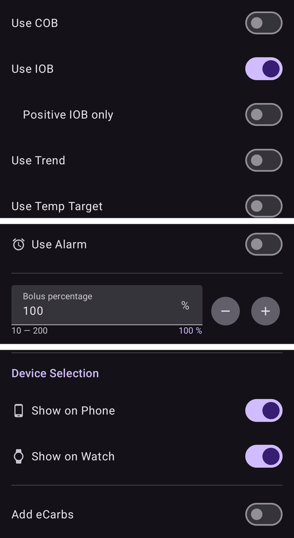

(quickwizards)=
# Hızlı Asistanlar (tek dokunuşla bolus)

**Hızlı Asistan**, sık tekrarlanan bir öğün veya durum için kaydedilmiş, tek dokunuşla çalışan bir düğmedir. Sabit bir **karbonhidrat** miktarı (ve bunun için nasıl doz verileceği) içinde kayıtlıdır. Böylece her seferinde tam bolus hesaplayıcısını açmak yerine, tek dokunuş ve bir onay ile bolus verebilir veya yalnızca karbonhidrat kaydedebilirsiniz.

```{contents} Table of contents
:depth: 2
:local: true
```

---

## Hızlı Asistanları açma

**Yönet** ekranını (alt gezinme çubuğu) açın ve **Hızlı Asistan** seçin (*“Hızlı Asistan ön ayarlarını yönetin”*).

---

## Hızlı Asistanları yönetme

Hızlı Asistanlarınız **kaydırılabilir bir kart karuseli** olarak gösterilir (her kart düğme metnini, karbonhidratı ve geçerli zaman aralığını gösterir). Altındaki düzenleyici **seçili** olanı ayarlar. Alttaki eylem çubuğunda **➕ ekle**, **⧉ klonla**, **🗑️ sil** ve seçili Hızlı Asistanı çalıştırmak için bir **▶** düğmesi vardır.


Düzenleyicinin ana alanları şunlardır:

- **Düğme Metni** — düğmede görünen ad.
- **Karbonhidrat** ve **Karb. zamanı** — karbonhidrat miktarı ve zaman kayması.
- **Geçerli Zaman Aralığı** — bkz. [Geçerlilik](#quickwizard_validity).
- **Hesaplayıcı Seçenekleri** ve **Cihaz Seçimi** — aşağıya bakın.

---

## Üç mod

Düzenleyicinin üstündeki seçici — **Sihirbaz / İnsülin / Karbonhidrat** — düğmeye dokunulduğunda **düğmenin ne yapacağını** belirler:

- **Sihirbaz** — ayarlanan karbonhidrat için, mevcut **KŞ, AİNS, AKRB ve eğilim** değerlerinizi kullanarak (aşağıdaki *Hesaplayıcı Seçenekleri*'ne göre) tam **bolus hesaplayıcısını** çalıştırır. *Hesaplanan* bolusu verir ve karbonhidratı kaydeder. Bu, klasik Hızlı Asistandır.
- **İnsülin** — sizin belirlediğiniz **sabit, önceden ayarlanmış bir insülin miktarını** verir — hesaplama yapılmaz.
- **Karbonhidrat** — ayarlanan karbonhidratı **yalnızca kaydeder**, **bolus verilmez**.

---

## Hesaplayıcı Seçenekleri (Sihirbaz modu)

**Sihirbaz** modundaki bir düğme için hesaplamanın hangi girdileri kullanacağını seçersiniz:

- **KŞ Kullan**, **AKRB Kullan**, **AİNS Kullan** (*Yalnızca pozitif AİNS* ile), **Eğilim Kullan** (*Tümü / Sadece pozitif / Sadece negatif*), **Geçici Hedef Kullan**, **Alarm Kullan**.
- **Bolus yüzdesi** — hesaplanan bolusu ölçeklendirir.
- **yKarb ekle** — ayrıca yayma karbonhidrat planlar.



---

## Geçerlilik — düğme ne zaman görünür

(quickwizard_validity)= **Geçerli Zaman Aralığı** (*Başlangıç / Bitiş*), bir Hızlı Asistanın **ne zaman** gösterileceğini ve kullanılabileceğini belirler. Örneğin **06:00–10:00** olarak ayarlanmış bir düğme yalnızca sabah görünür. Böylece bir *Kahvaltı* Hızlı Asistanı akşam yemeğinde ekranınızı kalabalık etmez (veya yanlışlıkla ona dokunulmaz). Bu zaman aralığının dışında düğme **Tedaviler** panelinde ve [Hızlı Başlatma araç çubuğunda](QuickLaunch.md) gizlenir. Araç çubuğundaki düğme silinmez: zaman aralığı yeniden başladığında geri gelir.

Geçerli zaman aralığı 4 saatten kısa ise, aynı öğün yanlışlıkla iki kez girilmesin diye düğme kullanıldıktan sonra 30 dakika boyunca da gizlenir.

---

## Kullanım yerleri — nerede kullanılır

**Cihaz Seçimi** anahtarları, her Hızlı Asistanın nerede görüneceğini belirler:

- **Telefonda Göster** — **[Tedaviler](../Maintenance/V4Changes.md) panelinde** görünür (hesaplanan doz doğrudan düğmenin üzerinde gösterilir). Telefonda gösterilen bir Hızlı Asistan, ayrıca **genel bakış ekranına hızlı işlem düğmesi olarak sabitlenebilir**: *Hızlı Başlatma'yı yapılandırın* ekranını açın ([Hızlı Başlatma](QuickLaunch.md) araç çubuğundaki ⚙) ve onu **Hızlı Asistan** kategorisinden ekleyin.
- **Saatte Göster** — **Wear OS Hızlı Asistan panelinde** görünür (saatin panel karuselinde ona kaydırın, sonra çalıştırmak için bir düğmeye dokunun — tıpkı [Senaryo paneli](#scenes-from-watch) gibi).

```{admonition} Don't see Device Selection?
:class: note
**Cihaz Seçimi** bölümü düzenleyicide yalnızca **Wear** eklentisi etkin ve onun **Wear kontrolü** tercihi açık olduğunda görünür. Bu olmadan her Hızlı Asistan yalnızca telefonda gösterilir.
```

Telefonda Hızlı Asistanlar, **Tedaviler** alt panelinin en üstünde görünür:


…ve genel bakış ekranında hızlı işlem düğmesi olarak:


Eşleştirilmiş bir **istemci** (**AAPSClient**) de bir Hızlı Asistanı tetikleyebilir — **ana birim** onu hesaplar ve verir (bkz. [Ana birim ↔ İstemci kontrolü](../RemoteFeatures/ClientMasterControl.md)).

Nerede tetiklenirse tetiklensin, bir Hızlı Asistana dokunmak, herhangi bir şey verilmeden önce her zaman bir **onay** gösterir (istemciden veya saatten tetiklendiğinde onayı ana birim oluşturur).

Bir Hızlı Asistanın dozu maks bolus değerinizin üzerindeyse veya karbonhidratı ya da yKarb değeri maks karbonhidrat değerinizin üzerindeyse (örneğin sınırı düşürdükten sonra) Hızlı Asistan reddedilir. Karbonhidrat sınırın üzerindeyse **Tedaviler** panelindeki düğme devre dışı olur. Hızlı Asistanı veya sınırı düzenleyin.

---

## Ekleme ve kaldırma

- **➕ Ekle** — yeni bir Hızlı Asistan oluşturur.
- **⧉ Klon** — başlangıç noktası olarak birinin kopyasını oluşturur.
- **🗑️ Sil** — birini kaldırır.

İki veya daha fazla Hızlı Asistanınız varsa karuseldeki sıralarını da değiştirebilirsiniz: üst çubuktaki **Yeniden sırala** simgesine (⇅) dokunun, ortadaki kartı **◀ / ▶ taşıma düğmeleriyle** adım adım taşıyın, sonra **✓** ile onaylayın. (Kontroller [profilleri yeniden sıralama](ProfileSwitch-ProfilePercentage.md) ile aynı görünür.)

Hızlı Asistanlar eşitlenen yapılandırmanın bir parçasıdır, bu yüzden ana biriminiz ve eşleştirilmiş istemcileriniz arasında paylaşılır.

---


<!-- =====================================================================
     Screenshots captured from a real master device:
       - quickwizard_editor.png   (Manage → QuickWizard: carousel, mode, carbs, carb time, valid time range)
       - quickwizard_options.png  (Calculator Options, Bolus percentage, Device Selection)
       - quickwizard_overview.png (the QuickWizard quick-action button on the overview)
       - quickwizard_watch_tile.png (the Wear OS QuickWizard tile)
     No QuickWizard was actually run (no bolus delivered).
     Maintainers: relocate page + images and fix cross-links as needed.
     ===================================================================== -->
