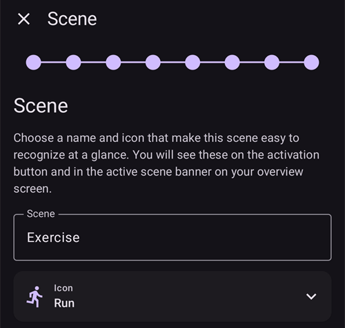
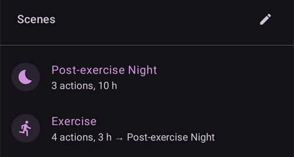
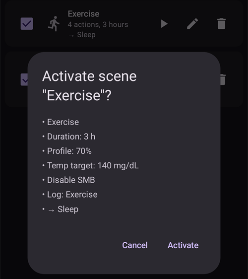
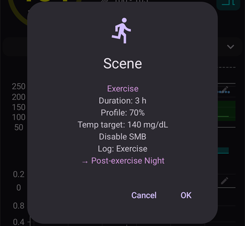

(scenes)=
# Senaryolar (duruma göre ön ayarlar)

**Senaryo**, **birkaç eylemi tek seferde** uygulayan, adı olan bir ön ayardır — örneğin profilinizi değiştiren, geçici bir hedef koyan, SMB'yi açıp kapatan ve tek dokunuşla bir careportal notu ekleyen bir *Uyku*, *Egzersiz* veya *Hastalık Günü* ön ayarı; isterseniz belirli bir süre için.

```{contents} Table of contents
:depth: 2
:local: true
```

---

## Senaryo nedir

Tekrarlanan bir durum her ortaya çıktığında birkaç şeyi elle değiştirmek yerine, bunları bir kez senaryo olarak ayarlarsınız ve tek dokunuşla etkinleştirirsiniz. Bir senaryo şu eylemlerin herhangi birini bir araya getirebilir:

- **Profil değişimi** — profili değiştirir ve/veya yüzde ile ölçeklendirir (ör. %70).
- **Geçici hedef** — bir geçici hedef koyar (ör. *Aktivite*, *Yakında Yenecek* veya özel bir değer).
- **SMB açık/kapalı** — senaryo etkin olduğu sürece süper mikro bolusları etkinleştirir veya devre dışı bırakır.
- **Döngü modu** — çalışma modunu değiştirir (ör. daha temkinli bir moda).
- **Careportal notu** — bir olayı kaydeder (ör. *Egzersiz*, *Hastalık*), böylece olay grafikte ve Nightscout'ta görünür.

Bir senaryonun ayrıca bir **süresi** — sabit bir süre (dakika/saat/gün) veya *Belirsiz (manuel sonlandırma)* — ve bittiğinde çalışan bir **bitiş eylemi** vardır: ya bir **bildirim** gösterilir ya da senaryo başka bir senaryoya **bağlanır** (örneğin *Hastalık Günü → Egzersiz*).

---

## Senaryoları yönetme

Senaryolarınızı görmek, oluşturmak, düzenlemek, etkinleştirmek/devre dışı bırakmak ve yeniden sıralamak için **Yönet → Senaryolar** ekranını açın.


Her senaryo kartında şunlar vardır:

- senaryoyu etkinleştirmek/devre dışı bırakmak için bir **onay kutusu**,
- bir **simge** ve **ad**,
- bir özet — *“N eylem, süre”* — ve senaryo başka bir senaryoya bağlanıyorsa **→ bağlı senaryo**,
- ve üç düğme: **▶ etkinleştir**, **✏️ düzenle**, **🗑️ sil**.

Yeni bir senaryo oluşturmak için **+** düğmesine dokunun.

---

## Senaryo oluşturma veya düzenleme

### Bir şablondan başlama

Bir senaryo **oluşturmak** için Senaryolar ekranındaki **+** düğmesine dokunun. İlk adım **Bir şablondan başla** adımıdır: sık görülen bir durum için hazır bir senaryo seçin — *Egzersiz*, *Hastalık Günü*, *Hastalık Günü — Kusma*, *Uyku*, *Egzersiz Sonrası Gece*, *Yemek öncesi*, *Alkol*, *Araç kullanmak*, *Banyo yapma*, *Luteal Evre*, *Sıcak Hava*, *Tıbbi Prosedür* — veya *Boş* bir senaryodan başlayın. Her şablon **önerilen eylemleri önceden doldurur** ve sonraki adımlarda her şeyi değiştirebilirsiniz.


Bir şablon seçtikten sonra, devam etmeden önce şablonun amacı — *ne zaman* ve *neden* kullanılacağı — açıklanır:


### Eylemleri adım adım geçme

Düzenleyicinin geri kalanı kısa, **adım adım** ilerleyen bir sihirbazdır. Her adım, *“Senaryoya … dahil et”* anahtarı olan bir eylem türüdür — anahtarı yalnızca bu senaryonun yapmasını istediğiniz eylemler için açın, diğerlerini kapalı bırakın.


Adımları **İleri**/**Geri** ile geçin: *Profil değişimi*, *Geçici hedef*, *SMB*, *Döngü modu*, *Careportal notu*, ardından **süre**, **bitiş eylemi** (bildirim veya başka bir senaryoya bağlanma) ve son olarak senaryonun **adı ve simgesi**. Bitirdiğinizde kaydedin. (Mevcut bir senaryoyu **düzenlemek** için onun **✏️** düğmesine dokunun — doğrudan bu adımlara gidersiniz.)

Her adım, eylemin ne yaptığını anlatan kısa bir açıklama ile başlar. Adımlar şöyle görünür, burada *Egzersiz* şablonu ile:

**Geçici hedef** — geçici hedef ön ayarlarınızdan birini seçin:


**SMB** — senaryo etkin olduğu sürece SMB'yi etkinleştirin veya devre dışı bırakın:


**Çalışma modu** — isterseniz döngü modunu değiştirin:


**Careportal** — kaydedilecek olay türü ve not:


**Süre** — senaryonun ne kadar etkin kalacağı; 0, siz kendiniz sonlandırana kadar demektir:


**Devam senaryosu** — isterseniz bu senaryo bittiğinde başlayacak senaryo:


**Senaryo** — ad ve simge. Kaydetmek için **Bitir** düğmesine basın:



---

## Bir senaryoyu etkinleştirme

Bir senaryoyu **Senaryolar** listesinden (**▶** düğmesi) veya alt gezinme çubuğundaki **Senaryolar** girdisinden etkinleştirin. Alt gezinme çubuğunun **Senaryolar** panelinde her senaryo, Senaryolar listesindeki aynı özeti gösterir. Panelin üstündeki **kalem**, senaryolarınızı oluşturmak veya düzenlemek için **Yönet → Senaryolar** ekranını açar.



[Bolus koruması](#Preferences-protection) açıksa, **AAPS** bir senaryo başlamadan veya bitmeden önce bunu sorar. Bir senaryoyu değiştirmek için ise [ayar koruması](#Preferences-settings-protection) gerekir.

Herhangi bir şey uygulanmadan önce, senaryonun tam olarak ne yapacağını listeleyen bir **onay** görürsünüz, böylece kontrol edebilirsiniz:



Senaryo başka bir senaryoya bağlanıyorsa, onay **→** ve devam senaryosunun adı ile biter; Senaryolar listesinde gösterildiği gibi.

Senaryoyu alt gezinme çubuğunun **Senaryolar** girdisinden başlattığınızda, onay aynı eylem listesini içeren daha basit bir iletişim kutusudur. Etkinleştirmek için **Tamam** düğmesine basın:



Onayladıktan sonra eylemler uygulanır ve **etkin senaryo**, genel bakış ekranının üstünde bir **Senaryoyu sonlandır** düğmesi ile gösterilir. Senaryo başka bir senaryoya bağlanıyorsa, şerit devam senaryosunun adını da gösterir:


Senaryonun eylemleri şu durumlardan biri olana kadar geçerli kalır:

- **süresi** biter (**bitiş eylemi** çalışır — bir bildirim veya bir sonraki senaryoya bağlanma) veya
- elle sonlandırmak için **Senaryoyu sonlandır** düğmesine dokunursunuz. Senaryo başka bir senaryoya bağlanıyorsa iki seçeneğiniz vardır: devam senaryosuna **Atla** (etkin senaryo biter ve devam senaryosu hemen başlar) veya **Senaryoyu sonlandır** (etkin senaryo biter ve devam senaryosu başlamaz).

Devam senaryosu olmayan bir senaryo yalnızca onay ister:


Bir senaryoyu sonlandırmak, senaryonun yaptığı değişiklikleri **geri alır** (örneğin başlattığı profil değişimini ve geçici hedefi).

Bir senaryo etkinken, ana ekrandaki profil ve hedef, onları senaryo ayarladıysa küçük bir senaryo simgesi taşır. Alt gezinme çubuğunun **Senaryolar** paneli, başka bir senaryo başlatmak için kullanılabilir kalır:


Süre kendiliğinden dolduğunda değişiklikler hemen geri alınır ve şerit, bir **Kapat** düğmesi ile **Senaryo sonlandı** olarak değişir. Kapatmak yalnızca şeridi ekrandan kaldırır — senaryonun kendisi zaten bitmiştir, bu yüzden otomasyon kuralları ve bağlı bir senaryo onu beklemeden devam eder.

---

## Senaryoları Otomasyon ile tetikleme

Bir senaryonun elle başlatılması gerekmez — **Otomasyon** onu sizin için çalıştırabilir. Bir otomasyon kuralına eylem eklediğinizde (**Yönet → Otomasyon**), eylem seçicide bir **Senaryolar** kategorisi vardır:

- **Senaryoyu çalıştır** — kuralın tetikleyicileri çalıştığında bir senaryoyu etkinleştirir (örneğin belirli bir saatte, bir yere vardığınızda veya glikoz bir eşiği geçtiğinde).
- **Senaryoyu etkinleştir** / **Senaryoyu devre dışı bırak** — bir senaryoyu etkinleştirmeden kullanılabilir (veya kullanılamaz) yapar.


Otomasyon bir senaryoya **tepki de verebilir**: tetikleyici listesinde bir **Senaryo** tetikleyicisi vardır, böylece bir kural yalnızca belirli bir senaryo etkinken çalışabilir. Bir senaryonun **bitiş eylemi** (geri alma, bildirim veya başka bir senaryoya bağlanma) ile birlikte bu, senaryoların otomatik olarak başlamasını, birbirini izlemesini ve bitmesini sağlar.

---

## Ana birim/İstemci ve saat ile senaryolar

**O anda etkin olan senaryo, eşleştirilmiş tüm cihazlarınız arasında eşitlenir** — bir telefonda etkinleştirin, diğerleri de onu gösterir.

Eşleştirilmiş bir **istemci** (**AAPSClient**) de bir senaryoyu etkinleştirebilir veya sonlandırabilir: istek **ana birime** gönderilir; ana birim onayı oluşturur ve senaryoyu kendi durumu üzerinde uygular. Bunun nasıl çalıştığını öğrenmek için bkz. [Ana birim ↔ İstemci kontrolü](../RemoteFeatures/ClientMasterControl.md).

(scenes-from-watch)=
### Wear OS saatinden

Senaryolar, bir **Wear OS saatinde** **Senaryo paneli** olarak kullanılabilir. Saatin panel karuselinde **Senaryo** paneline kaydırın (henüz orada değilse önce karuselin panel listesinden ekleyin) ve başlatmak istediğiniz senaryoya dokunun:


Kutucukta dört yer vardır. Varsayılan olarak her yer, telefondaki sıralarına göre etkin senaryolarınızdan bir sonrakiyle **otomatik olarak** dolar. Kendiniz seçmek için **panele uzun basın** ve ayarlarını açın: dört yerin her biri için **Otomatik** ayarını koruyabilir, **belirli bir senaryoyu** sabitleyebilir veya yeri boş bırakmak için **Hiçbiri** seçebilirsiniz. Sabitlendiği senaryo sonradan silinmiş veya devre dışı bırakılmış bir yer **Mevcut değil** gösterir — o yer için başka bir senaryo seçin.

Saat ardından bir onay gösterir — etkinleştirmek için **✓** simgesine dokunun veya iptal etmek için geri kaydırın:


Tıpkı istemcide olduğu gibi, **onayı ana birim oluşturur ve senaryoyu ana birim çalıştırır**; saat yalnızca isteği iletir (saat bir istemciyle eşleştirilmişse istemci telefon üzerinden).

Bir senaryo çalışırken — veya telefonda hâlâ **Senaryo sonlandı** şeridi görünürken — panel, altında senaryonun adı olan bir **Sonlandır** düğmesi gösterir. Etkin senaryoyu sonlandırmak veya kalan şeridi temizlemek için bileğinizden ona dokunun.

Çalışan senaryo başka bir senaryoya bağlanıyorsa, panel ayrıca altında devam senaryosunun adı olan bir **Atla** düğmesi gösterir. Bunlar telefondaki iki seçeneğin aynısıdır:

- **Sonlandır** — etkin senaryo biter. Onay, devam senaryosunun başlamayacağını söyler.
- **Atla** — etkin senaryo biter ve devam senaryosu hemen başlar. Onay iki senaryonun da adını gösterir.

Saatin [Döngü durumu ekranı](#WearOsSmartwatch-loop-status) da etkin senaryoyu, kalan süresini ve devam senaryosunu gösterir.

---


<!-- =====================================================================
     Screenshots captured from a real master device:
       - scenes_list.png        (Manage → Scenes management list)
       - templates_picker.png   (create: "Start from template" picker)
       - template_explanation.png (create: chosen template's explanation)
       - scene_editor.png       (scene editor, Profile switch step)
       - scene_confirmation.png (scene activation confirmation — also used on the Client/Master page)
       - scene_active_banner.png (overview active-scene banner with the End Scene button)
       - automation_scene_action.png (Automation action picker — Scenes category)
       - scene_watch_tile.png    (Wear OS Scene tile)
       - scene_watch_confirm.png (Wear OS scene confirmation)
     Maintainers: relocate page + images and fix cross-links as needed.
     ===================================================================== -->
