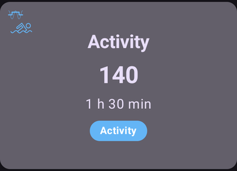
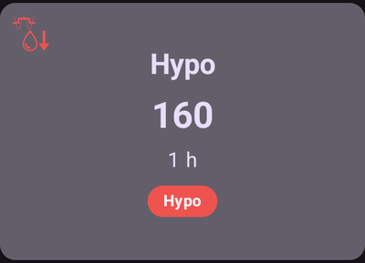
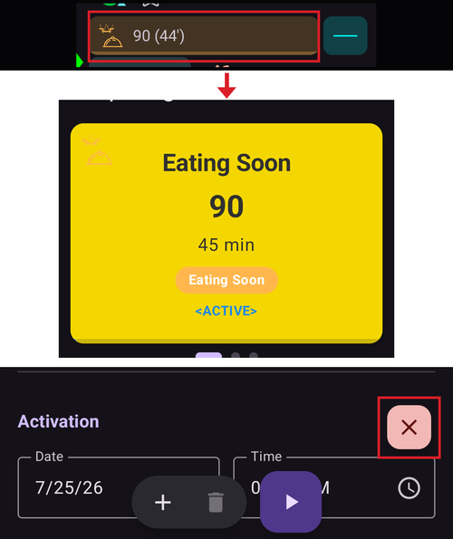
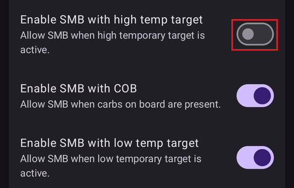

# Geçici-Hedefler

## Geçici Hedefler nedir ve bunları nerede ayarlayabilir ve yapılandırabilirim?

**Geçici Hedef** (kısaca **GH**), kullanıcının planlanan etkinlikler için [**KŞ** hedef aralığını](#profile-glucose-targets) değiştirmesini sağlayan bir **AAPS** özelliğidir. Bunu **AAPS**, kullanıcının insülin kullanımını değiştirerek yapar.

Bir glikoz hedefi, özellikle yalnızca kısa süreliyse (4 saatten kısa), glikoz seviyenizin ulaşmasını beklediğiniz veya istediğiniz *gerçek değer* olmak zorunda değildir. Daha çok, glikoz seviyelerinizi hedef aralıkta tutarken **AAPS**'e daha agresif veya daha az agresif olmasını söylemenin iyi bir yoludur.

Geçici hedefler şu sınırlar içinde tanımlanabilir:

|          | Geçici hedef             |
| -------- | ------------------------ |
| Minimum  | 4 mmol/L veya 72 mg/dL   |
| Maksimum | 10 mmol/L veya 180 mg/dL |

**AAPS**, egzersiz (**Aktivite**), öğünler (**Yakında Yenecek**) ve tahmin edilen hipoglisemi (**Hipo**) için uygun üç yerleşik **Geçici Hedef** ön ayarı sunar. Bunlar **Geçici Hedef** ekranında (**Yönet** → **Geçici Hedef**) bulunur; bu ekranı ana ekrandaki **hedef çipine** dokunarak da açabilirsiniz.

Kullanıcılar, **AAPS**'te bir **Geçici Hedef** seçerken elde edilebilecek sonuçlar konusunda gerçekçi beklentilere sahip olmalıdır. İstenen **KŞ** hedefine ulaşmanın başarısı birçok etkene bağlıdır: kullanıcının **AAPS** ayarlarının güvenilirliği, genel **KŞ** kontrolü, **AİNS**, insülin duyarlılığı, insülin direnci, egzersiz sırasındaki efor düzeyi vb.

Bir **Geçici Hedef**in istenen **KŞ** hedefine ulaşması yaklaşık 30 dakika veya daha uzun sürebilir. **AAPS**'in bir **KŞ** hedefine hemen ulaşması mümkün değildir; kullanıcılar bir **Geçici Hedef** seçerken bunu göz önünde bulundurmalıdır.

Aşağıdaki bölümler **Geçici Hedef Aktivite**, **Geçici Hedef Yakında Yenecek** ve **Geçici Hedef Hipo** özelliklerini özetler. Gösterilen değerler, uygulamayla gelen varsayılan değerlerdir — [her ön ayarı](#TempTargets-change-preset-defaults) kendi ihtiyaçlarınıza göre ayarlayabilirsiniz.

### GH - Aktivite



**KŞ hedefi (varsayılan ön ayar, değiştirilebilir)**

AAPS, 1 sa 30 dk boyunca 140 mg/dL veya 7,8 mmol/L değerine ulaşmayı hedefler

**Kullanıcıların seçim yaparken göz önüne almak isteyebileceği diğer konular**:

**KŞ** seviyesine bağlı olarak **AAPS**, **KŞ** hedefine ulaşmak için insülin kullanımını "azaltır". **KŞ** hedef aralıkta değilse (yani kullanıcının **Profil**inde seçili **KŞ** hedefinin üzerindeyse), **AAPS** bazalı açık tutabilir.

Kapalı döngü modunda **SMB**:

- devre dışı bırakılmış *olabilir* (aşağıda daha ayrıntılı anlatılıyor); ve/veya
- **AAPS** negatif **AİNS** durumundaysa bazal etkinleştirilebilir veya <0.

Kullanıcılar şunları da düşünebilir:

- planlanan egzersizden 1-2 saat önce bu **GH**'yi *seçmek*, böylece AİNS'in daha düşük olmasını sağlamak (bu GH için doğru zamanlama kişiden kişiye değişir); ve
- planlanan aktivite süresince daha düşük **AİNS** sağlamak için geçici bir Profil (azaltma) *seçmek*;
- **AİNS** zaten azaldığı ve bazı kullanıcılarda egzersizden sonra **KŞ** hızla yükseldiği için **GH**'nin egzersizden kısa süre önce *devre dışı kalacak* şekilde zamanlandığından *emin olmak*.

### GH - Yakında Yenecek


**KŞ hedefi (varsayılan ön ayar, değiştirilebilir)**

AAPS, 45 dakika boyunca 90 mg/dL veya 5,0 mmol/L değerine ulaşmayı hedefler

**Kullanıcıların seçim yaparken göz önüne almak isteyebileceği diğer konular**:

Kapalı döngü modunda **SMB**:

- etkin kalır; ve/veya
- kullanıcının **Profil** ayarlarına bağlı olarak bazal da etkinleştirilebilir.

**KŞ** seviyesine bağlı olarak **AAPS**, istenen **KŞ** hedefine ulaşmak için kullanıcının **AAPS** ayar parametreleri içinde insülin kullanımını "artırır".

### GH - Hipo



**KŞ hedefi (varsayılan ön ayar, değiştirilebilir)**

AAPS, 1 saat boyunca 160 mg/dL veya 8,9 mmol/L değerine ulaşmayı hedefler

**Kullanıcıların seçim yaparken göz önüne almak isteyebileceği diğer konular**:

Kapalı döngü modunda **SMB**:

- devre dışı bırakılmış *olabilir* (aşağıda daha ayrıntılı anlatılıyor); ve/veya
- **AAPS** negatif **AİNS** durumundaysa bazal etkinleştirilebilir veya <0.

(TempTargets-manage-v4)=

## Geçici hedefleri ayarlama ve yönetme (Yönet → Geçici Hedef)

**AAPS** v4'te GH **ön ayarlarınızı** yönetir ve geçici hedefi **Yönet** ekranından (alt gezinme çubuğu) → **Geçici Hedef** (*“Geçici hedefler belirleyin ve yönetin”*) başlatırsınız.


Ekranın üç bölümü vardır:

1. **Ön ayar karuseli** (üstte) — GH ön ayarlarınız arasında kaydırın. Her kart ön ayarın **adını**, **hedefini** ve **süresini** gösterir; o anda çalışan GH vurgulanır.
2. **Düzenleyici** (ortada) — gerçekten uygulanacak **Geçici hedef** ve **Süre**, ayrıca bir **Etkinleştirme** tarihi/saati.
3. **Eylem çubuğu** (altta) — **➕ ekle**, **‘️ sil** ve **▶ etkinleştir** düğmesi.

Bir ön ayar kartını seçmek, onun **hedefini** ve **süresini** düzenleyiciye yükler.

```{admonition} Yerleşik ve özel ön ayarlar :class: note Yerleşik ön ayarlar — **Yakında Yenecek**, **Aktivite** ve **Hipo** — her zaman vardır ve **silinemez** (ancak değerlerini değiştirip kaydedebilirsiniz). Kendiniz oluşturduğunuz tüm ön ayarlar **özel** ön ayarlardır ve serbestçe düzenlenebilir veya silinebilir.

    <br />### Geçici hedefi etkinleştirme
    
    İstediğiniz ön ayara kaydırın (değerleri düzenleyiciye yüklenir), isterseniz düzenleyicide **hedefi**/**süreyi** değiştirin, sonra **▶ Etkinleştir** düğmesine dokunun. Herhangi bir şey başlamadan önce bir onay tam hedefi, süreyi ve nedeni gösterir:
    
    
    
    Onayladıktan sonra geçici hedef hemen (veya seçilen **Etkinleştirme** zamanında) başlar ve ayarlanan **süre** boyunca çalışır.
    
    ```{admonition} Sayıları düzenlemek tek seferliktir — ön ayarı değiştirmez
    :class: important
    Düzenleyicideki **hedef** ve **süre**, **Etkinleştir** düğmesinin *şimdi* kullanacağı değerlerdir. Bunları değiştirirseniz, bu değişiklik **geçicidir**: yalnızca bu etkinleştirme için geçerlidir ve **kayıtlı ön ayarı değiştirmez**. Böylece ön ayarı kalıcı olarak değiştirmeden tek seferlik bir GH'yi "ayarlayıp etkinleştirebilirsiniz" (örneğin bugün *Aktivite*'yi biraz farklı bir hedefle etkinleştirmek).
    

### Değişiklikleri bir ön ayara kaydetme

Düzenlenen bir değeri *gerçekten* saklamak istiyorsanız, onu **Kaydet**in: düzenleyici seçili ön ayardan farklı olduğunda üst araç çubuğunda bir **Kaydet** simgesi görünür. Ona dokunmak, mevcut **hedefi** ve **süreyi** (özel ön ayarlarda adı da) seçili ön ayara geri kaydeder. Yerleşik ön ayarlar için eylem çubuğunda ayrıca bir **Varsayılanlara dön** düğmesi (↺) görünür: ön ayarın varsayılan değerlerini geri getirir.


Yani temel kural şudur:

- **Etkinleştir** → sayıları **bir kez** kullanır (ön ayar değişmez).
- **Kaydet** → sayıları ön ayarın **yeni varsayılanları** yapar.

Yerleşik bir ön ayarı ilk hâline döndürmek için onu seçin ve **↺ Varsayılanlara dön** düğmesine dokunun — bu düğme eylem çubuğunda yalnızca değerleri şu anda fabrika varsayılanlarından farklı olan **yerleşik** bir ön ayar için görünür ve o ön ayarın özgün **hedefini** ve **süresini** geri yükler.

### Ön ayar ekleme ve kaldırma

- **➕ Ekle** — mevcut düzenleyici değerlerinden **yeni bir özel ön ayar** oluşturur. Yeni kart karuselde görünür.
- **‘️ Sil** — seçili **özel** ön ayarı kaldırır. Yerleşik ön ayarlar (*Yakında Yenecek*, *Aktivite*, *Hipo*) silinemez.

En az iki **özel** ön ayarınız olduğunda karuseldeki sıralarını da değiştirebilirsiniz: üst çubuktaki **Yeniden sırala** simgesine (⇅) dokunun, ortadaki kartı **◀ / ▶ taşıma düğmeleriyle** adım adım taşıyın, sonra **✓** ile onaylayın. Yerleşik ön ayarlar yerlerini korur — yalnızca özel ön ayarlar taşınabilir. (Kontroller [profilleri yeniden sıralama](ProfileSwitch-ProfilePercentage.md) ile aynı görünür.)

Ön ayarlarınız eşitlenen yapılandırmanın bir parçasıdır, bu yüzden ana biriminiz ve eşleştirilmiş istemcileriniz arasında paylaşılır.

### Geçici hedef ayarlamanın diğer yolları

Geçici hedef bu ekranı açmadan da ayarlanabilir:

- **Karbonhidrat iletişim kutusundaki GH anahtarları** ile — [aşağıya](#TempTargets-carbs-dialog) bakın,
- **[Hızlı Başlatma araç çubuğundaki](QuickLaunch.md) bir ön ayar düğmesi** ile — *Hızlı Başlatma'yı yapılandırın* içindeki *Geçici Hedef Ön Ayarları* kategorisi, ön ayarlarınızın her biri için tek dokunuşla çalışan bir düğme sunar,
- bir **Wear OS saatinden** (**Geçici Hedef** menü öğesi / paneli),
- eşleştirilmiş bir **istemciden** — bkz. [Ana birim ↔ İstemci kontrolü](../RemoteFeatures/ClientMasterControl.md),
- bir **[senaryonun](Scenes.md)** parçası olarak (*Geçici hedef* eylemi) veya
- bir **Otomasyon** kuralından (*Geçici hedefi başlat* / *Geçici hedefi durdur*).

* * *

(TempTargets-where-can-i-select-a-temp-target)=

## Geçici Hedefi nerede seçebilirim?

En hızlı yol, ana ekrandaki **hedef çipine** dokunmaktır (çip mevcut hedef aralığınızı gösterir):


Bu, yukarıda anlatılan **Geçici Hedef** ekranını açar — bir ön ayara kaydırın ve **▶ Etkinleştir** düğmesine dokunun. Aynı ekrana **Yönet** → **Geçici Hedef** yoluyla da ulaşılabilir.

(TempTargets-carbs-dialog)= Karbonhidrat girerken **Geçici Hedef** ekranını açmanıza hiç gerek yoktur: **Karbonhidrat iletişim kutusunun** (**Tedaviler** → **Karbonhidrat**) üstünde **Hipo GH başlat**, **Yakında Yenecek GH başlat** ve **Aktivite GH başlat** anahtarları vardır. Birini açın; ilgili ön ayar, karbonhidrat girişiyle birlikte etkinleştirilir:


    {admonition} Otomatik Hipo GH
    :class: note
    Glikozunuz 72 mg/dL (4 mmol/L) altındayken **Karbonhidrat iletişim kutusunu** açarsanız, **AAPS** sizin için **Hipo GH başlat** anahtarını önceden seçer (daha uzun kalan süreye sahip daha yüksek bir geçici hedef zaten çalışmıyorsa).

(TempTargets-change-preset-defaults)=

## Varsayılan Geçici Hedefi nerede değiştirip kendi tercihlerimle geçersiz kılabilirim?

Her ön ayarın **hedefi** ve **süresi** doğrudan **Geçici Hedef** ekranında düzenlenir — bunun için artık ayrı bir tercih girdisi yoktur:

1. **Geçici Hedef** ekranını açın (hedef çipine dokunun veya **Yönet** → **Geçici Hedef**).
2. Değiştirmek istediğiniz ön ayara kaydırın.
3. Düzenleyicide **Geçici hedef** ve/veya **Süre** değerini ayarlayın.
4. Üst araç çubuğunda görünen **Kaydet** simgesine dokunun.


Düzenleyici, yerleşik bir ön ayarın fabrika değerlerinden farklı olduğu sürece eylem çubuğunda bir **↺ Varsayılanlara dön** düğmesi de görünür — ön ayarın özgün hedefini ve süresini geri yüklemek için ona dokunun.

## Geçici Hedefi nasıl iptal ederim?

Bir geçici hedef çalışırken, ana ekrandaki hedef çipi hedefi ve kalan süresini gösterir. Ona dokunun — **Geçici Hedef** ekranında çalışan ön ayar **AKTİF** olarak vurgulanır ve alttaki araç çubuğunun sonunda, **▶ Etkinleştir** düğmesinin hemen solunda kırmızı bir **✗ İptal** düğmesi görünür. Ona dokunun ve onaylayın:



Çalışan bir geçici hedef, bir **Wear OS saatinden**, eşleştirilmiş bir **istemciden** veya bir **Otomasyon** kuralıyla (*Geçici hedefi durdur*) da durdurulabilir.

(TempTargets-hypo-temp-target)=

## Hipo Geçici-Hedefi

**Hipo Geçici Hedefi**, insülin alımını azaltarak **AAPS**'in kullanıcının düşük kan şekeri yaşamasını önlemesini sağlar. Kullanıcı **KŞ** değerinin düşeceğini tahmin ederse: genellikle **AAPS** bunu halletmelidir, ancak çok şey kullanıcının **AAPS'** ayarlarının ne kadar sağlam olduğuna bağlıdır. **Hipo Geçici Hedefi**, kullanıcının tahmin edilen düşüşün önüne geçmesini ve **AAPS**'i insülini azaltacak şekilde güncellemesini sağlar.

Bazen hipoyu tedavi etmek için karbonhidrat yenildiğinde kullanıcının **KŞ** değeri hızla yükselebilir ve **AAPS**, **SMB**'leri etkinleştirerek hızla yükselen **KŞ**'ye karşı düzeltme yapar.

Bazı kullanıcılar **Hipo Geçici Hedefi** sırasında **SMB** verilmesini istemez. Bunun için **Ayarlar** → **OpenAPS SMB** içinde *'Yüksek geçici hedefte SMB'yi etkinleştir'* seçeneğini kapatın (aşağıya bakın):

- İleri düzey, 9. görev: kullanıcı, OpenAPS SMB'de 100 mg/dL (5,6 mmol/L) veya daha yüksek **Geçici Hedefler** için *“Yüksek geçici hedefler duyarlılığı artırır”* seçeneğini etkinleştirebilir; bu durumda **AAPS** daha duyarlı olur.

- İleri düzey, 9. görev: kullanıcı *“Yüksek geçici hedefte SMB'yi etkinleştir”* seçeneğini kapatabilir. Böylece **AAPS**'te AKRB > 0 olsa, “Düşük geçici hedefle SMB'yi etkinleştir” veya “SMB'yi her zaman etkinleştir” açık olsa ve OpenAPS SMB etkin olsa bile, yüksek geçici hedefler etkinken **AAPS** SMB vermez.

Not: Kan şekeriniz 72 mg/dL veya 4 mmol/L altındayken **Karbonhidrat iletişim kutusunu** açarsanız, **AAPS** **Hipo GH başlat** anahtarını otomatik olarak önceden seçer.

(TempTargets-activity-temp-target)=

## Aktivite Geçici-Hedefi

Egzersizden önce ve egzersiz sırasında, aktivite sırasında hipoglisemiyi önlemek için kullanıcının daha yüksek bir hedefe ihtiyacı olabilir.

**Aktivite Geçici Hedefi**ni kolaylaştırmak için kullanıcı, varsayılan bir **Geçici Hedef - Aktivite** ayarlayabilir. Bu, **KŞ** düşüşünü yavaşlatmak ve hipoglisemiyi önlemek için insülin kullanımını azaltarak **KŞ** seviyelerini yükseltir.

**AAPS**'e yeni başlayan kullanıcıların, bu özelliğin kendileri için en iyi şekilde çalışması için **Aktivite Geçici Hedefi** varsayılan ayarlarını denemeleri ve kişiselleştirmeleri gerekebilir. Egzersiz sırasında dengeli KŞ kontrolü sağlamak konusunda herkes farklıdır. Ayrıca bkz. [SSS'deki spor bölümü](#FAQ-sports).

Bazı kullanıcılar, **Aktivite Geçici Hedefi** açıkken ve ondan önce bir **Profil değişimi** (**AAPS**'in insülin iletimini azaltmak için %100'ün altında bir Profil azaltması) etkinleştirmeyi de tercih eder. İkisini tek adımda başlatabilirsiniz: ana ekranda profil adına dokunun, yuvarlak **▶** düğmesine dokunun, %100'ün altında bir **Yüzde** ve bir **Süre** ayarlayın, sonra **Geçici hedef / Aktivite** anahtarını açın. Bkz. [Profil yüzdesini değiştirme](#ProfileSwitch-change-percentage).

İleri düzey, 9. görev: kullanıcılar, OpenAPS **SMB**'de 100 mg/dL (5,6 mmol/L) veya daha yüksek **Geçici Hedefler** için *'Yüksek geçici hedefler duyarlılığı artırır'* seçeneğini etkinleştirebilir. 99 mg/dL (5,5 mmol/L) hedefi normal bir hedeftir; ne yüksek ne düşüktür. O zaman **AAPS** daha duyarlıdır.

Ayrıca *'Yüksek geçici hedefte SMB'yi etkinleştir'* kapalıysa, AKRB > 0 olsa, *'Düşük geçici hedefle SMB'yi etkinleştir'* veya *'SMB'yi her zaman etkinleştir'* açık olsa ve OpenAPS **SMB** etkin olsa bile **AAPS** **SMB** vermez.

(TempTargets-eating-soon-temp-target)=

## Yakında Yenecek Geçici-Hedefi

**Geçici Hedef Yakında Yenecek**, **KŞ**'nin yavaşça düşmesine yardım edebilir ve yemekten önce yeterli **AİNS** olmasını sağlar.

Bu, ön bolus yapmayan kullanıcılar için önemli bir araç olabilir. Ancak **Geçici Hedef Yakında Yenecek**'in etkinliği birkaç etkene bağlıdır: kullanıcının ayarları, düşük karbonhidratlı beslenip beslenmediği ve ön bolus ihtiyacını ortadan kaldırmak için hızlı etkili bir insülin (Fiasp veya Lyumjev gibi) kullanıp kullanmadığı. Normalde, kullanıcılar **AAPS**'te deneyim kazanana kadar **Geçici Hedef Yakında Yenecek** kullanırken ön bolus yapmayı beklemelidir; özellikle yüksek karbonhidratlı beslenen kullanıcılar için bu geçerlidir.

“Yakında yemek modu” hakkında daha fazla bilgiyi ['How to do “eating soon” mode'](https://diyps.org/2015/03/26/how-to-do-eating-soon-mode-diyps-lessons-learned/) makalesinde veya [burada](https://diyps.org/tag/eating-soon-mode/) okuyabilirsiniz.

İleri düzey, [9. görev](#objectives-objective9): OpenAPS SMB kullanıyorsanız ve *'Düşük geçici hedefler duyarlılığı azaltır'* açıksa, **AAPS** biraz daha agresif çalışır. Bu seçenek için **Geçici Hedef**in 98 mg/dL (5,4 mmol/L) veya daha düşük olması gerekir.

## Geçici Hedefler sırasında SMB'yi nasıl kapatırım?

Bunu yapmak için **Ayarlar** → **OpenAPS SMB** yolunu açın ve *'Yüksek geçici hedefte SMB'yi etkinleştir'* seçeneğini kapatın.



Bu, AKRB > 0 olsa, *'Düşük geçici hedefle SMB'yi etkinleştir'* veya *'SMB'yi her zaman etkinleştir'* açık olsa ve OpenAPS SMB etkin olsa bile **AAPS**'in **SMB** vermemesini sağlar.