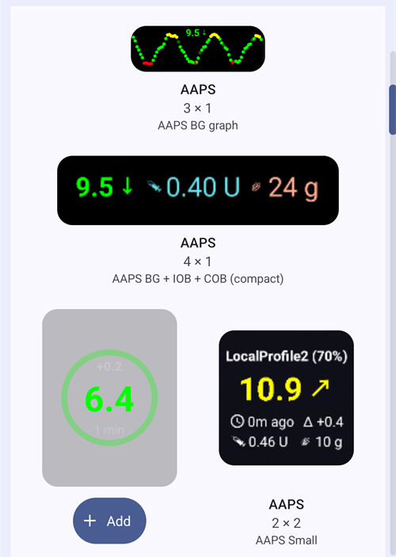

(widgets)=
# Ana ekran widget'ları

**AAPS**, telefonunuzun ana ekranına ekleyebileceğiniz widget'lar sunar. Bir widget, uygulamayı açmadan güncel verilerinizi gösterir. **AAPS**'i açmak için bir widget'a dokunun.

```{contents} Table of contents
:depth: 2
:local: true
```

---

## Mevcut widget'lar

Beş widget vardır. Android widget seçicide **AAPS** altında listelenirler:


| Widget                              | Varsayılan boyut | Ne gösterir                                                                                                                                                                                                                                      |
| ----------------------------------- | ---------------- | ------------------------------------------------------------------------------------------------------------------------------------------------------------------------------------------------------------------------------------------------ |
| **AAPS widget**                     | 5 × 2            | Ana ekrandaki durum bloğu: eğilim ve delta ile KŞ, profil adının yanında simge olarak döngü modu, hedef, duyarlılık (ana ekrandaki gibi gösterilir), AİNS ve AKRB. Metinler, kesilmek yerine widget'a verdiğiniz boyuta sığacak şekilde küçülür. |
| **AAPS glikoz dairesi**             | 2 × 2            | Ana ekrandaki KŞ dairesi: KŞ renginde bir halka, eğilim yayı, delta, KŞ değeri ve son ölçümden bu yana geçen süre.                                                                                                                               |
| **AAPS Küçük**                      | 2 × 2            | Profil adı, eğilim oku ile KŞ, son ölçümden bu yana geçen süre, delta, AİNS ve AKRB.                                                                                                                                                             |
| **AAPS KŞ + AİNS + AKRB (kompakt)** | 4 × 1            | KŞ ve eğilim oku, AİNS ve AKRB içeren tek bir satır.                                                                                                                                                                                             |
| **AAPS KŞ grafiği**                 | 3 × 1            | Son ölçümlerin küçük bir grafiği ile birlikte KŞ değeri.                                                                                                                                                                                         |

Ana ekranda **AAPS widget**, **glikoz dairesi** ve **Küçük** widget:


**Kompakt** widget ve **KŞ grafiği** widget'ı:


KŞ değerleri **AAPS**'teki renklerin aynısını kullanır: hedef aralıkta yeşil, aralığın üstünde sarı, aralığın altında kırmızı.

---

## Widget ekleme

Tam adımlar telefonunuza ve başlatıcı uygulamanıza (launcher) bağlıdır. Çoğu telefonda:

1. Ana ekranda boş bir alana uzun basın ve **Widget'lar** seçeneğini seçin.

   

2. Listede **AAPS**'i açın ve istediğiniz widget'a dokunun.
3. **Ekle** düğmesine basın (veya widget'ı istediğiniz yere sürükleyin).

   

Widget ana ekrana yerleştirilir. Ekledikten hemen sonra widget tutamaçlarla gösterilir: widget'ı **yeniden boyutlandırmak** için bir tutamacı sürükleyin veya taşımak için widget'ı sürükleyin. Glikoz dairesi herhangi bir boyuta getirilebilir.


Ana ekran sayfası doluysa telefon widget'ı yeni bir sayfaya yerleştirir.

---

## Widget yapılandırması

Widget'ı ekledikten hemen sonra üzerinde görünen **kalem** düğmesine dokunun. Daha sonra tutamaçları ve kalemi tekrar görmek için widget'a uzun basın.

**Widget yapılandırması** iletişim kutusunda iki ayar vardır:

- **Şeffaflığı yapılandır**: widget arka planının ne kadar opak (saydam olmayan) olduğu. Düşük bir değer duvar kağıdının arkadan görünmesini sağlar.
- **Siyah renk kullanın**: varsayılan arka plan yerine siyah bir arka plan kullanır.


Her widget'ın kendi yapılandırması vardır.

---

## Bilmekte fayda var

- Bir widget yalnızca verileri **gösterir**. Bir widget'tan bolus yapamaz veya herhangi bir şeyi değiştiremezsiniz.
- Widget **AAPS** tarafından yenilenir. **AAPS** çalışmıyorsa veya Android onu arka planda kısıtlıyorsa, widget eski verileri gösterebilir. Son ölçümden bu yana geçen süreyi kontrol edin ve **AAPS**'in [pil optimizasyonu](#SetupWizard-StoragePermission) dışında tutulduğundan emin olun.
- **AAPSClient**, **AAPSClient2** ve **AAPSClient3** ile widget arka planı sarı, mavi veya yeşildir. Böylece uygulamaları birbirinden ayırt edebilirsiniz. Renk zor görünüyorsa widget yapılandırmasında opaklığı artırın. Bkz. [AAPSClient, AAPSClient2 ve AAPSClient3 hakkında](#remotecontrol-aapsclient-versions).
