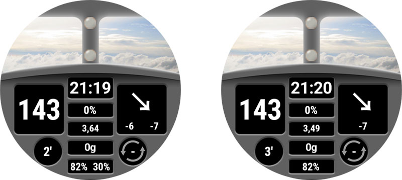

# Özel Saat Arayüzü Başvuru Belgesi

Bu sayfa, yeni saat arayüzü tasarlayanlar içindir. Yeni bir saat arayüzü oluşturmak veya canlandırmak istediğinizde kullanılabilecek tüm anahtar sözcükleri ve özellikleri listeler.

- Custom Watchface V2'de (Wear apk 3.3.0 veya üzeri) bulunan yeni özellikler ve anahtarlar [burada](#cwf-reference-new-v2-features)

## Özel saat arayüzü biçimi

Custom Watchface, AAPS için tasarlanmış açık bir biçimdir ve saatte bulunan yeni "AAPS (Custom)" saat arayüzüyle ilişkilidir.

Saat arayüzü dosyası basit bir zip dosyasıdır. Ancak saat arayüzü dosyası olarak tanınması için zip dosyası şu dosyaları içermelidir:

- CustomWatchface adlı bir görüntü dosyası (bitmap dosyası `CustomWatchface.jpg`, `CustomWatchface.png` veya vektör dosyası `CustomWatchface.svg` olabilir). Bu dosya, "Saat arayüzü yükle" düğmesine tıkladığınızda saat arayüzünü seçmek için kullanılan küçük simgedir. Aynı zamanda AAPS Wear eklentisinde görünen görüntüdür.
- `CustomWatchface.json` adlı bir dosya (aşağıdaki [JSON yapısı](#cwf-reference-json-structure) bölümüne bakın). Bu ikinci dosya ana dosyadır. Saat arayüzünü tasarlamak için gereken tüm bilgileri içerir. Bu json dosyası geçerli olmalıdır (bu dosyayı bir metin düzenleyicide elle düzenlerken muhtemelen en zor nokta budur, çünkü eksik veya fazla bir virgül json biçimini bozmak için yeterlidir). Bu JSON dosyası ayrıca boş olmayan bir değere sahip `"name"` anahtarı içeren bir `"metadata"` bloğu da içermelidir. Bu, özel saat arayüzünüzün adı olacaktır (aşağıdaki [Metadata ayarları](#cwf-reference-metadata-settings) bölümüne bakın)
- bu zip dosyasının boyutu olabildiğince küçük olmalıdır (yaklaşık 500 kb'den az). Bu dosya çok büyükse engellenir ve saate gönderilmez.

Zip dosyası bazı ek kaynak dosyaları da içerebilir:

- Saat arayüzündeki standart görünümlerde kullanılacak görüntüler için sabit kodlanmış dosya adları (`Background`, `CoverChart`... gibi; aşağıdaki [Sabit kodlanmış kaynak dosyaları listesi](#cwf-reference-list-of-hardcoded-resource-files) bölümüne bakın). Tüm bu dosyalar `jpg`, `png` veya `svg` biçiminde olabilir. ancak çoğu için saydamlığı destekleyen `png` veya `svg` kullanmanız gerekir (jpg dosyaları png dosyalarından daha küçüktür ama saydamlık içermez). En iyi kaliteyi en küçük boyutla genellikle svg dosyaları (vektör biçimi) sağlar.
- Serbest adlı ek kaynak dosyaları. Bu ek dosyalar görüntü dosyaları veya yazı tipi dosyaları olabilir (yazı tipleri için `ttf` ve `otf` biçimleri kabul edilir). Bu ek dosyalar için `filename` (uzantısız), JSON dosyasında bu dosyaların nerede veya ne zaman kullanılacağını belirtmek için keyValue olarak kullanılır.
  - görüntü dosyaları genellikle metin görünümlerinin arka planı olarak veya dinamik animasyon için (örneğin %0'dan %100'e pil seviyesi) kullanılır
  - yazı tipi dosyaları, saat arayüzünüzde size özel yazı tipleri kullanmanızı sağlar

(cwf-reference-json-structure)=

## JSON yapısı

JSON dosyaları Notepad (veya notepad++) metin düzenleyicisinde düzenlenebilir (JSON'u tanıyan ve renkli biçimlendirme kullanan notepad++'ı tercih edin)

- dosya, `"string_key":` gibi metin anahtarları ve anahtar değerleri içerir. Anahtar değerleri `"key value"` gibi metinler, tam sayılar, `true` veya `false` gibi boolean değerler ya da veri blokları olabilir.
- her değer bir virgülle `,` ayrılır
- Bir veri bloğu `{` ile başlar ve `}` ile biter
- json dosyası tek bir bütün bloktur, bu yüzden `{` ile başlar ve `}` ile biter. Bu dosyanın içindeki tüm iç bloklar, blok içinde benzersiz olması gereken bir `"key"` ile ilişkilidir
- Json dosyasının okunabilirliğini artırmak için dosya genellikle girintilidir (her yeni anahtar yeni bir satırdadır, her yeni blok 4 boşluk karakteri sağa kaydırılır)

(cwf-reference-metadata-settings)=

### Metadata ayarları

Bu blok, json dosyasındaki ilk bloktur ve zorunludur. Bu saat arayüzüyle ilgili tüm bilgileri içerir: ad, yazar, oluşturma veya güncelleme tarihi, yazar sürümü veya eklenti sürümü gibi.

Aşağıda bir metadata bloğu örneğini görebilirsiniz:

```text
"metadata": {
    "name": "Default Watchface",
    "author": "myName",
    "created_at": "07\/10\/2023",
    "author_version": "1.0",
    "cwf_version": "1.0",
    "comment": "Default watchface, you can click on EXPORT WATCHFACE button to generate a template"
},
```

Tarih için kullanılan `/` özel bir karakterdir. Json dosyasında doğru tanınması için önüne bir "kaçış" (escape) karakteri `\` koymanız gerekir

Bazı json dosyalarında ek bir `"filename"` anahtarı görebilirsiniz. Bu anahtar, özel saat arayüzü AAPS'e yüklendiğinde otomatik olarak oluşturulur veya güncellenir (kullanıcıya exports klasöründeki zip dosyasının adını göstermek için kullanılır). Bu nedenle bu anahtarı metadata bloğundan silebilirsiniz.

(cwf-reference-general-parameter-settings)=

### Genel parametre ayarları

Metadata içeren ilk bloktan sonra bazı genel parametreleri ayarlarsınız (aşağıdaki [Genel parametreler listesi](#cwf-reference-list-of-general-parameters) bölümüne bakın). Bu, grafik renklerini (Karbonhidrat, Bolus, KŞ değerleri...) ve aralık içi, hiper veya hipo değerler için varsayılan renkleri (KŞ değerinin ve okların varsayılan renkleri) ayarlamanızı sağlar

Aşağıda genel parametrelere bir örnek görebilirsiniz

```text
"highColor": "#FFFF00",
"midColor": "#00FF00",
"lowColor": "#FF0000",
"lowBatColor": "#E53935",
"carbColor": "#FB8C00",
"basalBackgroundColor": "#0000FF",
"basalCenterColor": "#64B5F6",
"gridColor": "#FFFFFF",
"pointSize": 2,
"enableSecond": true,
```
(cwf-reference-imageview-settings)=

### ImageView ayarları

Özel görüntü, özel saat arayüzü düzenindeki (Layout) her ImageView'a ait doğru dosya adı kullanılarak ayarlanabilir. Json bloğu yalnızca konumu, boyutu, görünümün görünür olup olmadığını tanımlamak ve isteğe bağlı olarak rengi ayarlamak için kullanılır:

Aşağıda second_hand için bir Image bloğu örneğini görebilirsiniz (bu örnekte zip dosyasında görüntü yoktur, bu yüzden varsayılan saniye ibresi görüntüsü kullanılır, ancak özel bir renkle ayarlanır).

```text
"second_hand": {
    "width": 400,
    "height": 400,
    "topmargin": 0,
    "leftmargin": 0,
    "visibility": "visible",
    "color": "#BC906A"
}
```
second_hand'in varsayılan KŞ rengiyle (lowRange, midRange veya highRange) renklenmesi için son satırı `bgColor` anahtar değeriyle değiştirmeniz yeterlidir

```json
    "color": "bgColor"
```

(cwf-reference-textview-settings)=

### TextView ayarları

TextView, ImageView'a göre daha fazla parametreye sahiptir: rotation (derece cinsinden tam sayı), textsize (piksel cinsinden tam sayı), gravity (metin değerinin ortalanacağını (varsayılan değer) ya da sola veya sağa hizalanacağını tanımlar) ayarlayabilir, font, fontStyle ve fontColor belirleyebilir, ayrıca TextView'ın arka plan rengini de ayarlayabilirsiniz

```text
"basalRate": {
    "width": 91,
    "height": 32,
    "topmargin": 133,
    "leftmargin": 249,
    "rotation": 0,
    "visibility": "visible",
    "textsize": 23,
    "gravity": "center",
    "font": "default",
    "fontStyle": "bold",
    "fontColor": "#BDBDBD"
},
```
Saat arayüzünüzde bir görünümü kullanmak istemiyorsanız, `"visibility"` anahtarını `"gone"` yapın, ancak boyutu ve konumu da şu şekilde görünür alanın dışına ayarlayın:

```text
"second": {
    "width": 0,
    "height": 0,
    "topmargin": 0,
    "leftmargin": 0,
    "rotation": 0,
    "visibility": "gone",
    "textsize": 46,
    "gravity": "center",
    "font": "default",
    "fontStyle": "bold",
    "fontColor": "#BDBDBD"
},
```
Boyut ve konum görünür alanın içindeyse, saat arayüzü yenilenirken gizli değerin kısa bir "parlamasını" görebilirsiniz.

Bir metin görünümünün arka plan görüntüsünü özelleştirmek istiyorsanız `"background":` anahtarını kullanabilir ve keyValue olarak zip dosyasındaki görüntünün dosya adını yazabilirsiniz. `"color:"` anahtarı ile yalnızca arka plan rengini de değiştirebilirsiniz.

```json
"background": "fileName"
```

Ayrıca `"textvalue":` adlı özel bir parametreye sahip 4 özel textView (freetext1 ile freetext4 arası) vardır. Bu parametre örneğin bir etiket ayarlamak için kullanılabilir

(cwf-reference-chartview-settings)=

### ChartView ayarları

Chart görünümü çok özel bir görünümdür. Bazı parametreleri ImageView veya TextView ile ortaktır...

Bu görünüm için standart ayarlar çok basittir:

```text
"chart": {
    "width": 400,
    "height": 170,
    "topmargin": 230,
    "leftmargin": 0,
    "visibility": "visible"
},
```
Chart görünümü için ekleyebileceğiniz 2 ek parametre şunlardır: `"color"` anahtarı ile bir arka plan rengi (varsayılan saydamdır) veya `"background"` anahtarı ile bir arka plan görüntüsü.

(cwf-reference-how-to-build-watchface)=

## İlk saat arayüzünüzü nasıl oluşturur/tasarlarsınız

### Gerekli araçlar

- Metin düzenleyici: Önerim NotePad++ (veya benzeri) kullanmanızdır. Basit bir metin düzenleyicidir, ancak metni renk kodlarıyla biçimlendirilmiş olarak gösterir, bu yüzden hataları bulmak daha kolaydır. herhangi bir basit metin düzenleyici iş görür. Çünkü amaç json bilgilerini ayarlamaktır.
- Görüntü düzenleyici (bitmap ve/veya vektör)
  - Bitmap kullanıyorsanız
    - Görüntü düzenleyici saydamlığı (arka planın üzerindeki tüm görüntüler için gereklidir) ve png biçimini (bitmap görüntü kullandıysanız) destekleyebilmelidir
    - Arka plan görüntüsü jpg biçiminde olabilir (png'den daha küçüktür)
    - Görüntü düzenleyici, grafik nesneleri (basit bir kare olabilir) piksel cinsinden ölçmenize (üst, sol, genişlik, yükseklik) izin vermelidir
    - Görüntü düzenleyici renkleri onaltılık RRGGBB koduyla gösterebilmelidir
    - Görüntü düzenleyici, görüntüyü 400px x 400px boyutuna getirebilmelidir (bu çözünürlükle çalışmak çok önemlidir)
  - Vektör kullanıyorsanız
    - Vektör görüntü svg biçiminde dışa aktarılmalıdır

### Sıfırdan başlamamak için şablon alın

İlk saat arayüzünüzü tasarlamak istediğinizde en iyisi varsayılan saat arayüzüyle başlamaktır (böylece tüm kullanılabilir görünümlerin doğru sıralandığı en son sürüme sahip olursunuz)

- Zip dosyasını, Wear eklentisindeki "Şablonu Dışarı Aktar" düğmesine tıklayarak alabilirsiniz. Zip dosyası AAPS/exports klasörüne kaydedilir
- Özel saat arayüzü düğmelerini görmek için AAPS'e bağlı bir saatinizin olması gerekir (saat, özel saat arayüzünüzü kontrol etmek, test etmek ve ayarlamak için de gereklidir)

Varsayılan saat arayüzü çok basittir ve zip dosyası yalnızca şu 2 dosyayı içerir:

- CustomWatchface.png (saat arayüzü seçiminde gösterilen varsayılan saat arayüzü görüntüsü)
- CustomWatchface.json

### Dosyalarınızı bilgisayarınızda düzenleyin

En kolay çalışma yolu, telefonu bilgisayara bağlamak ve iki ayrı klasörle çalışmaktır:

- bir dosya gezgini, tüm dosyaları (json, bitmap görüntüler, vektör görüntüler, yazı tipleri) ve CustomWatchface.zip dosyasını içeren özel bir klasörde açık olsun
- başka bir dosya gezgini (veya ayarlanmış bir gezinme ağacı) Phone/AAPS/exports klasörünü gösterecek şekilde açık olsun

Böylece çalışmak çok kolaydır: json dosyasını bir metin düzenleyiciyle veya görüntüyü bir görüntü düzenleyiciyle (bitmap veya vektör) her değiştirdiğinizde yalnızca şunları yapmanız gerekir:

1. her uygulamada değişikliklerinizi kaydedin
2. tüm dosyaları sürükleyip CustomWatchface.zip dosyasının içine bırakın
3. CustomWatchface.zip dosyasını sürükleyip telefonun AAPS/exports klasörüne bırakın
4. sonuçları kontrol etmek için CustomWatchface'i saate gönderin

### Saat arayüzü özelleştirmesini başlatma

İlk adımda bir saat arayüzü adı belirlemeniz (test için kolayca seçebilmek için gereklidir) ve json dosyasının başındaki metadata anahtarlarını ayarlamaya başlamanız gerekir

Ardından hangi bilgileri göstermek istediğinizi, yani hangi görünümün görünür veya gizli olacağını belirlemeniz gerekir.

- saniyeleri gösterecek misiniz?
- analog bir saat mi, dijital bir saat mi (veya ikisini birden...) tasarlamak istiyorsunuz?

Şimdi json dosyasını değiştirmeye başlayabilirsiniz: her görünümün `"visibility":` anahtarını `"visible"` veya `"gone"` olarak ayarlayın (görünümü tutmak isteyip istemediğinize göre)

Saat arayüzünü düzenlemeye başlamak için üst ve sol kenar boşluğu ile genişlik ve yükseklik değerlerini yaklaşık olarak ayarlamaya da başlayabilirsiniz (bu değerler daha sonra görüntü düzenleyici kullanılarak ince ayarlanır)

Not: her şey **400px x 400px boyutunda bir dikdörtgen** içinde tasarlanır. Bu yüzden her şey bu boyut içinde mutlak koordinatlarla konumlandırılır.

İlk saat arayüzünüzü tasarlarken her şeyin arkadan öne doğru katmanlar halinde düzenlendiğini bilmeniz gerekir. Bu yüzden her görünüm (ImageView veya TextView) arkasındaki bir şeyi gizleyebilir...


Ardından json dosyasında tüm görünümler arkadan öne doğru sıralanır (bu, neyin neyin arkasında olduğunu hatırlamanıza yardımcı olur...)

İlk özel saat arayüzünüzü tasarlıyor veya ayarlıyorsanız basit şeylerle başlayın: bazı görünümlerin görünürlüğünü değiştirin, json dosyasını değiştirmeden özel bir arka plan görüntüsü ekleyin...

### Renkleri yönetme

Json dosyasında renkleri belirtmek için birkaç anahtar vardır: görünümler için `"color"`, `"fontColor"`, ayrıca `"highColor"`, `"midColor"`, `"lowColor"`, ... (bkz. [Genel parametreler listesi](#cwf-reference-list-of-general-parameters))

Renkler, `#` ile başlayan ve ardından onaltılık (hexadecimal) biçimde RRGGBB (Kırmızı, Yeşil, Mavi) değerleri gelen bir metin alanıyla belirtilir:

- `"#FFFFFF"` beyaz, `"#000000"` siyah, `"#FF0000"` kırmızıdır...

Alfa katmanı için 2 ek değer ekleyerek bir saydamlık seviyesi de belirtebilirsiniz (AARRGGBB):

- `"#00000000"` tamamen saydamdır, `"#FF000000"` ise tamamen opaktır (yani `"#FF000000"`, `"#000000"` ile aynıdır)

Ayrıca genel parametrelerde belirtilen `"highColor"`, `"midColor"`, `"lowColor"` renklerini KŞ değerine göre otomatik olarak kullanmak için özel `"bgColor"` anahtar değerini kullanabilirsiniz:

- `"fontColor": "bgColor",` görünümün yazı tipi rengini KŞ değerine göre otomatik olarak ayarlar
- `sgv` (KŞ değeri için) ve `direction` (eğilim oku için) görünümlerinin genel parametrelerde ayarlanan KŞ renklerini otomatik olarak uyguladığını unutmayın (bu 2 görünüm için farklı renkler istiyorsanız, tek adımlı renk ile gelişmiş [dynData](#cwf-reference-dyndata-feature) özelliğini kullanmanız gerekir...)

ImageView'lar ve `"color":` anahtarı hakkında daha fazla bilgi için aşağıdaki [Görüntü rengini ayarlama](#cwf-reference-tune-image-color) bölümüne bakın.

### Sabit kodlanmış görüntüleri ekleme

saat arayüzünüzü ayarlamaya başlamanın en kolay yolu, zip dosyasına belirli adlara sahip bazı görüntüler eklemektir (bkz. [Sabit kodlanmış kaynak dosyaları listesi](#cwf-reference-list-of-hardcoded-resource-files))

- Görüntü `.jpg`, `.png` veya `.svg` biçiminde olmalıdır. ancak dikkatli olun, jpg saydamlığı desteklemez, bu yüzden yalnızca arka plan katmanı için kullanılmalıdır. Tüm ara katmanlar (cover_chart, cover_plate, ibreler) için `.png` veya `.svg` görüntü kullanın

- Bir vektör görüntü düzenleyiciniz varsa (örneğin Illustrator), bu biçimi tercih edin. Bu biçim, en iyi kalitede ve `.svg` uzantılı küçük metin dosyaları oluşturur.
- Dosya adını tam olarak doğru kullanmaya dikkat edin (büyük/küçük harf dahil)

Şimdi özel bir arka plan görüntüsü istiyorsanız, zip dosyasına `Background.jpg` adlı bir dosya eklemeniz yeterlidir (başka hiçbir şeyi değiştirmeden). Zip dosyasını saate gönderin ve sonucu kontrol edin!

Analog bir saat için hour_hand, minute_hand veya second_hand görünümlerini özelleştirmek istiyorsanız `HourHand.png` (veya `HourHand.svg`), `MinuteHand.png` ve `SecondHand.png` dosyalarını eklemeniz yeterlidir.

- bu görüntüler otomatik olarak görüntünün merkezi etrafında döner. Bu yüzden görüntüler 00:00:00 konumunda olmalıdır (ve "tam çerçeve" bir analog saat için üst 0, sol 0 konumunda 400 x 400 px boyutunu kullanın)

[Sabit kodlanmış kaynak dosyaları listesi](#cwf-reference-list-of-hardcoded-resource-files) bölümünde, her görüntü görünümü için `High` ve `Low` olmak üzere iki ek sabit kodlanmış dosya adı olduğunu da görebilirsiniz (örneğin zip dosyasına `BackgroundHigh.jpg` ve `BackgroundLow.jpg` adlı başka görüntüler ekleyebilirsiniz). ardından görüntü KŞ seviyenize göre (Aralıkta, Hiper veya Hipo) otomatik olarak değişir. Örnek olarak AIMICO saat arayüzüne bakın.

(cwf-reference-tune-image-color)=

### Görüntü rengini ayarlama

`"color"` anahtarı varsayılan görüntü rengini ayarlamak için kullanılabilir:

- background görünümüne uygulanırsa arka plan rengini ayarlar (varsayılan siyah)
- cover_plate (basit kadran) veya ibrelere uygulanırsa varsayılan görüntüyü (beyaz) belirtilen renge (`"bgColor"` dahil) çevirir

Bir bitmap görüntüye (`.jpg` veya `.png`) `"color"` anahtarını uyguladığınızda renk, renk doygunluğu üzerinde ilginç bir etki yaratır. Böylece bitmap görüntünüzü yine de tanıyabilirsiniz.

Son olarak `.svg` görüntü dosyalarında `"color"` anahtarının etkisi yoktur. Vektör dosyalarının rengini görüntünün içine sabit kodlanmış olarak düşünün. Renkleri değiştirmek istiyorsanız birkaç `svg` dosyası eklemeniz ve bunları değiştirmek için gelişmiş [dynData](#cwf-reference-dyndata-feature) özelliğini kullanmanız gerekir

### TextView'lar için ek yazı tipleri kullanma

Wear apk içinde zaten birkaç varsayılan yazı tipi bulunur ([Anahtar değerleri](#cwf-reference-key-values) bölümündeki font anahtarlarına bakın). Ancak varsayılan olarak bulunmayan ek yazı tipleri kullanmak istiyorsanız, ek yazı tiplerini zip dosyasına ekleyebilirsiniz:

- kabul edilen 2 yazı tipi biçimi `.ttf` ve `.otf` dosyalarıdır
- zip dosyasına özel bir yazı tipi eklerseniz, örneğin `myCustomFont.ttf` adlı bir dosya, bir TextView için json dosyasında bu yazı tipini kullanmak üzere dosya adını kullanmanız gerekir:

```
"font": "myCustomFont",
```

Bazı yazı tiplerinin büyük dosyalar olabileceğini unutmayın (ve zip dosyası için bir en büyük boyut sınırı vardır). Bu yüzden yalnızca çok az karakter (rakamlar, `.`, `,`) kullanıyorsanız, kullanılmayan karakterleri kaldırmak için ücretsiz araçlar kullanabilir (örneğin [burada](https://products.aspose.app/font/generator/ttf-to-ttf)) ve böylece yazı tipi dosyasının boyutunu küçültebilirsiniz.

(cwf-reference-advanced-features)=

## Gelişmiş özellikler

(cwf-reference-preference-feature)=

### Tercihler özelliği

CustomWatchface, saat arayüzünün doğru görünmesi için bazı saat tercihlerini otomatik olarak ayarlayabilir (kullanıcı Wear tercihlerinde izin verdiyse).

Ancak bu özellik dikkatli kullanılmalıdır. Tercihler diğer tüm saat arayüzleriyle ortaktır. Bu yüzden bu özellikle ilgili uyulması gereken birkaç kural vardır:

- gizli görünümlerle ilgili tercihleri asla ayarlamayın
- görünür görünümleri olabildiğince çok tutmaya çalışın
- bazı görünümlerin genişliğini gerekenden büyük yapmaktan çekinmeyin:
  - Geçici bazal (GBO) yüzde olarak (dar genişlik) ama aynı zamanda çok daha geniş olan mutlak değer olarak da gösterilebilir
  - ayrıntılı bilgi içeren delta veya ortalama delta geniş olabilir
  - aynısı iob2 için de geçerlidir: bu görünüm toplam AİNS'i gösterebilir, ancak ayrıntılı AİNS seçilirse metin çok uzun olabilir

Doğru bir görüntü için yine de çok özel bazı ayarlara ihtiyacınız varsa (aşağıdaki örnekte ayrıntılı AİNS için yeterli yer yoksa, saatinizdeki bu parametreyi `false` değerine "zorlayabilirsiniz"), metadata bloğuna bunun gibi bazı ayar kısıtlamaları ekleyebilirsiniz

```text
"metadata": {
    "name": "Default Watchface",
    "author": "myName",
    "created_at": "07\/10\/2023",
    "author_version": "1.0",
    "cwf_version": "1.0",
    "comment": "Default watchface, you can click on EXPORT WATCHFACE button to generate a template",
    "key_show_detailed_iob": false
},
```

Kullanıcı, özel saat arayüzünün saat parametrelerini değiştirmesine izin verirse (Wear eklentisindeki ayar), Ayrıntılı AİNS göster "devre dışı" olarak ayarlanır ve devre dışı durumda kilitlenir (izin Wear eklentisi parametresinde kapatılana veya başka bir saat arayüzü seçilene kadar bu parametre değiştirilemez)

- Kullanıcı bir saat arayüzü seçerken, seçim sırasında "gerekli parametre" sayısını görebilir

Aşağıdaki örnekte Gota saat arayüzünün bir gerekli parametresi vardır. İzin verilmemişse bu sayı beyaz renkte gösterilir. İzin verilmişse bu parametre saatte ayarlanır ve kilitlenir (bu durumda sayı turuncu renktedir)


(cwf-reference-twinview-feature)=

### TwinView özelliği

İkiz görünümler (twin views), görünür görünümlere göre görünümün konumunu ayarlamanın kolay bir yolunu sağlar. Bu, tamamen LinearLayout ile oluşturulmuş bir düzen kadar güçlü değildir, ancak birçok yaygın durumu çözebilir.

Aşağıdaki örnekte, ayarlarda tüm görünümleri açık olan AAPS (Cockpit) saat arayüzünü ve aynı saat arayüzünün "Teçhizat Pilini Göster" ve "OrtDelta'yı Göster" kapalıyken halini görebilirsiniz



İkiz görünümlerden biri gizlendiğinde diğerinin ortalanmak için kaydırıldığını görebilirsiniz

bu örnekte, `"uploader_battery"` bloğuna `"rig_battery"` görünümünü tanımlamak için `"twinView":` anahtarının eklendiğini, `"rig_battery"` bloğunda ise `"twinView":` anahtarının `"uploader_battery"` görünümünü ikiz olarak tanımladığını görebilirsiniz. Ardından ek `"leftOffsetTwinHidden":` anahtarı, ikiz gizlendiğinde görünümün kaç piksel kaydırılacağını tanımlar.

Bu sayıyı hesaplamak için: iki ikiz görünümün leftMargin değerleri arasındaki fark 50 pikseldir. Bu yüzden ortada kalmak için gereken kaydırma, bu farkın yarısı kadar bir yöne veya diğer yönedir.

İkiz görünümler dikey olarak konumlandırılmışsa, bu durumda `"topOffsetTwinHidden":` anahtarını kullanmalısınız

```text
"uploader_battery": {
    "width": 49,
    "height": 30,
    "topmargin": 354,
    "leftmargin": 150,
    "rotation": 0,
    "visibility": "visible",
    "textsize": 23,
    "gravity": "center",
    "font": "roboto_condensed_bold",
    "fontStyle": "bold",
    "fontColor": "#FFFFFF",
    "twinView": "rig_battery",
    "leftOffsetTwinHidden": 25
},
"rig_battery": {
    "width": 49,
    "height": 30,
    "topmargin": 354,
    "leftmargin": 200,
    "rotation": 0,
    "visibility": "visible",
    "textsize": 23,
    "gravity": "center",
    "font": "roboto_condensed_bold",
    "fontStyle": "bold",
    "fontColor": "#FFFFFF",
    "twinView": "uploader_battery",
    "leftOffsetTwinHidden": -25
},
```
(cwf-reference-dyndata-feature)=

### DynData özelliği

DynData, saat arayüzünüze bazı dahili değerlere (KŞ değeri, KŞ seviyesi, delta, pil yüzdesi gibi... kullanılabilir verilerin listesini [burada](#cwf-reference-dyndata-key-values) görebilirsiniz) göre animasyon eklemek istiyorsanız en güçlü özelliktir

Bu özelliği açıklamak için AAPS (SteamPunk) saat arayüzünü örnek olarak alacağım:


Bu saat arayüzünde sağ taraftaki [KŞ değerinin dönüşünü](#cwf-reference-background-management) (30 dereceden 330 dereceye), [avg_delta'nın dinamik aralığını](#cwf-reference-avg-delta-management) (değere göre 5 mgdl, 10 mgdl veya 20 mgdl'ye kadar ölçek), ölçekle eşzamanlı olması gereken [ibrenin dönüşünü](#cwf-reference-dynamic-rotation-management) ve ayrıca görünümlerin farklı katmanlarını yönetmemiz gerekecek...

Bu saat arayüzünü yönetebilmek için zip dosyasındaki tüm görüntüleri aşağıda görebilirsiniz:

Not: saydamlığı görebilmeniz için tüm bu görüntüler sarı bir arka plan üzerinde ve kırmızı bir kare ile çevrili olarak gösterilmiştir


- İlk satırda Background.jpg ve CoverPlate.png otomatik olarak ilgili görünümle eşleştirilir (varsayılan görünüm dosya adları), steampunk_pointer.png ise dynData ile yönetilir
- İkinci satırda avg_delta için dinamik aralığın 3 ölçeğini görürsünüz. Bunlar da dynData ile yönetilir
- Üçüncü satırda chartBackground.jpg, chart görünümüne elle bağlanır; HourHand.png ve son olarak MinuteHand.png dosyaları ise otomatik olarak ilgili görünümlerle eşleştirilir

(cwf-reference-background-management)=

#### Arka plan yönetimi

Önce KŞ değeri görüntüsüne bakalım: burada başka seçenek yoktur, bu görüntü yalnızca arka plan katmanında olabilir (aksi halde chart görünümünün önünde olur ve grafik görünmez!). Bu nedenle KŞ değerini arka plana bağlamamız ve ardından arka plan görüntüsünü KŞ değerine göre döndürmemiz gerekir.

Bu döndürmeyi yapmak için `"background"` bloğuna 2 özel anahtar ekleyeceğiz:

```text
"background": {
    "width": 400,
    "height": 400,
    "topmargin": 0,
    "leftmargin": 0,
    "dynData": "rotateSgv",
    "rotationOffset": true,
    "visibility": "visible"
},
```
`"dynData":` anahtarı, animasyonu (değer, aralık, dönüştürme...) tanımlamak için hangi bloğun kullanılacağını belirtir. Burada bu bloğun adı "rotateSgv" olarak verildi (bu özelliği kullanırken açıklayıcı bir ad seçin),

`"rotationOffset": true,` değere göre beklenen animasyonun bir döndürme olacağını tanımlar. (bir kaydırıcı oluşturmak istiyorsanız kullanabileceğiniz diğer anahtarlar `"leftOffset"` ve `"topOffset"` anahtarlarıdır)

Şimdi dosyanın sonuna, son görünümden sonrasına gidelim:

```text
"second_hand": {
    "width": 120,
    "height": 120,
    "topmargin": 140,
    "leftmargin": 140,
    "visibility": "gone"
},
"dynData": {
    "rotateSgv": {
        "valueKey": "sgv",
        "minData": 30,
        "maxData": 330
    },
```
Son görünümden (`"second_hand"`) sonra tüm animasyonları içerecek yeni bir `"dynData": { ... }` bloğu eklediğimizi görebilirsiniz:

`"background"` görünümünde tanımlanan bloğun adı `"rotateSgv"` idi. Bu, `"dynData"` içinde bulacağınız ilk bloktur!

Bu blok basittir: hangi değerin kullanılacağını tanımlayan `"valueKey":` adlı ilk anahtar vardır. bu örnekte `"sgv"`, KŞ değerini tanımlayan bir "keyValue" değeridir (çoğu durumda keyValue, bu bilgiyi gösteren görünümle aynı ada sahiptir).

KŞ değeri için varsayılan min data 39 mgdl, maks data ise 400 mgdl olarak ayarlanmıştır (tüm kullanılabilir keyValue değerleri ve ilgili min/maks data değerleri için aşağıdaki [DynData anahtar değerleri](#cwf-reference-dyndata-key-values) bölümüne bakın).

`"rotateSgv"` bloğunda iki ek anahtar (`"minData":` ve `"maxData":`), min ve maks veriyi 30 ve 330 olarak ayarlamak için kullanılır. Bu min ve maks değerlerle, arka planı derece cinsinden döndürmek için veri değerini (herhangi bir dönüştürme olmadan) doğrudan kullanabiliriz. Bu durumda 330 mg/dl üzerindeki tüm KŞ değerleri, görüntünün üst sınırı olan 330 ile sınırlanır.

#### Grafik yönetimi

Grafiğin varsayılan arka planı saydamdır. Bu yüzden arka plan görüntüsündeki KŞ ölçeğini gizlemek için özel bir arka plan görüntüsü eklememiz gerekir (bu görüntü Steampunk saat arayüzünün genel gölgelerini içerir). chartBackground.jpg dosyasına bağlantı `"background":` anahtarıyla yapılır

Elbette görünümün boyutu ve konumu piksel piksel doğru ayarlanmalıdır!

```text
"chart": {
    "width": 216,
    "height": 107,
    "topmargin": 280,
    "leftmargin": 80,
    "visibility": "visible",
    "background": "chartBackground"
},
```
(cwf-reference-avg-delta-management)=

#### Ortalama delta yönetimi

Ortalama deltanın dinamik aralığını yönetmek için dört freetext görünümünü kullanacağız. freetext1 görüntü ölçeğini yönetmek için, freetext2 ile freetext4 arası ise ölçeğe göre ibrenin dönüşünü yönetmek için kullanılır.

**freetext1**

Daha önce açıklandığı gibi, freetext görünümleri grafiğin ve arka planın önündedir. Bu yüzden bu görüntülerde, arkadakini görmek için saydam alanlar bıraktık (görüntünün sağ ve alt kısmı)

Bu görüntülerden çıkarılan alt kısım, kusursuz bir uyum için grafiğin arka planı olarak kullanılmıştır.

```text
"freetext1": {
    "width": 400,
    "height": 400,
    "topmargin": 0,
    "leftmargin": 0,
    "rotation": 0,
    "visibility": "visible",
    "dynData": "avgDeltaBackground"
},
```
Bu görünüm için `avgDeltaBackground` adlı başka bir `"dynData"` bloğuna bağlantı ekliyoruz. Bu blok, avgDelta değerine göre avgDelta ölçeğini yönetir.

```text
"avgDeltaBackground": {
    "valueKey": "avg_delta",
    "minData": -20,
    "maxData": 20,
    "invalidImage": "steampunk_gauge_mgdl_5",
    "image1": "steampunk_gauge_mgdl_20",
    "image2": "steampunk_gauge_mgdl_20",
    "image3": "steampunk_gauge_mgdl_10",
    "image4": "steampunk_gauge_mgdl_5",
    "image5": "steampunk_gauge_mgdl_5",
    "image6": "steampunk_gauge_mgdl_10",
    "image7": "steampunk_gauge_mgdl_20",
    "image8": "steampunk_gauge_mgdl_20"
},
```
- `"valueKey":`, `"avg_delta"` değeriyle bağlantıyı kurar
- min ve maks Data, aralığı bu saat arayüzünde gösterilebilen en yüksek değerle de sınırlar (-20 mg/dl ile 20 mg/dl arası). mmol kullanıcıları için: AAPS'teki tüm dahili değerlerin her zaman mg/dl cinsinden olduğunu unutmayın.

Şimdi burada dinamik arka plan görüntüsünün değere göre nasıl yönetileceğini göreceğiz.

`"invalidImage":`, geçersiz veri (veya eksik veri) olduğunda gösterilecek görüntüyü yöneten anahtardır. Burada zip dosyasındaki, 5 mg/dl ölçekli ek kaynak görüntüye bağlantı kuruyoruz

Ardından `"image1":` ile başlayıp `"image8":` ile biten bir dizi görüntü kullanacağız. Verilen görüntü sayısı, `minData` ile `maxData` arasındaki adım sayısını belirler.

- `image1`, avg_delta `minData` değerine eşit veya yakın olduğunda gösterilecek görüntüyü tanımlar. En yüksek numaralı görüntü (burada `image8`) ise avg_delta `maxData` değerine eşit veya yakın olduğunda gösterilecek görüntüyü tanımlar
- -20 mgdl ile 20 mgdl arasında toplam aralık 40 mgdl'dir. Bunu 8'e (verilen görüntü sayısı) bölersek 5 mgdl'lik 8 adım elde ederiz
- Şimdi arka plan görüntülerini avg_delta değerine göre eşleştirebiliriz. En düşük değerlerden başlayarak: -20 ile -15 arası ve -15 ile -10 arası için ölçek olarak `steampunk_gauge_mgdl_20`, ardından -10 ile -5 arası için `steampunk_gauge_mgdl_10` kullanacağız ve bu şekilde +15 ile +20 arasına kadar devam edeceğiz; orada yine `steampunk_gauge_mgdl_20` arka plan görüntüsünü kullanacağız

(cwf-reference-dynamic-rotation-management)=

**freetext2 ile freetext4 arası**

Bu görünümler için dinamik görüntüleri ve daha önce açıklanan döndürme özelliğini birleştireceğiz:

```text
"freetext2": {
    "width": 276,
    "height": 276,
    "topmargin": 64,
    "leftmargin": 64,
    "rotation": 0,
    "visibility": "visible",
    "dynData": "avgDelta5",
    "rotationOffset": true
},
"freetext3": {
    "width": 276,
    "height": 276,
    "topmargin": 64,
    "leftmargin": 64,
    "rotation": 0,
    "visibility": "visible",
    "dynData": "avgDelta10",
    "rotationOffset": true
},
"freetext4": {
    "width": 276,
    "height": 276,
    "topmargin": 64,
    "leftmargin": 64,
    "rotation": 0,
    "visibility": "visible",
    "dynData": "avgDelta20",
    "rotationOffset": true
},
```
Burada her görünüm belirli bir ölçeğe ayrılmıştır (yani özel bir dynData bloğuna bağlıdır). Bu 3 görünüm için `"rotationOffset":` anahtarının açık olduğunu da görebilirsiniz. Şimdi ilk dynData bloğuna bakalım:

```text
"avgDelta5": {
    "valueKey": "avg_delta",
    "minData": -20,
    "maxData": 20,
    "rotationOffset": {
        "minValue": -120,
        "maxValue": 120
    },
    "invalidImage": "null",
    "image1": "null",
    "image2": "null",
    "image3": "null",
    "image4": "steampunk_pointer",
    "image5": "steampunk_pointer",
    "image6": "null",
    "image7": "null",
    "image8": "null"
},
```
Burada dinamik aralık yalnızca -5 ile +5 arasındaki avg_delta verisi için kullanılacak olsa bile, ölçek değişimlerinde ibrenin arka planla eşzamanlı kalmasını sağlamak için -20, +20 mgdl toplam aralığını korumak önemlidir. Bu yüzden `avgDeltaBackground` ile aynı toplam aralığı ve aynı adım sayısını (8 görüntü) koruyoruz.

`"invalidImage"` veya birkaç `"imagexx"` anahtarının `"null"` değerine sahip olduğunu görebilirsiniz (bu, zip dosyasında dosya adı olarak bulunmayan herhangi bir metin olabilir). Bir dosya adı bulunamazsa görünümün arka plan görüntüsü saydam olur. Böylece bu ayar, ibrenin yalnızca 4. ve 5. adımda (ortalama delta -5 mg/dl ile +5 mg/dl arasında) görünür olmasını ve bu aralığın dışında görünmemesini sağlar.

Şimdi içinde `"minValue":` ve `"maxValue":` olmak üzere iki anahtar bulunan yeni bir `"rotationOffset":` bloğu görebiliriz. Bu değerler, dahili veri (mgdl cinsinden) ile istediğimiz dönme açısı arasındaki dönüşümü yapmak için kullanılır.

- Steampunk saat arayüzü, ibrenin en fazla -30 derece ile 30 derece arasında dönmesi için tasarlanmıştır. Bu yüzden ölçeğe göre (burada -5 mg/dl ile 5 mg/dl arası) bu değerler için 30 derece istiyoruz. `minData` ve `maxData` 4 kat daha büyük olduğu için karşılık gelen minValue ve maxValue değerleri 4 * 30 derece, yani -120 ve +120 derecedir. Ancak +-30 derecenin üzerindeki veya altındaki tüm dönüşlerde ibre gizlenir (görünür görüntü yoktur). İbre yalnızca -5 ile +5 mg/dl arasındaki değerlerde görünür... Burada beklenen de tam olarak budur.

Diğer dynData blokları `"avgDelta10"` ve `"avgDelta20"` ayarlarını yapmak için aynı şekilde tanımlanır

#### loop görünümü

Steampunk saat arayüzünde loop görünümündeki yeşil ve kırmızı oklar (durum için) kapatılmıştır. Bu da loop görünümüne bağlı özel bir dynData bloğu ile yönetilir.

```text
    "loopArrows": {
        "invalidImage": "greyArrows",
        "image1": "greenArrows",
        "image2": "redArrows"
    }
```
Bu blok yalnızca loop görünümü tarafından çağrıldığı ve bu görünümün varsayılan verisi döngü bilgisi olduğu için `"valueKey":` anahtarı isteğe bağlıdır.

loop için varsayılan `minData` ve `maxData` değerleri 0 dk ve 28 dk olarak tanımlanmıştır. Bu yüzden iki görüntüyle, 14 dk altındaki tüm veri değerleri `image1` arka planıyla, 14 dk üzerindeki tüm veri değerleri ise `image2` ile gösterilir. 14 dk, tam olarak yeşil oktan kırmızı oka geçiş eşiğidir.

Bu örnekte `greyArrows`, `greenArrows` ve `redArrows` dosyaları zip dosyasında yoktur. Bu yüzden bu oklar sadece kaldırılır (görünmez). Ancak durum oklarını özel arka plan görüntüleriyle ayarlamak isterseniz bu bloğu "olduğu gibi" kullanabilirsiniz.

#### rig_battery ve uploader_battery görünümleri

dynData özelliğinin genel tanıtımını bitirmek için pil yönetimine bakacağız. Buradaki amaç, metin rengini pil seviyesine göre (0'dan %100'e) özelleştirmektir

```text
"uploader_battery": {
    "width": 60,
    "height": 28,
    "topmargin": 100,
    "leftmargin": 170,
    "rotation": 0,
    "visibility": "visible",
    "textsize": 20,
    "gravity": "center",
    "font": "default",
    "fontStyle": "bold",
    "fontColor": "#00000000",
    "dynData": "batteryIcons",
    "twinView": "rig_battery",
    "topOffsetTwinHidden": -13
},
"rig_battery": {
    "width": 60,
    "height": 28,
    "topmargin": 74,
    "leftmargin": 170,
    "rotation": 0,
    "visibility": "visible",
    "textsize": 20,
    "gravity": "center",
    "font": "default",
    "fontStyle": "bold",
    "fontColor": "#00000000",
    "dynData": "batteryIcons",
    "twinView": "uploader_battery",
    "topOffsetTwinHidden": 13
},
```
Burada her iki görünümün `batteryIcons` adlı aynı `dynData` bloğunu paylaştığını görebilirsiniz. Bu mümkündür, çünkü varsayılan olarak bağlı veri görünümün kendi verisidir (yani `batteryIcons` bloğunda bir `"valueKey":` anahtarı belirtmeden, blok görünüme göre `uploader_battery` verisine veya `rig_battery` verisine uygulanır).

Bu iki görünümün [burada](#cwf-reference-twinview-feature) açıklanan TwinView özelliğini de kullandığını unutmayın.

Şimdi dynData bloğuna bakalım:

```text
"batteryIcons": {
    "invalidFontColor": "#00000000",
    "fontColor1": "#A00000",
    "fontColor2": "#000000",
    "fontColor3": "#000000",
    "fontColor4": "#000000",
    "fontColor5": "#000000"        
},
```
Burada dinamik arka plan görüntüsüyle tamamen aynı mantığı kullanıyoruz, ancak özel anahtarlarla (`"invalidFontColor"` ve `"fontColor1"` ile `"fontColor5"` arası, her biri %20 olan 5 adımı belirtmek için).

- `"fontColor1"` (koyu kırmızı) %20'nin altındaki tüm değerler için, beyaz ise bu eşiğin üzerindeki tüm değerler için kullanılır.
- Eşiği "%10'un altı" olarak düşürmek isterseniz `"fontColor6"` ile `"fontColor10"` arası 5 ek anahtar eklemeniz yeterlidir. Ancak yeşilden sarıya, turuncuya ve kırmızıya kademeli bir geçiş istiyorsanız her rengi ayrıca ayarlayabilirsiniz...

(cwf-reference-dynpref-feature)=

### DynPref özelliği

Bu bölümü okumadan önce [dynData](#cwf-reference-dyndata-feature) özelliğinin nasıl çalıştığını anlamanız gerekir, çünkü DynPref, DynData'nın gelişmiş bir kullanımıdır: Artık her DynData bloğunu kullanıcının ayarladığı tercihlere göre ayarlayabilirsiniz:

DynPref özelliğini açıklamak için iki örnek kullanacağız:

- Steampunk saat arayüzü (basit kullanım: aynı saat arayüzünde mgdl ve mmol sürümünü birlikte tutmak; saat arayüzü AAPS'te seçilen birime göre otomatik olarak geçiş yapar).
- AAPS V2 saat arayüzü, metin rengini ve arka planı dark ve match divider tercihlerine göre yönetebilmek için farklı tercihleri birleştirir.

#### Steampunk saat arayüzünde dynPref'in basit kullanımı

Steampunk'ta birimlere göre iki görüntü setimiz var: KŞ ölçeğini içeren ve KŞ değerine göre dönen `background` görüntüsü. ve avgDelta değerine göre dinamik ölçeği içeren `freeText1`. Doğru birimi otomatik olarak gösteren tek bir saat arayüzüne sahip olmak için görüntüyü seçilen birime göre seçmeliyiz.

Bunu yapmak için görünüm bloğunda `dynData` anahtarını bir `dynPref` anahtarıyla değiştireceğiz:

```text
 "background": {
    "width": 400,
    "height": 400,
    "topmargin": 0,
    "leftmargin": 0,
    "dynPref": "rotateSgv",
    "rotationOffset": true,
    "visibility": "visible"
},
```
`dynPref` anahtarlarının kullanımı, önceki bölümde açıklanan `dynData` anahtarlarına çok benzer

Şimdi json dosyasının sonuna, `dynData` bloğundan sonrasına bakalım:

```text
"dynData": {
    ...
},
"dynPref": {
    "rotateSgv": {
        "prefKey": "key_units",
        "true": {
            "valueKey": "sgv",
            "minData": 30,
            "maxData": 330,
            "invalidImage": "Background_mgdl",
            "image1": "Background_mgdl"
        },
        "false": {
            "valueKey": "sgv",
            "minData": 30,
            "maxData": 330,
            "invalidImage": "Background_mmol",
            "image1": "Background_mmol"
        }
    },
    ...
}
```
`background` görünüm bloğunda tanımlanan dynpref anahtarının (`"dynPref": "rotateSgv"`) json dosyasının sonundaki `dynPref` json bloğunda bulunduğunu görebilirsiniz:

Bu blok, hangi tercihin kullanılacağını tanımlayan bir `"prefKey"` anahtarı içermelidir. Bu örnekte `"key_units"` anahtarı, telefondaki AAPS'te seçilen birime bağlıdır. Seçilen birim mgdl ise değer `"true"`, mmol ise `"false"` olur.

Ardından "dynData" biçimini kullanan iki json bloğu bulacaksınız. Bunlar seçilen tercihe göre kullanılır

Arka plan görüntüsü için "sabit kodlanmış" dosya adının artık KŞ değeri ne olursa olsun aynı kalan dinamik bir görüntüyle değiştirildiğini unutmayın (key_units "true" ise `Background_mgdl.png` dosyası, key_units false ise `Background_mmol.png`). Ayrıca telefondan hiç veri alınmasa bile her zaman bir arka plan görüntüsü olması için bir `"invalidImage"` anahtarı da ekliyoruz.

#### AAPS V2 ile dynPref içinde farklı tercihleri birleştirme

Çoğu zaman bir tercih ayarladığınızda amaç "dinamik davranış" elde etmek değil, yalnızca seçtiğinize göre sonucu almaktır. Ancak dynPref içinde bu, dinamik bir özellik olarak kabul edilir...

- `dynData` içinde tam bir parametre bloğu (görüntüler, fontColor, Color, ... ile) belirtirken, `dynPref` ile her parametreyi belirli bir tercihe göre birleştirebilirsiniz.
- Burada match divider tercihinin dark tercihiyle nasıl birleştirildiğini göreceğiz: açık olduğunda (true), koyu saat arayüzünde (dark parametresi true) siyah arka plan üzerinde beyaz metin, açık renkli saat arayüzünde (dark false) ise beyaz arka plan üzerinde siyah metin gösterilir...

Önce json dosyasının başına bakalım:

```text
"dynPrefColor": "prefColorDark",
"pointSize": 2,
"enableSecond": false,
"background": {
    "width": 400,
    "height": 400,
    "topmargin": 0,
    "leftmargin": 0,
    "visibility": "visible",
    "dynPref": "dark"
},
```
`"dynPrefColor": "prefColorDark"`, görünümlerin dışındaki tüm varsayılan renkler için dynPref bloğunu belirtir. Bu renkler `"prefColorDark"` içinde dark parametresine göre ayarlanır:

Ve sonunda, `dynPref` bloğunun içinde varsayılan renkler için özel bir dynPref bloğu bulunur:

```text
"prefColorDark": {
    "prefKey": "key_dark",
    "true": {
        "highColor": "#FFFF00",
        "midColor": "#00FF00",
        "lowColor": "#FF0000",
        "lowBatColor": "#E53935",
        "carbColor": "#FB8C00",
        "basalBackgroundColor": "#0000FF",
        "basalCenterColor": "#64B5F6",
        "gridColor": "#FFFFFF"
    },
    "false": {
        "highColor": "#A0A000",
        "midColor": "#00A000",
        "lowColor": "#A00000",
        "lowBatColor": "#E53935",
        "carbColor": "#D07C00",
        "basalBackgroundColor": "#0000A0",
        "basalCenterColor": "#64B5F6",
        "gridColor": "#303030"
    }
}
```
Bu dynPref bloğu ile görünümler için kullanılan diğer standart dynPref blokları arasındaki fark şudur: burada `"key_dark"` parametresinin her değeri için bir dynData bloğu yoktur, yalnızca ana renklerin listesi vardır (`highColor`, `midColor` , ...)

Şimdi "ayırıcı şerit" (divider banner) içindeki öğelere bakalım (aşağıdaki örnekte `"matchDivider"` dynPref görünümüne bağlı `"basalRate"` görünümü):

```text
"basalRate": {
    "width": 90,
    "height": 32,
    "topmargin": 127,
    "leftmargin": 242,
    "rotation": 0,
    ...
    "leftOffsetTwinHidden": 33,
    "dynPref": "matchDivider"
},
```
Ardından dynPref bloğunda Match divider parametresinin (`key_match_divider` anahtarı) "true" ve "false" olmak üzere 2 blok içerdiğini görebilirsiniz. Ancak bu iki blok yalnızca görünümün ya "dark" dynBlock'u (yani şeridin dışındaki diğer görünümlerle tamamen aynı arka plan ve metin rengi) ya da arka plan ve metin için zıt renkleri ayarlayan "white" dynBlock'u kullanacağını tanımlamak için kullanılır...

```text
"matchDivider": {
    "prefKey": "key_match_divider",
    "true": {
        "dynPref": "dark"
    },
    "false": {
        "dynPref": "white"
    }
},
"dark": {
    "prefKey": "key_dark",
    "true": {
        "color1": "#000000",
        "fontColor1": "#FFFFFF"
    },
    "false": {
        "color1": "#FFFFFF",
        "fontColor1": "#000000"
    }
},
```
Burada bir "dynData" bloğunun içinde olduğunuzu unutmayın. Bu yüzden bir color veya fontColor tanımlamak için bir dynData (burada belirtilmemiş) ve tek bir adım kullanırsınız (`"color1"` ve `'fontColor1'` kullanılır)

- `image` dışındaki tüm parametreler için varsayılan "geçersiz değer" (`"invalidColor"` anahtarı veya `"invalidFontColor"` anahtarları ile özel olarak ayarlanmadıysa) `"color1"` ve `"fontColor1"` olur.


Ardından iob görünümleriyle (`iob1` ve `iob2`) üçüncü bir örnek göreceğiz. Burada ayrıntılı AİNS için daha küçük, toplam AİNS için daha büyük metin kullanacağız:

```text
"iob1": {
    "width": 125,
    "height": 33,
    "topmargin": 168,
    "leftmargin": 275,
    "rotation": 0,
    "visibility": "visible",
    "textsize": 19,
    ...
    "dynPref": "prefIob1"
},
"iob2": {
    "width": 125,
    "height": 33,
    "topmargin": 196,
    "leftmargin": 275,
    "rotation": 0,
    "visibility": "visible",
    "textsize": 24,
    ...
    "leftOffsetTwinHidden": -10,
    "dynPref": "prefIob2"
},
```
Varsayılan görünüm ayarlarında metin boyutunu (`iob1` için 19 ve `iob2` için 24) ve metin boyutunu (ayrıntılı AİNS parametresine göre) ve renkleri (dark parametresine göre) ayarlayacak iki farklı `dynPref` bloğunu göreceksiniz

```text
"prefIob1": {
    "prefKey": "key_show_detailed_iob",
    "true": {
        "dynPref": "dark",
        "textsize1": 24
    },
    "false": {
        "dynPref": "dark"
    }
},
"prefIob2": {
    "prefKey": "key_show_detailed_iob",
    "true": {
        "dynPref": "dark",
        "textsize1": 19
    },
    "false": {
        "dynPref": "dark"
    }
},
```
Burada ayrıntılı AİNS parametresine (`"key_show_detailed_iob"` anahtarı) göre, değer "true" olduğunda textsize'ın varsayılandan büyük sabit bir değere (19 yerine 24) ayarlandığını görebilirsiniz: bu, yalnızca tek bir değerle, yani tek adımla textsize "adım" özelliği kullanılarak yapılır... (görüntüler dışındaki tüm parametreler için invalidTextSize ayarlanmamışsa geçersiz veri için textsize1 kullanılır)

Ardından color ve fontColor ayarlamak için "dark" dynPref bloğu kullanılır

Bu örnekte, ayrıntılı AİNS açık ve dark açıksa iob1 görünümü için kullanılacak dynData bloğu şöyle olur:

```text
{
    "color1": "#000000",
    "fontColor1": "#FFFFFF",
    "textsize1": 24
},
```

Böylece metin siyah arka plan üzerinde beyaz olur ve 24 boyutu, görünümde ayarlanan varsayılan 19 boyutunun yerini alır

Ayrıntılı AİNS kapalı ve dark kapalıysa aynı iob1 görünümü için kullanılacak dynData bloğu şöyle olur:

```text
{
    "color1": "#FFFFFF",
    "fontColor1": "#000000"
},
```

Şimdi metin beyaz arka plan üzerinde siyah olur ve boyutu 19'dur

#### dynPref için ipuçları ve püf noktaları

- İstediğiniz kadar tercihi birleştirebilirsiniz, ancak dikkatli olun: tanımlanması gereken blok sayısı çok hızlı artabilir (üstel olarak): her parametrenin yalnızca 2 değeri olsa bile, 3 parametreyi zincirler ve tüm durumları tanımlamak isterseniz 8 blok tanımlamanız gerekir...
- "Sonsuz döngü" oluşturmamaya dikkat edin (örneğin dynpref1 bloğu dynpref2 bloğuyla tamamlanıyorsa ve dynpref2 bloğu da dynpref1 bloğuyla tamamlanıyorsa...). Bu durumda dynpref blokları geçersiz kabul edilir...
- Anahtardan sonra sayısal dizini eklemeyi unutmayın (örneğin bir görünümde `"textsize"` anahtarını kullanıyorsanız, dynPref değer bloğunda `"textsize1"` kullanmanız gerekir, çünkü bu bir "dynData" biçimidir; yani bu durumda değere tek bir adımla bağlıdır)
- Bir görünüm için yalnızca bir `"valueKey"` anahtarı ayarlanmalıdır. Bu yüzden son `dynData` bloğu birkaç `dynPref` bloğundan oluşturuluyorsa, birden fazla `"valueKey"` (ve ilgili `"minData"`, `"maxData"`, ...) eklemeyin

(cwf-reference-new-v2-features)=

### CustomWatchface V2'deki yeni özellikler (AAPS V3.3.0 veya üzeri)

Bu yeni özellikleri veya görünümleri kullanan saat arayüzlerinin, AAPS 3.3.0 sürümünden oluşturulmuş en son wear apk'ya ihtiyaç duyduğunu unutmayın.

CustomWatchface V1 içeren bir saatle "v2" zip kullanırsanız, saat arayüzünde eksik bilgi veya yanlış içerik olur.

CustomWatchface V2 şu yeni özellikleri içerir:

- [Yeni Status görünümü](#cwf-reference-new-status-feature)
- [Yeni TempTarget görünümü](#cwf-reference-new-temp-target-feature)
- [Yeni Reservoir Level görünümü](#cwf-reference-new-reservoir-level-feature)
- [Yeni biçimlendirme özelliği](#cwf-reference-new-formating-feature)
- [Takipçi için harici verileri gösterme](#cwf-reference-show-external-datas) (tek bir saat arayüzünde AAPS, AAPSCLIENT ve AAPSCLIENT2 için en fazla 3 veri seti)

(cwf-reference-new-status-feature)=

#### Yeni Status görünümü

Bu görünümün anahtarı `"status"` anahtarıdır ve ilgili blok, wear apk "Custom Watchface V2" (AAPS 3.3.0 veya üzeri sürümden oluşturulmuş) tarafından dışa aktarılan şablona otomatik olarak eklenir

Bu görünüm daha önce mevcut olan AAPS (NoChart), AAPS (BigChart) ve AAPS (Large) saat arayüzlerinde vardı ve bir metin değeri (wear apk içinde oluşturulan) içeriyordu.

Bu eski saat arayüzleri kaldırıldı ve AAPS 3.3.0'da 3 yeni özel saat arayüzüyle değiştirildi.

- en az bilgi AİNS değeridir (saatteki AİNS parametresi ne olursa olsun her zaman görünür)
- ardından tercihlerde açıksa ayrıntılı AİNS değerleri (BolusIOB|BasalIOB) gelir
- ve KŞ Etkisi (BGI) değeri (yine tercihlerde açıksa)

Bu `"status"` görünümü, görünürlüğü yönetmek için `"key_show_loop_status"` anahtarıyla (dynPref içinde) ilişkilidir.

Bu görünüm V1'de mevcut `"iob1"`, `"iob2"` ve `"bgi"` görünümleriyle yönetilebilirdi, ancak saatte seçilen farklı ayarlara göre her bilgi arasındaki boşluğu yönetmek için karmaşık dynPref ayarları gerekirdi.

(cwf-reference-new-temp-target-feature)=

#### Yeni TempTarget görünümü

Bu görünümün anahtarı `"tempTarget"` anahtarıdır ve ilgili blok, wear apk "Custom Watchface V2" (AAPS 3.3.0 veya üzeri sürümden oluşturulmuş) tarafından dışa aktarılan şablona otomatik olarak eklenir.

Saat arayüzünde şunları gösterir:

- Profil hedefi (tek değer veya min-maks hedef değerleri) (varsayılan renk beyaz)
- Döngünün ayarladığı hedef (varsayılan renk Yeşil)
- Kullanıcının tanımladığı Geçici Hedef (varsayılan renk Sarı)

Bu `"tempTarget"` görünümü, görünürlüğü yönetmek için `"key_show_temp_target"` anahtarıyla (dynPref içinde) ilişkilidir.

DynData anahtarı (renk bilgisiyle ilişkili) `"tempTarget"` anahtarıdır (TempTarget görünümüyle ilişkili varsayılan DynData anahtarı)

DynData değeri şunlara eşittir:

- 0 (Profil hedefi),
- 1 (Döngü hedefi) veya
- 2 (Kullanıcının Geçici Hedefi)

Bu görünümün harici veriler için de ([aşağıya](#cwf-reference-show-external-datas) bakın) `"tempTarget_Ext1"` ve `"tempTarget_Ext2"` anahtarlarıyla (Görünüm ve DynData) kullanılabildiğini unutmayın

(cwf-reference-new-reservoir-level-feature)=

#### Yeni Reservoir Level görünümü

Bu görünümün anahtarı `"reservoir"` anahtarıdır ve ilgili blok, wear apk "Custom Watchface V2" (AAPS 3.3.0 veya üzeri sürümden oluşturulmuş) tarafından dışa aktarılan şablona otomatik olarak eklenir.

Bu görünüm rezervuar seviyesini (`U` cinsinden) gösterir. Varsayılan renk Beyazdır; Uyarı seviyesinde Sarı, Acil seviyesinde Kırmızı olur

Bu `"reservoir"` görünümü, görünürlüğü yönetmek için `"key_show_reservoir_level"` anahtarıyla (dynPref içinde) ilişkilidir.

Rezervuar seviyesiyle ilişkili DynData anahtarları şunlardır:

-  `"reservoir"` (Reservoir Level görünümüyle ilişkili varsayılan DynData anahtarı), `U` cinsinden insülin seviyesiyle ilişkilidir
  - Min değer 0,0 Ü
  - Maks değer 500,0 Ü
-  `"reservoirLevel"`
  - 0 (Standart seviye, varsayılan olarak Beyaz renk)
  - 1 (Uyarı seviyesi, varsayılan olarak Sarı renk)
  - 2 (Acil seviye, varsayılan olarak Kırmızı renk)

Bu görünümün harici veriler için de ([aşağıya](#cwf-reference-show-external-datas) bakın) `"reservoir_Ext1"`, `"reservoir_Ext2"`, `"reservoirLevel_Ext1"` ve `"reservoirLevel_Ext2"` anahtarlarıyla (Görünüm ve DynData) kullanılabildiğini unutmayın.

(cwf-reference-new-formating-feature)=

#### DynData veya DynPref için yeni biçimlendirme özelliği

Artık saatin aldığı ve aşağıdaki [dyndata anahtar değeri tablosunda](#cwf-reference-dyndata-key-values) bulunan ham değerleri özel olarak biçimlendirebilirsiniz.

Bu özelliğin nasıl çalıştığını göstermek için AAPS (Large) saat arayüzünü örnek alalım ve sonuçlara "geçen süre değeri"ne ve yeni "status" görünümünün görünür olup olmamasına göre bakalım:


- Soldaki ilk ekran görüntüsünde status görünümü görünürdür (AİNS, ayrıntılı AİNS ve KŞ Etkisi ile). Bu yüzden satırın yalnızca 1/3'ü timestamp göstermek için kullanılabilir (`1'` ile çok kısa bilgi ve uploader pil bilgisi için `U: 55%`)
- İkinci ekran görüntüsünde `status` görünümü saat parametresinde gizlenmiştir. Bu yüzden timestamp bilgisi ve uploader pili için tam etiketi göstermek üzere çok yer vardır (`1 minute ago` ve `Uploader : 55%`)
- Sağdaki üçüncü ekran görüntüsünde saatte tamamen aynı ayar vardır, ancak timestamp değişmiştir ve "1"in üzerindedir. artık özel saat arayüzü, tekil/çoğul yönetimiyle güncellenen etiketi gösterebilir (`2 minutes ago`)

Aşağıda zip dosyasında tüm görünümlerin nasıl yönetildiğini (her görünümün farklı ayarlara göre konumu) açıklamayacağım. Yalnızca AAPS (Large) saat arayüzünde biçimlendirme özelliğini ve ilgili dinamik değeri nasıl yönettiğimize odaklanacağım.


**Bu özellik bir "dinamik blok" gerektirir** (bu bir `dynData` bloğu veya bir `dynPref` bloğu olabilir)

- AAPS (Large) saat arayüzünde biçimin parametrelere göre ayarlanmasını istedik (`status` görünümünün görünürlüğüne göre kısa veya uzun biçim), bu yüzden bunun için bir `dynPref` bloğu kullandık.

Önce görünümlerle başlayalım:

```text
"uploader_battery": {
    "width": 200,
    "height": 50,
    "topmargin": 175,
    "leftmargin": 0,
    "rotation": 0,
    "visibility": "visible",
    "textsize": 25,
    "gravity": "center",
    "font": "roboto_condensed_light",
    "fontStyle": "normal",
    "dynPref": "uploader",
    "dynValue": false,
    "fontColor": "#BDBDBD"
},

"timestamp": {
    "width": 200,
    "height": 50,
    "topmargin": 175,
    "leftmargin": 0,
    "rotation": 0,
    "visibility": "visible",
    "textsize": 25,
    "gravity": "center",
    "font": "roboto_condensed_light",
    "fontStyle": "normal",
    "dynPref": "timestamp",
    "dynValue": false,
    "fontColor": "#FFFFFF"
},
```
burada en önemli anahtar `"dynValue"` anahtarıdır: Bu anahtar, ham değerin dinamik olarak yönetilmesini sağlar. arkasındaki boolean değer (true veya false), değerin "dönüştürülüp dönüştürülmeyeceğini" tanımlar

- `false`: ham değer herhangi bir sınırlama veya dönüştürme olmadan olduğu gibi kullanılır
- `true`: ham değer dönüştürülür (dynData bloğundaki `minData` ve `maxData` anahtarları ve dynData'da tanımlanan `minValue` ve `maxValue` kullanılarak)

Bu saat arayüzünde ham değerler dönüştürme olmadan kullanılır, bu yüzden her iki görünüm için `"dynValue"` anahtarı `false` olarak ayarlanmıştır.


Şimdi `"dynPref"` içinde tanımlanan `"uploader"` bloğuna bakalım:

```text
"uploader": {
    "prefKey": "key_show_loop_status",
    "true": {
        "dynPref": "uploader_true_ago",
        "invalidTextvalue": "U: --",
        "textvalue1": "U: %.0f%%"
    },
    "false": {
        "dynPref": "uploader_false_ago",
        "invalidTextvalue": "Uploader: --",
        "textvalue1": "Uploader: %.0f%%"
    }
},
```
Varsayılan olarak `"uploader_battery"` görünümü `"uploader_battery"` değerine bağlıdır, bu yüzden şu satırı açıkça eklemeye gerek yoktur:

`"valueKey": "uploader_battery"` (min değer 0, maks değer 100 ve ham değer telefon pilinin yüzdesidir)

Biçimlendirme metni `"textvalue1"` anahtarına eklenir (`"textvalue1"`, `"textvalue2"` vb. anahtarlar, `view` bloğuna eklenebilen `"textvalue"` anahtarına bağlıdır)

- `"textvalue"` anahtarı, görünüm bloğunda biçimlendirme bilgisiyle kullanılabilir (bu durumda değer veya ayarlar ne olursa olsun biçim sabit kalır)
- Biçimlendirme bilgisini ayarlara veya değerlere göre değiştirmek istiyorsanız tüm dynData özelliği uygulanabilir. Özel anahtarlar `"invalidTextValue"` anahtarı (değer geçerli olmadığı için "biçimlendirme bilgisi" olmadan) ve `"textvalue1"`, `"textvalue2"`... anahtarlarıdır (minData ile maxData arasında yönetmek istediğiniz adım sayısı kadar değer)
- ek `"dynPref"` anahtarları, görünür görünümlere, dark ve matchDivider ayarlarına göre konum değişimi ve renk değişimi için başka bloklar tanımlamak üzere kullanılır

Biçimlendirme metninin sözdizimi şöyledir: `%[flags][width][.precision]f`

- `%` bir biçimlendirmenin başlangıcıdır, `f` ise sonudur ve Double değer dönüşümü için kullanılmalıdır.
  - Metninizde `%` karakterini kullanmak istiyorsanız, bunun bir biçimlendirme değil yüzde karakteri olduğunu belirtmek için `%%` kullanmanız gerektiğini unutmayın.
- `[flag]` isteğe bağlıdır. Sayının önünde her zaman bir işaret istiyorsanız genellikle `+`, negatif değerlerin parantez içinde olmasını istiyorsanız `(` olabilir
- `[width]` isteğe bağlıdır, çıktıya yazılacak en az karakter sayısını tanımlar
- `[.precision]`, ondalık ayırıcıdan sonraki basamak sayısını tanımlamak için kullanılır.
  - Değerlerin Double olduğunu unutmayın. Bu yüzden her zaman bir hassasiyet (precision) ayarlamak akıllıcadır (kotlin hassasiyeti nedeniyle ondalık ayırıcıdan sonra çok sayıda karakter olmasını önlemek için)

Yani yukarıdaki örnekte `%.0f`, Double değeri tam sayı olarak gösterir


Şimdi tekil/çoğul durumunu yönetmek için timestamp dynPref bloğuna bakalım:

```text
"timestamp": {
    "prefKey": "key_show_loop_status",
    "true": {
        "dynPref": "timestamp_true_uploader",
        "invalidTextvalue": "U: --",
        "textvalue1": "%.0f'"
    },
    "false": {
        "dynPref": "timestamp_false_uploader",
        "minData": 0,
        "maxData": 3,
        "invalidTextvalue": "-- minute ago",
        "textvalue1": "%.0f minute ago",
        "textvalue2": "%.0f minutes ago"
    }
},
```
- burada `status` görünümü görünürse (yani `"key_show_loop_status"` anahtarı `true` ise), "birim" olarak `'` ile tek bir biçim (`"textvalue1"`) kullanılır
- `status` görünümü gizliyse 2 farklı biçim kullanılır: biri 0 veya 1 için tekil, diğeri 2 ve üzeri değerler için çoğul
  - `"minData"` ve `"maxData"`, aralığı tanımlamak ve tekilden çoğula geçişin 1 ile 2 değerleri arasında yapılmasını sağlamak için kullanılır
  - `"maxData"` (tam sayı) değerinin 2 değil 3 olarak ayarlandığını unutmayın. Bunun nedeni, sistemde yönetilen Double verinin tam sayı olmamasıdır. Bu yüzden 1'in biraz üzerindeki veya biraz altındaki bir değer, tam sayıya yuvarlandıktan sonra 1'e eşit olsa bile tekil veya çoğul biçimde olabilir.

- `timestamp` görünümü için `"dynValue"` anahtarını `false` olarak ayarlamak önemlidir. Aksi halde biçimlendirme (tekil/çoğul) nedeniyle 3'ün üzerindeki tüm değerler `maxData` kullanılarak yapılan dönüştürmeyle `3 minutes ago` değeriyle sınırlanır...


**Biçimlendirme özelliğiyle ilgili ek açıklama**

- kullanılabilir tek dinamik değerlerin [burada](#cwf-reference-dyndata-key-values) listelenenler olduğunu unutmayın
- Tüm `BG` değerleri mgdl birimindedir. Biçimlendirme özelliğini değerleri mmol biriminde göstermek için kullanmak istiyorsanız mgdl'den mmol'e dönüşümü kendiniz yönetmeniz gerekir. Bir `dynData` veya `dynPref` bloğunda, değer dönüştürme için `"minValue"` ve `"maxValue"` içerecek bloğa ad vermek için kullanılacak anahtarın adı `"dynValue": { ...  }` olmalıdır. (bkz. [DynData anahtarları](#cwf-reference-dyndata-keys))
- Bir görünümde biçimi tanımlamak için `"textvalue"` anahtarıyla ve dinamik değer kullanımını tanımlamak için `"dynValue"` anahtarıyla sabit bir biçimlendirme metni kullanmak istiyorsanız, biçimlendirme özelliğini kullanabilmek için ayrıca bir `"dynData"` veya `"dynPref"` bloğu (boş olsa bile) kullanmanız gerekir.
- `"textvalue1"`, `"textvalue2"` ile textvalue*n* arası, double değer adımını özel bir metin etiketiyle değiştirmek için biçimlendirme özelliği olmadan da kullanılabilir (örneğin `"day_name"` anahtar değeri ve haftanın günlerinin özel adlarını tanımlamak için yedi adımla, ...)

- Tam belgeler için [Class Formatter](https://docs.oracle.com/javase/8/docs/api/java/util/Formatter.html) sayfasına bakabilirsiniz

(cwf-reference-show-external-datas)=

#### Takipçi için harici verileri gösterme

Custom Watchface artık aynı saat arayüzünde en fazla 3 veri setini gösterebilir: AAPS, AAPSCLIENT ve AAPSCLIENT2

Bu özelliği kullanmak için şunları yapmanız gerekir:

- telefonda şu 3 uygulamadan en az 2'sini yüklü tutun (AAPS, AAPSCLIENT, AAPSCLIENT2)
- CustomWatchface ile eşitleme için kullanılan ana uygulamaya (AAPS veya AAPSCLIENT) veri yayınlamak için AAPSCLIENT ve/veya AAPSCLIENT2'de veri yayınını (Broadcast data) etkinleştirin
- Anahtarında `_Ext1` veya `_Ext2` bulunan görünümleri içeren bir CustomWatchface kullanın (aşağıdaki [Key ve KeyValue başvurusu](#cwf-reference-key-and-keyvalue-reference) bölümüne bakın)

Telefondaki ana uygulama AAPSCLIENT ve veri yayınlayan ikinci uygulama AAPSCLIENT2 ise, standart görünümleri ve Ext1 ek görünümlerini kullanan bir saat arayüzü kullanıyorsanız Custom Watchface'e özel parametrelerde `Switch external data in watchface` (Saat arayüzünde harici verileri değiştir) parametresini etkinleştirmeniz gerekir (Ext1, AAPSCLIENT'a ve Ext2, AAPSCLIENT2'ye bağlıdır)

Ayrıca hasta adını (AAPS tercihlerinde ayarlanan) saat arayüzüne otomatik olarak ekleyebilmek için üç yeni görünüm (`"patient_name"` , `"patient_name_Ext1"` ve `"patient_name_Ext2"` *) eklendi (aşağıdaki örneğe bakın)


(cwf-reference-key-and-keyvalue-reference)=

## Key ve KeyValue başvurusu

(cwf-reference-list-of-metadata-keys)=

### Metadata anahtarları listesi

(cwf-reference-list-of-standard-metadata-keys)=

#### Standart bilgi metadata anahtarları listesi

| Anahtar            | Açıklama                                                                                                               |
| ------------------ | ---------------------------------------------------------------------------------------------------------------------- |
| `"name"`           | Özel saat arayüzünün adı                                                                                               |
| `"author"`         | Yazar(lar)ın adı veya takma adı                                                                                        |
| `"created_at"`     | Oluşturma (veya güncelleme) tarihi. Dikkat: `/` özel bir karakterdir, bu yüzden tarihte kullanırsanız önüne `\` koyun |
| `"cwf_version"`    | Saat arayüzünüzün tasarımıyla uyumlu saat arayüzü eklentisi sürümü                                                     |
| `"author_version"` | Yazar burada saat arayüzünün sürümünü belirtebilir                                                                     |
| `"comment"`        | Saat arayüzü hakkında bilgi veya kısıtlamaları belirtmek için kullanılabilecek serbest metin                           |

(cwf-reference-preference-keys)=

#### Tercih anahtarları

| Anahtar                       | Varsayılan değer ve açıklama                                                                                                                                                                                                                                                                      |
| ----------------------------- | ------------------------------------------------------------------------------------------------------------------------------------------------------------------------------------------------------------------------------------------------------------------------------------------------- |
| `"key_show_detailed_iob"`     | true, `iob2` görünümünde ayrıntılı AİNS verisini kilitler; bu durumda `iob1` (görünürse ve bir simgeyle değiştirilmemişse) toplam AİNS'i gösterir.<br />false, `iob2` görünümünde toplam AİNS'i kilitler. `iob2` genişliği ayrıntılı AİNS'i doğru göstermek için çok küçükse kullanılabilir |
| `"key_show_detailed_delta"`   | false (yalnızca tasarım `delta` ve `avg_delta` görünümlerinde ayrıntılı deltanın genişliğiyle uyumlu değilse)                                                                                                                                                                                     |
| `"key_show_bgi"`              | tasarımınız `bgi` bilgisini gerektiriyorsa true                                                                                                                                                                                                                                                   |
| `"key_show_iob"`              | tasarımınız `iob1` veya `iob2` görünümlerini gerektiriyorsa true                                                                                                                                                                                                                                  |
| `"key_show_cob"`              | tasarımınız `cob1` veya `cob2` görünümlerini gerektiriyorsa true                                                                                                                                                                                                                                  |
| `"key_show_delta"`            | tasarımınız `delta` bilgisini gerektiriyorsa true                                                                                                                                                                                                                                                 |
| `"key_show_avg_delta"`        | tasarımınız `avg_delta` bilgisini gerektiriyorsa true                                                                                                                                                                                                                                             |
| `"key_show_temp_target"`      | tasarımınız `tempTarget` bilgisini gerektiriyorsa true                                                                                                                                                                                                                                            |
| `"key_show_reservoir_level"`  | tasarımınız `reservoir` bilgisini gerektiriyorsa true                                                                                                                                                                                                                                             |
| `"key_show_uploader_battery"` | tasarımınız `uploader_battery` (telefon pili) bilgisini gerektiriyorsa true                                                                                                                                                                                                                       |
| `"key_show_rig_battery"`      | tasarımınız `rig_battery` bilgisini gerektiriyorsa true                                                                                                                                                                                                                                           |
| `"key_show_temp_basal"`       | tasarımınız `basalRate` bilgisini gerektiriyorsa true                                                                                                                                                                                                                                             |
| `"key_show_direction"`        | tasarımınız `direction` bilgisini (KŞ değişim okları) gerektiriyorsa true                                                                                                                                                                                                                         |
| `"key_show_ago"`              | tasarımınız `timestamp` bilgisini (son alınan KŞ'den bu yana geçen dakika) gerektiriyorsa true                                                                                                                                                                                                    |
| `"key_show_bg"`               | tasarımınız `sgv` bilgisini (KŞ değeri) gerektiriyorsa true                                                                                                                                                                                                                                       |
| `"key_show_loop_status"`      | tasarımınız `loop` bilgisini (döngü durumu ve geçen süre) gerektiriyorsa true                                                                                                                                                                                                                     |
| `"key_show_week_number"`      | tasarımınız `week_number` bilgisini gerektiriyorsa true                                                                                                                                                                                                                                           |
| `"key_show_date"`             | tasarımınız `Date`, `Month` veya `Day of the week` bilgisini gerektiriyorsa true                                                                                                                                                                                                                  |

#### Dahili anahtarlar

| Anahtar               | Açıklama                                                                                                                                                 |
| --------------------- | -------------------------------------------------------------------------------------------------------------------------------------------------------- |
| `"filename"`          | Bu anahtar, saat arayüzü yüklendiğinde otomatik olarak oluşturulur (veya güncellenir) ve exports klasöründeki yerel zip dosyasının adını içerir          |
| `"cwf_authorization"` | bu anahtar (saat arayüzü yüklendiğinde) oluşturulur ve Wear ayarlarında izin tercihi her değiştiğinde güncellenir. İzni saatle eşitlemek için kullanılır |

(cwf-reference-list-of-general-parameters)=

### Genel parametreler listesi

| Anahtar                  | Açıklama                                                                                                                                                                                                                                                                       |
| ------------------------ | ------------------------------------------------------------------------------------------------------------------------------------------------------------------------------------------------------------------------------------------------------------------------------ |
| `"highColor"`            | `"#FFFF00"`(varsayılan Sarı): KŞ üst sınırın üzerindeyse (Hiper) KŞ değerinin, eğilim oklarının ve grafikteki KŞ değerinin rengi                                                                                                                                               |
| `"midColor"`             | `"#00FF00"`(varsayılan Yeşil): KŞ aralık içindeyse KŞ değerinin, eğilim oklarının ve grafikteki KŞ değerinin rengi                                                                                                                                                             |
| `"lowColor"`             | `"#FF0000"`(varsayılan Kırmızı): KŞ alt sınırın altındaysa (Hipo) KŞ değerinin, eğilim oklarının ve grafikteki KŞ değerinin rengi                                                                                                                                              |
| `"lowBatColor"`          | `"#E53935"`(varsayılan Koyu Kırmızı): Değer düşük olduğunda (%30'un altında) `uploader_battery` rengi                                                                                                                                                                          |
| `"carbColor"`            | `"#FB8C00"`(varsayılan Turuncu): Grafikteki karbonhidrat noktalarının rengi                                                                                                                                                                                                    |
| `"basalBackgroundColor"` | `"#0000FF"`(varsayılan Koyu mavi): Grafikteki geçici bazal (GBO) eğrisinin rengi                                                                                                                                                                                               |
| `"basalCenterColor"`     | `"#64B5F6"`(varsayılan Açık mavi): Grafikteki Bolus veya SMB noktalarının rengi                                                                                                                                                                                                |
| `"gridColor"`            | `"#FFFFFF"`(varsayılan Beyaz): Grafikteki çizgilerin ve metin ölçeğinin rengi                                                                                                                                                                                                  |
| `"pointSize"`            | 2 (varsayılan): grafikteki noktaların boyutu (küçük nokta için 1, büyük noktalar için 2)                                                                                                                                                                                       |
| `"enableSecond"`         | false (varsayılan): saat arayüzünün `time`, `second` veya `second_hand` görünümlerinde saniyeleri gösterip göstermeyeceğini belirtir. görünümlerin görünürlüğü ile bu genel ayar arasında tutarlı olmak önemlidir. Bu ayar, zaman bilgisinin her saniye güncellenmesini sağlar |
| `"dayNameFormat"`        | "E" (varsayılan): "E" ile "EEEE" arası gün adı biçimini belirtir (sayı, kısa ad, tam ad)                                                                                                                                                                                       |
| `"monthFormat"`          | "MMM" (varsayılan): "M" ile "MMMM" arası ay biçimini belirtir (sayı, kısa ad, tam ad)                                                                                                                                                                                          |

(cwf-reference-list-of-hardcoded-resource-files)=

### Sabit kodlanmış kaynak dosyaları listesi

Çoğu görüntü için High ve Low sonekleri, görüntünün KŞ seviyesine göre (Aralıkta, Hiper veya Hipo) ayarlanmasını sağlar

| Dosya adları                                                    | Açıklama                                                                                                                                                                                      |
| --------------------------------------------------------------- | --------------------------------------------------------------------------------------------------------------------------------------------------------------------------------------------- |
| CustomWatchface                                                 | Saat arayüzü seçiminde ve Wear eklentisinde gösterilen görüntü                                                                                                                                |
| Background,<br />BackgroundHigh,<br />BackgroundLow | yok (varsayılan siyah): Arka plan görüntüsü. arka plan her zaman görünürdür ve görüntü verilmezse varsayılan renk siyahtır. Renk, saat arayüzü tasarımına uyacak şekilde değiştirilebilir     |
| CoverChart,<br />CoverChartHigh,<br />CoverChartLow | yok (varsayılan): Grafiğin (Chart) önündeki görüntü (arkadaki grafiği görmek için saydam alan olmalıdır). Grafiğin sınırlarını belirlemek için kullanılabilir                                 |
| CoverPlate,<br />CoverPlateHigh,<br />CoverPlateLow | basit kadran (varsayılan): tüm metin değerlerinin önündeki görüntü. arkadaki tüm değerleri görmek için saydamlık zorunludur                                                                   |
| HourHand,<br />HourHandHigh,<br />HourHandLow       | hour_hand (varsayılan): akrep (saat ibresi) görüntüsü. varsayılan bir görüntü sağlanır ve analog tasarıma uyacak şekilde renklendirilebilir. Not: dönme ekseni görüntünün merkezi olur        |
| MinuteHand,<br />MinuteHandHigh,<br />MinuteHandLow | minute_hand (varsayılan): yelkovan (dakika ibresi) görüntüsü. varsayılan bir görüntü sağlanır ve analog tasarıma uyacak şekilde renklendirilebilir. Not: dönme ekseni görüntünün merkezi olur |
| SecondHand,<br />SecondHandHigh,<br />SecondHandLow | second_hand (varsayılan): saniye ibresi görüntüsü. varsayılan bir görüntü sağlanır ve analog tasarıma uyacak şekilde renklendirilebilir. Not: dönme ekseni görüntünün merkezi olur            |
| ArrowNone                                                       | ?? (varsayılan): geçerli ok olmadığında gösterilen görüntü.                                                                                                                                   |
| ArrowDoubleUp                                                   | ↑↑ (varsayılan): yukarı çift ok görüntüsü                                                                                                                                                     |
| ArrowSingleUp                                                   | ↑ (varsayılan): yukarı tek ok görüntüsü                                                                                                                                                       |
| Arrow45Up                                                       | ↗ (varsayılan): 45 derece yukarı ok görüntüsü                                                                                                                                                 |
| ArrowFlat                                                       | → (varsayılan): düz ok görüntüsü                                                                                                                                                              |
| Arrow45Down                                                     | ↘ (varsayılan): 45 derece aşağı ok görüntüsü                                                                                                                                                  |
| ArrowSingleDown                                                 | ↓ (varsayılan): aşağı tek ok görüntüsü                                                                                                                                                        |
| ArrowDoubleDown                                                 | ↓↓ (varsayılan): aşağı çift ok görüntüsü                                                                                                                                                      |

Yukarıdaki her dosya adı için uzantı `.jpg`, `.png` veya `.svg` olabilir. Ancak dikkatli olun, `.jpg` saydamlığı desteklemez (bu yüzden arkadaki görünümleri gizlememek için dosyaların çoğu .png veya .svg olmalıdır...)

(cwf-reference-list-of-view-keys)=

### Görünüm anahtarları listesi

Bu liste arka plandan ön plana doğru sıralanmıştır. Saat arayüzünüzü düzenlerken bu sırayı bilmeniz çok önemlidir, çünkü bazı görüntüler veya metinler başka görüntüler tarafından gizlenebilir.

Not: sonunda `_Ext1` veya `_Ext2` bulunan tüm anahtarlar yenidir ve çok kullanıcılı saat arayüzleri içindir.

| Anahtar                                                                                | Görünüm türü    | Bağlı veri                                                                                                                | DynData anahtarı                                                                                                                                 |
| -------------------------------------------------------------------------------------- | --------------- | ------------------------------------------------------------------------------------------------------------------------- | ------------------------------------------------------------------------------------------------------------------------------------------------ |
| `"background"`                                                                         | Image View      |                                                                                                                           |                                                                                                                                                  |
| `"chart"`                                                                              | Özel Chart View | Grafik eğrileri                                                                                                           |                                                                                                                                                  |
| `"cover_chart"`                                                                        | Image View      |                                                                                                                           |                                                                                                                                                  |
| `"freetext1"`                                                                          | Text View       |                                                                                                                           |                                                                                                                                                  |
| `"freetext2"`                                                                          | Text View       |                                                                                                                           |                                                                                                                                                  |
| `"freetext3"`                                                                          | Text View       |                                                                                                                           |                                                                                                                                                  |
| `"freetext4"`                                                                          | Text View       |                                                                                                                           |                                                                                                                                                  |
| `"patient_name"` *<br/>`"patient_name_Ext1"` *<br/>`"patient_name_Ext2"` * | Text View       | Patient Name                                                                                                              |                                                                                                                                                  |
| `"iob1"`<br/>`"iob1_Ext1"` *<br/>`"iob1_Ext2"` *                           | Text View       | AİNS etiketi veya Toplam AİNS                                                                                             |                                                                                                                                                  |
| `"iob2"`<br/>`"iob2_Ext1"` *<br/>`"iob2_Ext2"` *                           | Text View       | Toplam AİNS veya Ayrıntılı AİNS                                                                                           |                                                                                                                                                  |
| `"cob1"`<br/>`"cob1_Ext1"` *<br/>`"cob1_Ext2"` *                           | Text View       | Karbonhidrat etiketi                                                                                                      |                                                                                                                                                  |
| `"cob2"`<br/>`"cob2_Ext1"` *<br/>`"cob2_Ext2"` *                           | Text View       | AKRB değeri                                                                                                               |                                                                                                                                                  |
| `"delta"`<br/>`"delta_Ext1"` *<br/>`"delta_Ext2"` *                        | Text View       | Kısa delta (5 dk)                                                                                                         | delta<br/>delta_Ext1<br/>delta_Ext2                                                                                                  |
| `"avg_delta"`<br/>`"avg_delta_Ext1"` *<br/>`"avg_delta_Ext2"` *            | Text View       | Ortalama delta (15 dk)                                                                                                    | avg_delta<br/>avg_delta_Ext1<br/>avg_delta_Ext2                                                                                  |
| `"tempTarget"`*<br/>`"tempTarget_Ext1"` *<br/>`"tempTarget_Ext2"` *        | Text View       | KŞ hedefi (tek değer veya min - maks hedef değerleri)                                                                     | tempTarget<br/>tempTarget_Ext1<br/>tempTarget_Ext2                                                                                   |
| `"reservoir"`*<br/>`"reservoir_Ext1"` *<br/>`"reservoir_Ext2"` *           | Text View       | Reservoir level                                                                                                           | reservoir<br/>reservoirLevel<br/>reservoir_Ext1<br/>reservoirLevel_Ext1<br/>reservoir_Ext2<br/>reservoirLevel_Ext2 |
| `"uploader_battery"`                                                                   | Text View       | telefon pil seviyesi (%)                                                                                                  | uploader_battery                                                                                                                                 |
| `"rig_battery"`<br/>`"rig_battery_Ext1"` *<br/>`"rig_battery_Ext2"` *      | Text View       | rig (teçhizat) pil seviyesi (%)                                                                                           | rig_battery<br/>rig_battery_Ext1<br/>rig_battery_Ext2                                                                            |
| `"basalRate"`<br/>`"basalRate_Ext1"` *<br/>`"basalRate_Ext2"` *            | Text View       | % veya mutlak değer                                                                                                       |                                                                                                                                                  |
| `"bgi"`<br/>`"bgi_Ext1"` *<br/>`"bgi_Ext2"` *                              | Text View       | mgdl/(5 dk) veya mmol/(5 dk)                                                                                              |                                                                                                                                                  |
| `"status"` *<br/>`"status_Ext1"` *<br/>`"status_Ext2"` *                   | Text View       | AİNS özeti (saatteki AİNS ayarı ne olursa olsun), Ayrıntılı AİNS (saatteki ayara göre) ve KŞ Etkisi (saatteki ayara göre) |                                                                                                                                                  |
| `"time"`                                                                               | Text View       | HH:MM veya HH:MM:SS                                                                                                       |                                                                                                                                                  |
| `"hour"`                                                                               | Text View       | HH                                                                                                                        |                                                                                                                                                  |
| `"minute"`                                                                             | Text View       | MM                                                                                                                        |                                                                                                                                                  |
| `"second"`                                                                             | Text View       | SS                                                                                                                        |                                                                                                                                                  |
| `"timePeriod"`                                                                         | Text View       | AM or PM                                                                                                                  |                                                                                                                                                  |
| `"day_name"`                                                                           | Text View       | günün adı (bkz. dayNameFormat)                                                                                            | day_name                                                                                                                                         |
| `"day"`                                                                                | Text View       | ayın günü (DD)                                                                                                            | day                                                                                                                                              |
| `"week_number"`                                                                        | Text View       | (WW) hafta numarası                                                                                                       | week_number                                                                                                                                      |
| `"month"`                                                                              | Text View       | ay adı (bkz. monthFormat)                                                                                                 |                                                                                                                                                  |
| `"loop"`<br/>`"loop_Ext1"` *<br/>`"loop_Ext2"` *                           | Text View       | son çalışmadan bu yana geçen dakika ve durum (arka planda renkli oklar). Renkli oklar DynData ile ayarlanabilir           | loop                                                                                                                                             |
| `"direction"`<br/>`"direction_Ext1"` *<br/>`"direction_Ext2"` *            | Image View      | TrendArrows                                                                                                               | direction                                                                                                                                        |
| `"timestamp"`<br/>`"timestamp_Ext1"` *<br/>`"timestamp_Ext2"` *            | Text View       | tam sayı (geçen dakika)                                                                                                   | timestamp                                                                                                                                        |
| `"sgv"`<br/>`"sgv_Ext1"` *<br/>`"sgv_Ext2"` *                              | Text View       | sgv değeri (mgdl veya mmol)                                                                                               | sgv<br />sgvLevel<br/>sgv_Ext1<br />sgvLevel_Ext1<br/>sgv_Ext2<br />sgvLevel_Ext2                                  |
| `"cover_plate"`                                                                        | Image View      |                                                                                                                           |                                                                                                                                                  |
| `"hour_hand"`                                                                          | Image View      |                                                                                                                           |                                                                                                                                                  |
| `"minute_hand"`                                                                        | Image View      |                                                                                                                           |                                                                                                                                                  |
| `"second_hand"`                                                                        | Image View      |                                                                                                                           |                                                                                                                                                  |

**Custom Watchface V2.0 veya üzerinde eklenen görünüm (AAPS 3.3.0 wear apk veya üzerinde kullanılabilir)*

(cwf-reference-list-of-json-keys)=

### Json anahtarları listesi

(cwf-reference-common-keys)=

#### Ortak anahtarlar

 tüm görünüm türlerinde (Text View, Image View, grafik görünümü) kullanılabilir

| Anahtar                  | tür     | açıklama / değer                                                                                                                                                                               |
| ------------------------ | ------- | ---------------------------------------------------------------------------------------------------------------------------------------------------------------------------------------------- |
| `"width"`                | int     | görünümün piksel cinsinden genişliği                                                                                                                                                           |
| `"height"`               | int     | görünümün piksel cinsinden yüksekliği                                                                                                                                                          |
| `"topmargin"`            | int     | piksel cinsinden üst kenar boşluğu                                                                                                                                                             |
| `"leftmargin"`           | int     | piksel cinsinden sol kenar boşluğu                                                                                                                                                             |
| `"rotation"`             | int     | derece cinsinden dönme açısı                                                                                                                                                                   |
| `"visibility"`           | string  | anahtar değeri tablosuna bakın                                                                                                                                                                 |
| `"dynData"`              | string  | bağlanacak dinamik veriyi ve ilgili animasyonu (renkler, görüntü, kaydırma, döndürme) belirten anahtar bloğunun adı<br />`"dynData": "customName",` (aşağıya bakın)                      |
| `"leftOffset"`           | boolean | dynData değerine göre yatay kaydırmayı (pozitif veya negatif değer) etkinleştirmek için bu anahtarı true değeriyle ekleyin                                                                     |
| `"topOffset"`            | boolean | dynData değerine göre dikey kaydırmayı (pozitif veya negatif değer) etkinleştirmek için bu anahtarı true değeriyle ekleyin                                                                     |
| `"rotationOffset"`       | boolean | dynData değerine göre döndürmeyi (pozitif veya negatif değer) etkinleştirmek için bu anahtarı true değeriyle ekleyin                                                                           |
| `"twinView"`             | string  | diğer görünümün anahtarı (genellikle diğer görünüm de bu görünümün anahtarını içeren twinView parametresine sahiptir)                                                                          |
| `"topOffsetTwinHidden"`  | int     | ikiz görünüm gizliyse görünümün konumunu dikey olarak kaydırmak için piksel sayısı (pozitif veya negatif değer)<br />topOffsetTwinHidden = (topOffset twinView - topOffset thisView)/2   |
| `"leftOffsetTwinHidden"` | int     | ikiz görünüm gizliyse görünümün konumunu yatay olarak kaydırmak için piksel sayısı (pozitif veya negatif değer)<br />leftOffsetTwinHidden= (leftOffset twinView - leftOffset thisView)/2 |
| `"dynPref"`              | string  | bağlanacak dinamik tercihi ve ilgili animasyonu (renkler, görüntü, kaydırma, döndürme) belirten anahtar bloğunun adı<br />`"dynPref": "customName",` (aşağıya bakın)                     |

(cwf-reference-textview-keys)=

#### TextView anahtarları

| Anahtar        | tür     | açıklama                                                                                                                                                                                                                                                                                                                                                                                                                                                                                                                                                                                                                                                                                                                                                                                                                            |
| -------------- | ------- | ----------------------------------------------------------------------------------------------------------------------------------------------------------------------------------------------------------------------------------------------------------------------------------------------------------------------------------------------------------------------------------------------------------------------------------------------------------------------------------------------------------------------------------------------------------------------------------------------------------------------------------------------------------------------------------------------------------------------------------------------------------------------------------------------------------------------------------- |
| `"textsize"`   | int     | piksel cinsinden yazı tipi boyutu (yazı tipinin üst ve alt kenar boşluğu içerebileceğini unutmayın; bu yüzden gerçek metin boyutu genellikle ayarlanan piksel sayısından küçük olur). Metnin kesilmemesi için boyutun görünüm yüksekliğinden küçük olması gerektiğini unutmayın                                                                                                                                                                                                                                                                                                                                                                                                                                                                                                                                                     |
| `"gravity"`    | string  | anahtar değeri tablosuna bakın                                                                                                                                                                                                                                                                                                                                                                                                                                                                                                                                                                                                                                                                                                                                                                                                      |
| `"font"`       | string  | kullanılabilir yazı tipleri için anahtar değeri tablosuna bakın.<br />Zip dosyasına eklenen yazı tipleri için yazı tipi dosya adı (uzantısız) da olabilir                                                                                                                                                                                                                                                                                                                                                                                                                                                                                                                                                                                                                                                                     |
| `"fontStyle"`  | string  | anahtar değeri tablosuna bakın                                                                                                                                                                                                                                                                                                                                                                                                                                                                                                                                                                                                                                                                                                                                                                                                      |
| `"fontColor"`  | string  | Yazı tipi rengini yönetir<br />`"#RRGGBB"`: RGB biçiminde renk kodu, onaltılık değerler; #FF0000 kırmızıdır<br />`"#AARRGGBB"`: AA alfa bilgisini (saydamlık) içerir; 00 saydam, FF opaktır<br />`"bgColor"`: bgColor anahtar değeri, KŞ değerine göre highColor, midColor veya lowColor kullanmanın kolay bir yoludur                                                                                                                                                                                                                                                                                                                                                                                                                                                                                            |
| `"allCaps"`    | boolean | metnin büyük harfle yazılmasını istiyorsanız true (çoğunlukla gün adı veya ay adı için)                                                                                                                                                                                                                                                                                                                                                                                                                                                                                                                                                                                                                                                                                                                                             |
| `"background"` | string  | `resource_filename`: metin görünümünün arka planı olarak bir kaynak görüntü ekleyebilirsiniz (kaynak dosya, görüntü oranı korunarak metin görünümünün yüksekliğine ve genişliğine sığacak şekilde yeniden boyutlandırılır). metin değeri arka plan görüntüsünün önünde olur.<br />- Bu anahtarın, grafiğe arka plan görüntüsünün önünde özel bir arka plan ayarlamak için `chart` görünümünde de kullanılabileceğini unutmayın                                                                                                                                                                                                                                                                                                                                                                                                |
| `"color"`      | string  | Görünüm arka planının rengini yönetir veya görüntünün rengini ayarlar (yalnızca bitmap için)<br />`"#RRGGBB"`: RGB biçiminde renk kodu, onaltılık değerler; #FF0000 kırmızıdır<br />`"#AARRGGBB"`: AA alfa bilgisini (saydamlık) içerir; 00 saydam, FF opaktır<br />`"bgColor"`: bgColor anahtar değeri, KŞ değerine göre highColor, midColor veya lowColor kullanmanın kolay bir yoludur<br />- Varsayılan gömülü görüntüde (ibre, kadran) renk doğrudan uygulanır; bitmap görüntüde (jpg veya png) görüntüye bir doygunluk gradyan filtresi uygulanır<br />- svg için bu parametrenin etkisi yoktur (svg dosyalarının rengi değiştirilemez)<br />- Bu anahtarın, grafiğe arka plan görüntüsünün önünde özel bir arka plan ayarlamak için `chart` görünümünde de kullanılabileceğini unutmayın |
| `"textvalue"`  | string  | 4 serbest metin görünümüne (freetext1 ile freetext4 arası) özel anahtardır. Bu anahtar, eklenecek metni ayarlamanızı sağlar (bir etiket olabilir veya saat görünümü ile dakika görünümü arasına bir ayırıcı eklemek istiyorsanız yalnızca `:` olabilir...)  
Custom Watchface eklentisi v2'den (AAPS 3.3) itibaren textvalue, diğer textView'lar için bir biçim metni (format string) eklemek amacıyla da kullanılabilir (`dynValue` anahtarı ve `dynData` veya `dynPref` ile birlikte kullanılır). örneğin                                                                                                                                                                                                                                                                                                                         |
| `"dynValue"`*  | boolean | ham değeri (double) eklemek istiyorsanız true. Değeri göstermek için özel bir biçim istiyorsanız `textvalue` anahtarıyla birlikte kullanışlıdır                                                                                                                                                                                                                                                                                                                                                                                                                                                                                                                                                                                                                                                                                     |

**Custom Watchface V2.0 veya üzerinde eklenen anahtar (AAPS 3.3.0 wear apk veya üzerinde kullanılabilir)*

(cwf-reference-imageview-keys)=

#### ImageView anahtarları

| Anahtar   | tür    | açıklama                                                                                                                                                                                                                                                                                                                                                                                                                                                                                                                                                                                                                                                                                                                                                                                                                            |
| --------- | ------ | ----------------------------------------------------------------------------------------------------------------------------------------------------------------------------------------------------------------------------------------------------------------------------------------------------------------------------------------------------------------------------------------------------------------------------------------------------------------------------------------------------------------------------------------------------------------------------------------------------------------------------------------------------------------------------------------------------------------------------------------------------------------------------------------------------------------------------------- |
| `"color"` | string | Görünüm arka planının rengini yönetir veya görüntünün rengini ayarlar (yalnızca bitmap için)<br />`"#RRGGBB"`: RGB biçiminde renk kodu, onaltılık değerler; #FF0000 kırmızıdır<br />`"#AARRGGBB"`: AA alfa bilgisini (saydamlık) içerir; 00 saydam, FF opaktır<br />`"bgColor"`: bgColor anahtar değeri, KŞ değerine göre highColor, midColor veya lowColor kullanmanın kolay bir yoludur<br />- Varsayılan gömülü görüntüde (ibre, kadran) renk doğrudan uygulanır; bitmap görüntüde (jpg veya png) görüntüye bir doygunluk gradyan filtresi uygulanır<br />- svg için bu parametrenin etkisi yoktur (svg dosyalarının rengi değiştirilemez)<br />- Bu anahtarın, grafiğe arka plan görüntüsünün önünde özel bir arka plan ayarlamak için `chart` görünümünde de kullanılabileceğini unutmayın |

(cwf-reference-chartview-keys)=

#### ChartView anahtarları

| Anahtar        | tür    | açıklama                                                                                                                                                                                                                                                                                                                                                                                                                                                                                                                                                                                                                                                                                                                                                                                                                            |
| -------------- | ------ | ----------------------------------------------------------------------------------------------------------------------------------------------------------------------------------------------------------------------------------------------------------------------------------------------------------------------------------------------------------------------------------------------------------------------------------------------------------------------------------------------------------------------------------------------------------------------------------------------------------------------------------------------------------------------------------------------------------------------------------------------------------------------------------------------------------------------------------- |
| `"color"`      | string | Görünüm arka planının rengini yönetir veya görüntünün rengini ayarlar (yalnızca bitmap için)<br />`"#RRGGBB"`: RGB biçiminde renk kodu, onaltılık değerler; #FF0000 kırmızıdır<br />`"#AARRGGBB"`: AA alfa bilgisini (saydamlık) içerir; 00 saydam, FF opaktır<br />`"bgColor"`: bgColor anahtar değeri, KŞ değerine göre highColor, midColor veya lowColor kullanmanın kolay bir yoludur<br />- Varsayılan gömülü görüntüde (ibre, kadran) renk doğrudan uygulanır; bitmap görüntüde (jpg veya png) görüntüye bir doygunluk gradyan filtresi uygulanır<br />- svg için bu parametrenin etkisi yoktur (svg dosyalarının rengi değiştirilemez)<br />- Bu anahtarın, grafiğe arka plan görüntüsünün önünde özel bir arka plan ayarlamak için `chart` görünümünde de kullanılabileceğini unutmayın |
| `"background"` | string | `resource_filename`: metin görünümünün arka planı olarak bir kaynak görüntü ekleyebilirsiniz (kaynak dosya, görüntü oranı korunarak metin görünümünün yüksekliğine ve genişliğine sığacak şekilde yeniden boyutlandırılır). metin değeri arka plan görüntüsünün önünde olur.<br />- Bu anahtarın, grafiğe arka plan görüntüsünün önünde özel bir arka plan ayarlamak için `chart` görünümünde de kullanılabileceğini unutmayın                                                                                                                                                                                                                                                                                                                                                                                                |

(cwf-reference-key-values)=

### Anahtar değerleri

| Anahtar değeri               | anahtar    | açıklama                                                                               |
| ---------------------------- | ---------- | -------------------------------------------------------------------------------------- |
| `"gone"`                     | visibility | görünüm gizli                                                                          |
| `"visible"`                  | visibility | görünüm saat arayüzünde görünür (ancak görünürlük parametrelerde açılıp kapatılabilir) |
| `"center"`                   | gravity    | metin görünümün içinde dikey ve yatay olarak ortalanır                                 |
| `"left"`                     | gravity    | metin dikey olarak ortalanır ancak görünümün içinde sola hizalanır                     |
| `"right"`                    | gravity    | metin dikey olarak ortalanır ancak görünümün içinde sağa hizalanır                     |
| `"sans_serif"`               | font       |                                                                                        |
| `"default"`                  | font       |                                                                                        |
| `"default_bold"`             | font       |                                                                                        |
| `"monospace"`                | font       |                                                                                        |
| `"serif"`                    | font       |                                                                                        |
| `"roboto_condensed_bold"`    | font       |                                                                                        |
| `"roboto_condensed_light"`   | font       |                                                                                        |
| `"roboto_condensed_regular"` | font       |                                                                                        |
| `"roboto_slab_light"`        | font       |                                                                                        |
| `"normal"`                   | fontStyle  |                                                                                        |
| `"bold"`                     | fontStyle  |                                                                                        |
| `"bold_italic"`              | fontStyle  |                                                                                        |
| `"italic"`                   | fontStyle  |                                                                                        |

(cwf-reference-dyndata-keys)=

### DynData anahtarları

| Anahtar                   | tür    | açıklama                                                                                                                                                                                                                                                                                                                                                                                                                                                                                                                     |
| ------------------------- | ------ | ---------------------------------------------------------------------------------------------------------------------------------------------------------------------------------------------------------------------------------------------------------------------------------------------------------------------------------------------------------------------------------------------------------------------------------------------------------------------------------------------------------------------------- |
| `"dynData"`               | block  | görünümler için kullanılacak tüm dinamik veri bloklarını içeren bloğu tanımlar. genellikle son görünümden sonra gelir.<br />Bu blokta tanımlanan tüm anahtarlar, görünüm bloğunda anahtar değeri (key Value) olarak kullanılır:<br />`"dynData": { dynData blocks }`<br />ve her blok özel bir adla ve içindeki birkaç anahtarla tanımlanır:<br />`"customName": { one dynData block }`                                                                                                              |
| `"valueKey"`              | string | kullanılacak dinamik verinin adı (genellikle ilgili görünüm anahtarıyla aynıdır).<br />Belirtilmezse, varsayılan olarak bu bloğu kullanan görünümün değerleri kullanılır. <br />örneğin valueKey belirtmeden pil seviyesi yüzdesini özelleştirmek için bir blok tanımlayabilir ve ardından aynı bloğu uploader_battery ve rig_battery görünümlerini özelleştirmek için kullanabilirsiniz                                                                                                                       |
| `"minData"`               | int    | AAPS verisi için dikkate alınacak en küçük değeri belirtir: örneğin değer sgv ise (dahili birim mgdl), minData 50 olarak ayarlanırsa 50 mgdl altındaki tüm KŞ değerleri 50 olarak ayarlanır.<br />- minData ve maxData değerlerinin dinamik değerleri (piksel veya derece cinsinden) hesaplamak için kullanılacağını unutmayın.                                                                                                                                                                                        |
| `"maxData"`               | int    | AAPS verisi için dikkate alınacak en büyük değeri belirtir: örneğin değer sgv ise (dahili birim mgdl), maxData 330 olarak ayarlanırsa 330 mgdl üzerindeki tüm KŞ değerleri 330 olarak ayarlanır.                                                                                                                                                                                                                                                                                                                             |
| `"leftOffset"`            | block  | Görünümün yatay kaydırmasını, min ve maks değerlere göre piksel cinsinden belirtir.<br />- `minValue` anahtarını, `maxValue` anahtarını ve `invalidValue` anahtarını (isteğe bağlı) içerir<br />- Veri minData değerinin altında veya ona eşitse görünüm minValue piksel kadar, veri maxData değerinin üzerinde veya ona eşitse görünüm maxValue piksel kadar kaydırılır<br />Bu kaydırmanın uygulanması için görünümde `leftOffset` true olarak ayarlanmalıdır                                            |
| `"topOffset"`             | block  | Görünümün dikey kaydırmasını, min ve maks değerlere göre piksel cinsinden belirtir.<br />- `minValue` anahtarını, `maxValue` anahtarını ve `invalidValue` anahtarını (isteğe bağlı) içerir<br />- Veri minData değerinin altında veya ona eşitse görünüm minValue piksel kadar, veri maxData değerinin üzerinde veya ona eşitse görünüm maxValue piksel kadar kaydırılır<br />Bu kaydırmanın uygulanması için görünümde topOffset true olarak ayarlanmalıdır                                               |
| `"rotationOffset"`        | block  | Görünümün dönme açısını, min ve maks değerlere göre derece cinsinden belirtir.<br />- `minValue` anahtarını, `maxValue` anahtarını ve `invalidValue` anahtarını (isteğe bağlı) içerir<br />- Veri `minData` değerinin altında veya ona eşitse görünüm `minValue` derece, veri `maxData` değerinin üzerinde veya ona eşitse görünüm `maxValue` derece döner<br />Bu döndürmenin uygulanması için görünümde `rotationOffset` true olarak ayarlanmalıdır                                                      |
| `"dynValue"`*             | block  | min ve maks aralığından min ve maks değerlere dynValue dönüşümünü belirtir.<br />- `minValue` anahtarını, `maxValue` anahtarını ve `invalidValue` anahtarını (isteğe bağlı) içerir<br />- Veri `minData` değerinin altında veya ona eşitse gönderilen dynValue minValue (double'a dönüştürülmüş), veri `maxData` değerinin üzerinde veya ona eşitse hesaplanan dynValue maxValue (double'a dönüştürülmüş) olur<br />Bu dönüşümün uygulanması için görünümde `dynValue` anahtarı true olarak ayarlanmalıdır |
| `"minValue"`              | int    | görünüme uygulanacak sonuç değeri (anahtar yalnızca leftOffset, topOffset veya rotationOffset bloğu içinde geçerlidir)                                                                                                                                                                                                                                                                                                                                                                                                       |
| `"maxValue"`              | int    | görünüme uygulanacak sonuç değeri (anahtar yalnızca leftOffset, topOffset veya rotationOffset bloğu içinde geçerlidir)                                                                                                                                                                                                                                                                                                                                                                                                       |
| `"invalidValue"`          | int    | veri geçersizse görünüme uygulanacak sonuç değeri (anahtar yalnızca leftOffset, topOffset veya rotationOffset bloğu içinde geçerlidir)                                                                                                                                                                                                                                                                                                                                                                                       |
| `"invalidImage"`          | string | veri geçersizse ImageView veya arka plan TextView için kullanılacak `resource_filename`                                                                                                                                                                                                                                                                                                                                                                                                                                      |
| image*1_to_n*           | string | minData (veya minData'ya yakın) ile `"image1"` ve maxData (veya maxData'ya yakın) ile image*n* arasındaki her adım için kullanılacak görüntünün `resource_filename` değeri<br />Örneğin 5 görüntü koyarsanız (image1'den image5'e), minData ile maxData arasındaki aralık 5 adıma bölünür ve veri değerine göre ilgili görüntü gösterilir                                                                                                                                                                              |
| `"invalidFontColor"`      | string | Veri geçersizse fontColor adımlarını yönetir<br />`"#RRGGBB"` veya `"#AARRGGBB"`: Geçersiz veri alınırsa kullanılacak renk (AA=00 ise saydam olabilir)                                                                                                                                                                                                                                                                                                                                                                 |
| fontColor*1_to_n*       | string | fontColor adımlarını yönetir<br />`"#RRGGBB"` veya `"#AARRGGBB"`: minData (veya minData'ya yakın) ile `"fontColor1"` ve maxData (veya maxData'ya yakın) ile fontColor*n* arasındaki her adım için kullanılacak renk                                                                                                                                                                                                                                                                                                    |
| `"invalidColor"`          | string | Veri geçersizse arka plan rengi veya görüntü rengi adımlarını yönetir<br />`"#RRGGBB"` veya `"#AARRGGBB"`: Geçersiz veri alınırsa kullanılacak renk (AA=00 ise saydam olabilir)                                                                                                                                                                                                                                                                                                                                        |
| color*1_to_n*           | string | Arka plan rengi veya görüntü rengi adımlarını yönetir<br />`"#RRGGBB"` veya `"#AARRGGBB"`: minData (veya minData'ya yakın) ile `"color1"` ve maxData (veya maxData'ya yakın) ile color*n* arasındaki her adım için kullanılacak renk                                                                                                                                                                                                                                                                                   |
| `"invalidTextSize"`       | int    | Veri geçersizse metin boyutu adımlarını yönetir                                                                                                                                                                                                                                                                                                                                                                                                                                                                              |
| textsize*1_to_n*        | int    | minData (veya minData'ya yakın) ile `"textsize1"` ve maxData (veya maxData'ya yakın) ile textsize*n* arasındaki her adım için kullanılacak metin boyutunu yönetir                                                                                                                                                                                                                                                                                                                                                            |
| `"invalidLeftOffset"`     | int    | Veri geçersizse leftOffset adımlarını yönetir                                                                                                                                                                                                                                                                                                                                                                                                                                                                                |
| leftOffset*1_to_n*      | int    | minData (veya minData'ya yakın) ile `"leftOffset1"` ve maxData (veya maxData'ya yakın) ile leftOffset*n* arasındaki her adım için kullanılacak leftOffset değerini yönetir<br />Not: başka bir görünüm gizlendiğinde bir görünümü kaydırmak için dynPref ile kullanılabilir...                                                                                                                                                                                                                                         |
| `"invalidTopOffset"`      | int    | Veri geçersizse topOffset adımlarını yönetir                                                                                                                                                                                                                                                                                                                                                                                                                                                                                 |
| topOffset*1_to_n*       | int    | minData (veya minData'ya yakın) ile topOffset1 ve maxData (veya maxData'ya yakın) ile topOffset*n* arasındaki her adım için kullanılacak topOffset değerini yönetir<br />Not: başka bir görünüm gizlendiğinde bir görünümü kaydırmak için dynPref ile kullanılabilir...                                                                                                                                                                                                                                                |
| `"invalidRotationOffset"` | int    | Veri geçersizse rotationOffset adımlarını yönetir                                                                                                                                                                                                                                                                                                                                                                                                                                                                            |
| rotationOffset*1_to_n*  | int    | minData (veya minData'ya yakın) ile rotationOffset1 ve maxData (veya maxData'ya yakın) ile rotationOffset*n* arasındaki her adım için kullanılacak rotationOffset değerini yönetir                                                                                                                                                                                                                                                                                                                                           |
| `"invalidTextvalue"`*     | string | Veri geçersizse textvalue değerini yönetir                                                                                                                                                                                                                                                                                                                                                                                                                                                                                   |
| textvalue*1_to_n* *     | string | minData (veya minData'ya yakın) ile textvalue1 ve maxData (veya maxData'ya yakın) ile textvalue*n* arasındaki her adım için kullanılacak textvalue değerini yönetir<br />Not: görünümde `"dynValue"` true olarak ayarlanmışsa biçimlendirme metni içerebilir                                                                                                                                                                                                                                                           |

**Custom Watchface V2.0 veya üzerinde eklenen anahtar (AAPS 3.3.0 wear apk veya üzerinde kullanılabilir)*

(cwf-reference-dyndata-key-values)=

### DynData anahtar değerleri

| Anahtar değeri                                                                              | anahtar  | açıklama                                                                                                                                                                                                                                                                                      |
| ------------------------------------------------------------------------------------------- | -------- | --------------------------------------------------------------------------------------------------------------------------------------------------------------------------------------------------------------------------------------------------------------------------------------------- |
| `"sgv"`<br/>`"sgv_Ext1"` *<br>`"sgv_Ext2"` *                                    | valueKey | varsayılan minData = 39 mgdl<br />varsayılan maxData = 400 mgdl<br />- Gerçek maxData değerinin sensörünüze bağlı olduğunu ve dahili değerlerde birimin her zaman mgdl olduğunu unutmayın                                                                                         |
| `"sgvLevel"`<br/>`"sgvLevel_Ext1"` *<br/>`"sgvLevel_Ext2"` *                    | valueKey | varsayılan minData = -1 (Hipo)<br />varsayılan maxData = 1 (Hiper)<br />KŞ aralık içindeyse = 0                                                                                                                                                                                   |
| `"direction"`<br/>`"direction_Ext1"` *<br/>`"direction_Ext2"` *                 | valueKey | varsayılan minData = 1 (aşağı çift ok)<br />varsayılan maxData = 7 (yukarı çift ok)<br />düz ok verisi = 4<br />Hata veya eksik veri = 0                                                                                                                                    |
| `"delta"`<br/>`"delta_Ext1"` *<br/>`"delta_Ext2"` *                             | valueKey | varsayılan minData = -25 mgdl<br />varsayılan maxData = 25 mgdl<br />- Gerçek min ve maxData değerlerinin bunun üzerinde olabileceğini ve dahili değerlerde birimin her zaman mgdl olduğunu unutmayın                                                                             |
| `"avg_delta"`<br/>`"avg_delta_Ext1"` *<br/>`"avg_delta_Ext2"` *                 | valueKey | varsayılan minData = -25 mgdl<br />varsayılan maxData = 25 mgdl<br />- Gerçek min ve maxData değerlerinin bunun üzerinde olabileceğini ve dahili değerlerde birimin her zaman mgdl olduğunu unutmayın                                                                             |
| `"tempTarget"`*<br/>`"tempTarget_Ext1"` *<br/>`"tempTarget_Ext2"` *             | valueKey | varsayılan minData = 0 (Profil hedefi)<br />varsayılan maxData = 2 (Geçici Hedef)<br />Hedef döngü tarafından ayarlanmışsa = 1<br/>Varsayılan veya eksik bilgi = 0                                                                                                          |
| `"reservoir"`*<br/>`"reservoir_Ext1"` *<br/>`"reservoir_Ext2"` *                | valueKey | varsayılan minData = 0 Ü<br />varsayılan maxData = 500 Ü                                                                                                                                                                                                                                |
| `"reservoirLevel"`*<br/>`"reservoirLevel_Ext1"` *<br/>`"reservoirLevel_Ext2"` * | valueKey | varsayılan minData = 0 (Standart renk)<br/>varsayılan maxData = 2 (Acil renk)<br/>Uyarı rengi = 1                                                                                                                                                                                 |
| `"uploader_battery"`                                                                        | valueKey | varsayılan minData = %0<br />varsayılan maxData = %100                                                                                                                                                                                                                                  |
| `"rig_battery"`<br/>`"rig_battery_Ext1"` *<br/>`"rig_battery_Ext2"` *           | valueKey | varsayılan minData = %0<br />varsayılan maxData = %100                                                                                                                                                                                                                                  |
| `"timestamp"`<br/>`"timestamp_Ext1"` *<br/>`"timestamp_Ext2"` *                 | valueKey | varsayılan minData = 0 dk<br />varsayılan maxData = 60 dk                                                                                                                                                                                                                               |
| `"loop"`<br/>`"loop_Ext1"` *<br/>`"loop_Ext2"` *                                | valueKey | varsayılan minData = 0 dk<br />varsayılan maxData = 28 dk<br />- Durum oklarının 14 dk altında yeşil, 14 dk üzerinde kırmızı olduğunu unutmayın. Bu yüzden 2 görüntü koyarsanız, varsayılan min ve maxData ile durum arka planını kendi özel görüntülerinizle değiştirebilirsiniz |
| `"day"`                                                                                     | valueKey | varsayılan minData = 1<br />varsayılan maxData = 31                                                                                                                                                                                                                                     |
| `"day_name"`                                                                                | valueKey | varsayılan minData = 1<br />varsayılan maxData = 7                                                                                                                                                                                                                                      |
| `"month"`                                                                                   | valueKey | varsayılan minData = 1<br />varsayılan maxData = 12                                                                                                                                                                                                                                     |
| `"week_number"`                                                                             | valueKey | varsayılan minData = 1<br />varsayılan maxData = 53                                                                                                                                                                                                                                     |

**Custom Watchface V2.0 veya üzerinde eklenen anahtar (AAPS 3.3.0 wear apk veya üzerinde kullanılabilir)*

(cwf-reference-dynpref-keys)=

### DynPref anahtarları

| Anahtar          | tür    | açıklama                                                                                                                                                                                                                                                                                                                                                                                                                                                                                                                                                           |
| ---------------- | ------ | ------------------------------------------------------------------------------------------------------------------------------------------------------------------------------------------------------------------------------------------------------------------------------------------------------------------------------------------------------------------------------------------------------------------------------------------------------------------------------------------------------------------------------------------------------------------ |
| `"dynPref"`      | block  | görünümler için kullanılacak tüm dinamik tercih bloklarını içeren bloğu tanımlar. Genellikle son görünümden veya dynData bloğundan sonra gelir.<br />Bu blokta tanımlanan tüm anahtarlar, görünüm bloğunda anahtar değeri (key Value) olarak kullanılır:<br />`"dynPref": { dynPref blocks }`<br />ve her blok özel bir adla ve içindeki birkaç anahtarla tanımlanır:<br />`"customName": { one dynPref block }`                                                                                                                           |
| `"dynPref"`      | string | *Bir görünüm bloğunun içinde*<br />kullanılacak dinamik dynPref bloğunun adı (genellikle ilgili görünüm anahtarı veya ilgili tercihle aynıdır).                                                                                                                                                                                                                                                                                                                                                                                                              |
| `"dynPref"`      | string | *Bir dynPref bloğuna dahil edilmiş kısmi bir dynData bloğunun içinde*<br />dynData bloğunu tamamlamak için kullanılacak dinamik dynPref bloğunun adı. Bu, bir dynData bloğunu birkaç tercihe göre ayarlamanızı sağlar                                                                                                                                                                                                                                                                                                                                        |
| `"dynPrefColor"` | string | bu anahtar, tüm ana renkleri (highColor, midColor, lowColor, grafik renkleri...) içeren ana bloğa özeldir. ana renkleri tercihlere göre ayarlamak istiyorsanız bunu kullanırsınız                                                                                                                                                                                                                                                                                                                                                                                  |
| `"prefKey"`      | string | kullanıcı tercihlerini almak için kullanılacak tercih anahtarı değerini (key Value) belirtir (aşağıdaki [PrefKey değerleri](#cwf-reference-prefkey-values) bölümüne bakın). Bu anahtar bir `dynPref` bloğu içinde kullanılmalıdır.<br />Ardından tercih anahtarına göre `dynPref` bloğu, prefKey'in değer sayısı kadar anahtar içermelidir.<br />Çoğu zaman tercihlerin "Boolean" olduğunu unutmayın. Bu yüzden dynPref bloğunda şu iki dynData bloğunu bulmalısınız: <br />`"true": { dynData Block },`<br />`"false": { dynData Block }` |
| `"true"`         | block  | çoğu tercih `"true"` veya `"false"` boolean değerini ayarlar. Kullanıcının seçtiği tercih true ise kullanılacak dynData bloğunu belirtirsiniz.<br />Blok ayrıca bir `"dynPref":` anahtarı içeriyorsa dynData bloğunun diğer blokla birleştirileceğini unutmayın. Bu, örneğin rengi bir tercihe, metin boyutunu (textsize) başka bir tercihe göre ayarlamanızı sağlar                                                                                                                                                                                         |
| `"false"`        | block  | çoğu tercih `"true"` veya `"false"` boolean değerini ayarlar. Kullanıcının seçtiği tercih false ise kullanılacak dynData bloğunu belirtirsiniz.<br />Blok ayrıca bir `"dynPref":` anahtarı içeriyorsa dynData bloğunun diğer blokla birleştirileceğini unutmayın. Bu, örneğin rengi bir tercihe, metin boyutunu (textsize) başka bir tercihe göre ayarlamanızı sağlar                                                                                                                                                                                        |

(cwf-reference-prefkey-values)=

### PrefKey değerleri

Yukarıdaki [Tercih anahtarları](#cwf-reference-preference-keys) bölümündeki tüm anahtarlar görünüm parametrelerini ayarlamak için kullanılabilir

AAPS (Custom) özel parametrelerinde bulunan aşağıdaki ek anahtarları da kullanabilirsiniz:

| Anahtar               | tür     | açıklama                                                                                                                                                                                                                                                                                                                                                |
| --------------------- | ------- | ------------------------------------------------------------------------------------------------------------------------------------------------------------------------------------------------------------------------------------------------------------------------------------------------------------------------------------------------------- |
| `"key_units"`         | boolean | *true*: AAPS'te seçilen birim mgdl ise<br />*false*: AAPS'te seçilen birim mmol ise                                                                                                                                                                                                                                                               |
| `"key_dark"`          | boolean | *true*: koyu arka plan kullanmak için<br />*false*: açık arka plan kullanmak için<br />Not: bu parametre önceki AAPS saat arayüzlerinde (AAPS, AAPS V2...) sık kullanılır                                                                                                                                                                   |
| `"key_match_divider"` | boolean | *true*: AAPS, AAPS v2 saat arayüzlerindeki ayırıcı görünmez<br />*false*: AAPS, AAPS v2 saat arayüzlerindeki ayırıcı görünür<br />Not: bu ayar, metin rengini (ve arka planı) dark parametresiyle aynı veya zıt renge ayarlamak için genellikle dark tercihiyle birlikte kullanılır (`dynData` bloğunda `dynPref` anahtarı kullanılarak)... |
