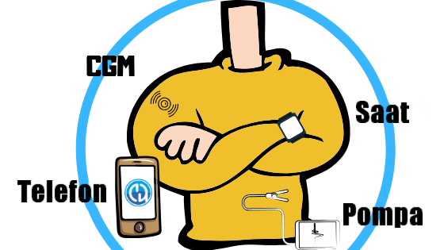

# Bileşenlere Genel Bakış

**AAPS** yalnızca (kendi oluşturduğunuz) bir uygulama değildir; kapalı döngü sisteminizin birkaç modülünden biridir. Bileşenlere karar vermeden önce bileşenlerin dokümantasyonuna bakmak iyi bir fikirdir.



```{admonition} IMPORTANT SAFETY NOTICE
:class: important

Bu dokümantasyonda anlatılan **AAPS** güvenlik özelliklerinin temeli, sisteminizi kurmak için kullanılan donanımın güvenlik özelliklerine dayanır. Otomatik insülin dozlama döngüsünü kapatmak için yalnızca test edilmiş, tam olarak çalışan ve ülkenizin resmi kurumlarınca onaylanmış bir insülin pompası ve CGM kullanmanız son derece önemlidir. Bu bileşenlerin donanımında veya yazılımında yapılan değişiklikler, beklenmeyen insülin iletimine ve dolayısıyla kullanıcı için önemli risklere yol açabilir. Bozuk, değiştirilmiş veya kendi yapımı insülin pompaları ya da CGM alıcıları bulursanız veya size önerilirse, bunları bir **AAPS** sistemi kurmak için **kullanmayın**.

Ek olarak, sadece orijinal aksesuarların kullanılması da bir o kadar önemlidir. Yerleştirme yardımcıları, kanüller ve rezervuarlar, pompanız veya CGM ile kullanım için üretici tarafından onaylanmalıdır. Test edilmemiş veya modifiye edilmiş aksesuarların kullanılması, CGM Sisteminin yanlış olmasına ve insülin iletim hatalarına neden olabilir. Yanlış dozda insülin çok tehlikelidir. Test edilmemiş veya modifiye edilmiş aksesuarlar kullanarak hayatınız ile oynamayın.

Son olarak, SGLT-2 inhibitörleri (gliflozinler) kullanmamalısınız, çünkü bunlar kan şekerini önceden hesaplanamayacak şekilde düşürür. KŞ'yi yükseltmek için bazal oranları düşüren bir sistemle birlikte kullanım özellikle tehlikelidir. Çünkü gliflozin nedeniyle KŞ bu şekilde yükselmeyebilir ve tehlikeli bir insülin eksikliği durumu oluşabilir. [Daha fazla bilgi burada](#PreparingForAaps-no-sglt-2-inhibitors).
```

## Gerekli Modüller

### Diyabet tedaviniz için iyi bir kişisel dozaj algoritması

Bu, oluşturulacak veya satın alınacak bir şey olmasa da büyük olasılıkla en çok hafife alınan 'modüldür' — ama çok önemlidir. Diyabetinizi yönetmek için bir algoritmadan yardım aldığınızda, algoritmanın ciddi hatalar yapmaması için doğru ayarları bilmesi gerekir. Diğer modüller henüz eksik olsa bile, **Profil**inizi diyabet ekibinizle birlikte şimdiden kontrol edebilir ve ayarlayabilirsiniz.

**Profil** şunları içerir:

- BR (bazal oranlar): arka plan insülinini sağlar;
- İDF (insülin duyarlılık faktörü): 1 ünite insülinin kan şekerinizi ne kadar düşüreceğini gösterir;
- CR (karbonhidrat oranı): bir ünite insülinin kaç gram karbonhidratı karşıladığını gösterir.

Çoğu looper, gün boyunca hormonal insülin duyarlılığına dayanan sirkadiyen (günlük) Bazal Oran, İDF ve Karbonhidrat Oranı kullanır.

**Profil**inizin yanında **insülininizi** de **Yönet → İnsülin ayarları** içinde, İES'si (insülin etki süresi) dahil olarak yapılandırmanız gerekir — bkz. [İnsülin ayarları](#Config-Builder-insulin-dia).

**Profil**iniz hakkında daha fazla bilgi [ayrı sayfasında](../SettingUpAaps/YourAapsProfile.md) bulunur.

### Telefon

Ayrı sayfaya bakın: [Telefonlar](../Getting-Started/Phones.md).

### İnsülin pompası

Ayrı sayfaya bakın: [Uyumlu pompalar](../Getting-Started/CompatiblePumps.md).

**Bazı pompa modellerinin avantajları ve dezavantajları**

Combo, Insight ve eski Medtronic sağlam pompalardır ve döngüde kullanılabilir. Combo, standart bir Luer-Lock bağlantısı olduğu için çok daha fazla infüzyon seti türü arasından seçim yapma avantajına sahiptir. Pili de standart bir pildir. Her benzin istasyonunda veya 24 saat açık markette satın alabilirsiniz. Gerçekten gerekirse otel odasındaki kumandadan çalabilir/ödünç alabilirsiniz ;-).

Bununla birlikte, tercih edilen pompa olarak DanaR/RS ve Dana-i'nin Combo'ya karşı avantajları şunlardır:

- Dana-i/RS ile ilk eşleştirme daha kolaydır. Ancak bunu genellikle yalnızca bir kez yaparsınız, bu nedenle yalnızca yeni bir özelliği farklı pompalarla test etmek istediğinizde etki eder.
- Şimdiye kadar Combo, ekran ayrıştırma ile çalışıyor. Genel olarak harika çalışıyor ama yavaş. Döngü için bu çok önemli değil çünkü her şey arka planda çalışıyor. Yine de bağlı kalmanız gereken süre çok daha uzundur. Bu yüzden Bluetooth bağlantısının kopabileceği süre de daha uzundur. Bolus verirken & yemek yaparken telefonunuzdan uzaklaşırsanız bu kolay değildir.
- Combo, GBO'ların sonunda titrer, DanaR ise SMB'de titrer (veya bip sesi çıkarır). Geceleri büyük olasılıkla SMB'den çok GBO kullanırsınız.  Dana-i/RS, ne bip sesi çıkaracak ne de titreyecek şekilde ayarlanabilir.
- Dana-i/RS'deki geçmişin karbonhidratlarla birlikte birkaç saniyede okunabilmesi sayesinde, çevrimdışıyken telefonu kolayca değiştirebilir ve birkaç CGM değeri gelir gelmez döngüye devam edebilirsiniz.
- **AAPS**'in iletişim kurabildiği tüm pompalar teslim edildiğinde su geçirmezdir. Sızdırmaz pil bölmesi ve rezervuar doldurma sistemi sayesinde yalnızca Dana pompaları "garanti kapsamında su geçirmezdir".

### KŞ kaynağı

Ayrı sayfaya bakın: [Uyumlu CGM'ler](../Getting-Started/CompatiblesCgms.md).

### **AAPS**-.apk dosyası

Sistemin ana bileşeni. Uygulamayı yüklemek için önce apk dosyasını kendiniz oluşturmanız gerekir. Talimatlar [burada](../SettingUpAaps/BuildingAaps.md).

### Raporlama sunucusu

Raporlama sunucusu glikoz ve tedavi verilerinizi gösterir ve ayrıntılı analiz için raporlar oluşturur. Şu anda AAPS ile kullanılabilen iki raporlama sunucusu vardır: [Nightscout](#SettingUpTheReportingServer-nightscout) ve [Tidepool](#SettingUpTheReportingServer-tidepool). İkisi de diyabet verilerinizi zaman içinde görselleştirmenin yollarını sunar, **hedef aralıktaki süre** (TIR) ve diğer ölçümler hakkında istatistikler verir.

Raporlama sunucusu diğer modüllerden bağımsızdır. Bir raporlama sunucusu kullanmak istemiyorsanız, bunun **AAPS**'i uzun süre çalıştırmak için zorunlu olmadığını bilmelisiniz. Ancak yine de bir tane kurmanız gerekir, çünkü [**1. Görev**](#objectives-objective1) için gereklidir.

Raporlama sunucunuzu nasıl kuracağınızla ilgili ek bilgileri [burada](../SettingUpAaps/SettingUpTheReportingServer.md) bulabilirsiniz.

## Opsiyonel Modüller

### Akıllı saat

**Wear OS 3** veya daha yeni bir sürümle çalışan herhangi bir akıllı saati seçebilirsiniz. Ayrıntılar için [Akıllı saatler](../Getting-Started/Watches.md) sayfasına bakın.

Kullanıcılar bir [test edilmiş telefonlar ve saatler listesi](#Phones-list-of-tested-phones) oluşturuyor. **AAPS** ile kullanılabilecek farklı saat arayüzleri vardır. Bunları [burada](../WearOS/WearOsSmartwatch.md) bulabilirsiniz.

### xDrip

xDrip uygulamasına **KŞ kaynağı** olarak ihtiyacınız olmasa bile, onu yine de kullanabilirsiniz, örneğin alarmlar veya farklı bir kan şekeri gösterimi için. İstediğiniz kadar alarm kurabilir, bir alarmın ne zaman etkin olacağını belirleyebilir, sessiz modu geçersiz kılıp kılamayacağını seçebilirsiniz vb. xDrip hakkında bazı bilgileri [burada](../CompatibleCgms/xDrip.md) bulabilirsiniz. Bu uygulama hızlı değiştiği için dokümantasyonunun her zaman güncel olmadığını unutmayın.

## Modülleri beklerken yapılması gerekenler

Döngüyü kapatmak için gereken tüm modülleri edinmek bazen biraz zaman alır. Ama merak etmeyin, beklerken yapabileceğiniz çok şey var. Bazal oranları (BR), insülin-karbonhidrat oranını (IC), insülin duyarlılık faktörlerini (İDF) vb. kontrol etmek ve (gerekirse) ayarlamak **gereklidir**. Belki açık döngü de sistemi test etmek ve **AAPS**'i tanımak için iyi bir yol olabilir. Bu modda **AAPS**, elle uygulayabileceğiniz tedavi önerileri verir.

Buradaki dokümanları okumaya devam edebilir, diğer döngü kullanıcılarıyla çevrimiçi veya yüz yüze iletişim kurabilir, dokümanları veya diğer döngü kullanıcılarının yazdıklarını [okuyabilirsiniz](../UsefulLinks/BackgroundReading.md) (yine de dikkatli olun: her şey doğru değildir veya sizin için uygun olmayabilir).

**Bitti mi?** **AAPS** bileşenlerinizin hepsi hazırsa (tebrikler!) veya en azından açık döngü modunda başlamaya yetecek kadarı varsa, her yeni Görevden önce [Görev açıklamasını](../SettingUpAaps/CompletingTheObjectives.md) okumalı ve donanımınızı kurmalısınız.
