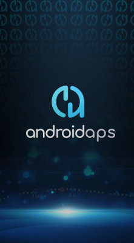

# Telefonlar

<!-- List of hidden pages to avoid overcrowding the menu -->

```{toctree}
:hidden:

../CompatiblePhones/Jelly.md
../CompatiblePhones/Huawei.md
```

**AAPS**'in güncel sürümü (4.0), Google **Android 12.0 veya üzeri** sürümlü bir Android akıllı telefon gerektirir. Yeni bir telefon almayı düşünüyorsanız (Ocak 2026 itibarıyla) **Android 16 tercih edilir**, Android 15 önerilmez.

Bu konudaki son gelişmeler için [Facebook veya Discord](../GettingHelp/WhereCanIGetHelp.md)'a bakın.

Güvenlik nedeniyle kullanıcıların **AAPS** sürümlerini güncel tutmaları önemle tavsiye edilir. Ancak Android 12.0 veya daha yeni bir cihaz kullanamayan kullanıcılar için eski Android sürümleriyle uyumlu eski **AAPS** sürümleri hâlâ mevcuttur, bkz.: [Sürüm notları](#maintenance-android-version-aaps-version).

- [Jelly Pro Ayarları](../CompatiblePhones/Jelly.md)
- [Huawei Ayarları](../CompatiblePhones/Huawei.md)

(Phones-list-of-tested-phones)=

## Test edilen telefonların listesi

[Test edilmiş donanım kurulumlarının](https://docs.google.com/spreadsheets/u/1/d/e/2PACX-1vScCNaIguEZVTVFAgpv1kXHdsHl3fs6xT6RB2Z1CeVJ561AvvqGwxMhlmSHk4J056gMCAQE02sAWJvT/pubhtml?gid=683363241&single=true) bir listesini tutuyoruz. Bu listeyi [kolay kullanımlı bir arayüzle inceleyebilirsiniz](https://vnniyb.github.io/androidAPS_testedHardwareEasyBrowser/). [Google formunu](https://docs.google.com/forms/d/e/1FAIpQLSfoGKLYEx4aUAJ5RWL3xLJeNdmRyxtXmDzpGhuU3Rfcj2H_Jw/viewform) doldurarak ve kurulumunuzu ekleyerek katkıda bulunun!

Bu liste, kullanıcıların bir telefonu **AAPS** ve belirli bir pompa ve CGM ile kullanma deneyimlerini gösterir. Telefonunuzun / pompanızın / CGM'nizin başka kullanıcılar tarafından başarıyla kullanılıp kullanılmadığını kontrol etmenize yardımcı olabilir.

Belge salt okunurdur. CTRL-F ile Google tablosunun metninde arama yapabilirsiniz.

Bir donanım kurulumu ile yaptığınız testi kaydetmek için lütfen bu [formu](https://docs.google.com/forms/d/e/1FAIpQLSfoGKLYEx4aUAJ5RWL3xLJeNdmRyxtXmDzpGhuU3Rfcj2H_Jw/viewform) doldurun. Formu doldurduktan sonra tablo her 5 dakikada bir otomatik olarak güncellenir.

Tabloyla ilgili bir sorununuz olursa Discord'da tablonun sorumlusu *@theodoor5137* ile iletişime geçin veya [nasıl yardım alabileceğinizi](../GettingHelp/WhereCanIGetHelp.md) anlatan sayfaya bakın.

## Telefonumu bulamadım

Belirli bir telefon modeli hakkında sorularınız varsa lütfen [Facebook veya Discord topluluğumuzda](../GettingHelp/WhereCanIGetHelp.md) arayın veya sorun.

Hâlâ test edilmesi gereken akıllı telefon veya akıllı saat modellerini bağışlamak için lütfen <donations@androidaps.org> adresine e-posta gönderin.

(Phones-phone-wallpaper)=

## Telefon duvar kağıdı

Telefonunuzu daha fazla **AAPS** ile süslemek isterseniz, arka plan resmini [buradan](../images/bg_phone.jpg) indirebilirsiniz!



Tasarım: Thiago :)