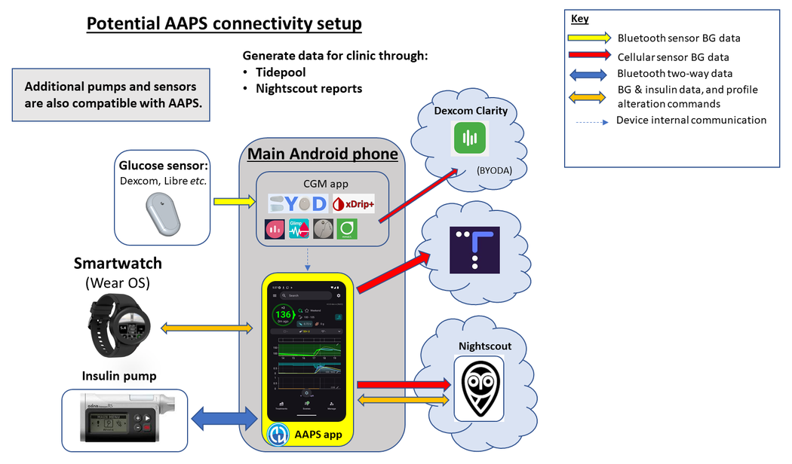
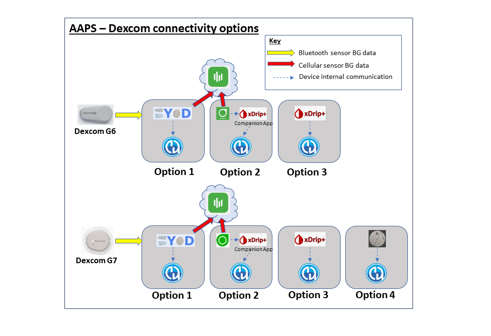
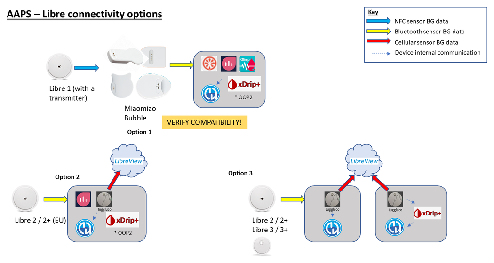
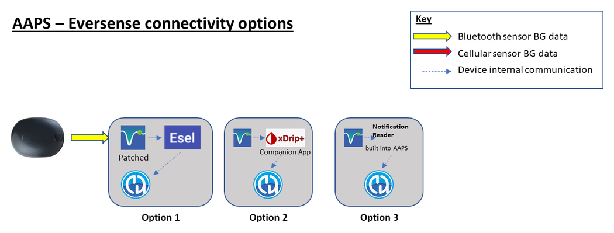

# AAPS ile başlamaya hazırlık

Welcome. Bu dokümantasyon, Android Yapay Pankreas Sistemini (**AAPS**) kurmaya ve kullanmaya hazırlanan kullanıcılara yol göstermeyi amaçlar.

## Dokümantasyonda yolunuzu bulma

Dokümantasyonun yapısına ait bir **dizin** ve açıklama [burada](../index.md) bulunur. Buraya dokümantasyonun sol üstündeki **AAPS** simgesine tıklayarak da ulaşabilirsiniz. Orada farklı dokümantasyon bölümlerinin amacına dair bir genel bakış bulacaksınız. Dokümantasyonda gezinmek için bu sayfanın solundaki başlıkları da kullanabilirsiniz. Son olarak, **AAPS** simgesinin hemen altında kullanışlı bir arama işlevi vardır.

**AAPS**'in hem yeteneklerini hem de sınırlarını kolayca anlamanızı sağlamayı amaçlıyoruz. Dokümantasyonu okumaya zaman ayırdıktan sonra uyumlu bir insülin pompanız veya CGM'niz olmadığını ya da **AAPS**'in umduğunuzdan farklı işlevler sunduğunu öğrenmek hayal kırıklığı yaratabilir.

**AAPS** dokümantasyonundaki deneyime dayalı birçok ayrıntı, **AAPS**'i gerçek zamanlı olarak kullanmaya başladığınızda daha anlamlı hale gelir. Bir sporu yalnızca kurallarını okuyarak öğrenmek zor olduğu gibi, önce **AAPS**'i güvenli kullanmanın temel kurallarını öğrenmeniz, sonra da **AAPS**'i kullanmaya başladıkça bu kuralları en iyi nasıl uygulayacağınızı öğrenmeniz gerekir.

(preparing-safety-first)=

## Önce Güvenlik
“Büyük güç, büyük sorumluluk getirir…”

### Teknik güvenlik
**AAPS** çok sayıda güvenlik özelliğine sahiptir. Bunlar, belirli parametrelerin test edilmesini ve çoktan seçmeli soruların yanıtlanmasını içeren bir dizi [Görevin](../SettingUpAaps/CompletingTheObjectives.md) aşama aşama tamamlanmasıyla kademeli olarak kaldırılan kısıtlamalar getirir. **AAPS** özellikleri, Görevler başarıyla tamamlandıkça açılır. Bu süreç, kullanıcının **AAPS**'in farklı özelliklerini öğrenirken Açık Döngü'den Kapalı Döngü'ye aşama aşama ve güvenli bir şekilde geçmesini sağlar.

[Görevler](../SettingUpAaps/CompletingTheObjectives.md), **AAPS** geliştiricilerinin yeni kullanıcılarda gözlemlediği tipik hatalar ve genel eğilimler dikkate alınarak **AAPS**'e mümkün olan en iyi girişi sağlamak için tasarlanmıştır. Hatalar, yeni başlayan kişi deneyimsiz olduğu ve **AAPS**'e başlamak için çok aceleci davrandığı ya da önemli noktaları gözden kaçırdığı için olabilir. [Görevler](../SettingUpAaps/CompletingTheObjectives.md) bu sorunları en aza indirmeyi amaçlar.

### Tıbbi güvenlik
```{admonition} Avoid permanent and painful damage to your eyes and nerves
:class: danger
Kan şekeri kontrolündeki hızlı iyileşmeler ve HbA1c düşüşü konusunda dikkatli olunmalıdır 
```

Önemli bir güvenlik konusu şudur: **Bir süredir yüksek glikoz düzeyleri olan kişilerde HbA1c'nin hızla düşmesi ve kan şekeri kontrolünün iyileşmesi kalıcı hasara yol açabilir**. Diyabetli birçok kişi bunun farkında değildir ve tüm klinisyenler hastalarını bu konuda bilgilendirmez.

Bu hasar **görme kaybı ve kalıcı nöropatiyi (ağrı)** içerebilir. Ortalama glikoz düzeylerini daha yavaş düşürerek bu hasarın oluşmasını önlemek mümkündür. Şu anda HbA1c değeriniz yüksekse ve **AAPS**'e (veya başka bir kapalı döngü sistemine) geçiyorsanız, başlamadan önce _lütfen_ bu olası riski klinik ekibinizle konuşun ve onlarla birlikte, güvenli glikoz hedeflerini kademeli olarak düşüren bir zaman planı üzerinde anlaşın. Başlangıçta **AAPS**'te daha yüksek glikoz hedeflerini kolayca ayarlayabilir (şu anda seçebileceğiniz en yüksek hedef 11,1 mmol/L'dir, ancak gerekirse bilerek zayıf bir profil de kullanabilirsiniz), ardından aylar geçtikçe hedefi düşürebilirsiniz.

#### Kalıcı hasar riski olmadan HbA1c değerimi ne kadar hızlı düşürebilirim?

76 hasta üzerinde yapılan geriye dönük bir [çalışma](https://pubmed.ncbi.nlm.nih.gov/1464975/), HbA1c 6 aylık bir dönemde sırasıyla %1, %2 veya %3 düştüğünde retinopatinin ilerleme riskinin 1,6 kat, 2,4 kat ve 3,8 kat arttığını bildirdi. Araştırmacılar şunu önerdi: **"Retinopatinin ilerlemesini önlemek için herhangi bir 6 aylık dönemde HbA1c değerindeki düşüş %2'den az ile sınırlandırılmalıdır.... Glisemik kontrolün başlangıcında çok hızlı bir düşüş, retinopatinin ilerlemesinde ciddi veya geçici bir kötüleşmeye neden olabilir."**

Not: Farklı HbA1c birimleri (% yerine mmol/mol) kullanıyorsanız, HbA1c hesaplama aracı için [buraya](https://www.diabetes.co.uk/hba1c-units-converter.html) tıklayın.

954 hasta üzerinde yapılan başka bir geriye dönük [değerlendirmede](https://academic.oup.com/brain/article/138/1/43/337923) araştırmacılar şunu belirtti:

**"HbA1c'de 3 ay içinde 2–3 puanlık (%) bir düşüşle diyabette tedaviye bağlı nöropati gelişmesi için mutlak risk %20 idi; HbA1c'de 3 ay içinde >4 puanlık (%) bir düşüşle diyabette tedaviye bağlı nöropati gelişmesi için mutlak risk %80'i aştı."**

Bu çalışma hakkındaki bir [yorum](https://academic.oup.com/brain/article/138/1/2/340563) da komplikasyonlardan kaçınmak için **hedefin A1c'yi 3 ayda <%2 düşürmek olması gerektiğini** kabul etti. Bu konudaki diğer incelemeleri [burada](https://www.ncbi.nlm.nih.gov/pmc/articles/PMC6587545/pdf/DOM-21-454.pdf) ve [burada](https://www.mdpi.com/1999-4923/15/7/1791) okuyabilirsiniz.

_Yeni_ tanı almış tip 1 diyabetlilerin (tanı anında, insülin tedavisine başlamadan önce genellikle HbA1c değerleri çok yüksektir) tanıdan hemen sonra HbA1c değerlerini bu risklerle aynı ölçüde karşılaşmadan hızla düşürebildikleri genel olarak kabul edilir, çünkü kan şekerleri bu kadar uzun bir süre yüksek kalmamıştır. Yine de bu, klinisyeninizle konuşmanız gereken bir konudur.

(PreparingForAaps-no-sglt-2-inhibitors)=
### SGLT-2 inhibitörleri kullanmayın

```{admonition} NO SGLT-2 inhibitors
:class: danger
Glifozinler olarak da adlandırılan SGLT-2 inhibitörleri, böbrekte glikozun geri emilimini engeller. Glifozinler kan şekeri düzeylerini öngörülemeyecek şekilde düşürür. Bu nedenle AAPS gibi bir kapalı döngü sistemi kullanırken bu ilaçları KESİNLİKLE KULLANMAMALISINIZ! Ciddi bir ketoasidoz ve/veya hipoglisemi riski olur! Bu ilacın, KŞ'yi yükseltmek için bazal oranları düşüren bir sistemle birlikte kullanılması özellikle tehlikelidir. 

Özetle:
- **Örnek 1: Hipo riski**
>Öğle yemeğinde 45 g karbonhidrat tüketmenize göre **AAPS** ile bolus yaparsınız. Sorun şudur: AAPS'in bilmediği bir şekilde, inhibitörler vücudun karbonhidratların bir kısmını atmasına neden olur. Bu da vücudunuzda emilen karbonhidratlara göre çok fazla insülin kalmasına ve hipoglisemiye yol açar.

- **Örnek 2: Ketoasidoz riski**
>İnhibitörler arka planda karbonhidratların bir kısmını atar ve KŞ'nizin düşmesine neden olur. **AAPS** pompaya bazal dahil insülin iletimini azaltmasını otomatik olarak söyler. Zamanla bu, KŞ'nizin hedef değerin altında kalmasına yol açabilir. Sonunda vücutta herhangi bir karbonhidratı kullanmak için yeterli temel insülin kalmaz ve ketoasidoz gelişir. Normalde tip 1 diyabetli hastalarda ketoasidoz pompa arızası nedeniyle gelişir. Bu durum telefonda alarmları tetikler ve yüksek KŞ değeri nedeniyle fark edilir. Ancak glifozinlerle tehlike şudur: pompa çalışmaya devam ettiği ve KŞ büyük olasılıkla hedef aralıkta kaldığı için AAPS alarmı olmaz.

SGLT-2 inhibitörlerinin yaygın ticari adları şunlardır: Invokana, Farxiga, Jardiance, Glyxambi, Synjardy, Steglatro ve Xigduo XR ve diğerleri.
```


### AAPS ile döngü kullanmanın temel ilkeleri

**AAPS**'i kullanmadan önce döngünün temel ilkelerini ve kavramlarını anlamanız gerekir. Bunu, **AAPS** dokümantasyonunu okumaya kendi zamanınızı ayırarak ve Görevleri tamamlayarak sağlarsınız. Görevler, **AAPS**'i güvenli ve etkili kullanmanız için size sağlam bir temel vermeyi amaçlar. **AAPS** dokümantasyonunun hacmi ilk başta çok fazla görünebilir, ama sabırlı olun ve sürece güvenin - doğru yaklaşımla başaracaksınız!

İlerleme hızı kişiye göre değişir, ancak tüm görevlerin tamamlanmasının genellikle 6 - 9 hafta sürdüğünü bilin. Birçok kişi **AAPS**'i kullanmaya başlamadan çok önce oluşturmaya, kurmaya ve ayarlamaya başlar. Buna yardımcı olmak için sistemde, ilk görevleri tamamlarken kullanabileceğiniz bir "sanal pompa" vardır. Böylece **AAPS**'i gerçekten insülin vermek için kullanmadan onu tanıyabilirsiniz. Zaman çizelgesinin ayrıntılı dökümü aşağıdadır. **AAPS**'in 7. görevinde kapalı döngüye geçmiş olduğunuzu bilin; sonraki görevler **SMB** ve **otomasyonlar** gibi ek özellikler ekler. Bunlar bazı kullanıcılar için yararlıdır, ancak **AAPS**'in temel işlevi için gerekli değildir.

**AAPS** ile başarılı olmak için proaktif bir yaklaşım, KŞ verileri üzerinde düşünmeye istekli olmak ve sonuçlarınızı iyileştirmek için **AAPS**'te gerekli ayarlamaları yapacak esnekliğe sahip olmak gerekir. Bir sporu yalnızca kurallarını okuyarak öğrenmek neredeyse imkânsız olduğu gibi, aynı şey **AAPS** için de söylenebilir.

#### Her şeyi kurup çalıştırırken gecikmeler ve küçük sorunlar için plan yapın

**AAPS**'e başlamanın ilk aşamalarında, döngünün tüm bileşenlerinin birbiriyle (ve olası takipçilerle) düzgün iletişim kurmasını sağlarken ve ayarlarınıza ince ayar yaparken zorluklar yaşayabilirsiniz. Bazı aksaklıklar ancak **AAPS** günlük hayatta kullanıldığında çözülebilir, ancak Facebook grubunda ve Discord'da çok sayıda yardım bulabilirsiniz. Lütfen buna göre plan yapın ve sorunları gidermek ve çözmek için "uygun" zamanlar seçin, örneğin bir hafta sonu sakin bir sabah (yani gece geç saatlerde, yorgunken, önemli bir toplantıdan veya seyahatten önce değil).

#### Teknoloji uyumluluğu

**AAPS** yalnızca belirli insülin pompaları, CGM'ler ve telefonlarla uyumludur ve bazı teknolojiler bazı ülkelerde kullanılamayabilir. Hayal kırıklığı yaşamamak için lütfen [CGM](../Getting-Started/CompatiblesCgms.md), [pompa](../Getting-Started/CompatiblePumps.md) ve [telefon](../Getting-Started/Phones.md) bölümlerini okuyun.

#### Uygulamayı oluşturma süresi ve tam döngüye geçiş

**AAPS** uygulamasını oluşturma süresi, uzmanlık düzeyinize ve teknik becerinize bağlıdır. Deneyimsiz kullanıcılar için **AAPS**'i oluşturmak genellikle yarım gün veya tam bir gün (topluluğun yardımıyla) sürebilir. Deneyim kazandıkça yeni **AAPS** sürümleri için bu süreç önemli ölçüde hızlanır.

Bu dokümantasyonun birçok bölümü, oluşturma sürecinde size yardımcı olmak için hazırlanmıştır:

- [AAPS'i oluşturma](../SettingUpAaps/BuildingAaps.md) sayfası, uygulamayı oluşturma ve telefonunuza kurma adımlarında size adım adım yol gösterir;

- [SSS](../UsefulLinks/FAQ.md) sık sorulan soruları yanıtlar ve en sık karşılaşılan hataları açıklar; ve

- [Sorun giderme](../GettingHelp/GeneralTroubleshooting.md) merkezi, en sık görülen sorunların çözümlerini konulara göre toplar.

Kapalı döngüye ulaşma süresi kişiye göre değişir; **AAPS** ile tam döngüye ulaşmak için yaklaşık bir zaman çizelgesi [aşağıda](#preparing-how-long-will-it-take) verilmiştir.


#### Anahtar deposu (keystore) & yapılandırma ayarları dışa aktarma dosyası

“Anahtar deposu” (keystore, .jks dosyası), kendi **AAPS** kopyanıza özel, parola ile şifrelenmiş bir dosyadır. Android telefonunuz, anahtar deposu olmadan hiç kimsenin sizin kopyanızı güncelleyememesini sağlamak için bu dosyayı kullanır. Kısacası, **AAPS**'i oluştururken şunları yapmalısınız:

1.  Anahtar deposu dosyanızı (uygulamanızı imzalamak için kullanılan .jks dosyası) güvenli bir yerde saklayın;

2.  Anahtar deposu dosyanızın parolasını not edin.

Anahtar deposunu nasıl saklayacağınız, oluşturma yönteminize bağlıdır:

- **Android Studio ile (bilgisayarda) oluşturma**: anahtar deposu oluşturma sırasında yaratılır - nereye kaydedeceğinizi öğrenmek için [İmzalı APK oluşturma](#Building-APK-generate-signed-apk) bölümüne bakın.
- **AAPS Builder**: anahtarınızı oluşturduğunuzda kurulum sayfasının size sunduğu `aaps-keystore.jks` yedek dosyasını, parolası ve takma adı (alias) ile birlikte saklayın. Kendi anahtar deponuzu yüklediyseniz o dosyayı saklayın.
- **Fork ile tarayıcıda oluşturma**: bir kopyasını Google Drive'ınıza indirmek için bu iş için hazırlanmış [Export keystore](#ci-keystore-export) iş akışını (workflow) kullanın.

Bu sayede, **AAPS**'in her yeni sürümünü oluştururken tam olarak aynı anahtar deposu dosyasını kullanabilirsiniz. Ortalama olarak her yıl 2 **AAPS** güncellemesi gerekir.

Ayrıca **AAPS**, [tüm yapılandırma ayarlarınızı dışa aktarma](../Maintenance/ExportImportSettings.md) olanağı sunar. Bu sayede telefon değiştirirken veya uygulamayı güncellerken/yeniden kurarken sisteminizi en az kesintiyle güvenli bir şekilde geri yükleyebilirsiniz. 

#### Troubleshooting

Emin olmadığınız bir şey varsa AAPS topluluğuna danışmaktan çekinmeyin - aptalca soru diye bir şey yoktur! Her deneyim düzeyindeki tüm kullanıcılar soru sormaya teşvik edilir. **AAPS** kullanıcılarının sayısı fazla olduğu için sorulara genellikle hızlı yanıt verilir.

##### [AAPS Facebook grubunda sorun](https://www.facebook.com/groups/AndroidAPSUsers/)

##### [AAPS Discord kanalında sorun](https://discord.gg/4fQUWHZ4Mw)


#### [Nereden yardım alabilirim](../GettingHelp/WhereCanIGetHelp.md)?

Bu bölüm, yeni kullanıcılara yardım almak için kaynak bağlantıları sunmayı amaçlar. Buna, soruları netleştirebilen ve AAPS ile ilgili olağan sorunları çözebilen yeni ve deneyimli kullanıcılardan oluşan topluluk desteğine erişim de dahildir.

#### [Klinisyenler için bölüm](../UsefulLinks/ClinicianGuideToAaps.md)

Bu, AAPS ve açık kaynaklı yapay pankreas teknolojisi hakkında daha fazla bilgi edinmek isteyen [klinisyenlere özel bir bölümdür](../UsefulLinks/ClinicianGuideToAaps.md). Giriş sayfasında [klinik ekibinizle nasıl konuşacağınıza](#introduction-how-can-i-approach-discussing-aaps-with-my-clinical-team) dair yönlendirmeler de vardır.

## Neyi oluşturacağız ve kuracağız?

Bu diyagram, **AAPS** sisteminin temel bileşenlerine (hem donanım hem yazılım) genel bir bakış sunar:




Üç temel donanım bileşenine (telefon, pompa, glikoz sensörü) ek olarak şunlara da ihtiyacımız var: 1) **AAPS** uygulaması 2) Bir raporlama sunucusu ve 3) Bir sürekli glikoz monitörü (CGM) uygulaması

### 1) Bir Android telefon uygulaması: **AAPS**

**AAPS**, Android akıllı telefonlarda & cihazlarda çalışan bir uygulamadır. Adım adım bir kılavuz kullanarak **AAPS** uygulamasını (bir apk dosyası) kendiniz oluşturacaksınız: **AAPS** kaynak kodunu GitHub'dan indirecek, gerekli programları (Android Studio, GitHub Desktop) bilgisayarınıza kuracak ve kendi **AAPS** uygulama kopyanızı oluşturacaksınız. Ardından **AAPS** uygulamasını akıllı telefonunuza (e-posta, USB kablosu _vb._ ile) aktarır ve kurarsınız.

### 2) Bir raporlama sunucusu: Nightscout (Tidepool*)

**AAPS**'ten tam olarak yararlanmak için bir Nightscout sunucusu kurmanız gerekir. Bunu [kendiniz yapabilir](https://nightscout.github.io/nightscout/new_user/#free-diy) veya küçük bir ücret ödeyerek sizin için kurulan bir [yönetilen Nightscout hizmeti](https://nightscout.github.io/#nightscout-as-a-service) kullanabilirsiniz. Nightscout, **AAPS**'ten zaman içinde veri toplamak için kullanılır ve CGM ile insülin örüntülerini ilişkilendiren ayrıntılı raporlar oluşturabilir. Bakım verenler, çocuklarının diyabet yönetimini takip etmek için Nightscout üzerinden **AAPS** uygulamasıyla uzaktan iletişim de kurabilir. Bu uzaktan iletişim özellikleri arasında glikoz ve insülin düzeylerinin gerçek zamanlı izlenmesi, uzaktan insülin bolusu (SMS ile) ve öğün bildirimi bulunur. Diyabet sonuçlarınızı CGM verilerine pompa verilerinden ayrı bakarak analiz etmeye çalışmak, sürücünün gözlerinin göremediği ve yolcunun ona çevreyi anlattığı bir araba kullanmaya benzer. Nightscout'a alternatif olarak Tidepool da kullanılabilir.

### 3) CGM sensör uygulaması

Glikoz sensörünüze/CGM'nize bağlı olarak, glikoz ölçümlerini almak ve **AAPS**'e göndermek için uyumlu bir uygulamaya ihtiyacınız olacak. Farklı seçenekler aşağıda gösterilmiştir. Daha fazla bilgiyi [uyumlu CGM'ler bölümünde](../Getting-Started/CompatiblesCgms.md) bulabilirsiniz:

  

### **AAPS** sisteminin bakımı

Geliştirilmiş sürümler yayımlandıkça hem **Nightscout** hem de **AAPS** yaklaşık yılda bir kez güncellenmelidir. Bazı durumlarda güncelleme ertelenebilir, bazı durumlarda ise güncelleme güçlü bir şekilde önerilir veya güvenlik için zorunlu kabul edilir. Bu güncellemeler Facebook gruplarında ve Discord sunucularında duyurulur. Sürüm notları durumun ne olduğunu açıkça belirtir. Güncelleme zamanında büyük olasılıkla sizinle benzer sorular soran pek çok kişi olacaktır ve güncellemeleri yaparken destek alacaksınız.

(preparing-how-long-will-it-take)=
## Her şeyi kurmak ne kadar sürer?

Daha önce belirtildiği gibi, **AAPS** kullanmak, kendi zamanınızı ayırmanızı gerektiren bir “yolculuk” gibidir. Tek seferlik bir kurulum değildir. **AAPS**'i oluşturmak, **AAPS** ve **CGM** yazılımını kurup yapılandırmak ve **AAPS** ile açık döngüden hibrit kapalı döngüye geçmek için güncel tahmin toplamda yaklaşık 4 ila 6 aydır. Bu nedenle, hâlâ farklı bir insülin verme sistemi kullanıyor olsanız bile, **AAPS** uygulamasını oluşturmaya ve ilk görevleri tamamlamaya mümkün olan en kısa sürede öncelik vermeniz önerilir (5. göreve kadar sanal pompa kullanabilirsiniz).

Bazı görevler, yeni işlevleri anladığınızdan emin olmak için belirli bir sayıda günün geçmesini gerektirir. Bu bekleme süresini atlamak mümkün değildir; bu minimum bekleme süreleri kendi güvenliğiniz için belirlenmiştir.

Yaklaşık bir zaman çizelgesi:

| Yapılacak işler                                                         |        Yaklaşık süre         |
| ----------------------------------------------------------------------- |:----------------------------:|
| Dokümantasyonun ilk okunması                                            |           1-2 gün            |
| GitHub'ı tarayıcıda oluşturmaya izin verecek şekilde yapılandırma       |           1-4 saat           |
| Bir raporlama sunucusu kurma                                            |            1 hour            |
| Bir CGM uygulaması kurma (xDrip, BYODA, …)                              |            1 hour            |
| CGM → xDrip → AAPS ilk yapılandırması                                   |            1 hour            |
| AAPS → pompa ilk yapılandırması                                         |            1 hour            |
| AAPS → Nightscout/Tidepool yapılandırması (yalnızca raporlama)          |            1 hour            |
| İsteğe bağlı: Nightscout ↔ **AAPS** & NSFollowers yapılandırması        |            1 hour            |
| 1. Görev: Görselleştirme ve izlemeyi kurma                              |            1 hour            |
| 2. Görev: AAPS'i kontrol etmeyi öğrenme                                 |            2 saat            |
| Görev 3: Bilginizi kanıtlayın                                           |       En fazla 14 gün        |
| 4. Görev: Açık döngüye başlama                                          |         En az 7 gün          |
| 5. Görev: Açık döngünüzü anlama                                         |            7 gün             |
| 6. Görev: Döngüyü kapatmaya başlama (Düşük Glikoz Duraklatma)           |   En az 5, en fazla 14 gün   |
| 7. Görev: Kapalı döngüyü ayarlama                                       | En az 1 gün, en fazla 7 gün  |
| 8. Görev: Bazalları ve oranları ayarlama, Otoduyarlılık'ı etkinleştirme | En az 7 gün, en fazla 14 gün |
| 9. Görev: Süper Mikro Bolus'u (SMB) etkinleştirme                       |         En az 28 gün         |
| 10. Görev: Otomasyon                                                    |         En az 28 gün         |

**AAPS** tam olarak çalışır hale geldikten sonra da genel diyabet yönetiminizi iyileştirmek için ayarlarınıza düzenli olarak ince ayar yapmanız gerekecektir.

## Requirements

### Tıbbi konular

[Güvenlik bölümündeki](#preparing-safety-first) tıbbi uyarılara ek olarak, pompada hangi insülini kullandığınıza bağlı olarak farklı parametreler de vardır.

#### İnsülin seçimi

**AAPS** hesaplamaları 100 Ü/ml insülin konsantrasyonuna (pompanın standardı ile aynı) dayanır. İnsülininizi **Yönet → İnsülin ayarları** bölümünde yapılandırırsınız: **Tepe** ve **İES** değerlerini ayarlayın veya ön ayarlardan birinin standart tepe zamanını doldurmak için **Tepe değerini şuradan yükle** seçeneğini kullanın:

- **Novorapid** (Humalog ve NovoLog için de)
- **Fiasp**
- **Lyumjev**

İleri düzey kullanıcılar, örneğin insülin karışımları için herhangi bir tepe zamanını (35 ila 120 dakika) doğrudan girebilir. Bkz. [İnsülin ayarları](#Config-Builder-insulin).


### Teknik konular

Bu dokümantasyon, gereken teknik bilgiyi en aza indirmeyi amaçlar. **AAPS** uygulamasını oluşturmak için birkaç seçeneğiniz var - genel bakış için [AAPS'i oluşturma](../SettingUpAaps/BuildingAaps.md) sayfasına bakın:

- **Tarayıcı ile oluşturma** (önerilir): bilgisayar veya Android Studio gerekmeden, GitHub Actions kullanarak uygulamayı doğrudan akıllı telefonunuzdan oluşturun. [AAPS Builder](../SettingUpAaps/BrowserBuildAapsBuilder.md) ile yalnızca bir GitHub hesabına ihtiyacınız vardır: uygulamayı doğrudan GitHub'dan indirirsiniz. Fork yöntemi, uygulamayı Google Drive'ınızda saklamak için ayrıca bir Google hesabı gerektirir.
- **Android Studio ile oluşturma**: uygulamayı bilgisayarınızda Android Studio kullanarak oluşturun. Bu yöntem çoğunlukla kodda değişiklik yapmak isteyen geliştiriciler tarafından kullanılır.
- **Komut satırı ile oluşturma**: Android Studio kurmadan yerel olarak oluşturmayı tercih eden kullanıcılar için.

Uygulamayı oluşturmanın ötesinde, bir raporlama sunucusu kurmanız, birkaç Android telefon uygulamasını yapılandırmanız ve diyabet yönetiminde uzmanlık kazanmanız da gerekir. Bunu adım adım ilerleyerek, sabırlı olarak ve **AAPS** topluluğunun yardımıyla başarabilirsiniz. İnternette gezinebiliyor ve kendi Gmail e-postalarınızı yönetebiliyorsanız, **AAPS**'i oluşturmak yapılabilir bir iştir. Acele etmeyin.

### Akıllı telefonlar

#### AAPS ve Android sürümleri

**AAPS**'in güncel sürümü (4.0), Google **Android 12.0 veya üzeri** sürümlü bir Android akıllı telefon gerektirir. Yeni bir telefon almayı düşünüyorsanız (Ocak 2026 itibarıyla) Android 16 tercih edilir.<br/> Güvenlik nedeniyle kullanıcıların **AAPS** sürümlerini güncel tutmaları önemle tavsiye edilir. Ancak Android 12.0 veya daha yeni bir cihaz kullanamayan kullanıcılar için eski Android sürümleriyle uyumlu eski **AAPS** sürümleri hâlâ mevcuttur, bkz.: [Sürüm notları](#maintenance-android-version-aaps-version).

#### Akıllı telefon modeli seçimi
Satın alacağınız model, istediğiniz işlev(ler)e bağlıdır. Çalışan kurulumlarla ilgili önerileri ve kullanıcı geri bildirimlerini [Telefonlar sayfasında](../Getting-Started/Phones.md) bulabilirsiniz.

Kullanıcıların telefonlarının Android sürümünü, güvenlik güncellemeleri de dahil olmak üzere, güncel tutmaları önerilir. Ancak **AAPS**'te yeniyseniz veya teknik konularda uzman değilseniz, telefonunuzu güncellemeyi başkaları güncelleyip çeşitli forumlarımızda bunun güvenli olduğunu onaylayana kadar ertelemek isteyebilirsiniz.

```{admonition} Delaying Samsung phone updates
:class: warning
Ne yazık ki Samsung'un telefonlarına zorla güncelleme yükleme geçmişi vardır. Bu güncellemeler Bluetooth bağlantı sorunlarına neden olabilir. Bu zorunlu güncellemeleri kapatmak için telefonu "geliştirici moduna" almanız gerekir:

1. **Settings** > **About phone** > **Software information** (Ayarlar › Telefon hakkında › Yazılım bilgileri) bölümüne gidin, ardından geliştirici modunun açıldığını onaylayana kadar **Build number** (Yapım numarası) öğesine dokunun.
2. Ana **Settings** (Ayarlar) menüsüne geri dönün. Burada yeni bir **Developer options** (Geliştirici seçenekleri) menü öğesi görmelisiniz.
3. **Developer options** (Geliştirici seçenekleri) menüsünü açın, **Auto system update** (Otomatik sistem güncellemesi) seçeneğini bulana kadar kaydırın ve kapatın.
```

```{admonition} Google Play Protect potential issue
:class: warning
**AAPS**'in her sabah Google Play Protect tarafından keyfi olarak kapatıldığına dair birkaç bildirim olmuştur. Bu olursa Google Play seçeneklerine gidip **Google Play Protect**'i devre dışı bırakmanız gerekir. Tüm telefon modelleri veya tüm Android sürümleri etkilenmez.
```

```{admonition} Android developer verification
:class: note
Google, Eylül 2026'dan itibaren [Android geliştirici doğrulamasını](#android-developer-verification) kademeli olarak kullanıma sunuyor. Bu, kendi oluşturduğunuz bir uygulamanın telefona nasıl kurulacağını değiştirir. **AAPS**'i oluşturma bundan etkilenmez ve ücretsiz kurulum yöntemleri kullanılmaya devam eder - ayrıntılar için bağlantılı sayfaya bakın.
```

