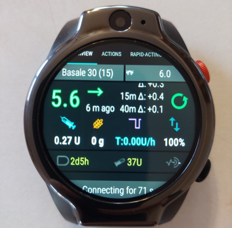
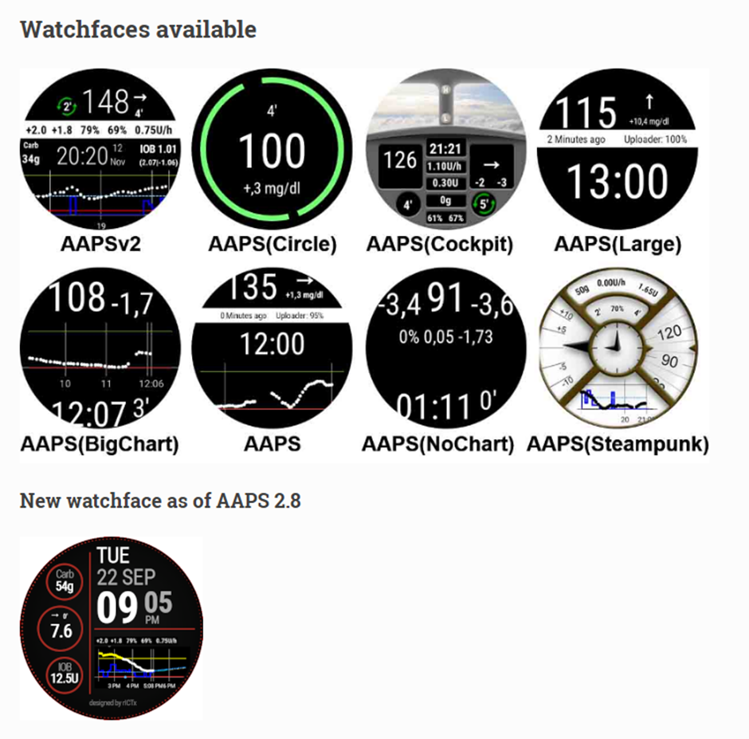
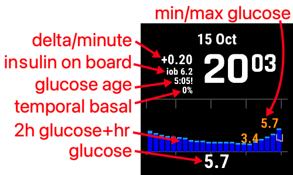
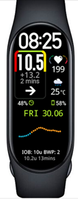

# Akıllı saatler ve AAPS

Çeşitli akıllı saatler, **AAPS**'teki bazı bilgileri göstermek veya uzaktan işlem yapmak için kullanılabilir.

**AAPS**'i (pompayı ve sensörü) doğrudan akıllı saatle kontrol etmek için tam Android saatler kullanılır (bunlar küçük [akıllı telefonlar](./Phones.md) gibi kabul edilir).

Bazı akıllı saatlerle tedavi girebilir veya daha fazlasını yapabilirsiniz, ancak **AAPS**'i yine telefonun kendisi yönetir.

Akıllı saatler **AAPS** ile giderek daha fazla kullanılıyor: diyabetli yetişkinler _ve_ diyabetli çocukların bakıcıları/ebeveynleri tarafından.

## Akıllı saatleri **AAPS** ile kullanmanın genel avantajları


Akıllı saatler, modele göre **AAPS** ile birçok farklı şekilde kullanılabilir. **AAPS**'i tamamen veya kısmen kontrol etmek ya da yalnızca glikoz düzeylerini, aktif insülini (AİNS) ve diğer değerleri uzaktan kontrol etmek için kullanılabilirler.

Bir akıllı saati **AAPS** ile birlikte kullanmak birçok durumda faydalı olabilir; örneğin araba veya (motor)bisiklet sürerken ve egzersiz sırasında. Bazı kişiler bir saate bakmanın (toplantıda, partide, yemek masasında vb.) telefona bakmaktan daha göze batmayan bir davranış olduğunu düşünür. Güvenlik açısından da akıllı saat hareket halindeyken faydalı olabilir: kullanıcı **AAPS** telefonunu gözden uzak bir yerde (örneğin bir çantanın içinde) tutar ve uzaktan kontrol için akıllı saati kullanır.

## **AAPS** kullanan ebeveynler/bakıcılar için özel avantajlar

Bir çocuk için: çocuğun **AAPS** telefonu yakındaysa, bakıcı **AAPS** telefonunu kullanmadan izleme veya değişiklik yapmak için bir akıllı saat kullanabilir. Bu, örneğin **AAPS** telefonu bir pompa kemerinin içinde saklıysa faydalı olabilir.

Bir akıllı saat, uzaktan kontrol veya [yalnızca takip](../RemoteFeatures/FollowingOnly.md) için TELEFON tabanlı seçeneklere _ek olarak_ veya onların _yerine_ kullanılabilir.

Ayrıca, ebeveyn/bakıcı takip telefonlarının (mobil ağa veya Wi-Fi bağlantısına bağlıdır) aksine, Bluetooth ile bağlı akıllı saatler uzak yerlerde, örneğin bir mağarada, bir teknede veya bir dağın ortasında faydalı olabilir. Her iki cihaz (**AAPS** telefonu ve akıllı saat) aynı Wi-Fi ağındaysa Wi-Fi da kullanabilirler.

## Akıllı saat ile AAPS arasındaki farklı etkileşim türleri

Şu anda akıllı saatlerin **AAPS** ile birlikte kullanıldığı beş ana yol vardır. Bunlar aşağıdaki tabloda gösterilmiştir: 

| Saat kurulumu       | Özellikler                                        | Requirements                                                                                                                                                                                                                                                                                                                   |
| ------------------- | ------------------------------------------------- | ------------------------------------------------------------------------------------------------------------------------------------------------------------------------------------------------------------------------------------------------------------------------------------------------------------------------------ |
| Bağımsız            | Telefonsuz AAPS                                   | Tam Android akıllı saat (en düşük Android sürümünü kontrol edin)</br> **app-fullRelease** çalıştırır                                                                                                                                                                                                                           |
| Tam uzaktan kontrol | AAPS işlevlerinin çoğu                            | Android **Wear OS** saat (Android/API sürümünü kontrol edin)</br>**wear-fullRelease** çalıştırır                                                                                                                                                                                                                               |
| Uzaktan kontrol     | AAPSClient işlevleri                              | Android **Wear OS** saat (Android/API sürümünü kontrol edin)</br>**[wear-aapsclientRelease](https://github.com/nightscout/AndroidAPS/releases)** çalıştırır                                                                                                                                                                    |
| Uzaktan kontrol     | Bazı AAPSClient işlevleri                         | Garmin saatler</br>(yalnızca eski Samsung Tizen ve Fitbit kurulumları, önerilmez)</br>Aşağıya bakın.                                                                                                                                                                                                                           |
| Görüntüleme         | Glikoz, eğilim, AİNS, AKRB, döngü ve pompa durumu | [Harici yardımcı uygulamalar](#watches-external-companion-apps) yayınından beslenen, **AAPS** telefonundaki bir yardımcı uygulama ile birçok akıllı saat: [WatchDrip+](https://bigdigital.home.blog/) (Xiaomi, Amazfit), [GlucoDataHandler](https://github.com/pachi81/GlucoDataHandler) (Wear OS), G-Watch</br>Aşağıya bakın. |

## Bir akıllı saat almadan önce…

Alacağınız akıllı saatin tam modeli, istediğiniz işlev(ler)e bağlıdır. [Telefonlar sayfasında](#Phones-list-of-tested-phones) faydalı bilgiler bulabilirsiniz. Orada bazı akıllı saatleri de içeren test edilmiş telefonlar listesi vardır.

Popüler saat markaları arasında Samsung Galaxy, Garmin, Fossil ve Mi band vardır. Yukarıdaki tabloda özetlenen farklı seçenekler, durumunuza hangi akıllı saatin uygun olduğuna karar vermenize yardımcı olmak için aşağıda daha ayrıntılı açıklanmıştır.

Bir akıllı saati telefondaki **AAPS** ile **AAPS**'i uzaktan kullanmak amacıyla birleştiriyorsanız, iki cihazın birbiriyle uyumlu olup olmadığını da düşünmeniz gerekir. Bu özellikle eski veya alışılmadık bir telefonunuz varsa önemlidir.

Genel olarak, yalnızca glikoz değerlerini takip etmek istiyorsanız ve **AAPS** ile etkileşim kurmayacaksanız, kullanabileceğiniz daha uygun fiyatlı ve daha basit birçok saat vardır.

Akıllı saat seçmenin en iyi yolu, Discord veya Facebook **AAPS** gruplarında "watch" (saat) gönderilerini aramaktır. Başkalarının deneyimlerini okuyun. Sorunuzun cevabı eski gönderilerde yoksa kendi sorularınızı paylaşın.

## Tam Android

Kulağa cazip bir seçenek gibi geliyor, değil mi? Ancak şu anda yalnızca birkaç meraklı, bağımsız bir saatte **AAPS** ile deneme yapıyor. Makul bir arayüze sahip olan ve aynı zamanda **AAPS** ile CGM uygulamanızın bağımsız kullanımında iyi çalışan akıllı saat sayısı sınırlıdır. Popüler modeller arasında LEMFO LEM 15 Pro ve 16 vardır. Saate **AAPS** "wear" apk'si yerine **AAPS** "full" apk'sini (genellikle akıllı telefona yüklenen apk) yüklemeniz gerekir.

Bir saatin bağımsız **AAPS** kullanımı için iyi çalışıp çalışmayacağını gösteren net bir özellik listesi yoktur, ancak aşağıdaki değerler yardımcı olur:

1)  Android 12 veya daha yeni. 2)  Yazıyı daha büyük ve daha kolay okunur yapmak için saat arayüzünü “kare” moddan çıkarabilmek. 3)  Çok iyi pil ömrü. 4)  İyi Bluetooth menzili.

Bağımsız **AAPS** saatleriyle ilgili sıkıntıların çoğu, küçük bir ekranla çalışmaktan ve şu anki AAPS full uygulama arayüzünün bir saat için tasarlanmamış olmasından gelir. Ekran küçük olduğu için saatte **AAPS** ayarlarını düzenlerken bir ekran kalemi kullanmayı tercih edebilirsiniz. Ayrıca bazı AAPS düğmeleri saat ekranında görünmeyebilir.

Diğer zorluklar: yeterli pil ömrü elde etmek zordur ve pili yeterli olan saatler genellikle iri ve kalındır. Kullanıcılar şu sorunları bildiriyor: işletim sistemi ve güç tasarrufu ayarlarıyla uğraşmak, saatte sensör başlatmanın zorluğu, zayıf Bluetooth menzili (hem sensörle hem de pompayla bağlantıyı korumak için) ve şüpheli su geçirmezlik. Örnekler aşağıdaki fotoğraflarda gösterilmiştir.



Bağımsız bir saat kurmak istiyorsanız, daha fazla bilgi için **AAPS** Facebook grubundaki (iyi arama sözcükleri “standalone” ve “Lemfo”) ve Discord'daki gönderileri ve yorumları okuyun.

## Wear OS

**AAPS** kodu, [**Wear OS** akıllı saatlere](https://wearos.google.com/#oem-carousel) yüklenebilen bir uygulama eklentisi içerir.


Akıllı saatinizin **AAPS** [ön koşullarını](#maintenance-android-version-aaps-version) karşıladığını kontrol edin.

### Wear OS _nedir_?

İlk üç akıllı saat seçeneği, akıllı saatte **Wear OS** yüklü olmasını gerektirir.

**Wear OS**, bazı modern Android akıllı saatlerde çalışan işletim sistemidir. Akıllı saatin açıklaması yalnızca Android ve iOS ile _uyumluluktan_ söz ediyorsa, bu saatte Wear OS çalıştığı anlamına gelmez. Bu, **AAPS** ile uyumlu olmayan, üreticiye özel başka bir işletim sistemi olabilir. **AAPS** veya **AAPSClient**'in herhangi bir sürümünün kurulup kullanılabilmesi için akıllı saatte **Wear OS 3.0, 3.2 veya 3.5** (Android 11, API düzeyi 30) **ya da daha yenisi** çalışmalıdır. Her Wear OS sürümü, dayandığı Android sürümünü izler: **Wear OS 3** Android 11'dir (API düzeyi 30), **Wear OS 4** Android 13'tür (API düzeyi 33), **Wear OS 5** Android 14'tür (API düzeyi 34) ve **Wear OS 6** Android 16'dır (API düzeyi 36). Wear OS 2 olan saatler **AAPS** çalıştıramaz.

**AAPS** wear.apk'yi bir **Wear OS** saate yüklerseniz, seçebileceğiniz birçok farklı özel **AAPS** saat arayüzü vardır. Bunun yerine standart bir akıllı saat arayüzü de kullanabilirsiniz. Bu durumda **AAPS** bilgileriniz arayüz üzerindeki “komplikasyon” adı verilen küçük kutucuklarda gösterilir. Komplikasyon, saat arayüzünde saatin yanı sıra gösterilen herhangi bir öğedir.

```{note}
Son **Wear OS** değişiklikleri özel **AAPS** saat arayüzlerini giderek bozuyor (Wear OS sürümü ne kadar yüksekse sorun o kadar ciddi), ancak **komplikasyonlar** çalışmaya devam ediyor. Bir saat almadan veya güncellemeden önce [Wear OS saat arayüzü değişiklikleri](#wearos-watchface-changes) bölümünü okuyun.
```


### Akıllı saatim nasıl görünebilir?

[**AAPS**'i saatinize yükledikten](../WearOS/WearOsSmartwatch.md) sonra, bu **AAPS**'e özel saat arayüzlerinden istediğinizi otomatik olarak seçebilirsiniz. Çoğu saatte ana ekrana, ekran küçülene kadar uzun basmanız ve başka bir ekran seçmek için sağa kaydırmanız yeterlidir:



Bunlar **AAPS**'te yerleşik temel ekranlardır. [Daha fazla saat arayüzü](#WearOS_changing-to-AAPS-watchface) vardır ve [komplikasyonları](#Watchfaces-complications) da kullanabilirsiniz.

### Bir Wear OS saati günlük hayatta nasıl kullanırım?

Saat arayüzleri ve günlük kullanım hakkında daha fazla bilgi, kendi özel saat arayüzünüzü nasıl yapacağınız (ve paylaşacağınız) dahil, [Wear AAPS'in akıllı saatte kullanımı](../WearOS/WearOsSmartwatch.md) bölümünde bulunabilir.

(Watchfaces-tizen)= (watches-external-companion-apps)=

## Harici yardımcı uygulamalar

**AAPS**, durumunu aynı telefonda yüklü diğer uygulamalara yayınlayabilir: glikoz ve eğilim, AİNS, AKRB, bazal ve geçici bazal, profil adı, döngü durumu, telefon ve pompa pili, rezervuar düzeyi ve bolus ilerlemesi. Birçok saat yardımcı uygulaması bu yayını okur ve verileri **AAPS**'in doğrudan desteklemediği saatlerde gösterir. Verileri göndermek için **Konfigürasyon** > **İletişim** içinde **Harici yardımcı uygulamalar** seçeneğini etkinleştirin (Konfigürasyon sayfasındaki [Harici yardımcı uygulamalar](#external-companion-apps) bölümüne bakın). Yayın her yeni değerle gönderilir ve istenemez: yardımcı uygulamadaki yenile düğmesinin **AAPS** üzerinde hiçbir etkisi yoktur.


Bu yayını kullandığı bilinen yardımcı uygulamalar:

- Xiaomi ve Amazfit saatler için [WatchDrip+](https://bigdigital.home.blog/), aşağıdaki [Xiaomi ve Amazfit saatler](#watches-xiaomi-amazfit) bölümüne bakın.
- Wear OS saatler için komplikasyon veya widget olarak [GlucoDataHandler](https://github.com/pachi81/GlucoDataHandler). **AAPS** saat arayüzlerinin güvenilir çalışmadığı Wear OS sürümlerinde faydalı bir yedek seçenektir, [Wear OS saatinizde AAPS kurulumu](../WearOS/WearOsSmartwatch.md) bölümüne bakın. Yardımcı uygulaması GlucoDataAuto, aynı verileri Android Auto olan bir arabada gösterir.
- Samsung Tizen saatler için [G-Watch uygulaması](https://play.google.com/store/apps/details?id=sk.trupici.g_watch) ve onun sonraki Wear OS sürümü. Önceki **AAPS** sürümlerinde eklentinin adı bu uygulamadan dolayı **Samsung Tizen** idi.

```{warning}
**G-Watch uygulaması** ve onun **Wear OS** sürümü artık geliştirilmiyor ve Samsung akıllı saatlerini Tizen'den Wear OS'a taşıdı. G-Watch yalnızca mevcut, eski kurulumlar için önemlidir ve yeni bir kurulum için önerilmez. Son haberler için ilgili [Facebook grubuna](https://www.facebook.com/groups/gwatchapp) bakın.
```

(Watchfaces-garmin)=

## Garmin

Garmin ConnectIQ mağazasında [AAPS](https://apps.garmin.com/search?keywords=androidaps) ile çalışan bazı Garmin saat arayüzleri vardır.


[AAPS Glucose Watch](https://apps.garmin.com/apps/3d163641-8b13-456e-84c3-470ecd781fb1), **AAPS** ile doğrudan çalışır. Glikoz değerlerinin yanı sıra döngü durum verilerini (aktif insülin, geçici bazal) gösterir ve kalp atış hızı değerlerini **AAPS**'e gönderir. ConnectIQ mağazasında bulunur; **Konfigürasyon → İletişim** içinde **Garmin** eklentisini etkinleştirin. 

1. Grafikteki en yüksek ve en düşük glikoz değerleri
2. Dakika başına glikoz değişimi
3. Aktif insülin (AİNS)
4. Son glikoz değerinden bu yana geçen süre (dakika:saniye)
5. Profil bazal oranının yüzdesi olarak geçici bazal oranı
6. Son 2 saatin glikoz grafiği
7. Güncel glikoz değeri


## Fitbit

```{warning}
Google, Fitbit'i Google Health'e taşıyor ve AB'de Fitbit saatlerden üçüncü taraf uygulamaları ve saat arayüzlerini kaldırıyor. Bu yüzden Fitbit saat arayüzleri **artık önerilen bir seçenek değildir** ve **AAPS** ile kullanmak için Fitbit almak önerilmez.
```

Mevcut Fitbit saatler için [Nightscout web sayfaları](https://nightscout.github.io/nightscout/wearable/#fitbit), [Glance](https://glancewatchface.com/) gibi yalnızca izleme amaçlı bazı seçenekleri listeler. Bunlar da üçüncü taraf saat arayüzleridir, bu yüzden aynı AB kısıtlaması geçerlidir.

## Yalnızca takip

Bu akıllı saatler bazı **AAPS** bilgilerini gösterir; bazıları başka uygulamalar gerektirir.

Yalnızca görüntüleme sağlayan çok sayıda uygun fiyatlı akıllı saat vardır. Nightscout kullanıyorsanız tüm seçeneklere iyi bir genel bakış [burada](https://nightscout.github.io/nightscout/wearable/#)

Aşağıda **AAPS** kullanıcıları arasında popüler olan bazı yalnızca takip saat seçenekleri var:

(watches-xiaomi-amazfit)=
### Xiaomi ve Amazfit saatler

**WatchDrip+**, topluluk tarafından geliştirilen bir yardımcı uygulamadır. Glikoz ve döngü verilerini çeşitli akıllı saat modellerinde gösterir; çoğunlukla Xiaomi (_ör._ Mi Band) ve Amazfit markalarında:



**WatchDrip+** 0.5 sürümünden beri verilerini aracı olarak xDrip+ kullanmadan doğrudan **AAPS**'ten okur. **AAPS** telefonunda:

1. **Konfigürasyon** > **İletişim** içinde **Harici yardımcı uygulamalar** seçeneğini etkinleştirin, [yukarıya](#watches-external-companion-apps) bakın. Bu, güncel glikoz değerini, deltayı, eğilim okunu, AİNS'i ve pompa durumunu sağlar.
2. **Konfigürasyon** > **İletişim** içinde **xDrip** eklentisini etkinleştirin ve ayarlarında **Durumu xDrip+'a gönder** seçeneğini açın. Bu, AİNS/AKRB durum satırını sağlar; saatteki glikoz grafiği de birkaç değerden sonra dolar.
3. Telefonda xDrip+ yüklüyse, saatin verileri iki kez almaması için **Broadcast Service API** seçeneğini devre dışı bırakın (xDrip+ > Settings > Inter-app settings). xDrip+ yalnızca saate veri aktarıyorduysa onu kaldırabilirsiniz.

WatchDrip+'ın yenile düğmesinin **AAPS** ile hiçbir etkisi yoktur: veriler her yeni değerle gelir.


Kurulum dahil, bunlar hakkında daha fazla bilgiyi [WatchDrip+ web sitesinde](https://bigdigital.home.blog/) okuyabilirsiniz. Bu saatlerin avantajı küçük ve görece uygun fiyatlı olmalarıdır. Özellikle çocuklar ve bilekleri daha ince olanlar için popüler bir seçenektir.

### Pebble saat


Pebble saatler ([artık üretilmiyor](https://en.wikipedia.org/wiki/Pebble_(watch))) 2013'ten 2016'ya kadar genel satışta idi ve hâlâ ikinci el bulunabilir. Fitbit, Pebble'ın varlıklarını devraldı. Pebble kullanıcıları Nightscout verilerini görmek için Urchin saat arayüzünü kullanabilir. Gösterilen veri seçenekleri arasında AİNS, şu anda aktif geçici bazal oranı ve tahminler vardır. Açık döngü kullanıyorsanız IFTTT ile bir applet oluşturabilirsiniz: **AAPS** bir bildirim gönderdiğinde SMS veya pushover bildirimi gönderilir.

### [Bluejay saatler](https://bluejay.website/)


Bunlar, glikoz verilerini Dexcom vericisinden **doğrudan** alabilen benzersiz cihazlardır. Pek bilinmeyen bir durum: Dexcom G6/G7 vericileri güncel glikoz verilerini aslında _iki_ ayrı kanalda yayınlar: bir telefon kanalı ve bir tıbbi kanal. Bluejay saatler glikoz verilerini iki kanaldan birinde alacak şekilde ayarlanabilir. Böylece **AAPS** telefon kanalını kullanıyorsa Bluejay saatler tıbbi kanalı kullanabilir.

Temel avantajı, saatin hem telefondan hem de döngü sisteminden bağımsız olmasıdır. Örneğin plajda veya bir eğlence parkında pompayı ve **AAPS** telefonunu çıkarırsanız ve **AAPS** telefonunun menzili dışındaysanız, Dexcom'unuzdan Bluejay saate doğrudan değer almaya devam edebilirsiniz.

Orijinal **Bluejay GTS** artık üretilmiyor ve Dexcom G7'yi okuyamaz. Sonraki modeller (U1, ardından şu anki **U3**; bu yazı yazılırken erken erişim olarak satılıyor) xDrip çalıştıran tam Android saatlerdir ve verileri doğrudan Dexcom G6 ve G7'den toplar. Üretici saati tıbbi kullanım için değil, bir araştırma aracı olarak tanımlar. Bildirilen dezavantajlar: her 5 dakikada bir değer almayabilir ve pilin sık sık şarj edilmesi gerekir. Güncel model ve bulunabilirlik için [Bluejay web sitesine](https://bluejay.website/) bakın.

### Apple saat

[Saatinizde Nightscout](https://nightscout.github.io/nightscout/wearable/#) sayfasına bakın.

Apple saat artık G7 doğrudan bağlantısını destekler ve **AAPS** ile aynı anda kullanılabilir.

