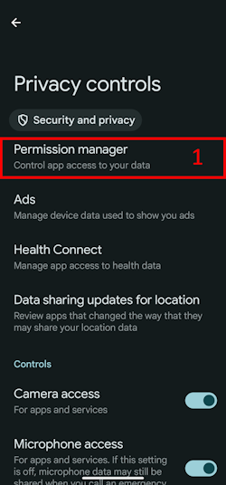
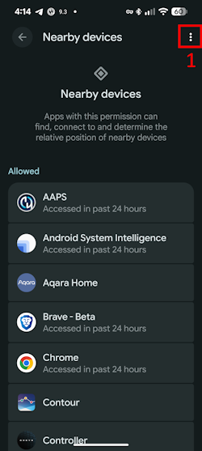

(bluetoothtroubleshooting-bluetooth-related-issues)=

# Bluetooth ile ilgili sorunlar

Bazı kullanıcılar Bluetooth ile ilgili sorunlar yaşıyor: Omnipod DASH etkinleştirme hataları, Medtrum Nano bağlantı sorunları ve diğer Pod hataları. Bu sorunların çoğunun nedeni aşağıdaki sorunlardan biridir.

Bu sorunların bazıları muhtemelen diğer Bluetooth insülin pompaları için de geçerlidir. Omnipod DASH gibi Medtrum Nano'nun da yakındaki cihazlar izniyle ilgili bilinen sorunları vardır.

---

(bluetoothtroubleshooting-cannot-start-omnipod-with-android-16)=

## Android 16 ile Omnipod başlatılamıyor
- Omnipod DASH'in Android 16'da doğru çalışması için en az **AAPS** 3.3.2.1 sürümü gerekir. Bu sürüm, Android 16'nın Omnipod için getirdiği bilinen sorunları gidermek üzere özel düzeltmeler içerir.

---

(bluetoothtroubleshooting-bluetooth-battery-optimisation)=

## Bluetooth pil optimizasyonu

Android'in yeni sürümleri, sistemin Bluetooth uygulaması için pil optimizasyonunu açmıştır. Bunun Bluetooth pompalarında ve CGM'lerde bazı sorunlara neden olduğu bilinmektedir.

[Kurulum Sihirbazı](../SettingUpAaps/SetupWizard.md)'nı izlediyseniz ve [Bluetooth pil optimizasyonu](#setup-wizard-bluetooth-battery-optimisation) bölümündeki yapılandırma ayarlarını uyguladıysanız bu ayar doğru olmalıdır. Ancak bu kılavuzun eski bir sürümünü izlediyseniz bu ayarı değiştirmemiş olabilirsiniz.

Pompa ve CGM bağlantı kopmaları yaşıyorsanız bu ayarın doğru yapılandırıldığını kontrol edin.

---

(bluetoothtroubleshooting-apps-using-nearby-device-permission)=

## "Yakındaki cihazlar" Android iznini kullanan uygulamalar bağlantı kopmalarına ve Pod etkinleştirme sorunlarına neden olabilir

Android, bir izin modeliyle her uygulamanın telefonunuzda neler yapabileceğini veya nelere erişebileceğini kontrol etmenizi sağlar. Yüklü her uygulama için belirli izinlere izin verebilir veya bunları reddedebilirsiniz. Örneğin cihazdaki dosyalara erişim, Bluetooth erişimi, yakındaki cihazları tarama vb.

**AAPS** çalışmak için bazı özel izinlere ihtiyaç duyar. Pod'ların çalışması için gereken izinlerden biri "Yakındaki cihazlar" iznidir. Bu izni isteyen başka birçok uygulama da vardır. Topluluk şunu fark etti: bu izin verilen bazı uygulamalar, bazı cihazlarda yeni Pod'ların etkinleştirilmesinde sorunlara neden olabilir.

(bluetoothtroubleshooting-apps-using-nearby-device-permission-known-apps)=

### "Yakındaki cihazlar" iznini kullanan ve sorunlara neden olduğu bilinen uygulamalar:

Bu listedeki uygulamalar, toplulukta bir veya daha fazla yerde Omnipod DASH cihazlarında ve bazı durumlarda Medtrum Nano'da da sorunlara neden olan uygulamalar olarak konuşuldu.

```{admonition} Updating the list
:class: note
Bu listeye eklenecek uygulamaları konuşmak için #omnipod-dash Discord kanalında @XiTatiON'a yazın.
```

- **myBMW** MyBMW, Medtrum Nano ve Omnipod DASH bağlantısını kesintiye uğrattı. MyBMW uygulaması "yakındaki cihazları bulma" iznini yalnızca bir kez sorar. Bu izni vermezseniz de uygulama sorunsuz çalışır

- **Amazon Alexa**  Alexa uygulamasından "Yakındaki cihazlar" iznini kaldırmak bazı kişilerde sorunu çözdü, ancak bu durumda Matter IoT cihazlarını eşleştirme özelliği çalışmaz

- **MINI app**  Uygulama myBMW uygulamasına dayanıyor gibi görünüyor, bu yüzden onunla aynı şekilde davranabilir

- **BM2** Bazı karavan ve kamp güneş enerjisi sistemlerinde kullanılan güneş pili izleme uygulaması: uygulama çalışırken yeni bir Pod'un etkinleştirilmesini engelledi. Yeni bir Pod'u etkinleştirirken uygulamayı durmaya zorlamak bu sorun için geçici bir çözümdür. Bundan sonra uygulamayı çalıştırmak Dash'in çalışmasını bozmadı gibi görünüyor (Android 16 çalıştıran bir Pixel 8 Pro'da).

(bluetoothtroubleshooting-revoke-nearby-device-permission)=

### Diğer uygulamalar için "Yakındaki cihazlar" izni nasıl kaldırılır:
Yeni bir Pod'u etkinleştirirken sorun yaşıyorsanız ve Android sürümünüz için desteklenen doğru **AAPS** sürümünü kullanıyorsanız, yeni Pod'u etkinleştirirken diğer uygulamaların iznini kaldırmanız gerekebilir.

**AAPS** dışındaki tüm uygulamalar için "Yakındaki cihazlar" iznini kaldırmak üzere bu adımları izleyin:

```{admonition} Menus and settings
:class: note
Bu kılavuzdaki ekran görüntüleri ve talimatlar, Google Pixel 8 Pro üzerindeki saf (Vanilla) Android 16 kurulumuna aittir. Diğer üreticilerin ve cihazların menüleri ve ayar açıklamaları muhtemelen bunlarla tam olarak aynı olmayacaktır. Adımları kendi cihazınıza göre uyarlayın. Takılırsanız, topluluktan nasıl destek alacağınızı öğrenmek için [Dash için nereden yardım alınır](#omnipod-dash-where-to-get-help-for-dash) bölümüne bakın.
```

1. Telefonunuzda Android ayarlarını açın, aşağı kaydırın ve **Security and privacy (1)** (Güvenlik ve gizlilik) seçeneğine dokunun.

    

2. Aşağı kaydırın ve **Privacy controls (1)** (Gizlilik kontrolleri) seçeneğine dokunun.

   

3. **Permission manager (1)** (İzin yöneticisi) seçeneğine dokunun.

   

3. Aşağı kaydırın ve **Nearby devices (1)** (Yakındaki cihazlar) seçeneğine dokunun.

   

4. Uygulama listesine göz atın ve **Nearby devices** (Yakındaki cihazlar) iznini kaldırmak istediğiniz uygulamaya dokunun.

   Bu kılavuzda izni kaldıracağımız uygulama **Android Auto (1)**'dur.

   Daha fazla Pod'un bozulmasını önlemek için herkese önce **AAPS** dışındaki tüm uygulamalardan bu izni kaldırmasını öneririz.

```{admonition} Which app to select?
:class: tip
Hangi uygulamanın soruna neden olduğundan emin değilseniz hepsini devre dışı bırakın (bilinen sorunlu uygulamalar listesine de bakmayı unutmayın ve önce onlarla başlayın). Yolda birkaç Pod'u bozmayı göze alabiliyorsanız, her yeni Pod etkinleştirmesinden önce izni bir yeni uygulama için açın. Böylece Pod sorunlarınıza tam olarak hangi uygulamanın neden olduğunu bulabilirsiniz. Yeni sorunlu uygulamalar bulursanız lütfen #omnipod-dash Discord kanalında bize bildirin.
```

   

5. İzni kaldırmak için **Don't allow (1)** (İzin verme) seçeneğine, ardından **Don't allow anyway (2)** (Yine de izin verme) seçeneğine dokunun. Doğru yaptıysanız seçili seçenek olarak **Don't allow (3)** (İzin verme) görünmelidir. Artık **Back arrow (4)** (Geri oku) ile **Nearby device** (Yakındaki cihazlar) menüsüne dönebilir ve gerekirse bu ayarı diğer uygulamalarda da değiştirebilirsiniz.

      

(bluetoothtroubleshooting-re-enable-nearby-device-permission)=

### Sistem uygulamaları ve diğer uygulamalar için "Yakındaki cihazlar" izni nasıl yeniden açılır:

1. Gerekirse uygulama gizlilik ayarlarına nasıl ulaşacağınızı **"Diğer uygulamalar için 'Yakındaki cihazlar' izni nasıl kaldırılır"** bölümünde bulabilirsiniz. **Nearby device** (Yakındaki cihazlar) yapılandırmasına girdikten sonra 2. adıma geçin.

2. Uygulama listesine göz atın ve **Nearby devices** (Yakındaki cihazlar) iznini vermek istediğiniz uygulamaya dokunun.

   Bu kılavuzda izin vereceğimiz uygulama **Android Auto (1)**'dur.

   İzin kaldırıldıktan sonra **Android Auto (1)** uygulamasının listede olmadığını göreceksiniz. Bunun nedeni, **Android Auto** uygulamasının bir **System app** (sistem uygulaması) olması ve sistem uygulamalarının varsayılan olarak gizli olmasıdır.

   

3. Gizli sistem uygulamalarını göstermek için sağ üst köşedeki **three-dot menu (⋮) (1)** (üç nokta menüsü) öğesine, ardından **"Show system" (2)** (Sistemi göster) seçeneğine dokunun. Artık gizli sistem uygulaması **Android Auto (3)** listede görünmelidir.

```{admonition} Find your app
:class: tip
Bir uygulamanın izni kaldırıldıysa, listenin alt kısmındaki izni kaldırılmış uygulamalar listesini görene kadar aşağı kaydırmanız gerekir.
```

     

5. Her uygulama için izinleri yeniden açmak üzere **"Diğer uygulamalar için 'Yakındaki cihazlar' izni nasıl kaldırılır"** bölümündeki adımları ters sırada uygulayın.

---

(bluetoothtroubleshooting-android-15-bluetooth-connection-problems)=

## Android 15'te sık Bluetooth bağlantı sorunları

Android'i güncelledikten veya yeni bir telefona geçtikten sonra **AAPS** pompayla Bluetooth bağlantısını sık sık kaybediyor. Telefonu yeniden başlatınca sorun geçici olarak kaybolur. **Omnipod DASH** kullanıyorsanız ve telefonunuzda Android 15 varsa, **Bluetooth eşleşmesi** ayarını açmak Bluetooth bağlantısının kararlılığını artırabilir. Açmak için:

```{admonition} Android 16
:class: warning
**Bluetooth eşleşmesi** ayarını yalnızca Android 15'te ve yalnızca bağlantı sorunları yaşıyorsanız açın. Android 16'da eşleştirmeyi (bonding) AÇMAYIN.
```

1. [Dash ayarlarını](#omnipod-dash-settings) açın: **Yönet** > **Pompa** ile DASH pompa ekranını açın ve sağ üst köşedeki **Ayarlar** (dişli) simgesine dokunun.

   

2. **Gelişmiş Ayarlar** bölümünü açın ve **Bluetooth eşleşmesi** ayarını açın.

   

3. Telefon bir eşleştirme isteği gösterirse kabul edin.

4. Restart your phone.
