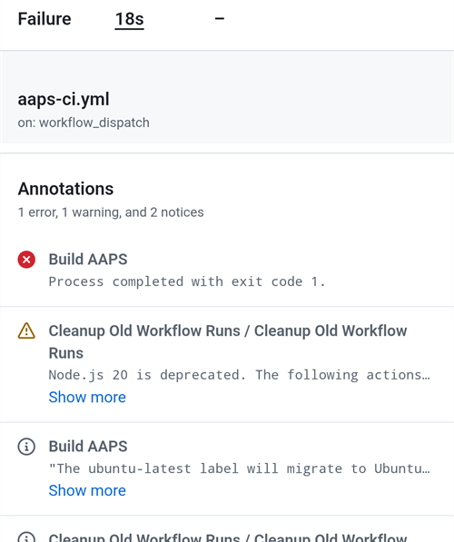

(aaps-ci-troubleshooting)=

# Tarayıcı ile oluşturma: sorun giderme

```{note}
This page collects troubleshooting tips for the [Browser build](../SettingUpAaps/BrowserBuild.md).
```

(aaps-builder-troubleshooting)=

## AAPS Builder

### Step 1: the repository

(aaps-builder-ts-repo-exists)=

#### "my-aaps already exists in this account"


You already have this repository, for example from an earlier attempt. Close the GitHub tab, keep that name in step 1 of the setup page and go on. If you already did steps 2 and 3 for it, your key is still in it: continue with [step 4](#aaps-builder-step4). If it was made with an earlier version of the setup page, update its workflow once as explained in [Updating AAPS](#aaps-builder-updates). You prefer a fresh start? Type another name, for example `my-aaps-2`, and use the same keystore in step 2.

(aaps-builder-ts-user-not-found)=

#### "No GitHub user with this name"


- 1. adımda **"No GitHub user with this name"** (bu adla bir GitHub kullanıcısı yok): e-posta adresinizi değil, GitHub profilinizde gösterildiği şekliyle GitHub kullanıcı adınızı yazın.
- **"Build AAPS" veya "Run workflow" düğmesi yok ya da depo boş**: depo şablondan oluşturulmamıştır. Onu silin (**Settings** → sayfanın en altı → **Delete this repository**) ve **Create my private repository** düğmesiyle [1. adımı](#aaps-builder-step1) yeniden yapın.

### Step 3: the secret

(aaps-builder-ts-404)=

#### "Page not found" (404)


- **Kurulum sayfası GitHub'ı açtığında "Page not found" (404)**: aynı tarayıcıda github.com'a giriş yapın (giriş yapmadığınızda GitHub özel depolar için 404 gösterir). Giriş yaptıysanız, kurulum sayfasının 1. adımındaki kullanıcı adı veya depo adı deponuzla eşleşmiyordur. Adları tam olarak yazın.

### Step 4: the build

(aaps-builder-ts-workflow-not-found)=

#### "This workflow does not exist"


Right after the repository is created, GitHub may not have read its workflow file yet: **Build AAPS** is missing from the **Actions** tab, and there is no **Run workflow** button. Any small change to the file makes GitHub read it:

1. In your repository, open **Code**, then the folder `.github`, then `workflows`, then the file `build.yml`.
2. Tap the **⋯** menu at the top right of the file, then **Edit file… In place** (on a computer, click the pencil).

   

3. Tap at the very end of the text and add an empty line (Enter). Tap **Commit changes…** at the top.

   

4. Tap **Commit changes** again.

   

5. Open the **Actions** tab again: **Build AAPS** is now in the list of workflows (on a phone, the list opens with the icon at the left of **All workflows**). Tap it, then **Run workflow**.

   

(aaps-builder-ts-build-failed)=

#### The build failed (red cross)

1. On the setup page, tap **Open my builds** and tap the build with the red cross.

   

2. The page of the build shows **Failure**, and which part failed: **AAPS / Check** (the repository, the secret, the version or the variant: nothing was built) or **AAPS / Build AAPS**.

   

3. Scroll down to **Annotations**, with your finger on the text, not on the diagram. The red lines explain the problem: tap **Show more** to read the whole message, then find it below.

   

- **"Secret KEYSTORE_SET is missing"** (KEYSTORE_SET secret'ı eksik): kurulum sayfasının 3. adımını yapın.
- **Oluşturma "This repository is PUBLIC" (bu depo herkese açık) mesajıyla duruyor**: deponuzda **Settings** → **General** → **Danger Zone** → **Change visibility** → **Private** yolunu açın (görünürlüğü özel yapın), ardından yeniden oluşturun.
- **"Version … does not exist"**: only released versions of **AAPS** can be built, the ones on the [tags page](https://github.com/nightscout/AndroidAPS/tags) of nightscout/AndroidAPS, such as `3.3.2.0`. A branch name such as `dev` doesn't work. Use `latest`, or type a tag exactly as listed.
- **"Variant … is not supported"** (varyant … desteklenmiyor): iş akışı dosyanız daha eski bir sürümdür. Onu [AAPS'i güncelleme](#aaps-builder-updates) bölümünde açıklandığı gibi değiştirin.
- **"The secret is too short"** (secret çok kısa), **"The secret is not a valid code"** (secret geçerli bir kod değil) veya **"The secret does not contain a keystore"** (secret bir anahtar deposu içermiyor): secret'a yanlış metin yapıştırılmıştır; çoğu zaman `KEYSTORE_SET` kelimesinin kendisi veya kodun yalnızca bir kısmı. Deponuzda **Settings** → **Secrets and variables** → **Actions** yolunu açın, `KEYSTORE_SET` öğesini düzenleyin ve **Copy secret** ile aldığınız uzun kodu yeniden yapıştırın (kurulum sayfasını kapattıysanız önce 2. adımı yeniden yapın).
- **"Keystore, password or alias is wrong"** (anahtar deposu, parola veya takma ad yanlış): anahtar deponuzun parolasını ve takma adını kontrol edin, ardından kurulum sayfasının 2. ve 3. adımlarını yeniden yapın.
- **"Google Drive access has expired or was revoked"** (Google Drive erişiminin süresi doldu veya erişim geri alındı): [6. adımı](#aaps-builder-google-drive) yeniden yapın ve `GDRIVE_OAUTH2` secret'ını güncelleyin.
- **Another error**: [read the build log](#aaps-ci-read-the-logs), then [run the build again](#aaps-ci-rerun). If it fails again the same way, ask for help with the name of the failed step and the error lines. Secret'larınızın içeriğini asla paylaşmayın.

### Step 5: the app

- **Download bağlantısı yok veya GitHub uygulaması açıldı**: GitHub uygulaması oluşturmaları indiremez. Oluşturmayı [5. adımda](#aaps-builder-step5) açıklandığı gibi Chrome'da açın. GitHub bağlantılarının uygulamada açılmasını durdurmak için: Android **Settings** (Ayarlar) → **Apps** (Uygulamalar) → **GitHub** → **Open by default** (Varsayılan olarak aç) → **Open supported links** (Desteklenen bağlantıları aç) seçeneğini kapatın.

## AAPS-CI sorun giderme

(aaps-ci-read-the-logs)=
### Önce: neyin yanlış gittiğini bulun

Bir oluşturma başarısız olduğunda GitHub her adımın günlüğünü tutar. Günlük, hangi adımın neden başarısız olduğunu söyler. Başka bir şey denemeden önce günlüğü okuyun: bu sayfada aradığınız şey ve yardım edenlerin sizden isteyeceği şey hata mesajıdır.

1. AndroidAPS'in GitHub kopyanızda **Actions** sekmesini açın. Başarısız bir oluşturmanın yanında kırmızı bir çarpı vardır. Adına dokunun.

   

2. Çalıştırma özeti **Failure** (başarısız) durumunu ve altında başarısız olan işi gösterir (**Build AAPS**, kırmızı çarpıyla).

   

3. **Annotations** (açıklamalar) bölümüne kaydırın ve kırmızı **Build AAPS** satırına dokunun.

   

4. İş açılır. Gri onay işaretli adımlar başarılı oldu. Kırmızı çarpılı adım başarısız olan adımdır: GitHub onu sizin için açar. Ondan sonraki adımlar atlandı (gri daire).

   

5. `Error: Process completed with exit code 1.` satırının hemen üstündeki satırları okuyun: bu satırlar sorunu açıklar. Bu örnekte **Retrieving Google Drive access token** adımı `invalid_grant` ve `Token has been expired or revoked.` ile başarısız oldu, [Google yenileme belirtecinin süresi doldu](#aaps-ci-google-token-expired) bölümüne bakın.

   

```{tip}
Yardım mı istiyorsunuz? Başarısız adımın adını ve hata satırlarını paylaşın (yukarıdaki gibi bir ekran görüntüsü yeterlidir). Secret'larınızın içeriğini asla paylaşmayın.
```

(aaps-ci-update-secret)=
#### Bir secret'ı güncelleme

Birçok düzeltme, bir secret'ın değerini değiştirmek anlamına gelir. AndroidAPS'in GitHub kopyanızda **Settings** → **Secrets and variables** → **Actions** yolunu izleyin ve secret'ın yanındaki kaleme dokunun.


Yeni değeri girin veya yapıştırın ve **Update secret** düğmesine dokunun. GitHub eski değeri asla göstermez: alan her zaman boştur.


(aaps-ci-rerun)=
#### Bir düzeltmeden sonra oluşturmayı yeniden çalıştırma

Nedeni düzelttikten sonra baştan başlamanız gerekmez: başarısız çalıştırmayı açın, **...** (sağ üst) öğesine, ardından **Re-run failed jobs** seçeneğine dokunun.


**Re-run jobs** düğmesine dokunun. Her zamanki gibi **Run workflow** ile yeni bir oluşturma da başlatabilirsiniz.


(aaps-ci-preparation-web)=
### aaps-ci-preparation web sayfası
  - Hazırlık sayfası geçici bir yerel sunucu tarafından gösterilir (örneğin bir bilgisayarda Simple Web Server). Bu sunucu Google yenileme belirtecini de alır.
  - Aşağıdaki ekranı görüyorsanız yerel sunucu durmuştur veya ona ulaşılamıyordur.
  - Hazırlık sayfasını kapatın, yerel sunucunun çalıştığını kontrol edin, sonra aaps-ci-preparation.html dosyasını 2. Adımdaki gibi yeniden açın ve kalan adımları tamamlayın. Bu, özellikle kurulum sırasında ilk Google bağlantısını oluştururken gereklidir.

  

(aaps-ci-google-token-expired)=
### Google yenileme belirtecinin süresi doldu
  - Google OAuth2 yenileme belirteçlerinin süresi, 6 ay kullanılmazsa dolar. Belirteçler başka durumlarda da geçersiz olabilir (ör. Google hesabınızın parolasını değiştirdiyseniz veya erişimi elle iptal ettiyseniz). Daha fazla bilgi için [Google OAuth2 dokümantasyonuna](https://developers.google.com/identity/protocols/oauth2) bakın.
  - [Oluşturma günlüğünde](#aaps-ci-read-the-logs) **Retrieving Google Drive access token** adımı `invalid_grant` ve `Token has been expired or revoked.` ile başarısız olur:

  

  - Oluşturmanız süresi dolmuş veya iptal edilmiş bir Google yenileme belirteci yüzünden başarısız olursa, yeni bir `GDRIVE_OAUTH2` belirteci almak için [Google Drive yetkilendirmesi](#aaps-ci-google-drive-auth) adımlarını yeniden yapmanız, GitHub deponuzda [secret'ı güncellemeniz](#aaps-ci-update-secret), sonra [oluşturmayı yeniden çalıştırmanız](#aaps-ci-rerun) gerekir.
  - Yetkilendirme yine başarısız olursa veya Google artık onayınızı istemiyorsa, önce Google hesabınızdan mevcut AAPS erişimini kaldırın, [aşağıya](#aaps-ci-google-remove-access) bakın.

(aaps-ci-google-remove-access)=
### AAPS erişimini Google hesabınızdan kaldırın ve yetkilendirmeyi yeniden başlatın
  - Google Drive yetkilendirmesi sürekli başarısız oluyorsa veya temiz bir durumdan yeniden başlamak istiyorsanız, önce AAPS'e daha önce verdiğiniz erişimi kaldırın, sonra yetkilendirmeyi yeniden yapın.
  - Telefonunuzda [https://myaccount.google.com](https://myaccount.google.com) adresini açın, **Security** (Güvenlik) seçeneğine dokunun, **Your connections to third-party apps & services** (Üçüncü taraf uygulama ve hizmetlerle bağlantılarınız) bölümüne kaydırın ve bağlı uygulamalar listesini açın. Doğrudan [https://myaccount.google.com/connections](https://myaccount.google.com/connections) adresine de gidebilirsiniz.
  - Listede **AAPS** öğesine dokunun.

  

  - Sayfa, AAPS'e verdiğiniz erişimi gösterir (uygulamayla kullanılan Google Drive dosyaları). Bağlantıyı kaldırmak için **Delete all** (Tümünü sil) seçeneğine veya önce incelemek için **See details** (Ayrıntıları göster) seçeneğine dokunun.

  

  - Ayrıntılar sayfasında **Remove all access** (Tüm erişimi kaldır) seçeneğine dokunun.

  

  - **Confirm** (Onayla) düğmesine dokunun.

  

  - Google, AAPS'in artık erişimi olmadığını onaylar. AAPS artık bağlı uygulamalar listesinde görünmez.

  

  - Şimdi yetkilendirmeyi temiz bir şekilde yeniden başlatın: hazırlık sayfasını ve dosya yöneticisi uygulamasını **ikisini birden** kapatın, aaps-ci-preparation.html dosyasını dosya yöneticisinden yeniden açın ve [Google Drive yetkilendirmesi](#aaps-ci-google-drive-auth) adımlarını yeniden yapın. Google sizden yeniden erişim izni isteyecek ve sayfa yeni bir `GDRIVE_OAUTH2` belirteci verecektir.
  - GitHub deponuzda [`GDRIVE_OAUTH2` secret'ını yeni belirteç ile güncelleyin](#aaps-ci-update-secret), sonra [oluşturmayı yeniden çalıştırın](#aaps-ci-rerun).

(aaps-ci-disable-software)=
### OAuth doğrulamasını engelleyebilecek yazılımları devre dışı bırakın
  - OAuth anahtarını almaya çalışmadan önce telefondaki tüm VPN veya güvenlik uygulamalarını (güvenlik duvarı, kötü amaçlı yazılım koruması vb.) devre dışı bırakın.

(aaps-ci-actions-permission)=
### GitHub Actions izin ayarlarını kontrol edin
  - GitHub Actions ilkelerinin “Allow all actions and reusable workflows” olarak ayarlandığından emin olun (Settings → Actions → General). Değiştirirseniz seçeneklerin altındaki **Save** düğmesine basın.

  

`actions/checkout@v4` and `actions/setup-java@v4` are not allowed to be used in `xxxxx/AndroidAPS`. Actions in this workflow must be: within a repository owned by `xxxxx`

(aaps-ci-workflow-permissions)=
### GitHub iş akışı (workflow) izin ayarlarını kontrol edin
  - Oluşturma, aşağıdakine benzer bir "Invalid workflow file" hatasıyla hemen başarısız olursa, deponuzun varsayılan iş akışı izinleri çok kısıtlayıcıdır:

```
Invalid workflow file
The workflow is not valid. .github/workflows/aaps-ci.yml (Line: 361, Col: 3):
Error calling workflow 'xxxxx/AndroidAPS/.github/workflows/cleanup-workflow-runs.yml@...'.
The nested job 'cleanup' is requesting 'actions: write', but is only allowed 'actions: none'.
```

  - Workflow permissions ayarının “Read and write permissions” olduğundan emin olun (Settings → Actions → General → Workflow permissions). Sonra kaydedin ve oluşturma iş akışını yeniden çalıştırın.

  

(aaps-ci-password-special-characters)=
### Oluşturma, anahtar deposu parolası kontrol edilirken başarısız oluyor
  - [Oluşturma günlüğünde](#aaps-ci-read-the-logs) **Validating keystore, alias and password** adımı `Either KEYSTORE_BASE64, KEYSTORE_PASSWORD, KEY_PASSWORD, or KEY_ALIAS is incorrect` ve ardından `Keystore was tampered with, or password was incorrect` ile başarısız olur. Oluşturma burada durur: anahtar deposu ve parolalar AAPS oluşturulmadan önce kontrol edilir.

  

  - Oluşturma iş akışı, parolalarınızdaki her karakteri olduğu gibi korur. `KEYSTORE_PASSWORD` ve `KEY_PASSWORD` değerlerini tam olarak oldukları gibi girin; ters eğik çizgi veya başka bir kaçış karakteri eklemeyin. Ters eğik çizgi eklediyseniz, [secret'ları parolanın tam haliyle güncelleyin](#aaps-ci-update-secret). Aşağıdaki örnek yanlıştır: parola `Example2026`, ters eğik çizgi sonradan eklenmiş.

  

  - Parolanız doğru olduğu halde oluşturma APK imzalanırken hâlâ başarısız oluyorsa ve parola `$`, ters tırnak (backtick), `"` veya `\` içeriyorsa, fork'unuzdaki iş akışı dosyası Eylül 2026'dan eskidir ve bu karakterleri hâlâ yorumluyordur. [Fork'unuzu](#Update-to-new-version-update-your-repo) en son dev ile senkronize edin, sonra oluşturma iş akışını yeniden çalıştırın.
  - Dikey çizgi `|` özel bir durumdur. [Seçenek 1](#aaps-ci-option1)'in hazırlık sayfası; anahtar deposunu, parolaları ve takma adı `|` ile ayrılmış tek bir `KEYSTORE_SET` secret'ında birleştirir. İş akışı bunu bu karakterden böler. Hazırlık sayfasının oluşturduğu parola yalnızca harf ve rakam içerir, bu yüzden Seçenek 1 ile bu durum oluşamaz. Bu durum yalnızca `|` içeren bir paroladan kendiniz bir `KEYSTORE_SET` secret'ı oluşturduysanız olabilir. Bu durumda `KEYSTORE_SET` secret'ını silin ve bunun yerine [Seçenek 2](#aaps-ci-option2)'nin ayrı secret'larını girin.
