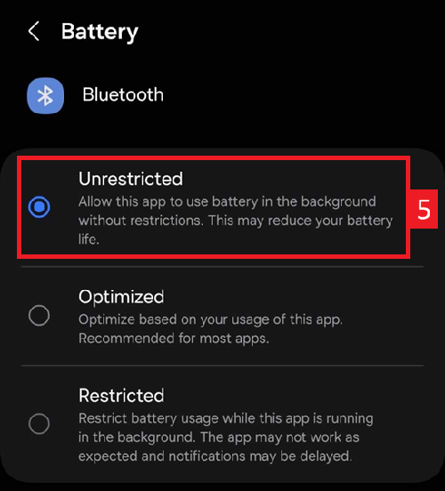

(generaltroubleshooting)=

# Troubleshooting

**Bir şey çalışmadığında buradan başlayın.** Sorun giderme bilgileri dokümantasyonun birçok sayfasında yer alır. Bu sayfa onları bir araya getirir: en yaygın sorunları çözmenize yardımcı olmak için konuya göre sıralanmış tek bir bağlantı listesidir.

Cevabınızı aşağıda bulamazsanız şunlara da bakın:

* sık sorulan soruların cevapları için [SSS](../UsefulLinks/FAQ.md) ve
* döngünüz çalışıyor ancak glikoz kontrolünüzün iyileşmesi gerekiyorsa [profil ince ayar kılavuzu](ProfileTuning.md).

```{admonition} Still stuck?
:class: tip
Bu bağlantıların hiçbiri sorununuzu çözmezse, topluluğa sormak için (Facebook, Discord) [Nereden yardım alabilirim?](WhereCanIGetHelp.md) sayfasına bakın veya [günlük dosyalarınızı](AccessingLogFiles.md) geliştiricilere gönderin.
```

---

(generaltroubleshooting-aaps-app)=

## AAPS uygulaması

### Yapım & güncelleme

* Oluşturma başarısız olursa [Oluşturma başarısız olursa](#building-aaps-troubleshooting) bölümüne bakın: burada her oluşturma yöntemi için sorun giderme bölümü listelenir:
  * [AAPS Builder](#aaps-builder-troubleshooting)
  * [Tarayıcı ile oluşturma](#aaps-ci-troubleshooting)
  * [Android Studio](TroubleshootingAndroidStudio.md)
* Kayıp anahtar deposu veya yeni anahtar deposu: [AAPS'i yeniden yükleme](#reinstall-aaps)
* **AAPS**'i güncelleme: [AAPS Builder ile](#aaps-builder-updates), [tarayıcı ile oluşturma (fork) ile](#update-browser-build-troubleshooting), [Android Studio ile](#update-computer-build-troubleshooting)

### Yükleme

* [Google Play Protect uyarısı](#transferring-installing-play-protect-warning): uygulama güvenli değil olarak bildiriliyor.
* Kurulum, doğrulanmamış bir geliştirici hakkında bir mesajla **engelleniyor**: ücretsiz kurulum yöntemleri için [Android geliştirici doğrulaması](#android-developer-verification) bölümüne bakın.

### Ayarlar

* [Profil: "Bazal oran mevcut pompa ile uyumlu değildir"](#your-aaps-profile-basal-not-compatible)
* [Pompa: "Veriler farklı pompadan geliyor"](#config-builder-wrong-pump-data)
* [Nightscout Client](TroubleshootingNsClient.md)
* Başlangıçta **"AAPS ayarları okunamıyor"**: ayarlar, Android'in **AAPS** için sakladığı bir anahtarla şifrelenmiştir ve bu anahtar artık ayarları açamıyordur; örneğin telefonun anahtar deposu sıfırlandıktan sonra. Bu ekran gösterilirken **AAPS** çalışmaz ve pompayı kontrol etmez. **Tekrar dene**'ye dokunun: **AAPS**'i kapatıp yeniden başlatır. Bu işe yaramazsa telefonu yeniden başlatın. **Sıfırdan başla**'yı yalnızca başka hiçbir şey işe yaramadığında kullanın: okunamayan ayar dosyasını bir kenara koyar (adı değiştirilir ve saklanır) ve **AAPS**'i boş ayarlarla başlatır. Ardından son [ayar dışa aktarımınızı](../Maintenance/ExportImportSettings.md) içe aktarın.

### Kullanım

* [Yanlış karbonhidrat değerleri (yavaş karbonhidrat emilimi)](#CobCalculation-detection-of-wrong-cob-values)
* [Otomasyonlar](#automations-troubleshooting)
* [Tam kapalı döngü](#full-closed-loop-troubleshooting)

---

(generaltroubleshooting-bluetooth-related-issues)=


## Bluetooth ile ilgili sorunlar

Bluetooth bağlantılarıyla, pompa/Pod bağlantısının kopmasıyla veya etkinleştirme ve bağlantı sorunlarıyla ilgili bilinen sorunlar için: [Bluetooth sorunlarını giderme](../GettingHelp/BluetoothTroubleshooting.md)

---

(generaltroubleshooting-android-related-issues)=

## Android ile ilgili sorunlar

### Pil optimizasyonu

**AAPS**, telefonunuz için doğru ayarları bulmanıza yardımcı olabilir: **menü** (☰) > **Hakkında** bölümünü açın ve **Uygulamamı kapatma?** öğesine dokunun. Bu, [Don't kill my app](https://dontkillmyapp.com/) sitesinde telefon markanıza ait talimatları açar. [Kurulum sihirbazı](#setup-wizard-bluetooth-battery-optimisation) da sizden **AAPS** ve Bluetooth için pil optimizasyonunu kapatmanızı ister.

Android, varsayılan olarak etkin olan pil tasarrufu ayarları içerir. Bu ayarlar, sistemin çalışması için gerekli olmayan uygulamaları otomatik olarak askıya alır/duraklatır. Böylece her zaman çalışması gerekmeyen uygulamaların harcadığı pil enerjisi azalır.

Bu ayar etkin olduğunda, **AAPS** ve **xDrip** gibi diğer destekleyici uygulamalarda büyük olasılıkla sorunlara neden olur.

**AAPS** ve diğer destekleyici uygulamaların her zaman etkin kalması için Pil Optimizasyonunu devre dışı bırakmanız önemlidir.

Telefonunuzun modeline ve markasına göre, bu ayarın devre dışı bırakılması gereken birden fazla yer olabilir.

***NOT:** Telefonunuzda bu seçenek varsa, Bluetooth hizmeti için Pil Optimizasyonunu devre dışı bırakmak üzere aşağıdaki adımları izleyin. Aynı adımları **AAPS** ve diğer uygulamalar için de kullanabilirsiniz, ancak ekran görüntüleri yalnızca Bluetooth hizmeti için nasıl yapılacağını gösterir.*

#### Pixel telefonlar (saf Android)

* Android ayarlarına gidin, "Uygulamalar"ı seçin.

  

* "Tüm uygulamaları gör" seçeneğini seçin

  

* Sağdaki menüden "Sistemi göster" uygulamalarını seçin.

  

* Şimdi "Bluetooth" uygulamasını arayın ve seçin.

  

* "Uygulama pil kullanımı"na tıklayın ve "Kısıtlanmamış"ı seçin (bazı eski Android sürümlerinde adı "Optimize edilmemiş").

  


#### Samsung telefonlar

* Android ayarlarına gidin, "Uygulamalar" ı seçin

* Sıralama algoritmasını değiştiren simgede (1), "Sistem uygulamalarını göster"i (2) seçin.

  

  

* Şimdi Bluetooth uygulamasını arayın ve ayarlarını görmek için seçin.

  

* "Pil"i seçin

  

* "Kısıtlanmamış" olarak ayarlayın (bazı eski Android sürümlerinde adı "Optimize edilmemiş").

  

#### Huawei telefonlar

Şu kılavuza bakın: [Huawei Bluetooth ve pil optimizasyonu](../CompatiblePhones/Huawei.md)

---

(generaltroubleshooting-cgm)=

## Sürekli Glikoz İzleme (CGM)

CGM'lerdeki bilinen sorunlar ve çözüm adımları için faydalı bağlantılar.

* [General](#general-cgm-troubleshooting)
* [Dexcom G6](#DexcomG6-troubleshooting-g6)
* [Minimal Looper ile Libre 2](#minimallooper-troubleshooting)
* [Libre 3](#libre3-experiences-and-troubleshooting)
* [xDrip - CGM verisi yok](#xdrip-identify-receiver)
* [xDrip - Dexcom sorun giderme](#xdrip-troubleshooting-dexcom-g5-g6-and-xdrip)

---

(generaltroubleshooting-pumps)=

## Pompalar

Pompalardaki bilinen sorunlar ve çözüm adımları için faydalı bağlantılar

* [Accu-Chek Combo](#combov2-tips-for-basic-usage)
* [Accu-Chek Insight](#Accu-Chek-Insight-Pump-insight-specific-errors)
* [CareLevo](#carelevo-alarms-and-notifications)
* [DanaRS](#DanaRS-Insulin-Pump-dana-rs-specific-errors)
* [Diaconn G8](#diaconn-g8-bluetooth-troubleshooting)
* [EOPatch2](#eopatch2-alarms-and-warnings)
* [Medtronic + RileyLink](#MedtronicPump-what-to-do-if-i-loose-connection-to-rileylink-and-or-pump)
* [Medtrum Nano](#medtrum-nano-troubleshooting)
* [Omnipod DASH](#omnipod-dash-troubleshooting)
* [Omnipod Eros](#OmnipodEros-troubleshooting)

---

(generaltroubleshooting-phones)=

## Telefonlar

Telefonlardaki bilinen sorunlar ve çözüm adımları için faydalı bağlantılar

* [Test edilmiş telefon ve cihaz kurulumlarının listesi](https://docs.google.com/spreadsheets/u/1/d/e/2PACX-1vScCNaIguEZVTVFAgpv1kXHdsHl3fs6xT6RB2Z1CeVJ561AvvqGwxMhlmSHk4J056gMCAQE02sAWJvT/pubhtml?gid=683363241&single=true)
* [Jelly](../CompatiblePhones/Jelly.md)
* [Huawei Bluetooth ve pil optimizasyonu](../CompatiblePhones/Huawei.md)

---

(generaltroubleshooting-remote-control)=

## Uzaktan kontrol

* [AAPSClient ve uzaktan kumanda (eşleştirme, komutlar alınmıyor)](#client-master-control-troubleshooting)
* ['Nightscout erişim belirteci' sorunları](#remotecontrol-nightscout-access-token)
* [SMS Komutları](#SMSCommands-troubleshooting)
* [Android Auto](#android-auto-troubleshooting)

---

(generaltroubleshooting-smartwatches)=

## Akıllı saatler

Akıllı saatlerdeki bilinen sorunlar ve çözüm adımları için faydalı bağlantılar

* [Troubleshooting Wear app](#Watchfaces-troubleshooting-the-wear-app)
* [Saat ve telefon iletişim kurmuyor](#wear-os-watch-phone-communication)
* [Wear OS 5](#wear-os-5-troubleshooting)
* [Wear uygulamasını oluşturma](#building-aaps-wear-os-troubleshooting)
