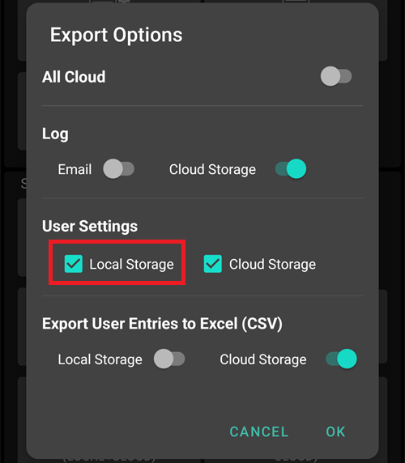
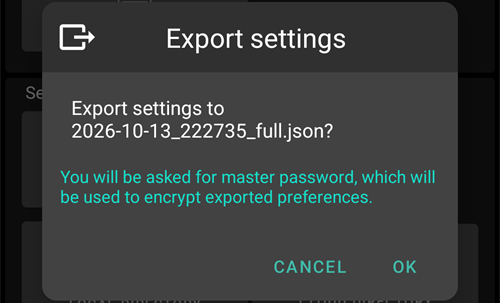
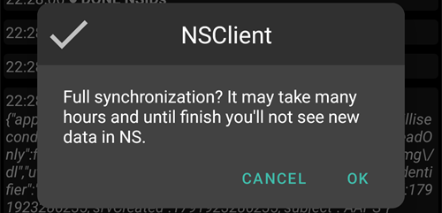
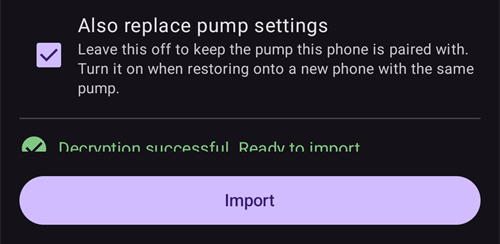
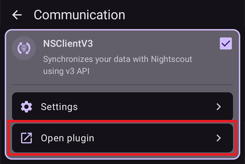

(reinstall-aaps)=
# Yeni bir anahtar deposuyla AAPS'i yeniden yükleme

Her **AAPS** apk dosyası bir **anahtar deposu (keystore)** ile imzalanır. Bir güncelleme, mevcut **AAPS**'inizin üzerine yalnızca **aynı anahtar deposu** ile imzalanmışsa yüklenir: bu durumda tüm ayarlarınız ve verileriniz korunur. Bu nedenle anahtar deposunu ve parolasını güvenli bir yerde saklamanız önerilir.

Öncekinden farklı bir anahtar deposuyla imzalanmış bir apk yüklemeye çalışırsanız, yüklemenin başarısız olduğunu açıklayan bir hata mesajı alırsınız!

(reinstall-aaps-when)=
## Ne zaman yeniden yüklemeniz gerekir?

Yeni apk dosyanız farklı bir anahtar deposuyla imzalandığında **AAPS**'i kaldırıp yeniden yüklemeniz gerekir, örneğin:

- Eski anahtar deponuzu veya parolasını bulamıyorsunuz.
- [Tarayıcı ile oluşturmanın 1. seçeneği](../SettingUpAaps/BrowserBuildKeystore.md) ile veya [AAPS Builder](../SettingUpAaps/BrowserBuildAapsBuilder.md) içinde **Create a new key** (yeni anahtar oluştur) ile yeni bir anahtar deposu oluşturdunuz.
- Yeni bir bilgisayarda oluşturuyorsunuz ve anahtar deponuzu oraya kopyalamadınız.

Anahtar deponuz hâlâ duruyorsa bu sayfaya ihtiyacınız yok: onu yeniden kullanın ve [**AAPS**'i yerinde güncelleyin](../Maintenance/UpdateToNewVersion.md).

(reinstall-aaps-before)=
## Başlamadan önce

- **AAPS**'i kaldırmak tüm ayarlarını, [görevlerinizi](../SettingUpAaps/CompletingTheObjectives.md) ve mevcut pompa bağlantısını siler. Bunları **ayar dosyanızı** içe aktararak geri alırsınız, bu yüzden güncel bir ayar dosyanız olduğundan emin olun.
- Ayar dosyası tedavi ve glikoz geçmişinizi içermez. [Nightscout](../SettingUpAaps/SettingUpTheReportingServer.md)'a yükleme yapıyorsanız, yeniden yüklemeden sonra geçmişi oradan geri alabilirsiniz (8. adım).
- [**Ana parolanıza**](#Preferences-master-password) ihtiyacınız var: ayar dosyası onunla şifrelenir.
- **Omnipod ve Medtrum kullanıcıları:** önce [Hortumsuz pompalar](#ExportImportSettings-tubeless-pumps) bölümünü okuyun. Ayar dosyanız, şu anda taktığınız Pod veya Patch süresince dışa aktarılmış olmalıdır.
- Gerekirse, başlamadan önce [CGM/KŞ kaynağı alıcınızı kurun](../Getting-Started/CompatiblesCgms.md).

(reinstall-aaps-steps)=
## Adımlar

Resimler, **AAPS** 3.4'ten (1-3. adımlar) **AAPS** 4'e (6-8. adımlar) geçişi gösterir. Diğer sürümler biraz farklı görünür.

(reinstall-aaps-export)=
### 1. Export your settings

Ayarlarınızı, telefonunuzda şu anda yüklü olan **AAPS** ile dışa aktarın. Ayrıntılar için [Ayarları dışa aktarma](#ExportImportSettings-Settings-Export) bölümüne bakın.

**AAPS** 3.4'te: **Bakım**'ı açın ve **Dışa aktarma seçenekleri**'ne dokunun. **Kullanıcı Ayarları** altında **Yerel Depolama**'yı işaretleyin ve **Tamam**'a dokunun.

*Not: Güvenlik için bir yedek kopya tutmak üzere [Bulut Depolama](#preferences-maintenance-cloud) da kullanabilirsiniz: bu iyi bir fikirdir, ancak ayarları hızlıca geri yükleyebilmek için Yerel Depolama'yı da kullanın.*

Düğmede artık **Ayarları dışa aktar (yerel)** yazar. Bu düğmeye dokunun.

**AAPS**, oluşturacağı dosyanın adını gösterir. **Tamam**'a dokunun, ana parolanızı yazın ve **Tamam**'a dokunun.

**AAPS** 4'te: **Bakım**'ı açın, **Ayarları dışa aktar** yanındaki **Yerel** çipini seçin ve **Ayarları dışa aktar**'a dokunun.

(reinstall-aaps-copy)=
### 2. Ayar dosyasını telefonunuzdan başka bir yere kopyalayın

Dosya, [**AAPS** dizininizdeki](#SetupWizard-StoragePermission) **preferences** klasöründedir ve adı `2026-10-13_222735_full.json` gibidir. Dosyayı harici bir konuma kopyalayın veya yükleyin (ör. bilgisayarınız, bulut depolama hizmeti...). Dosya normalde kaldırma işleminden sonra telefonunuzda kalır, ancak her ihtimale karşı başka bir yerde de bir kopyasını saklayın.

(reinstall-aaps-nightscout-before)=
### 3. Nightscout ile senkronize edin

Bu adım zorunlu değildir, ancak [DynISF](#Open-APS-features-DynamicISF) kullanıyorsanız önerilir: eklentinin ihtiyaç duyduğu verilerin oluşması için 5 gün beklemek yerine doğrudan mevcut ayarlarla devam etmenizi sağlar. NSClient V3'ün [etkinleştirilmiş ve yapılandırılmış](../SettingUpAaps/SettingUpTheReportingServer.md) olması gerekir.

Kaldırmadan önce tüm verilerinizin Nightscout'ta olduğundan emin olun.

**NSClient**'ı açın, ekranın altındaki **Tam senkronizasyon** düğmesine dokunun, ardından **Tamam**'a dokunun.

*Not: Gereken süre Nightscout barındırma hizmetinize bağlıdır.*

**AAPS** ardından veritabanını temizlemeyi önerir. **Tamam**, 3 aydan eski verileri telefondan kaldırır; bu da senkronizasyonu çok hızlandırır. **Vazgeç** ise temizlemeden senkronize eder. Telefondaki veritabanı kaldırma sırasında zaten silinir, bu yüzden iki seçenek de uygundur.

Senkronizasyon bitene kadar **AAPS**'i çalışır durumda bırakın.

(reinstall-aaps-build)=
### 4. Yeni apk dosyasını oluşturun

Yeni anahtar deponuzla imzalanmış yeni bir apk [oluşturun](../SettingUpAaps/BuildingAaps.md) ve telefonunuza aktarın.

(reinstall-aaps-uninstall)=
### 5. AAPS'i kaldırın

Telefonunuzun **Ayarlar** > **Uygulamalar** > **AAPS** bölümünde **Kaldır**'a dokunun ve **Tamam** ile onaylayın.

(reinstall-aaps-install)=
### 6. Yeni AAPS'i yükleyin ve başlatın

Yeni apk dosyasını [yükleyin](../SettingUpAaps/TransferringAndInstallingAaps.md) ve **AAPS**'i başlatın. [Kurulum sihirbazı](../SettingUpAaps/SetupWizard.md), **AAPS**'in ihtiyaç duyduğu izinleri ister: her biri için **İzin ver**'e dokunun. Bu, [pil optimizasyonunu](#setup-wizard-bluetooth-battery-optimisation) da yeniden kapatır.

**AAPS Dizini** için öncekiyle aynı **AAPS** klasörünü (içinde **preferences** klasörü olanı) seçin, **Bu klasörü kullan**'a ve **İzin ver**'e dokunun.

**AAPS** dışa aktardığınız ayarları bulduğunda, kurulum sihirbazı bunları içe aktarabileceğiniz bir [Saklanan ayarlar bulundu](#setup-wizard-import-settings) ekranı gösterir. Sihirbazı kapatıp aşağıda anlatıldığı gibi **Bakım** bölümünden de içe aktarabilirsiniz.

(reinstall-aaps-import)=
### 7. Ayarlarınızı içe aktarın

Ayar dosyası artık telefonunuzda değilse, onu **AAPS** dizininizdeki **preferences** klasörüne geri kopyalayın.

Menü (☰) > **Bakım** bölümünü açın, **Ayarları içe aktar** yanındaki **Yerel** çipini seçin ve **Ayarları içe aktar**'a dokunun.

Listede her dosya, **AAPS** sürümü ve ne kadar eski olduğu ile birlikte gösterilir. 1. adımda dışa aktardığınız dosyayı seçin.

Yeni **AAPS**'te önce bir ana parola belirlemeniz gerekmez. Dışa aktarırken kullandığınız ana parolayı **Şifre çözme parolası** alanına yazın ve **Şifreyi çöz**'e dokunun. **Dosya farklı bir parolayla şifrelenmiş** mesajı normaldir: yeni **AAPS** parolanızı henüz bilmiyor. İçe aktarma, parolayı diğer ayarlarınızla birlikte geri yükler.

**Pompa ayarlarını da değiştir** seçeneğini işaretleyin: bu olmadan pompanız ve ayarları geri yüklenmez. Omnipod ve Medtrum kullanıcıları: bunu yalnızca dosya mevcut Pod veya Patch'iniz sırasında dışa aktarıldıysa işaretleyin (bkz. [Hortumsuz pompalar](#ExportImportSettings-tubeless-pumps)).

**İçe aktar**'a, ardından ayarları uygulamak için **Tamam**'a ve **Ayarlar uygulandı** ekranında yeniden **Tamam**'a dokunun.

(reinstall-aaps-nightscout-after)=
### 8. Geçmişinizi Nightscout'tan geri alın

Menü (☰) > [**Konfigürasyon**](../SettingUpAaps/ChangeAapsConfiguration.md) > **İletişim** bölümünü açın ve **NSClientV3** altındaki **Eklentiyi aç**'a dokunun. Durumun **Bağlandı** olarak göründüğünü kontrol edin. Görünmüyorsa [NSClient'te Sorun Giderme](TroubleshootingNsClient.md) sayfasına bakın.

Ekranın altındaki **Tam senkronizasyon** düğmesine ve **Tamam**'a dokunun. Veritabanı yeni olduğu için temizleme sorusunu istediğiniz gibi cevaplayabilirsiniz.

**AAPS**, verilerinizi Nightscout'tan yükler. İşlem bittiğinde günlükte **Full sync finished** görünür.

(reinstall-aaps-check)=
### 9. Kontrol edin ve döngüye devam edin

Pompanızın bağlı olduğunu ve CGM değerlerinizin geldiğini kontrol edin, ardından döngüye devam edin.

(reinstall-aaps-afterwards)=
## Sonrası

Bundan sonra her zaman yeni anahtar deponuzu kullanın ve onu parolasıyla birlikte telefonunuzun dışında güvenli bir yerde saklayın. Bkz. [Yedek oluşturma](../Maintenance/ExportImportSettings.md).
