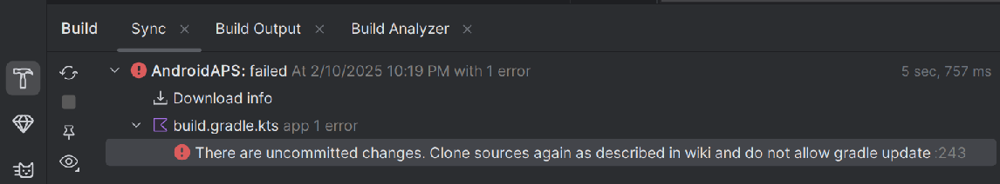
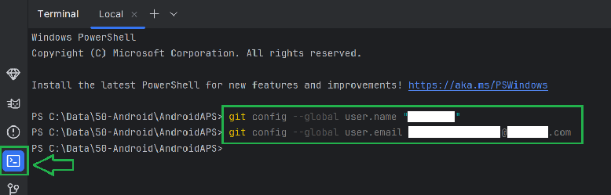
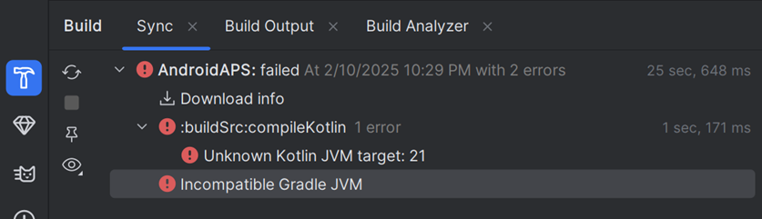
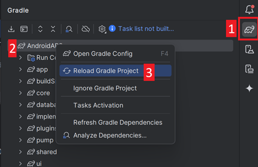
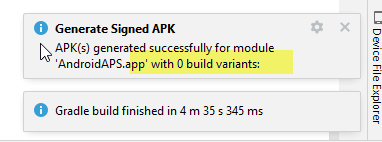
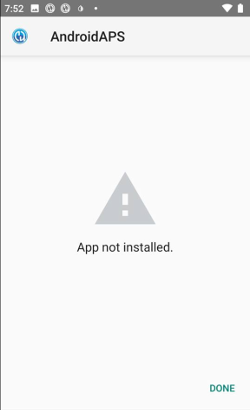

(troubleshooting_androidstudio-troubleshooting-android-studio)=

# Android Studio'da Sorun Giderme

```{contents} List of common issues
:depth: 2
:local: true
```

(troubleshooting_androidstudio-lost-keystore)=
## Kayıp keystore
Anahtar deponuzu veya parolasını kaybettiyseniz, yeni bir anahtar deposuyla imzalanmış bir apk mevcut **AAPS**'inizi güncelleyemez: onu kaldırıp yeniden yüklemeniz gerekir. Bkz. [Yeni bir anahtar deposuyla AAPS'i yeniden yükleme](#reinstall-aaps).

## Gradle Sync başarısız oldu
Gradle Sync çeşitli nedenlerle başarısız olabilir. 'gradle sync failed' diyen bir mesaj aldığınızda, Android Studio'nun altındaki "Build" sekmesini (1) açın ve hangi hata mesajının (2) gösterildiğini kontrol edin.


```{contents} Likely reasons for gradle sync failures are:
:depth: 1
:local: true
```

*Önemli*: Kendi sorununuzla ilgili talimatları uyguladıktan sonra [gradle sync](#gradle-resync) işlemini yeniden başlatmanız gerekir.

(troubleshooting_androidstudio-uncommitted-changes)=
### Uncommitted changes

Bunun gibi bir hata mesajı alırsanız:



```
Build file 'C:\Data\50-Android\AndroidAPS\app\build.gradle.kts' line: 243

There are uncommitted changes.
Clone sources again as described in wiki and do not allow gradle update
```

#### Adım 1 - Git kurulumunu kontrol edin
  * Android Studio'nun altındaki terminal sekmesini (1) açın, aşağıdaki metni kopyalayıp terminale (2) yapıştırın veya yazın.
    ```
    git --version
    ```

    

    Not: Git ile version arasında bir boşluk ve iki kısa çizgi vardır!

  * Yukarıdaki ekran görüntüsünde görüldüğü gibi, hangi Git sürümünün yüklü olduğunu söyleyen bir mesaj almalısınız. Bu durumda [2. adıma](#troubleshooting-android-studio-check-for-uncommitted-changes) gidin.

  * Şöyle bir mesaj alırsanız
    ```
    Git: command not found
    ```
    git kurulumunuz doğru değil.

  * [Git kurulumunu kontrol et](#BuildingAaps-steps-for-installing-git)

  * Windows kullanıyorsanız ve Git'i yeni yüklediyseniz, Git'in her yerden kullanılabilmesi için yüklemeden sonra bilgisayarınızı yeniden başlatmalısınız

  * Git yüklüyse, (Windows kullanıyorsanız) bilgisayarı yeniden başlattıysanız ve Git hâlâ bulunamıyorsa:

  * Bilgisayarınızda "git.exe" dosyasını arayın.

    Hangi dizine kaydedildiğini not edin.

  * Windows'ta Ortam değişkenlerine gidin, "PATH" değişkenini seçin ve düzenle'ye tıklayın. Git kurulumunuzu bulduğunuz dizini ekleyin.

  * Kaydedin ve çıkın.

  * Android Studio'yu yeniden başlatın.

(troubleshooting-android-studio-check-for-uncommitted-changes)=
#### Adım 2: Taahhüt edilmemiş değişiklikleri kontrol edin.

  * Android Studio'da sol taraftaki 'Commit' sekmesini (1) açın. 
  * "Changes" (eski Android Studio sürümlerinde adı "Default changeset") (2) veya "Unversioned Files" (3) görebilirsiniz:

    * "Changes" görüyorsanız, büyük olasılıkla 'Gradle'ı güncellediniz veya bazı dosyaların içeriğini yanlışlıkla değiştirdiniz.

    * "Changes" üzerine sağ tıklayın ve "Rollback…" seçin (1)

      

    * Dosyalar tekrar Git sunucusundan alınır. Commit sekmesinde başka değişiklik yoksa [3. adıma](#gradle-resync) gidin.

  * "Unversioned Files" görüyorsanız, kaynak kod dizininize yanlışlıkla dosya kaydetmiş olabilirsiniz. Bunlar önemli dosyalar olabilir: örneğin başka bir yere taşınması gereken anahtar deposu dosyanız gibi. Bu dosyaların ne olduğunu bilmiyorsanız ve onları kendiniz oluşturmadıysanız silebilirsiniz.

    * Bu dosyayı güvenli bir yere taşımak veya kesip yapıştırmak için bilgisayarınızdaki normal dosya gezginini kullanın.

    * Android Studio'ya geri dönün ve dosyanın artık **AAPS** dizininde olmadığından emin olmak için Commit sekmesindeki Refresh düğmesine (4) tıklayın.

      Commit sekmesinde başka değişiklik yoksa [3. adıma](#gradle-resync) gidin.


#### Adım 3 - Resync Gradle (tekrar)

[Gradle Resync](#gradle-resync) bölümündeki talimatları izleyin.

### Git Pull Failed - Please tell me who you are

Bu mesajı görüyorsanız, Git sizden kendinizi tanıtmanızı istiyor.


Terminali açın ve aşağıdaki iki komutu sırayla yazın.

```
git config --global user.name "Your name here"
git config --global user.email your.email@here.com
```

Adınız tırnak işaretleri arasına yazılmalıdır.



(troubleshooting_androidstudio-android-gradle-plugin-requires-java-11-to-run)=

(incompatible-gradle-jvm)=
### Uyumsuz Gradle JVM



```
Your build is currently configured to use incompatible Java 21.0.3 and Gradle 8.2.
Cannot sync the project.

We recommend upgrading to Gradle version 8.9.

The minimum compatible Gradle version is 8.5.

The maximum compatible Gradle JVM version is 19.
```

Or:

```
Cause: error: invalid source release: 21
```

Yukarıdaki hata mesajını alırsanız, yeniden oluşturmayı denemeden önce doğru JVM sürümünü indirmeniz gerekir:

1.  [Gereksinim tablosunda](#Building-APK-recommended-specification-of-computer-for-building-apk-file), oluşturduğunuz **AAPS** sürümü için hangi JVM sürümüne ihtiyacınız olduğunu kontrol edin ve not alın.

2. Android Studio'nun sağ tarafındaki fil simgesine (1) tıklayarak Gradle görünümünü açın, ayarları (2) açın ve **Gradle Settings**'i (3) seçin:


3.  **Gradle JDK** alanında uygun sürümün seçili olup olmadığını kontrol edin (1). Seçili değilse alana tıklayın ve listede zaten bulunup bulunmadığına bakın. Aşağıdaki örnekte JVM 21, “jbr-21” olarak adlandırılmıştır. Onu bulursanız seçmeniz yeterlidir, işlem tamamdır. Mevcut değilse **Download JDK** (2) seçin.


4. Version (1) alanında **AAPS** sürümünüz için gereken JDK'yı seçin (gereksinim tablosunu kontrol ederken not aldığınız sürüm). Vendor (2) alanında herhangi bir sağlayıcıyı seçin. Location (3): değiştirmeyin. **Download** (4) düğmesine tıklayın.


5.  **Settings** iletişim kutusunu **OK** ile kapatın.
6. Şimdi Gradle Sync'i yeniden başlatmanız gerekir. [Gradle Resync](#gradle-resync) bölümündeki talimatları izleyin.

(incompatible-version-of-android-gradle-plugin)=
### Android Gradle eklentisinin uyumsuz sürümü

  Aşağıdaki hata mesajını alırsanız

`The project is using an incompatible version (AGP x.x.x) of the Android Gradle plugin. Latest supported version is AGP x.x.x`

  

  Android Studio'nun eski bir sürümünü kullanıyorsunuz. Menüde Help > Check for updates bölümüne gidin ve Android Studio ile eklentileri için bulunan tüm güncellemeleri yükleyin.

(troubleshooting_androidstudio-could-not-resolve-no-cached-version)=
### Çözülemedi/Önbelleğe alınmış sürüm yok

  Bu hata mesajını alabilirsiniz:


  * Sağ tarafta Gradle sekmesini (1) açın.

    (2)'de gösterilen düğmenin Seçili *OLMADIĞINDAN* emin olun.

    

  * Şimdi bir [Gradle Resync](#gradle-resync) başlatmanız gerekir

(troubleshooting_androidstudio-unable-to-start-daemon-process)=
### Daemon işlemi başlatılamıyor

  Böyle bir hata mesajı görürseniz, muhtemelen Windows 10 32 bit sistem kullanıyorsunuzdur. Bu, Android Studio 3.5.1 ve üzeri tarafından desteklenmez ve maalesef **AAPS** geliştiricilerinin bu konuda yapabileceği bir şey yoktur!

  32 bit mi yoksa 64 bit işletim sistemi mi kullandığınızı nasıl anlayacağınız hakkında internette bilgi bulabilirsiniz - ör. [bu sayfa](https://support.microsoft.com/en-us/windows/32-bit-and-64-bit-windows-frequently-asked-questions-c6ca9541-8dce-4d48-0415-94a3faa2e13d).

  

(gradle-resync)=
### Gradle Resync

  Gradle sync'in başarısız olduğunu söyleyen mesajı hâlâ görüyorsanız, şimdi **Try again** (1) bağlantısını seçin. 


  Mesajı artık görmüyorsanız, bunu yine de elle başlatabilirsiniz:

  * Android Studio'nun sağ kenarındaki Gradle sekmesini (1) açın.

    

  * AAPS (2) üzerine sağ tıklayın

  * "Reload Gradle Project" üzerine tıklayın (3)

## 0 yapı varyantı ile başarıyla İmzalı APK oluşturuldu

İmzalı apk oluşturduğunuzda, oluşturmanın başarılı olduğu ancak '0 build variants' oluşturulduğu bildirimini alabilirsiniz:



Bu yanlış bir uyarıdır. Oluşturma için seçtiğiniz "Destination folder" dizinini kontrol edin ([İmzalı APK oluşturma](#Building-APK-generate-signed-apk) adımı); oluşturulan apk dosyasını orada bulacaksınız!


## Uygulama, derleyici/kotlin uyarılarıyla oluşturuldu

Derlemeniz başarıyla tamamlandıysa ancak derleyici veya kotlin uyarıları alıyorsanız (sarı veya mavi ünlem işaretiyle gösterilir), bu uyarıları görmezden gelebilirsiniz.

 

Apk dosyanız başarıyla oluşturuldu ve telefonunuza aktarılabilir!


## AAPS CGM verisi almıyor

* Yamalı Dexcom G6 uygulamasını kullanıyorsanız: bu uygulama artık güncel değil. Bunun yerine [BYODA](#DexcomG6-if-using-g6-with-build-your-own-dexcom-app) uygulamasını kullanın.

* xDrip kullanıyorsanız: alıcıyı [xDrip ayarları sayfasında](#xdrip-identify-receiver) anlatıldığı gibi tanımlayın.


## Apk yüklenmedi



* “app-full-release.apk” dosyasını telefonunuza aktardığınızdan emin olun.
* Bu hata genellikle yeni apk dosyasının, yüklü **AAPS**'inizden farklı bir anahtar deposuyla imzalandığı anlamına gelir. Önceki anahtar deponuz hâlâ duruyorsa onu seçin ve yeniden oluşturun. Aksi halde [Yeni bir anahtar deposuyla AAPS'i yeniden yükleme](#reinstall-aaps) sayfasına bakın.
* Telefonunuzda "Uygulama yüklenmedi" mesajı görüntülenirse şu adımları izleyin:

1. [Ayarları dışa aktarın](../Maintenance/ExportImportSettings.md) (telefonunuzda zaten yüklü olan AAPS sürümünde)
2. Telefonunuzdaki **AAPS**'i kaldırın.
3. Uçak modunu etkinleştirin ve Bluetooth'u kapatın.
4. Yeni sürümü yükleyin (“app-full-release.apk”)
5. [Ayarları içe aktarın](../Maintenance/ExportImportSettings.md)
6. Bluetooth'u tekrar açın ve uçak modunu devre dışı bırakın

## Apk yüklendi ama sürüm eski

Uygulamayı başarıyla oluşturduysanız, telefonunuza aktarıp başarıyla yüklediyseniz ama sürüm numarası aynı kalıyorsa, [yerel kopyanızı güncellemeyi](#Update-to-new-version-update-your-local-copy) unutmuş olabilirsiniz

## Yukarıdakilerin hiçbiri işe yaramadı

Yukarıdaki ipuçlarının hiçbiri işe yaramadıysa, apk dosyasını sıfırdan oluşturmayı düşünebilirsiniz:

1. [Ayarları dışa aktarın](../Maintenance/ExportImportSettings.md) (telefonunuzda zaten yüklü olan AAPS sürümünde)

2. Have your key password and key store password ready.

    Veya yeni bir anahtar deposu kullanabilirsiniz.

3. Apk dosyasını [burada](#Building-APK-download-AAPS-code) anlatıldığı gibi sıfırdan oluşturun.

4. Apk dosyasını başarıyla oluşturduğunuzda telefonunuzdaki mevcut apk dosyasını silin, yeni apk dosyasını telefonunuza aktarın ve yükleyin.
5. Görevlerinizi ve ayarlarınızı geri yüklemek için [ayarları yeniden içe aktarın](../Maintenance/ExportImportSettings.md).
6. Pil optimizasyon seçeneklerinizi kontrol etmeli ve tekrar devre dışı bırakmalısınız.

## En kötü durum senaryosu

Yukarıdakiler oluşturma sorununuzu çözmezse, Android Studio'yu tamamen kaldırıp sıfırdan yeniden oluşturmayı deneyebilirsiniz.  Bazı kullanıcılar bunun oluşturma sorunlarını çözdüğünü görmüştür.  Android Studio'yu silerken Android kullanıcı ayarlarını silmeyin ve **Android Studio ile ilişkili tüm dosyaları kaldırdığınızdan emin olun.** Android Studio'yu tüm gizli dosyalarıyla birlikte tamamen kaldırmazsanız, kaldırma işlemi mevcut sorunlarınızı çözmek yerine yeni sorunlara neden olabilir. Tam kaldırma kılavuzları online olarak bulunabilir,

[https://stackoverflow.com/questions/39953495/how-to-completely-uninstall-android-studio-from-windowsv10](https://stackoverflow.com/questions/39953495/how-to-completely-uninstall-android-studio-from-windowsv10).

Android Studio'yu [burada](#Building-APK-install-android-studio) anlatıldığı gibi sıfırdan yükleyin.
