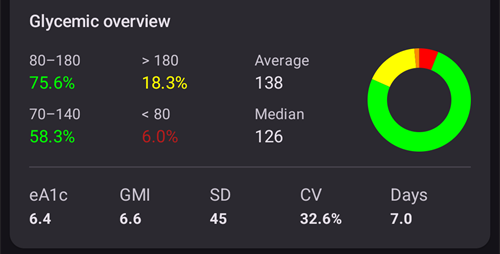
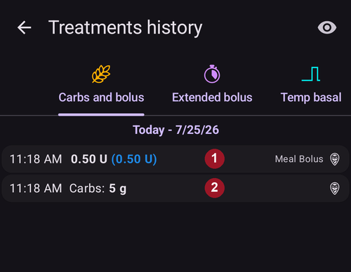

# Verilerinizi inceleme

## AAPS Geçmiş tarayıcısı

**AAPS** tüm geçmişinizi (**KŞ**, tedaviler, bazal, hedefler, **Profil değişimi**, …) telefondaki yerel bir veritabanında saklar. Bu veritabanı [ayarların dışa aktarılmasına](../Maintenance/ExportImportSettings.md) dahil değildir. Bunu **AAPS** içinde, aşağıda açıklanan **Geçmiş tarayıcısı** ve **İstatistikler** ekranıyla inceleyebilirsiniz. Uzun süreli inceleme ve raporlar için verilerinizi [Nightscout](../SettingUpAaps/Nightscout.md)'a veya [Tidepool](../SettingUpAaps/Tidepool.md)'a yükleyin.

**AAPS** geçmişi **Geçmiş tarayıcısı** içinde incelenebilir: **menüyü** (☰) açın ve **Geçmiş tarayıcısı**'nı seçin.

- İncelemek istediğiniz günü seçmek için **tarih kartına** dokunun.
- Grafikler, **seçilen günün tamamını** gösterecek şekilde uzaklaştırılmış olarak açılır. Bir bölümü yakınlaştırmak için iki parmağınızla büyütün.
- Bir gün geri veya ileri gitmek için **<** ve **>** oklarını, bugüne dönmek için **Şimdi** düğmesini kullanın.
- Grafikler, ana ekran grafikleriyle aynı verileri gösterir (KŞ, tedaviler, bazal, AİNS, AKRB, aktivite, sapmalar...).

(reviewing-statistics)=
## AAPS İstatistikleri

**AAPS** temel izleme istatistikleri sunar.

Değerlerin çoğu ADA 2023 [önerilerine](https://diabetesjournals.org/care/article/46/Supplement_1/S97/148053/6-Glycemic-Targets-Standards-of-Care-in-Diabetes) dayanır.

Bunları açmak için **menüyü** (☰) açın ve **İstatistikler**'i seçin.

**İstatistikler** ekranında dört sekme vardır: **İnsülin**, **Hedef Aralıktaki Süre**, **Glikoz** ve **Döngü**. Sekmeler arasında geçmek için bir sekmeye dokunun veya sola ya da sağa kaydırın.

(reviewing-tdd)=
### İnsülin sekmesi: Günlük Toplam Doz

**Günlük Toplam Doz** kartı, **AAPS**'in insülin verisi olan önceki günler (en fazla bir hafta) için her güne bir satır, ardından bunların **Ortalama** değerini ve sonra şu ana kadarki **Bugün** değerini gösterir. **AAPS** yüklendikten hemen sonra yalnızca **Bugün** gösterilir. Sütunlar şunlardır:

- **Bazal**: yalnızca bazal.
- **Bolus**: bolus tedavilerinin ve SMB'lerin toplamı.
- **GTD Toplam**: günlük toplam insülin dozu (**GTD**), gün içinde verilen bolus ve bazal insülinin toplamı.
- **Karbonhidrat**: girilen karbonhidrat ve yKarb tedavileri.

**GTD** bölümü sayfayı açtığınızda hesaplanır ve hesaplama birkaç saniye sürer. Yeniden hesaplamak için **Tekrar Hesapla**'ya dokunun.

**GTD**, günlük bolus ve bazal insülininizin toplamıdır. Bazı doktorlar - özellikle pompayı yeni kullananlar için - 50:50 bazal-bolus oranı kullanır: bu durumda toplam temel bazal (**TBB**, 24 saat boyunca bazal oranlarınızın toplamı) GTD'nin yaklaşık yarısı olmalıdır. Diğerleri GTD'nin %32 ile %37'si arasında bir TBB'yi tercih eder.

Çoğu pratik kural gibi, bunun gerçek geçerliliği de sınırlıdır. Diyabetiniz farklı olabilir!

### Hedef Aralıktaki Süre sekmesi

Hedef Aralıktaki Süre (**TIR**): 70-180 mg/dL veya 3,9-10 mmol/L.

**TIR** bilgisi, **AAPS** veritabanındaki veri miktarına bağlı olarak 7 ve 30 gün için gösterilir.

Dar Hedef Aralıktaki Süre (TITR) 70-140 mg/dL veya 3,9-7,8 mmol/L istatistikleri aşağıda bulunur (ekran bu aralığı 70-141 olarak gösterir).

**Hedefleri endokrinoloğunuzla konuşun**

Diyabetiniz farklı olabilir. Önerilen hedefleri endokrinoloğunuzla veya sizi destekleyen sağlık ekibiyle konuşmalısınız. Doğru kullanıldığında AAPS istatistikleri, __KŞ__ eğilimlerini takip etmek ve ilerlemeyi izlemek için etkili bir araç olabilir.

Aşağıda, **Dexcom TIR** kartı ayrıntılı 14 günlük **TIR** istatistiklerini gösterir.

**SD**: Standart sapma, KŞ dalgalanmasının bir [göstergesi](https://www.ncbi.nlm.nih.gov/pmc/articles/PMC3125941/) (en yüksek = en kötü).

HbA1c: CGM ölçümlerinin ortalamasına göre tahmin edilen glike hemoglobin değeri. Bu yalnızca yol gösteren bir değerdir ve kan HbA1c testlerinizle aynı olmayabilir.

(reviewing-statistics-agp)=
### Glikoz sekmesi: Ambulatuvar Glikoz Profili (AGP)

**Ambulatuvar Glikoz Profili** (**AGP**), glikozunuzun gün içinde genellikle nasıl değiştiğini gösterir. Üstteki düğmelerle süreyi seçin: **Bugün**, **24sa**, **7 gün**, **30 gün** veya **90 gün**.

- **Grafik**: gece yarısından gece yarısına bir gün. Çizgi **Medyan** değeridir (o saatteki ölçümlerinizin yarısı daha düşük, yarısı daha yüksekti). Çevresinde bir bant ölçümlerinizin ortadaki yarısını (**%25–75**), daha geniş bir bant ise çoğunu (**%10–90**) gösterir. Dar bir bant, o saatte glikozunuzun günden güne benzer olduğu anlamına gelir. Kesikli çizgiler **DÜŞÜK işareti**, 140 mg/dL (7,8 mmol/L) ve **YÜKSEK işareti** değerlerinizi gösterir.
- **Glisemik genel bakış**: aralığınızda, dar aralıkta (70–140 mg/dL veya 3,9–7,8 mmol/L), aralığınızın üstünde ve altında geçen süre, ardından **Ortalama** ve **Medyan** glikoz değeriniz. Aralığınız, [Görselleştirme Aralığı](#Preferences-range-for-visualization) içinde ayarlanan **DÜŞÜK işareti** ve **YÜKSEK işareti** değerleridir.
- **eA1c** ve **GMI**: CGM ölçümlerinizden hesaplanan iki HbA1c tahmini. Yukarıdaki HbA1c gibi, bunlar da kan HbA1c testlerinizle aynı olmayabilir.
- **SD** (standart sapma) ve **CV** (varyasyon katsayısı): glikozunuzun ne kadar değiştiği. Daha düşük bir değer, daha dengeli glikoz demektir.
- **Gün**: kaç günlük CGM verisinin kullanıldığı.

 

AGP'nin altında, **Glikoz Pentagonu (CGP)** kartı son 14 gününüzün glikozuna ait beş ölçüyü bir beşgen olarak çizer. Daha küçük bir beşgen, daha iyi glikoz kontrolü demektir.

### Döngü sekmesi: GTD Döngü Modeli

**GTD Döngü Modeli**, tekrarlayan örüntüleri fark etmenize yardımcı olmak için günlük insülin toplamlarınızı 28 günlük döngüler halinde üst üste gösterir. Her döngü, ortalamalarıyla birlikte bir çizgi olarak çizilir (**Ayrı döngüler**).

- **Ham GTD** / **Temizlenmiş GTD**: verildiği şekliyle günlük toplam dozu veya karbonhidratlar için verilen insülin çıkarılmış GTD'yi seçin.
- **Döngü kayması**: döngünün başlangıcını kaydırır (0 ile 27 gün arası).

En az 56 günlük veri (2 döngü) gerekir. Daha az veri varsa kart **Yeterli veri yok (2 döngü için en az 56 gün gerekli)** mesajını gösterir. Model yalnızca **Döngü** sekmesini açtığınızda hesaplanır, çünkü 168 günlük veriyi okur.

(aaps-screens-treatments)=
## Tedavi geçmişi

Ana ekranın sol üst köşesindeki **menüyü** (☰) açın ve **Tedavi geçmişi**'ni seçin. Bu görünümde aşağıdaki tedavilerin geçmişini görebilir ve değiştirebilirsiniz; her biri kendi sekmesindedir (hepsini görmek için sekme satırını kaydırın):

* Karbonhidrat ve bolus
* [Yayma Bolus](#Extended-Carbs-extended-bolus-and-switch-to-open-loop-dana-and-insight-pump-only)
* Geçici Bazal
* [Geçici hedef](../DailyLifeWithAaps/TempTargets.md)
* [Profil değişimi](../DailyLifeWithAaps/ProfileSwitch-ProfilePercentage.md)
* Careportal: notlar ve careportal kayıtları
* Çalışma modu: döngü durumunun geçmişi
* Kullanıcı girişi: Nightscout'a gönderilmeyen diğer notlar

Her satırın sonundaki küçük simgeler, verinin nereden geldiğini veya nereye gönderildiğini gösterir:
* **Nightscout** simgesi (Nightscout logosu): veri Nightscout'tan geldi veya Nightscout'a kaydedildi
* **Pompa** simgesi: veri pompa geçmişinden geliyor (pompa tarafından işlendi)
* **Çöp kutusu** simgesi: kayıt silindi (yalnızca sağ üstteki **göz** simgesiyle silinen kayıtları gösterdiğinizde görünür)

(screens-bolus-carbs)=
### Karbonhidrat ve bolus

Bu sekmede bolus ve karbonhidrat kaydını görebilirsiniz. Her bolus (satır **1**), insülin miktarının yanında kalan ilgili AİNS'i gösterir. Bolusun kaynağı şunlardan biri olabilir:
* Öğün (İnsülin, Hızlı Asistan veya Bolus sihirbazı düğmeleriyle elle girilen)
* SMB, SMB işlevi kullanıldığında

Karbonhidrat kayıtları (satır **2**) gram cinsinden miktarlarıyla gösterilir.

İnsülin dozunu hesaplamak için [Bolus sihirbazı](#aaps-screens-bolus-wizard)'nı kullandıysanız, bolusun nasıl hesaplandığının ayrıntılarını görmek için bolus satırındaki “Calc” yazısına basabilirsiniz.

Kullanılan pompaya bağlı olarak insülin ve karbonhidrat tek bir satırda gösterilebilir veya birden fazla satır oluşabilir: biri hesaplama ayrıntısı, biri karbonhidrat, biri de bolusun kendisi için.

Tedavi geçmişi, hatalı karbonhidrat girişlerini düzeltmek için kullanılabilir (_örneğin_ karbonhidratı fazla veya az tahmin ettiyseniz). Mevcut bir kaydı düzenlemenin mümkün olmadığını unutmayın; şu adımları izlemeniz gerekir:

1. Ana ekrandaki güncel AKRB ve AİNS değerlerini kontrol edin ve not edin.
2. Pompaya bağlı olarak karbonhidrat, insülinle birlikte tek satırda veya ayrı bir kayıt olarak gösterilebilir (ör. Dana RS ile).
3. Hatalı karbonhidrat miktarı olan kaydı kaldırın: çöp kutusu simgesine basın, kaldırılacak satırları seçin ve işlemi bitirmek için çöp kutusu simgesine tekrar basın.
4. Ana ekranda AKRB'yi tekrar kontrol ederek karbonhidratın başarıyla kaldırıldığından emin olun.
5. Karbonhidrat ve insülini içeren tek bir satır varsa aynısını AİNS için de yapın.

   → Karbonhidrat istenildiği gibi kaldırılmazsa ve burada açıklandığı gibi (6.) ek karbonhidrat eklerseniz, AKRB çok yüksek olur ve bu da çok fazla insülin verilmesine yol açabilir.

6. Doğru karbonhidrat miktarını tekrar girin (alt gezinme çubuğunda **Tedaviler → Karbonhidrat** veya bir [Hızlı Başlatma](#quicklaunch) **Karbonhidrat** düğmesi) ve doğru olay zamanını ayarladığınızdan emin olun.
7. Karbonhidrat ve insülini içeren tek bir satır varsa insülin miktarını da eklemeniz gerekir. Doğru olay zamanını ayarladığınızdan emin olun ve yeni kaydı onayladıktan sonra ana ekranda AİNS'i kontrol edin.

### Geçici Bazal

Döngünün uyguladığı **geçici bazallar** burada gösterilir. Bir kaydın AİNS üzerinde hâlâ etkisi varsa, bu bilgi oranın yanında gösterilir (satır **1**). Bu şunlar olabilir:
* Geçici bazal, Profilde ayarlanandan yüksekse pozitif AİNS
* Sıfır geçici bazal için (satır **1**'deki gibi) veya geçici bazal, Profilde ayarlanandan düşükse negatif AİNS

Kayıtları silmek yalnızca Nightscout'taki raporlarınızı etkiler ve muhtemelen gerçek AİNS'inizi bozar - önerilmez.

Bir satırın solundaki kırmızı S, “Askıya al” anlamına gelir: bazal o anda verilmediğinde görünür. Bu, örneğin pod değiştirme sırasında normal bir durumdur.

### Geçici hedef

Geçici hedeflerin geçmişi burada görülebilir.

### Profil değişimi

Profil değişimlerinin geçmişi burada görülebilir. Her profil değiştirdiğinizde birden fazla kayıt görebilirsiniz: hem NS'de hem de Pompa Geçmişinde saklanan satır **1**, gerçek değişime karşılık gelir. Nightscout'ta saklanan ancak Pompa Geçmişinde olmayan satır **2**, kullanıcının yaptığı profil değişimi isteğine karşılık gelir.

Kayıtları silmek yalnızca Nightscout'taki raporlarınızı etkiler ve mevcut profili asla gerçekten değiştirmez.

Bir **Profil değişimi**'nin kopyasını oluşturmak için satır **2**'de gösterilen **Klon** düğmesini kullanabilirsiniz. Daha fazla bilgi için [AAPS profiliniz > Profillerinizi yönetin](#your-aaps-profile-clone-profile-switch) bölümüne bakın.

### Careportal

Bu sekme, Nightscout'a kaydedilen tüm notları ve careportal kayıtlarını gösterir.

(AapsScreens-running-mode)= (aaps-screens-running-mode)=
### Running mode

Bu sekme, [döngü durumu](#AapsScreens-loop-status) değişikliklerinin geçmişini gösterir: açık, kapalı, LGS, askıya alma, bağlantıyı kesme.

### Kullanıcı girişi

Bu sekme, **AAPS** içinde kullanıcı veya bir **Otomasyon** tarafından yapılan eylemleri listeler (döngü modu değişiklikleri, profil değişimleri, tedaviler, ayar dışa aktarmaları...). Bu kayıtlar Nightscout'a gönderilmez.

------

## Nightscout ile Tidepool arasındaki fark nedir?

Nightscout, **AAPS** verilerinin saklanmasını kolaylaştırır ve çok çeşitli [raporlama araçları](https://nightscout.github.io/nightscout/reports/) sunar.

Tidepool ise kullanıcının [verilerini incelemesini](https://www.tidepool.org/viewing-your-data) sağlar ve [endokrinoloji ekibinizle kolay paylaşım](https://www.tidepool.org/providers/how-it-works#tidepool-data-platform) sunar.