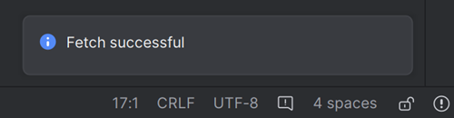
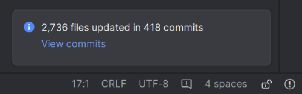
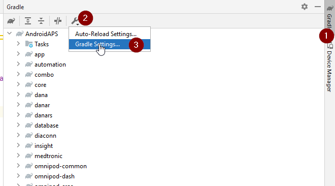
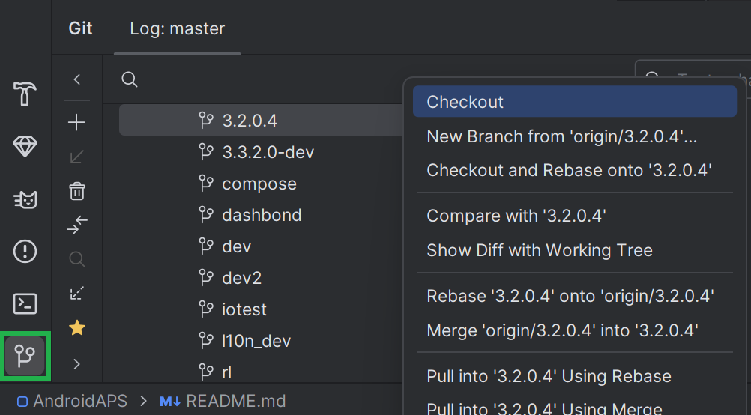
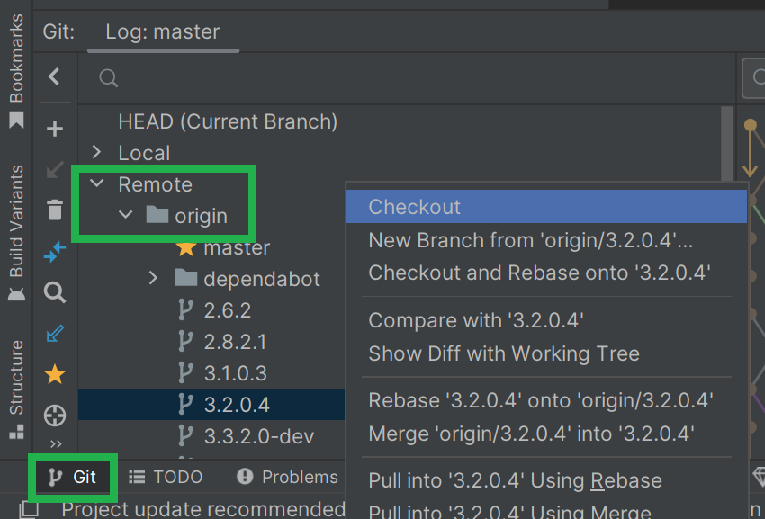
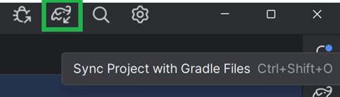
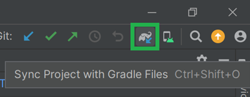

# AAPS 3.2.0.4 sürümüne güncelleme

(update-aaps-3204)=

## İndirmek yerine kendiniz oluşturun

**Tıbbi cihazlarla ilgili düzenlemeler nedeniyle AAPS uygulaması (bir apk dosyası) indirilemez. Uygulamayı kendi kullanımınız için oluşturmak yasaldır, ancak bir kopyasını başkasına vermemelisiniz!**

Ayrıntılar için [SSS sayfasına](../UsefulLinks/FAQ.md) bakın.

## AAPS 3.2.0.4'ü oluşturmak için bilgisayar ve yazılım özellikleri

* Apk'yı oluşturmak için belirli bir **[Android Studio](https://developer.android.com/studio/)** sürümü gerekebilir.

| AAPS Sürümü             | Önerilen<br/>Android Studio<br/>Sürümü | Alternatif<br/>Android Studio<br/>Sürümü | Gradle | JVM |
| ----------------------- | -------------------------------------------------- | ---------------------------------------------------- | ------ |:--- |
| [3.2.0.4](#version3204) | Hedgehog (2023.1.1)                                | Meerkat'e kadar                                      | 8.2    | 17  |

"Önerilen sürüm" uygun JVM sürümüyle birlikte gelir. Önerilen sürüm, **AAPS**'i oluşturmak için kullanabileceğiniz en düşük sürümdür. "Önerilen" sürümden daha eski bir sürümle oluşturma **YAPAMAZSINIZ**. Farklı bir sürüm kullanırsanız JVM sürümüyle ilgili sorunlarla karşılaşabilirsiniz. Bu sorunları çözmek için [Android Studio'da Sorun Giderme](#incompatible-gradle-jvm) sayfasına bakın. Mevcut Android Studio sürümünüz tabloda yoksa önce onu güncellemelisiniz.

Gradle sürümü kaynak koda bağlıdır. Kaynak kodu indirirken / güncellerken her zaman doğru Gradle sürümünü alırsınız. Burada yalnızca bilgi için verilmiştir, bununla ilgili bir şey yapmanız gerekmez.

* [Windows 32 bit sistemler](#troubleshooting_androidstudio-unable-to-start-daemon-process) Android Studio tarafından desteklenmez. Lütfen unutmayın: **64 bit işlemci ve 64 bit işletim sistemi zorunlu koşuldur.** Sisteminiz bu koşulu KARŞILAMIYORSA ilgili donanımı veya yazılımı ya da tüm sistemi değiştirmeniz gerekir.

<table class="tg">
<tbody>
  <tr>
    <th class="tg-baqh">OS (Only 64 bit)</th>
    <td class="tg-baqh">Windows 8 or higher</td>
    <td class="tg-baqh">Mac OS 10.14 or higher</td>
    <td class="tg-baqh">Gnome, KDE veya Unity DE destekleyen herhangi bir Linux;&nbsp;&nbsp;GNU C Library 2.31 veya üstü</td>
  </tr>
  <tr>
    <th class="tg-baqh"><p align="center">CPU (Only 64 bit)</th>
    <td class="tg-baqh">x86_64 CPU mimarisi; 2. nesil Intel Core veya daha yenisi ya da şu desteğe sahip AMD işlemci: <br><a href="https://developer.android.com/studio/run/emulator-acceleration#vm-windows" target="_blank" rel="noopener noreferrer"><span style="text-decoration:var(--devsite-link-text-decoration,none)">Windows Hypervisor</span></a></td>
    <td class="tg-baqh">ARM tabanlı yongalar veya şu desteğe sahip 2. nesil Intel Core ya da daha yenisi: <br><a href="https://developer.android.com/studio/run/emulator-acceleration#vm-mac" target="_blank" rel="noopener noreferrer"><span style="text-decoration:var(--devsite-link-text-decoration,none)">Hypervisor.Framework</span></a></td>
    <td class="tg-baqh">x86_64 CPU architecture; 2nd generation Intel Core or newer, or AMD processor with support for AMD Virtualization (AMD-V) and SSSE3</td>
  </tr>
  <tr>
    <th class="tg-baqh"><p align="center">Bellek (RAM)</th>
    <td class="tg-baqh" colspan="3"><p align="center">8 GB veya daha fazla</td>
  </tr>
  <tr>
    <th class="tg-baqh"><p align="center">Disk</th>
    <td class="tg-baqh" colspan="3"><p align="center">At least 30GB free space. SSD is recommended.</td>
  </tr>
  <tr>
    <th class="tg-baqh"><p align="center">Resolution</th>
    <td class="tg-baqh" colspan="3"><p align="center">1280 x 800 Minimum <br></td>
  </tr>
  <tr>
    <th class="tg-baqh"><p align="center">Internet</th>
    <td class="tg-baqh" colspan="3"><p align="center">Broadband</td>
  </tr>
</tbody>
</table>

**HDD (Sabit Disk Sürücüsü) yerine SSD (Katı Hal Sürücüsü) kullanmanız kesinlikle önerilir (zorunlu değildir), çünkü AAPS apk dosyasını oluşturmak daha kısa sürer.**  **AAPS** apk dosyasını oluştururken yine de HDD kullanabilirsiniz. Bunu yaparsanız oluşturma işlemi uzun sürebilir, ancak bir kez başladıktan sonra işlemi kendi başına çalışır durumda bırakabilirsiniz.

## 3.2.0.4 oluşturma sürecinde yardım ve destek

**AAPS** uygulamasını oluştururken zorluk yaşarsanız özel bir [**Android Studio'da sorun giderme**](https://androidaps.readthedocs.io/en/3.2/GettingHelp/TroubleshootingAndroidStudio.html) bölümü vardır, lütfen önce ona bakın.

Oluşturma talimatlarında bir şeyin yanlış, eksik veya kafa karıştırıcı olduğunu düşünüyorsanız ya da hâlâ zorlanıyorsanız, lütfen [Facebook](https://www.facebook.com/groups/AndroidAPSUsers) veya [Discord](https://discord.gg/4fQUWHZ4Mw) üzerindeki diğer **AAPS** kullanıcı gruplarına ulaşın. Bir şeyi kendiniz değiştirmek isterseniz (ekran görüntülerini güncellemek _vb._), lütfen bir [pull request (PR)](../SupportingAaps/HowToEditTheDocs.md) gönderin.

```{note}
Bu sayfada hem **yeni** hem de eski (**klasik**) Android Studio kullanıcı arayüzü için örnek resimler vardır.
```

## 3.2.0.x sürümünden 3.2.0.4 sürümüne güncellemeye genel bakış

```{contents} Steps for updating to 3.2.0.4
:depth: 1
:local: true
```

### Mevcut ayarlarınızı dışa aktarın

Telefonunuzdaki mevcut **AAPS** sürümünden ayarlarınızı dışa aktarın. Belki gerekmez ama tedbirli olmak daha iyidir.

Bunu nasıl yapacağınızı hatırlamıyorsanız [Ayarları dışa ve içe aktarma](ExportImportSettings.md) sayfasına bakın.

### Yerel AAPS kopyanızı güncelleyin

* Mevcut AAPS projenizi Android Studio ile açın. You might need to select your project. AAPS projesine (çift) tıklayın.


<br>


* Android Studio menü çubuğunda Git -> Fetch seçin


<br>


* Sağ alt köşede Fetch işleminin başarılı olduğunu bildiren bir mesaj göreceksiniz.



<br>


* Şimdi menü çubuğunda Git -> Pull seçin


<br>


* Tüm seçenekleri olduğu gibi bırakın (origin/master) ve Pull seçin


<br>


* İndirme sürerken bekleyin. Bunu alt çubukta bilgi olarak göreceksiniz. Tamamlandığında, bir başarı mesajı göreceksiniz.

  ```{note}
  Güncellenen dosyalar farklı olabilir! Bu bir sorun olduğunu göstermez.
  ```




<br>


* Bazı bağımlılıkları indirmek için Gradle Sync çalışacaktır. Tamamlanana kadar bekleyin.


<br>


### JVM sürüm 17'yi seçin

- Android Studio'nun sağ tarafındaki fil simgesine (1) tıklayarak Gradle görünümünü açın, ayarları (2) açın ve **Gradle Settings**'i (3) seçin:


<br>



- **Gradle JDK** alanında (1) uygun sürümün, yani **jbr-17**'nin seçili olup olmadığını kontrol edin. Seçili değilse alana tıklayın ve listede zaten olup olmadığına bakın. Listede yoksa (aşağıdaki ekran görüntüsü yalnızca **jbr-21**'in bulunduğu bir bilgisayarı gösteriyor) **Download JDK...** (2) seçin.


- Version (1) alanında **17** seçin. Vendor (2) alanında JetBrains Runtime veya herhangi bir sağlayıcı seçin. Location (3): değiştirmeyin.


- **Settings** iletişim kutusunu **OK** ile kapatın.

### AAPS 3.2.0.4 dalını seçin

- Sol altta Git simgesini seçin, 3.2.0.4 üzerine sağ tıklayın ve Checkout seçin.



<br>



### Projeyi Gradle ile senkronize edin

```{admonition} WARNING!
:class: warning
**Gradle'ı asla güncellemeyin.** Her zaman projeyle senkronize edin.
```

Yeni arayüzde fil simgesini ve Sync Project with Gradle Files seçeneğini kullanın (veya [bunu](#gradle-resync) izleyin).



Klasik arayüz için ise ([bunu](https://androidaps.readthedocs.io/en/3.2/GettingHelp/TroubleshootingAndroidStudio.html#gradle-resync)) izleyin.



### İmzalı 3.2.0.4 APK'yı oluşturun

Kaynak kodunuz artık yayınlanmış güncel sürümdür ve tüm ön koşullar kontrol edilmiştir. Şimdi imzalı apk'yı [imzalı apk oluşturma bölümünde](#Building-APK-generate-signed-apk) anlatıldığı gibi oluşturma zamanı.

### 3.2.0.4 APK'yı aktarın ve yükleyin

Yükleyebilmek için apk'yı telefonunuza aktarmanız gerekir.

```{note}
Oluşturmayı Android Studio'da aynı mevcut anahtar deposuyla yaptıysanız telefonunuzdaki mevcut uygulamayı kaldırmanız gerekmez. Apk'yi kurduğunuzda, güncellemeleri yüklemek için talimatları izleyin.
Diğer durumlarda, örneğin imzalı apk'nız için Android Studio'da yeni bir anahtar deposu oluşturduysanız, apk'yı yüklemeden önce eski uygulamayı silmeniz gerekir. **Ayarlarınızı mutlaka dışa aktarın!**
```

[AAPS'i aktarma ve yükleme](../SettingUpAaps/TransferringAndInstallingAaps.md) talimatlarına bakın

### Telefonda AAPS sürüm 3.2.0.4'ü kontrol edin

Yeni apk'yı yükledikten sonra, sağ üstteki üç nokta menüsüne ve ardından Hakkında'ya tıklayarak telefonunuzdaki AAPS sürümünü kontrol edebilirsiniz. Mevcut sürümü görmelisiniz.

