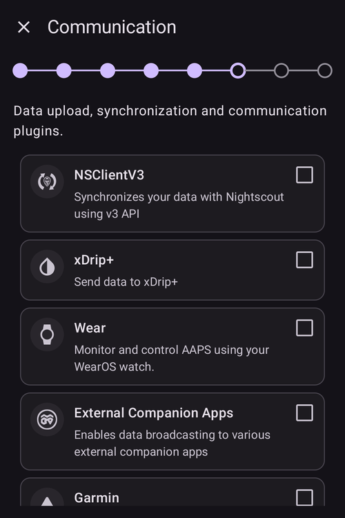
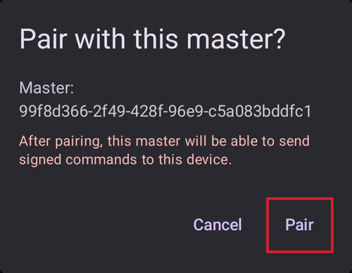

(aapsclient-app)=
# AAPSClient uygulaması

**AAPSClient**, **AAPS**'in yardımcı uygulamasıdır: ikinci bir telefon (genellikle bir bakım verenin telefonu) için, **AAPS** kullanan kişiyi **takip eden** bir uygulamadır. **AAPS** 4 sürümünden itibaren bakım veren, imzalı komutlarla döngüyü uzaktan **kontrol** da edebilir. İki telefon **Nightscout** siteniz üzerinden iletişim kurar; telefonlar arasında doğrudan bağlantı gerekmez.

```{admonition} Wording used on this page
:class: note
- **İstemci** = **AAPSClient** çalıştıran telefon.
- **Ana birim** = pompaya sahip olan ve döngüyü çalıştıran ana **AAPS** telefonu.
```

```{admonition} Which devices can run AAPSClient?
:class: note
From **AAPS** version 4, **AAPSClient** runs on Android phones and tablets, on Wear OS watches and on computers (Windows, Mac and Linux). On an iPhone there is no ready-made download: you build the app yourself. See the [table of downloads by device](#aapsclient-platforms).
```

```{contents} Table of contents
:depth: 2
:local: true
```

## AAPSClient nedir (ve ne değildir)

**AAPSClient**, **AAPS** gibi görünür ve hissettirir, ancak **kendi döngüsü yoktur**:

- **APS algoritması**, **Görevler** ve **pompa sürücüleri** içermez; asla kendi başına doz vermez.
- Yalnızca ana uygulamanın kullandığı eklentiler (**SMS Komünikatör**, **Tidepool**, **Open Humans**) da dahil değildir.
- *İçerdikleri*: **NSClientV3** senkronizasyonu, KŞ kaynağı eklentileri, **xDrip+** yayını ve **Wear OS** / **Garmin** bağlayıcıları; yani takip etmek ve komutları iletmek için gereken her şey. İstemciye bağlı bir **Garmin** saat verileri gösterebilir, ancak gönderdiği karbonhidratlar girilmez ve pompayı bağlayamaz veya bağlantısını kesemez: istemci bir mesaj gösterir ve bunları bunun yerine **AAPS**'te girersiniz.

**AAPSClient**'tan başlattığınız her şey kontrol edilir, sınırlanır, onaylanır ve **ana birim tarafından yürütülür** (pompanın bağlı olduğu telefon). Ayrı [Ana birim ↔ İstemci kontrolü](ClientMasterControl.md) sayfası bunun nasıl çalıştığını açıklar: iki telefonun nasıl eşleştirileceği, ana birimin gördüğünüz onay metnini nasıl yazdığı, istemcide başlatılan bir bolusun nasıl verildiği ve ana birim çevrimdışıyken ne olduğu.

## Sürümler: AAPSClient, AAPSClient2 ve AAPSClient3

Aynı takipçi telefona yan yana en fazla üç istemci uygulaması yüklenebilir; her biri **farklı** bir kişiyi takip eder: **AAPSClient** (sarı baykuş simgesi), **AAPSClient2** (mavi baykuş) ve **AAPS** 4 sürümünde yeni olan **AAPSClient3** (yeşil baykuş). İşlevleri aynıdır. Onları birbirinden ayırt edebilmeniz için yalnızca adları ve renkleri farklıdır (uygulama simgesi, widget arka planı ve ana ekrandaki durum bölümü). Her uygulama kendi ana birimiyle eşleştirilir. Ayrıntılar için bkz. [AAPSClient, AAPSClient2 ve AAPSClient3 hakkında](#remotecontrol-aapsclient-versions).

(aapsclient-platforms)=
## Uygulamayı edinme

All the ready-made files are in the *Assets* list of the latest release on [GitHub](https://github.com/nightscout/AndroidAPS/releases/) (click *Assets* at the bottom of the release to expand it). In the table, *x.y.z* stands for the version number. Choose the file that matches your device:

| Cihaz                   | File to download                    | Notes                                                                                                                                                                                        |
| ----------------------- | ----------------------------------- | -------------------------------------------------------------------------------------------------------------------------------------------------------------------------------------------- |
| Android phone or tablet | `app-aapsclient-release_x.y.z.apk`  | Install it like the main app: see [Download and installation of AAPSClient](#RemoteControl_aapsclient) and [Transferring and installing](../SettingUpAaps/TransferringAndInstallingAaps.md). |
| Wear OS watch           | `wear-aapsclient-release_x.y.z.apk` | Goes with the AAPSClient app on the phone. See [Wear OS smartwatch](../WearOS/WearOsSmartwatch.md).                                                                                          |
| Windows computer        | `AAPSClient-x.y.z.msi`              | Open the file to install.                                                                                                                                                                    |
| Mac                     | `AAPSClient-x.y.z.dmg`              | See the note on macOS below the table.                                                                                                                                                       |
| Linux (Debian, Ubuntu)  | `aapsclient_x.y.z_amd64.deb`        | Install it with your package manager.                                                                                                                                                        |
| iPhone                  | none                                | There is no App Store version and no download. You build the app yourself, see [AAPSClient on an iPhone](#aapsclient-iphone).                                                                |

**Following two people?** Each file above also exists as *aapsclient2* / *AAPSClient2*. It is a second client app that installs next to the first one, so one device can follow two people (see [About AAPSClient, AAPSClient2 and AAPSClient3](#remotecontrol-aapsclient-versions)). **AAPSClient3** is not in the release assets: build it yourself ([build variants](#browserbuild-variant)).

**Files to ignore:** the *pumpcontrol* files (`app-pumpcontrol-release_…`, `wear-pumpcontrol-release_…`) are not a client. Leave them out.

**Mac: the first start.** The app is not notarized by Apple, so macOS blocks it the first time you open it. Click *Done*, then open *System Settings → Privacy & Security*, scroll down and click *Open Anyway*.

**Computer: how to connect.** A computer has no camera, so the QR code cannot be scanned. Set up **Nightscout** in the client, then on the master add the client with a **PIN** and type the 8-digit PIN in the client (**Pair with master**). See [Pairing with the master](#aapsclient-pairing-with-the-master).

**Same version everywhere.** The master and all its clients must run the same **AAPS** version. When you update the master, update the clients too.

(aapsclient-iphone)=
### AAPSClient on an iPhone

There is no **AAPSClient** in the App Store and no ready-made file to download, so you build the app yourself:

- You need a Mac with **Xcode** and an Apple developer account.
- The project is the `ios` folder of the [AndroidAPS repository on GitHub](https://github.com/nightscout/AndroidAPS/tree/master/ios).
- A build for a real iPhone is signed with your own Apple developer team. A build for the iPhone simulator does not need one.
- There is no step-by-step guide yet. This page will be updated when there is one.

The iPhone version pairs with the master like the others. Unlike the computer versions, the iPhone can scan the master's QR code with its camera.

## İlk başlatma: daha kısa bir Kurulum Sihirbazı

**AAPSClient** ilk başlatmada **AAPS**'ten bildiğiniz **Kurulum Sihirbazı**'nı çalıştırır, ancak çok daha az adımla: bir takipçide profil, insülin, pompa, APS veya görev yapılandırması yoktur:

1. **Hoş geldiniz**, **lisans sözleşmesi**, **izinler** ve **ana parola**: ana uygulamayla aynıdır, bkz. [AAPS Kurulum Sihirbazı](../SettingUpAaps/SetupWizard.md).
2. İstemci **birimleri** veya **düşük/yüksek işaretlerini** **sormaz**: Nightscout'a bağlanır bağlanmaz bunları ana telefondan alır. Bunları daha sonra **Ayarlar** içinde görebilirsiniz; orada küçük bir **telefon simgesi**, bunların [ana telefonla senkronize edildiğini](#client-master-config-prefs) gösterir. Yalnızca ana birime ulaşılabildiği sürece düzenlenebilirler.
3. **Ana birimden kurulumu yapın**: ana birimde **Yönet → Yetkili istemciler** bölümünü açın, bu telefonu bir **QR kodu** ile ekleyin ve burada **QR kodunu tarayın** düğmesine dokunun. Tek bir tarama, Nightscout'u bu telefona ait bir belirteç ile kurar ve eşleştirme yapan bir kodla telefonu da eşleştirir. Telefon, ana birimde eklendiği adı da kurulum adı olarak alır (aksanlı harfler düz harflere dönüşür, "Miloš" "Milos" olur). **Taramadan sonra kurulum tamamlanır**: sonraki adımlar yalnızca kodun yaptığını göstereceği için sihirbaz kapanır. QR kodu yoksa bu adımı atlayın. (Not on a computer: it has no camera, see [Getting the app](#aapsclient-platforms).)

   

4. **İletişim**: eklenti listesi yalnızca bir takipçinin ihtiyaç duyduklarını sunar (NSClientV3, xDrip+, Wear, Harici yardımcı uygulamalar, Garmin). Bir QR kodu taramadıysanız, **NSClientV3**'ü etkinleştirin, ana telefondakiyle **aynı Nightscout URL**'sini ve bir erişim belirtecini girin, **websockets** etkin olsun; tam olarak [Senkronizasyon](#RemoteControl_aapsclient) bölümünde açıklandığı gibi. Websockets are **mandatory** for remote control from **AAPSClient**, on both phones.

   

5. **Ana birimle eşleştir**: bu adım **yalnızca** istemcide vardır. Bu cihazı güvenli komut kanalı üzerinden PIN ile ana birime bağlar ve QR kodunda olduğu gibi telefonun ana birimde eklendiği adı alır. **Eşleştirmeden sonra kurulum tamamlanır.** Bu adımı atlayıp daha sonra istediğiniz zaman **Yönet → Ana birimle eşleştir** bölümünden de eşleştirebilirsiniz.

   

6. **Bu telefonu kim kullanıyor?**: yalnızca sihirbazda eşleştirme yapmadıysanız görünür; bu telefonu kullanan kişinin adıdır. Bu kurulumu raporlarda ve senkronizasyonda diğerlerinden ayırt eder.

(aapsclient-pairing-with-the-master)=

## Ana birimle eşleştirme

**Ana birimde** **Yönet → Yetkili istemciler** bölümünü açın ve bir istemci ekleyin. Eşleştirmenin iki yolu vardır:

- **QR kodu ile** (telefonda kamera varsa en hızlısı): kodu "**Ana birimden kurulumu yapın**" sihirbaz adımında veya **Yönet → Ana birimle eşleştir → QR kodunu tarat** bölümünde tarayın ve "**Kullan**" ile onaylayın. Bu, Nightscout'u da kurar.
- **PIN ile**: **istemcide** yukarıdaki sihirbaz adımını (veya **Yönet → Ana birimle eşleştir**) açın, ana birimde gösterilen tek kullanımlık PIN'i yazın ve "**Eşleştir**" düğmesine basın. İstemci ardından kime güvenmek üzere olduğunu gösterir; "**Eşleştir**" ile onaylayın:



Sihirbazdan yapılan başarılı bir eşleştirme kurulumu tamamlar ve ana ekranı açar. Ana birimde istemci, [Yetkili istemciler](#client_master_master_setup) listesinde **Etkin** olarak görünür. Daha sonra **Yönet → Ana birimle eşleştir**, "*Zaten eşleştirilmiş*" yazısını, telefonun rolünü ve güçlendirilmiş modun açık olup olmadığını gösterir:

 Tam eşleştirme yöntemi, güvenlik ayrıntıları ve sorun giderme [Ana birim ↔ İstemci kontrolü](#client_master_client_setup) sayfasındadır.

Eşleştirmeden sonra istemci, ana birimden (ana birimde bir yönetici (admin) belirteci varsa) yalnızca bir istemcinin ihtiyaç duyduğu haklara sahip kendi Nightscout belirtecini alır ve girmiş olabileceğiniz belirteci kullanmayı bırakır. **AAPSClient** asla Nightscout'a kendisi tedavi veya KŞ yazmaz: yaptığı her şey ana birime gönderilir ve onu ana birim yazar. Bkz. [İstemcinin kendi Nightscout belirteci](#client-master-control-own-token).

Ana birim, bu telefonun neler yapabileceğine telefonun **[rolü](#client-master-control-roles)** ile karar verir (Salt okunur, Yemekler, Bakıcı veya Yönetici). **Yönet → Ana birimle eşleştir** telefonun rolünü gösterir.

## Ana ekran

İstemcinin ana ekranı takip edilen döngüyü yansıtır:


- **KŞ, grafikler, AİNS/AKRB ve profil**, ana birimin yüklediği şekliyle Nightscout'tan gelir.
- Gösterilen **döngü durumu** **ana birimin** döngü durumudur (istemcinin kendi döngüsü yoktur). İstemci, ana birimin çalışma modunu Nightscout'tan alana kadar çalışma modu çipi bir **soru işareti** (bilinmiyor) gösterir.
- **Durum kartı**, Nightscout cihaz durumundan alınan **takip edilen pompanın** rezervuarını ve pilini ve uploader pilini gösterir; istemcinin pompası yoktur, bu yüzden uygulamanın hiçbir yerinde yerel pompa durumu ve pompa yönetimi yoktur.
- İstemci eşleştirildikten sonra alt çubukta **Tedaviler**, **Senaryolar** ve **Yönet** bulunur (eşleştirmeden önce yalnızca **Yönet**); pompa veya görev sekmeleri yoktur.

## Tedaviler ve işlemler

**Yönet** altındaki her şey ana uygulamadaki gibi çalışır, tek önemli farkla: istemcide tedaviyi değiştirecek işlemler (bolus, karbonhidrat, geçici hedefler, senaryolar…) **cihaz eşleştirilene kadar gizlidir** ve eşleştirildikten sonra onay ve yürütme için **ana birime iletilir**; bkz. [Uzaktan kontrolü kullanma](#client-master-control).

**Profil** girişi bir istisnadır: **eşleştirilmemiş** bir istemcide bile gösterilir, ancak **yalnızca görüntüleme** modunda açılır. İstemci, Nightscout üzerinden aldığı profilleri (kendi hesaplamaları için bunlara ihtiyaç duyar) düzenleme veya etkinleştirme düğmeleri olmadan gösterir. İstemci **eşleştirildikten** sonra profil listesi ana birimle senkronize edilir ve profilleri, diğer uzaktan işlemler gibi istemciden düzenleyip etkinleştirebilirsiniz.

**Eşleştirilmemiş** bir istemcide **Yönet** yalnızca **Profil** ve **Ana birimle eşleştir** seçeneklerini sunar:


"*Ana birime ulaşılamıyor. Bağlantı yeniden sağlanana kadar düzenleme devre dışı bırakılmıştır.*" kırmızı bandı eşleştirilmemiş bir istemcide de görünür. Bu beklenen bir durumdur: henüz ulaşılacak bir ana birim yoktur. İstemci eşleştirildiğinde ve ana birim çevrimiçi olduğunda bant kaybolur.

İstemci eşleştirildikten sonra tedavi işlemleri görünür:


**Pompa girişi yoktur**: istemcinin pompası yoktur.

Ana birime ulaşılamıyorsa, aynı bant eşleştirilmiş bir istemcide de görünür: tedavi işlemleri gri görünür ve denediğiniz her şey gönderilmeden önce engellenir. İstemci, bir işlem denediğinizde ana birimin çevrimdışı olduğunu fark eder ve ana birim tekrar çevrimiçi olduğunda işlemleri yeniden etkinleştirir.


## Ana birimle senkronize edilen ayarlar

Etkin eklenti **konfigürasyonu** ve birçok **tercih**, ana birim ile eşleştirilmiş istemcileri arasında senkronize tutulur; senkronize edilen öğeler küçük bir **telefon simgesiyle** işaretlenir ve ana birime ulaşılamadığı sürece (bir "*Ana birime ulaşılamıyor*" bandıyla) devre dışıdır. Bu konu [Konfigürasyonu ve tercihleri değiştirme](#client-master-config-prefs) bölümünde açıklanmıştır.

## Akıllı saatte AAPSClient

Bir Wear OS saat, **istemci** telefonla eşleştirilebilir; saatin işlemleri istemci üzerinden ana birime iletilir. Bkz. [Wear OS](../WearOS/WearOsSmartwatch.md) ve [Uzaktan kontrol bölümündeki akıllı saat seçenekleri](#RemoteControl_smartwatches).
