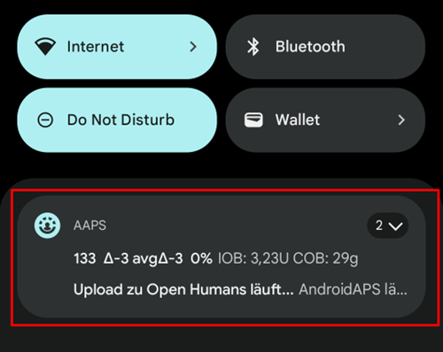

# Android Auto

**AAPS**, güncel durumunuzu doğrudan arabanızdaki Android Auto'ya bir mesaj olarak gönderebilir.

## Requirements

**AAPS**, Android Auto'nun bir özelliğini kullanır. Bu özellik, telefondaki uygulamaların mesajlarını arabanın ses sisteminin ekranına iletir.

Bu şu anlama gelir:

* Android, **AAPS**'in bildirim göstermesine izin vermeli ve
* **AAPS** resmi bir uygulama olmadığı için, Android Auto'da "bilinmeyen kaynaklar" kullanımına izin verin.

(androidauto-check-that-aaps-can-show-notifications)=

## AAPS'in bildirim gösterebildiğini kontrol edin

**AAPS** her zaman güncel glikozunuzu, AİNS ve AKRB değerlerinizi içeren bir durum bildirimi gösterir. Bu, Android Auto'nun arabada gösterdiği bildirimdir. **AAPS** içinde açılacak bir şey yoktur, ancak Android, **AAPS**'in bildirim göstermesine izin vermelidir.

Telefonunuzda **Ayarlar** > **Uygulamalar** > **AAPS** > **Bildirimler** menüsünü açın ve **Tüm AAPS bildirimleri** seçeneğinin açık olduğundan emin olun.

Aşağı kaydırın ve **Devam eden durum** seçeneğinin açık olduğundan emin olun: bu, durum bildiriminin kanalıdır.

Lütfen arabanıza gitmeden önce telefonda **AAPS** durum bildirimini gördüğünüzü kontrol edin!

(androidauto-allow-the-use-of-unknown-sources-with-android-auto)=

## Android Auto'da "bilinmeyen kaynaklar" kullanımına izin verin.

**AAPS** resmi bir Android Auto uygulaması olmadığı için, Android Auto'da "bilinmeyen kaynaklar" için bildirimler etkinleştirilmelidir. Bu, burada size göstereceğimiz geliştirici modu ile yapılır.

Arabanıza gidin ve telefonunuzu arabanın ses sistemine bağlayın.

Şimdi buna benzer bir ekran görmelisiniz.

Ayarları başlatmak için **ayarlar** simgesine basın.

Sayfanın en altına kaydırın ve **telefonda daha fazlasını görün** (see more in the phone) seçeneğini seçin.

Şimdi telefonda geliştirici modunu etkinleştireceğiz.

İlk ekran böyle görünür. Sayfanın en altına kaydırın.

Orada Android Auto'nun sürümünü görürsünüz. Android Auto sürümüne 10 kez (yazıyla: on) dokunun. Bu gizli kombinasyon ile artık geliştirici modunu etkinleştirdiniz.

Açılan "Geliştirme ayarlarına izin verilsin mi?" ("Allow development settings?") penceresinde geliştirici modunu etkinleştirmek istediğinizi onaylayın.

**Geliştirici ayarları** içinde "Bilinmeyen kaynaklar" ("Unknown sources") seçeneğini etkinleştirin.

Now you can quit developer mode if you want. Tap three dots menu on the top right to do so.

## Arabada bildirimlerin gösterilmesi

Arabanızda Android Auto'da sağ alt taraftaki **sayı simgesine** dokunun.

CGM verileriniz şöyle gösterilir:

(android-auto-troubleshooting)=

## Sorun giderme:

* Bildirimi görmüyorsanız, Android'de [AAPS'in bildirim göstermesine izin verip vermediğinizi](#androidauto-check-that-aaps-can-show-notifications) ve [Android Auto'nun bildirimlere erişim hakkı olup olmadığını](#androidauto-allow-the-use-of-unknown-sources-with-android-auto) kontrol edin.