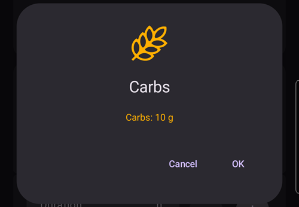
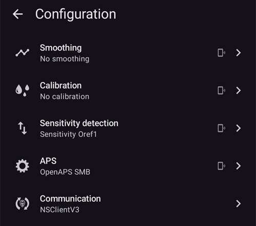
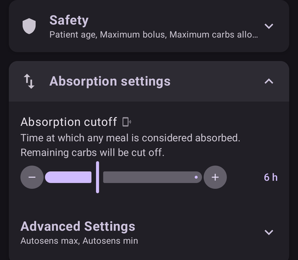

(client-master-control)=
# Ana birim ↔ İstemci kontrolü (imzalı uzaktan kumanda)

**AAPS** sürüm 4'ten itibaren, **AAPSClient** çalıştıran bir takipçi telefon, Nightscout üzerinden tedavileri yalnızca *bildirmekten* çok daha fazlasını yapabilir: ana telefonla **eşleştirildikten** sonra, ana telefonun (**ana birim**) kontrol ettiği, onayladığı ve uyguladığı **imzalı komutlar** gönderebilir. Buna ana birimin pompasıyla bir **insülin bolusu** vermek de dahildir.

Bu sayfa bunun nasıl çalıştığını, nasıl kurulduğunu ve nasıl kullanıldığını açıklar.

```{contents} Table of contents
:depth: 2
:local: true
```

```{admonition} Wording used on this page
:class: note
- **Ana birim** = pompaya sahip olan ve döngüyü çalıştıran ana **AAPS** telefonu (`full` uygulaması).
- **İstemci** = pompası olmayan, ana birimi takip eden ve artık onu *kontrol* de eden bir **AAPSClient** telefonu.
- Her iki telefon da **aynı Nightscout** sitesine bağlı olmalıdır. Tüm iletişim hâlâ Nightscout üzerinden gider. Telefonlar arasında doğrudan bir bağlantı gerekmez.
```

---

## Nasıl çalışır

```{admonition} Coming from AAPS v3?
:class: note
**AAPS** v3'te **AAPSClient** Nightscout'a yalnızca imzasız careportal tedavileri yazabiliyordu ve bolus veremiyordu. Uzaktan kumanda artık bir kerelik bir [eşleştirme](#client_master_master_setup) gerektirir. Ayrıca bkz. [AAPS v4'te neler değişti](#v4changes-remote-control).
```

**AAPS** v4, ayrı bir **İstemci Kontrolü** (Client-Control) kanalı kullanır. Bu kanal hâlâ Nightscout sitenizi kullanır (`settings` koleksiyonunda), ancak her mesaj yalnızca iki telefonun bildiği bir sır ile **kriptografik olarak imzalanır**. Sır yalnızca bir kez, **eşleştirme** sırasında verilir ve hemen ardından yenisiyle değiştirilir. Böylece hiçbir zaman açık metin olarak iletilmez.

Temel ilke şudur: **karar ana birimindir**:

1. İstemci bir *istek* gönderir (“2 Ü bolus”, “Egzersiz senaryosunu başlat”, “bu geçici hedefi ayarla”…).
2. **Ana birim** eylemi **kendi** güncel verilerine (profil, AİNS, AKRB, mevcut geçici hedef, pompa) göre yeniden hesaplar ve **sınırlar**, ayrıca kullanıcının göreceği **onay metnini tam olarak kendisi yazar**.
3. İstemci (veya saat) **ana birimin** onay metnini gösterir. Hiçbir zaman kendi metnini oluşturmaz.
4. Onay verildiğinde ana birim eylemi **bir kez uygular** ve sonucu istemciye bildirir.

Bunun sizin için anlamı:

- **İmzalı komutlar**: yalnızca eşleştirdiğiniz istemciler komut gönderebilir (her istemci için ayrı eşleştirme sırrı ve imza). Eski veya tekrar gönderilen komutlar reddedilir.
- **Her istemci için bir rol**: her istemcinin ne yapabileceğine siz karar verirsiniz, *Salt okunur* rolünden *Yönetici* rolüne kadar. Bkz. [İstemci rolleri](#client-master-control-roles).
- **İstemciden insülin bolusu**: ana birim bolusu kendi pompasıyla verir ve istemci iletimin ilerlemesini gösterir.
- **Karar ana birimindir**: ana birim her eylemi kendi kısıtlamalarına göre sınırlar ve istemcide gösterilen onay metnini yazar.
- **Tedaviyi yalnızca eşleştirilmiş istemciler değiştirir**: istemci kontrolü açıkken ana birim, doğrudan Nightscout'a yazılan tedavileri veya değişiklikleri artık kabul etmez. Bkz. [Güçlendirilmiş mod](#client-master-control-hardened-mode).
- **Her istemci kendi Nightscout belirtecini alır**. Bu belirteçte yalnızca bir istemcinin ihtiyaç duyduğu yetkiler vardır. Bkz. [İstemcinin kendi Nightscout belirteci](#client-master-control-own-token).
- **Ana birim çevrimdışı**: eylemler açık bir mesajla engellenir.
- **Bir istemcinin erişimini kaldırmak** tek dokunuş gerektirir (her istemci için). Tüm istemcileri durdurmak için ana birimdeki anahtarı da kullanabilirsiniz.

Bir istemciden başlatılabilecek eylemler: **bolus**, **karbonhidrat / yKarb**, **geçici hedef** (ayarlama ve iptal), **profil değişimi**, **döngü / çalışma modu** değişikliği, **geçici bazal** (ayarlama ve iptal), **yayma bolus** (ayarlama ve iptal), **insülin seçimi** ve **[senaryolar](../DailyLifeWithAaps/Scenes.md)**. İki yönlü **tercihlerin** bir kısmı da ana birim ile istemciler arasında senkronize tutulur.

---

## Roller ve ön koşullar

```{admonition} Before you start
:class: important
- **Ana birim**, normal `full` **AAPS** sürümünü çalıştırır ve pompanıza bağlıdır.
- **Ana birim**, Nightscout'unuzla **NSClientV3** kullanır ve *bağlı* durumunu gösterir. Ana birime Nightscout'unuzun bir **yönetici (admin) belirtecini** verin: bununla ana birim her istemci için ayrı bir belirteç oluşturabilir ve bunu istemciye QR kodu olarak gösterebilir.
- **İstemci**, **[AAPSClient](AapsClient.md)** çalıştırır (veya başka hastalar için **AAPSClient2** / **AAPSClient3**. Bkz. [AAPSClient, AAPSClient2 ve AAPSClient3 hakkında](#remotecontrol-aapsclient-versions)). **Aynı** Nightscout'u kullanmalıdır. İstemciyi ana birimin QR kodu ile kurarsanız, istemci Nightscout adresini ve belirtecini ana birimden alır. Aksi halde önce istemcide **NSClientV3**'ü kendiniz kurun.
- Her iki telefonda da **websocket** gereklidir: komutlar ana birime yalnızca websocket bağlantısı üzerinden ulaşır. İstemci kontrolü açıkken **AAPS**, ana birimde ve eşleştirilmiş istemcilerde websocket'leri açık tutar.
```

Eşleştirme ve senkronizasyon iki farklı şeydir:

- **Senkronizasyon** (veriler: KŞ, tedaviler, profil) eskisi gibi kurulur. Bkz. [Senkronizasyon](#RemoteControl_aapsclient). Ana birimin QR kodu bunu istemcide sizin yerinize yapabilir.
- **Eşleştirme** (kontrol: burada açıklanan imzalı komut kanalı) aşağıdaki yeni adımdır.

---

## Kurulum

(client_master_master_setup)=
### 1. Ana birimde: kontrolü etkinleştirin ve bir istemci ekleyin

Ana birimde **Yönet** ekranını açın ve **Yetkili istemciler** öğesini seçin.

**İstemci kontrolüne izin ver** seçeneğini açın (varsayılan olarak **kapalıdır**). Bu, ana kapatma anahtarıdır: kapalıyken hiçbir istemci komut gönderemez, ancak eşleştirilmiş istemcileriniz silinmez. Böylece anahtarı daha sonra tekrar açabilirsiniz. Anahtarı açmak [Güçlendirilmiş mod](#client-master-control-hardened-mode) özelliğini de açar. Bu, "*Güçlendirilmiş mod açık*" olarak ve açıklama veren bir **(i)** ile gösterilir. [Basit mod](#preferences-simple-mode) içinde istemci kontrolü her zaman açıktır, bu yüzden anahtar gösterilmez.


Bir istemci eklemek için **+** düğmesine (sağ altta) dokunun. **Yeni istemci** penceresinde:

1. Listede tanıyabilmeniz için bir **cihaz adı** girin.
2. **Telefonun nasıl kurulacağını** seçin (aşağıdaki tabloya bakın).
3. Telefonun **[rolünü](#client-master-control-roles)** seçin. Sizin için hiçbir şey önceden seçilmez: doğru rol, telefonu kimin kullandığına bağlıdır.


| Yol                                   | Yeni telefon ne alır                                                          | Ne zaman kullanılır                                                                                        |
| ------------------------------------- | ----------------------------------------------------------------------------- | ---------------------------------------------------------------------------------------------------------- |
| **QR kodu: Nightscout ve eşleştirme** | Nightscout adresi, kendi Nightscout belirteci ve eşleştirme, tek bir taramada | yeni telefonun kamerası var: en hızlı yol, yazacak bir şey yok                                             |
| **QR kodu: yalnızca Nightscout**      | Nightscout adresi ve kendi Nightscout belirteci, eşleştirme yok               | telefon yalnızca verileri **göstermeli** ve hiçbir zaman komut göndermemeli                                |
| **PIN**                               | yalnızca eşleştirme; telefon mevcut Nightscout ayarlarını korur               | telefonun kamerası yok (veya ana birim belirteç oluşturamıyor); telefon zaten Nightscout'a bağlı olmalıdır |

İki QR kodu yolu için ana birimin **NSClientV3** ayarlarında bir **yönetici (admin) belirteci** gerekir, çünkü istemcinin belirtecini Nightscout'ta ana birim oluşturur. Böyle bir belirteç yoksa, QR kodu seçenekleri gösterilir ancak seçilemez ve pencere nedenini söyler. **PIN** her zaman çalışır.

#### QR kodu ile

**Tamam** düğmesine dokunun: ana birim istemcinin Nightscout belirtecini oluşturur ve bir **QR kodu** gösterir. Eşleştirme de yapan bir kod yaklaşık **iki dakika** geçerlidir. Ekran geri sayım yapar ve istemci eşleştiğinde kendiliğinden kapanır. Kodu yeni telefonda [İstemcide](#client_master_client_setup) bölümünde açıklandığı gibi taratın.

```{admonition} The QR code is a secret
:class: warning
QR kodunu gören herkes Nightscout'unuzu okuyabilir. Eşleştirme yapan bir kod ayrıca eşleştirmeyi de taşır. Kodu yalnızca yeni telefona gösterin. Kod ekrandayken **AAPS** ekran görüntüsü alınmasını engeller.
```


#### PIN ile

**Tamam** düğmesine dokunun: ana birim 8 haneli bir **eşleştirme PIN'i** gösterir. PIN dörder haneli iki grup halinde gösterilir (örneğin `1234 5678`). Bu PIN **tek kullanımlıktır** ve **yaklaşık iki dakika sonra geçersiz olur**. QR kodda olduğu gibi, ana birim listesinde zaten bulunan bir istemci adını kabul etmez: her istemci kendi adı altında kendi Nightscout token'ını alır.


```{admonition} The pairing PIN is a secret
:class: warning
PIN, Nightscout üzerinden değiş tokuş edilen eşleştirme sırrını korur. PIN'i yalnızca eşleştirdiğiniz cihazla paylaşın, herkese açık bir yerde paylaşmayın ve kullanmazsanız süresinin dolmasını bekleyin. **+** düğmesine tekrar dokunarak her zaman yeni bir PIN oluşturabilirsiniz.
```

(client_master_client_setup)=
### 2. İstemcide: ana birimle eşleştirme

#### QR kodunu taratma

Ana birimin QR kodunu iki yerde taratabilirsiniz:

- istemcinin **Kurulum Sihirbazı** içinde, Nightscout adımından önce gelen "**Ana birimden kurulumu yapın**" adımında. Tek bir tarama Nightscout'u kurar ve eşleştirme yapan bir kodla eşleştirmeyi de yapar. Böylece kurulum biter: sihirbaz kapanır ve ana ekran açılır;
- daha sonra istediğiniz zaman **Yönet → Ana birimle eşleştir → QR kodunu tarat** yolundan.

İlk seferde **AAPSClient**, **kamera** izni ister. İzni reddederseniz, ekran kameranın gerekli olduğunu söyler. İzni **Tekrar dene** ile verebilir veya bunun yerine PIN ile eşleştirebilirsiniz.

Kamerayı koda doğrultun. İstemci, kodun ne yaptığını gösterir (Nightscout adresi ve eşleştirme yapan bir kod için eşleşeceği ana birim) ve "**Bu kod kullanılsın mı?**" diye sorar. **Kullan** düğmesine dokunun: istemci **NSClientV3**'ü açar, Nightscout adresini ve belirtecini koddakilerle değiştirir ve websocket'leri açar. Eşleştirme yapan bir kod telefonu da eşleştirir. Telefon Nightscout'a bağlanır bağlanmaz ana birime "merhaba" (Hello) mesajı gönderir.


```{admonition} Scanning is available on Android
:class: note
A computer without camera: use the PIN there.
```

#### PIN'i girme

İstemcide **Yönet → Ana birimle eşleştir** yolunu (veya Nightscout adımından sonra gelen **Ana birimle eşleştir** sihirbaz adımını) açın, ana birimde gösterilen **8 haneli PIN'i girin** ve **Eşleştir** düğmesine dokunun. İstemci, PIN'i kullanarak eşleştirme teklifini Nightscout üzerinden güvenli şekilde alır. Ardından "**Bu ana birimle eşleştirilsin mi?**" diye sorar ve ana birimin kimliğini gösterir. Onaylamak için **Eşleştir** düğmesine dokunun (ekran görüntüsü için bkz. [Ana birimle eşleştirme](#aapsclient-pairing-with-the-master)).


#### Eşleştirmeden sonra

Bir istemci eşleştirildiğinde ana birime bir **Hello** (merhaba) mesajı gönderir ve ana birimin **Yetkili istemciler** listesinde **Etkin** olarak, *“son görülme”* zamanıyla birlikte görünür. İstemci [rolünü](#client-master-control-roles) eşleştirmeden öğrenir, bu yüzden doğru düğmeleri hemen gösterir. Kurulum Sihirbazı'nda yapılan bir eşleştirme sihirbazı bitirir. Aynı adımda iki telefon, eşleştirme sırrını hiç iletilmemiş yeni bir sır ile değiştirir (bkz. [Güvenlik notları](#client-master-control-security)). PIN ile kurulan bir istemci de kendi Nightscout belirtecini alır (bkz. [İstemcinin kendi Nightscout belirteci](#client-master-control-own-token)). Bir istemci aynı anda yalnızca **bir** ana birimle eşleştirilebilir. Başka bir ana birimle eşleştirmek için önce **Eşleşmeyi Kaldır** düğmesini kullanın.


### 3. İstemcileri yönetme

Ana birimin **Yetkili istemciler** ekranından istediğiniz zaman şunları yapabilirsiniz:

- Bir istemcinin adının altındaki dört düğmelik satır ile **rolünü değiştirin**. Yeni rol, yeniden eşleştirme gerekmeden hemen geçerli olur.
- Bir istemcinin **hangi Nightscout belirteciyle yazdığını görün**: istediğiniz durum "*Kendi Nightscout belirteci*" ifadesidir. Kırmızı bir "*… Nightscout belirtecini kullanıyor; bu belirteç bir istemcinin ihtiyacından fazla yetkiye sahip*" satırı, istemcinin hâlâ daha fazla yetkisi olan bir belirteç kullandığı anlamına gelir. Bu genellikle sizin yönetici belirtecinizdir. Bkz. [İstemcinin kendi Nightscout belirteci](#client-master-control-own-token).
- Tek bir istemcinin **erişimini kaldırın**: yanındaki **çöp kutusu** simgesine dokunun. İstemci yeniden eşleştirilene kadar komut gönderemez. İstemcinin kendi Nightscout belirteci de silinir, bu yüzden artık Nightscout'unuzu da okuyamaz.
- Eşleştirmeleri kaybetmeden **tüm kontrolü durdurun**: **İstemci kontrolüne izin ver** seçeneğini kapatın.

**QR kodu: yalnızca Nightscout** ile kurulan telefonlar, istemcilerin altında "**Yalnızca Nightscout okuma**" başlığı altında listelenir. Bunların her biri için QR kodunu tekrar gösterebilir (aynı telefonu yeniden kurmak için) veya belirtecini silebilirsiniz. Belirteci silmek, telefonun Nightscout'unuza erişimini sonlandırır.


---

(client-master-control-roles)=
## İstemci rolleri

Eşleştirilmiş her istemcinin bir **rolü** vardır. Ana birim her komut için rolü kontrol eder ve istemci yalnızca rolünün izin verdiği şeyleri gösterir. Yeni bir rol, yeniden eşleştirme gerekmeden hemen geçerli olur. Roller birbirinin üzerine kurulur: her rol, kendinden önceki rolün yapabildiği her şeyi yapabilir.

| Rol             | İstemci şunları yapabilir                                                                                                                                                                                                                                 |
| --------------- | --------------------------------------------------------------------------------------------------------------------------------------------------------------------------------------------------------------------------------------------------------- |
| **Salt okunur** | yalnızca verileri göstermek. Eşleştirilmiş kalır, bu yüzden ona daha yüksek bir rol verdiğinizde hazırdır.                                                                                                                                                |
| **Yemekler**    | bolus vermek, bolus sihirbazını ve Hızlı Asistan'ı kullanmak, karbonhidrat girmek ve çalışan bir bolusu durdurmak. Burada girilen karbonhidratlar, döngünün daha fazla insülin vermesine neden olabilir.                                                  |
| **Bakıcı**      | bir kullanıcının **AAPS** içinde yaptığı her şeyi yapmak: geçici hedefler, profil ve insülin değişimleri, döngü modu, geçici bazal, yayma bolus, senaryolar, careportal kayıtları, kalibrasyonlar ve kayıt silme. Ayarları veya ön ayarları değiştiremez. |
| **Yönetici**    | ayarlar ve ön ayarlar dahil her şeyi yapmak (Hızlı Asistan, geçici hedef ön ayarları, senaryolar, profiller, otomasyon, insülin).                                                                                                                         |

**Yetkili istemciler** ekranının üstündeki **(i)** aynı açıklamayı gösterir. İstemcide **Yönet → Ana birimle eşleştir** ekranı telefonun kendi rolünü gösterir.

---

(client-master-control-hardened-mode)=
## Güçlendirilmiş mod

**İstemci kontrolüne izin ver** açıkken ana birim **güçlendirilmiş moddadır**: değişiklikleri yalnızca eşleştirilmiş istemcilerden kabul eder. Doğrudan Nightscout'ta (örneğin Nightscout web sitesinde veya diğer uygulamalarda) yapılan tedavileri, geçici hedefleri, profil değişikliklerini, çalışma modu değişikliklerini veya silme işlemlerini kabul **etmez**.

- Nightscout'tan veri kabul etme ayarları (**NSClientV3 → Senkronizasyon**) güçlendirilmiş mod açıkken gizlenir. **AAPS** bu ayarları kapalıymış gibi kullanır.
- Ana birim, KŞ dahil tüm verilerini Nightscout'a hâlâ **yükler** ve **websocket**'leri açık tutar.
- Ana birim **KŞ değerlerini Nightscout'tan** alıyorsa, KŞ'yi hâlâ oradan alır.
- **Yeni** bir ana birime geçmiş verileri yüklemek için **NSClientV3** içinde **Tam senkronizasyon** kullanın: profiller dahil Nightscout'taki her şeyi alır.
- [SMS komutları](SMSCommands.md) bundan etkilenmez.

Eşleştirilmiş bir istemci, ana birimin güçlendirilmiş modunu izler: websocket'leri açık tutar ve aynı Nightscout ayarları istemcide de gizlenir. Eşleştirilmemiş bir istemci kendi ayarlarını korur.

[Basit mod](#preferences-simple-mode) güçlendirilmiş modu her zaman açar. Kapatmak için Basit moddan çıkın ve ana birimde **İstemci kontrolüne izin ver** seçeneğini kapatın.

```{admonition} Why hardened mode
:class: note
Eşleştirilmiş bir istemcinin gönderdiği her şey ana birim tarafından imzalanır, kontrol edilir ve onaylanır. Nightscout web sitesine yazılan bir tedavi ise öyle değildir: Nightscout'unuza yazma erişimi olan herkes onu ekleyebilir. Güçlendirilmiş modda ana birimin yaptıklarını yalnızca imzalı komutlar değiştirebilir.
```

---

(client-master-control-own-token)=
## İstemcinin kendi Nightscout belirteci

Bir istemcinin yönetici (admin) belirtecine ihtiyacı yoktur. İstemci yalnızca Nightscout'unuzu okur ve komutlarını onun üzerinden ana birime gönderir. Kendisi hiçbir şey yüklemez. Bu yüzden ana birim her istemciye yalnızca şu yetkilere sahip ayrı bir Nightscout belirteci verir:

- her şeyi okuma,
- `settings` koleksiyonuna, yani ana birime giden kanala yazma,
- Nightscout alarmlarını erteleme.

Belirteç, **`aaps-client`** adlı bir Nightscout rolüne aittir. Ana birim bu rolü ilk ihtiyaç duyduğunda oluşturur. Rolü ve belirteçleri (`aaps-` ve istemcinin adı ile adlandırılır) Nightscout sitenizin **Admin tools** (yönetici araçları) bölümünde görebilirsiniz. Rol orada değiştirilirse, ana birim bir sonraki belirteç oluşturduğunda veya siz **Yetkili istemciler** ekranını açtığınızda rolü eski haline getirir.

Bir istemci belirtecini şöyle alır:

- **QR kodu ile kurulum**: belirteç kodun içindedir.
- **PIN ile eşleştirme** (veya bu özellik yokken eşleştirilmiş): eşleştirmeden sonra ana birim, istemcinin kendi belirtecini eşleştirilmiş kanal üzerinden şifreli olarak gönderir. İstemci önce bu belirteçle giriş yapılabildiğini kontrol eder, sonra eski belirteci yerine bunu kullanır. Bunun için ana birimde bir yönetici belirteci gerekir. Yoksa istemci kendi eski belirtecini korur ve ana birimdeki kartında kırmızı satır görünür.

**Bir istemci kendi belirtecini korur.** Ana birim, bir istemcinin kendi belirteciyle yazdığını bir kez gördükten sonra, o istemcinin komutlarını yalnızca bu belirteçle kabul eder. Başka bir belirteçle yazılan bir komut (örneğin daha sonra istemciye yazılan bir yönetici belirteci veya başka bir istemcinin belirteci), istemci eşleştirilmiş olsa bile reddedilir ve istemci "*Ana birim bunu reddetti: bu telefon, Nightscout'a kendisine ait olandan farklı bir belirteçle (token) veri gönderiyor*" der. Ana birimdeki kartı da bunu kırmızı olarak gösterir. İstemci hâlâ çevrimiçi görünür, böylece neyin yanlış olduğunu görebilirsiniz. Düzeltmek için istemciyi ana birimde kaldırın ve tekrar ekleyin.

Ana birim, kendi oluşturmadığı bir Nightscout belirtecini (`aaps-client` dışında rolleri olan bir belirteci) asla silmez veya değiştirmez: bunlar sizindir. İstemciyi kaldırdığınızda, istemcinin kendi belirtecini siler.

---

## Uzaktan kumandayı kullanma

### İstemciden bir eylem başlatma

İstemciyi tam olarak telefonun kendisi gibi kullanın: **Karbonhidrat**, **İnsülin**, **Geçici Hedef**, **Profil**, **Senaryolar**, **Yönet** paneli vb. öğeleri açın ve değerleri girin.

Onayladığınızda istemci kısa bir süre **“Ana birimle iletişime geçiliyor…”** gösterir, **ana birim** eylemi hesaplar ve sınırlar, ardından istemci **ana birimin kendi onay metnini** gösterir: ana birimin kendi ekranında göstereceği satırların, değerlerin ve renklerin aynısı. Bunları gözden geçirin ve devam etmek için **Tamam** düğmesine dokunun.


Aynısı basit bir karbonhidrat girişi için de geçerlidir: onay için gösterilen miktar, ana birimin hesapladığı miktardır:



Siz onayladıktan sonra ana birim eylemi bir kez uygular ve sonuç istemciye yansıtılır.

### İstemciden insülin bolusu

Bu, v4'teki ana yeni özelliktir. Bir istemcide başlatılan bolus **ana birim tarafından kendi pompasıyla verilir**. Ana birim bolusu kendi kısıtlamalarına göre sınırlar ve bolus sürerken istemci **canlı iletim ilerlemesini** gösterir (pompa bir hata bildirirse bir alarm da gösterir).

```{admonition} Boluses are always confirmed and capped on the master
:class: note
Bir istemci verilen miktara hiçbir zaman kendi başına karar vermez. Ana birim miktarı yeniden hesaplar ve sınırlar, siz ana birimin yazdığı miktarı onaylarsınız ve ancak o zaman bolus verilir.
```

(clientmastercontrol-when-the-master-is-offline)=
### Ana birim çevrimdışı olduğunda

Ana birime ulaşılamıyorsa (telefonu kapalı/uykuda, Nightscout'a bağlı değil veya websocket'ler çalışmıyor), istemcideki kontrol eylemleri **hiçbir şey gönderilmeden engellenir** ve açık bir mesaj alırsınız. Hiçbir şey yarım uygulanmaz.


İstemci, ulaşılabilirliği otomatik olarak yeniden kontrol eder ve ana birim tekrar çevrimiçi olduğunda kontrolü yeniden etkinleştirir.

(clientmastercontrol-wear-os-on-a-client)=

### İstemcide Wear OS (saat)

Bir **istemci** telefona eşleştirilmiş bir saat, eylemlerini istemci üzerinden ana birime iletir (saat → istemci → ana birim). Saat, tıpkı telefon gibi, **ana birimin** onay satırlarını ve gerçek sonucu gösterir. Saatin kurulumu değişmedi. Bkz. [Wear OS](../WearOS/WearOsSmartwatch.md).


<!-- 📷 SCREENSHOT NEEDED (optional): watch confirmation screen relayed from the master,
     and/or the "Contacting master" state on the watch. Requires a paired Wear OS device. -->

---

(client-master-config-prefs)=
## Konfigürasyonu ve tercihleri değiştirme

Eşleştirme, tek seferlik eylemleri iletmekten fazlasını yapar: ana birim ile istemcileri arasında **konfigürasyonu** ve birçok **tercihi** de uyumlu tutar.

### Konfigürasyon (hangi eklentiler etkin)

Etkin **eklentiler** (APS algoritması, duyarlılık, yumuşatma, …) **ana birimde** seçilir ve eşleştirilmiş her istemciye **yansıtılır**. Bir istemcide bu seçimler [Konfigürasyon](#configuration_sync_icon) ekranında küçük bir **telefon simgesi** ile işaretlenir. Bunları ana birimde değiştirin, istemciler otomatik olarak izler; bunun tersi de geçerlidir.

Bir istemcide telefon simgesi *Yumuşatma*, *Kalibrasyon*, *Duyarlılık algılaması* ve *APS (YPS)* üzerinde görünür (ana birimden senkronize edilir), ancak *İletişim* üzerinde görünmez:



Her cihaza özel bağlantı bilgileri, en önemlisi **NSClient Nightscout URL'si / erişim belirteci**, senkronize *edilmez*. Her telefonun kendi bilgileri vardır. Bir istemcide bunlar ana birimin QR kodundan gelir veya siz kendiniz ayarlarsınız.

### Profiller

**Profil listeniz** de ana birim ile eşleştirilmiş istemcileri arasında senkronize tutulur. Eşleştirilmiş bir istemcide **Yönet → Profil** ana birimdeki profillerin aynısını gösterir. Bir profili **düzenleyebilir** veya **etkinleştirebilirsiniz**. Diğer tüm komutlarda olduğu gibi değişiklik **ana birime** gönderilir, orada uygulanır ve geri senkronize edilir.

Yeni kurulmuş bir istemcide bir profili ilk kez etkinleştirdiğinizde, istemci "*Henüz hiçbir insülin kullanılmıyor*" gösterebilir ve sizden **insülini seçmenizi** isteyebilir. Ana birimde etkin olan insülini seçin (ana birimdeki **Yönet → İnsülin ayarları** bunu gösterir).

**Eşleştirilmemiş** bir istemcide Profil ekranı hâlâ kullanılabilir, ancak **yalnızca görüntüleme** içindir: istemci Nightscout üzerinden aldığı profilleri gösterir (bunlara kendi hesaplamaları için ihtiyaç duyar), ancak düzenleme veya etkinleştirme düğmesi yoktur. Değişikliğin gönderileceği bir ana birim yoktur.

### Tercihler

**Tercihlerin** bir kısmı **iki yönlüdür**: bunları **ana birimde veya eşleştirilmiş bir istemcide** değiştirebilirsiniz ve değişiklik diğer tarafa senkronize edilir. Böyle bir tercihi bir istemcide değiştirdiğinizde, değişiklik imzalı kanal üzerinden ana birime gönderilir, orada uygulanır ve geçerli değer geri gönderilir. Böylece istemcide gördüğünüz değer her zaman ana birimin kaydettiği değerdir. Aynı tercih iki cihazda neredeyse aynı anda değiştirilirse, **en son yapılan değişiklik geçerli olur**. Kaydırıcılı bir ayarda yeni değer, parmağınızı kaldırdığınızda gönderilir.

Ayarların içinde aynı küçük **telefon simgesi**, senkronize edilen tek tek tercihleri işaretler. Aşağıdaki örnekte *Emilim kesme* senkronize edilir (telefon simgesi), simgesi olmayan ayarlar ise yalnızca o cihazda geçerlidir:



```{admonition} The master must be online to change synced settings from a client
:class: note
Kaydedilen değerde yetki ana birimde olduğu için, ana birimin kontrol ettiği bir konfigürasyon öğesini veya iki yönlü bir tercihi bir istemciden değiştirmek için ana birimin **ulaşılabilir** olması gerekir. Ana birim çevrimdışıyken bu kontroller istemcide devre dışıdır (bkz. [Ana birim çevrimdışı olduğunda](#clientmastercontrol-when-the-master-is-offline)).
```

---

(client-master-control-security)=
## Güvenlik notları

```{admonition} How the channel is protected
:class: tip
- **Eşleştirme sırrı**: ana birim bunu istemciye bir kez verir (bir Nightscout belgesinde PIN ile korunarak veya QR kodunun içinde) ve her iki taraf da sırrı şifreli olarak saklar.
- **Eşleştirmeden hemen sonra yeni bir sır**: istemcinin eşleştirmeden sonraki ilk mesajı bir anahtar değişimi başlatır. O andan itibaren her iki telefon da hiç iletilmemiş bir sır kullanır. Birinin görmüş olabileceği bir sır (fotoğrafı çekilmiş bir QR kodu, Nightscout'tan okunmuş bir PIN teklifi) bundan sonra işe yaramaz. Bu özellik yokken eşleştirilmiş telefonlar, güncellemeden sonra aynı işlemi bir kez yapar.
- **Her komut imzalanır** (HMAC). Ana birim, imzası eşleştirilmiş bir istemciyle eşleşmeyen her şeyi reddeder.
- **Tekrar gönderme engellenir**: her istemci için ayrı, yalnızca artan bir sayaç kullanılır ve her komutun kısa bir geçerlilik süresi vardır, sonra **süresi dolar**.
- **Nightscout'ta en az yetki**: her istemcinin [kendi Nightscout belirteci](#client-master-control-own-token) vardır. Bu belirteç yalnızca okuyabilir ve istemci kontrolü kanalına yazabilir. İstemci belirteci bir kez kullandıktan sonra, ana birim onun komutlarını yalnızca bu belirteçle kabul eder. İstemciyi kaldırmak belirteci siler.
- **Yalnızca imzalı değişiklikler**: [güçlendirilmiş modda](#client-master-control-hardened-mode) ana birim, doğrudan Nightscout'a yazılan tedavi değişikliklerini yok sayar.
- **Ana birim paylaştığını imzalar**: ana birimin istemcileri için Nightscout'a koyduğu ayarlar, istemci listesi ve "ana birim çalışıyor" işareti, ana birimin imzasını taşır. Bir istemci bunları yalnızca imza ana birime aitse kabul eder. Bu yüzden başka bir istemcinin belirteci bunları değiştiremez. İstemci, ana birimin anahtarını eşleştirme sırasında öğrenir. Yalnızca Nightscout okuyan bir telefon ise bunu QR kodundan öğrenir. Reddedilen bir belge NSClient günlüğünde "*✕ SETTINGS … refused*" olarak görünür.
- **Kontrol sizde kalır**: her istemciye ihtiyaç duyduğu [rolü](#client-master-control-roles) verin, bir istemcinin erişimini tek dokunuşla kaldırın veya **İstemci kontrolüne izin ver** ile her şeyi devre dışı bırakın.
```

```{admonition} After restoring a backup
:class: warning
Bir istemci, komut sayacını geriye alan bir yedekten geri yüklenirse, ana birim onun sonraki komutlarını tekrar gönderilmiş komutlar olarak reddeder. Düzeltmek için **eşleşmeyi kaldırın ve yeniden eşleştirin**.
```

---

(client-master-control-troubleshooting)=

## Troubleshooting

| Belirti                                                                                                                                 | Neyi kontrol etmeli                                                                                                                                                                                                                                                                                                                                                      |
| --------------------------------------------------------------------------------------------------------------------------------------- | ------------------------------------------------------------------------------------------------------------------------------------------------------------------------------------------------------------------------------------------------------------------------------------------------------------------------------------------------------------------------ |
| İstemci **ana birimin çevrimdışı** olduğunu söylüyor                                                                                    | Ana birim uyanık ve **AAPS** çalışıyor; her iki telefon da **NSClientV3** içinde bağlı; her ikisinde de **websocket**'ler etkin; aynı Nightscout sitesi.                                                                                                                                                                                                                 |
| İstemci **eşleştirilmemiş** olduğunu söylüyor                                                                                           | **Yönet → Ana birimle eşleştir** yolundan yeniden eşleştirin. İstemcinin, ana birimin **Yetkili istemciler** listesinde **Etkin** olduğunu kontrol edin.                                                                                                                                                                                                                 |
| Komut ana birim tarafından **reddedildi**                                                                                               | Ana birim komutu kendi güncel durumuna göre yeniden doğrular: örneğin seçilen profil artık yoktur veya pompa türü eşleşmez. Ana birimde tekrar kontrol edin.                                                                                                                                                                                                             |
| Komutlar çalışıyor ama **yavaş**                                                                                                        | Her iki telefonda da **websocket**'leri etkinleştirin (aksi halde uygulamalar daha yavaş olan yoklama yöntemine geçer).                                                                                                                                                                                                                                                  |
| Eşleştirme *"Eşleştirme sırrı kaydedilemedi"* mesajıyla iptal ediliyor                                                                  | Hiçbir şey değiştirilmedi. Eşleştirmeyi yeniden başlatın. Hata devam ederse **AAPSClient**'ı yeniden başlatın ve bir kez daha deneyin.                                                                                                                                                                                                                                   |
| Eşleştirmeden sonra hiçbir şey olmuyor                                                                                                  | Ana birimde **İstemci kontrolüne izin ver** seçeneğinin AÇIK olduğundan ve ana birimin Nightscout'a bağlı olduğundan emin olun.                                                                                                                                                                                                                                          |
| **Yeni istemci** penceresinde QR kodu seçenekleri seçilemiyor                                                                           | Pencere nedenini söyler. *Yönetici belirteci değil*: ana birime Nightscout'unuzun bir yönetici (admin) belirtecini verin veya istemciyi **PIN** ile ekleyin. *Bağlantı yok*: ana birim **NSClientV3** içinde *bağlı* durumunu gösterene kadar bekleyin.                                                                                                                  |
| *"Nightscout'ta bu adda ve farklı yetkilere sahip bir belirteç var"*                                                                    | Kendi Nightscout belirteçlerinizden birinin adı `aaps-` ve bu addan oluşuyor. İstemci için başka bir ad seçin.                                                                                                                                                                                                                                                           |
| *"Bu adda bir istemci zaten listede var"*                                                                                               | Başka bir ad seçin veya önce o istemciyi kaldırın.                                                                                                                                                                                                                                                                                                                       |
| İstemci *"Bu kod başka bir AAPS sürümüne ait"* diyor                                                                                    | Ana birim ve istemci **AAPS**'in **aynı** sürümünü çalıştırmalıdır. Eski olanı güncelleyin.                                                                                                                                                                                                                                                                              |
| İstemci *"Bu kodun süresi doldu"* diyor                                                                                                 | Eşleştirme yapan bir kod yaklaşık iki dakika geçerlidir. Yeni bir kod almak için istemciyi ana birimde tekrar ekleyin.                                                                                                                                                                                                                                                   |
| İstemci *"Bu telefon zaten eşleştirilmiş"* diyor                                                                                        | Önce eşleşmeyi kaldırın (**Yönet → Ana birimle eşleştir → Eşleşmeyi Kaldır**), sonra tekrar taratın. **Yalnızca Nightscout** kodu eşleştirilmiş bir telefonda da çalışır.                                                                                                                                                                                                |
| İstemci *"Ana birim bunu reddetti: bu telefon, Nightscout'a kendisine ait olandan farklı bir belirteçle (token) veri gönderiyor"* diyor | İstemci daha önce kendi Nightscout belirtecini kullanıyordu ve şimdi başka bir belirteçle yazıyor. Örneğin Nightscout ayarlarına bir belirteç yazıldıktan sonra bu olabilir. İstemciyi ana birimde kaldırın ve tekrar ekleyin (bkz. [İstemcinin kendi Nightscout belirteci](#client-master-control-own-token)).                                                          |
| İstemcideki NSClient günlüğü *"✕ SETTINGS … refused"* gösteriyor ve istemcinin ayarları artık ana birimi izlemiyor                      | Ana birimin ayarlar belgesini başka biri yazdı veya ana birimin yeni bir anahtarı var (örneğin verileri silindikten sonra). Eşleştirilmiş bir istemci, Nightscout'a bir sonraki bağlanışında yeni anahtarı kendiliğinden alır. Yalnızca Nightscout okuyan bir telefonun ana birimin QR koduna tekrar ihtiyacı vardır (**Yalnızca Nightscout okuma → QR kodunu göster**). |
| İstemcinin kartı kırmızı renkte *"… Nightscout belirtecini kullanıyor"* gösteriyor                                                      | İstemci hâlâ ihtiyacından fazla yetkisi olan bir belirteçle yazıyor. Ana birim eşleştirmeden sonra istemciye kendi belirtecini gönderir, ancak yalnızca ana birimde bir yönetici belirteci varsa. Ana birimin belirtecini kontrol edin veya istemciyi bir QR kodu ile yeniden kurun.                                                                                     |
| Bir istemci artık Nightscout'u okuyamıyor                                                                                               | İstemcinin belirteci silindi, örneğin istemci ana birimde kaldırıldığı için. İstemciyi tekrar ekleyin.                                                                                                                                                                                                                                                                   |
| Nightscout web sitesinde girilen tedaviler uygulanmıyor                                                                                 | [Güçlendirilmiş modda](#client-master-control-hardened-mode) bu beklenen durumdur: tedavileri bunun yerine eşleştirilmiş bir istemcide girin.                                                                                                                                                                                                                            |

Nightscout / senkronizasyon sorunları için önce [NSClient'te Sorun Giderme](../GettingHelp/TroubleshootingNsClient.md) sayfasına bakın.

---


<!-- =====================================================================
     SCREENSHOTS STILL TO ADD:
       1. (optional) Wear OS confirmation relayed from the master
     Already included:
       - authorized_clients_master.png       (master: Allow client control, hardened mode, client card, + button)
       - authorized_clients_roles.png        (master: client card with roles, Read Nightscout only section)
       - new_client_master.png               (master: New client dialog, three ways and role row)
       - qr_code_master.png                  (master: pairing QR code with countdown, code blurred; console screenshot)
       - aapsclient_wizard_from_master.png   (client: Set up from the master wizard step)
       - pair_with_master_unpaired.png       (client: pairing screen, unpaired PIN entry)
       - pairing_pin_master.png              (master: one-time pairing PIN — expired demo PIN)
       - pair_with_master_client.png         (client: pairing screen, paired state)
       - confirmation_master_authored.png    (client: master-authored scene confirmation)
       - carbs_confirmation_client.png       (client: master-authored carbs confirmation)
       - master_offline_error.png            (client: master-offline message)
     Maintainers: relocate page + images and fix cross-links as needed.
     ===================================================================== -->
