# AAPS'i takip etme (AAPS sistemiyle etkileşim olmadan)

[Uzaktan kontrol](../RemoteFeatures/RemoteControl.md) sayfasında anlatılan, **AAPS**'i uzaktan kontrol etme _ve_ takip etme olanaklarına ek olarak, topluluğun geliştirdiği birkaç uygulama ve cihaz daha vardır. Bunlarla **AAPS** ile etkileşime girmeden yalnızca sayıları (glikoz değerleri ve diğer bilgiler) takip edebilirsiniz.

**AAPS**'i takip etmek için mevcut birçok seçeneğe iyi bir genel bakış [Nightscout follower](https://nightscout.github.io/nightscout/downloaders/#) web sayfasındadır.

```{contents} Table of contents
:depth: 1
:local: true
```

**AAPS** ile birlikte en sık kullanılan yöntemler aşağıda daha ayrıntılı açıklanmıştır.

## Akıllı telefon uygulamaları

```{contents} These are some of the main “follower” apps used by **AAPS** users. All of these apps are “free”: 
:depth: 1
:local: true
```

### Dexcom Follow ([Android](https://play.google.com/store/apps/details?id=com.dexcom.follow.region2.mgdl) ve [iOS](https://apps.apple.com/fr/app/dexcom-follow-mg-dl-dxcm2/id1032203080))

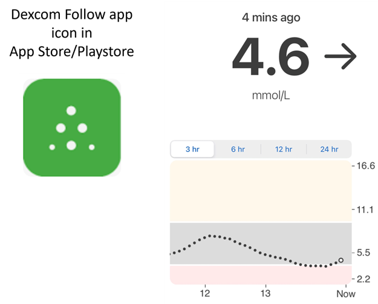

* Dexcom Follow çok çeşitli telefonlarla uyumludur (hem Android hem de iPhone). Dexcom Follow, sensör verilerini almak için resmi Dexcom uygulamasını kullanmasanız bile kullanılabilir.

* Birçok bakım veren Dexcom Follow'u tanır ve daha karmaşık bir şey yerine onun anlaşılır arayüzünü tercih eder.

* Dexcom Follow; öğretmenler, büyükanne ve büyükbabalar ve diyabet ile şeker değerleri hakkında çok az şey bilen kişiler için çok iyidir. Özelleştirilebilir uyarıları vardır (KŞ seviyesi, hangi sesin çalınacağı vb.). Gerekirse alarmlar tamamen kapatılabilir. Bu, sensörünüz henüz oturmadıysa ve çok sayıda yanlış düşük değer üretiyorsa çok faydalıdır.

#### Dexcom Follow kurulumu: adım adım kılavuz

Sensör verilerini almak için resmi olmayan Dexcom uygulaması BYODA'yı kullanıyorsanız, takipçilere davetleri BYODA uygulamasının içinden gönderebiliyor olabilirsiniz.

Üçüncü taraf uygulamalardan artık Dexcom takipçilerine davet e-postası gönderemezsiniz. xDrip'te davet isteği yalnızca “invite not sent” (davet gönderilmedi) mesajıyla sonuçlanır.

Resmi Dexcom uygulamasını yüklemeniz, daveti göndermeniz ve ardından resmi uygulamayı kaldırmanız gerekir.

Adımlar şöyledir:

1)  Resmi “Dexcom” uygulamasını _herhangi bir_ akıllı telefona (Android/iPhone) yükleyin. Daha uygunsa bu, takipçi telefonu olabilir. 2)  Dexcom kullanıcı adınız ve parolanızla giriş yapın. Zaten Dexcom/Clarity müşterisiyseniz, bunlar Dexcom Clarity için kullandığınız giriş bilgileriyle aynıdır. Dexcom girişiniz yoksa, bu adımda yeni bir giriş oluşturma seçeneği vardır.   
3)  Tanıtım menülerini kaydırarak geçin. 4)  Sensör kodu için “no code” (kod yok) seçeneğini ekleyin. 5)  Transmitter SN altında “enter manually” (elle gir) seçeneğini seçin ve geçerli herhangi bir verici kodu girin (biliyorsanız süresi dolmuş vericilerinizden birinin kodunu kullanın, böylece mevcut vericinizin çalışmasını etkilemez. Kodlar belirli rakam ve harflerden oluşan özel bir biçime uyar: “NLNNNL”, ve yalnızca belirli kombinasyonlar kullanılır. Bu yüzden geçerli olduğunu bildiğiniz bir kodu kullanmak en kolayıdır). 6)  Uygulama vericiyi ve sensörü bulmaya çalışırken takipçi davet edebilirsiniz: uygulamanın sol üstündeki küçük üç noktayı seçin ve yeni takipçi ekleyin. Takipçilerinizden biri telefonunu değiştirdiyse ve yeni bir davete ihtiyacı varsa da bunu kullanabilirsiniz: burada onu takipçi listesinden silebilir ve yeni telefonunda kullanması için yeni bir davet e-postası gönderebilirsiniz. 7)  Takipçi telefonuna Dexcom Follow'u App Store'dan (iPhone) veya Play'den (Android) indirerek yükleyin. Dexcom Follow uygulamasını kurun. Takipçi olma davetini bulmak için e-postanızı açmanız istenecektir.    
8)  Artık resmi Dexcom G6 uygulamasını silebilirsiniz.

Dexcom Follow için sensör verileri, hangi uygulamayı kullandığınıza göre **AAPS** telefonundan ya doğrudan BYODA'dan ya da xDrip'ten aktarılır.


### [Nightguard](https://apps.apple.com/fr/app/nightguard/id1116430352) (iOS)

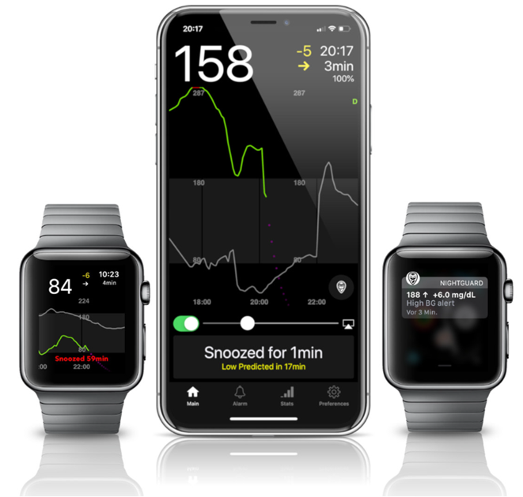

Artıları (kullanıcıların bildirdiği):

* [App Store](https://apps.apple.com/us/app/nightguard/id1116430352)'da mevcuttur; basit, kullanımı kolay bir arayüze sahiptir.

* Alarmları 5 dakikadan 24 saate kadar farklı sürelerle ertelemek için düğmeyi kaydırın veya telefonu sallayın

* Alarmları özelleştirebilirsiniz (yüksek ve düşük uyarıları, 15-45 dakika veri gelmediğinde kaçırılan ölçümler).

* Art arda 2-5 ölçümde hızlı yükselme/düşme (siz seçersiniz). İki ayrı ölçüm arasındaki farkı (delta) da seçebilirsiniz

* Akıllı erteleme: değerler doğru yönde ilerliyorsa uyarı vermez

* Belirli bir süre için yeni geçici hedef ayarlamayı, geçici hedefi silmeyi veya karbonhidrat girmeyi sağlıyor gibi görünen bir Care sekmesi vardır.

Eksileri (kullanıcıların bildirdiği)

* Yalnızca iOS için mevcuttur

* Hangi GH seviyesi ayarlanırsa ayarlansın GH 5 mmol olarak gösterilir

* Ekranda TB görünse de geçici bazal oranını hiç göstermez

### [Nightwatch](https://play.google.com/store/apps/details?id=se.cornixit.nightwatch) (Android)

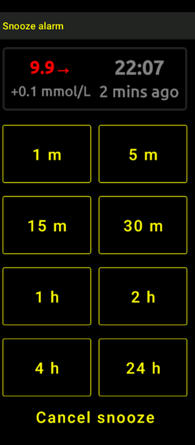


* Nightwatch kendini bir Nightscout istemcisi olarak tanıtır ve kullanıcının Nightscout glikoz değerlerini Android telefon veya tablette izler.

* Uygulama [Google Play](https://play.google.com/store/apps/details?id=se.cornixit.nightwatch)'den indirilebilir ve KŞ verilerini gerçek zamanlı gösterir.

* Kullanıcı, özelleştirilmiş sesli düşük ve yüksek alarmlarla uyarılabilir.

* KŞ verileri mmol/L veya mg/dL olarak görüntülenebilir.

* Android 5.0 veya üstünü gerektirir.

* Koyu bir arayüzü, büyük değerleri ve düğmeleri vardır; gece kullanımı için tasarlanmıştır.

### xDrip (Android)

xDrip'i takipçi olarak kullanabilirsiniz.

#### Nightscout ile

xDrip'i Nightscout takipçisi (Nightscout Follower) olarak ayarlayın. KŞ ve tedavileri alırsınız, bazalı almazsınız.

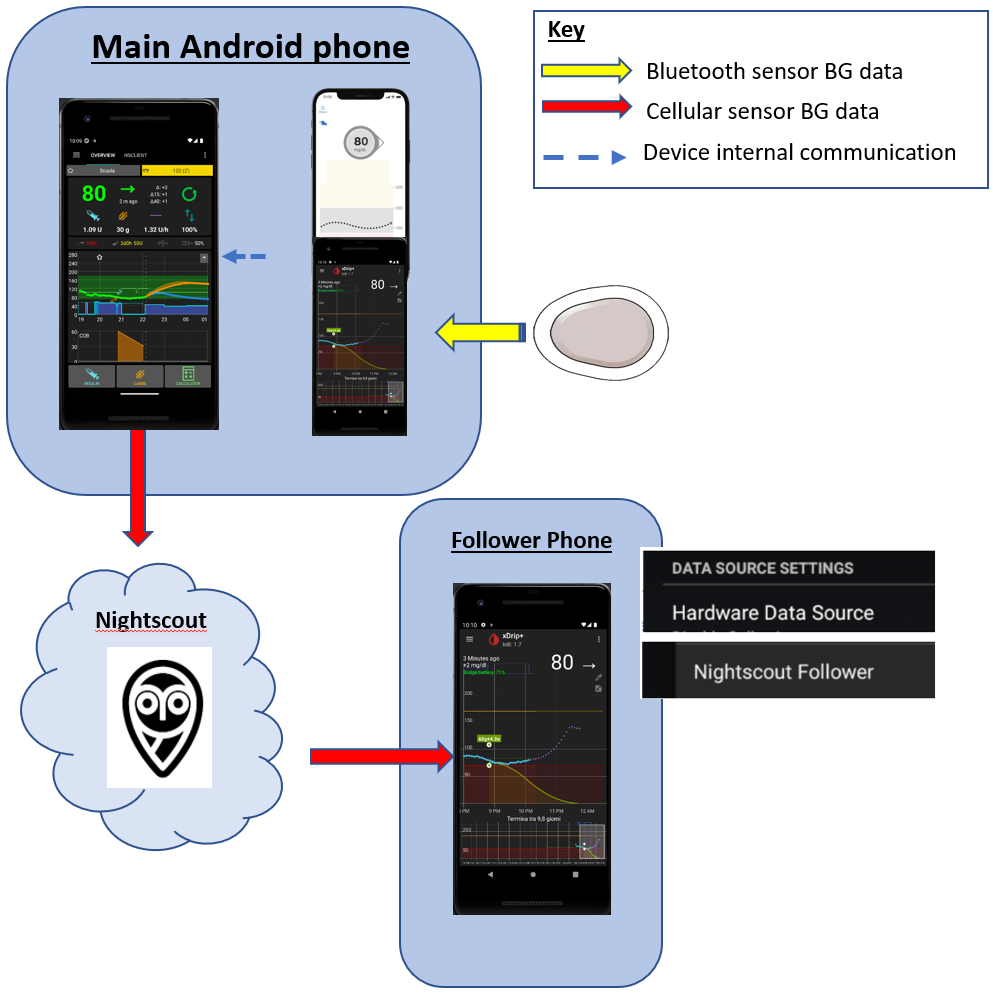

#### Nightscout olmadan - xDrip KŞ veri kaynağı

**AAPS** veri kaynağınız xDrip ise (veya xDrip KŞ'yi BYODA, Juggluco gibi başka bir uygulamadan da alabiliyorsa), KŞ, tedaviler ve bazal oranlarını göstererek xDrip takipçileriyle veri paylaşmak için bunu ana birim telefondan kullanabilirsiniz.

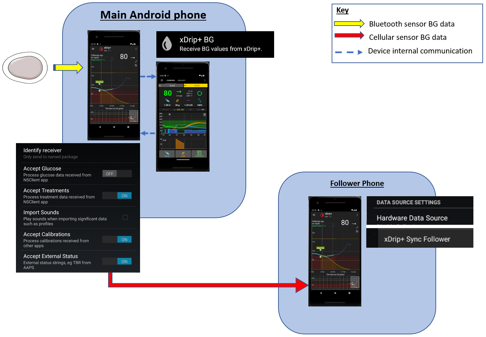

#### Nightscout olmadan - xDrip KŞ yardımcı uygulaması

**AAPS** veri kaynağınız xDrip değilse ama KŞ verilerini Companion App veri kaynağından gösterebiliyorsanız, KŞ, tedaviler ve bazal oranlarını göstererek xDrip takipçileriyle veri paylaşmak için bunu ana birim telefondan kullanabilirsiniz.

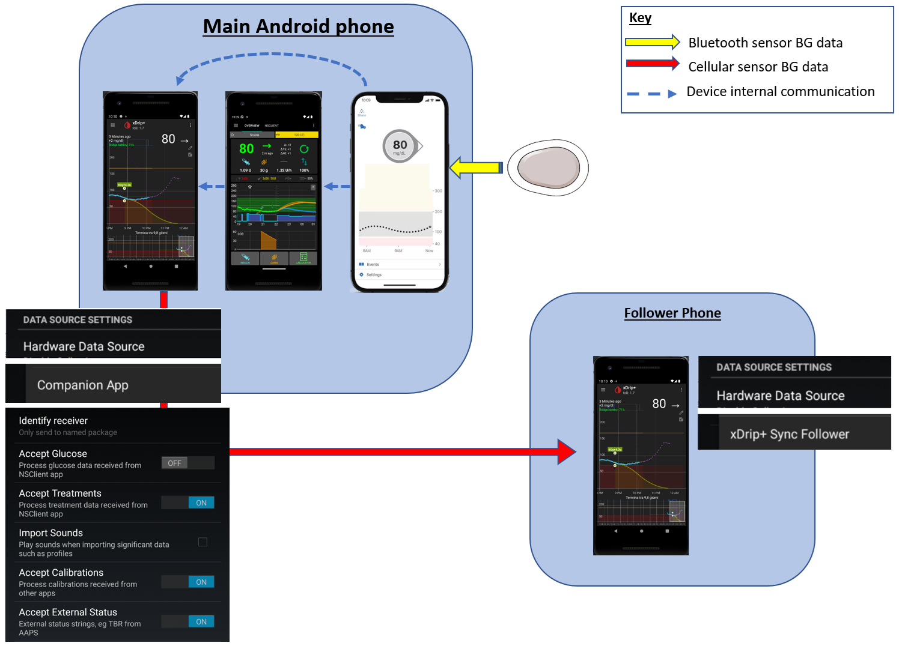

### xDrip4iOS (iOS)

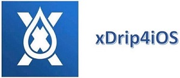

xDripSwift, orijinal xDrip uygulamasının iOS'a aktarılmasıyla oluşturuldu ve **xDrip4iOS** olarak yazılan "xDrip for iOS" haline geldi.

```{admonition} Further detail about how to attempt to obtain the original **xDrip4iOS** app
:class: dropdown
[xDrip4iOS Facebook grubu](https://www.facebook.com/groups/853994615056838/announcements), xDrip4iOS ve Shuggah için ana topluluk desteğidir. **xDrip4iOS** birçok farklı CGM sistemine ve vericiye bağlanabilir; kan şekeri değerlerini, grafikleri ve istatistikleri gösterebilir ve alarm verebilir. Ayrıca Nightscout'a veri yükleyebilir veya bir [Nightscout takipçi uygulaması](https://xdrip4ios.readthedocs.io/en/latest/connect/follower/) olarak çalışabilir. 

"**xDrip4iOS**'u iPhone'uma nasıl yüklerim?"
İki seçenek vardır:

1. Mac'iniz ve bir Apple Developer hesabınız (yılda 99 EUR/USD) varsa, [talimatları izleyerek](https://xdrip4ios.readthedocs.io/en/latest/install/build/) kendi xDrip4iOS'unuzu oluşturabilirsiniz.

İsterseniz daha sonra "releaser" (yayınlayan) olabilir ve [kişisel bir Testflight xDrip4iOS'u](https://xdrip4ios.readthedocs.io/en/latest/install/personal_testflight/) en fazla 100 kişiyle paylaşarak onlara yardım edebilirsiniz.

2. [xDrip4iOS Facebook grubuna](https://www.facebook.com/groups/853994615056838/announcements) katılın ve uygulamayı edinmenin güncel yöntemleri için sabitlenmiş gönderileri okuyun. **Uygulama için davet istememelisiniz** (grup kurallarını okuyun).
```


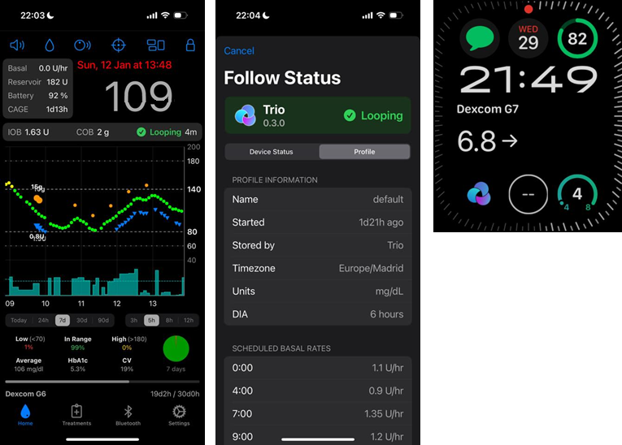

"**Shuggah** nedir?" Ukraynalı bir geliştirici grubu, xDrip4iOS proje kodunu (GitHub'da herkese açık olarak paylaşılır) kopyaladı ve bir şirket hesabı altında App Store'da yayınladı. Shuggah sürümü hiçbir şekilde xDrip4iOS geliştiricileri tarafından yönetilmez.

[xDrip4iOS Facebook grubu](https://www.facebook.com/groups/853994615056838/announcements), xDrip4iOS'u ve ona uygun Apple Watch uygulamalarını destekler.

### [Sugarmate](https://apps.apple.com/fr/app/sugarmate/id1111093108) (iOS)

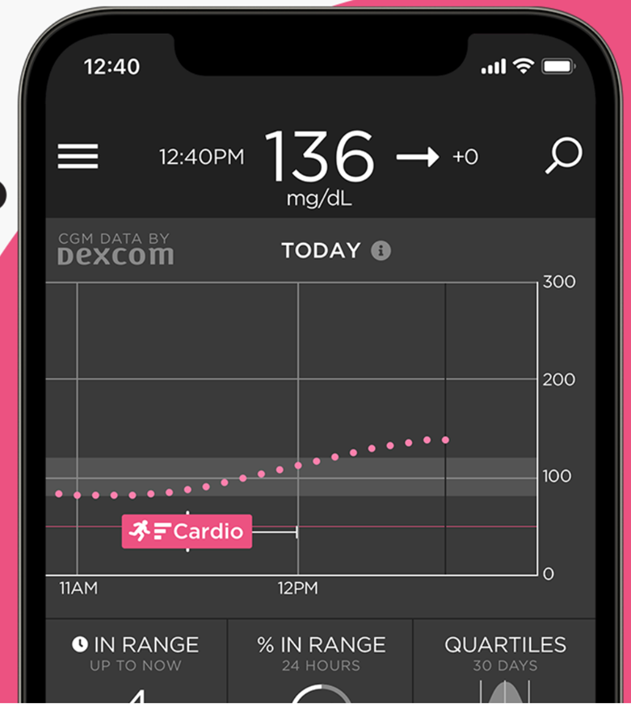

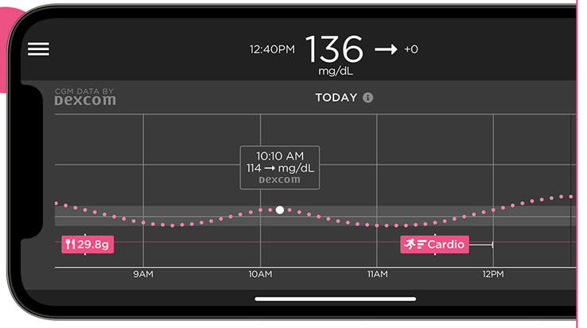


[Sugarmate](https://sugarmate.io/), App Store'dan iPhone'lara indirilebilir. Sugarmate şunlarla uyumludur:
* Apple iPhone (yazılım sürümü 13.0 veya üstü gerekir)
* Apple iPad (yazılım sürümü 13.0 veya üstü gerekir)
* Google Android (web uygulamasını ana ekranınıza kaydedin)

Sugarmate kullanıcıları, ABD'de araç kullanırken glikoz değerlerini göstermek için Apple CarPlay ile kullanılabildiğini bildirmiştir. Bunun ABD dışındaki ülkelerde mümkün olup olmadığı henüz bilinmiyor. Bu konuda daha fazla bilginiz varsa, lütfen bir [pull request](../SupportingAaps/HowToEditTheDocs.md) oluşturarak ayrıntıları buraya, dokümantasyona ekleyin. Bu hızlı ve kolaydır.


### [Spike](https://spike-app.com/) (iOS)

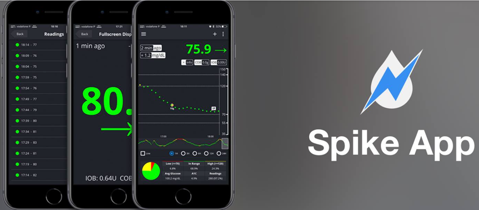

Spike, birincil alıcı veya takipçi uygulaması olarak kullanılabilir; KŞ, alarmlar, AİNS ve daha fazlasını sağlar.

Web sitesi ve uygulama artık geliştirilmiyor. Destek [Facebook](https://www.facebook.com/groups/1973791946274873) ve [Gitter](https://gitter.im/SpikeiOS/Lobby) üzerinde bulunabilir.

## **AAPS** bir telefonda çalışırken **AAPS'in izlenmesi** için akıllı saatler (tam profil verisi veya yalnızca glikoz).

[Buraya](../Getting-Started/Watches.md) bakın.


## AAPS'i takip etmek için cihazlar

```{contents} Devices include:
:depth: 1
:local: true
```

### M5Stack

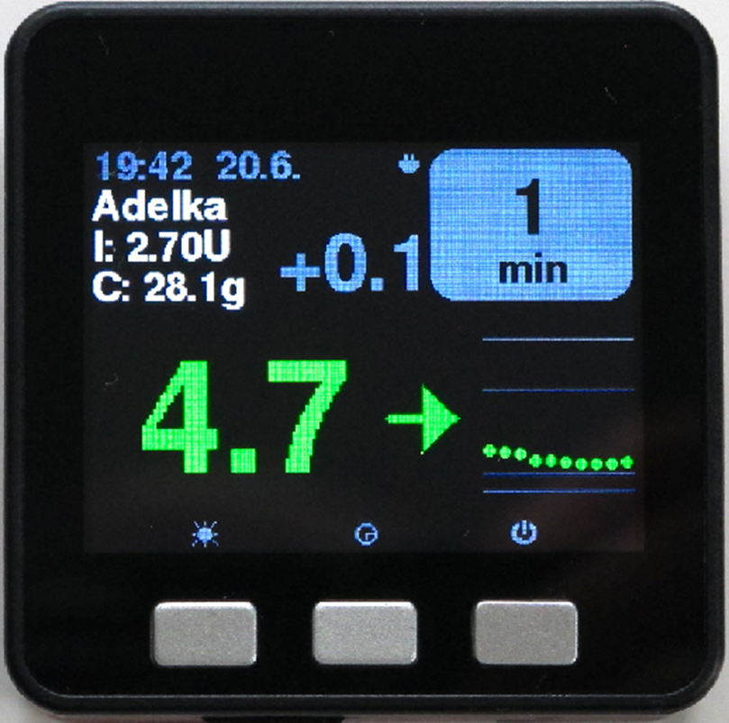

M5Stack, birçok uygulama için programlanabilen küçük bir kutudur. Martin'in projesi [M5Stack NightscoutMon](https://github.com/mlukasek/M5_NightscoutMon/wiki), sensör glikoz değerlerini ve eğilimlerini, AİNS ve AKRB'yi gösterir. Renkli ekranı, micro SD kart yuvası, 3 düğmesi, hoparlörü ve dahili pili olan plastik bir kutu içindedir. Çok iyi bir kan şekeri monitörüdür ve Nightscout hesabınız varsa kurulumu nispeten kolaydır. Kullanıcılar genellikle evdeki Wi-Fi ağında çalıştırır. Bazı kullanıcılar ise telefonun Wi-Fi erişim noktasıyla çalıştırarak motosiklet sürerken ekran olarak kullandığını bildiriyor.

### SugarPixel

SugarPixel, sürekli glikoz izleme için ikincil bir glikoz gösterge ve uyarı cihazıdır. Kullanıcının akıllı telefonundaki Dexcom uygulamasına veya Nightscout uygulamasına bağlanır. Cihaz, kan şekeri değerlerini gerçek zamanlı gösterir. Bu CGM donanım monitörünün avantajları: rastgele ton üreten sesli uyarılar (çok yüksek sesli), işitme engelliler için titreşimli uyarılar, özelleştirilebilir ekran seçenekleri ve yerleşik çok kullanıcılı takip.

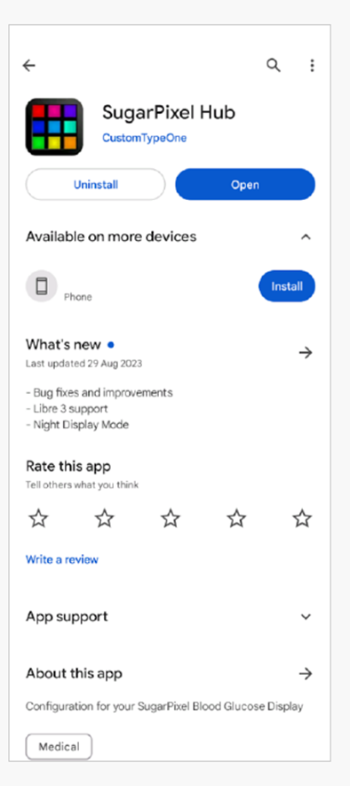

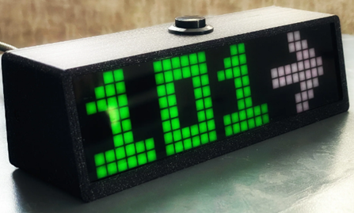

* SugarPixel, kullanıcının ihtiyaçlarına uygun olarak mg/dL ve mmol/L cinsinden birden fazla ekran seçeneği ve renk kodlu glikoz değerleri sunar.
* Standart arayüz KŞ, eğilim oku ve Delta'yı gösterir. Delta, son ölçümden bu yana olan + veya - değişimdir.
* SugarPixel, düşük parlaklıkta kullanım için BG and Time arayüzüyle özelleştirilebilir; böylece kullanıcı komodinde KŞ değerini ve güncel saati görebilir.
* SugarPixel'in renk arayüzü, KŞ değerini temsil eden tek bir rengi göstermek için tüm ekranı kullanır. Bu sayede kullanıcı, dışarıda bahçede, terasta veya havuzda oynarken KŞ değerlerini pencereden uzaktan görebilir.
* Big BG arayüzü, cihazı komodinde kullanan ve gözlük veya kontakt lens takan kişiler için faydalıdır.

### Ulanzi TC001 üzerinde Nightscout Clock

**Nightscout Clock**, **Ulanzi TC001** cihazında çalışan açık kaynaklı bir yazılımdır. Dexcom sunucularına veya Nightscout'a bağlanır ve kan şekeri değerlerini gerçek zamanlı gösterir.

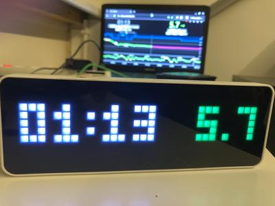

* Saat hem mmol/L hem de mg/dL birimlerini destekler ve sesli alarmları vardır.
* Birkaç ekran seçeneği vardır. Genel bakış için [Github nightscout-clock](https://github.com/ktomy/nightscout-clock?tab=readme-ov-file#more-information-for-people-who-needs-it) sayfasına bakın.
* Cihazın kurulumu ve yapılandırılması yalnızca birkaç basit adım gerektirir. Kurulduktan sonra çalışması için yalnızca güç ve Wi-Fi gerekir.
* Ulanzi TC001 cihazını satın almak SugarPixel'den çok daha ucuzdur.
* Yazılım ve kurulum talimatları [Github nightscout-clock](https://github.com/ktomy/nightscout-clock?tab=readme-ov-file) sayfasında bulunabilir.
* Artiom Kenibasov tarafından geliştirilir ve bakımı yapılır; destek [Facebook AAPS Users grubunda](https://www.facebook.com/groups/cgminthecloud/posts/8776932509094594/) verilir.

### PC (TeamViewer)
Bazı kullanıcılar, ileri düzey uzaktan sorun giderme için [TeamViewer](https://www.teamviewer.com/) gibi tam bir uzaktan erişim aracını faydalı buluyor.
