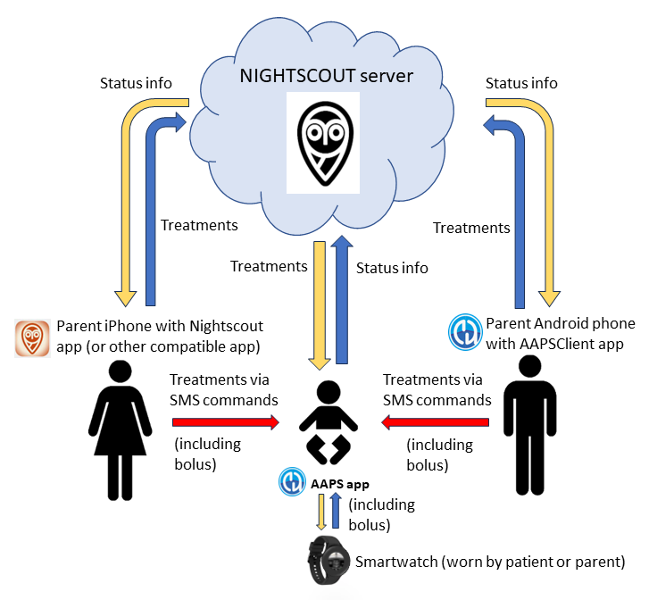
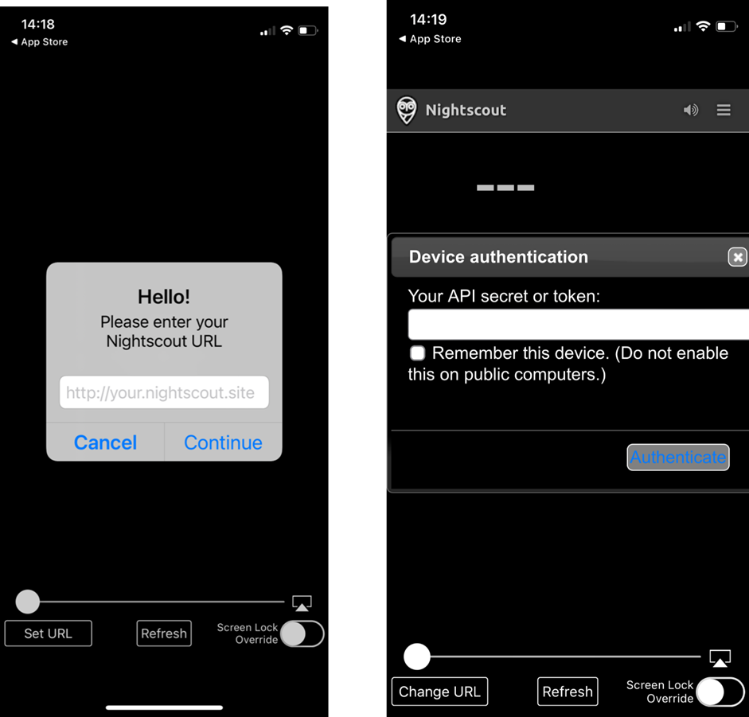
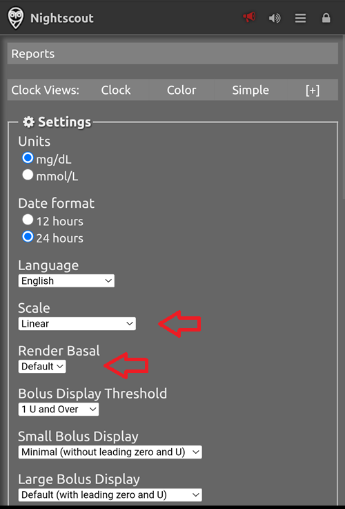

# AAPS'in uzaktan kontrolü

```{contents} In this page
:backlinks: entry
:depth: 2
```

**AAPS**'i uzaktan yönetmek için dört çok etkili araç vardır:

1) [SMS commands](#RemoteControl_SMS-Commands) (follower phone can be either Android or iOS), 2) [AAPSClient](#RemoteControl_aapsclient) (follower device is an Android phone or tablet, or a Windows, Mac or Linux computer; on an iPhone you [build the app yourself](#aapsclient-iphone)) 3) [Nightscout](#RemoteControl_nightscout) (Android, iOS or other computer/device), mainly for following: see the note on [client control](#client-master-control) in that section.  
4) [Smartwatches](#RemoteControl_smartwatches) (Android)

İlk üçü çoğunlukla bakım verenler/ebeveynler için uygundur. Akıllı saatler ise hem bakım verenler/ebeveynler **hem de** diyabetli yetişkinlerin kendileri için çok faydalıdır.



(RemoteControl_SMS-Commands)=

## 1) SMS Komutları

Ayrı [SMS Komutları](../RemoteFeatures/SMSCommands.md) sayfasına bakın.

(RemoteControl_aapsclient)=
## 2) AAPSClient

**AAPSClient** görünüş olarak **AAPS**'in kendisine çok benzer. Bakım verene, **AAPS**'e uzaktan komut göndermek için aynı ekranları ve düğmeleri sunar:


(remotecontrol-aapsclient-versions)=
### AAPSClient, AAPSClient2 ve AAPSClient3 hakkında

İstemci uygulamasının 3 sürümü vardır: **AAPSClient**, **AAPSClient2** ve **AAPSClient3**. Hepsi aynı şekilde çalışır. Tek fark, aynı takipçi telefona yan yana yüklenebilmeleridir.

Bir kişiyi takip eden bakım verenin yalnızca **AAPSClient**'a ihtiyacı vardır. İkinci bir kişiyi (kendi **Nightscout** sitesi ve kendi **AAPS** telefonu olan) takip etmek ve uzaktan kontrol etmek için **AAPSClient2**'yi de yükleyin. Üçüncü bir kişi için de **AAPSClient3**'ü yükleyin. Her uygulama, takip ettiği kişinin **Nightscout** sitesi ve **AAPS** telefonuyla ayrı ayrı kurulur ve [eşleştirilir](#aapsclient-pairing-with-the-master).

Uygulamaları birbirinden ayırmak için bazı öğelerin rengi farklıdır: **AAPSClient** için sarı, **AAPSClient2** için mavi ve **AAPSClient3** için yeşil. Bu öğeler uygulama simgesi, widget arka planı ve uygulamanın ana ekranındaki **AAPS** durum bölümüdür. <br/> Not: widget arka planının opaklığı widget yapılandırmasında ayarlanabilir. Opaklık düşükse renk zor görünür.


### İndirme ve yükleme

**AAPSClient**, iki bakım verenin de bir hastanın **AAPS** telefonuna erişebilmesi ve onu uzaktan kontrol edebilmesi için tek bir telefona veya birden fazla takipçi telefona (ör. 1. ebeveynin ve 2. ebeveynin takipçi telefonu) yüklenebilir.

**AAPSClient**'ı indirmek için [GitHub deposuna](https://github.com/nightscout/AndroidAPS/releases/) gidin ve şu dosyaya tıklayın: **“app-AAPSClient-release_x.x.x.x”** (aşağıdaki ekran görüntüsündekinden daha yeni bir sürüm olabilir):


Ardından bilgisayarınızda _indirilenler_ klasörüne gidin. Windows'ta _indirilenler_ sağ taraftaki şeritte görünür:


İndirme bittikten sonra dosyayı bulmak için _klasörde göster_ seçeneğine tıklayın.

**AAPSClient** apk'sı artık şu yollardan biriyle aktarılabilir:

USB kablosuyla takipçi telefona aktarılabilir; veya Google Drive klasörüne sürüklenip ardından "app-AAPSClient-release" dosyasına tıklanarak takipçi telefona eklenebilir.

Kendiniz için **AAPS**'e ve başka birini izlemek için **AAPSClient**'a ihtiyacınız varsa, **AAPSClient**'ı yukarıda anlatıldığı gibi GitHub deposundan indirmek yerine kendiniz oluşturmanız gerekir. Bunun nedeni, farklı anahtarlarla imzalanmış **AAPS** ve **AAPSClient**'ı aynı telefona yükleyememenizdir. <br/> **AAPSClient**'ı kendiniz oluşturmak için [normal AAPS oluşturma](../SettingUpAaps/BuildingAaps.md) ile aynı işlemi izleyin. **Generate signed App Bundle or APK** sayfasında **fullRelease** yerine **aapsclientRelease** seçin.

Bir takipçi telefona birden fazla istemci uygulaması (**AAPSClient**, **AAPSClient2**, **AAPSClient3**) yüklediğinizde de aynı kural geçerlidir: hepsi **aynı anahtarla** imzalanmalıdır. Aksi halde Android ikincisini yüklemeyi reddeder (hata `INSTALL_FAILED_DUPLICATE_PERMISSION`).

### Senkronizasyon: AAPSClient ve AAPS kurulumu

__AAPSClient__ apk'sı takipçi telefona yüklendikten sonra, Nightscout 15 için **NSClientV3**'ün her iki telefonda da aynı şekilde ayarlandığından emin olun (bkz. [güncelleme notları](../Maintenance/UpdateToNewVersion.md)). Aşağıdaki örnek, NSClientV3 ve Nightscout 15 ile senkronizasyon kurulumunu gösterir. __AAPS__'te başka veri kaynakları da vardır (ör. xDrip).

**Konfigürasyon** > **İletişim** bölümünde kullanıcı, verilerini __NSClientV3__ (v3 API) üzerinden Nightscout ile senkronize eder. Bu, hem __AAPS__ hem de takipçi telefonda aynı şekilde ayarlanır.


Kullanıcı, her birinde NSClientV3'ü kurarak AAPS ve AAPSClient telefonlarının __ikisinin de__ birlikte senkronize olduğundan emin olmalıdır. Takipçi telefonda bunun yerine **AAPS**'in gösterdiği bir QR kodu taranabilir, aşağıdaki [AAPSClient'ı AAPS ile eşleştirme](#remotecontrol-pairing) bölümüne bakın:

- NSClientV3 **Ayarlar** bölümüne **Nightscout URL** adresinizi girin

- Aynı ayarlarda **Nightscout erişim belirteci** alanına belirtecinizi girin. Lütfen [buradaki](https://nightscout.github.io/nightscout/security/#create-a-token) notları izleyin. **AAPS** telefonunda bir **yönetici belirteci** (admin token) kullanın: **AAPS** bununla her takipçi telefon için ayrı bir belirteç oluşturur.

- Enable **Use websockets** on **both** phones. Websockets are **mandatory** for remote control from **AAPSClient**, on both phones. Without them, **AAPSClient** can follow **AAPS** but cannot control it. Her iki telefonda da senkronizasyonu hızlandırırlar, ancak pil kullanımı biraz artar.

  Your Nightscout host must support websockets. If the websocket connection keeps dropping, remote control does not work. See [Troubleshooting NSClient](../GettingHelp/TroubleshootingNsClient.md).


Kullanıcı, her iki telefonun **NSClientV3** ekranında hem __AAPSClient__ hem de __AAPS__ için ‘Bağlandı’ göründüğünden emin olmalıdır. Bu noktada **AAPSClient**, **AAPS**'i takip eder (KŞ, tedaviler, profil), ancak henüz kontrol edemez: iki telefonu aşağıda anlatıldığı gibi eşleştirin.

(remotecontrol-pairing)=
### AAPSClient'ı AAPS ile eşleştirme (uzaktan kontrol)

**AAPS** sürüm 4'ten itibaren **AAPSClient**, **AAPS**'i güvenli ve **eşleştirilmiş** bir bağlantı üzerinden kontrol eder. Yalnızca senkronizasyon yeterli değildir: telefonlar eşleştirilene kadar **AAPSClient** yalnızca **Yönet** ekranını gösterir; burada yalnızca görüntülenebilen **Profil** ve **Ana birimle eşleştir** vardır.

1. **AAPS** telefonunda **Yönet → Yetkili istemciler** bölümünü açın ve **İstemci kontrolüne izin ver** seçeneğini açın (varsayılan olarak kapalıdır, Basit modda her zaman açıktır).
2. **+** düğmesine dokunun, takipçi telefon için bir ad girin, nasıl kurulacağını seçin ve **rolünü** seçin:
   - **QR kodu: Nightscout ve eşleştirme** — **AAPS**, takipçi telefonda Nightscout'u kuran ve telefonu tek taramada eşleştiren bir QR kodu gösterir. Bunun için **AAPS** telefonunun NSClientV3 ayarlarında bir yönetici belirteci gerekir.
   - **PIN** — kamerası olmayan ve zaten Nightscout'a bağlı bir takipçi telefon için: tek kullanımlık **PIN**'i not edin (yaklaşık iki dakika geçerlidir).
3. **AAPSClient** telefonunda kodu tarayın (Kurulum Sihirbazında veya **Yönet → Ana birimle eşleştir → QR kodunu tarat** ile) ya da **Yönet → Ana birimle eşleştir** bölümünü açıp PIN'i girin. Onayla.

Takipçi telefon ardından **Yetkili istemciler** listesinde **Etkin** olarak görünür ve **AAPSClient** **Tedaviler**, **Senaryolar** ve **Yönet** ekranlarını gösterir. Takipçi telefon, yalnızca ihtiyaç duyduğu haklara sahip kendi Nightscout belirtecini alır. Ekran görüntüleri ve sorun gidermeyle birlikte tam yöntem [Ana birim ↔ İstemci kontrolü](#client_master_master_setup) sayfasındadır.

Kurulumun çalıştığını kontrol edin: **AAPSClient**'ta karbonhidrat girin, gösterilen miktarı onaylayın ve girişin her iki telefonda da **Tedaviler** içinde göründüğünü kontrol edin.

(remotecontrol-nightscout-access-token)=

### 'Nightscout erişim belirteci' yapılandırma sorunlarını giderme

'Nightscout erişim belirteci' yapılandırmasının ayrıntıları, Nightscout sağlayıcınızın ücretli barındırılan bir site olup olmamasına göre değişebilir.

**AAPS**'in 'Nightscout erişim belirteci'ni kabul etmesinde zorlanıyorsanız ve ücretli barındırılan bir Nightscout sitesi kullanıyorsanız, 'Nightscout erişim belirteci' sorunlarını nasıl çözeceğinizi önce Nightscout sağlayıcınıza danışabilirsiniz. Aksi halde lütfen **AAPS** grubuna başvurun, ancak bunu yapmadan önce [buradaki](https://nightscout.github.io/nightscout/security/#create-a-token) notları doğru izlediğinizi tekrar kontrol edin.

### AAPSClient'ın sundukları

Eşleştirildikten sonra **AAPSClient**, bakım verene **AAPS**'in kendisiyle neredeyse aynı ekranları sunar:

- **Tedaviler**: insülin bolusu, karbonhidrat ve bolus sihirbazı.
- **Senaryolar**: [senaryoları](../DailyLifeWithAaps/Scenes.md) başlatma ve durdurma.
- **Yönet**: profiller, insülin ayarları, geçici hedefler, Hızlı Asistan, otomasyon, yiyecek, bölge rotasyonu, eşleştirme ve çalışan geçici bazal.
- **Ana Menü**: tedavi geçmişi, geçmiş tarayıcısı, istatistikler, bakım, konfigürasyon.

**AAPSClient**'ta pompa ve görevler yoktur. Ayrıntılı açıklama için [AAPSClient uygulaması](AapsClient.md) sayfasına bakın.

**AAPSClient**, bakım verenin **AAPS**'te doğrudan yapılabilen ayarlamaların çoğunu, **insülin bolusları dahil**, mobil ağ veya internet üzerinden uzaktan yapmasını sağlar. Her komut imzalanır ve Nightscout üzerinden **AAPS** telefonuna gönderilir. Telefon komutu kendi verileriyle karşılaştırır, sınırlar, size kendi onay ekranını gösterir ve ancak ondan sonra uygular. **AAPSClient**, özellikle kimlik doğrulama gerektiren komutlarda [SMS Komutları](../RemoteFeatures/SMSCommands.md)'ndan çok daha hızlı _olabilir_.

Başka yollarla (örneğin Nightscout web sitesinden) Nightscout'a girilen tedaviler, istemci kontrolü açıkken uygulanmaz: **AAPS** bu durumda [güçlendirilmiş moddadır](#client-master-control-hardened-mode) ve değişiklikleri yalnızca eşleştirilmiş istemcilerden alır. İstemci kontrolü kapalıyken bunlar yalnızca [NSClient tercihlerinin Senkronizasyon bölümünde](#Preferences-nsclient-synchronization) ilgili **NS'den … al** seçenekleri etkinse uygulanır.

**AAPSClient** ile uzaktan kontrol yalnızca senkronizasyonunuz iyi çalışıyorsa önerilir (_yani_ GH, GBO vb. kendiliğinden değişmesi gibi istenmeyen veri değişiklikleri görmüyorsanız).

### Akıllı saat seçenekleriyle AAPSClient

Akıllı saat, çocuklarda **AAPS**'i yönetmeye yardımcı olmak için çok faydalı bir araç olabilir. A couple of different configurations are possible. **AAPSClient** bakım verenin telefonunda yüklüyse, [**AAPSClient WearOS** uygulaması](https://github.com/nightscout/AndroidAPS/releases/) indirilip ebeveynin telefonuna bağlı uyumlu bir akıllı saate yüklenebilir. Bu, güncel KŞ ve döngü durumunu gösterir. **AAPSClient**, **AAPS** ile eşleştirildikten sonra saat eylemleri (bolus, karbonhidrat, geçici hedef ve profil değişiklikleri dahil) **AAPSClient** üzerinden **AAPS**'e iletilir, o da bunları onaylar ve uygular: bkz. [İstemcide Wear OS](#clientmastercontrol-wear-os-on-a-client). Akıllı saatler hakkında daha fazlasını [burada](#remotecontrol-smartwatches) okuyabilirsiniz.

(RemoteControl_nightscout)=
## 3) Nightscout

Nightscout'un “bulutta” bir sunucu olmasının yanı sıra, doğrudan iPhone'unuzdaki App Store'dan indirilebilen özel bir **Nightscout** uygulaması da vardır. Android takipçi telefonunuz varsa, özel bir Nightscout uygulaması yoktur ve [**AAPSClient**](#RemoteControl_aapsclient) kullanmak daha iyidir. Yalnızca takip etmek istiyor ve tedavi göndermek istemiyorsanız Play Store'dan [Nightwatch](https://play.google.com/store/apps/details?id=se.cornixit.nightwatch) uygulamasını indirip yükleyebilirsiniz.

**Nightscout** uygulamasını iPhone'unuza yükledikten sonra uygulamayı açın ve kurulum adımlarını izleyerek Nightscout adresinizi girin (aşağıda, solda). Bu adresin biçimi, Nightscout'unuzun nerede barındırıldığına göre değişebilir. (_ör._ http://youraddresshere.herokuapp.com). Ardından Nightscout API secret'ınızı girin (aşağıda, sağda). API parolası sorulmazsa, uygulamanın üst kısmındaki asma kilide tıklayarak bunu girmeniz gerekir:



Kurulum hakkında daha fazla bilgi doğrudan [Nightscout](https://nightscout.github.io/nightscout/discover/) sayfasında bulunabilir

İlk girişte çok basit bir ekran görürsünüz. Sağ üstteki “hamburger” menüsünü seçip aşağı kaydırarak görüntüleme seçeneklerini özelleştirin:


“Settings” (Ayarlar) bölümüne kadar aşağı kaydırın. KŞ gösteriminde varsayılan ölçek logaritmik olduğundan “scale” (ölçek) ayarını “linear” (doğrusal) yapmak isteyebilirsiniz. Pompa bazalının görünmesi için “render basal” altında “default” seçin.



İstediğiniz seçenekleri seçin. Alarmlar için başka bir uygulama kullanıyorsanız alarmların işaretini kaldırın.


“show plugins” bölümüne gelene kadar aşağı kaydırmaya devam edin.

“careportal” seçeneğinin işaretli olduğundan emin olmanız gerekir. Başka çeşitli ölçümleri de seçebilirsiniz (en faydalıları: IOB, care portal, pump, cannula age, insulin age, basal profile ve OpenAPS).

Önemli: bu değişikliklerin geçerli olması için şimdi en alttaki “save” (kaydet) düğmesine tıklamanız gerekir.


“save” düğmesine bastıktan sonra uygulama ana Nightscout ekranınıza döner. Ekran aşağı yukarı şöyle görünür:

1. Güncel glikoz değeri
2. AAPS sistem durumu bilgileri - daha fazla ayrıntı görmek için ekrandaki sekmelere tek tek dokunun. Bu görüntüleme seçeneklerini hamburger menüsünden ekleyin veya kaldırın.
3. Tedavilerle (karbonhidrat, bolus) birlikte son glikoz eğrisi
4. Daha uzun süreli glikoz eğrisi
5. Görüntüleme seçeneklerini ayarlamak, rapor oluşturmak, profilleri düzenlemek ve Nightscout yönetici araçları için "hamburger" menüsü
6. Tedavi girmek için "**+**" menüsü (**AAPS**'in bunları ne zaman uyguladığı için [aşağıya](#RemoteControl_nightscout-treatments) bakın).
7. Gösterilecek farklı bir zaman aralığı seçin
8. Bazal insülin profili
9. Yeşil çizgi = geçmiş glikoz Mavi çizgiler = tahmin edilen glikoz


Nightscout uygulamasının sol üst menüsüne daha ayrıntılı bakalım:

1. Careportal ile geriye dönük düzenleme
2. Alarmları aç/kapat
3. Hamburger - tercihleri ayarlamak için
4. Careportal - Tedavi kaydı (**AAPS**'in bunları ne zaman uyguladığı için [aşağıya](#RemoteControl_nightscout-treatments) bakın)


Bu ekrandaki gri sekmelerde **AAPS** sisteminin durumu hakkında çok fazla bilgi vardır (bir sekmeye dokunursanız daha da fazla bilgi görünür):

1. 5 dakikalık glikoz eğilimi
2. Bolus sihirbazı önizlemesi
3. Güncel profilinizi ve bazal bilgilerinizi görmek için Basal'a basın
4. AAPS'teki son CGM ölçümünden bu yana geçen süre
5. **Pompa**: insülin, pil yüzdesi ve AAPS'in pompaya en son ne zaman bağlandığı
6. AAPS'in son yenileme zamanı - bu süre 5 dakikadan uzunsa AAPS telefonu ile pompa/CGM arasında bağlantı sorunu olabilir
7. Bazal ve bolus insülin dağılımını görmek için IOB'ye basın
8. Rezervuardaki insülinin yaşı
9. Kanül yaşı
10. AAPS telefonunun pil durumu
11. Veritabanınızın boyutu. Çok dolarsa (yalnızca kendi kurduğunuz Nightscout'ta; barındırma hizmetlerinde bunu dikkate almayın) bağlantı sorunları yaşamaya başlayabilirsiniz. Bu sayıyı küçültmek için Admin tools menüsünden (hamburger menüsü üzerinden) veri silebilirsiniz.


Açılır pencereyi kapatmak için sayfanın altındaki "refresh" düğmesine basın.

(RemoteControl_nightscout-treatments)=
### Nightscout uygulaması üzerinden AAPS'e tedavi gönderme

**AAPS** 4'te **AAPS**'i uzaktan kontrol etmenin desteklenen yolu **eşleştirilmiş bir AAPSClient**'tır, bkz. [Ana birim ↔ İstemci kontrolü](#client-master-control): her istemcinin ne yapabileceğini sınırlayan bir [rolü](#client-master-control-roles) vardır ve her komut istemci tarafından imzalanır, ardından **AAPS** telefonu tarafından kontrol edilir ve onaylanır. İstemci kontrolü açıkken **AAPS** telefonu [güçlendirilmiş moddadır](#client-master-control-hardened-mode): Nightscout web sitesinde veya Nightscout uygulamasında girilen tedaviler, geçici hedefler ve profil değişimleri **uygulanmaz**. Nightscout uygulaması bu durumda yalnızca takip için bir araçtır.

```{admonition} Only when client control is off
:class: warning
**Yönet → Yetkili istemciler** içinde **İstemci kontrolüne izin ver** kapalıysa (ve Basit mod da kapalıysa), **AAPS** Nightscout'tan gelen careportal girişlerini yalnızca [NSClientV3 ayarlarının Senkronizasyon bölümünde](#Preferences-nsclient-synchronization) **NS'den … al** seçenekleriyle açtığınız veri türleri için uygular: karbonhidratlar, geçici hedefler, profil değişimleri ve diğer careportal girişleri. İnsülin bu yolla asla verilmez: Nightscout'ta girilen bir "Correction bolus" (düzeltme bolusu) yalnızca *bildirilir*; **AAPS** bunu vermeden aktif insülin (AİNS) olarak sayar. Bu kurulum uzaktan kontrol için önerilmez; bunun yerine eşleştirilmiş bir **AAPSClient** kullanın.
```

**Nightscout** seçenekleri hakkında daha fazlasını [burada](https://nightscout.github.io/) okuyun

### Nightscout uygulamasından en iyi şekilde yararlanmak için ipuçları

1). Bir sayfada “takılırsanız” ve ana ekranı tekrar görmek isterseniz, “refresh” (yenile) düğmesine (alt ortada) tıklamanız yeterlidir. Bu sizi KŞ grafiğinin olduğu **Nightscout** ana sayfasına geri götürür.

Telefonda çalışan güncel profili görmek için grafiğin üstündeki çeşitli simgelere basın. “basal” düğmesine basarak daha fazla bilgi (güncel karbonhidrat oranı, duyarlılık, saat dilimi vb.) görülebilir. “OpenAPS” ise profil, güncel hedef vb. hakkında bilgi verir. Telefonun pil yüzdesi ve pompanın pil yüzdesi de izlenebilir. BWP, AİNS ve AKRB'ye göre algoritmanın gelecekte ne olacağını düşündüğünü gösterir.

#### Menüdeki diğer simgeler: kalem (düzenleme) ne anlama geliyor?

Düzenleme kalemini (teknik olarak) son 48 saatteki bolus veya düzeltme tedavilerini taşımak ya da silmek için kullanabilirsiniz.

Bu konuda daha fazlası [burada](https://nightscout.github.io/nightscout/discover/#edit-mode-edit)

Bu, bildirilmiş (ama bolusu yapılmamış) karbonhidratları silmek için faydalı olabilir. Ancak pratikte şu anda **AAPS** ile iyi çalışmıyor. Bu tür değişiklikleri doğrudan **AAPS** uygulamasında yapmanızı öneririz.

(RemoteControl_smartwatches)= (remotecontrol-smartwatches)=

## 4) Akıllı saatler

### Seçenek 1) AAPS'i bir Wear OS saatinden kontrol etme


[Saatinizde **AAPS**'i kurduktan](../WearOS/BuildingAapsWearOS.md) sonra, akıllı saat arayüzleri ve işlevleri hakkında ayrıntılı bilgileri [Wear AAPS'in akıllı saatte kullanımı](../WearOS/WearOsSmartwatch.md) sayfasında bulabilirsiniz.

Kısaca, akıllı saatten şu işlevler başlatılabilir:

* geçici hedef ayarlama

* bolus hesaplayıcıyı kullanma (hesaplama değişkenleri telefondaki ayarlarda tanımlanabilir)

* yKarb girme

* bolus yapma (insülin + karbonhidrat)

* watch settings

* status

* check pump status

* check loop status

* profili kontrol etme ve değiştirme, CPP (Sirkadiyen Yüzde Profili = zaman kaydırma + yüzde)

* GTD'yi gösterme (Günlük Toplam Doz = günlük bolus + bazal)

* Bakım veren ile tip 1 diyabetli çocuk farklı yerlerdeyken uzaktan bolus (her iki cihaz da ağa bağlı olduğu sürece **AAPS** saati ve **AAPS** telefonu için mümkündür)

#### Bakım verenlerden saate başka uygulamalarla (WhatsApp gibi) iletişim

Saate WhatsApp gibi başka uygulamalar eklemek mümkündür, örneğin bakım verenler ile çocuklar arasında mesajlaşma için. Telefona bağlı yalnızca BİR Google hesabı olması önemlidir; aksi halde saat bu verileri almaz. Samsung hesabı açmak için 13 yaşında veya daha büyük olmanız gerekir. Bu hesap, Android telefonda kullanılan e-posta adresiyle açılmalıdır.

Galaxy 4 saatte mesajlaşma için WhatsApp kurulumunu anlatan bir video [burada](https://gorilla-fitnesswatches.com/how-to-get-whatsapp-on-galaxy-watch-4/) gösterilmektedir (WhatsApp'ın tüm işlevlerini kullanamazsınız)

Hem **AAPS** telefonundaki **Galaxy wearable** uygulamasında hem de saatte ayar yapıldığında, WhatsApp mesajları hafif bir titreşimle bildirilebilir ve mesaj mevcut saat arayüzünün üzerinde görünebilir.

### Seçenek 2) Telefondaki **AAPS**'i uzaktan kontrol etmek için saatte **AAPS**

**AAPSClient** veya SMS komutlarıyla takipçi telefon kullanımına benzer şekilde (yukarıdaki bölümlere bakın), akıllı saat de **AAPS**'i uzaktan kontrol etmek ve tam profil verisi sağlamak için kullanılabilir. Takipçi telefon kullanımından önemli bir fark şudur: akıllı saat ile **AAPS** telefonu arasındaki bağlantı Bluetooth üzerindendir ve ne Nightscout ne de kimlik doğrulama kodu gerektirir. Ek bir not: Bluetooth ile bağlı akıllı saat ve **AAPS** telefonu ayrıca bir Wi-Fi/mobil veri ağındaysa, saat **AAPS** telefonuyla bu ağ üzerinden de iletişim kurar ve iletişim mesafesi uzar. Buna, **AAPS** saati olan bakım veren ile (**AAPS** telefonu olan) tip 1 diyabetli çocuk farklı yerlerdeyken uzaktan bolus yapmak da dahildir. Bu, örneğin çocuk okuldayken faydalı olabilir.

Bu nedenle uzaktan kontrol yapabilen bir akıllı saat, şu durumlarda genellikle faydalıdır:

a)  **AAPSClient** veya **SMS** komutları çalışamıyorsa; veya

b)  Kullanıcı kimlik doğrulama kodu yazmak istemiyorsa (SMS komutlarında gerektiği gibi).

Bir akıllı saatin **AAPS**'i kontrol edebilmesi için **Wear OS 3 veya daha yenisi** gerekir. Lütfen saatin teknik özelliklerini kontrol edin ve [Akıllı saatler sayfasına](../Getting-Started/Watches.md) bakın. Emin değilseniz arama yapın veya **AAPS** Facebook/Discord gruplarında sorun.

Popüler Samsung Galaxy Watch 4 (40mm) üzerinde **AAPS** kurulumu için özel adım adım kılavuzlar aşağıda verilmiştir. [Garmin](https://apps.garmin.com/en-US/apps/a2eebcac-d18a-4227-a143-cd333cf89b55?fbclid=IwAR0k3w3oes-OHgFdPO-cGCuTSIpqFJejHG-klBTm_rmyEJo6gdArw8Nl4Zc#0) saat de popüler bir seçimdir. Başkaları için faydalı olacağını düşündüğünüz farklı bir akıllı saati kurma deneyiminiz varsa, bulgularınızı daha geniş **AAPS** topluluğuyla paylaşmak için lütfen bunu bu sayfalara ekleyin: [dokümantasyonu düzenleyin](../SupportingAaps/HowToEditTheDocs.md).

### Seçenek 3) Telefondaki **AAPS**'i uzaktan kontrol etmek için saatte AAPSClient


Saat yazılımı olan **AAPSClient** Wear apk'sı, doğrudan [GitHub](https://github.com/nightscout/AndroidAPS/releases/) üzerinden indirilebilir.

Yazılımı indirmek için telefondaki istemci uygulamasına uyan saat uygulamasına tıklayın: **wear-aapsclient-release_**_sürüm_, **AAPSClient** ile; **wear-aapsclient2-release_**_sürüm_, **AAPSClient2** ile kullanılır (bkz. [AAPSClient, AAPSClient2 ve AAPSClient3 hakkında](#remotecontrol-aapsclient-versions)):


Ardından "save as" (farklı kaydet) seçin ve dosyayı bilgisayarınızda uygun bir yere kaydedin:


**AAPSClient** wear apk'sı telefonunuza aktarılabilir ve **AAPS** Wear uygulamasıyla aynı şekilde saate yüklenebilir. Ayrıntılar: [Wear uygulamasını AAPS telefonunuza aktarma](#remote-control-transferring-the-aaps-wear-app-onto-your-aaps-phone)  


