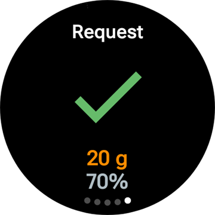
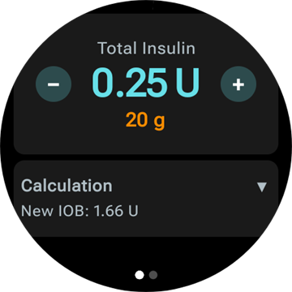
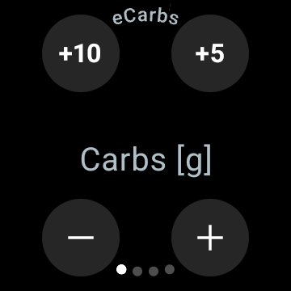
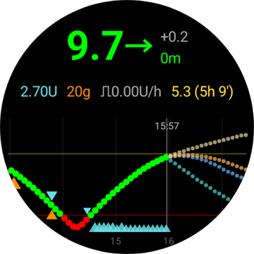
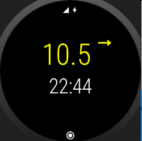
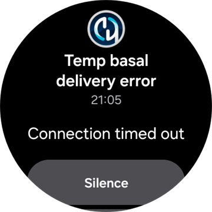

# Wear OS akıllı saatiniz üzerinden AAPS'in kullanımı

(Watchfaces-aaps-watchfaces)=

## AAPS saat arayüzleri

```{warning}
Klasik **AAPS** saat arayüzleri yalnızca Wear OS 5 ve daha eski sürümlerde çalışır ve Wear OS 5 onları zaten kısıtlar. **Wear OS 6 ve daha yeni** sürümlerde saat uygulaması bunun yerine Google'ın Watch Face Format biçiminde tek bir saat arayüzü yükler: resim olarak özel saat arayüzünüz veya **Komplikasyonlu saat arayüzü**. Her Wear OS sürümünde neyin bozulduğu için [Wear OS saat arayüzü değişiklikleri](#wearos-watchface-changes) bölümüne, Wear OS 6 için [AAPS'in yüklediği saat arayüzü](#wearos-aaps-v4-watchface) bölümüne bakın.
```

Wear OS 5 ve daha eski sürümlerde **AAPS** saat uygulamasında birkaç klasik saat arayüzü bulunur. Bunlar glikoz değerini delta ile birlikte, AİNS'i, etkin bazal oranı ve okumaların grafiğini gösterir. Bunlarda iki dokunma işlemi çalışır:

* **AAPS** ana menüsünü açmak için glikoz değerine iki kez dokunun
* Zaman aralığını değiştirmek için grafiğe iki kez dokunun

Her Wear OS sürümünde, bu sayfada anlatılan [komplikasyonlar](#Watchfaces-complications) ve [paneller](#WearOsSmartwatch-wear-os-tiles), onlara yeri olan her saat arayüzüyle çalışır.

## Configuration

[**Konfigürasyon** > **İletişim**](#Config-Builder-wear) bölümünde **Wear** seçeneğini etkinleştirin.

Saatten bolus yapmak veya başka işlemler yapmak için **Wear kontrolü** seçeneğini açın. Saat için bolus sihirbazı seçenekleri de aynı yerde ayarlanır: bkz. [Ayarlar > Wear](#preferences-wear). **Wear kontrolü** kapalıyken telefon, saatten gönderilen her tedaviyi veya mod değişikliğini reddeder ve saat *"Saat kontrolü, telefondaki Wear ayarlarında kapalı."* mesajını gösterir.

**Wear** kartındaki **Eklentiyi aç** ile Wear ekranını açarsınız:


Üst satırda bağlı saatin adı veya **(Saat Bağlı Değil)** gösterilir. Bu ekranda şunları yapabilirsiniz:

* Resend all data. Saat bir süre bağlı değilse ve bilgileri saate göndermek istiyorsanız yararlı olabilir.
* Saatinizdeki ayarları doğrudan telefonunuzdan açın.
* **AAPS**'in saate hangi saat arayüzünü yükleyeceğini seçin (**Saatte yüklü saat arayüzü**: özel saat arayüzünüz veya Komplikasyonlu saat arayüzü). Bu kart yalnızca **Wear OS 6** veya daha yeni bir saat bağlıyken gösterilir. Bkz. [AAPS'in yüklediği saat arayüzü](#wearos-aaps-v4-watchface).
* **Özel saat arayüzü** kartını yönetin (kart, bir saat bağlıyken gösterilir): **Saat arayüzü yükle** saate özel bir saat arayüzü gönderir, **Saat arayüzü bilgisi** yüklenen saat arayüzünün ayrıntılarını ve içerdiği alanları listeler, **Diğer saat arayüzleri** tarayıcınızda [paylaşım sayfasını](../ExchangeSiteCustomWatchfaces/index.md) açar ve **Şablonu Dışarı Aktar** düzenleyebileceğiniz bir şablon kaydeder. Yüklenen saat arayüzünün önizlemesi düğmelerin altında gösterilir. Bkz. [AAPS saat arayüzüne geçiş](#WearOS_changing-to-AAPS-watchface).

AAPS'ten gelen bildirimlerin saatte engellenmediğinden emin olun. Bir işlemin onayı (ör. bolus, geçici hedef) bir bildirimle gelir; bu bildirimi kaydırıp onay işaretine dokunmanız gerekir.

## Accessing main menu of AAPS


**AAPS** ana menüsünü açmak için şunlardan birini kullanın:

* saatin uygulama listesinden **AAPS**'i açın
* menüyü açan bir **AAPS** komplikasyonuna dokunun, bkz. [Komplikasyonla ilgili ayarlar](#WearOsSmartwatch-complication-settings)
* **Dokunma eylemi** **Ana Menü** olarak ayarlanmış **KŞ Grafiği** paneline dokunun, bkz. [Panel ayarları](#WearOsSmartwatch-wear-os-tiles)
* klasik bir **AAPS** saat arayüzünde glikoz değerine iki kez dokunun

(WearOsSmartwatch-loop-status)=

## Döngü durumu ekranı

**Döngü durumu** ekranı, telefonunuzu çıkarmadan döngünün ne yaptığının bir özetini verir. Bu ekranı AAPS ana menüsünden (**Döngü durumu** veya **Durum → Döngü**) ya da **Kan Şekeri** komplikasyonuna dokunarak açın. **Durum** menüsünde ayrıca bir **Pompa** sayfası ve toplam günlük dozları gösteren bir **GTD** sayfası vardır.


Ekran bir kart listesidir. Hepsini görmek için aşağı kaydırın:

* **Çalışma modu** — geçerli mod (kapalı döngü, açık döngü, LGS, askıya alındı, bağlantı kesildi…) ve geçici bir mod için ne kadar daha süreceği.
* **Döngü Sonucu** — döngünün en son ne zaman çalıştığı ve istediği geçici bazal veya SMB.
* **Senaryo** — yalnızca bir [senaryo](#scenes-from-watch) etkinken: senaryonun adı, kalan süresi (bitiş zamanı olmayan bir senaryo için **Sona erene kadar**) ve bittiğinde başlayan **Devam** senaryosu.
* **Hedefler** — hedefiniz ve çalışıyorsa geçici hedef.
* **Profil** — etkin profilin adı; varsayılan değerlerde değilse **Yüzde** ve **Zaman kayması** ile birlikte. Geçici bir profil değişimi vurgulanır; ne kadar daha süreceğini ve bittiğinde döneceği profili (**Geri döner**) gösterir.
* **Duyarlılık** — telefonun ana ekranındaki duyarlılık çipiyle aynı satırlar: Otoduyarlılık değeri ile profil, değişken ve etkin İDF.

Bir çalışma modunun, geçici hedefin veya profil değişiminin yanındaki küçük senaryo simgesi, bunun etkin senaryo tarafından ayarlandığını gösterir (**Aktif senaryo tarafından ayarlandı**). Aynı simge **Çalışma modu** seçicisinde de gösterilir.


(WearOsSmartwatch-bolus-calculator)=

## Saatteki bolus hesaplayıcısı

**Hesaplayıcı**'yı **AAPS** ana menüsünden, [Eylemler panelinden](#WearOsSmartwatch-wear-os-tiles) veya sihirbazı açacak şekilde ayarlanmış bir komplikasyondan açın. Hesaplayıcı birkaç sayfadan geçer; devam etmek için sağdan sola kaydırın:

| Karbonhidrat                                                              | İstek                                                                | Sonuç                                                               | Hesaplama                                                                           | Onayla                                                              |
| ------------------------------------------------------------------------- | -------------------------------------------------------------------- | ------------------------------------------------------------------- | ----------------------------------------------------------------------------------- | ------------------------------------------------------------------- |
|  |  |  |  |  |

1. **Karbonhidrat**: karbonhidratı **+10**, **+5**, **−** ve **+** düğmeleriyle girin.
2. **İstek**: telefon devralmadan önceki son sayfa. Girdiklerinizi gösterir: karbonhidratı ve kullanıyorsanız öğün türünü, karb. zamanını ve yüzdeyi; bkz. [İsteğe bağlı sayfalar](#WearOsSmartwatch-calculator-optional-pages). Hesaplamayı yapan telefona göndermek için onay işaretine dokunun.
3. **Sonuç**: **AAPS**'in önerdiği bolus ve altında karbonhidratlar: şimdiki karbonhidratlar ve sonraki yKarb, karb. zamanı ve yemek hatırlatıcısının zili. Dozu **−** ve **+** ile ayarlayın, aşağıya bakın. **Hesaplama** kartı için aşağı kaydırın: hesaplamanın her satırını görmek için karta dokunun, telefondakiyle aynıdır.
4. **Onayla**: ikinci sayfaya kaydırın ve onay işaretine dokunun. Telefon bolusu iletir ve karbonhidratları kaydeder.

(WearOsSmartwatch-calculator-optional-pages)=

### İsteğe bağlı sayfalar

Saatteki üç ayarın her biri **Karbonhidrat** sayfasından sonra bir sayfa ekler. Bu ayarlar varsayılan olarak kapalıdır. **AAPS** ana menüsünü, ardından **Ayarlar** > **Arayüz** bölümünü açın ve istediğiniz ayarları açın; birden fazlası açıksa sayfalar **Öğün türü**, **Karb. zamanı**, **Yüzde** sırasıyla gelir. Hesaplayıcının altındaki noktalar, kaç sayfası olduğunu gösterir.

| Ayarlar                                                                               | Öğün türü                                                                  | Karb. zamanı                                                                  | Yüzde                                                                   |
| ------------------------------------------------------------------------------------- | -------------------------------------------------------------------------- | ----------------------------------------------------------------------------- | ----------------------------------------------------------------------- |
|  |  |  |  |

* **Hesaplayıcı öğün türü**: **Ekmek**, **Kek** veya **Pizza**; yavaş bir öğünün karbonhidratlarını şimdiki karbonhidrat ve sonraki yKarb olarak böler, bkz. [Öğün türünü seçme](#WearOsSmartwatch-wizard-meal-type).
* **Hesaplayıcı karb. zamanı**: yemeğe kadar kalan dakikalar ve yemek hatırlatıcısı için bir **Alarmı ayarla** zili, bkz. [Karb. zamanı ve yemek hatırlatıcısı](#WearOsSmartwatch-wizard-carb-time).
* **Hesaplayıcı yüzdesi**: hesaplanan bolusun bir yüzdesi; örneğin daha küçük bir doz istediğinizde %70. Telefonun [Bolus sihirbazı ayarları](#Preferences-deliver-this-part-of-bolus-wizard-result) içindeki **Bolus yüzdesi** değeriyle başlar; bunu değiştirmediyseniz %100'dür. Ayrıca [Sonuç sayfasında bolusu ayarlama](#WearOsSmartwatch-wizard-result) altındaki nota bakın.

(WearOsSmartwatch-wizard-result)=

### Sonuç sayfasında bolusu ayarlama

Sonuç sayfası, **AAPS**'in önerdiği bolusu bir **−** ve bir **+** düğmesiyle birlikte gösterir. Telefona dönmeden, onaylamadan önce dozu ayarlamak için bu düğmeleri kullanın.

| Önerilen                                                                      | Daha fazla                                                                       | Daha az                                                                            |
| ----------------------------------------------------------------------------- | -------------------------------------------------------------------------------- | ---------------------------------------------------------------------------------- |
|  |  |  |

* Her basış bolusu **pompanızın bir adımı** kadar değiştirir; böylece sunulan miktarlar her zaman pompanızın gerçekten verebileceği miktarlara uyar.
* Değeri değiştirmeye devam etmek için düğmeyi **basılı tutun**. Ne kadar uzun basılı tutarsanız değer o kadar hızlı değişir.
* **0 Ü** altına veya **maksimum bolus** ayarınızın üstüne çıkamazsınız.

Güncel toplam sonuç sayfasında gösterilir; böylece onaylamak üzere olduğunuz miktarı her zaman görürsünüz. Değişiklik karbonhidratlardan sonra gösterilir, örneğin *(+0,20 Ü)*; kullandığınız düğme artış için yeşile, azalış için kırmızıya döner.

**AAPS** dozu sınırlamak zorunda kaldıysa, örneğin hesaplanan bolus **maksimum bolus** ayarınızın üstünde olduğu için, toplamın altındaki kehribar renkli bir uyarı satırı bunu belirtir (örneğin *"Bolus kısıtlaması uygulandı"*). Aynısı sınırlanmış bir karbonhidrat miktarı için de geçerlidir.

```{admonition} Bu, Hesaplayıcı yüzdesi ile aynı şey değildir :class: note **Hesaplayıcı yüzdesi** ayarı, sonuç sayfası görünmeden **önce** hesaplanan bolusun bir *yüzdesini* girmenizi sağlar. **−** ve **+** düğmeleri ise *son miktarı* **doğrudan** sonuç sayfasında ayarlar. İkisini birlikte kullanabilirsiniz.

    <br />(WearOsSmartwatch-wizard-meal-type)=
    
    ### Öğün türünü seçme
    
    Saatteki hesaplayıcı, telefon sihirbazındaki [karbonhidrat türü](#AapsScreens-carbs-type) gibi, yavaş bir öğünün karbonhidratlarını şimdiki karbonhidrat ve sonraki yKarb olarak bölebilir. Saatin **Ayarlar** > **Arayüz** bölümünde **Hesaplayıcı öğün türü** ayarını açın. Bu ayar varsayılan olarak kapalıdır; kapalıyken **Öğün türü** sayfası atlanır.
    
    * Karbonhidratı girdikten sonra bir **Öğün türü** sayfası üç simge gösterir: **Ekmek**, **Kek** ve **Pizza**. Bir simgeye dokunun: simgenin adı ve verdiği karbonhidrat simgelerin altında gösterilir, örneğin ekmek için *65 g* veya pizza için *52+22 g* (şimdi 52 g ve sonra 22 g yKarb). **Ekmek** varsayılandır ve tüm karbonhidratları şimdiye koyar.
    * İstek ve onay sayfaları karbonhidratları aynı şekilde gösterir (*52+22 g*). Sonuç sayfası ayrıca yKarb'ın ne zaman başlayacağını ve ne kadar süreceğini gösterir.
    * Bolus yalnızca şimdi yenen karbonhidratlar için hesaplanır. Bölme, telefon sihirbazıyla aynı sayıları kullanır.
    
    (WearOsSmartwatch-wizard-carb-time)=
    
    ### Karb. zamanı ve yemek hatırlatıcısı
    
    Saatin **Ayarlar** > **Arayüz** bölümünde **Hesaplayıcı karb. zamanı** açıksa, karbonhidratlardan sonra bir **Karb. zamanı** sayfası gelir: telefon sihirbazındaki [karb. zamanı](#aaps-screens-bolus-wizard) gibi, yemeğe kadar kalan dakikalar. **Şimdi** varsayılandır. **−** ve **+** zamanı 5 dakikalık adımlarla, şimdiden en fazla bir saat önceye veya sonraya kaydırır. Geçmişteki bir zaman, önceden yediğiniz karbonhidratlar içindir.
    
    Gelecekteki bir zamanda, değerin altında bir **Alarmı ayarla** zili görünür. Zil varsayılan olarak açıktır; kapatmak için ona dokunun. İstek ve sonuç sayfaları karb. zamanını (örneğin *+30 dk*) ve zili gösterir. Telefon karbonhidratları o zamana kaydeder, öğün türünün yKarb'ını da onunla birlikte kaydırır ve **Yemek vakti** hatırlatıcısını başlatır.
    
    | Sonuç | KŞ grafiği | Çalışıyor | Yemek vakti |
    | --- | --- | --- | --- |
    |  |  |  |  |
    
    Hatırlatıcı saatte de çalışır; böylece telefon yanınızda değilken de çalar:
    
    * **KŞ Grafiği** ekranı, **KŞ Grafiği** paneli ve **Komplikasyonlu saat arayüzü**nün grafiği, hatırlatıcının çalacağı yere kesik çizgili turuncu bir çizgi ve yanında kalan dakikaları çizer.
    * Hatırlatıcı çalışırken, bildirim akışında **Durdur** ve **+5 dk** düğmeleri olan sessiz bir **Yemek vakti** bildirimi durur. Kaydırarak kapatırsanız, hatırlatıcı bitene kadar geri gelir.
    * Zaman geldiğinde saat titreşir ve siz yanıt verene kadar beş dakika boyunca her yarım dakikada bir tekrar titreşir. Bildirim **Sessize al** ve **+5 dk** seçeneklerini sunar; bildirimi kaydırarak kapatmak da onu sessize alır.
    
    **Durdur**, **Sessize al** ve **+5 dk** saatte, telefonda ve bir **AAPSClient** üzerinde aynı işi yapar ve hepsi aynı hatırlatıcıyı gösterir.
    
    (Watchfaces-complications)=
    
    ## Komplikasyonlar
    
    _Komplikasyon_, geleneksel saatçilikten gelen bir terimdir; ana saat arayüzüne yapılan bir eklemeyi anlatır: başka bir küçük pencere veya alt kadran (tarih, haftanın günü, ay evresi vb. ile). Wear OS 2.0 bu yaklaşımı getirir: hava durumu, bildirimler, fitness sayaçları gibi özel veri sağlayıcıları, komplikasyonları destekleyen her saat arayüzüne eklenebilir.
    
    AAPS Wear OS uygulaması `2.6` sürümünden beri komplikasyonları destekler ve komplikasyonları destekleyen her üçüncü taraf saat arayüzünün AAPS ile ilgili verileri (eğilimle birlikte KŞ, AİNS, AKRB vb.) gösterecek şekilde yapılandırılmasına izin verir.
    
    Komplikasyonlar ayrıca AAPS işlevlerine **kısayol** olarak da kullanılır. Bunlara dokunarak AAPS ile ilgili menüleri ve diyalogları açabilirsiniz (komplikasyon türüne ve yapılandırmaya bağlı olarak).
    
    
    
    ### Komplikasyon türleri
    
    AAPS Wear OS uygulaması önceden tanımlanmış biçimlere göre yalnızca ham veri sağlar. Komplikasyonların nerede ve nasıl gösterileceğine (düzen, kenarlık, renk ve yazı tipi dahil) üçüncü taraf saat arayüzü karar verir. Mevcut birçok Wear OS komplikasyon türünden AAPS şunları kullanır:
    
    * `SHORT TEXT` - Her biri 7 karakterlik iki satır metin içerir; bazen değer ve etiket olarak adlandırılır. Genellikle bir daire veya küçük bir hap şeklinin içinde gösterilir: alt alta veya yan yana. Çok az yeri olan bir komplikasyondur. AAPS tries to remove unnecessary characters to fit-in: by rounding values, removing leading and trailing zeroes from values, etc.
    * `LONG TEXT` - Her biri yaklaşık 20 karakterlik iki satır metin içerir. Genellikle bir dikdörtgen veya uzun bir hap şeklinin içinde gösterilir: alt alta. Daha fazla ayrıntı ve metin olarak durum bilgisi için kullanılır.
    * `RANGED VALUE` - Yüzde gibi önceden tanımlanmış bir aralıktaki değerler için kullanılır. Simge ve etiket içerir, genellikle dairesel bir ilerleme kadranı olarak gösterilir.
    * `LARGE IMAGE` - Arka plan olarak kullanılabilen özel bir arka plan resmi (saat arayüzü destekliyorsa).
    * `SMALL IMAGE` / `MONOCHROMATIC IMAGE` - Küçük bir simge. `SMALL IMAGE` yerinde AAPS simgeyi kendi rengiyle çizer; `MONOCHROMATIC IMAGE` yerinde simgeyi saat arayüzü renklendirir.
    
    ### Komplikasyon kurulumu
    
    Saat arayüzüne komplikasyon eklemek için saat arayüzüne uzun basın ve altındaki dişli simgesine dokunarak yapılandırın. Saat arayüzünün bunları nasıl yapılandırdığına bağlı olarak ya yer tutuculara dokunun ya da saat arayüzünün komplikasyon kurulum menüsüne girin. AAPS complications are grouped under the AAPS menu entry.
    
    Saat arayüzünde komplikasyonları yapılandırırken Wear OS, saat arayüzünde seçilen komplikasyon yerine sığabilecek komplikasyonları listeler ve filtreler. If specific complications cannot be found on the list, it is probably due to its type that cannot be used for the given place.
    
    ### AAPS'in sağladığı komplikasyonlar
    
    AAPS aşağıdaki komplikasyonları sağlar. "Açar", **Komplikasyon Dokunma Eylemi** **Varsayılan** olarak bırakıldığında bir dokunuşun ne yaptığını gösterir, bkz. [Komplikasyonla ilgili ayarlar](#WearOsSmartwatch-complication-settings).
    
    **Glikoz**
    
    * **Kan Şekeri** (`SHORT TEXT`, _Döngü durumu_ ekranını açar): ilk satırda glikoz değeri ve eğilim oku, ikinci satırda okumanın yaşı ve delta.
    * **Kan Şekeri (büyük)** (`SHORT TEXT`, _KŞ Grafiği_ ekranını açar): ilk satırda yalnızca glikoz değeri; böylece saat arayüzü onu büyük çizebilir. Yaş ve eğilim oku ikinci satırdadır.
    * **KŞ Grafiği** (`SMALL IMAGE` / `LARGE IMAGE`, _KŞ Grafiği_ ekranını açar): resim yeri olan saat arayüzleri için resim olarak KŞ grafiği. Bu, **Komplikasyonlu saat arayüzü**ndeki grafiktir.
    * **Tam durum** (`LONG TEXT`, _Menü_'yü açar): verilerin çoğu tek satırda: eğilim okuyla glikoz değeri, delta ve okumanın yaşı, ardından aktif karbonhidrat, aktif insülin ve bazal oranı.
    * **Tam durum (çevrilmiş)** (`LONG TEXT`, _Menü_'yü açar): aynısı, iki satırın yeri değiştirilmiş olarak; `LONG TEXT` yerinin iki satırından yalnızca birini gösteren saat arayüzleri için.
    
    **İnsülin ve karbonhidrat**
    
    * **AİNS simgesi** (`SHORT TEXT`, _Bolus_ açar): şırınga simgesiyle aktif insülin.
    * **Detaylı AİNS** (`SHORT TEXT`, _Bolus_ açar): ilk satırda toplam aktif insülin, ikinci satırda bolus ve bazal kısımları.
    * **AKRB simgesi** (`SHORT TEXT`, _Hesaplayıcı_'yı açar): karbonhidrat simgesiyle aktif karbonhidrat.
    * **Detaylı AKRB** (`SHORT TEXT`, _Hesaplayıcı_'yı açar): ilk satırda şu anki aktif karbonhidrat, ikinci satırda henüz gelecek karbonhidratlar (yKarb).
    * **AKRB & AİNS** (`SHORT TEXT`, _Hesaplayıcı_'yı açar): ilk satırda aktif insülin, ikinci satırda aktif karbonhidrat.
    
    **Bazal ve hedef**
    
    * **Bazal oranı** (`SHORT TEXT`, _Menü_'yü açar): geçerli bazal oranı.
    * **Bazal & AİNS** (`SHORT TEXT`, _Menü_'yü açar): ilk satırda aktif insülin, ikinci satırda bazal oranı.
    * **Bazal & Hedef** (`SHORT TEXT`, _Geçici Hedef_ açar): ilk satırda hedef (geçici hedef çalışırken kalan süreyle birlikte), ikinci satırda bazal oranı.
    * **Hedef** (`SHORT TEXT`, _Geçici Hedef_ açar): ilk satırda hedef ve geçici hedef çalışırken ikinci satırda kalan süresi.
    * **Bazal, AKRB & AİNS** (`SHORT TEXT`, _Menü_'yü açar): ilk satırda bazal oranı, ikinci satırda aktif karbonhidrat ve aktif insülin.
    
    **Döngü ve telefon**
    
    * **Çalışma modu** (`SMALL IMAGE` / `ICON`, _Çalışma modu seçicisini_ açar): geçerli döngü modu simge olarak: kapalı döngü, açık döngü, düşük glikozda askıya alma, askıya alındı, bağlantı kesildi veya devre dışı. Dokunma, o anda izin verilen mod değişikliklerini içeren bir seçici açar, örneğin **Döngüyü askıya al**, **Pompa bağlantısını kes**, **Döngüyü devam ettir** veya **Pompayı tekrar bağla**. Aynı seçici **AAPS** ana menüsünde **Çalışma modu** altında da bulunur.
    * **Yükleyici/Telefon Pili** (`RANGED VALUE` / `SHORT TEXT` / `ICON`, _Durum_ açar): **AAPS** telefonunun pili; pil simgeli bir gösterge, bir sayı veya yalnızca simge olarak. Diğer **AAPS** verileriyle birlikte, genellikle her 5 dakikada bir yeni okumayla güncellenir.
    
    Komplikasyondan, ana menüden veya Çalışma modu panelinden açılan **Çalışma modu** seçicisi:
    
    
    
    (WearOsSmartwatch-complication-settings)=
    
    ### Komplikasyonla ilgili ayarlar
    
    Saatteki **AAPS** ana menüsünde **Ayarlar** > **Komplikasyon** bölümünü açın:
    
    
    
    * **Komplikasyon Dokunma Eylemi** (varsayılan `Varsayılan`): bir **AAPS** komplikasyonuna dokunmanın neyi açacağı, tüm komplikasyonlar için birlikte:
      * _Varsayılan_: komplikasyonun kendisinin açtığı ekran, yukarıdaki listeye bakın
      * _Menü_: **AAPS** ana menüsü
      * _Hesaplayıcı_: bolus hesaplayıcısı
      * _Tedavi_: tedavi diyaloğu, insülin ve karbonhidrat
      * _yKarb_: yKarb diyaloğu
      * _Durum_: durum menüsü
      * _Çalışma modu_: çalışma modu seçicisi. Telefonun Wear ayarlarında **Wear kontrolü** açık olmalıdır, aksi halde onun yerine ana menü açılır.
      * _Hiçbiri_: dokunma bir şey yapmaz
    * **KŞ grafiği zaman aralığı** (varsayılan `3 saat`): **KŞ Grafiği** komplikasyonunun kaç saati gösterdiği: 1, 3 veya 6. KŞ Grafiği panelinin kendi ayarı vardır.
    * **Komplikasyonlarda Unicode** (varsayılan `Açık`): komplikasyonlar delta için `Δ`, ayırıcı olarak `⁞` ve bazal oranı için `⎍` gibi Unicode simgeleri kullanır. Nasıl göründükleri saat arayüzünün yazı tipine bağlıdır. Bir saat arayüzü bunları kutu veya boşluk olarak çiziyorsa bu ayarı `Kapalı` yapın.
    
    (WearOsSmartwatch-wear-os-tiles)=
    
    ## Wear OS panelleri
    
    Paneller, saat arayüzünden kaydırarak ulaştığınız sayfalardır. **AAPS** bunlardan yedisini sunar; her biri en fazla dört düğmeden oluşur. Bir düğmeye dokunmak saatte ilgili diyaloğu açar veya onay ister; ardından işi telefon yapar. Panel bir kısayoldur, durum ekranı değildir: telefon uygulamasının durumunu tutmaz.
    
    Panelleri kullanmadan önce [Ayarlar > Wear](#preferences-wear) bölümünde **Wear kontrolü** seçeneğini açın.
    
    ### Panel ekleme
    
    Saatinize ve telefonunuza bağlı olarak iki yol vardır:
    
    1. Saatte: saat arayüzünden son panelin ötesine, **Add tile** (Panel ekle) seçeneğine kadar kaydırın ve bir **AAPS** paneli seçin. Çoğu saatte bir panele uzun basmak da ekleme ve kaldırma görünümünü açar.
    2. Telefonda, saatinizin yardımcı uygulamasında (Samsung için **Galaxy Wearable**, diğer markalar için **Wear OS**): **Tiles** (Paneller) bölümünü açın, **Add** (Ekle) düğmesine dokunun ve istediğiniz **AAPS** panellerini seçin. Panellerin sırası sürüklenerek değiştirilebilir.
    
    
    
    ### Panel ayarları
    
    **Eylemler**, **Geçici Hedef**, **KŞ Grafiği** ve **Senaryo** panellerinin saatte ayarları vardır. **AAPS** ana menüsünü, ardından **Ayarlar** > **Paneller** bölümünü açın ve paneli seçin. Pixel saatler dışında, panele uzun basmak da panelin ayarlarını açar. Diğer üç panel telefondan doldurulur ve saatte ayarlanacak bir şeyleri yoktur.
    
    | Ana menü | Ayarlar | Paneller |
    | --- | --- | --- |
    |  |  |  |
    
    Bir panelin ayarları, panelin dört yerinin listesidir. Ne göstereceğini seçmek için bir yere dokunun veya boş bırakmak için **Hiçbiri** seçin.
    
    | Panele uzun basma | Geçici Hedef panelinin ayarları |
    | --- | --- |
    |  |  |
    
    Her panelin dört yeri vardır. Bundan fazla girişi olan bir panel ilk dördünü gösterir.
    
    ### Eylemler paneli
    
    
    
    **AAPS** saat uygulamasının diyaloglarına kısayollar. Panel ayarlarında bunlardan en fazla dördünü seçin:
    
    * **Hesap**: karbonhidrat girişi, isteğe bağlı yüzde [1] ve isteğe bağlı öğün türü [2] ile bolus hesaplayıcısı
    * **Tedavi**: insülin ve karbonhidrat tek seferde
    * **İnsülin**: birim olarak girilen bir bolus
    * **Karbonhidrat**: karbonhidrat, yayma karbonhidrat da. Daha önce girdiğiniz karbonhidratları düzeltmek için, mevcut AKRB'nize kadar **negatif** bir miktar kabul edilir. Karbonhidrat çıkarmaları saatin KŞ grafiğinde gösterilir.
    * **yKarb**: yayma karbonhidrat
    * **GH**: özel hedef ve süreyle geçici hedef
    * **Profil değişimi**: yüzde, zaman kaydırma ve süre ile profil değişimi
    
    
    
    Düğmelerin açtığı diyaloglar. Bir diyaloğun sonraki sayfasına geçmek için sağdan sola kaydırın ve isteği telefona göndermek için son sayfadaki onay işaretine dokunun:
    
    | Tedavi | İnsülin | Karbonhidrat | yKarb | GH | Profil değişimi |
    | --- | --- | --- | --- | --- | --- |
    |  |  |  |  |  |  |
    
    [1] Bolus hesaplayıcısında yüzde girişini göstermek için saatin **Ayarlar** > **Arayüz** bölümünde **Hesaplayıcı yüzdesi** ayarını açın. Varsayılan yüzde, telefondaki ["Bolus yüzdesi"](#Preferences-deliver-this-part-of-bolus-wizard-result) ayarından gelir. Diğer hesaplayıcı ayarları, telefondaki **Ayarlar** > **Bolus sihirbazı ayarları** altındaki ayarlardır.
    
    [2] **Öğün türü** sayfasını göstermek için saatin **Ayarlar** > **Arayüz** bölümünde **Hesaplayıcı öğün türü** ayarını açın; bu sayfada yavaş bir öğünün karbonhidratlarını şimdiki karbonhidrat ve sonraki yKarb olarak bölmek için **Ekmek**, **Kek** veya **Pizza** seçersiniz. Bkz. [Öğün türünü seçme](#WearOsSmartwatch-wizard-meal-type).
    
    ### Geçici Hedef paneli
    
    
    
    Telefondaki ön ayarlardan geçici hedefler. Her ön ayarın süresini ve hedefini telefonda **Ayarlar** > [Varsayılan geçici hedefler](#Preferences-default-temp-targets) altında ayarlayın. Panel ayarlarında bunlardan en fazla dördünü seçin:
    
    * **Aktivite**: spor için
    * **Yemek**: yakında yemek; öğünde daha fazla aktif insülin olması için daha düşük bir hedef
    * **Hipo**: hipo tedavisi sırasında daha yüksek bir hedef
    * **Manuel**: özel hedef ve süre
    * **İptal**: çalışan geçici hedefi durdurur. Bu düğme yalnızca bir geçici hedef çalışırken gösterilir.
    
    ### Hızlı Asistan paneli
    
    
    
    Telefondaki [Hızlı Asistan](#quickwizards) girişlerinden **Saatte Göster** açık olanlar, geçerli saatleri içinde. Karbonhidrat girişi karbonhidratını g olarak, insülin girişi sabit dozunu Ü olarak gösterir. Bir dokunuş, saatte onaydan sonra girişi çalıştırır. Saatte ayarlanacak bir şey yoktur: girişleri telefonda düzenleyin ve panelde görmek istediğiniz her giriş için **Cihaz Seçimi** altında **Saatte Göster** seçeneğini açın. Tüm girişlerinizin geçerli saatleri dışında panel **Mevcut yapılandırma yok** gösterir.
    
    
    
    ### Senaryo paneli
    
    
    
    Telefondaki [Senaryolar](#scenes-from-watch). Dört yerin her biri panel ayarlarında **Otomatik**, **Hiçbiri** veya bir senaryo olarak ayarlanır. **Otomatik** bir yer, telefonun listesinden başka bir yerin almadığı sonraki senaryoyu alır. Telefonda artık bulunmayan bir senaryoya ayarlanmış bir yer **Mevcut değil** gösterir.
    
    
    
    ### Çalışma modu paneli
    
    
    
    Geçerli moddan geçebileceğiniz [çalışma modları](#aaps-screens-running-mode), telefondakiyle aynı simgelerle: kapalı döngü, düşük glikozda askıya alma, açık döngü, döngüyü devre dışı bırakma, döngüyü askıya alma ve pompa bağlantısını kesme; bunlardan biri çalışırken de devam ettirme ve tekrar bağlama. **Döngüyü askıya al** ve **Pompa bağlantısını kes** önce bir süre sorar. Hangi modların sunulacağına telefon karar verir; saat ilk dördünü gösterir ve listede **Döngüyü askıya al** varsa **Döngüyü devre dışı bırak** seçeneğini göstermez.
    
    ### Kullanıcı Eylemi paneli
    
    
    
    Telefonda tetikleyicisi **Kullanıcı eylemi** olan her [otomasyon](#automations-automation-triggers) için bir düğme. Dokunma onay ister, ardından telefon otomasyonun eylemlerini çalıştırır. Düğmeler otomasyonların adını taşır; bu yüzden onlara kısa adlar verin. Saatte ayarlanacak bir şey yoktur.
    
    ### KŞ Grafiği paneli
    
    
    
    Ok, delta ve yaş ile glikoz değeri; altında AİNS, AKRB, bazal oranı ve hedef; ayrıca tahminler, boluslar, karbonhidratlar ve SMB'lerle KŞ grafiği. Saatte iki ayar vardır: **Zaman aralığı** (1, 3 veya 6 saat) ve tam **KŞ Grafiği** ekranını, **Ana Menü**'yü veya **Döngü durumu** ekranını açan **Dokunma eylemi**.
    
    
    
    
    
    ## Her zaman açık
    
    Bu bölüm ve bir sonraki, Wear OS 5 ve daha eski sürümlerdeki klasik **AAPS** saat arayüzleri için geçerlidir. Wear OS 6'da **Komplikasyonlu saat arayüzü**nün kendi her zaman açık ekranı vardır, bkz. [AAPS'in yüklediği saat arayüzü](#wearos-aaps-v4-watchface).
    
    Android Wear OS akıllı saatlerinde uzun pil ömrü zor bir konudur. Some smartwatches get as much as 30 hours before recharging. En iyi güç tasarrufu için ekran, kullanılmadığında kapatılmalıdır. Most watches support the “Always on” display.
    
    AAPS sürüm 3'ten beri, her zaman açık modda “Basitleştirilmiş Kullanıcı Arayüzü” (Simplify UI) kullanılabilir. This UI only contains the blood glucose, direction, and time. Bu arayüz güç için optimize edilmiştir: daha seyrek güncellenir, daha az bilgi gösterir ve OLED ekranlarda güç tasarrufu için daha az piksel yakar.
    
    Basitleştirilmiş kullanıcı arayüzü modu, AAPS(DijitalStil) ve AAPS(Özel) saat arayüzleri için kullanılabilir. Basitleştirilmiş kullanıcı arayüzü isteğe bağlıdır ve saat arayüzü ayarlarından yapılandırılır (saat arayüzüne uzun basın ve “düzenle” veya dişli simgesine dokunun). “Basitleştirilmiş Kullanıcı Arayüzü” yapılandırmasını seçin ve “Her Zaman Açık Modu” veya “Her Zaman Açık ve Şarj Oluyor” olarak ayarlayın.
    
    ### Gece modu
    
    Şarj sırasında ekranın gece boyunca “her zaman açık” kalması ve kan şekerinizi göstermesi yararlı olur. Ancak standart saat arayüzleri çok parlaktır ve çok fazla bilgi gösterir; uykulu gözlerle ayrıntıları okumak zordur. Bu nedenle saat arayüzüne bir seçenek ekledik: yapılandırmada ayarlanırsa kullanıcı arayüzü yalnızca şarj sırasında basitleştirilir.
    
    Basitleştirilmiş kullanıcı arayüzü modu, AAPS(DijitalStil) ve AAPS(Özel) saat arayüzleri için kullanılabilir. Basitleştirilmiş kullanıcı arayüzü isteğe bağlıdır ve saat arayüzü ayarlarından yapılandırılır (saat arayüzüne uzun basın ve “düzenle” veya dişli simgesine dokunun). “Basitleştirilmiş Kullanıcı Arayüzü” yapılandırmasını seçin ve “Şarj Olurken” veya “Her Zaman Açık ve Şarj Oluyor” olarak ayarlayın.
    
    The Android developer options enable your watch to stay awake during charging. Geliştirici seçeneklerini kullanılabilir yapmak için [resmi belgelere](https://developer.android.com/training/wearables/get-started/debugging) bakın. Geliştirici seçeneklerinde “Şarj olurken uyanık kal” (“Stay awake when charging”) ayarını “açık” yapın.
    
    Note: not all displays can handle always-on very well. It can cause screen burn-in, especially on the older OLED displays. Saatler yanmayı önlemek için genellikle ekranı karartır; öneriler için kullanım kılavuzunuza, üreticiye veya internete bakın.
    
    
    
    
    
    (WearOsSmartwatch-phone-alarms)=
    
    ## Saatte telefon alarmları
    
    
    
    Saat, telefonun alarmlarını gösterir; böylece telefonun neden ses çıkardığını görür ve bileğinizden yanıt verebilirsiniz. Saat titreşir ve siz yanıt verene kadar beş dakika boyunca her yarım dakikada bir tekrar titreşir. Bir bildirim, alarmın başlığını ve metnini [yemek vakti](#WearOsSmartwatch-wizard-carb-time) hatırlatıcısıyla aynı yanıtlarla gösterir:
    
    * **Sessize al** veya kaydırma: alarm durur ve telefondaki alarm ekranı kapanır.
    * **5 dk sessiz**: alarm durur ve beş dakika sonra telefonda ve saatte tekrar çalar.
    
    Saate iki tür alarm ulaşır:
    
    * Telefonun alarm ekranı (pompa hataları, otomasyon alarmları, KŞ alarmları): **Sessize al** ve **5 dk sessiz**.
    * *Pompaya ulaşılamıyor* veya bir Nightscout alarmı gibi sesli acil bildirimler: yalnızca **Sessize al**. Telefonda bunlar için yalnızca **Kapat** vardır ve nedenleri sürdükçe kendiliğinden geri gelirler.
    
    *Yemek vakti* hatırlatıcısı bu yolla gönderilmez: saat onu kendisi çaldırır.
    
    ## Uyarı erteleme kısayolu
    
    Saat alarmı kendisi [gösterir](#WearOsSmartwatch-phone-alarms); kısayol, alarmı tek basışla sessize almanın ikinci bir yoludur. It is possible to create a shortcut to snooze the alerts/alarm of AAPS. Muting the sound via your watch is convenient and faster without reaching for your phone. Not: Alarm mesajını yine de telefonunuzda kontrol etmeniz ve buna göre işlem yapmanız gerekir, ancak bunu daha sonra yapabilirsiniz. Saatinizde iki düğme varsa, bir tuşu `AAPS Snooze Alert` (Türkçe: AAPS Uyarı Erteleme) programına atayabilirsiniz.
    
    Samsung Watch 4'te düğmeyi bağlamak için `Settings > Advanced Features > Customize Buttons > Double press > AAPS Snooze Alert` yoluna gidin
    
    Komplikasyonlu bir saat arayüzünde, **AAPS Uyarı Erteleme** olarak ayarlanmış bir **App shortcut** (uygulama kısayolu) komplikasyonu aynı işi bir dokunuşla yapar. [Komplikasyonlu saat arayüzünün alternatif kurulumu](#wearos-complications-watchface-setup) bunun için sağ üst yeri kullanır.
    
    ### xDrip'i erteleme
    
    xDrip kullanıyorsanız ve saatte xDrip yüklüyse, 'AAPS Snooze Alert' kısayolu tüm xDrip alarmlarını da erteler. 
    
    
    ## Performans ve pil ömrü ipuçları
    
    Wear OS saatleri gücü çok sınırlı cihazlardır. Saat kasasının boyutu, içindeki pilin kapasitesini sınırlar. Hem donanım hem de yazılım tarafındaki son gelişmelere rağmen Wear OS saatlerin hâlâ her gün şarj edilmesi gerekir.
    
    Pil ömrü bir günden kısaysa (sabahtan akşama kadar), sorunları gidermek için bazı ipuçları şunlardır.
    
    Pili en çok tüketen alanlar şunlardır:
    
    * Arka ışığı açık (LED için) veya tam yoğunluk modunda (OLED için) etkin ekran
    * Ekranda çizim
    * Bluetooth üzerinden radyo iletişimi
    
    İletişimden ödün veremeyeceğimiz (güncel verilere ihtiyacımız var) ve en güncel verilerin çizilmesini istediğimiz için, optimizasyonların çoğu _ekran süresi_ alanında yapılabilir:
    
    * Hazır saat arayüzleri genellikle mağazadan indirilen özel saat arayüzlerinden daha iyi optimize edilmiştir.
    * Etkin olmayan / kısık modda çizilen veri miktarını sınırlayan saat arayüzlerini kullanmak daha iyidir.
    * Üçüncü taraf hava durumu widget'ları gibi, harici kaynaklardan veri kullanan başka komplikasyonları karıştırırken dikkatli olun.
    * Daha basit saat arayüzleriyle başlayın. Komplikasyonları birer birer ekleyin ve pil ömrünü nasıl etkilediklerini gözlemleyin.
    * Saat arayüzünde koyu tema kullanın. OLED ekranlarda daha az yanan piksel, daha az güç tüketimi ve daha az ekran yanması demektir.
    * Saatinizde hangisinin daha iyi çalıştığını kontrol edin: AAPS'in hazır saat arayüzleri mi, yoksa AAPS komplikasyonlu başka saat arayüzleri mi.
    * Birkaç gün boyunca, farklı aktivite profilleriyle gözlemleyin. Çoğu saat; bakma, hareket ve kullanımla ilgili diğer tetikleyicilerde ekranı açar.
    * Performansı etkileyen genel sistem ayarlarınızı kontrol edin: bildirimler, arka ışık / etkin ekran zaman aşımı, GPS'in ne zaman etkinleştirildiği.
    * Diğer kullanıcıların deneyimleri ve bildirdikleri pil ömrü için [test edilen telefon ve saatlerin listesine](#Phones-list-of-tested-phones) bakın ve [topluluğa sorun](../GettingHelp/WhereCanIGetHelp.md).
    * **Saat arayüzünde veya komplikasyonda gösterilen verilerin güncel olduğunu garanti edemeyiz**. Sonuçta bir saat arayüzünün veya bir komplikasyonun ne zaman güncelleneceğine Wear OS karar verir. AAPS uygulaması güncelleme istese bile sistem, pil tasarrufu için güncellemeleri ertelemeye veya yok saymaya karar verebilir. Emin olmadığınızda ve saatin pili azaldığında her zaman telefondaki ana AAPS uygulamasından tekrar kontrol edin.
    
    (Watchfaces-troubleshooting-the-wear-app)=
    
    ## Wear uygulamasında sorun giderme
    
    Saat hiç veri göstermiyorsa veya eski veri gösteriyorsa, önce saat ile telefon arasındaki bağlantıyı kontrol edin, bkz. [AAPS saati - AAPS telefonu iletişiminde sorun giderme](#wear-os-watch-phone-communication). Wear OS 5 kullanan bir saat için ayrıca [Wear OS 5 için genel sorun giderme önerilerine](#wear-os-5-troubleshooting) bakın. Güncellenmeyen bir komplikasyonun nedenleri, güncellenmeyen bir panel veya saat arayüzünün nedenleriyle aynıdır; bu yüzden önce bunları kontrol edin.
    
    ## Ek AAPS özel saat arayüzleri de mevcuttur
    
    [Buradan](../ExchangeSiteCustomWatchfaces/index.md) diğer kullanıcıların yaptığı özel saat arayüzlerini içeren Zip dosyalarını indirebilirsiniz.
    
    ## Kendi saat arayüzünüzü oluşturun
    
    Kendi saat arayüzünüzü oluşturmak istiyorsanız [buradaki kılavuzu](../ExchangeSiteCustomWatchfaces/CustomWatchfaceReference.md) izleyin.
    
    Özel bir saat arayüzü oluşturduktan sonra kendi **AAPS** özel saat arayüzünüzü başkalarıyla paylaşabilirsiniz; zip dosyası GitHub'a bir Pull Request ile "ExchangeSiteCustomWatchfaces" klasörüne yüklenebilir. Pull request birleştirilirken dokümantasyon ekibi CustomWatchface.png dosyasını çıkarır ve adının başına Zip dosyasının adını ekler.
    
    (WearOsSmartwatch-complications-watchface-download)=
    
    ## Komplikasyonlu saat arayüzünün kendi sürümünüzü yapın
    
    **AAPS**'in Wear OS 6'da yüklediği **Komplikasyonlu saat arayüzü** (bkz. [AAPS'in yüklediği saat arayüzü](#wearos-aaps-v4-watchface)) Samsung'un **Watch Face Studio** aracıyla yapılmıştır. Proje dosyası ücretsiz indirilebilir; böylece onu zevkinize göre değiştirebilir veya **AAPS**'in onu yüklemediği Wear OS 5 ya da daha eski bir saatte kullanabilirsiniz:
    
    [Komplikasyonlu saat arayüzü (AAPS V4), zip](https://github.com/openaps/AndroidAPSdocs/raw/refs/heads/master/docs/_static/wearos/Complications_watchface_AAPS_V4.zip)
    
    Zip dosyası dört dosya içerir:
    
    * `AAPS V4_0_2.wfs`: proje. Bunu [Watch Face Studio](https://developer.samsung.com/watch-face-studio/download.html) içinde açın, istediğinizi değiştirin ve oradan saate yükleyin.
    * `com.watchfacestudio.aapsv4.apk`: saat arayüzünün kendisi, [adb](https://developer.android.com/tools/releases/platform-tools) ile yüklemeye hazır: saat ADB hata ayıklama ile bağlıyken `adb install com.watchfacestudio.aapsv4.apk`.
    * `README.txt`: önerilen iki komplikasyon kurulumu, [Wear OS sayfasındakiyle](#wearos-complications-watchface-setup) aynı.
    * `AAPS V4.png`: bir önizleme.
    
    ```{admonition} Bu bir özel saat arayüzü değildir
    :class: note
    Bu zip, **Wear** eklentisindeki **Saat arayüzü yükle** için bir özel saat arayüzü değildir ve telefon onu yükleyemez. Zip açılmalı ve yukarıdaki gibi Watch Face Studio veya adb ile saate yüklenmelidir.