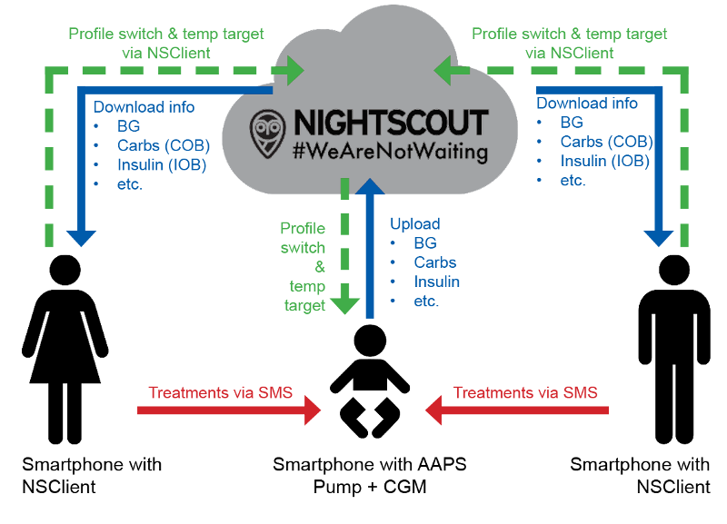

# Uzaktan İzleme

__AAPS__, tip 1 diyabetli çocukların uzaktan izlenmesi için birçok özellik sunar. Ayrıca __AAPS__'e uzaktan talimat gönderen uzaktan komutları da kolaylaştırır. Aynı şekilde __AAPSClient__, eşinizin veya arkadaşınızın __AAPS__'ini takip etmek için uzaktan izlemede de kullanılabilir.

## Fonksiyonlar

- Çocuğun pompası, çocuğun telefonundaki __AAPS__ ile kontrol edilir.
- Bakım verenler, Android telefonlarında **AAPSClient apk** kullanarak glikoz değerleri, aktif karbonhidrat, aktif insülin vb. tüm önemli verileri uzaktan takip edebilir (**AAPSClient**'in iPhone sürümü geliştirilme aşamasındadır, bkz. [AAPSClient](AapsClient.md)). __AAPS__'te değiştirilen ayarlar __AAPSClient__ ile senkronize edilir; bunun tersi de geçerlidir.
- xDrip companion modu kuruluysa, bakım verenler Android telefonlarında **takipçi modundaki xDrip uygulaması** ile alarm alabilir.
- __AAPS__'in [SMS Komutları](../RemoteFeatures/SMSCommands.md) ile uzaktan kontrolü, iki faktörlü kimlik doğrulama ile korunur.
- __AAPSClient__ üzerinden uzaktan kontrol, **AAPS** 4 ile gelen imzalı komut kanalını kullanır: istemci önce ana birimle **eşleştirilmelidir** (QR kodu veya PIN ile) ve her komut ana birim tarafından onaylanır ve uygulanır. Her bakım veren telefonu, salt okunurdan tam kontrole kadar kendi [rolünü](#client-master-control-roles) alabilir — bkz. [Ana birim ↔ İstemci kontrolü](#client-master-control).

## Uzaktan izleme için araçlar ve uygulamalar

- Web tarayıcısında [Nightscout](https://nightscout.github.io/) (çoğunlukla veri gösterimi).
- [__AAPSClient__](AapsClient.md), __AAPS__'in sadeleştirilmiş bir sürümüdür. Ana birim __AAPS__'i takip edebilir ve **eşleştirildikten** sonra uzaktan komut gönderebilir: karbonhidrat, __Geçici Hedefler__, __Profil değişimleri__ ve hatta bolus (bkz. [Ana birim ↔ İstemci kontrolü](#client-master-control)). 3 uygulama vardır: [indirilebilir AAPSClient, AAPSClient2 & AAPSClient3](https://github.com/nightscout/AndroidAPS/releases/). Böylece bir bakım veren aynı telefondan en fazla üç farklı kişiyi takip edebilir (örneğin her birinin kendi Nightscout hesabı ve ana birim __AAPS__'i olan, tip 1 diyabetli iki çocuk).
- Orijinal Dexcom uygulamasını kullanıyorsanız Dexcom Follow (yalnızca KŞ değerleri).
- Takipçi modunda [xDrip](../CompatibleCgms/xDrip.md) (çoğunlukla KŞ değerleri ve **alarmlar**).
- iOS'ta [Sugarmate](https://sugarmate.io/) veya [Spike](https://spike-app.com/) (çoğunlukla KŞ değerleri ve **alarmlar**).
- Bazı kullanıcılar, ileri düzey uzaktan sorun giderme için [TeamViewer](https://www.teamviewer.com/) gibi tam bir uzaktan erişim aracını faydalı buluyor.

## Akıllı saat seçenekleri

Akıllı saat, tip 1 diyabetli çocuklarda __AAPS__'i yönetmeye yardımcı olan çok kullanışlı bir araç olabilir. Birkaç farklı seçenek vardır:

- Seçenek 1 - __AAPSClient__ bakım verenin telefonunda yüklüyse, [AAPSClient WearOS uygulaması](https://github.com/nightscout/AndroidAPS/releases/), bakım verenin telefonuna bağlı uyumlu bir akıllı saate yüklenebilir. Saat; güncel __KŞ__ değerini, döngü durumunu ve bolus geçmişini gösterir. Karbonhidrat girişine, __Geçici Hedeflere__ ve __Profil__ değişikliklerine izin verir. İstemci ana birimle **eşleştirilmişse**, saat bir **bolus** da başlatabilir: komut istemci üzerinden ana birime iletilir, ana birim de onaylar ve uygular (bkz. [Ana birim ↔ İstemci kontrolü](#client-master-control)).
- Seçenek 2 - [AAPS WearOS uygulaması](../WearOS/WearOsSmartwatch.md) da oluşturulup uyumlu bir akıllı saate yüklenebilir. Saat çocuğun telefonuna bağlıdır ama bakım veren tarafından takılır. Bu seçenek, yukarıdaki tüm işlevlerin yanı sıra, çocuğun telefonunu üzerinden almaya gerek kalmadan doğrudan insülin bolusu verme imkânı sunar.
- Seçenek 3 - Yalnızca gösterim: **AAPS**'in doğrudan desteklemediği bir saat (Xiaomi, Amazfit veya komplikasyon gösteren bir Wear OS saati), WatchDrip+ veya GlucoDataHandler gibi bir yardımcı uygulama ile glikoz, AİNS, AKRB ve döngü durumunu gösterebilir. Bu uygulamaya veriyi, saatin bağlı olduğu **AAPS** veya **AAPSClient** telefonundaki **Harici yardımcı uygulamalar** eklentisi sağlar. Bkz. [Harici yardımcı uygulamalar](#watches-external-companion-apps).

## Dikkat edilmesi gereken önemli noktalar

- Yükleme ve indirme süresi nedeniyle ana birim ile takipçi arasında bir zaman farkı olduğunu ve ana birim __AAPS__ telefonunun ancak döngü çalıştıktan sonra veri yüklediğini unutmayın.
- Uzaktan kontrol çalışmadığında (_örn._ ağ sorunları veya Bluetooth bağlantısının kopması) acil durum planınız nedir? Aniden yeni bir komut gönderemezseniz **AAPS**'in ne yapacağını her zaman düşünün. **AAPS**, pompadaki bazal, İDF ve IC değerlerinin üzerine geçerli profilin değerlerini yazar. Daha güçlü bir insülin profiline geçiyorsanız, uzaktan bağlantınız kesilme ihtimaline karşı yalnızca geçici profil değişimleri (_yani_ belirli bir süresi olan) kullanın. Böylece süre dolduğunda pompa asıl profile geri döner.
