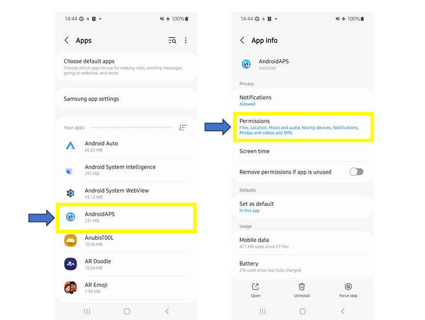
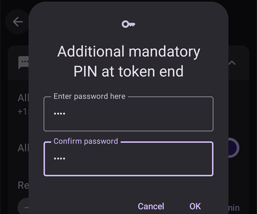
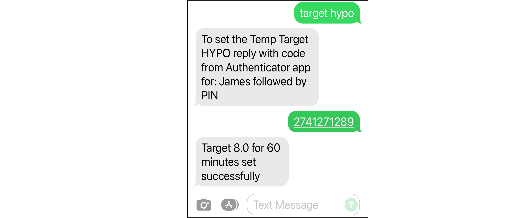
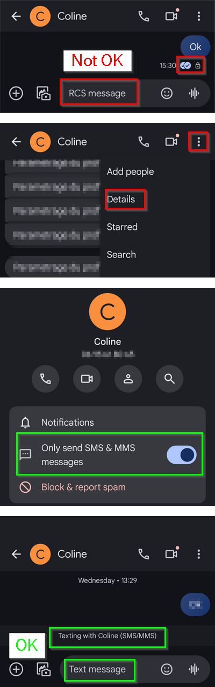

# SMS Komutları

```{contents} Table of contents
:depth: 2
```

Çoğu uzaktan ayar (geçici hedefler, karbonhidratlar, profil değişimleri ve istemci eşleştirildikten sonra bolus), internet bağlantısı olan bir Android telefondaki [**AAPSClient** uygulaması](../RemoteFeatures/RemoteMonitoring.md) ile yapılabilir, bkz. [Ana birim ↔ İstemci kontrolü](#client-master-control) (**AAPSClient**'in iPhone sürümü geliştirilme aşamasındadır, bkz. [AAPSClient](AapsClient.md)). SMS komutları internet olmadan çalışan bir alternatif olarak kalır. Takipçi olarak iPhone kullanıyorsanız ve henüz **AAPSClient** yoksa tek uzaktan kontrol seçeneğidir.

**SMS komutları çok kullanışlıdır:**
1. Rutin uzaktan kontrol için

2. Eşleştirilmiş bir **AAPSClient** olmadan uzaktan insülin bolusu vermek istiyorsanız

3. Kısa mesajların ulaştığı ama mobil veri/internet bağlantısının zayıf olduğu bölgelerde. Bu, uzak bölgelere giderken (örn. kamp, kayak) çok faydalıdır.

4. Diğer uzaktan kontrol yönteminiz (**AAPSClient**) geçici olarak çalışmıyorsa

## Önce Güvenlik

**AAPS**'te **SMS Komünikatör**'ü etkinleştirirseniz, uzaktan komut göndermek için kurulan telefonun çalınabileceğini ve/veya başka biri tarafından kullanılabileceğini unutmayın. Telefonunuzu her zaman en azından bir PIN ile kilitleyin. Güçlü bir parola ve/veya biyometrik kilit kesinlikle önerilir. Bunun APK ana parolanızdan (**AAPS** ayarlarını dışa aktarmak için gereken parola) farklı olduğundan emin olun.

Ayrıca SMS komutları için [ikinci bir telefon numarasına](#SMSCommands-authorized-phone-numbers) izin vermeniz önerilir. Böylece asıl uzaktan kontrol telefonunuzun güvenliği tehlikeye girerse, ikinci numarayı kullanarak SMS Komünikatör'ü [devre dışı bırakabilirsiniz](#SMSCommands-other).

Bolus komutları arasındaki varsayılan en kısa bekleme süresi 15 dakikadır; süre, pompanın bir bolusu kabul ettiği andan itibaren sayılır. Güvenlik nedeniyle, bu süreyi kısaltmak için en az iki yetkili telefon numarası eklemeniz gerekir. Önceki bolustan sonraki 15 dakika içinde tekrar uzaktan bolus vermeye çalışırsanız şu yanıtı alırsınız: “Uzaktan bolus gönderilemiyor. Daha sonra tekrar deneyin.”

AAPS ayrıca bolus veya profil değişikliği gibi uzak komutlarınızın gerçekleşip gerçekleşmediğini kısa mesajla size bildirecektir. Alıcı telefonlardan birinin çalınması durumuna karşı en az iki farklı telefon numarasına onay metinleri gönderilecek şekilde ayarlamanız önerilir.

**SMS Komutları ile bolus verirseniz karbonhidratları ayrıca girmelisiniz (ikinci bir SMS, AAPSClient...)!** Bunu yapmazsanız AİNS doğru olur ama AKRB çok düşük kalır. **AAPS** çok fazla aktif insülin olduğunu varsaydığı için bu durum, gereken bir düzeltme bolusunun verilmemesine yol açabilir.

Hassas komutlar için, güvenliği artırmak amacıyla zamana dayalı tek kullanımlık parola üreten bir Authenticator (kimlik doğrulama) uygulaması kullanılmalıdır.

Bir bakım veren telefonunun SMS komutu gönderme yetkisini kaldırmak istiyorsanız, **AAPS**'teki “[Kimlik Doğrulayıcıları (OTP) Sıfırla](#sms-commands-authenticator-setup)” acil durum düğmesini kullanın veya “[SMS stop](#SMSCommands-other)” SMS komutunu gönderin. Kimlik doğrulayıcıları sıfırlayarak bakım verenlerin TÜM telefonlarını geçersiz kılarsınız. You will need to set them up again.

## SMS Komutları kurulumu

```{contents} The overall process is as follows
:depth: 1
:local: true
```

(sms-commands-authenticator-setup)=
### Authenticator kurulumu

Güvenliği artırmak için iki faktörlü kimlik doğrulama kullanılır.

Bakım veren telefonuna (App Store'dan veya Google Play'den) bir Authenticator (kimlik doğrulama) uygulaması indirip yükleyin. Popüler ücretsiz uygulamalar şunlardır:
  - [Authy](https://authy.com/download/)
  - Google Authenticator - [Android](https://play.google.com/store/apps/details?id=com.google.android.apps.authenticator2) / [iOS](https://apps.apple.com/de/app/google-authenticator/id388497605)
  - [LastPass Authenticator](https://lastpass.com/auth/)
  - [FreeOTP Authenticator](https://freeotp.github.io/)

Bu Authenticator uygulamaları, mobil bankacılık veya alışverişte olduğu gibi, süresi sınırlı, tek kullanımlık 6 haneli bir parola üretir. RFC 6238 TOTP belirteçlerini desteklediği sürece başka bir Authenticator uygulaması da kullanabilirsiniz. Microsoft Authenticator çalışmaz.

### Telefon ayarlarını kontrol edin

Telefonunuzda **Uygulamalar > AAPS > İzinler** bölümüne gidin. **SMS** ve **Telefon** izinlerinin verildiğinden emin olun.



```{admonition} "App was denied access to SMS"
:class: tip
Android, uygulama mağazasından yüklenmemiş uygulamalar (örneğin **AAPS**) için **SMS** iznini engelleyebilir. **SMS** iznini verirken bu mesajı görürseniz telefonun **Ayarlar > Uygulamalar > AAPS** bölümünü açın, **⋮** menüsüne (sağ üstte) dokunun ve **Kısıtlanmış ayarlara izin ver** seçeneğini seçin. Ardından **SMS** iznini tekrar verin.
```


### Tarih ve saat senkronizasyonu

Her iki telefondaki saat senkronize olmalıdır. En iyisi, ağdan otomatik olarak ayarlamaktır. Zaman farklılıkları kimlik doğrulama sorunlarına yol açabilir.

Hem **AAPS** telefonunda hem de bakım veren telefonunda tarih ve saatin senkronize olduğunu kontrol edin. Bunu tam olarak nasıl yapacağınız cihazınıza bağlıdır; farklı ayarları denemeniz gerekebilir.

Örnek (Samsung S23 için): **Ayarlar > Genel yönetim > Tarih ve saat**: **Otomatik tarih ve saat** seçeneğinin işaretli olduğundan emin olun.

Telefon bir çocuk hesabı olarak kurulduysa, bazı seçenekler gri görünebilir; çünkü bunlar için aile hesabı üzerinden yönetici yetkisi gerekir. Bu tarih ve saat ayarı, bakım verenin/ebeveynin iPhone'unda “Otomatik olarak ayarla” olarak adlandırılır. Telefonları senkronize edip etmediğinizden emin değilseniz endişelenmeyin; SMS komutlarını kurabilir, sorun çıkarsa sonra giderebilirsiniz (gerekirse yardım isteyin).

### AAPS settings

Telefon ayarlarını kontrol ettikten sonra, **AAPS** uygulamasında [**Konfigürasyon** → **İletişim**](../SettingUpAaps/ConfigBuilder.md) bölümüne gidin ve **SMS Komünikatör** eklentisini etkinleştirin.

**SMS Komünikatör** ayarlarını açın.

**SMS ile uzaktan komutlara izin ver** seçeneğini etkinleştirin. **Kodun sonunda ek zorunlu PIN** ve **Authenticator (kimlik doğrulama) kurulumu** seçenekleri ancak bu etkinleştirildikten sonra görünür:


(SMSCommands-authorized-phone-numbers)=
#### İzin verilen telefon numaraları

Bakım verenin telefon numara(lar)ını girin. Bu örneklerde gösterildiği gibi ülke kodunu ekleyin ve telefon numarasının başındaki “0”ı yazmayın:
* Birleşik Krallık telefon numarası: +447976304596
* ABD telefon numarası: +11234567890
* Fransa telefon numarası:  +33612344567
* _vb._

Numaranın önündeki “+” işaretinin gerekip gerekmediği bulunduğunuz yere göre değişebilir. Bunu belirlemek için bir deneme mesajı gönderin; alınan biçim **SMS Komünikatör** eklenti ekranında (**Konfigürasyon** → **İletişim** → **SMS Komünikatör** → **Eklentiyi aç**) görünür.

Eklenecek birden fazla telefon numarası varsa, bunları noktalı virgülle ayırın ve **numaralar arasında BOŞLUK BIRAKMAYIN** (bu çok önemlidir!). **Tamam** seçeneğini seçin:


#### Uzaktan bolus için en kısa ara

- SMS ile verilen iki bolus arasındaki en kısa bekleme süresini (dakika olarak) belirleyebilirsiniz.
- Güvenlik nedeniyle bu değeri düzenlemek için en az iki yetkili telefon numarası eklemelisiniz.

#### Kodun sonunda ek zorunlu PIN

Güvenlik nedeniyle yanıt kodunun ardından bir PIN gelmelidir. SMS komutu gönderilirken sizin (ve diğer bakım verenlerin) Authenticator kodunun sonuna ekleyeceğiniz bir PIN seçin.

PIN gereksinimleri:

* en az 6 hane
* yalnızca rakam

Daha güvenli bir PIN için aynı rakamı birçok kez (_örn._ 111111) veya bir sıra (_örn._ 123456) kullanmayın.



#### Authenticator kurulumu

* **Authenticator (kimlik doğrulama) kurulumu** seçeneğine dokunun ve ekrandaki adım adım talimatları izleyin.
* _Bakım verenin telefonunda_ yüklü Authenticator uygulamasını açın, yeni bir bağlantı kurun ve
* **AAPS OTP kod kurulumu için QR kodu tarayın** altında gösterilen QR kodunu bakım veren telefonuyla tarayın.


* **Tek Kullanımlık Parolayı (OTP) Test Edin** altında, bakım veren telefonundaki Authenticator uygulamasından aldığınız tek kullanımlık kodu ve ardından PIN'inizi **Kontrol edilecek kod** alanına girin:

Örnek:
* Authenticator uygulamasındaki kod: 457051
* Your mandatory PIN is 2401
* Kontrol edilecek kod: 4570512401

Giriş doğruysa, kırmızı “HATALI PIN” yazısı otomatik olarak yeşil “Tamam” yazısına dönüşür. **Basmanız gereken bir düğme yoktur!** İşlem artık tamamlanmıştır; kodu girdikten sonra basmanız gereken bir “Tamam” düğmesi yoktur:


Artık SMS komutları kurulumunuz tamamlanmış olmalıdır.

Tanımlanmış kimlik doğrulayıcıları kaldırmak istiyorsanız **Authenticator (kimlik doğrulama) kurulumu** ekranının altındaki **Kimlik Doğrulayıcıları (OTP) Sıfırla** düğmesini kullanın. (Kimlik doğrulayıcıyı sıfırlayarak, önceden tanımlanmış TÜM kimlik doğrulayıcıları geçersiz kılarsınız. Onları tekrar kurmanız gerekir.)

## SMS komutlarının kullanımı

### SMS komutlarıyla ilk adımlar

1)  Her şeyi doğru kurduğunuzu kontrol etmek için, bakım veren telefonundan **AAPS** telefonuna SMS olarak “bg” yazıp göndererek bağlantıyı test edin. Burada gösterilene benzer bir yanıt almalısınız:


Hiç yanıt almazsanız aşağıdaki [Sorun giderme](#SMSCommands-troubleshooting) bölümüne bakın.

2)  Şimdi Authenticator gerektiren bir SMS komutu deneyin, _örn._ “target hypo”. Bakım verenin telefonuna bir yanıt mesajı gelir. Bu mesaj sizden Authenticator uygulamasındaki **altı haneli Authenticator parolasını** ve ardından yalnızca bakım verenlerin/takipçilerin bildiği ek gizli **PIN**'i girmenizi ister (PIN'iniz 6 haneliyse toplam on iki hane).

Bir SMS komutunu ilk kez gönderirken, nasıl çalıştığını görmek için bunu **AAPS** telefonunun yanında deneyin:


Bakım verenin telefonu, uzaktan gönderilen SMS komutunun başarıyla uygulanıp uygulanmadığını bildiren bir yanıt SMS'ini **AAPS**'ten alır.

Komutunuz başarılıysa bunu onaylayan bir yanıt alırsınız. Bir sorun varsa bir hata mesajı alırsınız. Sık görülen hatalar için aşağıdaki [Sorun giderme](#SMSCommands-troubleshooting) bölümüne bakın.

**İpucu**: Çok fazla SMS gönderilecekse, telefon tarifenizde (kullanılan her telefon için) sınırsız SMS olması yararlı olabilir.

### SMS komutlarıyla yemek bolusu verme

Uzaktan insülin bolusu **SMS Komutları** ile veya eşleştirilmiş bir **AAPSClient** ile verilebilir (bkz. [Ana birim ↔ İstemci kontrolü](#client-master-control)); Nightscout web sitesi üzerinden verilemez. Karbonhidratlar da SMS veya **AAPSClient** ile bildirilebilir. SMS ile karbonhidrat ve insülin komutlarını tek bir SMS mesajında birlikte göndermek mümkün değildir. Bu komutlar şu şekilde ayrı ayrı gönderilmelidir:

1)  İnsülin bolusunu gönderin (_örn._ “bolus 2”, 2 ünitelik bir bolus komutu verir). SMS komutlarıyla gönderilen bolus, **AAPS**'teki **Tedaviler** → **İnsülin** ile aynıdır. 2)  Karbonhidratları gönderin (_örn._ “carbs 20”, 20 g karbonhidrat bildirir). Bu, **AAPS**'teki **Tedaviler** → **Karbonhidrat** ile aynıdır.

Hipoglisemiden kaçınmak için temkinli başlamak iyi bir fikirdir: karbonhidrat oranınıza göre gerekenden **daha az insülin** bolusu verin, çünkü mevcut glikoz değerini veya glikoz eğilimini hesaba katmıyorsunuz.

**Bu komutları gönderme sıranız önemlidir**. Herhangi bir yolla büyük miktarda karbonhidrat bildirirseniz ve SMB'ler etkinse, **AAPS** hemen kısmi bir insülin bolusu vererek yanıt verebilir. Bu nedenle karbonhidratları bildirdikten _sonra_ insülin bolusu göndermeye çalışırsanız, can sıkıcı bir gecikme ve “bolus devam ediyor” mesajı ile karşılaşabilirsiniz. Ardından SMB olarak ne verildiğini kontrol etmeniz gerekir. Ya da bir SMB'nin verildiğini fark etmezseniz ve sizin sonraki bolusunuz da başarılı olursa, öğün için toplamda çok fazla insülin verilebilir. Bu yüzden yemek bolusunu uzaktan veriyorsanız insülin bolusunu her zaman karbonhidrat bildiriminden _önce_ gönderin. İsterseniz **AAPSClient**'i SMS komutlarıyla birlikte kullanabilirsiniz: eşleştirilmiş bir **AAPSClient**'te girilen karbonhidratlar için doğrulama kodu gerekmez, bu yüzden SMS komutlarından daha hızlıdır. İstemci kontrolü açıkken Nightscout web sitesinde girilen karbonhidratlar veya diğer tedaviler **uygulanmaz**; **AAPS** bu durumda [güçlendirilmiş moddadır](#client-master-control-hardened-mode).

(SMSCommands-commands)=
## Komutlar

```{contents} List of command groups
:depth: 1
:local: true
```

Komutlar İngilizce gönderilmelidir. Yanıt metni zaten [çevrilmişse](#translations-translate-strings-for-AAPS-app) yanıt sizin dilinizde olur. Komutlar büyük/küçük harfe duyarlı değildir; küçük veya büyük harf kullanabilirsiniz.


Aşağıdaki **SMS Komutları Tabloları** tüm olası SMS komutlarını gösterir. Anlaşılmasına yardımcı olmak için _örnek değerler_ verilmiştir. Komutlar, **AAPS** uygulamasının kendisinde izin verilen değer aralıklarının (hedefler, profil yüzdesi vb.) aynısını kullanır.

(authentication-or-not)=
### Kimlik doğrulama gerekli mi?

Bazı SMS komutları hemen yanıt verir, bazı SMS komutları ise Authenticator uygulaması ile güçlü **kimlik doğrulama** gerektirir. “**BG**” (güncel glikoz değerini isteyen) gibi basit bir sorgu hızlıca yazılır, kimlik doğrulama gerektirmez ve aşağıda gösterilen **AAPS** durum bilgisini döndürür:


Daha fazla güvenlik gerektiren komutlar için bir kod girilmesi gerekir, örneğin:



Aşağıdaki tablolardaki *Doğrulama* sütunu, her komut için böyle güçlü bir kimlik doğrulamanın gerekip gerekmediğini gösterir.

### CGM (Sürekli glikoz ölçüm) verileri

| Komut      | Doğrulama | İşlev & *Yanıt*                                                                                                                                                                                                                       |
| ---------- | --------- | ------------------------------------------------------------------------------------------------------------------------------------------------------------------------------------------------------------------------------------- |
| BG         | No        | Döndürür: son KŞ, delta, AİNS (bolus ve bazal), AKRB<br/>*Son KŞ: 5,6 4 dk önce, Delta: -0,2 mmol, AİNS: 0,20Ü (Bolus: 0,10Ü Bazal: 0,10Ü)*                                                                                     |
| CAL 5.6/90 | Yes       | CGM'i 5.6/90 değeriyle kalibre eder<br/>(glikoz biriminize uygun değeri kullanın)<br/>Yalnızca **AAPS**'te doğru kurulduysa çalışır.<br/>*Kalibrasyon gönderildi. xDrip+'ta kalibrasyon alma etkinleştirilmelidir.* |

### Pump

| Komut                | Doğrulama | İşlev & *Yanıt*                                                                                      |
| -------------------- | --------- | ---------------------------------------------------------------------------------------------------- |
| PUMP                 | No        | LastConn: 1 min ago<br/>Temp: 0.00U/h @11:38 5/30min<br/>IOB: 0.5U Reserv: 34U Batt: 100 |
| PUMP DISCONNECT *30* | Yes       | Pompanın bağlantısını *30* dakika kesmek için                                                        |
| PUMP CONNECT         | Yes       | Pump reconnected                                                                                     |

### Bazal

| Komut             | Doğrulama | İşlev & *Yanıt*                             |
| ----------------- | --------- | ------------------------------------------- |
| BASAL 0.3         | Yes       | 30 dk boyunca 0,3 Ü/sa bazal başlatmak için |
| BASAL 0.3 20      | Yes       | 20 dk boyunca 0,3 Ü/sa bazal başlatmak için |
| BASAL 30%         | Yes       | 30 dk boyunca %30 bazal başlatmak için      |
| BASAL 30% 50      | Yes       | 50 dk boyunca %30 bazal başlatmak için      |
| BASAL STOP/CANCEL | Yes       | Geçici bazalı durdurmak için                |

Bazı pompalar geçici bazalı yalnızca yüzde olarak, bazıları ise yalnızca Ü/sa olarak kabul eder. Diğer biçimi kullanırsanız **AAPS** *"Bu pompa geçici bazalı Ü/sa olarak değil, yalnızca yüzde olarak kabul eder."* (veya tersi) yanıtını verir ve hiçbir şey ayarlamaz. Süre, pompanızın geçici bazal süre adımının katı olmalıdır.


### Döngü

| Komut             | Doğrulama | İşlev & *Yanıt*                                                                                                                                                                                                                                                                        |
| ----------------- | --------- | -------------------------------------------------------------------------------------------------------------------------------------------------------------------------------------------------------------------------------------------------------------------------------------- |
| LOOP STATUS       | No        | Yanıt mevcut duruma bağlıdır:<br/> - Döngü devre dışıysa *Döngü devre dışı*<br/> - Döngü kapalı, açık veya LGS modundaysa *Döngü etkin*<br/> - Pompanın bağlantısı kesildiyse *Pompa bağlantısı kesildi*<br/> - Döngü askıya alındıysa *Askıya alındı (10 dk)* |
| LOOP STOP/DISABLE | Yes       | Pompa önceden programlanmış bazal orana geri döner.<br/>*Döngü devre dışı bırakıldı*                                                                                                                                                                                             |
| LOOP SUSPEND 20   | Yes       | *Döngü askıya alındı*                                                                                                                                                                                                                                                                  |
| LOOP RESUME       | Yes       | *Loop resumed*                                                                                                                                                                                                                                                                         |
| LOOP CLOSED       | Yes       | *Geçerli çalışma modu: Kapalı Döngü*                                                                                                                                                                                                                                                   |
| LOOP LGS          | Yes       | *Geçerli çalışma modu: Düşük Glikoz Duraklatma (LGS)*                                                                                                                                                                                                                                  |

### Bolus

Son bolus komutundan veya uzaktan komutlardan sonraki 15 dakika içinde uzaktan bolusa izin verilmez (bu değer yalnızca 2 telefon numarası eklendiğinde düzenlenebilir)! Bu durumda yanıt şu olur: *Uzaktan bolus gönderilemiyor. Daha sonra tekrar deneyin.* Bu yanıt, pompa o anda bir bolus veriyorsa da gönderilir.

| Komut                | Doğrulama | İşlev & *Yanıt*                                                                                                                                                             |
| -------------------- | --------- | --------------------------------------------------------------------------------------------------------------------------------------------------------------------------- |
| BOLUS 1.2            | Yes       |                                                                                                                                                                             |
| BOLUS 0.60 MEAL      | Yes       | Belirtilen 0,60Ü bolusu verir<br/>**ve** [Yakında Yenecek Geçici Hedefi](#TempTargets-eating-soon-temp-target) ayarlar                                                |
| CARBS 5              | Yes       | Bolus olmadan 5 g girmek için                                                                                                                                               |
| CARBS 5 17:35/5:35PM | Yes       | Saat 17:35'te 5 g girmek için.<br/>Kabul edilen saat biçimi, telefondaki<br/> saat ayarına (12 sa/24 sa) bağlıdır.                                              |
| EXTENDED 2 120       | Yes       | 120 dk boyunca 2Ü yayma bolus başlatmak için.<br/>Yalnızca [uyumlu pompalar](#Extended-Carbs-extended-bolus-and-switch-to-open-loop-dana-and-insight-pump-only) için. |
| EXTENDED STOP/CANCEL | Yes       | Yayma bolusu durdurmak için                                                                                                                                                 |

### Profile

| Komut          | Doğrulama | İşlev & *Yanıt*                                                                                                                        |
| -------------- | --------- | -------------------------------------------------------------------------------------------------------------------------------------- |
| PROFILE STATUS | No        | Geçerli profil ve yüzdesi                                                                                                              |
| PROFILE LIST   | No        | **AAPS**'teki güncel profil listesi, örn.:<br/>1. Profile1<br/> 2. Profile2                                                |
| PROFILE 1      | Yes       | Listedeki 1. profile geçmek için.<br/>Profil adlarını değil, **PROFILE LIST** komutunun<br/>döndürdüğü numaraları kullanın |
| PROFILE 2 30   | Yes       | Profile2 %30'a geçmek için                                                                                                             |

Yüzde, uygulamada olduğu gibi %30 ile %250 arasında olmalıdır. Bu aralığın dışındaki bir değer, sizden doğrulama kodu istenmeden önce reddedilir.

### Temporary Targets

| Komut                     | Doğrulama | İşlev & *Yanıt*                                   |
| ------------------------- | --------- | ------------------------------------------------- |
| TARGET MEAL/ACTIVITY/HYPO | Yes       | MEAL/ACTIVITY/HYPO Geçici Hedefini ayarlamak için |
| TARGET STOP/CANCEL        | Yes       | Geçici Hedefi iptal etmek için                    |


(SMSCommands-other)=
### Diğer

| Komut            | Doğrulama | İşlev & *Yanıt*                                                                                                                                                                                                                                                |
| ---------------- | --------- | -------------------------------------------------------------------------------------------------------------------------------------------------------------------------------------------------------------------------------------------------------------- |
| RESTART          | Yes       | AAPS'i yeniden başlatır. Normalde yeniden başlatmayla çözülen sorunlar yaşıyorsanız faydalıdır.                                                                                                                                                                |
| SMS DISABLE/STOP | Yes       | SMS Uzak Hizmet desteğini devre dışı bırakmak için kodla yanıt verin.<br/>Bu hizmeti yalnızca **AAPS** yüklü ana telefondan<br/>yeniden etkinleştirebileceğinizi unutmayın.                                                                        |
| HELP             | No        | Sorgulanabilen tüm işlevleri döndürür:<br/>BG, LOOP, PUMP, BASAL, BOLUS, EXTENDED, CAL, PROFILE, TARGET, SMS, CARBS, HELP, RESTART<br/>Bir bölümdeki tüm seçenekleri listelemek için<br/>ayrıca ***HELP ***FUNCTION****** komutunu gönderin. |
| HELP BOLUS       |           | *BOLUS 1.2<br/>BOLUS 1.2 MEAL*                                                                                                                                                                                                                           |

(SMSCommands-troubleshooting)=
## Sorun giderme ve SSS

```{contents} List of questions and issues
:depth: 1
:local: true
```

### SMS komutlarıyla neler _yapamayız_?

1)  **_Geçici_ profil değişimi ayarlayamazsınız** (örneğin 60 dakika için "profile exercise" ayarlamak), ancak kalıcı olarak “profile exercise” profiline geçebilirsiniz. Geçici profil değişimleri bunun yerine **AAPSClient** ile ayarlanabilir.

2)  **Otomasyonları iptal edemezsiniz** veya **kullanıcı tanımlı hedefler ayarlayamazsınız**, ancak yaklaşık çözümler vardır: Örneğin normal profil hedefinin 5,5 olduğunu düşünün. Okuldaki bir spor dersi nedeniyle AAPS'te 14:30 ile 15:30 arasında her zaman 7,0 yüksek hedef ayarlayan bir otomasyon kurdunuz ve otomasyonun bir koşulu “geçici hedef yok” olsun. Bu hafta kısa süre önce spor dersinin iptal edildiği ve yerine pizza yeme etkinliği yapılacağı size bildirildi, ama çocuğunuz **AAPS** telefonuyla zaten okulda. Yüksek geçici hedef 7,0 otomasyon tarafından başlatılırsa ve siz bunu iptal ederseniz (**AAPS** telefonunda veya uzaktan), otomasyonun koşulları hâlâ sağlanır ve **AAPS** bir dakika sonra yüksek hedefi tekrar ayarlar.

**AAPS telefonuna erişiminiz olsaydı** otomasyonun işaretini kaldırabilir/otomasyonu değiştirebilirdiniz ya da bunu yapmak istemezseniz ana ekrandaki hedefe basarak veya **Yönet** → **Geçici Hedef** ile 60 dk için 5,6 değerinde yeni bir geçici hedef ayarlayabilirdiniz. Bu, otomasyonun 7,0 yüksek hedefini ayarlamasını engellerdi.

**AAPS telefonuna erişiminiz yoksa** SMS komutları yaklaşık bir çözüm için kullanılabilir: örneğin “target meal” komutuyla 45 dk için 5,0 hedef ayarlayabilirsiniz (diğer varsayılan hedefler aktivite veya hipo için 8,0'dır, bkz. Tablo). Ancak SMS komutlarıyla _belirli_ bir hedef değeri (örneğin 60 dakika için 5,6) belirtemezsiniz; bunun için **AAPSClient** kullanmanız gerekir.

### Az önce gönderdiğim bir komuttan vazgeçersem ne olur?

**AAPS** yalnızca en son komutu uygular. Yani “bolus 1.5” yazıp, ardından kimlik doğrulaması yapmadan yeni bir “bolus 1” komutu gönderirseniz, önceki 1.5 komutunu yok sayar. **AAPS**, sizden doğrulama kodu istenmeden önce SMS komutunun ne olduğunu onaylayan bir yanıtı ve işlemden sonra da bir yanıtı bakım verenin telefonuna her zaman gönderir.

### Bir SMS komutuna neden yanıt almadım?

Bunun nedeni şunlardan biri olabilir:

1)  Mesaj telefona ulaşmadı (ağ sorunları). 2)  **AAPS** isteği hâlâ işliyor (_örn._ bolus hızınıza göre verilmesi biraz zaman alabilen bir bolus). 3)  Komut alındığında **AAPS** telefonunun pompayla iyi bir Bluetooth bağlantısı yok ve komut başarısız oldu (bu genellikle **AAPS** telefonunda bir alarm oluşturur).

### SMS komutlarına hiç yanıt gelmiyor

Bakım veren telefonunda ve/veya **AAPS** telefonunda şu seçenekleri devre dışı bırakmayı deneyin:
* **Sohbet mesajı olarak gönder** 
* Android Mesajlar veya Google Mesajlar uygulamasını kullanıyorsanız RCS mesajlaşmayı devre dışı bırakın:
  - Mesajlar uygulamasında ilgili SMS konuşmasını açın
  - Sağ üst köşedeki üç nokta seçenekler menüsünü seçin
  - "Detaylar"ı seçin
  - "Yalnızca SMS ve MMS mesajları gönder" ("Only send SMS and MMS messages") seçeneğini etkinleştirin 

### Komutları uygularken oluşan hatalar

Komutun başarılı olmamasının birkaç olası nedeni vardır:

* SMS komutları kurulumu tamamlanmamış/doğru değil
* Yanlış biçimde bir komut gönderdiniz (“pump disconnect 45” yerine “disconnect pump 45” gibi)
* Yanlış veya süresi dolmuş bir Authenticator kodu kullandınız (geçerli kodun süresi dolmak üzereyse, yeni bir kod için birkaç saniye beklemek genellikle iyidir)
* Kod+PIN doğruydu, ancak SMS'in gönderilmesinde/ulaşmasında bir gecikme oldu ve **AAPS** bu yüzden Authenticator kodunun süresinin dolduğunu hesapladı
* **AAPS** telefonu pompanın menzili dışında/pompayla bağlantısı yok
* Sistem şu anda zaten bir bolus veriyor

Sık görülen hatalar aşağıdaki örneklerde gösterilmiştir:


### Kimliği doğrulanmış bir komutu nasıl durdurabilirim?

Durduramazsınız. Ancak SMS ile gönderilen bir bolusu, hızlı davranırsanız, **AAPS** telefonunun kendisinde bolus açılır penceresinden iptal edebilirsiniz. Birçok SMS komutu (bolus ve karbonhidrat bildirimi dışında) kolayca geri alınabilir ya da bir hata yapılırsa istenmeyen etkileri azaltmak için önlem alınabilir.

Bolus ve karbonhidrat bildirimindeki hatalar için de önlem alabilirsiniz. Örneğin 20 g karbonhidrat bildirdiniz ama çocuğunuz yalnızca 10 g yedi ve siz (veya yanındaki bir bakım veren) tedaviyi doğrudan **AAPS** telefonunda silemiyorsanız, **AAPS**'in daha az agresif davranması için yüksek bir geçici hedef veya düşürülmüş bir profil ayarlayabilirsiniz.

### Çoklu SMS

Aynı mesajı tekrar tekrar alıyorsanız (_örn._ bir profil değişimi), diğer uygulamalarla yanlışlıkla bir döngü koşulu oluşturmuş olabilirsiniz. Bu örneğin xDrip olabilir. Öyleyse lütfen xDrip'in (veya başka bir uygulamanın) tedavileri Nightscout'a yüklemediğinden emin olun.

Diğer uygulama birden fazla telefona yüklenmişse, hepsinde yüklemeyi devre dışı bıraktığınızdan emin olun.

(sms-commands-too-many-messages)=
### SMS Komutlarından çok fazla kısa mesaj alıyorum. Sıklığını azaltabilir veya tamamen durdurabilir miyim?

SMS komutlarını kullanmak, **AAPS** telefonundan bakım verenin telefonuna çok sayıda otomatik mesaj gönderilmesine neden olabilir. **AAPS**'te otomasyonlar kuruluysa, örneğin “Pompadaki bazal profili güncellendi” gibi mesajlar da alırsınız. Çok fazla SMS gönderilecekse, **AAPS** telefonunuzun tarifesinde (ve kullanılan her bakım veren telefonunda) sınırsız SMS olması ve tüm telefonlarda SMS bildirimlerini, alarmlarını veya titreşimlerini kapatmanız faydalı olabilir. SMS komutlarını kullanıp bu bildirimleri almamak mümkün değildir. Bu nedenle çocuğunuzla (yeterince büyükse) doğrudan iletişim kurmak için SMS yerine başka bir yol isteyebilirsiniz. **AAPS** bakım verenlerinin sık kullandığı alternatif iletişim uygulamaları arasında WhatsApp, LINE, Telegram ve Facebook Messenger vardır.

Profil değişikliği Nightscout'tan geldiyse, "Pompadaki bazal profili güncellendi" SMS'ini devre dışı bırakmak mümkündür. Bunu yapmak için AAPS dizininizin `extra` klasöründe adı **tam olarak** `do_not_send_sms_on_profile_change` olan bir dosya oluşturun.
