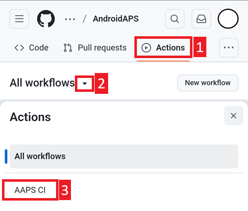

(github-build-apk)=

# Tarayıcı ile oluşturma – Adım 4: APK'yı oluşturun

```{note}
Bu, [Tarayıcı ile oluşturma](BrowserBuild.md) yönteminin **Adım 4**'üdür. Önce [Adım 3 – Google Drive'ı yetkilendirin](BrowserBuildGoogleDrive.md) bölümünü tamamlayın.
```

## AAPS APK'sını oluşturmak için AAPS-CI GitHub Actions
 - Genel kullanıcılar için uygundur.

```{tab-set}

:::{tab-item} Wiki
### İmzalı APK'yı oluşturmak için iş akışını (workflow) çalıştırın

1. AndroidAPS'in GitHub kopyanızda Actions seçin.
2. All Workflows'u genişletin.
3. AAPS-CI seçin



4. Aşağı kaydırın ve Run Workflow'a dokunun.


5. **Use workflow from** (iş akışının kullanılacağı dal) seçeneğini master dalında bırakın. **Select AAPS Version** (AAPS sürümünü seçin) alanında oluşturmak istediğiniz **AAPS** sürümünü seçin (genellikle en yenisi). [Varyantı](#browserbuild-variant) (fullRelease) seçin ve Run workflow'a dokunun.


6. Workflow run was successfully requested mesajını göreceksiniz. Tarayıcı sayfanızı yenileyin, ardından oluşturma ilerlemesini izleyebilirsiniz. İşlem bittiğinde AAPS CI işleminin yanında yeşil bir onay işareti görünür. Android APS'in güncellenmiş sürümünü başarıyla oluşturdunuz.


### AAPS APK'sını yükleyin

1. Google Drive'ınızı açın
2. AAPS klasörüne girin, yeni sürüm klasörünü seçin. Orada hem telefon hem de Android Wear sürümlerini bulacaksınız.


:::  

:::{tab-item} Video
<div align="center" style="max-width: 360px; margin: auto; margin-bottom: 2em;">
  <div style="position: relative; width: 100%; aspect-ratio: 9/16;">
    <iframe
      src="https://geo.dailymotion.com/player/x9rdwms.html?video=x9rdwms&loop=true&mute=true"
      loading="lazy"
      style="position: absolute; top: 0; left: 0; width: 100%; height: 100%;"
      frameborder="0"
      allowfullscreen>
    </iframe>
  </div>
</div>
:::  

```

## Oluşturulacak sürümü seçme

**Tarayıcı yöntemiyle yalnızca 3.3.2.1 ve üzeri AAPS sürümleri oluşturulabilir.**

**Select AAPS Version** (AAPS sürümünü seçin) alanına dokunun ve oluşturulacak sürümü seçin. En yeni sürüm listenin en üstündedir.


(browserbuild-variant)=

## Oluşturma varyantını seçme

*Not: Android ve Android Wear uygulamalarının ikisi de otomatik olarak oluşturulur.*

  - İhtiyacınız olan varyantı seçin:
    - fullRelease: Tam işlevle normal pompa kullanımı için.
    - [aapsclientRelease, aapsclient2Release, aapsclient3Release](#RemoteControl_aapsclient): Bakım verenler için ([Nightscout](../SettingUpAaps/Nightscout.md) gerekir). `aapsclient3Release`, **AAPS** 4.0 sürümünden itibaren kullanılabilen **AAPSClient3** uygulamasını oluşturur (bkz. [AAPSClient, AAPSClient2 ve AAPSClient3 hakkında](#remotecontrol-aapsclient-versions)).
    - pumpcontrolRelease: Pompa uygulamanızın/kumandanızın yerine kullanmak için


Adı “Debug” ile biten varyantlar, APK'nın hata ayıklama (debug) modunda oluşturulacağını gösterir. Bu mod, geliştiricilerin sorun gidermesi için faydalıdır.

<!-- If you want to test the items in a pull request has been moved to dev page /AdvancedOptions/DevBranch.md -->

----

Oluşturma başarılı olunca apk Google Drive'ınıza kaydedilir. [AAPS'i aktarma ve yükleme](TransferringAndInstallingAaps.md) ile devam edin.

```{note}
Eylül 2026'dan itibaren Google'ın [Android geliştirici doğrulaması](#android-developer-verification), ülkenize bağlı olarak APK'yı dosyaya dokunarak yüklemeyi engelleyebilir. Ücretsiz çözüm yolları o sayfada açıklanmıştır.
```

Oluşturma başarısız olursa önce [oluşturma günlüğünde neyin yanlış gittiğini bulun](#aaps-ci-read-the-logs), ardından [Tarayıcı ile oluşturma: sorun giderme](../GettingHelp/BrowserBuildTroubleshooting.md) sayfasına bakın. Oluşturmanıza belirli bir commit'i eklemek için [bir commit'i cherry-pick ile ekleme](#github-cherry-pick) bölümüne bakın.
