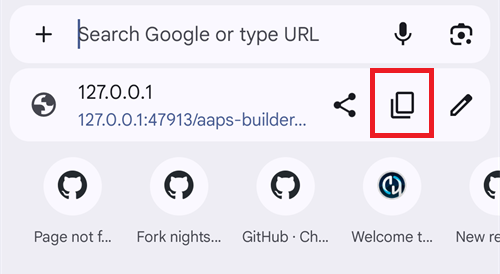
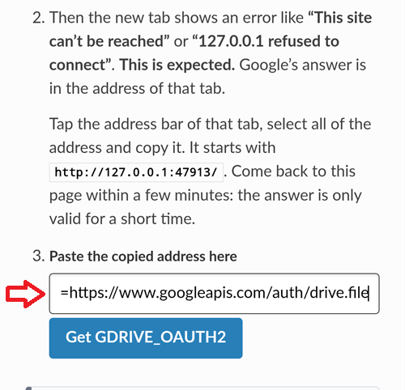

(aaps-builder)=

# AAPS Builder ile tarayıcıda oluşturma

```{note}
Bu, AAPS'i bir **Android telefondan** oluşturmanın önerilen yoludur. Her bilgisayar tarayıcısından da çalışır. Bilgisayardan veya iPhone'dan oluşturmanın diğer yolları için [Tarayıcı ile oluşturma](BrowserBuild.md) genel bakışına bakın.
```

```{contents} In this page
:backlinks: entry
:depth: 2
```

**AAPS Builder**, AAPS uygulamasını sizin için ücretsiz kod barındırma sitesi olan GitHub'da oluşturur. Telefonunuza yüklenecek bir şey ve açılacak bir hazırlık dosyası yoktur.

Bir kurulum sayfası size adım adım yol gösterir. İlk seferde yaklaşık 10 dakika sürer:

1. GitHub hesabınızda AAPS Builder'ın kendinize ait **özel bir kopyasını** oluşturun: kurulum sayfası GitHub'ı her şey doldurulmuş olarak açar, siz yalnızca onaylarsınız. GitHub'a AAPS'in nasıl oluşturulacağını söyleyen dosya olan oluşturma iş akışı zaten içindedir.
2. **İmzalama anahtarınızı** (anahtar deposu) oluşturun veya yükleyin.
3. Anahtarı deponuza bir GitHub **secret**'ı olarak verin.
4. Uygulamayı **oluşturun**. Bir oluşturma 15 ila 30 dakika sürer.
5. Uygulamayı telefonunuza **indirin ve yükleyin**.

AndroidAPS'i fork etmeniz **gerekmez**: AAPS kaynak kodu her oluşturmada resmi AndroidAPS deposundan indirilir. Google Drive'a da **gerek yoktur**: uygulamayı doğrudan GitHub'dan indirirsiniz.

```{admonition} Where the code comes from
:class: note

Oluşturma iş akışı AAPS geliştiricileri tarafından [nightscout/aaps-builder](https://github.com/nightscout/aaps-builder) deposunda bakımı yapılır ve sizin deponuz onun bir kopyasıdır. Kopyanızdaki [iş akışı](https://github.com/nightscout/aaps-builder/blob/main/.github/workflows/build.yml) kısadır: o depoda tutulan [oluşturma adımlarını](https://github.com/nightscout/aaps-builder/blob/main/.github/workflows/aaps-builder.yml) çalıştırır. Böylece iyileştirmeler deponuzda hiçbir değişiklik yapmadan size ulaşır. İki dosyayı da okuyabilirsiniz. İş akışı oluşturma sırasında yalnızca resmi AAPS kaynak kodunu ve GitHub'ın kendi oluşturma araçlarını indirir. Anahtar deponuz tarayıcınızdan ve özel deponuzdan hiçbir zaman dışarı çıkmaz.
```

(aaps-builder-before-you-start)=

## Başlamadan önce

İhtiyacınız olanlar:

- Bir **GitHub hesabı** (ücretsiz). Hesabınız yoksa önce [github.com](https://github.com/signup) adresinde bir hesap oluşturun.
- Bir **web tarayıcısı**: telefonunuzda Chrome veya bilgisayarda herhangi bir tarayıcı. Başlamadan önce bu tarayıcıda github.com'a giriş yapın.
- **Telefonunuzda GitHub uygulaması mı var?** Onu tutabilirsiniz. Bu durumda kurulum sayfasının bazı düğmeleri Chrome yerine uygulamayı açar. Oluşturma uygulamada çalışır, ancak uygulama bitmiş AAPS'i **indiremez**: indirme için Chrome'a nasıl geçileceğini [5. adım](#aaps-builder-step5) gösterir.
- Daha önce AAPS oluşturduysanız ve yeniden yüklemeden güncellemek istiyorsanız **mevcut anahtar deponuz** (`.jks` dosyası), parolası ve takma adı (alias).

```{warning}
**Oluşturma deponuz özel (private) kalmalıdır.** Bir oluşturmanın ürettiği her şeyi, depoyu görebilen herkes görebilir. Kurulum sayfası sizin için özel bir depo oluşturur. Onu asla herkese açık (public) yapmayın ve bunun yerine AAPS Builder'ı **fork** etmeyin: bir fork her zaman herkese açıktır.

Özel bir depo her ay 2000 ücretsiz GitHub Actions dakikası alır. Bu, birkaç oluşturma için yeterlidir.
```

```{warning}
**Yeni anahtar mı, mevcut anahtar mı: AAPS'i güncelleyip güncelleyemeyeceğinizi bu belirler.**

- **Telefonunuzda zaten AAPS var ve onu hâlâ elinizde olan bir anahtar deposuyla oluşturdunuz**: kurulum sayfasında **I already have a keystore** (zaten bir anahtar deposum var) seçeneğini seçin ve dosyayı yükleyin. Bir sonraki oluşturmanız AAPS'i yerinde günceller. AAPS'i önceki tarayıcı ile oluşturma yöntemiyle (kendi fork'unuzla) mı oluşturdunuz? Anahtar deponuz fork'unuzdadır: [önce onun bir kopyasını alın](#aaps-builder-from-fork).
- **AAPS'i ilk kez oluşturuyorsunuz veya anahtar deponuzu ya da parolasını kaybettiniz**: **Create a new key** (yeni bir anahtar oluştur) seçeneğini seçin. Yeni bir anahtarla imzalanan bir uygulama, başka bir anahtarla imzalanmış AAPS'i **güncelleyemez**. Ayarlarınızı dışa aktarmalı, dosyayı telefonunuzun dışına kopyalamalı, eski AAPS'i kaldırmalı, yenisini yüklemeli ve ardından ayarlarınızı içe aktarmalısınız: bkz. [Yeni bir anahtar deposuyla AAPS'i yeniden yükleme](#reinstall-aaps).

Bundan sonra hep aynı anahtarı kullanmaya devam edin. Yeni bir anahtar oluşturduğunuzda sayfanın sunduğu yedeği indirin ve parolası ve takma adıyla (`key0`) birlikte telefonunuzun dışında güvenli bir yerde saklayın.
```

(aaps-builder-from-fork)=

## Önceki tarayıcı ile oluşturmadan gelenler (fork)

AAPS'i hiç önceki tarayıcı ile oluşturma yöntemiyle oluşturmadıysanız (GitHub'da AndroidAPS'in kendi kopyanız, yani fork'unuz, hazırlık dosyası ve Google Drive ile) bu bölümü atlayın.

Anahtar deponuz fork'unuzda secret olarak saklanır. GitHub bir secret'ı bir daha hiç göstermez, bu yüzden onu yeni deponuza kopyalayamazsınız. Önce anahtar deponuzun bir kopyasını alın, ardından onu [2. adımda](#aaps-builder-step2) **I already have a keystore** ile kullanın.

```{warning}
**Create a new key** seçeneğini seçmeyin. Yeni bir anahtarla oluşturulan AAPS, telefonunuzdaki AAPS'i güncelleyemez.
```

Sizin durumunuz hangisi?

- **Seçenek 2'yi kullandınız** (Android Studio'dan kendi anahtar deponuzu yüklediniz) ve `.jks` dosyası, parolaları ve takma adı hâlâ sizde: burada yapacak bir şey yok. Bu dosyayı 2. adımda kullanın.
- **Seçenek 1'i kullandınız** (anahtarınızı hazırlık dosyası oluşturdu) veya anahtar deposu dosyanız artık sizde değil: aşağıdaki gibi onu fork'unuzdan dışa aktarın.

Anahtar deponuzu fork'unuzdan dışa aktarmak için:

1. Fork'unuzda **Settings** → **Secrets and variables** → **Actions** yolunu açın ve `ZIP_PASSWORD` adlı bir secret ekleyin. Yalnızca İngilizce harfler ve rakamlardan oluşan bir parola seçin. Bu parola, oluşturmak üzere olduğunuz dosyayı korur.
2. Fork'unuzun **Actions** sekmesini açın, **CI Keystore Export** öğesine, ardından **Run workflow** düğmesine dokunun. Daha fazla ayrıntı: [Anahtar deponuzu dışa aktarın](#ci-keystore-export).
3. Çalıştırmada yeşil bir onay işareti görününce Google Drive'ınızı açın: `keystore.zip` dosyası **AAPS** → **KeyStore** klasöründedir. Çalıştırma Google Drive adımında başarısız olursa fork'unuzun Google Drive erişiminin süresi dolmuştur: [Google yenileme belirtecinin süresi doldu](#aaps-ci-google-token-expired) bölümüne bakın.
4. `keystore.zip` dosyasını indirin ve `ZIP_PASSWORD` ile açın: bir bilgisayarda veya telefonunuzda parola korumalı ZIP dosyalarını açabilen bir dosya yöneticisi uygulamasıyla. İçinde şunlar vardır:
   - `keystore.jks`: anahtar deponuz,
   - `keyStoreInfo.txt`: `KEYSTORE_PASSWORD`, `KEY_PASSWORD` ve `ALIAS` değerleriniz (genellikle `key0`).
5. `keystore.jks` dosyasını telefonunuza (veya oradan seçebilmek için Google Drive'a) kopyalayın.

Kurulum sayfasının [2. adımında](#aaps-builder-step2):

1. **I already have a keystore** (zaten bir anahtar deposum var) sekmesine dokunun.
2. **Keystore file** alanında `keystore.jks` dosyasını seçin.
3. **Keystore password** alanına `keyStoreInfo.txt` içindeki `KEYSTORE_PASSWORD` değerini yazın.
4. **Key alias** (anahtar takma adı) alanında `keyStoreInfo.txt` içindeki `ALIAS` değerini seçin veya yazın.
5. `KEY_PASSWORD`, `KEYSTORE_PASSWORD` değerinden farklıysa **Key password is the same as the keystore password** işaretini kaldırın ve `KEY_PASSWORD` değerini yazın.

`keystore.zip` dosyasını ve `ZIP_PASSWORD` parolasını telefonunuzun dışında güvenli bir yerde saklayın: bu, anahtarınızın yedeğidir.

AAPS Builder oluşturmalarını Google Drive'a da kaydetmek için [6. adımı](#aaps-builder-google-drive) yapın: kurulum sayfası sizin için yeni bir `GDRIVE_OAUTH2` alır. AAPS Builder ile oluşturulan AAPS telefonunuza yüklenene kadar fork'unuzu tutabilirsiniz.

## Kurulum sayfasını açın

**→ [AAPS Builder kurulum sayfasını açın](#aaps-builder-setup)**

Kurulum sayfası bu dokümantasyonun bir parçasıdır ve sizin dilinizdedir. Bu sayfayı da başka bir sekmede açık tutun: aşağıdaki bölümler kurulum sayfasının her adımını ekran görüntüleriyle daha ayrıntılı açıklar.

Kurulum sayfası her GitHub sayfasını yeni bir Chrome sekmesinde açar. Kurulum sayfasına dönmek için Chrome'un adres çubuğunun yanındaki sekme düğmesine (içinde sayı olan kare) dokunun ve AAPS Builder kurulum sayfasını seçin.


Kurulum sayfası tamamen tarayıcınızda çalışır: anahtarınız ve parolalarınız hiçbir yere gönderilmez; yalnızca kendiniz yapıştırdığınız GitHub secret'ına girer. GitHub'a yalnızca GitHub kullanıcı adınız gönderilir; bu, kullanıcı adının var olup olmadığını kontrol etmek içindir. GitHub kullanıcı adınızı ve depo adınızı hatırlar. Böylece secrets sayfanızı veya oluşturmalarınızı yeniden açmak için istediğiniz zaman ona dönebilirsiniz.


(aaps-builder-step1)=

## Adım 1 – Özel oluşturma deponuzu oluşturun

Bu adım, GitHub hesabınızda oluşturma iş akışı zaten içinde olan, AAPS Builder'ın size ait özel bir kopyasını oluşturur. Onu ve oluşturduğu uygulamaları yalnızca siz görebilirsiniz.

1. Bu tarayıcıda github.com'a giriş yaptığınızdan emin olun.

2. **Your GitHub username** (GitHub kullanıcı adınız) alanına e-posta adresinizi değil, GitHub kullanıcı adınızı yazın. Sayfa bunu GitHub ile kontrol eder: **✓ GitHub user found** (GitHub kullanıcısı bulundu) doğru olduğu anlamına gelir.

3. **Name of your repository** (deponuzun adı) alanında önerilen `my-aaps` adını bırakın. Deponuzu daha önce başka bir adla oluşturduysanız tam olarak o adı yazın.

   ```{note}
   **Zaten bir AAPS Builder deponuz mu var** (kurulum sayfasının daha eski bir sürümüyle yapılmış)? Yeni bir tane oluşturmayın: tam adını yazın, **Create my private repository** adımını atlayın ve iş akışını [AAPS'i güncelleme](#aaps-builder-updates) bölümünde açıklandığı gibi bir kez güncelleyin. Secret'larınız olduğu gibi kalır. Yine de yeni bir depo istiyorsanız henüz sahip olmadığınız bir ad seçin, örneğin `my-aaps-2`, ve 2. adımda aynı anahtar deposunu kullanın.

   AndroidAPS fork'unuzun adını yazmayın: bir fork herkese açıktır ve zaten kendi **AAPS CI** iş akışıyla oluşturma yapar.
   ```

   

4. **Your repository:** (deponuz) satırını kontrol edin: `github.com/<your username>/my-aaps` gösterir. Kurulum sayfası son ziyaretinizdeki adı hatırlar: düğmelerini kullanmadan önce her seferinde kontrol edin.

5. **Create my private repository** (özel depomu oluştur) düğmesine dokunun.

   

6. GitHub yeni bir sekmede **Create a new repository** (yeni depo oluştur) sayfasını açar. Her şey zaten doldurulmuştur: **Start with a template** (bir şablonla başla) altında **Include all branches** (tüm dalları dahil et) kapalı olarak `nightscout/aaps-builder` şablonu, **General** (genel) altında **Owner** (sahip) olarak hesabınız ve seçtiğiniz ad.

   

   Hiçbir şeyi değiştirmeyin.

7. Aşağı kaydırın: **Configuration** (yapılandırma) altında **Choose visibility** (görünürlüğü seçin) zaten **Private** (özel) olarak ayarlıdır. Yeşil **Create repository** (depo oluştur) düğmesine dokunun.

   

   GitHub yeni deponuzu gösterir: içinde bir `.github` klasörü (oluşturma iş akışıyla) ve bir `README.md` dosyası vardır. 2. adım için **kurulum sayfası sekmesine geri dönün**: Chrome'un adres çubuğunun yanındaki sekme düğmesine dokunun ve kurulum sayfasını seçin.

   

```{warning}
**Yeni deponuz boş mu**, hiç dosya yok mu? Şablondan oluşturulmamıştır ve oluşturma yapamaz. Onu silin (**Settings** → sayfanın en altı → **Delete this repository** (bu depoyu sil)), ardından kurulum sayfasında yeniden **Create my private repository** düğmesine dokunun.
```

```{tip}
GitHub says **my-aaps already exists in this account**? You already have your repository: close the GitHub tab and go on with the setup page. If your key is already in it, continue with [step 4](#aaps-builder-step4). See [troubleshooting](#aaps-builder-ts-repo-exists).
```

(aaps-builder-step2)=

## Adım 2 – İmzalama anahtarınız

Uygulama kendi anahtarınızla imzalanmalıdır. İki sekmeden birini seçin. Önce [yeni anahtar veya mevcut anahtar uyarısını](#aaps-builder-before-you-start) okuyun.


### I already have a keystore

1. **I already have a keystore** (zaten bir anahtar deposum var) sekmesine dokunun.
2. **Keystore file** (anahtar deposu dosyası) alanında `.jks` dosyanızı (veya `.keystore`, `.p12`, `.pfx`) seçin. Telefonda önce dosyayı telefonunuza veya Google Drive'a kopyalayın.
3. **Keystore password** (anahtar deposu parolası) alanına anahtar deposu parolasını yazın.
4. **Key alias** alanında listeden takma adınızı seçin veya liste yoksa yazın. Android Studio ile yapılan anahtar depolarında bu genellikle `key0`'dır.
5. Anahtar parolanız anahtar deposu parolasından farklıysa **Key password is the same as the keystore password** (anahtar parolası, anahtar deposu parolasıyla aynı) işaretini kaldırın ve anahtar parolasını yazın.
6. **Check and continue** (kontrol et ve devam et) düğmesine dokunun.

Sayfa parolayı ve takma adı cihazınızda kontrol eder. **Keystore OK! Continue with step 3.** (anahtar deposu tamam, 3. adımla devam edin) her şeyin doğru olduğu anlamına gelir. Parolanın oluşturma sırasında kontrol edileceğini söylerse yine de devam edin: bir sorun varsa oluşturma bunu size bildirir.

### Create a new key

1. **Create a new key** (yeni bir anahtar oluştur) sekmesine dokunun.

2. Bir parola seçin ve iki kez yazın. Kurallar: en az 8 karakter; yalnızca a–z ve A–Z harfleri, 0–9 rakamları ve `! ? #` gibi semboller. Boşluk, aksanlı harf (ç, ğ, ı, ö, ş, ü gibi) ve `|` karakteri olmamalıdır.

3. **Create key** (anahtar oluştur) düğmesine dokunun. **Key created** (anahtar oluşturuldu) mesajının görünmesi birkaç saniye sürer.

   

4. **Download backup (aaps-keystore.jks)** (yedeği indir) düğmesine dokunun. Chrome **Download file again?** (dosya yeniden indirilsin mi?) diye sorarsa, aynı adlı daha eski bir yedek zaten telefonunuzdadır: **Download again** (yeniden indir) seçeneğine dokunun. Chrome bu durumda yeni anahtarı `aaps-keystore (1).jks` olarak kaydeder: bu anahtara ait dosya budur; onu saklayın ve eskisiyle karıştırmayın.

   Bu üçünü birlikte, telefonunuzun dışında güvenli bir yerde saklayın (örneğin kendi bulut depolamanızda):

   - `aaps-keystore.jks` dosyası,
   - parolanız,
   - anahtarın takma adı (alias): **`key0`**.

   AAPS'i bir gün başka bir yolla, örneğin Android Studio ile oluşturursanız üçüne de ihtiyacınız olur. Kurulum sayfasının daha eski bir sürümüyle oluşturulan anahtarların takma adı `aaps`'tir.

   

(aaps-builder-step3)=

## Adım 3 – Anahtarı deponuza verin

3. adım, 2. adım bitince açılır. Anahtarınız, parolaları ve takma adı tek bir değerde, `KEYSTORE_SET` secret'ında toplanır.

1. **Open the secrets page** (secrets sayfasını aç) düğmesine dokunun.


2. GitHub, deponuzun **New secret** (yeni secret) sayfasını açar. Telefonda bu, ayarlar menüsünün altındadır: aşağı kaydırın.


3. Kurulum sayfası sekmesine geçin ve **Copy name** (adı kopyala) düğmesine dokunun. GitHub sekmesine geri dönün ve küçük **Name** (ad) alanına yapıştırın. Adı `KEYSTORE_SET`'tir.

4. Kurulum sayfası sekmesine geçin ve **Copy secret** (secret'ı kopyala) düğmesine dokunun. GitHub sekmesine geri dönün ve büyük **Secret** kutusuna yapıştırın (telefonda uzun basın). Secret, binlerce karakterden oluşan çok uzun bir koddur: kurulum sayfası ilk karakterlerini düğmenin yanında gösterir. Oraya `KEYSTORE_SET` kelimesini yapıştırmayın.

5. **Add secret** (secret ekle) düğmesine dokunun. `KEYSTORE_SET` artık **Repository secrets** (depo secret'ları) altında görünür.


Bunu yalnızca bir kez yapmanız gerekir.

```{tip}
GitHub **Page not found** (sayfa bulunamadı, 404) mu gösteriyor? Önce bu tarayıcıda github.com'da oturum açtığınızı kontrol edin: oturum açmadığınızda GitHub, özel depolar için 404 gösterir. Aksi halde 1. adımdaki kullanıcı adı veya depo adı deponuzla eşleşmiyordur. Adı github.com'da kontrol edin, 1. adımda düzeltin ve düğmeye yeniden dokunun.
```

(aaps-builder-step4)=

## Adım 4 – Uygulamayı oluşturun

1. Kurulum sayfasında **Open the build page** (oluşturma sayfasını aç) düğmesine dokunun. GitHub, deponuzun **Build AAPS** (AAPS'i oluştur) sayfasını açar.

   

   Bunun yerine **GitHub uygulaması** açılırsa: **RUN WORKFLOW** düğmesine dokunun, sürümü ve varyantı kontrol edin ve yeniden **RUN WORKFLOW** düğmesine dokunun. Uygulama yine de **Nothing to see here** (burada görülecek bir şey yok) gösterebilir: listeyi yenilemek için aşağı çekin ve oluşturmanızı görün. Ardından aşağıdaki 4. adımla devam edin.

2. GitHub sorarsa iş akışlarını etkinleştirmek için yeşil düğmeye dokunun.

   İş akışları listesinde iki öğe vardır: **Build AAPS** öğesini kullanın. **AAPS Builder** öğesini dikkate almayın: oluşturma adımlarını içerir ve **Run workflow** düğmesi yoktur.

3. **Run workflow** (iş akışını çalıştır) düğmesine dokunun. Küçük bir form açılır:
   - **Version** (sürüm): en yeni AAPS sürümünü oluşturmak için `latest` olarak bırakın veya `4.0.0` gibi bir sürüm numarası yazın.
   - **Variant** (varyant): pompayla normal kullanım için `fullRelease` olarak bırakın. Diğer varyantlar [oluşturma varyantları](#browserbuild-variant) bölümünde açıklanmıştır. `aapsclient3Release`, **AAPS** 4.0 sürümünden itibaren kullanılabilen **AAPSClient3** uygulamasını oluşturur (bkz. [AAPSClient, AAPSClient2 ve AAPSClient3 hakkında](#remotecontrol-aapsclient-versions)).
   - Yeşil **Run workflow** düğmesine dokunun.

   

4. Oluşturma başlar ve iki bölümle **In progress** (devam ediyor) gösterir: önce **AAPS / Check**, sonra **AAPS / Build AAPS**.

   

5. 15 ila 30 dakika bekleyin. Yeşil bir onay işareti, oluşturmanın bittiği anlamına gelir. Kırmızı bir çarpı, başarısız olduğu anlamına gelir: mesajı okumak için oluşturmayı açın, ardından [sorun giderme](#aaps-builder-troubleshooting) bölümüne bakın.

   

   ```{tip}
   **Oluşturma bitince e-posta:** GitHub size yalnızca bir oluşturma başarısız olduğunda e-posta gönderir. Başarılı olduğunda da e-posta almak için: github.com'da profil resminizi → **Settings** → **Notifications** → **System** → **Actions** açın ve **Only notify for failed workflows** (yalnızca başarısız iş akışları için bildir) işaretini kaldırın.
   ```

**Build AAPS** veya **Run workflow** düğmesi yoksa:

- Deponuzu açın ve içinde `workflows/build.yml` dosyasını içeren bir `.github` klasörü olup olmadığını kontrol edin. Depo boşsa şablondan oluşturulmamıştır: onu silin (**Settings** → sayfanın en altı → **Delete this repository**) ve [1. adımı](#aaps-builder-step1) düğmeyle yeniden yapın.
- The file is there, but GitHub shows **This workflow does not exist**: see [troubleshooting](#aaps-builder-ts-workflow-not-found).
- **Actions** sekmesini açın. İş akışlarının devre dışı olduğunu söylüyorsa, etkinleştirmek için yeşil düğmeye dokunun, ardından listede **Build AAPS** öğesine dokunun.

(aaps-builder-step5)=

## Adım 5 – Uygulamayı telefonunuza yükleyin

```{warning}
**Her güncellemeden önce** AAPS'te [ayarlarınızı dışa aktarın](#ExportImportSettings-Automating-Settings-Export) ve dosyayı **telefonun dışına** kopyalayın (Google Drive, Dropbox…). Her zaman geri dönebilmek için birkaç eski dışa aktarmayı ve APK dosyalarını da orada saklayın.
```

1. Telefonunuzda kurulum sayfasını **Chrome**'da açın. İstenirse github.com'a giriş yapın.
2. **Open my builds** (oluşturmalarımı aç) düğmesine, ardından yeşil onay işaretli en yeni oluşturmaya dokunun.

   ```{admonition} The GitHub app opened instead of Chrome?
   :class: note

   GitHub uygulaması oluşturmaları indiremez. Uygulamada en yeni oluşturmayı açın, ardından **Artifacts ↗** öğesine dokunun veya üstteki paylaşma simgesine dokunup **Chrome**'u seçin (ya da **Copy link** (bağlantıyı kopyala) seçip bağlantıyı Chrome'un adres çubuğuna yapıştırın). Oluşturma Chrome'da açılır: orada bir sonraki adımla devam edin.

   GitHub bağlantılarının uygulamada açılmasını durdurmak için: Android **Settings** (Ayarlar) → **Apps** (Uygulamalar) → **GitHub** → **Open by default** (Varsayılan olarak aç) → **Open supported links** (Desteklenen bağlantıları aç) seçeneğini kapatın.
   ```

   

3. Oluşturma özetine kadar aşağı kaydırın ve **Download AAPS** (AAPS'i indir) bağlantısına dokunun.

   

   ```{tip}
   Parmağınızla oluşturma adımlarının şeması üzerinde değil, metin üzerinde kaydırın: aksi halde sayfa yerine şema hareket eder.
   ```

   Ayrıca **Artifacts** (oluşturulan dosyalar) bölümüne kadar aşağı kaydırıp `aaps-….apk` yanındaki indirme simgesine de dokunabilirsiniz.

   

4. İndirme bitince Chrome menüsünü **⋮** → **Downloads** (İndirilenler) açın, `aaps-….apk` dosyasına dokunun ve **Install** (Yükle) seçin. İstenirse bu kaynaktan uygulama yüklenmesine izin verin.

   

`aaps-wear-….apk` akıllı saat uygulamasıdır. Akıllı saat kullanmıyorsanız atlayın.

Uygulama oluşturma sayfasında **14 gün** saklanır. Deponuzda **Code** altında görünmez. Onu ayar dışa aktarmalarınızla birlikte telefonunuzun dışında güvenli bir yere kopyalayın.

Uygulamayı yüklemenin diğer yolları için [AAPS'i aktarma ve yükleme](TransferringAndInstallingAaps.md) sayfasına bakın.

```{note}
Eylül 2026'dan itibaren Google'ın [Android geliştirici doğrulaması](#android-developer-verification), ülkenize bağlı olarak APK'yı dosyaya dokunarak yüklemeyi engelleyebilir. Ücretsiz çözüm yolları o sayfada açıklanmıştır.
```

(aaps-builder-google-drive)=

## Adım 6 (isteğe bağlı) – Uygulamayı Google Drive'a da kaydedin

Her oluşturmanın Google Drive'ınıza, `AAPS/<version>` klasörüne kaydedilmesini de sağlayabilirsiniz. Bu isteğe bağlıdır: uygulama her zaman oluşturma sayfasında bulunur.

Bunun için bir secret daha gerekir: `GDRIVE_OAUTH2`. Kurulum sayfasının 6. adımı bunu sizin için Google'dan alır; telefonda da bilgisayarda da. **AAPS** bundan sonra Google Drive'ınızda yalnızca kendi oluşturduğu dosyaları görebilir ve değiştirebilir, başka hiçbir şeyi değil.

1. Kurulum sayfasında **Connect Google Drive** (Google Drive'ı bağla) düğmesine dokunun. Google yeni bir sekmede açılır.

2. Google hesabınızı seçin ve erişime izin verin. Google uygulamanın doğrulanmadığını söylerse **Advanced** (gelişmiş), ardından **Go to …** (… sitesine git) seçeneğine dokunun.

   

   

3. Yeni sekme bu durumda **This site can't be reached** (bu siteye ulaşılamıyor) veya **127.0.0.1 refused to connect** (127.0.0.1 bağlanmayı reddetti) gibi bir hata gösterir. **Bu beklenen bir durumdur:** Google'ın yanıtı o sekmenin adresindedir. Tap the address bar, then the copy icon next to the address (on a computer: select the whole address and copy it). Adres `http://127.0.0.1:47913/` ile başlar.

   

   

4. Birkaç dakika içinde kurulum sayfası sekmesine geri dönün: Google'ın yanıtı yalnızca kısa bir süre ve yalnızca bir kez geçerlidir. Adresi **Paste the copied address here** (kopyalanan adresi buraya yapıştırın) alanına yapıştırın ve **Get GDRIVE_OAUTH2** (GDRIVE_OAUTH2 al) düğmesine dokunun. Sayfa **GDRIVE_OAUTH2 is ready** (GDRIVE_OAUTH2 hazır) gösterir.

   

   

5. **Open the secrets page** (secrets sayfasını aç) düğmesine dokunun. **Copy name** düğmesine dokunun, ardından küçük **Name** alanına yapıştırın (ad `GDRIVE_OAUTH2`'dir). **Copy secret** düğmesine dokunun, büyük **Secret** kutusuna yapıştırın ve **Add secret** düğmesine dokunun.

   

Bir sonraki oluşturmadan itibaren APK'lar Google Drive'a da kaydedilir.

Diğer tarayıcı ile oluşturma yöntemlerinin hazırlık dosyasından elde ettiğiniz bir `GDRIVE_OAUTH2` değeriniz zaten var mı? O da çalışır: onu `GDRIVE_OAUTH2` secret'ı olarak ekleyin.

6 ay boyunca oluşturma yapmazsanız veya Google parolanızı değiştirirseniz Google erişimi durdurur. Oluşturma bunu size bildirir: bu adımları yeniden yapın. [Google yenileme belirtecinin süresi doldu](#aaps-ci-google-token-expired) bölümüne bakın.

(aaps-builder-updates)=

## Updating AAPS

Deponuz kendi kendine hiçbir şey oluşturmaz: ne zaman, hangi sürümü ve hangi varyantı oluşturacağınıza siz karar verirsiniz. Yeni bir AAPS sürümü yayınlandığında:

1. 5. adımda açıklandığı gibi [ayarlarınızı yedekleyin](#aaps-builder-step5).
2. Yeni sürümü [4. adımdaki](#aaps-builder-step4) gibi oluşturun. `latest` olarak bırakın veya sürüm numarasını yazın.
3. Onu [5. adımdaki](#aaps-builder-step5) gibi indirin ve yükleyin.

**Oluşturma adımlarının güncellemeleri** size kendiliğinden ulaşır: deponuz her oluşturmada AAPS geliştiricilerinin nightscout/aaps-builder içinde yayınladığı oluşturma adımlarını çalıştırır. Deponuzda hiçbir şey değişmez ve otomatik oluşturma yoktur.

**İş akışı dosyanızın güncellemeleri** nadirdir: yalnızca **Run workflow** formu değiştiğinde (örneğin yeni bir oluşturma varyantı için) veya deponuz kurulum sayfasının daha eski bir sürümüyle (kısa bir iş akışı dosyası olan boş bir depo) ya da eski şablondan yapıldıysa bir kez. [Doküman güncellemeleri & değişiklikleri](../Maintenance/DocumentationUpdate.md) sayfası bunu bildirir. `KEYSTORE_SET` secret'ınız olduğu gibi kalır. Kurulum sayfasında, 1. adımın sonundaki **Updating your copy** (kopyanızı güncelleme) bölümünü açın:

1. **Open the newest workflow** (en yeni iş akışını aç) düğmesine dokunun. Bilgisayarda dosyanın sağ üstündeki **kopyalama simgesine** ("Copy raw file") tıklayın. Telefonda bunun yerine **düz metin sürümünü** açın, metne basılı tutun, ardından **Select all** (tümünü seç) ve **Copy** (kopyala) seçin.
2. Tap **Open my workflow file**, then the **⋯** menu at the top right of the file and **Edit file… In place** (on a computer, click the pencil).
3. Metnin tamamını kopyaladığınız iş akışıyla değiştirin (telefonda uzun basın: **Select all**, ardından **Paste** (yapıştır)).
4. **Commit changes…** düğmesine, ardından **Commit changes** (değişiklikleri kaydet) düğmesine dokunun.

Dosyanın ilk satırı sürümünü gösterir.

## Troubleshooting

Something went wrong? See [AAPS Builder troubleshooting](#aaps-builder-troubleshooting).

```{toctree}
:hidden:

AAPS Builder kurulum sayfası <BrowserBuildAapsBuilderSetup.md>
```
