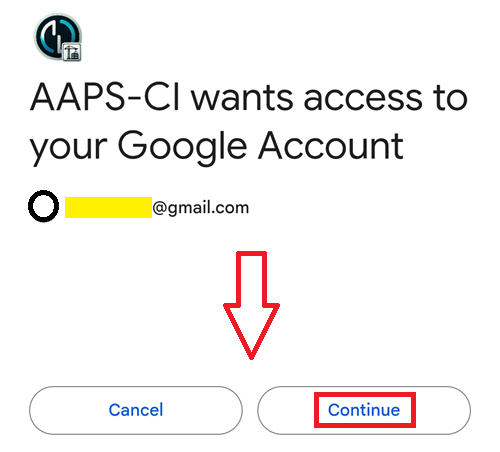

(aaps-ci-google-drive-auth)=

# Tarayıcı ile oluşturma – Adım 3: Google Drive'ı yetkilendirin

```{note}
Bu, [Tarayıcı ile oluşturma](BrowserBuild.md) yönteminin **Adım 3**'üdür. Önce [Adım 2 – İmzalama anahtar deponuzu oluşturun](BrowserBuildKeystore.md) bölümünü tamamlayın.
```

```{warning}
Önceki talimatlardan hangisini izlediğiniz fark etmez (Seçenek 1 veya Seçenek 2): Tarayıcı ile oluşturmayı başarıyla kullanmak için Google Drive yetkilendirmesini MUTLAKA eklemelisiniz.
```

Not: Bu bölümü videoda zaten yaptıysanız şimdi doğrudan [Adım 4 – APK'yı oluşturun](BrowserBuildAPK.md) bölümüne geçebilirsiniz.

```{warning}
Google yetkilendirmesi başlamazsa veya hazırlık sayfası hata verirse hazırlık sayfasını kapatın, `aaps-ci-preparation.html` dosyasını 2. adımdaki gibi yeniden açın ve bu adıma yeniden başlayın. Bkz. [sorun giderme](#aaps-ci-preparation-web).
```

Hazırlık sayfası sekmesine geri dönün.

Google Drive Auth bölümüne kadar aşağı kaydırın ve Start Auth (yetkilendirmeyi başlat) düğmesine dokunun.


Google hesabınızı seçin.


Aşağı kaydırın ve erişimi kabul edin. Web sayfası, Google Drive kimlik doğrulama anahtarını almak için buna ihtiyaç duyar.

Continue (Devam) düğmesine dokunun.



`GDRIVE_OAUTH2` alanı dolar; üstteki Copy (kopyala) düğmesine dokunun.


GitHub sekmesine geri geçin.

Repository secrets (depo secret'ları) bölümüne kadar aşağı kaydırın ve New repository secret (yeni depo secret'ı) düğmesine dokunun.

Seçenek 1'i izlediyseniz şunu görmelisiniz:


Seçenek 2'yi izlediyseniz daha fazla anahtar olur:


Name (ad) alanına az önce kopyaladığınız metni yapıştırın. Yapıştırma menüsünü göstermek için metin kutusuna uzun basın.


Hazırlık sayfası sekmesine geçin.

İkinci Copy (kopyala) düğmesine dokunun.


GitHub sekmesine geri geçin.

1. Secret alanına az önce kopyaladığınız metni yapıştırın. Yapıştırma menüsünü göstermek için metin kutusuna uzun basın.

2. Add secret (secret ekle) düğmesine dokunun.


Artık iki (Seçenek 1) veya beş (Seçenek 2) secret kaydınız olmalıdır.


GitHub artık oluşturulan AAPS apk dosyasını Google Drive'ınıza kaydedebilecek.

----

**Sonraki: [Adım 4 – APK'yı oluşturun](BrowserBuildAPK.md) →**
