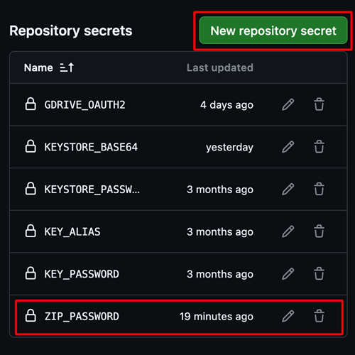

(aaps-ci-preparation)=

# Tarayıcı ile oluşturma – Adım 2: İmzalama anahtar deponuzu oluşturun

```{note}
Bu, [Tarayıcı ile oluşturma](BrowserBuild.md) sürecinin **2. adımıdır**. Önce [Adım 1 – GitHub fork'unuzu oluşturun](BrowserBuildFork.md) sayfasını tamamlayın.
```

AAPS, bir **Java KeyStore (JKS)** içinde saklanan özel anahtarlarla imzalanmalıdır. Bu, tüm sürecin en önemli kararıdır, çünkü AAPS'i daha sonra yeniden yüklemeden **güncelleyip** güncelleyemeyeceğinizi belirler.

```{note}
Sonraki adımlarda özel bilgilerinizi (anahtar deponuzu ve daha sonra Google Drive erişiminizi) GitHub içinde **secret** (gizli değer) olarak saklayacaksınız. Secret, yalnızca sizin oluşturmanızın okuyabildiği şifrelenmiş bir değerdir. Başka hiç kimse, fork'unuza bakan kişiler bile, onu göremez. Oluşturmanızın size ait kalmasını sağlayan budur.
```

## Anahtar deposu yönteminizi seçin

İki seçeneği de okuyun ve durumunuza uyanı seçin.

### Seçenek 1 – Yeni bir anahtar deposu oluşturun (yeni kullanıcılar)

Aşağıdakilerden **herhangi biri** doğruysa bunu seçin:

- AAPS'i **ilk kez** oluşturuyorsunuz.
- Daha önce Android Studio ile (bilgisayarda) yapılmış bir oluşturmadan kalan bir anahtar deponuz yok.
- Anahtar deposu parolanızı veya takma adınızı (alias) unuttunuz.

```{warning}
AAPS'i **Seçenek 1** ile oluşturmak yepyeni bir anahtar deposu oluşturur. Bu yüzden **mevcut AAPS'inizi yerinde güncellemenize izin vermez**. Bu yeni oluşturmaya geçmek için ayarlarınızı dışa aktarmanız, eski AAPS'i kaldırmanız, yenisini yüklemeniz ve ayarlarınızı yeniden içe aktarmanız gerekir. [Yeni bir anahtar deposuyla AAPS'i yeniden yükleme](#reinstall-aaps) bölümündeki adımları izleyin.
```

**→ [Seçenek 1 ile devam edin – Yeni bir anahtar deposu oluşturun](BrowserBuildO1.md)**

### Seçenek 2 – Mevcut anahtar deponuzu yükleyin (mevcut / önceki kullanıcılar)

Daha önce bilgisayarda Android Studio ile yaptığınız bir AAPS oluşturmasında kullandığınız `.jks` anahtar deposu **zaten elinizdeyse** **ve** parolasını ve takma adını (genellikle `key0`) biliyorsanız bunu seçin.

Böylece mevcut AAPS kurulumunuz güncellenebilir kalır: gelecekteki güncellemeler aynı anahtar deposunu kullanır.

**→ [Seçenek 2 ile devam edin – Mevcut anahtar deponuzu yükleyin](BrowserBuildO2.md)**

----

```{note}
Sonraki sayfada cihazınızı (bilgisayar veya iPhone) seçeceksiniz. Her cihaz sayfası, hazırlık dosyasını o cihaza uygun şekilde indirmeniz ve açmanız ve anahtar deponuzu oluşturmanız için size adım adım yol gösterir. Oluşturulan AAPS uygulaması Google Drive'ınıza kaydedilir.
```

**Sonraki adım: yukarıdan [Seçenek 1](BrowserBuildO1.md) veya [Seçenek 2](BrowserBuildO2.md)'yi seçin, ardından cihazınıza ait sayfayı izleyin.**

----

(ci-keystore-export)=

## Anahtar deponuzu dışa aktarın (isteğe bağlı)

Kayıtlı anahtar deponuzu dışa aktarmak istiyorsanız bu yöntemi kullanın.

Bu betik, önceden ayarladığınız anahtar deposu bilgilerini (Seçenek 1 veya Seçenek 2'den) parola korumalı bir ZIP dosyası olarak Google Drive'ınızdaki `/AAPS/KeyStore` klasörüne aktarır.

```{warning}
Bu dışa aktarma yöntemini kullanmadan önce anahtar deposu ve Google Drive ayarlarınızın tamamlandığından emin olun.
```

### Steps:

1. **ZIP parolası secret'ını ekleyin:**
   - Deponuzda **Settings** → **Secrets and variables** → **Actions** yolunu açın
   - **New repository secret** (yeni depo secret'ı) düğmesine tıklayın
   - **Name** (ad) alanına şunu girin: `ZIP_PASSWORD`
   - **Secret** alanına kendi belirlediğiniz ZIP şifreleme parolasını girin
   - Parolada yalnızca İngilizce harfler ve rakamlar kullanın (özel sembol kullanmayın)
   - **Add secret** (secret ekle) düğmesine tıklayın

   

2. **Dışa aktarma iş akışını (workflow) çalıştırın:**
   - Deponuzda **Actions** sekmesine gidin
   - **CI Keystore Export** öğesini seçin
   - **Run workflow** (iş akışını çalıştır) düğmesine tıklayın
   - Dışa aktarılan anahtar deposu ZIP dosyası Google Drive'ınıza kaydedilir

   

   

```{toctree}
:hidden:

Seçenek 1 – Yeni bir anahtar deposu oluşturun <BrowserBuildO1.md>
Seçenek 2 – Mevcut anahtar deponuzu yükleyin <BrowserBuildO2.md>
```
