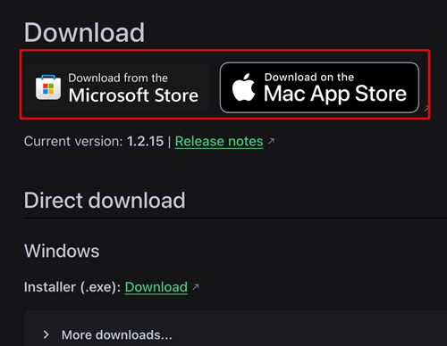

(aaps-ci-option2-computer)=

# Seçenek 2 · Bilgisayar – Mevcut anahtar deponuzu yükleyin

```{note}
**Bilgisayarda** (Windows / Mac / Linux) [Seçenek 2](BrowserBuildO2.md) (mevcut bir anahtar deposunu yükleme).
```

## 1. Hazırlık dosyasını indirin

:::{include} BrowserBuildDownloadPrep.md
:::

## 2. Yerel bir sunucu başlatın ve anahtar deposunu yükleyin

Bilgisayar kullanın (Windows/Mac/Linux desteklenir)

<!--crowdin: exclude-->
<div align="center" style="max-width: 360px; margin: auto; margin-bottom: 2em;">
  <div style="position: relative; width: 100%; aspect-ratio: 9/16;">
    <iframe
      src="https://geo.dailymotion.com/player/x9rdyc6.html?video=x9rdyc6&loop=true&mute=true"
      loading="lazy"
      style="position: absolute; top: 0; left: 0; width: 100%; height: 100%;"
      frameborder="0"
      allowfullscreen>
    </iframe>
  </div>
</div>

Simple Web Server'ı yükleyin<br/><br/> Windows veya Mac kullanıyorsanız onu Microsoft Store'dan veya Mac App Store'dan yükleyebilirsiniz. Tarayıcınız mağaza uygulamasının açılıp açılmayacağını sorarsa izin verin.<br/><br/> <br/><br/>

Mac örneği:

- get → install → open (al → yükle → aç)<br/><br/> <br/><br/>

- Get Started (başlayın) düğmesine tıklayın<br/><br/> <br/><br/>

- New Server (yeni sunucu) düğmesine tıklayın<br/><br/> <br/><br/>

- Folder Path (klasör yolu) alanında aaps-ci-preparation.html dosyasının bulunduğu klasörü seçin, ardından Create Server (sunucu oluştur) düğmesine tıklayın.<br/><br/> <br/><br/>

- Bu ekranı görüyorsanız sunucu başlatılmıştır.<br/><br/> <br/><br/>

- Simple Web Server'ı kapatmayın. Lütfen tarayıcınıza geçin ve şu adresi açın:<br/><br/> [http://127.0.0.1:8080/aaps-ci-preparation.html](http://127.0.0.1:8080/aaps-ci-preparation.html)<br/><br/>

- Sonraki adımlar için aşağıdaki videoya bakın; videoyu 2 dakika 18 saniyeden itibaren izleyin.<br/><br/>
  <!--crowdin: exclude-->
  <div align="center" style="max-width: 360px; margin: auto; margin-bottom: 2em;">
    <div style="position: relative; width: 100%; aspect-ratio: 9/16;">
      <iframe
        src="https://geo.dailymotion.com/player/x9rdvt0.html?video=x9rdvt0&startTime=138&loop=true&mute=true"
        loading="lazy"
        style="position: absolute; top: 0; left: 0; width: 100%; height: 100%;"
        frameborder="0"
        allowfullscreen>
      </iframe>
    </div>
  </div>

----

**Sonraki adım: [Adım 3 – Google Drive'ı yetkilendirin](BrowserBuildGoogleDrive.md) →**
