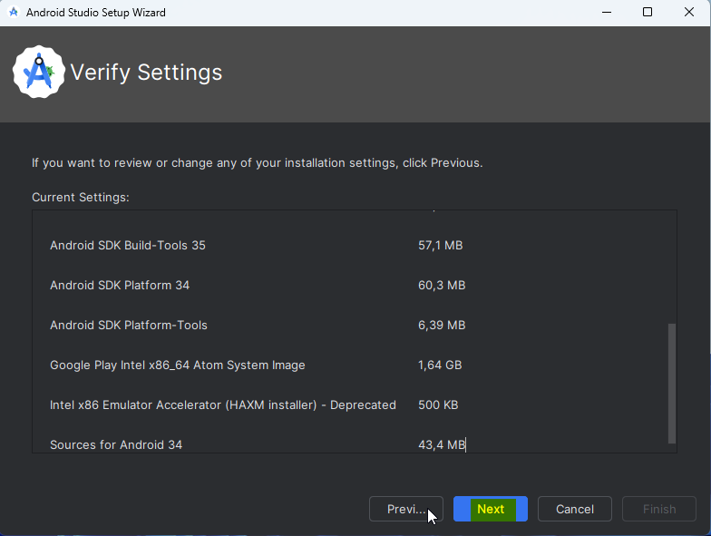
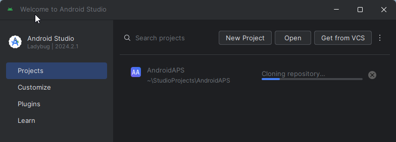
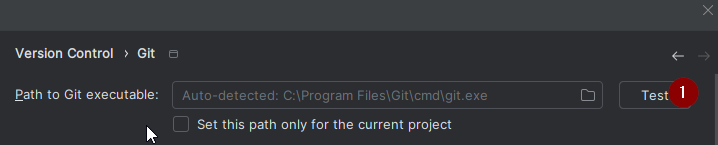
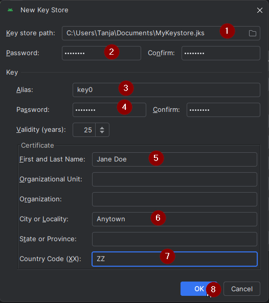
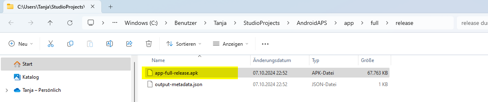

<!-- Android Studio Build, FKA Computer Build. Preserve filenames to avoid breaking URLs. -->

# Android Studio ile oluşturma

Bu, AAPS uygulamanızı oluşturmanın geleneksel yöntemidir.

[Tarayıcı ile oluşturma](./BrowserBuild.md) yöntemini kullanarak uygulamayı bilgisayar olmadan oluşturabilirsiniz.

## İndirmek yerine kendiniz oluşturun

**Tıbbi cihazlarla ilgili düzenlemeler nedeniyle AAPS uygulaması (bir apk dosyası) indirilemez. Uygulamayı kendi kullanımınız için oluşturmak yasaldır, ancak bir kopyasını başkasına vermemelisiniz!**

Ayrıntılar için [SSS sayfasına](../UsefulLinks/FAQ.md) bakın.

---

(Building-APK-recommended-specification-of-computer-for-building-apk-file)=
## AAPS'i oluşturmak için bilgisayar ve yazılım gereksinimleri

* Apk'yı oluşturmak için belirli bir **[Android Studio](https://developer.android.com/studio/)** sürümü gerekebilir. Aşağıdaki tabloya bakın:

| AAPS Sürümü             | Önerilen<br/>Android Studio<br/>Sürümü | Alternatif<br/>Android Studio<br/>Sürümü | Gradle | JVM |
| ----------------------- | -------------------------------------------------- | ---------------------------------------------------- | ------ |:--- |
| 2.6.2                   | 3.6.1                                              |                                                      | 5.6.4  | 11  |
| 2.8.2.1                 | 4.1.1                                              |                                                      | 6.1.1  | 13  |
| [3.1.0.3](#version3100) | 2020.3.1                                           | Quail 4'e kadar test edildi                          | 7.3.3  | 17  |
| [3.2.0.4](#version3204) | Hedgehog (2023.1.1)                                | Quail 4'e kadar test edildi                          | 8.2    | 17  |
| [3.3.1.3](#version3300) | Ladybug Feature Drop (2024.2.2)                    | Quail 4'e kadar test edildi                          | 8.10   | 21  |
| [3.3.2](#version3300)   | Meerkat (2024.3.1)                                 | Quail 4'e kadar test edildi                          | 8.11.1 | 21  |
| [3.3.2.1](#version3321) | Narwhal (2025.1.2)                                 | Quail 4'e kadar test edildi                          | 8.13   | 21  |
| [3.4.2.6](#version3426) | Panda 2 (2025.3.2)                                 | Quail 4'e kadar test edildi                          | 9      | 21  |
| [4.0.0](#version400)    | Rabbit 2 (2026.2.2)                                | En son                                               | 9.8    | 21  |

"Önerilen sürüm" uygun JVM sürümüyle birlikte gelir. Önerilen sürüm, **AAPS**'i oluşturmak için kullanabileceğiniz en düşük sürümdür. "Önerilen" sürümden daha eski bir sürümle oluşturma **YAPAMAZSINIZ**. Farklı bir sürüm kullanırsanız JVM sürümüyle ilgili sorunlarla karşılaşabilirsiniz. Bu sorunları çözmenize yardım etmesi için [Android Studio'da Sorun Giderme](#troubleshooting_androidstudio-uncommitted-changes) sayfasına bakın. Mevcut Android Studio sürümünüz tabloda yoksa önce onu güncellemelisiniz.

Gradle sürümü kaynak koda bağlıdır. Kaynak kodu indirirken / güncellerken her zaman doğru Gradle sürümünü alırsınız. Burada yalnızca bilgi için verilmiştir, bununla ilgili bir şey yapmanız gerekmez.

* [Windows 32 bit sistemler](#troubleshooting_androidstudio-unable-to-start-daemon-process) Android Studio tarafından desteklenmez. Lütfen unutmayın: **64 bit işlemci ve 64 bit işletim sistemi zorunlu koşuldur.** Sisteminiz bu koşulu KARŞILAMIYORSA ilgili donanımı veya yazılımı ya da tüm sistemi değiştirmeniz gerekir.

<table class="tg">
<tbody>
  <tr>
    <th class="tg-baqh">OS (Only 64 bit)</th>
    <td class="tg-baqh">Windows 10 veya üstü</td>
    <td class="tg-baqh">macOS 12 veya üstü</td>
    <td class="tg-baqh">Gnome, KDE veya Unity DE destekleyen herhangi bir Linux dağıtımı;&nbsp;&nbsp;GNU C Library (glibc) 2.31 veya üstü</td>
  </tr>
  <tr>
    <th class="tg-baqh"><p align="center">CPU (Only 64 bit)</th>
    <td class="tg-baqh"><a href="https://developer.android.com/studio/install" target="_blank" rel="noopener noreferrer">Sanallaştırma desteği</a> (Intel VT-x veya AMD-V) BIOS'ta etkin olan, 2017 veya daha yeni bir x86_64 işlemci (Intel 8. nesil Core i5, AMD Ryzen veya daha yenisi)</td>
    <td class="tg-baqh">Apple Silicon (M1 veya daha yenisi) ya da 6. nesil Intel Core veya daha yenisi (Intel Mac desteği aşamalı olarak kaldırılıyor)</td>
    <td class="tg-baqh">Sanallaştırma desteği (Intel VT-x veya AMD-V) BIOS'ta etkin olan, 2017 veya daha yeni bir x86_64 işlemci (Intel 8. nesil Core i5, AMD Ryzen veya daha yenisi)</td>
  </tr>
  <tr>
    <th class="tg-baqh"><p align="center">Bellek (RAM)</th>
    <td class="tg-baqh" colspan="3"><p align="center">16 GB veya daha fazla (8 GB yalnızca Android Studio için kesin en düşük değerdir, 32 GB önerilir)</td>
  </tr>
  <tr>
    <th class="tg-baqh"><p align="center">Disk</th>
    <td class="tg-baqh" colspan="3"><p align="center">En az 32 GB boş alan. SSD is recommended.</td>
  </tr>
  <tr>
    <th class="tg-baqh"><p align="center">Resolution</th>
    <td class="tg-baqh" colspan="3"><p align="center">En az 1280 x 800 (1920 x 1080 önerilir)<br></td>
  </tr>
  <tr>
    <th class="tg-baqh"><p align="center">Internet</th>
    <td class="tg-baqh" colspan="3"><p align="center">Broadband</td>
  </tr>
</tbody>
</table>

**HDD (Sabit Disk Sürücüsü) yerine SSD (Katı Hal Sürücüsü) kullanmanız kesinlikle önerilir (zorunlu değildir), çünkü AAPS apk dosyasını oluşturmak daha kısa sürer.**  **AAPS** apk dosyasını oluştururken yine de HDD kullanabilirsiniz. Bunu yaparsanız oluşturma işlemi uzun sürebilir, ancak bir kez başladıktan sonra işlemi kendi başına çalışır durumda bırakabilirsiniz.

## Oluşturma sırasında yardım ve destek

**AAPS** uygulamasını oluştururken zorluklarla karşılaşırsanız, bu konuya ayrılmış bir [**Android Studio'da sorun giderme**](../GettingHelp/TroubleshootingAndroidStudio.md) bölümü vardır; lütfen önce oraya bakın.

Oluşturma talimatlarında bir şeyin yanlış, eksik veya kafa karıştırıcı olduğunu düşünüyorsanız ya da hâlâ zorlanıyorsanız, lütfen [Facebook](https://www.facebook.com/groups/AndroidAPSUsers) veya [Discord](https://discord.gg/4fQUWHZ4Mw) üzerindeki diğer **AAPS** kullanıcı gruplarına ulaşın. Bir şeyi kendiniz değiştirmek isterseniz (ekran görüntülerini güncellemek _vb._), lütfen bir [pull request (PR)](../SupportingAaps/HowToEditTheDocs.md) gönderin.

## AAPS uygulamasını oluşturmak için adım adım kılavuz

```{admonition} WARNING
:class: warning
AAPS'i daha önce oluşturduysanız, aşağıdaki adımların hepsini yeniden yapmanız gerekmez.
Lütfen doğrudan [güncelleme kılavuzuna](../Maintenance/UpdateToNewVersion.md) geçin!
```

```{contents} The overall steps for building the **AAPS** apk file
:depth: 1
:local: true
```

Bu kılavuzda **AAPS** apk dosyasının oluşturulmasına ait _örnek_ ekran görüntüleri bulacaksınız. **AAPS** apk'sını oluşturmak için kullandığımız yazılım olan  **Android Studio** düzenli olarak güncellendiği için bu ekran görüntüleri sizin kurulumunuzla aynı olmayabilir, ancak yine de izlenebilir olmaları gerekir.

**Android Studio** Windows, Mac OS X ve Linux platformlarında çalıştığı için farklı platformlarda adımlar arasında küçük farklar da olabilir.

(install-git-if-you-dont-have-it)=
### Git'i yükleyin

```{admonition} Why Git? 
:class: dropdown

Git, bir “_Sürüm Kontrol Sistemi_” (Versioning Control System, VCS) olarak bilinir.\
Git, koddaki değişiklikleri izlemenizi ve başkalarıyla birlikte çalışmanızı sağlayan bir programdır. Git'i, **AAPS** kaynak kodunun bir kopyasını GitHub web sitesinden kendi bilgisayarınıza almak için kullanacaksınız. Ardından **AAPS** uygulamasını (apk) oluşturmak için bilgisayarınızda Android Studio'yu kullanacaksınız. 
```

(BuildingAaps-steps-for-installing-git)=
#### Git'i yükleme adımları

1.  **Git**'in zaten yüklü olmadığını kontrol edin. Bunu Windows arama çubuğuna “git” yazarak yapabilirsiniz – **“Git bash”** veya Git'in başka bir biçimini görürseniz Git zaten yüklüdür ve doğrudan [Android Studio'nun yüklenmesine](#Building-APK-install-android-studio) geçebilirsiniz:


2. Git yüklü değilse, sisteminiz için en son sürümü [**buradaki**](https://git-scm.com/downloads) "Download" bölümünden indirip yükleyin. Güncel her Git sürümü çalışmalıdır; sisteminize uygun sürümü seçin: Mac, Windows veya Linux.

**Mac kullanıcıları için not:** Git web sayfası, yüklemeye yardım etmesi için "homebrew" adlı ek bir programı yüklemeniz konusunda da size yol gösterir. Git'i homebrew ile yüklerseniz hiçbir tercihi değiştirmeniz gerekmez.

(Make_a_note_of_Git_path)=

* Yükleme sırasında "select destination location" (hedef konumu seçin) sorulduğunda, Git'in _nereye_ yüklendiğini (“**installation path**”, yükleme yolu) not edin; bir sonraki adımda bunu kontrol etmeniz gerekecek. "C:\Program Files\Git\cmd\git.exe" benzeri bir yol olacaktır

*  Git yüklemesinin birkaç adımında tüm varsayılan seçenekleri kabul etmeniz yeterlidir.

*  Yüklemeden sonra Git'in nereye yüklendiğini not etmeyi unuttuysanız şu şekilde bulabilirsiniz: bilgisayarın arama çubuğuna "git" yazın, "Git bash" üzerine sağ tıklayın, "open file location" (dosya konumunu aç) seçeneğini seçin ve fareyle "Git bash" simgesinin üzerine gelin; yüklendiği yer görünecektir.

* Bir sonraki adımdan önce bilgisayarınızı yeniden başlatın.

(Building-APK-install-android-studio)=
### Android Studio'yu yükleyin

- **Aşağıdaki adımlar sırasında sürekli çevrimiçi olmanız gerekir, çünkü Android Studio birkaç güncelleme indirir**

```{admonition} What is Android Studio?
:class: dropdown
Android Studio, bilgisayarınızda çalışan bir programdır. İnternetten kaynak kodu indirmenizi (Git kullanarak) ve akıllı telefon (ve akıllı saat) uygulamaları oluşturmanızı sağlar. Bilgisayarınızda Android Studio ile yeni veya güncellenmiş bir uygulama oluşturarak akıllı telefonunuzda çalışan, döngü yapan mevcut **AAPS** sürümünü "bozamazsınız"; bunlar tamamen ayrı işlemlerdir. 
```

Android Studio'yu yüklerken en önemli şeylerden biri **sabırlı olmaktır!** Yükleme ve kurulum sırasında Android Studio çok sayıda dosya indirir ve bu zaman alır.

```{admonition} Different UI
:class: warning
Önemli not: Android Studio son sürümlerde arayüzünü değiştirdi. Bu kılavuz adımları *yeni arayüz* ile gösterir. Ekran görüntüleri "Ladybug" ile alındı, bu yüzden daha yeni sürümler biraz farklı görünebilir. Hâlâ eski arayüzü kullanıyorsanız, önce [bu talimatları](#computerbuild-NewUI) izleyerek Android Studio'yu yeni arayüze geçirmek isteyebilirsiniz.
```

Android Studio sürümü çok önemlidir. Doğru Android Studio sürümünü seçmek için [yukarıdaki talimatlara](#Building-APK-recommended-specification-of-computer-for-building-apk-file) bakın.

[Android Studio'nun güncel sürümünü](https://developer.android.com/studio) veya [**Archives**](https://developer.android.com/studio/archive) (arşiv) sayfasından daha eski bir sürümü indirin ve indirme sözleşmelerini kabul edin.


İndirme bittiğinde, bilgisayarınıza yüklemek için indirilen uygulamayı başlatın. Windows'un indirilen uygulamalarla ilgili bazı uyarılarını kabul etmeniz/onaylamanız gerekebilir!

Aşağıdaki ekran görüntülerinde gösterildiği gibi "Next" (İleri) düğmesine tıklayarak Android Studio'yu yükleyin. Hiçbir ayarı değiştirmeniz **gerekmez**!


Disk alanından tasarruf etmek istiyorsanız Android Virtual Device (sanal Android cihazı) seçeneğinin işaretini kaldırabilirsiniz: **AAPS**'i oluşturmak için kullanılmaz.


Şimdi "Install" (yükle) düğmesine tıklayın:


Tamamlandığında "Next" (İleri) düğmesine basın


Son adımda, Android Studio'yu ilk kez başlatmak için "Finish"e tıklayın.


Android Studio'nun geliştirilmesine yardım etmek isteyip istemediğiniz sorulacaktır. İstediğiniz seçeneği seçin; bu, sonraki adımları etkilemez.


Karşılama ekranı sizi Android Studio kurulumuna davet eder. "Next" (İleri) düğmesine basın.


Kurulum türü olarak "Standard" (standart) seçin.


Ayarları yeniden "Next" (İleri) düğmesine tıklayarak onaylayın.



Şimdi lisans sözleşmelerini kabul etmeniz gerekiyor. Solda, sırayla seçmeniz gereken iki bölüm (1 + 3) vardır; her biri için sağda "Accept" (kabul et) (2 + 4) seçeneğini seçin.

Ardından "Finish" (bitir) (5) düğmesine tıklanabilir.


Şimdi bazı Android paketleri indirilecek ve yüklenecek. Sabırlı olun ve bekleyin.

Bittiğinde, yeniden "Finish" (bitir) seçeneğini seçebileceğiniz aşağıdaki ekranı göreceksiniz.


Şimdi Android Studio'nun karşılama ekranını göreceksiniz.


(Building-APK-download-AAPS-code)=
### AAPS kodunu indirin

```{admonition} Why can it take a long time to download the AAPS code?
:class: dropdown

**AAPS** ilk kez indirilirken Android Studio, **AAPS** kaynak kodunu indirmek için internet üzerinden Github web sitesine bağlanır. Bu yaklaşık 1 dakika sürer. 

Ardından Android Studio, bunları bilgisayarınızda oluşturmak için gereken diğer bileşenleri belirlemek üzere **Gradle**'ı (Android uygulamaları için bir geliştirme aracı) kullanır. 
```

Android Studio karşılama ekranında, solda "**Projects**" (projeler) (1) öğesinin vurgulandığını kontrol edin.

Ardından sağdaki "**Clone Repository**" (depoyu klonla) (2) düğmesine tıklayın:


Şimdi Android Studio'ya kodu nereden alacağını söyleyeceğiz:


* Solda (1) "Repository URL" (depo URL'si) seçili olmalıdır (varsayılan olarak).
* Sürüm kontrolü (2) olarak "Git" seçili olmalıdır (varsayılan olarak).
* Şimdi bu URL'yi kopyalayın:
    ```
    https://github.com/nightscout/AndroidAPS.git
    ```
    ve URL metin kutusuna (3) yapıştırın.

* Klonlanan kodun kaydedileceği (varsayılan) dizinin bilgisayarınızda zaten bulunmadığını kontrol edin (4). Bunu başka bir dizinle değiştirebilirsiniz, ancak lütfen nereye kaydettiğinizi unutmayın!
* Şimdi "Clone" (klonla) düğmesine (5) tıklayın.

```{admonition} INFORMATION
:class: note
Dizini not edin. Kaynak kodunuz orada saklanır!
```

Şimdi deponun klonlandığını bildiren bir ekran göreceksiniz:



Bir noktada Android Studio kapanıp yeniden açılacaktır. Projeye güvenmek isteyip istemediğiniz sorulabilir. "Trust project" (projeye güven) seçeneğine tıklayın:

  


Yalnızca Windows kullanıcıları için: Güvenlik duvarınız izin isterse erişim izni verin:

 

After the repository is cloned successfully, Android Studio will open the cloned project.

(computerbuild-NewUI)=
```{admonition} New UI
:class: note
Android Studio kısa süre önce arayüzünü değiştirdi. Android Studio'nun yeni kurulumları varsayılan olarak yeni arayüzü kullanır!

Yalnızca Android Studio'nuz farklı görünüyorsa yeni arayüze geçmeniz gerekebilir:
Sol üstteki hamburger menüye tıklayın, ardından **Settings**'i (Apple bilgisayarlarda **Preferences**'ı) seçin.
**Appearance & Behavior** (görünüm ve davranış) içinde **New UI**'a gidin ve **Enable new UI** (yeni arayüzü etkinleştir) kutusunu işaretleyin. Ardından kullanmaya başlamak için Android Studio'yu yeniden başlatın.

**New UI** seçeneğini bulamazsanız endişelenmeyin: zaten yeni arayüzü kullanıyorsunuz!
```


Android Studio açıldığında sabırla bekleyin (bu birkaç dakika sürebilir) ve özellikle açılır pencerede önerildiği gibi projeyi **güncellemeyin**.

Android Studio otomatik olarak bir "Gradle project sync" (gradle senkronizasyonu) başlatır; bunun bitmesi birkaç dakika sürer. Hâlâ çalıştığını görebilirsiniz:


```{admonition} NEVER UPDATE GRADLE!
:class: warning

Android Studio, gradle sistemini güncellemenizi önerebilir. **Gradle'ı asla güncellemeyin!** Bu sorunlara yol açar.
```

Yalnızca Windows bilgisayarlarda: Windows Defender'ın çalıştığına dair bir bildirim alabilirsiniz: **Automatically** (otomatik olarak) seçeneğine tıklayın ve onaylayın, bu oluşturmayı hızlandırır!


Gradle senkronizasyonunu çalışır durumda bırakıp sonraki adımlara şimdiden geçebilirsiniz.

(Building-APK-set-git-path-in-preferences)=
### Android Studio tercihlerinde Git yolunu ayarlayın

Şimdi Android Studio'ya, [daha önce](#install-git-if-you-dont-have-it) yüklediğiniz Git'i nerede bulacağını söyleyeceğiz.

* Yalnızca Windows kullanıcıları: [Git'i yükledikten](#install-git-if-you-dont-have-it) sonra bilgisayarınızı yeniden başlattığınızdan emin olun. Yapmadıysanız şimdi yeniden başlatın ve Android Studio'yu yeniden açın

**Android Studio**'nun sol üst köşesinde hamburger menüyü açın ve **File** > **Settings** (Windows'ta) veya **Android Studio** > **Preferences** (Mac'te) yoluna gidin. Bu, aşağıdaki pencereyi açar. **Version Control** (sürüm kontrolü) (1) adlı açılır listeyi genişletmek için tıklayın ve **Git** (2) öğesini seçin


"Test" düğmesine (1) tıklayarak **Android Studio**'nun doğru **Path to Git executable** (Git programının yolu) değerini otomatik olarak bulup bulamadığını kontrol edin:




Otomatik ayar başarılı olursa, **Git**'in mevcut sürümü yolun yanında gösterilir.

   


**git.exe** otomatik olarak bulunamazsa veya "Test" düğmesine tıklamak bir hatayla sonuçlanırsa şunları yapabilirsiniz:
* [daha önce](#BuildingAaps-steps-for-installing-git) kaydettiğiniz yolu elle girebilir veya
* klasör simgesine (1) tıklayın ve **git.exe**'nin [daha önce](#BuildingAaps-steps-for-installing-git) yüklendiği dizine elle gidin
* Ayarlarınızı **Test** düğmesiyle doğrulayın!

  

(Building-APK-generate-signed-apk)=
### İmzalı ("signed") AAPS APK'sını oluşturun

```{admonition} Why does the AAPS app need to be "signed"?
:class: dropdown

Android, her uygulamanın _imzalanmasını_ ister. Böylece uygulama daha sonra yalnızca orijinal uygulamayı yayınlayan aynı güvenilir kaynaktan güncellenebilir. Bu konu hakkında daha fazla bilgi için [bu bağlantıyı](https://developer.android.com/studio/publish/app-signing.html#generate-key) izleyin. 

Bizim amacımız için bu yalnızca şu anlama gelir: bir imzalama dosyası, yani "anahtar deposu" (keystore) dosyası oluştururuz ve **AAPS** uygulamasını oluştururken bunu kullanırız.
```


**Önemli: Devam etmeden önce gradle senkronizasyonunun başarıyla bittiğinden emin olun!**


Menü çubuğunu açmak için sol üstteki hamburger menüye tıklayın. **Build** (1) öğesini, ardından **Generate Signed App Bundle / APK** (2) öğesini seçin


"Android App Bundle" yerine "APK" (1) seçeneğini seçin ve "Next" (ileri) (2) düğmesine tıklayın:


Sonraki ekranda "Module" değerinin "AndroidAPS.app" (1) olarak ayarlandığından emin olun. ".app" öncesindeki kısım, kodu klonladığınız klasörün adıdır.

(Building-APK-wearapk)=
```{admonition} INFORMATION!
:class: note
Saatiniz için apk oluşturmak istiyorsanız, şimdi AndroidAPS.wear'ı seçmeniz gerekir!
```


"Create new..." (yeni oluştur) seçeneğine tıklayın (2) ve anahtar deponuzu oluşturmaya başlayın.

```{admonition} INFORMATION!
:class: note
Anahtar deposunu yalnızca bir kez oluşturmanız gerekir.
AAPS'i daha önce oluşturduysanız yeni bir anahtar deposu OLUŞTURMAYIN; mevcut anahtar deponuzu seçin ve parolalarını girin!
```

**_Not:_** Anahtar deposu (key store), uygulamayı imzalamak için gereken bilgilerin saklandığı bir dosyadır. Şifrelenmiştir ve bilgiler parolalarla korunur.



* Bilgisayarınızda anahtar deponuz için bir yol seçmek üzere "klasör" simgesine (1) tıklayın.

  Kaynak kodunuzu sakladığınız dizini **kullanmayın**; bunun yerine yeni bir bilgisayara da taşıyacağınız bir dizin kullanın.

```{admonition} WARNING!
:class: warning
Anahtar deponuzun nerede saklandığını kendiniz için not etmeyi unutmayın. Bir sonraki AAPS güncellemesini oluştururken buna ihtiyacınız olacak!
```

* Şimdi basit bir parola seçin (ve not edin), parola kutusuna (2) girin ve onaylayın (2).

  Anahtar deposu ve anahtar parolalarının karmaşık olması gerekmez. İleride parolanızı kaybederseniz [Yeni bir anahtar deposuyla AAPS'i yeniden yükleme](#reinstall-aaps) bölümüne bakın.

```{warning}
**Parolalarınızda özel karakterler kullanmayın.** Anahtar deposu ve anahtar parolaları için yalnızca harf ve rakam kullanın. Özellikle `$`, ters tırnak (backtick), `"` veya `\` kullanmayın. Daha sonra [Tarayıcı ile oluşturma](#aaps-ci-option2) yöntemine geçer ve bu anahtar deposunu yeniden kullanırsanız, bu karakterler imzalama adımının başarısız olmasına neden olabilir; bkz. [Tarayıcı ile oluşturma: sorun giderme](#aaps-ci-password-special-characters).
```

* Anahtarınızın varsayılan takma adı (alias) (3) "key0"dır; bunu değiştirmeyin.

* Şimdi anahtarınız için bir parolaya ihtiyacınız var. İşi basit tutmak için isterseniz yukarıda anahtar deponuz için kullandığınız parolanın aynısını kullanabilirsiniz. Bir parola (4) girin ve onaylayın.

```{admonition} WARNING!
:class: warning
Bu parolaları not edin! Bir sonraki AAPS güncellemesini oluştururken bunlara ihtiyacınız olacak!
```

* Geçerlilik süresi varsayılan olarak 25 yıldır; olduğu gibi bırakın.

* Adınızı ve soyadınızı (5) girin. Başka bilgi eklemeniz gerekmez, ancak isterseniz ekleyebilirsiniz (6-7).

* Devam etmek için "OK" (Tamam) (8) düğmesine tıklayın:


**Generate signed App Bundle or APK** sayfasında artık anahtar deponuzun yolu gösterilir. Şimdi Key Store password (anahtar deposu parolası) (1) ve Key password (anahtar parolası) (2) alanlarına parolaları yeniden girin ve parolaları hatırlamak için kutuyu (3) işaretleyin; böylece apk'yı bir sonraki oluşturuşunuzda (ör. yeni bir AAPS sürümüne güncellerken) bunları yeniden girmeniz gerekmez. "Next" (İleri) (4) düğmesine tıklayın:


Sonraki ekranda "fullRelease" (1) oluşturma varyantını seçin ve "Create" (oluştur) (3) düğmesine tıklayın. (2)'de gösterilen hedef klasörü hatırlamalısınız, çünkü oluşturduğunuz apk dosyasını daha sonra orada bulacaksınız!

   

Android Studio şimdi **AAPS** apk'sını oluşturacak. Sağ altta "Gradle Build running" (gradle oluşturma çalışıyor) (2) yazısı görünür. İşlem, bilgisayarınıza ve internet bağlantınıza bağlı olarak biraz zaman alır, bu yüzden **sabırlı olun!** Oluşturmanın ilerlemesini izlemek isterseniz Android Studio'nun altındaki küçük çekiç simgesine, "build"e (1) tıklayın:


Şimdi oluşturmanın ilerlemesini izleyebilirsiniz:


Oluşturma bittiğinde Android Studio "BUILD SUCCESSFUL" (oluşturma başarılı) bilgisini gösterir. "locate" (bul) seçeneğini seçmek için tıklayabileceğiniz bir açılır bildirim görebilirsiniz. Bunu kaçırırsanız, bildirimleri açmak için bildirim simgesine (1), ardından **locate** (bul) (2) bağlantısına tıklayın:


**_Oluşturma başarılı olmadıysa [Android Studio'da Sorun Giderme bölümüne](../GettingHelp/TroubleshootingAndroidStudio.md) bakın._**

Bildirimler kutusunda mavi "locate" (bul) bağlantısına tıklayın:

 Dosya yöneticiniz açılır ve az önce oluşturduğunuz apk dosyasını gösterir.

   

Tebrikler! Artık **AAPS** apk dosyasını oluşturdunuz. Dokümantasyonun bir sonraki bölümünde bu dosyayı akıllı telefonunuza aktaracaksınız.

```{tip}
İleride bir Android Wear akıllı saat kullanmak isteyebileceğinizi düşünüyorsanız, AAPS apk'nızla uyumlu olduğundan emin olmak için AAPS Wear apk'sını oluşturmanın en iyi zamanı şimdidir.
```

[**AAPS**'i aktarma ve yükleme](../SettingUpAaps/TransferringAndInstallingAaps.md) adlı sonraki aşamaya geçin.


