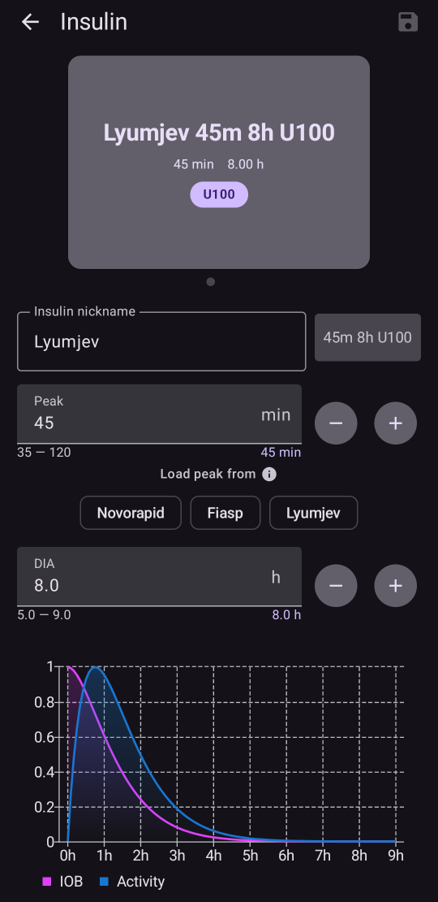
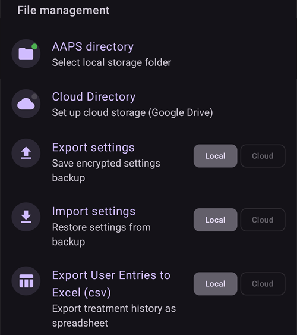

# Konfigürasyon (Config Builder)

```{admonition} AAPS v3'ten mi geliyorsunuz? :class: note **Config Builder** artık **Konfigürasyon** olarak adlandırılıyor ve **menü**de (☰) bulunuyor. Bkz. [AAPS v4'te neler değişti](#v4-changes).

    <br />**Konfigürasyon**, hangi eklentilerin etkin olacağını (CGM, pompa, APS algoritması, duyarlılık, senkronizasyon, …) seçtiğiniz ve her eklentiyi ve ayarlarını açtığınız yerdir. [Adım adım anlatım](#configuration-v4) aşağıdadır; bu sayfanın geri kalanı her bölümü ayrıntılı olarak açıklar.
    
    (configuration-v4)=
    ## AAPS v4'te Konfigürasyon
    
    **AAPS** v4'te ana ekranın **sol üst** köşesindeki **menü**ye (☰) dokunun ve **Konfigürasyon**'u seçin (*“Yapılandırmanızı (CGM, pompa, ...) ayarlayın ve özellikleri etkinleştirin”*).
    
    
    
    Eklentiler **kategori**lere göre gruplanmıştır — örneğin *Yumuşatma*, *Kalibrasyon*, *Duyarlılık algılaması*, *APS*, *İletişim* ve *Genel*. Her satır kategori adını ve **şu anda etkin** olan eklentiyi gösterir (ör. *APS → OpenAPS SMB*). Bir kategoriyi açmak için satıra dokunun.
    
    
    
    Bir kategorinin içinde o kategori için kullanılabilen eklentileri görürsünüz. Tek seçimli kategorilerde etkin olanı seçersiniz; bazı kategoriler çoklu seçimlidir (*“Geçerli olanların tümünü seçin.”*). Her eklenti iki eylem sunar:
    
    - **Eklentiyi aç** — eklentinin kendi ekranını açar.
    - **Ayarlar** — eklentinin tercihlerini açar (ayarlar genişletilebilir bölümler halinde gruplanmış olabilir).
    
    
    
    (configuration_sync_icon)=
    ### Telefon simgesi — “ana birimden senkronize edilir”
    
    Bir kategorinin veya ayarın yanındaki küçük **telefon simgesi**, o öğenin **ana birimden senkronize edildiği** anlamına gelir — değeri/seçimi bu cihaza NSClientV3 (Nightscout) kanalı üzerinden iletilir.
    
    Bir **istemcide** (**AAPSClient**) bu öğeler **ana birimle senkronize tutulur**. Simge yalnızca istemcide gösterilir, bu yüzden ana **AAPS** uygulamasında alınan yukarıdaki ekran görüntüsünde görünmez. İstemcide genellikle *Yumuşatma*, *Kalibrasyon*, *Duyarlılık algılaması* ve *APS* üzerinde görünür. Ana birim ile istemcilerin nasıl uyumlu kaldığı ve hangi ayarları hangi taraftan değiştirebileceğiniz [Ana birim ↔ İstemci kontrolü](#client-master-config-prefs) bölümünde anlatılır.
    
    Aynı simge **ayarların içinde** de, senkronize edilen tek tek tercihlerin yanında görünür. Aşağıdaki örnekte *Emilim kesme* ayarında bu simge vardır; simgesi olmayan ayarlar her cihazda ayrı ayrı yapılandırılır:
    
    
    
    Simgesi **olmayan** öğeler **her cihazda ayrı ayrı** yapılandırılır. En önemli örnek **NSClientV3 (İletişim)** bağlantısının kendisidir — **Nightscout URL**'si, **erişim belirteci** ve **websocket'ler** her telefonda ayrı ayrı ayarlanır, bu yüzden bunlarda telefon simgesi **görünmez**.
    
    ---
    
    (Config-Builder-tab-or-hamburger-menu)=
    ## Bir eklenti ekranını açma
    
    Her eklenti ekranı şu yollardan biriyle açılır (**AAPS** v3'teki sekmeler ve göz onay kutusu artık yok, bkz. [AAPS v4'te neler değişti](#v4-changes)):
    
    - **Konfigürasyon** → eklentinin kategorisi → **Eklentiyi aç**,
    - en çok kullandığınız ekranlar için alt gezinme çubuğundaki **Yönet** paneli (Profil, İnsülin ayarları, Pompa, Otomasyon, Yiyecek...),
    - kendiniz eklediğiniz bir [Hızlı Başlatma](../DailyLifeWithAaps/QuickLaunch.md) düğmesi,
    - ana ekrandaki **arama çubuğu**.
    
    ```{contents}
    :backlinks: entry
    :depth: 2
    

(ConfigBuilder_Profile)=

## Profile

Bu modül **AAPS**'in temel bir parçası olduğu için devre dışı bırakılamaz.

**Profil**inizin içinde neler olduğunu temel olarak anlamak için [AAPS profiliniz](../SettingUpAaps/YourAapsProfile.md) sayfasına bakın.

(insulin)= (Config-Builder-insulin)=

## İnsülin


**AAPS** 4'te insülin artık **Konfigürasyon**'da seçilen bir eklenti değildir. Kullandığınız insülini ayarlamak için **Yönet → İnsülin ayarları**'nı açın.

İnsülin düzenleyicisinde şunları yapabilirsiniz:

* kolayca tanınması için insüline bir **İnsülinin takma adı** verin,
* değeri yazarak veya **–** / **+** düğmelerini kullanarak **Tepe** (en yüksek insülin etkisine kadar geçen süre, dakika olarak) ve **İES** (İnsülin Etki Süresi, saat olarak) değerlerini ayarlayın,
* o insülinin standart tepe zamanını tek adımda doldurmak için bir **Tepe değerini şuradan yükle** ön ayar düğmesine dokunun — **Novorapid** (75 dk), **Fiasp** (55 dk) veya **Lyumjev** (45 dk).

İzin verilen aralıklar, hangi insülini kullanırsanız kullanın aynıdır:

* **İES**: 5 ila 9 saat (hasta tipi **Hamile** olarak ayarlanmışsa 5 ila 10 saat). Bir değer seçmek için [İnsülin etki süresi (İES) ve tepe](#Config-Builder-insulin-dia) bölümüne bakın.
* **Tepe**: 35 ila 120 dakika.

Düzenleyicinin altında gösterilen **AİNS** (aktif insülin) ve **Aktivite** eğrileri, değerleri değiştirdikçe güncellenir. Böylece ayarlarınızın insülin etkisini nasıl şekillendirdiğini hemen görebilirsiniz.

**AAPS**'te gösterilen insülin profilini anlamak için daha fazla bilgiyi [burada](#AapsScreens-insulin-profile) bulabilirsiniz.

(Config-Builder-insulin-change-active)=

### Kullanılan insülini değiştirme (İES veya tepe)

**AKTİF** olarak işaretlenen insülin, çalışan profilinizin kullandığı insülindir. Alanları gri renktedir: onu düzenleyemez veya silemezsiniz. Bu sayede çalışan profilinizde gösterilen insülin adı her zaman gerçekten kullanılan ayarlarla eşleşir.

Kullandığınız İES veya tepe değerini değiştirmek için:

1. **Yönet → İnsülin ayarları**'nı açın. Ekran salt okunur açılırsa (üst çubukta bir **✏️ kalem**), kaleme dokunun ve ayarlarınızın kilidini açın.
2. **+** (*Yeni insülin ekle*) düğmesine dokunun. **AAPS** ekranda gösterilen insülinin bir kopyasını oluşturur.
3. Yeni **Tepe** ve/veya **İES** değerini ayarlayın, ardından kaydet simgesine (sağ üst) dokunun.
4. **▶** (*İnsülini etkinleştirin*) düğmesine dokunun ve onaylayın. Yeni insülin **AKTİF** olur.

```{admonition} Ad, tepe ve İES değerlerini içerir :class: note **AAPS**, yapılandırmalarınızı bir bakışta ayırt edebilmeniz için tepe, İES ve konsantrasyon değerlerini insülin adına otomatik olarak ekler (örneğin *Fiasp 55m 8h U100*).

    <br />Eski insülin artık aktif değilse onu silebilirsiniz.
    
    ### "Tepe değerini şuradan yükle" ön ayarları
    
    **AAPS** 4'te seçilebilecek bir insülin türleri listesi yoktur. Her insülin aynı üstel aktivite eğrisini kullanır; yalnızca **Tepe** ve **İES** değerleri farklıdır. İnsülin düzenleyicisindeki **Tepe değerini şuradan yükle** ön ayarları, en yaygın insülinler için önerilen tepe değerini tek dokunuşla doldurur (**Tepe değerini şuradan yükle** yanındaki küçük ⓘ, bunları tepe değerleriyle birlikte listeler). Ardından **Tepe** ve **İES** değerlerini yine de ayarlayabilirsiniz.
    
    Tepe değerini önerilen değerden yalnızca bunun etkisini anlıyorsanız değiştirin. [İnsülin eğrisi grafiği](#AapsScreens-insulin-profile) eğrileri anlamanıza yardımcı olur.
    
    #### Novorapid
    
    
    
    * Humalog, Novolog ve Novorapid için önerilir (**AAPS** v3'te *Rapid-Acting Oref* olarak adlandırılıyordu)
    * Tepe = enjeksiyondan 75 dakika sonra
    
    #### Fiasp
    
    
    
    * Fiasp için önerilir (**AAPS** v3'te *Ultra-Rapid Oref* olarak adlandırılıyordu)
    * Tepe = enjeksiyondan 55 dakika sonra
    
    (Config-Builder-lyumjev)=
    #### Lyumjev
    
    
    
    * Lyumjev için önerilir
    * Tepe = enjeksiyondan 45 dakika sonra
    
    #### Özel tepe
    
    * **AAPS** 4'te ayrı bir "Free-Peak Oref" insülin türü yoktur: herhangi bir **Tepe** değerini (35 ila 120 dakika) bir ön ayar kullanmadan doğrudan [insülin düzenleyicisine](#Config-Builder-insulin) girin.
    * Özel tepe, listede olmayan bir insülin veya farklı insülinlerin bir karışımını kullanıyorsanız işe yarar.
    
    (Config-Builder-insulin-dia)=
    ### İnsülin etki süresi (İES) ve tepe
    
    ```{warning}
    Döngü kullanırken İES veya tepe değerini azaltmak her zaman verilen insülini artırır. İES, AAPS'te ticari AID sistemlerinden farklı çalışır. Bu ayarlarda dikkatsizce yapılan değişiklikler, insülin dozunu beklenenden çok daha fazla veya çok daha az değiştirebilir.
    

AAPS, insülin etkisinin zaman çizelgesini **İES** ve onunla yakından ilişkili **tepe** ayarlarıyla yapılandırılan matematiksel bir formülle modeller. İES, AİNS'in sıfıra ulaşmasına kadar geçen teorik süredir; tepe ise insülin etkisinin en güçlü olduğu zaman noktasıdır. Bundan bir AİNS eğrisi ve bir aktivite eğrisi elde edilir. Aktivite eğrisi basitçe AİNS azalmasının **hızıdır**.

AAPS döngü yaparken [sıfır geçici bazal](#Open-APS-features-super-micro-bolus-smb) dönemlerinin olmasının normal olduğunu göz önünde bulundurun. Bu eksik bazal insülin AİNS'ten tamamen çıkarılır. Bu yüzden AİNS pratikte yapılandırılan İES'ten saatlerce önce sıfıra ulaşır. [Bolus AİNS ve bazal AİNS](#aaps-screens-iob-cob-basal-sens) değerlerini ana ekrandan ayrı ayrı inceleyebilirsiniz.

İES ve tepe değerini yapılandırmak için ana ekranda **Yönet**'e, ardından **İnsülin ayarları**'na dokunun. AAPS etkin insülin yapılandırmasını şöyle gösterir:


Bu örnekte tepe ayarı 55 dakika, İES 8 saat ve [insülin konsantrasyonu](#Insulin-Concentration) standart 100 IU/mL'dir.

Yukarıda açıklanan sıfır geçici bazal etkisi ve AAPS'te AİNS azalması için kullanılan formül nedeniyle, çoğu kullanıcı ticari sistemlere göre belirgin şekilde daha yüksek bir İES ayarlar. Genel olarak birçok kişi 9 saatlik bir **İES** değerinin kendileri için iyi çalıştığını görür. AAPS ile daha fazla deneyim kazandıktan ve profiliniz iyi ayarlandıktan sonra, aşağıdaki bilgilerle kişisel İES ve tepe ayarlarını bulmayı deneyebilirsiniz.

````{admonition} İES ve tepe yapılandırmasının etkisiyle ilgili ayrıntılar :class: dropdown

AAPS'te bazal oranın AİNS azalması üzerinde dolaylı bir etkisi olduğundan, çok yüksek bazal oranlar çok yüksek bir İES'i gizleyebilir ve bunun tersi de geçerlidir. İES ve tepe değerini ayarlamadan önce bazal oranları dikkatle ayarlamak mantıklıdır. Ayrıca İES ve tepe ayarlarının birbirini etkilediğini göz önünde bulundurun: İES'in etkisi tepe değerine bağlıdır ve bunun tersi de geçerlidir.

Bu grafikler, izin verilen değer aralığında İES ve tepe değerinin AİNS eğrileri üzerindeki etkisini tam olarak gösterir.

İES'i ayarlama:

```{image} ../images/iob_remaining_static_peak.png :width: 400px

    <br />Tepeyi ayarlama:
    
    ```{image} ../images/iob_remaining_static_dia.png
    :width: 400px
    

Son olarak, İES ve tepe değerinin birlikte ayarlandığı bir karşılaştırma. Buradaki mantık, iki değerin de aynı oranda ayarlanmasıdır, yani `49/35 ~ 7/5`. Ya da benzer şekilde `120/93 ~ 9/7`. Göreli değişiklik ikisi için de aynı olduğu sürece, başlangıçtaki İES veya tepe değeri ne olursa olsun aralıklar tutarlı kalır.

```{image} ../images/iob_remaining_uniform.png :width: 400px

    <br />İES ve tepe bu şekilde ayarlandığında eğrideki her noktanın aynı göreli miktarda kaydığına dikkat edin.
    
    ````
    
    #### İES ve tepe yapılandırmasıyla ilgili ek okumalar
    
    * [AAPS'in öncülü OpenAPS'ten teknik ayrıntılar ve tarihsel arka plan](https://openaps.readthedocs.io/en/latest/docs/While%20You%20Wait%20For%20Gear/understanding-insulin-on-board-calculations.html#understanding-the-new-iob-curves-based-on-exponential-activity-curves).
    * Diabettech'te [Why we are regularly wrong in the duration of insulin action (DIA) times we use, and why it matters…](https://www.diabettech.com/insulin/why-we-are-regularly-wrong-in-the-duration-of-insulin-action-dia-times-we-use-and-why-it-matters/) (Kullandığımız insülin etki süresi (İES) değerlerinde neden sık sık yanılıyoruz ve bu neden önemli).
    * See My CGM'de (arşiv) [Exponential Insulin Curves + Fiasp](https://web.archive.org/web/20220630154425/http://seemycgm.com/2017/10/21/exponential-insulin-curves-fiasp/) (Üstel insülin eğrileri + Fiasp).
    * Bionic Wookie'de [Revised Humalog model in a closed loop](https://bionicwookiee.com/2022/04/13/revised-humalog-model-in-a-closed-loop/) (Kapalı döngüde revize edilmiş Humalog modeli) ve Lyumjev, Fiasp, NovoRapid, Humalog için 9 saatlik bir İES öneren diğer makaleler.
    
    (Config-Builder-bg-source)=
    ## KŞ kaynağı
    Kullandığınız kan şekeri kaynağını seçin. Daha fazla kurulum bilgisi için [KŞ kaynağı](../Getting-Started/CompatiblesCgms.md) sayfasına bakın.
    
    
    
    Diğer kaynakları görmek için aşağı kaydırın:
    
    
    
    
    
    * [xDrip+ KŞ](../CompatibleCgms/xDrip.md) - [Juggluco](../CompatibleCgms/Juggluco.md) gibi uyumlu uygulamalar için de
    * [NSClient KŞ](../CompatibleCgms/CgmNightscoutUpload.md) - yalnızca ne yaptığınızı biliyorsanız, bkz. [KŞ kaynağı](../Getting-Started/CompatiblesCgms.md).
    * [MM640g](../CompatibleCgms/MM640g.md)
    * Glimp - yalnızca 4.15.57 ve daha yeni sürümler desteklenir
    * [BYODA (Build Your Own Dexcom App)](#DexcomG6-if-using-g6-with-build-your-own-dexcom-app).
    * MicroTech CGM uygulaması - Aidex / LinX CGM için
    * [Poctech](../CompatibleCgms/PocTech.md)
    * Tomato (MiaoMiao) - MiaoMiao cihazı için Tomato uygulaması
    * [Glunovo](https://infinovo.com/) - Glunovo CGM sistemi için Glunovo uygulaması
    * Intelligo - Intelligo uygulaması
    * Syai/Ottai - Syai ve Ottai uygulamaları için (bkz. [Syai Tag](../CompatibleCgms/SyaiTagX1.md) ve [Ottai](../CompatibleCgms/OttaiM8.md))
    * SI Uygulaması - Sibionics CGM için yamalı SI App veya Sibionics App
    * Sino uygulaması - Sinocare CGM için yamalı uygulama
    * Bildirim okuyucu - resmi CGM uygulamalarının (Dexcom, Medtronic, Eversense vb.) gösterdiği bildirimlerden glikoz değerlerini okur
    * Instara - Instara uygulaması
    * Rastgele KŞ - test için rastgele KŞ verileri oluşturur. Yalnızca **Sanal pompa** ile birlikte bir mühendislik (geliştirici) sürümünde etkinleştirilebilir. Bu yüzden normal bir **AAPS** kurulumunda kullanılamaz.
    
    ## Yumuşatma
    
    
    
    Bkz. [Kan şekeri verilerini yumuşatma](../CompatibleCgms/SmoothingBloodGlucoseData.md).
    
    ## Kalibrasyon
    
    **AAPS**'in sensörünüzden aldığı değerleri nasıl işleyeceğini seçin:
    
    - **Kalibrasyon yok**: sensör değerleri olduğu gibi kullanılır. Sensör zaten fabrikada kalibre edilmişse ve doğruysa bunu kullanın. Bu varsayılan ayardır.
    - **Doğrusal kalibrasyon**: **AAPS**, sensör değerlerini parmak ucu ölçümlerinizden hesapladığı bir eğim ve ofset ile düzeltir.
    
    **Doğrusal kalibrasyon** nasıl kullanılır:
    
    1. **Kalibrasyon** kategorisinde **Doğrusal kalibrasyon**'u seçin.
    2. Yeni bir sensör taktığınızda sensör değişimini kaydedin: kalibrasyon ekranında **Sensör değişimini kaydet**'i kullanın veya Careportal'da bir CGM sensör yerleştirme kaydı girin. Bu, **AAPS**'e sensör oturumunun ne zaman başladığını bildirir. **AAPS** değerlerde 30 dakikadan uzun bir boşluk fark ederse, sizden bir sensör değişimini işaretlemenizi isteyebilir; bu soru yalnızca ana birimde görünür, istemcide görünmez.
    3. Eklentiyi açın ve **Kalibrasyon ekle**'ye dokunun. Parmak ucu ölçüm değerinizi girin. **AAPS** bu değeri son 10 dakikadaki sensör değeriyle eşleştirir.
    
    Bir kalibrasyon yalnızca şu durumlarda kabul edilir:
    
    - bir sensör değişimi kaydedilmişse ve o zamandan beri en az **2 saat** geçmişse (ısınma),
    - glikozunuz sabitse. Çok hızlı değişiyorsa, iletişim kutusu bunu size söyler ve sınırı gösterir,
    - son 10 dakikadan bir CGM değeri varsa,
    - değer şimdiki an içinse. Daha eski parmak ucu değerlerini giremezsiniz.
    
    Düzeltme nasıl çalışır:
    
    - **AAPS**, mevcut sensörün değer çiftlerinden geçen düz bir çizgi çizer: `corrected value = slope × sensor value + offset`.
    - Yeni çiftler eski çiftlerden daha fazla sayılır: 2 günlük bir çift yaklaşık %37, 4 günlük bir çift yaklaşık %14 oranında sayılır. Bu nedenle çizgi, sensörünüz kaydıkça onu takip eder.
    - En az **2 çift** gerekir.
    - Çiftler birbirine yakınsa (aralarındaki fark 54 mg/dL / 3 mmol/L'den azsa), yalnızca değerler kaydırılır (offset, eğim yok).
    - Eğim 0,55 ile 1,6 arasında tutulur. Bu aralığın dışındaki bir eğim en yakın değerle sınırlanır.
    - Güvenlik sınırı: 100 mg/dL (5,5 mmol/L) değerindeki düzeltme ±30 mg/dL'den (1,7 mmol/L) fazla olacaksa düzeltme uygulanmaz. Bu sizi yanlış bir girişten korur.
    
    Neyi değiştirir:
    
    - Düzeltilmiş değer her yerde kullanılır: ana ekrandaki KŞ, grafik ve döngü. Sensör değerlerinin kendisi değiştirilmez. Düzeltme bunların üzerine uygulanır; mevcut sensörün daha önceki değerlerine de.
    - Yeni bir sensör değişimi sıfırdan başlar. Önceki sensörlerin çiftleri artık sayılmaz.
    - Grafikte bir kalibrasyon, parmak ucu değerinde bir işaret olarak gösterilir.
    - Kalibrasyonlar Nightscout üzerinden senkronize edilir, böylece istemcileriniz aynı düzeltilmiş değerleri gösterir.
    
    Girişleri kontrol edin ve kaldırın:
    
    - **Eklentiyi aç** durumu (örneğin *Eğim 0.85, orta aralık düzeltmesi -0.4*), çiftlerinizin çizgiyle birlikte bir grafiğini ve giriş listesini gösterir.
    - Bir giriş yanlışsa (örneğin parmağınızda şeker varsa), yanındaki çöp kutusu simgesine dokunun. Çizgi hemen yeniden hesaplanır.
    
    ```{admonition} KŞ kaynağı olarak xDrip+ mı kullanıyorsunuz?
    :class: note
    xDrip+'ın kendi kalibrasyonu vardır. Sensör değerlerinin iki kez düzeltilmemesi için yalnızca tek bir yerde kalibrasyon yapın.
    

    {admonition} Dikkatli kalibre edin
    :class: warning
    Yanlış bir parmak ucu değeri, yanlış glikoz değerlerine ve dolayısıyla yanlış insülin dozlarına yol açar. Ölçümden önce ellerinizi yıkayın ve glikozunuz hızla değişirken kalibrasyon yapmayın.


(Config-Builder-pump)=

## Pump

Select the pump you are using. Daha fazla kurulum bilgisi için [Uyumlu pompalar](../Getting-Started/CompatiblePumps.md) sayfasına bakın.


Tüm pompa sürücülerini görmek için aşağı kaydırın:


Başka bir pompa seçtiğinizde **AAPS** sizden değişikliği onaylamanızı ister:


* [Dana R](../CompatiblePumps/DanaR-Insulin-Pump.md)
* Dana R Korean (Kore'de satılan DanaR pompası için)
* Dana Rv2 (resmi olmayan üretici yazılımı yükseltmesi yapılmış DanaR pompası)
* [Dana-i/RS](../CompatiblePumps/DanaRS-Insulin-Pump.md)
* [Accu Chek Insight](../CompatiblePumps/Accu-Chek-Insight-Pump.md)
* [Accu Chek Combo](../CompatiblePumps/Accu-Chek-Combo-Pump-v2.md)
* [Omnipod Eros](../CompatiblePumps/OmnipodEros.md) için Omnipod
* [Omnipod DASH](../CompatiblePumps/OmnipodDASH.md) için Dash
* [Medtronic](../CompatiblePumps/MedtronicPump.md)
* [Diaconn G8](../CompatiblePumps/DiaconnG8.md)
* [EOPatch2](../CompatiblePumps/EOPatch2.md)
* [Medtrum](../CompatiblePumps/MedtrumNano.md)
* [Equil 5.3](../CompatiblePumps/Equil5.3.md)
* [Carelevo](../CompatiblePumps/CareLevo.md)
* Sanal pompa: açık döngü - yalnızca **AAPS** önerileri 
  * **AAPS** ile ilk adımlarınızı atarken, ilk [görevler](../SettingUpAaps/CompletingTheObjectives.md) sırasında
  * henüz sürücüsü olmayan pompalar için

(config-builder-wrong-pump-data)=

### Mesaj: "Veriler farklı pompadan geliyor"

**AAPS** bağlı olduğu pompayı (pompa tipi ve seri numarası) hatırlar. Başka bir pompadan veri alırsa, örneğin pompanız aynı modelden yeni bir pompayla değiştirildikten sonra, bu mesajı gösterir ve o pompadan gelen verileri yok sayar:


Yeni pompayı kullanmak için pompa sürücüsünü değiştirin: **Sanal pompa**'yı seçin, onaylayın, ardından pompanızı yeniden seçin. **AAPS** böylece şu anda bağlı olduğu pompayı kaydeder.

(Config-Builder-sensitivity-detection)=

## Duyarlılık algılaması


Select the type of sensitivity detection. Farklı yöntemlerle ilgili daha fazla ayrıntı için lütfen [buradan okumaya devam edin](../DailyLifeWithAaps/SensitivityDetectionAndCob.md). Bu, geçmiş verileri sürekli analiz eder ve insüline normalden daha duyarlı (veya tersine, daha dirençli) tepki verdiğinizi fark ederse ayarlamalar yapar. Duyarlılık oranının nasıl hesaplandığıyla ilgili daha fazla ayrıntıyı [AAPS'in temel özellikleri > Otoduyarlılık](#Open-APS-features-autosens) bölümünde bulabilirsiniz.

Duyarlılığınızı ana ekranda bir [ek grafikte](#AapsScreens-section-g-additional-graphs) DYRLLK% seçerek ve beyaz çizgiyi izleyerek görebilirsiniz. Duyarlılık algılaması/[Otoduyarlılık](#Open-APS-features-autosens) özelliğinin verilen insülin miktarını otomatik olarak ayarlayabilmesi için [8. Görev](#objectives-objective8) aşamasında olmanız gerektiğini unutmayın. Bu göreve ulaşmadan önce, Otoduyarlılık yüzdesi / grafiğinizdeki çizgi yalnızca bilgi amaçlı gösterilir.

### Emilim ayarları

Oref1'i **SMB** ile kullanıyorsanız **min_5m_carbimpact** değerini 8 olarak değiştirmelisiniz. Bu değer yalnızca **CGM** ölçümlerinde boşluk olduğunda veya fiziksel aktivite, aksi halde **AAPS**'in AKRB'yi azaltmasına neden olacak kan şekeri yükselişini tamamen "tükettiğinde" kullanılır. [Karbonhidrat emilimi](../DailyLifeWithAaps/CobCalculation.md) kanınızın tepkilerine göre dinamik olarak hesaplanamadığında, karbonhidratlarınıza varsayılan bir azalma hızı uygular. Temelde bir güvenlik önlemidir.

(Config-Builder-aps)=

## APS (YPS)


Select the desired APS algorithm for therapy adjustments. Seçilen algoritmanın etkin ayrıntılarını **Eklentiyi aç** ile görebilirsiniz.

* OpenAPS AMA 
  * Advanced Meal Assist (Gelişmiş Öğün Yardımı): artık önerilmeyen eski algoritma.
  * Basitçe söylemek gerekirse avantajı şudur: kendinize bir öğün bolusu verdikten sonra, karbonhidratları güvenilir şekilde girerseniz sistem daha hızlı yüksek geçici bazal uygulayabilir.
* [OpenAPS SMB](#Open-APS-features-super-micro-bolus-smb) 
  * Super Micro Bolus (Süper Mikro Bolus): tüm kullanıcılar için önerilen en yeni algoritma.
  * AMA'dan farklı olarak SMB, glikoz seviyelerini kontrol etmek için geçici bazal oranlarını değil, çoğunlukla küçük **Süper Mikro Boluslar** kullanır.
  * Not: SMB'ler aslında [9. Görev](#objectives-objective9) aşamasına kadar verilmeyecek olsa da bu algoritmayı en baştan kullanmanız önerilir.
* [OtoİDF](#Open-APS-features-auto-isf) 
  * İleri düzey kullanıcılar için deneysel algoritma. Yalnızca görevler tamamlandıktan sonra listede görünür.

AMA'dan SMB algoritmasına geçiyorsanız, *min_5m_carbimpact* değeri [Ayarlar → Emilim ayarları](#Preferences-min_5m_carbimpact) bölümünde elle **8** olarak (SMB için varsayılan değer) değiştirilmelidir.

## Döngü

Bu modül **AAPS**'in temel bir parçası olduğu için devre dışı bırakılamaz.


## Constraints


### Objectives

**AAPS**'in adım adım tamamlamanız gereken bir öğrenme programı (bir dizi görev) vardır. This should guide you safely through setting up a closed loop system.

Daha fazla bilgi için [Görevler](../SettingUpAaps/CompletingTheObjectives.md) sayfasına bakın.

## İletişim

Bu kategoride (**AAPS** v3'te **Senkronizasyon** olarak adlandırılıyordu), **AAPS**'in verilerinizi gönderip göndermeyeceğini ve nereye göndereceğini seçersiniz.


Listenin geri kalanını görmek için aşağı kaydırın:


### NSClientV3

[Raporlama sunucusu](../SettingUpAaps/SettingUpTheReportingServer.md) olarak ve/veya [uzaktan izleme](../RemoteFeatures/RemoteMonitoring.md), [uzaktan kontrol](../RemoteFeatures/RemoteControl.md) için kullanılabilir.

NSClientV3 senkronizasyonunu kurmak için [Raporlama sunucusuyla senkronizasyon](#SetupWizard-synchronization-with-the-reporting-server-and-more) bölümüne bakın.

### Tidepool

[Raporlama sunucusu](../SettingUpAaps/SettingUpTheReportingServer.md) olarak kullanılabilir.

Bkz. [Tidepool](../SettingUpAaps/Tidepool.md).

### xDrip

Glikoz değerleri ve tedaviler gibi verileri aynı telefondaki xDrip+'a **göndermek** için kullanılır. Ayarlarında ayrıca **Durumu xDrip+'a gönder** seçeneği de bulunur: xDrip+ ve bazı saat yardımcı uygulamalarının gösterdiği, AİNS ve AKRB içeren bir durum satırı.

### Open Humans

Bkz. [Open Humans](../SupportingAaps/OpenHumans.md).

(Config-Builder-wear)=

### Wear

**AAPS**'i bir Wear OS saatinden izleyin ve kontrol edin. Saatin kurulumu [Wear OS akıllı saat](../WearOS/WearOsSmartwatch.md) sayfasında anlatılır. Eklentiyi etkinleştirdikten sonra seçeneklerini [Ayarlar > Wear](#preferences-wear) bölümünde seçin. Saatin kullanımı [Wear OS akıllı saatiniz üzerinden AAPS'in kullanımı](../RemoteFeatures/RemoteControlWearOS.md) sayfasında anlatılır.

(external-companion-apps)=

### Harici yardımcı uygulamalar

**AAPS** durum verilerini telefonda yayınlar. Böylece telefonda yüklü diğer uygulamalar bu verileri gösterebilir — örneğin saat veya widget yardımcı uygulamaları. Yayın şunları içerir: glikoz ve eğilim, AİNS, AKRB, bazal ve geçici bazal, profil adı, döngü durumu, telefon ve pompa pili, rezervuar seviyesi ve bolus ilerlemesi. Bunu yalnızca kullandığınız bir yardımcı uygulama bu verileri istiyorsa etkinleştirin.

Bu yayını okuduğu bilinen uygulamalar [WatchDrip+](https://bigdigital.home.blog/) (Xiaomi ve Amazfit saatleri), [GlucoDataHandler](https://github.com/pachi81/GlucoDataHandler) (Wear OS komplikasyonları ve widget'ları, ayrıca GlucoDataAuto üzerinden Android Auto) ve G-Watch uygulamasıdır. Kurulumları [Akıllı saatler ve AAPS](#watches-external-companion-apps) sayfasında anlatılır. Bunlardan bazıları, AİNS ve AKRB içeren bir durum satırı için yukarıdaki **xDrip** eklentisindeki **Durumu xDrip+'a gönder** seçeneğini de kullanır.

Önceki sürümlerde bu eklentinin adı, ilk olarak yapıldığı [Samsung Tizen saatleri için G-Watch uygulamasından](#Watchfaces-tizen) dolayı **Samsung Tizen** idi.

### Garmin

Garmin cihazına bağlantı (Fenix, Edge...)

## Tedaviler

Kaydedilen tedavileri görmek için **menü**yü (☰) açın ve [Tedavi geçmişi](#aaps-screens-treatments)'ni seçin. Bir kaydı düzenlemek veya silmek isterseniz (ör. beklediğinizden daha az karbonhidrat yediyseniz) 'Kaldır'ı seçin ve yeni değeri (gerekirse zamanı da değiştirerek) alt gezinme çubuğundaki **Tedaviler → Karbonhidrat** üzerinden girin (bkz. [Karbonhidrat](#screens-bolus-carbs)).

## General

**AAPS** 4'te **Konfigürasyon**'un **Genel** kategorisinde yalnızca **OtoAyar** listelenir. Aşağıda anlatılan diğer özellikler her zaman kullanılabilir ve artık burada etkinleştirilmeleri gerekmez; her paragraf bunları nerede bulacağınızı söyler.


### Genel Bakış

**AAPS**'in [ana ekranı](#AapsScreens-the-homescreen) artık bir eklenti değildir ve **Konfigürasyon**'da kendine ait ayarları yoktur. Daha önce burada olan seçenekler artık **Ayarlar**'dadır (dişli simgesi): [Diyaloglarda notları göster](#Preferences-show-notes-field-in-treatments-dialogs), [Durum ışıkları](#Preferences-status-lights) ve bolus sihirbazının kullandığı [Bolus yüzdesi](#Preferences-deliver-this-part-of-bolus-wizard-result). **AAPS** 3.x'teki süper bolus seçeneği **AAPS** 4'te [bir ayar olarak mevcut değildir](#Preferences-advanced-settings-overview).

(Config-Builder-actions)=

### Eylemler

**AAPS** 3.x'teki Eylemler sekmesi artık yoktur. Düğmeleri artık **Yönet** panelindedir — bkz. [Eylemler sekmesi nereye gitti?](#screens-action-tab).

### Otomasyon

**Yönet → Otomasyon**, [10. Görev](#objectives-objective10)'den itibaren [Otomasyonlarınızı](../DailyLifeWithAaps/Automations.md) yönetmenizi sağlar.

(Config-Builder-sms-communicator)=

### SMS Komünikatör

Uzaktaki bakım verenlerin bazı **AAPS** özelliklerini SMS ile kontrol etmesini sağlar. Daha fazla kurulum bilgisi için [SMS Komutları](../RemoteFeatures/SMSCommands.md) sayfasına bakın.

### Yiyecek

**Yönet → Yiyecek**, Nightscout yiyecek veritabanında tanımlanan yiyecek ön ayarlarını gösterir. Daha fazla kurulum bilgisi için [Nightscout Readme](https://github.com/nightscout/cgm-remote-monitor#food-custom-foods) sayfasına bakın.

Not: Bu kayıtlar **AAPS** hesaplayıcısında kullanılamaz. (Yalnızca görüntüleme)

(Config-Builder-autotune)=

### OtoAyar

OtoAyar'ı etkinleştirebilirsiniz, [buraya](../AdvancedOptions/Autotune.md) bakın.

### Bakım

Ayarları dışa / içe aktarmak ve günlük dosyalarını yönetmek için **menü**yü (☰) açın ve **Bakım**'ı seçin.





### Config Builder

Artık **Konfigürasyon** olarak adlandırılıyor: bu sayfa.