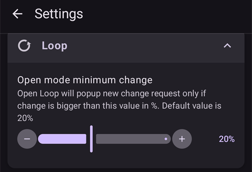

# Ayarlar

**AAPS** v4'te tercihler **Ayarlar** ekranında bulunur. Bu ayarlara üç yoldan ulaşabilirsiniz. Ayrıntılar için [AAPS yapılandırmanızda değişiklik yapma](../SettingUpAaps/ChangeAapsConfiguration.md) sayfasına bakın:

1. Ana ekranın sağ üst köşesindeki **Ayarlar** (dişli) simgesine dokunun: açılıp kapanabilen bölümlere ayrılmış tüm ayarlar.
2. **Konfigürasyon** ekranında, etkin bir eklentinin altındaki "**Ayarlar**"a dokunun: yalnızca o eklentinin ayarları.
3. Ana ekranın üst kısmındaki **arama çubuğunu** kullanın: aradığınız metnin bir kısmını yazmaya başlamanız yeterlidir. Bu şekilde tek tek ayarları (Ayarlar ekranında görünmeyenleri bile), diyalogları ve dokümantasyonu bulabilirsiniz.


- **Bölümler** üzerlerine dokunarak açılır ve kapanır. Gördüğünüz bölümler, etkinleştirdiğiniz eklentilere ve [Basit mod](#preferences-simple-mode) ayarına bağlıdır.


```{contents}
:backlinks: entry
:depth: 2
```

(Preferences-general)=
## General


**Birimler**

- Birimleri tercihinize göre mmol/L veya mg/dL olarak ayarlayın.

**Language**

- **AAPS** varsayılan olarak telefonun dilini kullanır (önerilir).

- **AAPS**'i telefondan farklı bir dilde kullanmak istiyorsanız, dili burada seçin. Android 13 ve sonrasında **AAPS** bu dili Android'de kendi uygulama dili olarak kaydeder. Böylece tüm ekranları, ana ekran, widget'lar ve sayıların yazılış biçimi bu dili izler.

- Dili değiştirdiğinizde **AAPS** metinleri hemen yeni dile geçer. Bazı metinler hâlâ eski dilde görünüyorsa **AAPS**'i yeniden başlatın.
- Android 12'de bu ayar gösterilmez: **AAPS** her zaman telefonun dilini kullanır.
- Ayar, [basit modda](#preferences-simple-mode) gizlidir.

(preferences-simple-mode)= **Basit mod**

**AAPS**'i ilk kez kurduğunuzda **basit mod** varsayılan olarak etkindir. **Basit modda** ayarların önemli bir kısmı gizlenir ve tercihlerin yerine önceden tanımlanmış değerler kullanılır. **AAPS** kullanıcı arayüzünü ve ayarlarını tanıdıktan sonra basit modu kapatmalısınız.

**İnsülin konsantrasyonu desteği**

- Farklı insülin konsantrasyonları (U50, U200, ...) için desteği etkinleştirir. Bunu yalnızca gerçekten U100 dışında bir konsantrasyon kullanıyorsanız etkinleştirin ve uyarıları dikkatle okuyun.
- Ayar, [basit modda](#preferences-simple-mode) gizlidir.

**Keep screen on**

- Android'in ekranı her zaman açık tutmasını sağlar. This is useful for presentations etc. But it consumes a lot of battery power. Therefore, it is recommended to connect the smartphone to a charger cable.

**Kurulum adı**

- Bu telefonu kullanan kişinin adı. Bu **AAPS** kurulumunu raporlarda ve senkronizasyonda diğerlerinden ayırır. Örneğin ailenizde tip 1 diyabetli iki çocuk **AAPS** kullanıyorsa.
- Dışa aktarılan ayar dosyalarının adlarında kullanılır.
- [Dual saat arayüzünde](../WearOS/WearOsSmartwatch.md) gösterilir.

(Preferences-skin)=
### Arayüz şablonu (skin)

**AAPS** 3.x'teki arayüz şablonu seçimi (Original, Low resolution, Large display...) **AAPS** 4'te artık yoktur. Yeni arayüz ekranınıza otomatik olarak uyum sağlar. Renk şeması [Görünüm](#preferences-appearance) bölümünde değiştirilebilir.

(preferences-appearance)=
## Görünüm


(Preferences-range-for-visualization)=
### Range for visualization

**AAPS** ana ekranında ve akıllı saatte KŞ grafiğinin üst ve alt sınırlarını seçin. It is only the visualization, not the target range for your BG. Örnek: 70 - 180 mg/dL veya 3,9 - 10 mmol/L

(Preferences-show-notes-field-in-treatments-dialogs)=
### Diyaloglarda notları göster

Tedavilerinize kısa metin notları ekleme seçeneği sunar (bolus sihirbazı, karbonhidrat, insülin...)

Ayar, [basit modda](#preferences-simple-mode) gizlidir.

### Uyg. Renk Şeması

Açık tema, koyu tema veya telefonun sistem ayarını izleme arasında seçim yapın.

(Preferences-protection)=
## Koruma


(Preferences-master-password)=
### Master password

2.7 sürümünden beri ayarlar şifrelendiği için [ayarları dışa aktarabilmek](../Maintenance/ExportImportSettings.md) için zorunludur.

If you forgot your master password, see [How to reset the master password?](#FAQ-reset-master-password)

**Biometric protection may not work on OnePlus phones. Bu, bazı OnePlus telefonlarında bilinen bir sorundur.**


(Preferences-settings-protection)=
### Ayar koruması

- Ayarlarınızı bir parola veya telefonun biyometrik kimlik doğrulaması ile koruyun (örneğin [**AAPS**'i bir çocuk kullanıyorsa](../RemoteFeatures/RemoteMonitoring.md)). Bu özelliği etkinleştirirseniz, Ayarlar ile ilgili herhangi bir ekranı her açmak istediğinizde kimlik doğrulaması istenir.

- Bu durumda yönetim ekranları (**Profil**, **İnsülin ayarları**, **Geçici Hedef**, **Hızlı Asistan**) **salt okunur** açılır. Bir kaydı yine etkinleştirebilir veya kullanabilirsiniz. Ancak ekleme, düzenleme, kopyalama ve silme, ayarlarınızın kilidini açana kadar gizlenir. Bkz. [Ayar koruması artık yönetim ekranlarını da kilitler](#v4changes-read-only-management).

- Ana parolayı yalnızca [dışa aktarılan ayarları](../Maintenance/ExportImportSettings.md) korumak için kullanmak, ayarları düzenlemek için ise farklı bir parola kullanmak istiyorsanız özel parola kullanılmalıdır.

- Özel bir parola kullanıyorsanız, parolayı [yukarıda](#Preferences-master-password) açıklandığı gibi ayarlamak için "Ayarlar parolası" satırına dokunun.

### Uygulama koruması

Uygulama korunuyorsa, **AAPS**'i açmak için ve [koruma zaman aşımından](#Preferences-password-and-pin-retention) sonra uygulamaya geri döndüğünüzde yeniden parolayı girmeniz veya telefonun biyometrik kimlik doğrulamasını kullanmanız gerekir.

Yanlış parola girilirse **AAPS** hemen kapanır. Ancak daha önce başarıyla açılmışsa arka planda çalışmaya devam eder.

### Bolus protection

- **AAPS**'i küçük bir çocuk kullanıyorsa ve siz [SMS ile bolus](../RemoteFeatures/SMSCommands.md) veriyorsanız, bolus koruması faydalı olabilir.

- **Bolus koruması** yalnızca **Ayar koruması** (Seviye 2) ayarlandıktan sonra seçilebilir.

- Aşağıdaki örnekte bolus koruması **Ana parola** kullanır: **AAPS**, **İnsülin** gibi bir tedavi diyaloğunu açmadan önce bu parolayı sorar. **Biyometrik** seçeneğinde, biyometrik kimlik doğrulama çalışmazsa bunun yerine ana parolayı girebilirsiniz.


(Preferences-password-and-pin-retention)=
### Parola ve PIN geçerlilik süresi

**Koruma zaman aşımı**, parolayı başarıyla girdikten sonra ayarların veya bolus işlevlerinin ne kadar süre (saniye olarak) kilitsiz kalacağını belirler.

## Tedavi güvenliği


(preferences-patient-type)=
### Hasta yaşı

- Güvenlik limitleri bu ayarda seçtiğiniz yaşa göre belirlenir.
- Bu sert sınırlara (maksimum bolus gibi) ulaşmaya başlarsanız, bir adım yukarı çıkmanın zamanı gelmiştir.
- Gerçek yaştan daha yüksek bir yaş seçmek kötü bir fikirdir. Çünkü insülin iletişim kutusuna yanlış bir değer girildiğinde (örneğin ondalık ayırıcı atlandığında) aşırı doza yol açabilir.
- Bu sabit güvenlik sınırlarının gerçek değerlerini öğrenmek istiyorsanız, [bu sayfada](../DailyLifeWithAaps/KeyAapsFeatures.md) kullandığınız algoritma özelliğine gidin.

(Preferences-maximum-bolus)=
### Maksimum bolus

- **AAPS**'in bir seferde verebileceği en fazla bolus insülin miktarını insülin ünitesi olarak belirler.
- This setting exists as a safety limit to prevent the delivery of a massive bolus due to accidental input or user error.
- Bunu, bir öğün veya düzeltme dozu için ihtiyaç duyabileceğiniz maksimum bolus insülin dozuna karşılık gelen makul bir miktara ayarlamanız önerilir.
- Bu kısıtlama, bolus hesaplayıcısına da uygulanır.

### İzin verilen maksimum karb miktarı

- **AAPS** bolus hesaplayıcısının doz hesaplayabileceği en fazla karbonhidrat miktarını gram olarak belirler.
- This setting exists as a safety limit to prevent the delivery of a massive bolus due to accidental input or user error.
- Bunu, bir yemek için ihtiyaç duyabileceğiniz maksimum karbonhidrat miktarına kabaca karşılık gelen makul bir miktara ayarlamanız önerilir.

## KŞ Kaynağı

Seçtiğiniz [KŞ kaynağının](#Config-Builder-bg-source) ayarları ayrı bir bölüm olarak görünür. Örneğin **xDrip+ KŞ** ile:


- **KŞ verilerini Nightscout'a yükle**: **AAPS**'in aldığı KŞ değerlerini Nightscout'a yüklemesini sağlar. Bunu yalnızca CGM uygulamasının kendisi bu değerleri zaten yüklemiyorsa etkinleştirin.
- **Sensör değişimini kaydet**: sensör takıldığında otomatik olarak bir sensör değişimi tedavi olayı oluşturur.

## Ana ekran

**AAPS** 3.x'te bu ayarlar "Genel Bakış" (Overview) bölümünde toplanmıştı. **AAPS** 4'te ise doğrudan ait oldukları ana ekran öğelerinden yapılandırılırlar.

(Preferences-buttons)=
### Hızlı Başlatma düğmeleri

Ana ekranda hangi eylem düğmelerinin görüneceğini belirleyin: ana ekranın alt ortasındaki küçük **dişli** simgesine dokunun ("Hızlı Başlatma'yı yapılandırın") ve hızlı erişmek istediğiniz eylemleri **Ekle** ile ekleyin (tedaviler, CGM eylemleri, careportal kayıtları...).


(Preferences-quick-wizard)=
### Hızlı Asistan

Belirli standart öğünler veya atıştırmalıklar için ana ekranda gösterilecek özel düğmeler oluşturun. Sık yenen standart öğünler için kullanışlıdır.

Her düğme için karbonhidrat miktarını ve bolusun hesaplama yöntemini belirlersiniz. Ardından düğmenin ana ekranınızda hangi zaman aralığında görüneceğini belirlersiniz. Her zaman aralığı için yalnızca bir düğme olur. Belirlenen zaman aralığının dışındaysanız veya Hızlı Asistan düğmesinde tanımlanan karbonhidratı karşılayacak kadar AİNS'iniz varsa, düğme görünmez. Farklı öğünler için farklı zamanlar belirlerseniz, günün saatine göre ana ekranda her zaman uygun standart öğün düğmesi bulunur.

Hızlı Asistan ön ayarlarınızı yönetmek için ana ekrandaki arama çubuğuna "Hızlı Asistan" yazın ve **Hızlı Asistan - Hızlı Asistan ön ayarlarını yönetin** öğesini açın.

Hızlı Asistan düğmesine dokunursanız **AAPS**, mevcut oranlarınıza göre (ayarlanmışsa kan şekeri değerini veya aktif insülini de dikkate alarak) bu karbonhidratlar için bir bolus hesaplar ve önerir.

İnsülin verilmeden önce önerinin onaylanması gerekir.

(Preferences-default-temp-targets)=
### Varsayılan geçici hedefler

[Geçici hedefler (GH)](../DailyLifeWithAaps/TempTargets.md), kan şekeri hedefinizi belirli bir süre için değiştirmenizi sağlar. Varsayılan bir GH ayarladığınızda, hedefinizi aktivite, yakında yemek vb. için kolayca değiştirebilirsiniz.

**Geçici Hedef** ekranını açmak için ana ekrandaki **hedef aralığına** dokunun. Ön ayar kartları (Yakında Yenecek, Aktivite, Hipo) arasında kaydırın ve her ön ayarın hedefini ve süresini **Ön Ayarlar** altında değiştirin. Preset values are:

* Yakında Yenecek: hedef 90 mg/dL / 5,0 mmol/L, süre 45 dk
* Aktivite: hedef 140 mg/dL / 7,8 mmol/L, süre 90 dk
* Hipo: hedef 160 mg/dL / 8,9 mmol/L, süre 60 dk


[Geçici hedefleri nasıl etkinleştireceğinizi buradan öğrenin](#TempTargets-where-can-i-select-a-temp-target).

### Hazırla/doldur için standart insülin miktarları

Hortumu doldurmak veya kanülü hazırlamak için **AAPS**'i kullanmak istiyorsanız, bunu ana ekrandaki genişletilmiş durum panelinde bulunan **Hazırla/doldur** düğmeleriyle yapabilirsiniz.

Üç doldurma düğmesinin varsayılan miktarları, kateterinizin uzunluğuna göre **Hazırla/doldur** ayarlarında belirlenebilir. Bu ayarları açmak için ana ekrandaki arama çubuğuna "hazırla" yazın.


(Preferences-status-lights)=
### Durum ışıkları

Durum ışıkları şunlar için görsel bir uyarı verir:

- Sensör yaşı
- İnsülin yaşı (rezervuarın kullanıldığı gün sayısı)
- Rezervuar seviyesi (Ü)
- Kanül yaşı
- Pompa pil yaşı
- Pompa pil seviyesi (%)

Uyarı eşiği aşılırsa değerler sarı renkte gösterilir. Kritik eşik aşılırsa değerler kırmızı renkte gösterilir.

Eşikleri değiştirmek için ana ekrandaki durum panelini genişletin (durum satırının sağındaki ok) ve "Durum" yanındaki küçük **Ayarlar** simgesine dokunun:


Bir öğeye (**Kanül**, **İnsülin**, **Sensör** veya **Pompa pili**) dokunarak uyarı ve kritik eşiklerini açın:


Son seçenek, bu ayarlar Nightscout'ta tanımlıysa onları Nightscout'tan içe aktarmanızı sağlar. Daha fazla bilgi için [Nightscout dokümantasyonuna](https://nightscout.github.io/nightscout/setup_variables/#age-pills) bakın.

(Preferences-deliver-this-part-of-bolus-wizard-result)=
### Bolus sihirbazı ayarları

**Bolus sihirbazı** ayarlarını açmak için ana ekrandaki arama çubuğuna "bolus" yazın:


**Bolus yüzdesi**, bolus sihirbazı kullanıldığında hesaplanan bolusun [varsayılan yüzdesini](#AapsScreens-section-j) belirler.

Varsayılan değer %100'dür: düzeltme yok. Burada farklı bir değer ayarlasanız bile, bolus sihirbazını her kullandığınızda bu değeri yine değiştirebilirsiniz. Bu ayar %75 ise ve 10 Ü bolus yapmanız gerekiyorsa, bolus sihirbazı yalnızca 7,5 ünitelik bir öğün bolusu önerir.

[SMB](#objectives-objective9) kullanan birçok kişi, gereken insülinin %100'ünü öğün bolusu olarak vermez. Yalnızca bir kısmını (örneğin %75) verir ve gerisini UAM (bildirilmemiş öğün algılama) ile SMB'ye bırakır. Burada %100'den düşük bir değer kullanmak şu durumlarda faydalı olabilir:
* sindirimi yavaş olan kişiler için: bolusun tamamını en başta vermek hipoya neden olabilir, çünkü insülin sindirimden daha hızlı etki eder.
* **KŞ yükselişiyle** kendi başına başa çıkması için **AAPS**'e daha fazla alan bırakmak. Her iki durumda da **AAPS**, gerekli gördüğünde/gördüğü anda bolusun eksik kısmını SMB'lerle telafi eder.

**Bolus danışmanını kullan**

Etkinleştirildiğinde, hiperglisemideyken bolus sihirbazını kullanırsanız bir uyarı alırsınız. Bu uyarı, ön bolus yapıp **KŞ** değeriniz hedef aralığa döndüğünde yemek yemek isteyip istemediğinizi sorar.

(Preferences-advanced-settings-overview)=
### Superbolus

**AAPS** 3.x'teki Süperbolus seçeneği **AAPS** 4'te bir ayar olarak bulunmaz.

## Döngü

Döngü modunu şimdi değiştirmek için [AAPS ekranları > Ana ekran > Döngü durumu](#AapsScreens-loop-status) bölümüne bakın.

(Preferences-minimal-request-change)=
### Açık modda minimum değişiklik

**Açık Döngü** kullanırken, **AAPS** bazal oranının değiştirilmesini her önerdiğinde bildirim alırsınız. Bildirim sayısını azaltmak için [daha geniş bir KŞ hedef aralığı](#profile-glucose-targets) kullanabilir veya "**Açık modda minimum değişiklik**" ayarının yüzdesini artırabilirsiniz. Bu, bir bildirimi tetiklemek için gereken göreli değişikliği tanımlar.



## Gelişmiş Öğün Yardımı (AMA) veya Süper Mikro Bolus (SMB)

[Konfigürasyon > APS](../SettingUpAaps/ConfigBuilder.md) ayarlarınıza bağlı olarak iki algoritma arasında seçim yapabilirsiniz:

- [Advanced meal assist (OpenAPS AMA) (Gelişmiş Öğün Yardımı)](#Open-APS-features-advanced-meal-assist-ama) - algoritmanın 2017'deki hâli
- [Super Micro Bolus (OpenAPS SMB) (Süper Mikro Bolus)](#Open-APS-features-super-micro-bolus-smb) - yeni başlayanlara önerilen en güncel algoritma

[**AAPS** 3.3 sürümünden](#version3300) itibaren [Dinamik İDF](../DailyLifeWithAaps/DynamicISF.md) özelliği OpenAPS SMB'nin içine taşınmıştır.

### OpenAPS AMA

OpenAPS AMA ile ilgili tüm ayarlar, [AAPS'in temel özellikleri > Advanced Meal Assist (AMA)](#Open-APS-features-advanced-meal-assist-ama) bölümünde açıklanmıştır.

(Preferences-openaps-smb-settings)=
### OpenAPS SMB

OpenAPS SMB ile ilgili tüm ayarlar, [AAPS'in temel özellikleri > Süper Mikro Bolus (SMB)](#Open-APS-features-super-micro-bolus-smb) bölümünde açıklanmıştır.

Gördüğünüz ayarların listesi, [Görevler](../SettingUpAaps/CompletingTheObjectives.md)deki ilerlemenize ve [Basit mod](#preferences-simple-mode) ayarına bağlıdır. Yeni bir kurulumda yalnızca **Dinamik hassasiyet kullanın** gösterilir. Görevler tamamlandığında bölüm şöyle görünür:


Bölümün en altındaki **Gelişmiş Ayarlar**, normalde değiştirmeniz gerekmeyen değerleri içerir:


## Emilim ayarları


(Preferences-min_5m_carbimpact)=
### SMB min. 5 dk karb etkisi (min_5m_carbimpact)

Ayar, [basit modda](#preferences-simple-mode) gizlidir.

Algoritma, [karbonhidratların ne zaman emildiğini](../DailyLifeWithAaps/CobCalculation.md) belirlemek için KŞ etkisini (BGI, kan şekeri etkisi) kullanır.

Karbonhidrat emilimi kanınızın tepkilerine göre dinamik olarak hesaplanamadığı zamanlarda, **AAPS** karbonhidratlarınıza varsayılan bir azalma uygular. Temelde bir güvenlik önlemidir. Bu değer yalnızca **CGM** okumalarında boşluk olduğunda veya fiziksel aktivite, normalde **AAPS**'in AKRB'yi azaltmasına neden olacak kan şekeri yükselişini tamamen "tükettiğinde" kullanılır.

Basitçe söylemek gerekirse: Algoritma, mevcut insülin vb. dozundan etkilendiğinde KŞ'lerinizin nasıl davranması *gerektiğini* "bilir". Beklenen davranıştan pozitif bir sapma olduğunda, bir miktar karbonhidrat emilmiş/azalmış sayılır. Büyük değişiklik=çok karbonhidrat vs.

min_5m_carbimpact, 5 dakika başına varsayılan karbonhidrat emilim etkisini tanımlar. Tüm parametrelerin açıklaması için [OpenAPS tercihler ve güvenlik ayarları dokümantasyonuna](https://openaps.readthedocs.io/en/latest/docs/While%20You%20Wait%20For%20Gear/preferences-and-safety-settings.html?highlight=carbimpact#min-5m-carbimpact) bakın.

AMA için standart değer 3, SMB için 8'dir.

Ana ekrandaki AKRB grafiği, min_5m_carbimpact kullanıldığında AKRB eğrisinin üst kısmı boyunca turuncu noktalar gösterir.


### Emilim kesme

Herhangi bir öğünün emilmiş sayıldığı süre; kalan karbonhidratlar silinir. Sık sık yüksek yağlı veya proteinli yemekler yiyorsanız, yemek emilim sürenizi artırmanız gerekecektir.

### Advanced settings - autosens ratio


- Minimum ve maksimum [Otoduyarlılık](#Open-APS-features-autosens) oranını belirleyin.
- Normalde standart değerler (maks. 1,2 ve min. 0,7) değiştirilmemelidir.

## Pump


### BT Watchdog

Gerekirse BT Watchdog'u etkinleştirin (örneğin Dana pompaları için). Pompaya bağlantı kurulamazsa Bluetooth'u bir saniyeliğine kapatır. Bu, Bluetooth yığınının donduğu bazı telefonlarda yardımcı olabilir.

## Pompa Ayarları

Buradaki seçenekler, [Konfigürasyon > Pompa](#Config-Builder-pump) bölümünde seçtiğiniz pompa sürücüsüne göre değişir. Pompanızı [pompa ile ilgili talimatlara](../Getting-Started/CompatiblePumps.md) göre eşleştirin ve ayarlayın.

Örneğin **Sanal pompa** ile bölümün adı **Sanal pompa ayarları** olur. Sanal pompanın taklit ettiği **Pompa tipi**ni ve durumunun Nightscout'a yüklenip yüklenmeyeceğini seçersiniz:


## Tidepool

Daha fazla bilgi özel [Tidepool](../SettingUpAaps/Tidepool.md) sayfasındadır.

(Preferences-nsclient)=
## NSClientV3


NSClient eklentisi (konfigürasyon menüsünde **NSClientV3** olarak gösterilir) verilerinizi Nightscout ile senkronize eder. Nightscout API v3'ü kullanır.

```{admonition} Data uploaders
:class: warning

NSClientV3 kullanırken tüm yükleyiciler Nightscout API v3'ü kullanmalıdır. Başka bir yükleyici (örneğin CGM uygulamanız) API v3 uyumlu değilse, Nightscout'a **AAPS'in tüm verileri yüklemesine izin verin** (KŞ, tedaviler, ...) ve o yükleyiciyi devre dışı bırakın.
```

- *Nightscout URL*'nizi ayarlayın (örneğin <https://yoursitename.yourplatform.dom>).
- **URL'nin sonunda /api/v1/ OLMADAN olduğundan emin olun.**
- Nightscout'ta bir *[Admin belirteci](https://nightscout.github.io/nightscout/security/#create-a-token)* oluşturun (V3 API'yi kullanmak için [Nightscout 15](https://nightscout.github.io/update/update/) gerekir) ve bunu **Nightscout erişim belirteci** alanına girin (API Secret'ınızı değil!). **AAPSClient**'ta bunun yerine ana telefonun QR kodunu tarayabilirsiniz. Bu, istemcinin kendi belirtecini ayarlar. PIN ile eşleştirilen bir istemci, eşleştirmeden sonra kendi belirtecini ana telefondan alır. Bkz. [İstemcinin kendi Nightscout belirteci](#client-master-control-own-token).
- Bu, verilerin hem Nightscout web sitesi hem de **AAPS** arasında okunmasını ve yazılmasını sağlar.
- 1. Görevde takılıp kalırsanız, burada yazım hatası olup olmadığını iki kez kontrol edin.
- Leave "Use websockets" enabled (recommended). Websockets are **mandatory** for remote control from **AAPSClient**, on both phones.

(Preferences-nsclient-synchronization)=
### Senkronizasyon


Senkronizasyon seçenekleri, **AAPS**'i nasıl kullanmak istediğinize bağlıdır.

Hangi verileri [Nightscout'a yüklemek veya Nightscout'tan indirmek](#Nightscout-aaps-settings) istediğinizi seçebilirsiniz.

İstemci kontrolü açıkken (Basit modda her zaman açıktır) bu ayarlar gizlenir: **AAPS** bu durumda [güçlendirilmiş moddadır](#client-master-control-hardened-mode), doğrudan Nightscout'ta yapılan değişiklikleri almaz ve tüm verilerini yükler.

### Alarm seçenekleri


- Alarm seçenekleri, uygulama üzerinden hangi Nightscout alarmlarının kullanılacağını seçmenizi sağlar. Bir Nightscout alarmı tetiklendiğinde **AAPS** alarm verir.
- Alarmların çalması için [Nightscout değişkenlerinizde](https://nightscout.github.io/nightscout/setup_variables/#alarms) Acil Yüksek, Yüksek, Düşük ve Acil Düşük alarm değerlerini ayarlamanız gerekir.
- Yalnızca Nightscout bağlantınız varken çalışırlar ve ebeveynler/bakım verenler için tasarlanmıştır.
- **CGM** kaynağı telefonunuzdaysa (örneğin xDrip veya BYODA), Nightscout alarmları yerine o uygulamanın alarmlarını kullanın.
- NS duyuruları, Nightscout [duyurularını](https://nightscout.github.io/nightscout/discover/#announcement) **AAPS** bildirimlerinde gösterir.
- Belirli bir süre Nightscout'tan veri gelmediğinde çalan eski veri ve acil eski veri alarmlarının eşiğini değiştirebilirsiniz.

### Uzaktan kontrol

"**İstemci kontrolüne izin ver**" anahtarı artık bu ayarlarda değildir: eşleştirilmiş istemcilerin yönetildiği **Yönet → Yetkili istemciler** ekranının en üstündedir. Bu anahtarın açtığı [güçlendirilmiş mod](#client-master-control-hardened-mode) dahil olmak üzere ayrıntılar için özel [Ana birim ↔ İstemci kontrolü](../RemoteFeatures/ClientMasterControl.md) sayfasına bakın.

### Connection settings


- Bağlantı ayarları, Nightscout bağlantısının ne zaman etkin olacağını belirler.
- Nightscout yüklemesini yalnızca Wi-Fi ile veya hatta belirli Wi-Fi SSID'leri ile sınırlayın.
- Yalnızca belirli bir Wi-Fi ağını kullanmak istiyorsanız, o ağın Wi-Fi SSID'sini girebilirsiniz.
- Birden çok SSID noktalı virgülle ayrılabilir.
- Tüm SSID'leri silmek için alana boşluk girin.

(Preferences-advanced-settings-nsclient)=
### Gelişmiş ayarlar (NSClientV3)


Gelişmiş ayarlardaki seçenekler kendi kendini açıklar.

## SMS Komünikatör

Daha fazla bilgi özel [SMS Komutları](../RemoteFeatures/SMSCommands.md) sayfasındadır.

(preferences-wear)=
## Wear

Bu bölüm, **Wear** eklentisi [Konfigürasyon > İletişim](#Config-Builder-wear) bölümünde etkinleştirildiğinde gösterilir. Daha fazla bilgi özel [Wear OS akıllı saat](../WearOS/WearOsSmartwatch.md) ve [Wear OS akıllı saatiniz üzerinden AAPS'in kullanımı](../RemoteFeatures/RemoteControlWearOS.md) sayfalarındadır.


- **Wear kontrolü**: tedavilerin ve diğer eylemlerin saatten gönderilmesine izin verir. Bu ayar kapalıysa saat yalnızca verileri gösterir: telefon saatten gelen her komutu reddeder ve bir kontrol ekranı açacak bir komplikasyona dokunmak bunun yerine saatte **AAPS** menüsünü açar.

**Wear Sihirbazı Ayarları**, saatteki bolus sihirbazının sonucuna hangi hesaplamaların dahil edileceğini belirler. Saatte yalnızca karbonhidratı girersiniz. Bu anahtarlar, telefondaki bolus sihirbazında yapacağınız seçimlerin yerini alır:

- **Sihirbaza KŞ'yi dahil et**: mevcut glikozunuz ile hedefiniz arasındaki fark için bir düzeltme ekler.
- **Sihirbaza geçici hedefi dahil et**: bu düzeltme için profil hedefi yerine çalışan geçici hedefi kullanır.
- **Sihirbaza eğilimi dahil et**: mevcut glikoz eğilimini hesaba katar.
- **Sihirbaza AKRB dahil et**: hâlâ aktif olan karbonhidratlar için insülin ekler.
- **Sihirbaza AİNS dahil et**: hâlâ aktif olan insülini çıkarır.


**Özel saat arayüzü ayarları**, **Özel saat arayüzlerine izin ver** seçeneğini içerir. Özel bir saat arayüzü dosyası, bazı saat ayarları için değerler içerebilir. Bu anahtar açıkken, böyle bir saat arayüzünün yüklenmesi saatteki bu ayarları değiştirebilir. Kapalıyken saat arayüzü yüklenir ama ayarlar olduğu gibi kalır:


**Genel Ayarlar**, her SMB verildiğinde saatte bildirim almak için **SMB'yi bildir** seçeneğini içerir:


## OtoAyar

Bu bölüm, **OtoAyar** eklentisi [Konfigürasyon > Genel](#Config-Builder-autotune) bölümünde etkinleştirildiğinde gösterilir. Ayarlar özel [OtoAyar](../AdvancedOptions/Autotune.md) sayfasında açıklanmıştır.


## Otomasyon


Select which location service shall be used:

- Pasif konumu kullan: **AAPS** konumu yalnızca başka uygulamalar istediğinde alır
- Ağ konumunu kullan: Wi-Fi'nizin konumu
- GPS konumunu kullan (Dikkat! Aşırı pil tüketimine neden olabilir!)

## Yerel uyarılar


Ayarlar açıklayıcı olmalıdır.

**Rahatsız Etmeyin modunu geçersiz kıl** (varsayılan olarak açık): **AAPS** alarmları, telefon sessizdeyken veya Rahatsız Etmeyin modundayken bile çalar. **AAPS**'in bu modlara uyması gerekiyorsa bunu kapatın: bu durumda alarmlar çalmaz, Rahatsız Etmeyin modunda ise telefonda ve saatte yalnızca titreşir. Rahatsız Etmeyin modunda gelen döngü önerileri sessiz gösterilir.

Bir alarm çaldığında alarm ekranında **Alarmı sessize al** (ekran açık kalır, böylece mesajı okuyabilirsiniz) ve **Sessize al ve kapat** seçenekleri bulunur. Bildirim alanında alarm bildirimini kaydırarak kapatmak alarmı susturur. Daha sonra **AAPS**'i açtığınızda, yanıtlamadığınız bir alarm yeniden gösterilir.

(preferences-maintenance-settings)=
## Bakım ayarları


**E-Posta alıcısı**: Günlüklerin standart alıcısı <logs@aaps.app> adresidir.

**Gönderilecek günlük kaydı sayısı**: günlükleri gönderdiğinizde en son günlük dosyalarından kaç tanesinin ekleneceği.

**Data Choices**


Geliştiricilere çökme raporları göndererek **AAPS**'in daha da geliştirilmesine yardımcı olabilirsiniz.

**Gözetimsiz Ayarlar Dışa Aktarımı**<br/> Bu özelliği etkinleştirerek **AAPS**'in ayarları sizin müdahaleniz olmadan dışa aktarmasına izin verirsiniz. Bunun için ana parola, bir sonraki elle dışa aktarmada güvenli bir şekilde (yalnızca) telefonunuzda saklanır. Saklanan parola en fazla 4 hafta boyunca kullanılır. 4 hafta sonra parolanın süresinin dolmak üzere olduğu size bildirilir. 1 haftalık ek süre boyunca parola, bakım menüsünden ayarları manuel olarak dışa aktararak yenilenebilir.

1 haftalık ek süre dolduktan sonra saklanan parolanın süresi biter. Otomatik ayar dışa aktarımları iptal edilir ve kullanıcıya bildirim gönderilerek parolayı yeniden girmesi istenir. [(**Otomatik ayar dışa aktarımları**)](../DailyLifeWithAaps/Automations.md#automating-preference-settings-export), Tedaviler altındaki **AAPS** 'Careportal' ve 'Kullanıcı girişi' listelerine kaydedilir.

Bu seçeneği etkinleştirdikten sonra mutlaka manuel bir ayar dışa aktarımı yapın. Bu sırada parolanız istenir ve **AAPS** onu saklayabilir.

### Log files

AAPS, sorun giderme için günlükleri kaydeder.

Bu özelliği devre dışı bırakmayın: bir sorun çıktığında nedenini anlamaya yardımcı olur.

Günlükleri geliştiricilere göndermeniz gerekiyorsa, e-postada sorunu doğru bir şekilde açıkladığınızdan emin olun. Günlükleri yalnızca sizden istendikten sonra, [GitHub'daki bir sorun bildirimine](https://github.com/nightscout/AndroidAPS/issues) bağlı olarak göndermeniz tercih edilir.

AAPS günlüklerini telefon belleğinizde -> Android -> data -> info.nightscout.androidaps -> files konumunda bulabilirsiniz.

Günlük işlemleri (günlük ayarları, günlükleri gönderme ve silme) ve dosya yönetimi, ana ekranın sol üst köşesindeki **menüden** (☰) açılan **Bakım** ekranında bulunur:


(preferences-maintenance-logdirectory)=

### Yerel AAPS dizinini ayarlama

**Bakım** ekranında **AAPS dizini** de bulunur. Bu ayar, kullanıcının telefonunda **AAPS**'in tercihleri, günlükleri ve diğer dosyaları saklayacağı bir dizin seçmesini sağlar. Bir dizin seçildiğinde, yolu (örneğin `Documents/AAPS`) **AAPS dizini** altında gösterilir. Böylece dosyalarınızın nereye kaydedildiğini her zaman görebilirsiniz.

Doğrudan telefon belleğinizin ana klasöründe bir dizin kullanmanız şiddetle önerilir. Varsayılan AAPS'tir.


AAPS'in bir alt dizinini seçerseniz bir hata mesajı görürsünüz. "Tamam" düğmesine dokunun ve doğru dizini (bir üst dizini) seçerek tekrar deneyin. Ne yaptığınızı tam olarak bilmiyorsanız "Kapat" seçeneğini seçmeyin.


Android, dizin iznini sessizce geri alabilir. Örneğin **AAPS**'i yeniden yüklediğinizde veya depolama alanını temizlediğinizde. Bu olduğunda **AAPS** kalıcı bir **AAPS dizinine erişim kaybedildi** bildirimi gösterir. Siz buraya dönüp dizini yeniden seçene kadar yerel ayar dışa aktarımı çalışmaz. Bunu hemen yapın. Aksi takdirde telefondaki yedekleriniz artık güncellenmez.

(preferences-maintenance-cloud)=

### Bulut dizini ayarlama

Ayarlarınızı, günlüklerinizi ve CSV verilerinizi bir bulut hizmetine aktarabilirsiniz.

1. **Menüyü** (☰) açın, **Bakım**'ı seçin ve **Bulut Dizini**'ne dokunun (**Dosya yönetimi** altında).

   

2. **Depolama Türünü Seçin** penceresinde **Google Drive**'ı seçin.

   

3. Bir Google oturum açma sayfası açılır. Yedeklerinizi tutacak Google hesabını seçin ([AAPS için ayrı bir Google hesabı](../UsefulLinks/DedicatedGoogleAccountForAaps.md) kullanabilirsiniz).

   

4. Hesabın doğru hesap olduğunu kontrol edin ve **AAPS**'e erişim vermek için **Devam**'a dokunun. Bulut dizinini daha önce ayarladıysanız, sayfada **AAPS**'in zaten bazı erişim izinleri olduğu yazar.

   

5. **AAPS**'e döndüğünüzde ana ekranın altında **Bulut depo kimlik doğrulaması başarılı** mesajı görünür:

   

   **Bakım** menüsünde **Bulut Dizini** artık yeşil bir noktaya sahiptir ve **Kayıtları gönder**, **Ayarları dışa aktar**, **Ayarları içe aktar** ve **Kullanıcı Girişlerini Excel'e Aktar (csv)** yanındaki **Bulut** düğmeleri kullanılabilir.

   

Buluta dışa aktarmayı durdurmak için **Bakım** menüsündeki **Bulut Dizini** satırının sonundaki **✕** (**Ayarları Temizle**) simgesine dokunun (bir bulut hizmeti ayarlandığında gösterilir) ve **Bulut Ayarlarını Temizle** ile onaylayın. Bu, yerel depolamaya geri döner ve yetkilendirmeyi siler.

## Open Humans

Verilerinizi araştırma projelerine bağışlayarak topluluğa yardımcı olabilirsiniz! Ayrıntılar [Open Humans sayfasında](../SupportingAaps/OpenHumans.md) açıklanmıştır.

**Ayarlar → Open Humans** bölümünde verilerin ne zaman yükleneceğini belirleyebilirsiniz
- sadece Wi-Fi'ye bağlıyken
- sadece şarj olurken
