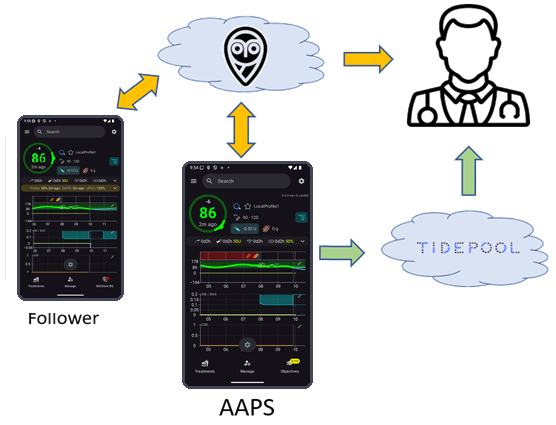

# Raporlama sunucusunu kurma

Şu anda **AAPS** ile kullanabileceğiniz iki raporlama sunucusu vardır:

- [Nightscout](https://nightscout.github.io/)
- [Tidepool](https://www.tidepool.org/)



Nightscout kullanmanızı öneririz.

(SettingUpTheReportingServer-nightscout)=
## Nightscout

Nightscout, CGM verilerinizi ve **AAPS** verilerinizi kaydedip gösterebilen ve raporlar oluşturan bir web uygulamasıdır. Uzun yıllardır **AAPS** ile entegre olan güçlü bir platformdur. Kullanıcıların ve bakım verenlerin hastanın diyabet verilerini neredeyse gerçek zamanlı izlemesini sağlar (ilgili tüm bileşenler arasında yeterli internet bağlantısı varsa, verilerin alınması ile sunulması arasında yalnızca birkaç saniye geçebilir). Ayrıca bakım verenlerin **AAPSClient** üzerinden **AAPS**'e gönderdiği uzaktan komutları da taşır (bkz. [Ana birim ↔ İstemci kontrolü](#client-master-control)).

Nightscout açık kaynak yazılım olarak sunulur. Herkes ücretsiz veya ücretli hizmetler kullanarak bir Nightscout sunucusu oluşturabilir ve çalıştırabilir.

Daha fazla bilgiyi [Nightscout projesinin web sitesinde](http://nightscout.github.io/) bulabilirsiniz.

### Seçenek 1 - Nightscout sunucunuzu kendiniz kurun

Nightscout raporlama sunucunuzu oluşturmak, bakım gerektirecek bir veya daha fazla web tabanlı uygulama gerektirebilir. Tamamen ücretsiz bir hizmete sahip olmak için, sağlayıcılar ücretsiz seçeneği kaldırırsa Nightscout sitenizi ve verilerinizi taşımanız gerekebilir.

Nightscout'u nasıl kurabileceğinizin açıklamasını, farklı çalıştırma seçeneklerinin avantajları ve dezavantajları ile tahmini maliyetleri de içerecek şekilde [burada](https://nightscout.github.io/nightscout/new_user/#free-diy) bulabilirsiniz.

### Seçenek 2 - Barındırılan bir Nightscout hizmeti için ödeme yapın

Ayrıca Nightscout'u sizin için aylık bir ücret karşılığında barındıran farklı hizmet sağlayıcıların seçenekleri de vardır. Maliyetler makul düzeydedir; barındırılan bir seçeneğin avantajı, bilişim (IT) bilgisine veya herhangi bir altyapıya ihtiyaç duymamanızdır.


Mevcut Nightscout kullanıcıları, Nightscout sunucularının nerede ve nasıl barındırıldığını zaman zaman yeniden değerlendirebilir ve daha uygun hale gelirse farklı bir seçeneğe geçebilir.

Nightscout barındırma hizmeti sunan bazı sağlayıcılar [burada](https://nightscout.github.io/nightscout/new_user/#vendors-comparison-table) listelenmiştir.

### Nightscout'un diğer yapılandırması

Nightscout sunucunuz kurulup çalışmaya başladıktan sonra, dikkat etmeniz gereken diğer noktalar için [Nightscout yapılandırma sayfasına](../SettingUpAaps/Nightscout.md) bakın.

(SettingUpTheReportingServer-tidepool)=
## Tidepool

Tidepool, 2023 sonunda yayınlanan 3.2 sürümünden beri **AAPS** içinde kullanılabilir.

```{admonition} Tidepool with **AAPS** is only for reporting
:class: danger
**AAPS** kullanırken verilerin gelişi ile raporlanması arasında üç saatlik bir gecikme olduğundan, Tidepool bakım verenlerle gerçek zamanlı bilgi paylaşmak için uygun değildir.  
Öte yandan Nightscout kabul edilen bir çözüm değilse, Tidepool raporları hastanın endokrinoloğu ile paylaşmak için çok iyi bir çözüm olabilir.  
```

Tidepool, [açık kaynaklı](https://github.com/tidepool-org) bir projedir. Tidepool sunucularında ücretsiz bir hesap kullanma imkânı sunar.

Tidepool'u AAPS ile kurma hakkında daha fazla bilgi [burada](../SettingUpAaps/Tidepool.md).

```{admonition} **AAPS** has the uploader for Tidepool integrated
:class: note
Tidepool'a veri yüklemek için yükleyici uygulamayı kullanmanız **gerekmez**: **AAPS** kan şekeri, tedavi ve bazal verilerini sizin için yükler. Yalnızca kişisel bir Tidepool hesabına ihtiyacınız vardır. Verilerinizi ayrı Tidepool yükleyici aracıyla yüklemeyin; bu, değerlerin iki kez kaydedilmesine yol açar.  
```

## Sonraki adım

Raporlama sunucunuzu kurduktan sonra, telefonunuzdaki **AAPS**'i [Kurulum Sihirbazı](./SetupWizard.md) ile yapılandırabilirsiniz; sihirbaz **AAPS**'i raporlama sunucunuza da bağlar.