# AAPS Kurulum Sihirbazı

```{contents} In this page
:backlinks: entry
:depth: 2
```

**AAPS**'i ilk kez başlattığınızda "**Kurulum Sihirbazı**" size yol gösterir. Böylece uygulamanızın tüm temel ayarlarını tek seferde hızlıca yapabilirsiniz. **Kurulum Sihirbazı**, önemli bir şeyi unutmamanız için size yol gösterir. Örneğin **izin ayarları**, **AAPS**'i doğru kurmak için çok önemlidir.

Ancak **Kurulum Sihirbazı**'nı ilk kullanışınızda her şeyi tam olarak ayarlamanız zorunlu değildir. Sihirbazdan kolayca çıkabilir ve daha sonra ona geri dönebilirsiniz. **Kurulum Sihirbazı**'ndan sonra yapılandırmayı daha da iyileştirmek veya değiştirmek için üç yol vardır. Bunlar bir sonraki bölümde açıklanacaktır. Bu nedenle Kurulum Sihirbazı'nda bazı adımları atlamanızda bir sakınca yoktur; bunları daha sonra kolayca yapılandırabilirsiniz.

**Kurulum Sihirbazı**'nı kullanırken ve hemen sonrasında **AAPS**'te gözle görülür büyük değişiklikler fark etmeyebilirsiniz. **AAPS** döngünüzü etkinleştirmek için **Görevler**'i takip etmeli ve özellikleri tek tek etkinleştirmelisiniz. Kurulum Sihirbazı'nın sonunda **1. Görev**'e başlayacaksınız. **AAPS**'i siz yönetirsiniz, o sizi değil.

```{admonition} Preview Objectives
:class: note
Görevlerin yapısını merak ediyorsanız lütfen [Görevleri tamamlama](../SettingUpAaps/CompletingTheObjectives.md) sayfasını okuyun. Ama sonra, önce Kurulum Sihirbazı'nı çalıştırmak için buraya geri dönün.

```

Deneyimlerimizden biliyoruz ki yeni başlayanlar **AAPS**'i olabildiğince hızlı kurmak için çoğu zaman kendilerini baskı altına sokar. Öğrenilecek çok şey olduğu için bu, hayal kırıklığına yol açabilir.

Bu yüzden lütfen döngünüzü ayarlarken acele etmeyin. İyi çalışan bir **AAPS** döngüsünün faydaları çok büyüktür.

```{admonition} Ask for Help
:class: note
Dokümantasyonda bir hata varsa veya bir şeyin nasıl daha iyi açıklanabileceğine dair daha iyi bir fikriniz varsa, [Diğer kullanıcılarla iletişim kurun](../GettingHelp/WhereCanIGetHelp.md) bölümünde anlatıldığı gibi topluluktan yardım isteyebilirsiniz.
```
## Karşılama mesajı

Kurulum Sihirbazı açıldığında sizi kısa bir karşılama mesajıyla selamlar ve ekranın altında hemen bir "**Gerekli İzinler**" paneli gösterir (bir sonraki bölüme bakın).

İzinleri verdikten sonra panel kapanır ve karşılama ekranında "**İleri**" düğmesi görünür. Devam etmek için "**İLERİ**" düğmesine basın:


## Gerekli izinler

**AAPS**'in doğru çalışması için birkaç izne ihtiyacı vardır. Sihirbaz bunları tek bir "**Gerekli İzinler**" panelinde toplar. Her birinin kendi "**İzin ver**" düğmesi vardır. İzinleri tek tek verin — her öğenin yanındaki simge, izin verildiğinde onay işaretine dönüşür.


### Pil optimizasyonu

Akıllı telefonlarda pil tüketimi önemli bir konudur, çünkü pillerin performansı hâlâ oldukça sınırlıdır. Bu nedenle akıllı telefonunuzdaki Android işletim sistemi, uygulamaların çalışmasına ve işlemci zamanı, dolayısıyla pil gücü harcamasına sınırlı izin verir.

Ancak **AAPS**'in düzenli olarak çalışması gerekir. _Örneğin_ birkaç dakikada bir glikoz değerlerini almalı ve sonra sizin ayarlarınıza göre glikoz seviyelerinize ne yapılacağına karar vermek için algoritmayı uygulamalıdır. Bu nedenle pil optimizasyonundan hariç tutulmalıdır.

"**Pil optimizasyonu**" yanındaki "**İzin ver**" düğmesine basın, ardından "Let app always run in background?" (uygulamanın her zaman arka planda çalışmasına izin verilsin mi?) penceresinde "**Allow**" (izin ver) seçeneğini seçin:


(SetupWizard-StoragePermission)=

### AAPS Dizini

**AAPS**'in ayarlarını ve günlük bilgilerini akıllı telefonunuzun kalıcı depolama alanına kaydetmesi gerekir. Kalıcı depolama, verilerin akıllı telefonunuz yeniden başlatıldıktan sonra da kullanılabilir olacağı anlamına gelir. Diğer bilgiler kalıcı depolamaya kaydedilmediği için kaybolur.

"**AAPS Dizini**" yanındaki "**İzin ver**" düğmesine basın. Bu, telefonunuzun dosya sistemini açar ve **AAPS**'in bilgilerini nereye kaydedeceğini seçmenizi sağlar.

```{tip}
Varsayılan AAPS dizinini seçmeniz önerilir.</br>
AAPS'in bir alt dizinini **seçmeyin**.
```

Varsayılan dizin **AAPS**'tir, ancak istediğiniz başka bir ayrı dizini de kullanabilirsiniz. Gerekirse dizini oluşturun, dizine girin ve "**USE THIS FOLDER**" (bu klasörü kullan) seçeneğini seçin:

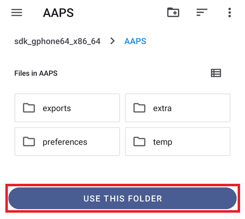

**AAPS**'e seçilen dizine erişim izni vermek istediğinizi "**ALLOW**" ile onaylayın:


### Notifications

Android, size bildirim göndermek isteyen uygulamalar için özel izin gerektirir.

Bildirimleri kapatmak, _örneğin_ sosyal medya uygulamaları için iyi bir özellik olsa da **AAPS**'in size bildirim göndermesine izin vermeniz çok önemlidir.

"**Bildirimler**" yanındaki "**İzin ver**" düğmesine basın ve sistem sorusunda "**Allow**" seçeneğini seçin:


### Alarmlar ve hatırlatıcılar

**Android 14 ve daha yeni** sürümlerde **AAPS**'in "**Alarmlar ve hatırlatıcılar**" iznine ihtiyacı vardır. Böylece **AAPS** arka plandayken alarmlar ekranı açabilir ve hatırlatıcılar (örneğin bir **Otomasyon**'dan) zamanında çalar.

Bu öğe yalnızca gerektiğinde gösterilir. **AAPS** pil optimizasyonundan hariç tutulduğunda (yukarıya bakın) Android tam zamanlı alarmlara otomatik olarak izin verir ve öğe kaybolur. Hâlâ listede görünüyorsa "**Alarmlar ve hatırlatıcılar**" yanındaki "**İzin ver**" düğmesine basın. Bu, **AAPS** için bir sistem ayarları ekranı açar. Anahtarı açın ve **AAPS**'e geri dönün. Android 13 ve daha eski sürümlerde bu öğe görünmez ve bir şey yapmanız gerekmez.

Tüm izinlerde onay işareti göründüğünde (üç izin, Android 14 ve daha yeni sürümlerde dört izin) "**Gerekli İzinler**" paneli kendiliğinden kapanır. Devam etmek için karşılama ekranında "**İLERİ**" düğmesine basabilirsiniz.

(setup-wizard-bluetooth-battery-optimisation)=
### Bluetooth pil optimizasyonu

```{admonition} Extra Android setting, not part of the Wizard
:class: note
Aşağıdakiler, Kurulum Sihirbazı dışında yapılan ek Android ayarlarıdır. Yukarıdaki "İzin ver" düğmelerinden biri değildir, ancak güvenilir bir pompa bağlantısı için önemlidir.
```

Android'in yeni sürümleri, sistemdeki Bluetooth uygulamasına da pil optimizasyonu ekledi.

**AAPS** için pil optimizasyonunu kapatmanın yanı sıra, büyük olasılıkla Bluetooth sistem uygulaması için de kapatmanız gerekecektir. Bunu yapmazsanız pompa bağlantısı kopabilir ve sorunlar çıkabilir.

***NOT: Bunun nasıl yapılacağı xDrip dokümantasyonunda anlatılmıştır: [xDrip dokümantasyonu](https://navid200.github.io/xDrip/docs/BluetoothBatteryOpt.html)***

Android 16'da şu adımları izleyin; diğer sürümlerde ekranlar, buradaki ekran görüntülerinden biraz farklı olacaktır:

1. Android ayarlarını açın, **Apps** (Uygulamalar) için arama yapın ve uygulama ayarlarını açın.

   

2. Uygulama ayarlarını göreceksiniz, ancak tüm uygulamaları görmek için listeyi genişletmemiz gerekir. Genişletmek için **See all apps** (Tüm uygulamaları gör) seçeneğine tıklayın.

   

3. Bluetooth uygulaması bir sistem uygulaması olduğu için varsayılan olarak gizlidir. Bu yüzden sistem uygulamalarını göstermemiz gerekir. Sağ üstteki **üç noktaya** (⋮) tıklayın (1). Ardından **Show system** (sistemi göster) seçeneğine tıklayın (2).

   

4. `Bluetooth` uygulamasını arayın ve `Bluetooth` ve/veya `Legacy Bluetooth` üzerine tıklayın. İkisi de varsa, işlemi ikisi için de yapın.

   ***NOT: `Bluetooth MIDI Service` güvenle göz ardı edilebilir, AAPS bunu kullanmaz***

       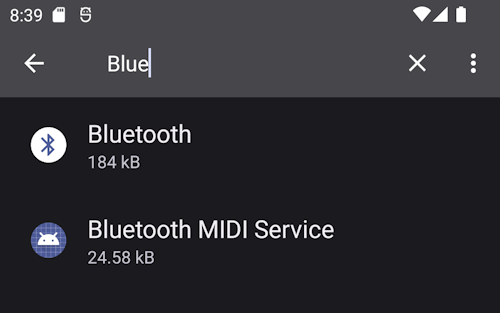    

   1. Android 12'de `Battery` (pil), Android 13 ve üzerinde `App battery usage` (uygulama pil kullanımı) seçeneğine tıklayın.

      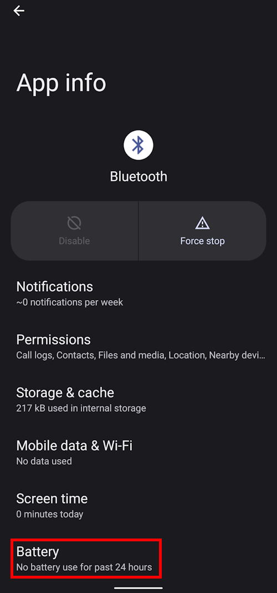

5. Android 12 ve üzerinde `Unrestricted` (kısıtlamasız) seçeneğini seçin. Android 15 ve üzerinde `Allow background usage` (arka planda kullanıma izin ver) ayarını genişletmeniz gerekir. Bunun için kırmızıyla işaretlenmiş bölüme tıklayın, ardından işlemi tamamlamak için 6. adımı izleyin.

       

6. Android 16'da `Unrestricted` (kısıtlamasız) seçeneğini seçin

   

## Lisans sözleşmesi

Son kullanıcı lisans sözleşmesinde **AAPS** kullanımının yasal yönleri hakkında önemli bilgiler vardır. Lütfen dikkatle okuyun.

Son kullanıcı lisans sözleşmesini anlamıyorsanız veya kabul edemiyorsanız lütfen **AAPS**'i hiç kullanmayın!

Anlıyor ve kabul ediyorsanız lütfen "**ANLADIM VE KABUL EDİYORUM**" düğmesine basın ve Kurulum Sihirbazı'nı izleyin:


Kabul ettiğinizde bir "**İleri**" düğmesi görünür. "**İLERİ**" düğmesine basın.

Bir sonraki ekran olan "**İzinler**", izinleri yeniden listeler. Başta izinleri verdiğiniz için hepsinde onay işareti görünmelidir. Biri eksikse yanındaki "**İzin ver**" düğmesine basın. Devam etmek için "**İLERİ**" düğmesine basın:


## Master password

**AAPS** yapılandırması bazı hassas veriler içerdiği için (_örneğin_ Nightscout sunucunuzun erişim belirteci) burada belirlediğiniz bir parola ile şifrelenir.

Sihirbaz "**Parola ayarlanmadı**" gösterir. "**Uygula**" düğmesine basın:


Bu, "**Koruma**" ekranını açar. "**Ana parola**" seçeneğine basın ("Parola ayarlanmadı" olarak gösterilir):

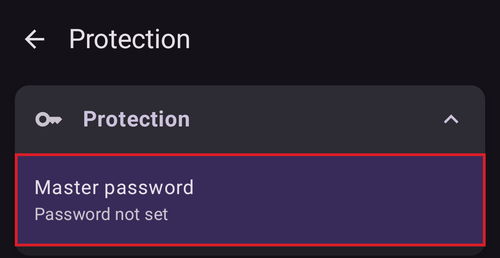

Her iki alana da aynı parolayı girin ve "**Tamam**" düğmesine basın:

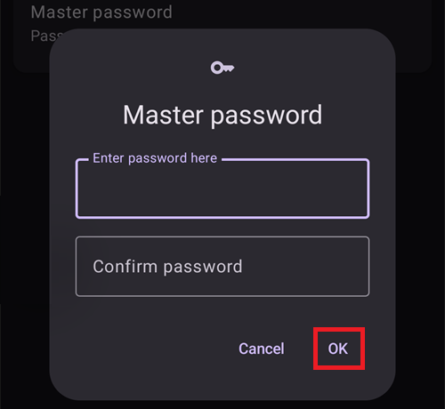

Sol üst köşedeki okla geri dönün. Sihirbaz artık "**Parola belirlendi!**" gösterir:


```{admonition} Do not lose your Master Password
:class: danger
Lütfen **ANA PAROLANIZI KAYBETMEYİN**. Parolanızı bir yere not edin, _örneğin_ Google Drive'a. Google Drive iyi bir yerdir, çünkü Google onu sizin için yedekler. Akıllı telefonunuz veya bilgisayarınız çökebilir ve elinizde güncel bir kopya olmayabilir. Ana parolanızı unutursanız, profil yapılandırmanızı ve **Görevler**'deki ilerlemenizi daha sonra geri yüklemek zor olabilir.
```

İşiniz bittiğinde bir sonraki ekrana geçmek için "**İLERİ**" düğmesine basın.

(setup-wizard-import-settings)=
## Ayarları içe aktarın

Bu ekran yalnızca **AAPS**, **AAPS** dizininde daha önce dışa aktarılmış ayarlar bulduğunda gösterilir ("Saklanan ayarlar bulundu"). Örneğin uygulamayı yeniden yüklediğinizde veya yeni bir telefona geçtiğinizde.

- Önceki yapılandırmanızı geri yüklemek için "**Ayarları içe aktar**" düğmesine basın — bkz. [Ayarları dışa ve içe aktarma](../Maintenance/ExportImportSettings.md).
- Yeni bir yapılandırma ile başlamak için "**İLERİ**" düğmesine basın ve sihirbaza devam edin.


## Birimler (mg/dL <-> mmol/L)

Lütfen glikoz değerlerinizin mg/dL mi yoksa mmol/L mi olduğunu seçin, ardından "**İLERİ**" düğmesine basın:


## Görüntü Ayarları

Burada sensör glikoz gösterimi için "**DÜŞÜK işareti**" ve "**YÜKSEK işareti**" değerlerini ayarlarsınız. Bu iki işaret arasındaki glikoz değerleri "hedef aralıkta" olarak gösterilir. Şimdilik varsayılan değerleri (72 ve 180 mg/dL) bırakabilir ve daha sonra değiştirebilirsiniz.

Seçtiğiniz değerler yalnızca grafiğin görsel sunumunu etkiler, başka hiçbir şeyi etkilemez.

_Örneğin_ glikoz hedefiniz profilinizde ayrıca ayarlanır.

TIR (time in range, aralıkta geçen süre) analizi için kullandığınız aralık, raporlama sunucunuzda ayrıca yapılandırılır.

Gerekirse işaretleri "−" / "+" düğmeleriyle ayarlayın, ardından "**İLERİ**" düğmesine basın:


(SetupWizard-synchronization-with-the-reporting-server-and-more)=
## İletişim

"**İletişim**" ekranı, verilerinizi yüklemek, senkronize etmek ve yayınlamak için kullanılan eklentileri listeler:

- **SMS Komünikatör** – SMS komutlarıyla **AAPS**'in uzaktan kontrolü
- **NSClientV3** – verilerinizi v3 API ile Nightscout'a senkronize eder
- **Tidepool** – verileri Tidepool'a yükler
- **xDrip** – verileri xDrip'e gönderir
- **Open Humans** – diyabet verilerinizi yükleyin ve bilimsel projelere bağışlayın
- **Wear** – **AAPS**'i bir WearOS saatinden izleyin ve kontrol edin
- **Harici yardımcı uygulamalar** – verilerin çeşitli harici uygulamalara yayınlanması
- **Garmin** – bir Garmin cihazına bağlantı


Listenin geri kalanını görmek için aşağı kaydırın:


Bunların birkaçını şimdi ayarlayabilirsiniz, ancak ilk kurulumda yalnızca raporlama sunucusuna odaklanacağız. Şu anda kuramıyorsanız şimdilik atlayın — daha sonra ayarlayabilirsiniz.

Bu örnekte raporlama sunucusu olarak Nightscout kullanıyoruz. Etkinleştirmek için "**NSClientV3**" sağındaki kutuyu işaretleyin. Tidepool için bu daha da basittir, çünkü yalnızca kişisel oturum açma bilgilerinize ihtiyacınız vardır.

Etkinleştirdikten sonra, ayarlamak için NSClientV3'ün altındaki "**Ayarlar**" düğmesine basın:


Burada Nightscout raporlama sunucusunu ayarlarsınız. NSClientV3 ayarları kaydırılabilir tek bir sayfada gösterilir:

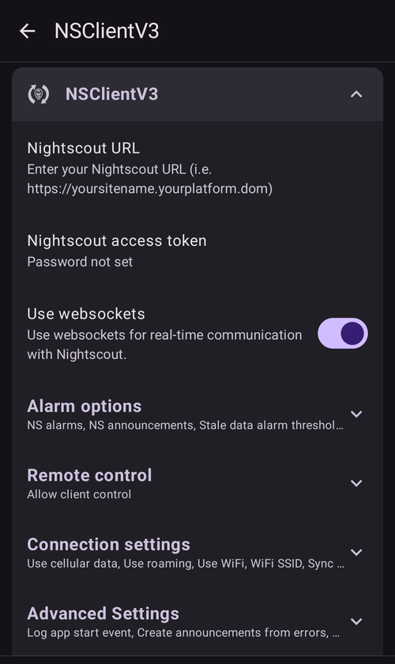

"**Nightscout URL**" seçeneğine basın ve kişisel Nightscout sunucunuzun adresini girin (kendi kurduğunuz veya hizmet sağlayıcınızın verdiği URL). "**Tamam**" ile onaylayın.

"**Nightscout erişim belirteci**" seçeneğine basın ve Nightscout sunucunuzun erişim belirtecini girin. Bu belirteç olmadan erişim çalışmaz. Henüz yoksa lütfen raporlama sunucusunun kurulumuyla ilgili dokümantasyona bakın.

Leave "**Use websockets**" enabled for real-time communication with Nightscout. Websockets are **mandatory** for remote control from **AAPSClient**, on both phones.

Diğer bölümleri şimdilik varsayılan değerlerinde bırakabilirsiniz. Daha sonra nerede bulacağınızı bilmeniz için burada açıklanmıştır:

**Alarm seçenekleri** — Nightscout alarmları, duyuruları ve eski veri eşikleri. Anahtarları şimdilik kapalı bırakın; bu seçenekleri yalnızca var olduklarını bilmeniz için açıyoruz.

**Bağlantı Ayarları** — verilerin nasıl aktarılacağını seçin. Bakım verenler "**Hücresel veri kullan**" seçeneğini açmalıdır. Aksi halde baktıkları kişinin (_örneğin_ bir çocuğun) telefonu Wi-Fi kapsamı dışında, _örneğin_ okul yolunda, veri yükleyemez. Diğer kullanıcılar veri veya pil tasarrufu için hücresel aktarımı kapatabilir. Emin değilseniz her şeyi açık bırakın.


**Gelişmiş Ayarlar** — uygulama yeniden başladığında bunu Nightscout'ta görmek istiyorsanız "**Uygulama başlatma olayını günlüğe kaydet**" seçeneğini açın (bakım verenler için yararlıdır). "**Hatalardan duyurular oluştur**" ve "**Gereken karbonhidratlardan duyurular oluştur**" seçeneklerini açık tutun. "**Yavaş senk. kullan**" seçeneğini kapalı bırakın; bunu yalnızca Nightscout sunucusu büyük miktarda veriyi yavaş işliyorsa kullanırsınız.


Eklenti listesine geri dönün ve bir sonraki ekrana geçmek için "**İLERİ**" düğmesine basın.

## İstemci kontrolü

**AAPS** 4 sürümünden itibaren, **AAPSClient** çalıştıran istemci cihazlar bu telefonla (**ana birim**) **eşleştirilebilir** ve Nightscout üzerinden gönderilen imzalı komutlarla onu kontrol edebilir. Bu, **AAPS**'i uzaktan kontrol etmenin önerilen yeni yoludur — ayrıntılı açıklama ve kurulum için [Ana birim ↔ İstemci kontrolü](../RemoteFeatures/ClientMasterControl.md) sayfasına bakın.

Bu ekranda şimdi ayarlamanız gereken bir şey yoktur; istemcileri daha sonra istediğiniz zaman **Yönet → Yetkili istemciler** bölümünden eşleştirebilirsiniz. Orada bir istemciyi **QR kodu** ile (bu, istemcide Nightscout'u da kurar) veya **PIN** ile ekler ve ona bir **rol** verirsiniz.

- "**Yetkili istemciler**" — bu ana birimi kontrol etmesine izin verilen eşleştirilmiş istemci cihazları yönetin.
- "**Nightscout veri kabulü**" — doğrudan Nightscout'ta girilen tedavilerin ve verilerin kabul edilmesi (eski ve daha az güvenli yol) artık varsayılan olarak kapalıdır. Bu ayarları yalnızca hâlâ buna ihtiyacınız varsa açın, _örneğin_ verileri Nightscout veya üçüncü taraf uygulamalar üzerinden girmek için.

İstemci kontrolü zaten açıksa — [Basit mod](#preferences-simple-mode)'da her zaman açıktır — bu telefon [güçlendirilmiş mod](#client-master-control-hardened-mode)'dadır: değişiklikleri yalnızca eşleştirilmiş istemcilerden alır. Bu yüzden ekran "**Nightscout veri kabulü**" ayarlarını sunmak yerine güçlendirilmiş modu açıklar.

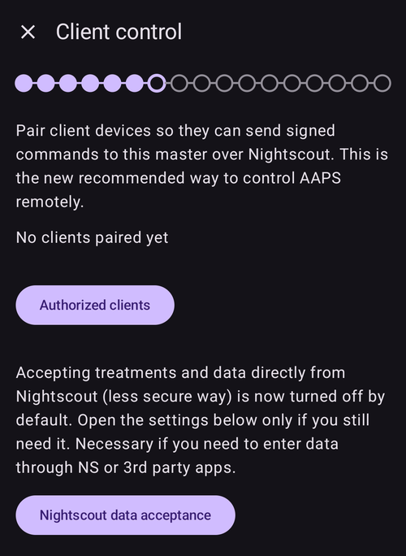

"**Nightscout veri kabulü**", "**Senkronizasyon**" ayarlarını açar. Burada Nightscout'tan alınan her veri türünün kendi anahtarı vardır:


Bir sonraki ekrana geçmek için "**İLERİ**" düğmesine basın.

(setup-wizard-instance-name)=
## Bu telefonu kim kullanıyor?

Burada bu telefonu kullanan kişinin adını girersiniz. Bu ad, raporlarda ve senkronizasyon sırasında bu **AAPS** kurulumunu diğerlerinden ayırır, örneğin ailenizde iki çocuk **AAPS** kullanıyorsa. Ayrıca dışa aktarılan ayar dosyalarının adlarında kullanılır ve saatte gösterilir.

Herhangi bir şey olabilir. Bunu daha sonra **Ayarlar → Genel → Kurulum adı** bölümünden değiştirebilirsiniz.

Bir sonraki ekrana geçmek için "**İLERİ**" düğmesine basın.


## Patient type

Burada "Hasta tipi"ni seçersiniz. Bu önemlidir, çünkü **AAPS** yazılımı hastanın yaşına göre farklı sınırlar kullanır. Bu, güvenlik ve emniyet açısından önemlidir.

Bir öğün için **izin verilen maksimum bolus** da burada ayarlanır. Yani tipik öğünlerinizi karşılamak için vermeniz gereken en büyük bolus. Bu, bir öğün için bolus yaparken yanlışlıkla aşırı doz vermenizi önlemeye yardımcı olan bir güvenlik özelliğidir.

İkinci sınır benzer bir mantığa sahiptir, ancak beklediğiniz en yüksek karbonhidrat alımıyla ilgilidir.

Bu değerleri ayarladıktan sonra bir sonraki ekrana geçmek için "**İLERİ**" düğmesine basın:


## İnsülin

Burada pompanızda kullanılan insülini ayarlarsınız. Yeni insülin profilleri **en az 5 sa İES** gerektirir.

İnsülin düzenleyicisini açmak için "**İnsülin**" düğmesine basın:


Düzenleyicide insüline bir **takma ad** verebilir, **Tepe** (dakika olarak) ve **İES** (saat olarak) değerlerini ayarlayabilirsiniz. En hızlı yol, "**Tepe değerini şuradan yükle**" ile hazır bir ayar yüklemektir — **Novorapid**, **Fiasp** veya **Lyumjev** seçin — ve tepe değeri sizin için doldurulur. Alttaki grafik, ortaya çıkan insülin etki eğrisini önceden gösterir.


İnsülininize uyan hazır ayarı seçin, örneğin **Fiasp**:


```{admonition} Use your insulin brand's preset peak
:class: danger
Uzman değilseniz lütfen tepe değerini değiştirmeyin — her insülin markası için hazır değerler genellikle iyi çalışır.
```

Yeni bir **AAPS** kullanıcısıysanız **İES** değerini 9 saat olarak ayarlayın — nedenini anlamak için [İnsülin etki süresi (İES) ve tepe](#Config-Builder-insulin-dia) bölümüne bakın.

```{admonition} "Insulin configuration changed" dialog
:class: note
Eşleştirilmiş bir istemci (_örneğin_ başka bir telefon) insülin yapılandırmasını değiştirdiyse bir pencere açılır. Onun değişikliklerini yüklemek için **Tamam** düğmesine, düzenlemeye devam etmek için **Vazgeç** düğmesine basın (bir sonraki kaydetmeniz onun değişikliklerinin üzerine yazar).
```


Kaydet simgesine (sağ üst) basın, ardından bir sonraki ekrana geçmek için "**İLERİ**" düğmesine basın.

## Kan şekeri kaynağı

Burada **AAPS**'in glikoz verilerini nereden alacağını seçersiniz. Lütfen [KŞ kaynağınızın](../Getting-Started/CompatiblesCgms.md) dokümantasyonunu okuyun.

Birçok kaynak vardır — listeyi kaydırın ve kullandığınız kaynağı seçin:


Bir kaynak seçtiğinizde kartı genişler ve iki düğme gösterir: verilerin nasıl alınacağını ayarlamak için "**Ayarlar**" ve kaynağın kendi ekranını açmak için "**Eklentiyi aç**". Aşağıdaki örnekte **BYODA** seçilmiştir. Bazı kaynaklarda bu aşamada ayarlanacak bir şey yoktur, bu yüzden genellikle doğrudan bir sonraki ekrana geçebilirsiniz:


Seçiminizi yaptıktan sonra bir sonraki ekrana geçmek için "**İLERİ**" düğmesine basın.

(setup-wizard-profile)=
## Profile

Şimdi Kurulum Sihirbazı'nın çok önemli bir bölümüne giriyoruz.

Bir sonraki ekranda profil bilgilerinizi girmeye çalışmadan önce lütfen [profiller](../SettingUpAaps/YourAapsProfile.md) hakkındaki dokümantasyonu okuyun.

```{admonition} Working profile required - no exceptions here !
:class: danger
**AAPS**'in güvenli çalışması için doğru bir profil gereklidir.

Profilinizi belirlemiş ve doktorunuzla konuşmuş olmanız gerekir. Ayrıca profilin başarılı bazal oran, İDF ve IC testleriyle çalıştığı kanıtlanmış olmalıdır!

Bir robota yanlış veri girilirse başarısız olur - her seferinde. **AAPS** yalnızca kendisine verilen bilgilerle çalışabilir. Profiliniz çok güçlüyse hipoglisemi, çok zayıfsa hiperglisemi riskiniz olur. 
```

Profil düzenleyicisini açmak için "**Profil**" düğmesine basın:


Düzenleyici boş açılır ("Kayıt mevcut değil"). Yeni bir profil oluşturmak için alttaki "**+**" düğmesine basın:


Gerekirse uzun vadede birden fazla profiliniz olabilir. Burada yalnızca bir tane oluşturuyoruz.

```{admonition} Profile only for tutorial - not for your usage
:class: note
Buradaki örnek profil yalnızca verilerin nasıl girileceğini göstermek içindir.

Doğru veya çok iyi ayarlanmış bir profil olması amaçlanmamıştır, çünkü her kişinin ihtiyaçları çok farklıdır.

Gerçek döngü için bunu kullanmayın!
```

Yeni profilin (örneğin "**LocalProfile1**") dört sekmesi vardır: **IC**, **İDF**, **BAZAL** ve **HDF**. Profili yeniden adlandırmak için profil adının yanındaki kaleme basın. Her sekmeyi doldurun — bir sekme geçerli değerler içerene kadar kırmızı kalır ve bir hata mesajı gösterir:


"**IC**" sekmesine basın ve [IC](#your-aaps-profile-insulin-to-carbs-ratio) değerlerinizi girin. Daha fazla zaman dilimi eklemek için "**+**" düğmesini kullanın:


"**İDF**" sekmesine basın ve [İDF değerlerinizi](#your-aaps-profile-insulin-sensitivity-factor) girin:


"**BAZAL**" sekmesine basın ve [bazal değerlerinizi](#your-aaps-profile-basal-rates) girin:


"**HDF**" sekmesine basın ve kan şekeri hedef değerlerinizi girin.

Açık döngüde bu hedef daha geniş bir aralık olabilir. Aksi halde **AAPS** sizi sürekli olarak geçici bazal oranını veya başka bir ayarı değiştirmeniz için uyarır ve bu yorucu olabilir.

Daha sonra, kapalı döngüde, genellikle alt ve üst sınır için tek bir değeriniz olacaktır. Bu, **AAPS**'in hedefe ulaşmasını kolaylaştırır ve size genel olarak daha iyi bir diyabet kontrolü sağlar.

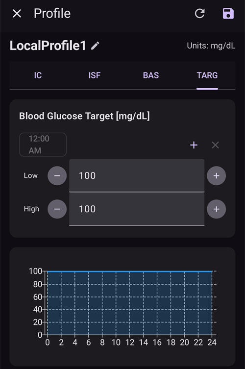

Dört sekmenin tümü geçerli olduğunda **kaydet simgesi** (sağ üst) etkin hale gelir. Profili kaydetmek için ona basın:


Sol üst köşedeki "**X**" ile düzenleyiciyi kapatın. Profil özeti, profilin adını, toplam günlük bazalını (∑), birimleri ve IC ile İDF değerlerini grafikleriyle birlikte gösterir:


```{admonition} Several defined but only one active profile
:class: note
Birden fazla profil tanımlayabilirsiniz, ancak aynı anda yalnızca bir profil etkin olarak çalışır.
```

Sağ alttaki "**▶**" (etkinleştir) düğmesine basın. "**Etkinleştir**" ekranı açılır. Henüz kullanımda bir insülin olmadığı için, profil değişiminin bunu kaydedebilmesi amacıyla önce kullandığınız insülini seçmenizi ister. Siz seçene kadar "**Etkinleştir**" düğmesi gri kalır:


"**İnsülin Seçin**" düğmesine basın ve daha önce ayarladığınız insülini seçin. Yüzdeyi %100'de bırakın ve "**Etkinleştir**" düğmesine basın:

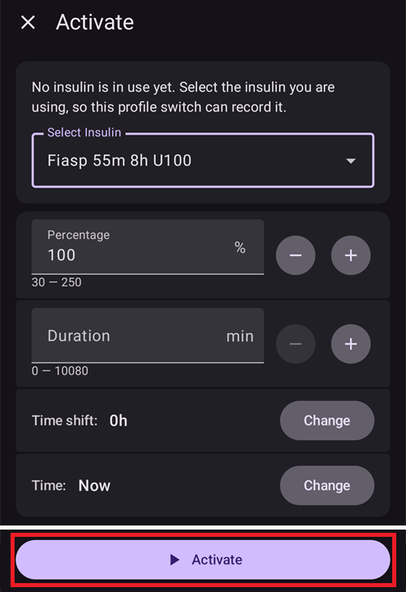

Bir profil değişimi penceresi açılır. Bu durumda ayarları olduğu gibi bırakın ve "**Tamam**" ile onaylayın:

```{admonition} Profile switch dialog
:class: note
Bu genel pencereyi, hastalık veya spor gibi profilinizi koşullara uydurmanız gereken durumlarda nasıl kullanacağınızı daha sonra öğreneceksiniz.
```


Profiliniz artık etkin. Bir sonraki ekrana geçmek için "**İLERİ**" düğmesine basın.

## İnsülin pompası

Şimdi insülin pompanızı seçersiniz. Lütfen [insülin pompanızın](../Getting-Started/CompatiblePumps.md) dokümantasyonunu okuyun.

Listeyi kaydırın ve pompanızı seçin. Bu örnekte "**Sanal pompa**" kullanıyoruz. Bu, hâlâ öğrenirken ve henüz gerçek bir pompa bağlamadığınızda yararlıdır:


Birçok pompa desteklenir — kendi pompanızı bulmak için aşağı kaydırın:


Gerçek bir pompa seçtiğinizde **AAPS** onay ister, çünkü profilinizin bazal oranlarını pompaya kopyalayacak ve pompada kayıtlı bazal oranlarının üzerine yazacaktır. "**Tamam**" düğmesine yalnızca **AAPS** profilinizdeki bazal oranları doğruysa basın; aksi halde "**Vazgeç**" düğmesine basın ve pompaya daha sonra geçin:


Seçtiğiniz pompa Bluetooth ile iletişim kuruyorsa, **AAPS** sihirbazı bitirdiğinizde yakındaki cihazlara bağlanmak için izin ister (bkz. [Bluetooth izni](#setup-wizard-bluetooth-permission)).

Profilinizi zaten ayarladıysanız ve pompanızı nasıl bağlayacağınızı biliyorsanız, şimdi bağlayabilirsiniz. Aksi halde şimdilik **Sanal pompa**'da bırakın — bunu istediğiniz zaman değiştirebilirsiniz. Ya da sol üst köşedeki okla Kurulum Sihirbazı'ndan çıkın ve **AAPS**'in önce size birkaç kan şekeri değeri göstermesini bekleyin.

Bir sonraki ekrana geçmek için "**İLERİ**" düğmesine basın.

## APS algorithm

APS algoritmanız olarak OpenAPS SMB algoritmasını kullanın. Adına rağmen, algoritmanın SMB özelliği siz AAPS'i tanıyana ve ilk görevleri tamamlayana kadar kapalıdır. OpenAPS SMB zaten OpenAPS AMA'dan daha yenidir ve genel olarak daha iyidir.

SMB başta kapalıdır, çünkü SMB özelliği kan şekeri artışına daha hızlı tepki verir: bazal oran yüzdesini artırmak yerine Süper Mikro Bolus kullanır. Profiliniz başlangıçta, biraz deneyim kazandıktan sonraki kadar iyi olmadığı için bu özellik ilk başta kapalıdır.

```{admonition} Only use the older algorithm **OpenAPS AMA** if you know what you are doing
:class: note
OpenAPS AMA, yüksek değerleri düzeltmek için mikro bolusları desteklemeyen en temel algoritmadır. Bu algoritmayı kullanmanın daha iyi olduğu durumlar olabilir, ancak önerilen bu değildir.
```

"**OpenAPS SMB**" seçin, ardından ayrıntıları görmek için "**Ayarlar**" düğmesine basın:


Buradaki tek seçenek "**Dinamik hassasiyet kullanın**" seçeneğidir. Bunu kapalı bırakın ve şimdilik hiçbir şeyi değiştirmeyin — yalnızca metni okuyun.

**Görevler**'in koyduğu sınırlar nedeniyle şu anda zaten ne "kapalı döngü" ne de "SMB özellikleri"ni kullanabilirsiniz.

Geri dönün ve bir sonraki ekrana geçmek için "**İLERİ**" düğmesine basın:

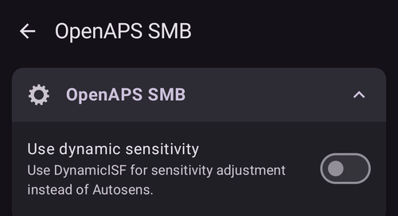

## Duyarlılık algılama

Standart duyarlılık eklentisi olarak "**Oref1 duyarlılık**" seçili kalsın:


"**Ayarlar**" düğmesine basarsanız emilim ayarlarını gözden geçirebilirsiniz; varsayılan değerler (_örneğin_ 6 sa emilim kesme) şimdilik uygundur.

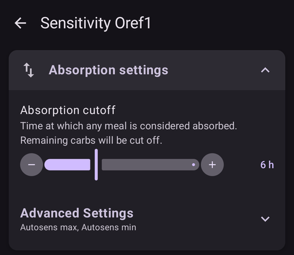

Bir sonraki ekrana geçmek için "**İLERİ**" düğmesine basın.

## 1. Görev'i başlatın

Şimdi Görevler'e giriyorsunuz — diğer **AAPS** özelliklerine erişmek için gereken yeterlilik.

"**Görevleri Aç**" düğmesine basın:


Kurulumumuz şu anda bu Görev'i başarıyla tamamlamak için tam olarak hazır olmasa bile burada 1. Görev'i başlatıyoruz. Ama bu bir başlangıç.

**1. Görev**'in "**Başlat**" düğmesine basın:


Görev genişler ve tek tek kontrollerini gösterir. Bazı adımlarda zaten ilerleme kaydettiğinizi, diğerlerinin ise henüz yapılmadığını görebilirsiniz:


Geri dönün, ardından Kurulum Sihirbazı'nı tamamlamak için "**BİTİR**" düğmesine basın:


"**BİTİR**" düğmesine bastıktan sonra **AAPS**'in ana ekranına gelirsiniz. Bilgi mesajlarıyla birlikte bir "**Bildirim**" paneli açılabilir, örneğin az önce yaptığınız profil değişimi hakkında. Mesajı silmek için her mesajın altındaki "**Kapat**" düğmesine basın.

Kurulum Sihirbazı'ndan herhangi bir anda yanlışlıkla çıkarsanız sihirbazı yeniden başlatabilir veya [AAPS döngüsünün yapılandırmasını](../SettingUpAaps/ChangeAapsConfiguration.md) elle değiştirebilirsiniz.

(setup-wizard-bluetooth-permission)=
## Bluetooth permission

Bluetooth ile bağlanan bir pompa seçerseniz (örneğin **Omnipod Dash**), bir bant **AAPS**'in Bluetooth iznine ihtiyacı olduğunu hatırlatır. Şimdilik "**Kapat**" düğmesine basabilirsiniz — izin, sihirbazı bitirdikten sonra verilir:


Kurulum Sihirbazı bittiğinde **AAPS** ana ekranında bir "**Gerekli İzinler**" paneli gösterilir. Diğer izinler zaten verilmiştir; "**Bluetooth**" yanındaki "**İzin ver**" düğmesine basın:


**AAPS**'in pompanızı bulup ona bağlanabilmesi için "**Allow**" seçeneğini seçin:


**AAPS** döngünüz artık tam olarak kurulduysa lütfen bir sonraki bölüme geçin: ["Görevleri tamamlama"](../SettingUpAaps/CompletingTheObjectives.md).
