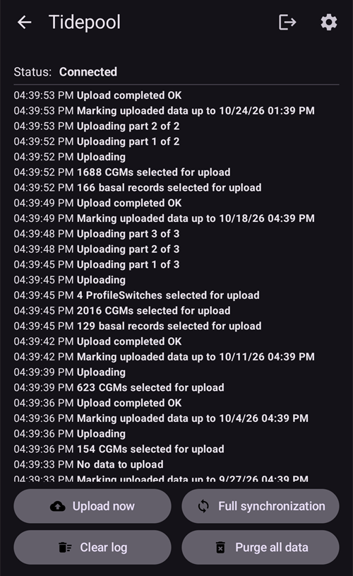

# Tidepool

Tidepool, KŞ, insülin ve karbonhidrat verilerini (ve tedavilerinize eklediğiniz notları) toplayan üçüncü taraf bir araçtır. Bu verileri analiz etmek ve klinik ekibinizle paylaşmak için kullanılabilir. AAPS 3.2 sürümünden beri, 1. Görevin bir kısmını yerine getirmek için Nightscout'a alternatif olarak kullanılabilir. Klinik ortamlarla iyi bütünleşen alternatif bir raporlama platformu olarak Nightscout ile birlikte de kullanılabilir. Bu, Nightscout'un uzaktan izleme ve kontrol özelliklerini isteyen, ancak klinik ekiplerinin daha rahat ettiği bir raporlama platformu da kullanmak isteyen, AAPS kullanan çocuklar için tercih edilen seçenek olabilir.

Tidepool'un yalnızca raporlama için olduğunu anlamak önemlidir. Gerçek zamanlı bir takip uygulaması DEĞİLDİR. Ana AAPS telefonu dışında takipçileriniz olması gerekiyorsa Nightscout'u da kurmalısınız.

Not: Tidepool kuruluşu, iOS Loop ürününü FDA onayıyla piyasaya sürmüştür. Bu çalışmanın, onların veri raporlama platformuyla veya AAPS ile hiçbir ilgisi yoktur.

## Adım 1 - Bir Tidepool hesabı oluşturun

- [tidepool.org](https://www.tidepool.org/) adresine gidin

- “Personal Sign Up” (kişisel kayıt) veya “Sign Up” (kayıt ol) seçeneğini seçin

- Bir e-posta adresi ve parola oluşturun ve bunları not edin

- “Personal Account” (kişisel hesap) seçeneğini seçin ve “Continue” (devam) düğmesine tıklayın

- Hasta bilgileri bölümünü doldurun ve kullanım koşullarını kabul edin

- E-posta adresinize gelen talimatları izleyerek e-posta adresinizi doğrulayın

## Adım 2 - AAPS'i Tidepool'a bağlayın

- Ana ekranın sol üst köşesindeki **menüyü** (☰) açın ve "**Konfigürasyon**" seçeneğini seçin

- "**İletişim**" kategorisini açın ve "**Tidepool**" eklentisini etkinleştirin:

- Tidepool'un altındaki "**Eklentiyi aç**" düğmesine dokunun, ardından sağ üst köşedeki **Giriş** simgesine (bir kapıya giren ok) dokunun

- Tidepool giriş sayfasında bir tarayıcı penceresi açılır. Yukarıda 1. adımda oluşturduğunuz e-posta adresi ve parola ile giriş yapın:

- Giriş başarılı olduktan sonra tarayıcı kapanır ve Tidepool ekranı "**Bağlandı**" durumunu gösterir; alttaki günlük, veri yüklemelerini kaydeder. Giriş başarısız olursa bilgilerinizin doğru olduğunu ve e-posta adresinizi Tidepool ile doğruladığınızı kontrol edin.

- Tidepool eklentisinin "**Ayarlar**" bölümünde "**Bağlantı Ayarları**" seçeneğini açın. Varsayılan olarak "**Nightscout bağlantı ayarlarını kullan**" açıktır. Böylece Tidepool, Nightscout için ayarladığınız koşullarla aynı koşullarda yükleme yapar. Tidepool için ayrı koşullar istiyorsanız bunu kapatın. Örneğin Nightscout mobil veri de kullanırken Tidepool'a yalnızca Wi-Fi'da ve şarj olurken yükleme yapmak için.

 

Verileriniz Tidepool'a yüklendikten sonra bunları nasıl kullanacağınız hakkında daha fazla yardım için şu adresi ziyaret edin: [https://www.tidepool.org/viewing-your-data](https://www.tidepool.org/viewing-your-data)

(tidepool-menu)=
## Tidepool düğmeleri

Tidepool ekranının sağ üst köşesinde:

- **Giriş** veya **Çıkış** simgesi — Tidepool hesabınıza bağlanın veya bağlantıyı kesin. Bunlardan yalnızca biri gösterilir: oturumunuz kapalıyken **Giriş**, oturumunuz açıkken **Çıkış**. **AAPS**, oturumunuzu kapatmadan önce sizden onay ister.
- Dişli simgesi — Tidepool ayarları.

Tidepool ekranının altındaki düğmeler:

- "**Şimdi yükle**" — bir sonraki otomatik yüklemeyi beklemeden yeni verileri hemen yükleyin.
- "**Tam senkronizasyon**" — **AAPS**'te kayıtlı tüm verileri yeniden yükleyin.
- "**Tüm verileri sil**" — **AAPS**'in Tidepool hesabınıza yüklediği **tüm** verileri silin. Bu işlem geri alınamaz. Bunu yalnızca yanlış veya yinelenen verileri kaldırmak için kullanın, ardından verilerinizi yeniden yüklemek için "**Tam senkronizasyon**" çalıştırın.
- "**Günlüğü temizle**" — Tidepool ekranında gösterilen günlüğü boşaltın.

Tidepool'da, **AAPS** 4 tarafından yüklenen veriler **AAPS** cihaz adı altında gösterilir. Tidepool'u daha eski bir sürümle kullandıysanız [AAPS v4'te neler değişti](#v4changes-tidepool) bölümüne bakın. 
