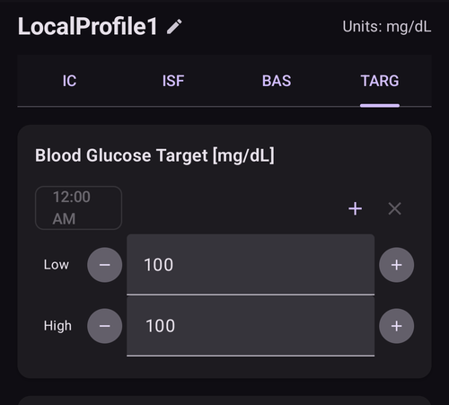
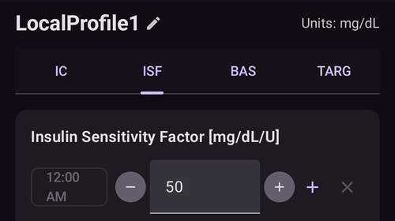

# AAPS profiliniz

**AAPS Profiliniz**, **AAPS**'in sensör glikoz düzeylerinize göre insülini nasıl vereceğini belirleyen dört temel parametreden oluşan bir settir. Bunlar **AAPS**'in üzerine kurulduğu ana parametrelerdir. **Görevler**'de ilerledikçe değiştirebileceğiniz ek parametrelerin (SMB ayarları gibi) kilidini açarsınız, ancak bu özelliklerin iyi çalışması temeldeki **Profil**'inizin doğru olmasına bağlıdır. **Profil** şunları içerir:
* [glikoz hedefleri](#profile-glucose-targets),
* [bazal oranlar](#your-aaps-profile-basal-rates) (BR),
* [insülin duyarlılık faktörleri](#your-aaps-profile-insulin-sensitivity-factor) (İDF) ve
* [karbonhidrat insülin oranları](#your-aaps-profile-insulin-to-carbs-ratio) (IC veya ICR).

```{admonition} Where did DIA go?
:class: note
**İnsülin etki süresi (İES)** artık **Profil**'inizin bir parçası değildir. Bunun yerine her insülin için ayrı ayarlanır — bkz. [Yönet → İnsülin ayarları](#Config-Builder-insulin-dia).
```

**AAPS** yönetiminin bir parçası olarak kullanıcılar, **Profil** ayarlarının doğruluğunu sürekli olarak değerlendirmeli ve dikkatle incelemelidir. Ayarları burada verilen sırayla ele almanız önerilir. Başka bir ayarı değiştirmeden önce bir ayarı doğru yapmayı hedefleyin. Tek seferde büyük değişiklikler yapmak yerine küçük adımlarla çalışın. Her değişiklikten sonra yeni profili etkinleştirmeyi unutmayın. Ayarlarınızı dışa aktararak [**Profil** ayarlarınızı düzenli olarak yedekleyin](#YourAapsProfile_Profile-backup).

**Profil** ayarlarınız birbirini etkiler - bazı durumlarda birlikte iyi çalışan ama başka durumlarda çalışmayan 'yanlış' ayarlarınız olabilir. Örneğin çok yüksek bir bazal, çok yüksek bir **CR** ile aynı zamana denk geldiğinde. Bu, ayarları tek tek ele almanız ve çeşitli durumlarda birbiriyle uyum içinde çalıştıklarını kontrol etmeniz gerektiği anlamına gelir.

[OtoAyar](https://autotuneweb.azurewebsites.net/)'ı düşüncenize rehberlik etmesi için kullanabilirsiniz, ancak körü körüne takip edilmemelidir: sizin için veya her durumda iyi çalışmayabilir.

```{admonition} Your diabetes may vary
:class: note
**Profiller** kişiden kişiye çok farklıdır.

Bazal oranlar (BR), insülin duyarlılık faktörleri (İDF) ve karbonhidrat insülin oranları (IC veya ICR) için mutlak değerler ve insülin ihtiyacındaki eğilimler kişiden kişiye çok farklıdır; bu, biyolojinize, cinsiyetinize, yaşınıza, kondisyonunuza vb. ve ayrıca hastalık ve yakın zamanda yapılan egzersiz gibi kısa süreli etkenlere bağlıdır. Bu konuda daha fazla rehberlik için Adam Brown'ın [“Bright Spots and Landmines”](https://diatribe.org/bright-spots-and-landmines/) kitabı okunması çok iyi bir kitaptır.

```

Son dört parametre (glikoz hedefleri, bazal oranlar, insülin duyarlılık faktörleri ve karbonhidrat insülin oranları) 24 saatlik bir süre boyunca farklı değerlere ayarlanabilir, gerekirse saatlik olarak değiştirilebilir.


Aşağıda **AAPS**'ten _örnek_ bir profilin ekran görüntüleri gösterilmektedir. Lütfen dikkat: aşağıdaki örnek profil çok sayıda zaman noktası gösterir. **AAPS** ile yeni başladığınızda profiliniz muhtemelen çok daha basit olacaktır.


(profile-glucose-targets)=
## Glikoz hedefleri

### Description

**KŞ hedefiniz** temel bir değerdir ve **AAPS**'in tüm hesaplamaları buna dayanır. Bu, kan şekerinizi genellikle içinde tutmayı hedeflediğiniz hedef aralıktan farklıdır. Hedef, **AAPS** hesaplamalarında kullanılır: **AAPS**, **KŞ**'nizin hedef aralığın dışına çıkacağını tahmin ederse, sizi bu aralığa geri getirmek için harekete geçer.

Hedefler şu sınırlar içinde tanımlanabilir:

|          | _Düşük_ hedef            | _Yüksek_ hedef             |
| -------- | ------------------------ | -------------------------- |
| Minimum  | 4,4 mmol/L veya 80 mg/dL | 5 mmol/L veya 90 mg/dL     |
| Maksimum | 10 mmol/L veya 180 mg/dL | 11,1 mmol/L veya 200 mg/dL |

### Impact

**Profil**'inizdeki hedef çok genişse (örneğin 3 mmol/L [50 mg/dL] veya daha geniş), genellikle **AAPS**'in çok az işlem yaptığını görürsünüz. Bunun nedeni, **KŞ** düzeyinin bu geniş aralıkta bir yerde olacağının tahmin edilmesidir; bu yüzden **AAPS**'in geçici bazal oranı uygulaması pek olası değildir.

### Nasıl ayarlanır

**Aşağıdaki şekil**, hedefin bir **AAPS** profilinde nasıl ayarlanabileceğine dair bir örnek gösterir.



**KŞ** hedefleri kişisel tercihlerinize ve ihtiyaçlarınıza göre ayarlanır. Örneğin geceleri hipolardan endişe ediyorsanız, hedefinizi 21:00 - 07:00 arası için biraz daha yüksek, 117 mg/dL (6,5 mmol/L) olarak ayarlayabilirsiniz. Kahvaltı bolusundan önce sabah yeterince aktif insülininiz (AİNS) olduğundan emin olmak istiyorsanız, sabah 7 ile 8 arası için daha düşük bir hedef, 81 mg/dL (4,5 mmol/L) ayarlayabilirsiniz.

[Açık Döngü](#KeyAapsFeatures-OpenLoop)'deyken, özellikle [ilk görevlerde](../SettingUpAaps/CompletingTheObjectives.md) ilerlerken, **AAPS**'in nasıl davrandığını öğrenirken ve **Profil**'inizi ayarlarken geniş aralıklı bir hedef kullanmak iyi bir seçenek olabilir.<br/> [Kapalı Döngü](#KeyAapsFeatures-ClosedLoop)'deyken (**[6. Görev](#objectives-objective6)**'den itibaren), **AAPS**'in **KŞ** dalgalanmalarına hızla tepki vermesini sağlamak için, günün her saati için tek bir hedefiniz olana kadar aralığı daraltmanız önerilir (_Düşük_ hedef = _Yüksek_ hedef).

(your-aaps-profile-basal-rates)=

## Bazal oranlar

### Description

Bazal insülin oranınız (Ünite/saat) arka plan insülinini sağlar ve yemek veya egzersiz olmadığında glikoz düzeylerinizi sabit tutar.

İnsülin pompası, karaciğerin çok fazla glikoz salmasını önlemek ve glikozu vücut hücrelerine taşımak için birkaç dakikada bir az miktarda hızlı etkili insülin verir. Bazal insülin, diyetinize bağlı olarak genellikle toplam günlük dozunuzun (TGD) %40 - 50'sini oluşturur ve genellikle bir sirkadiyen ritim izler; 24 saat içinde insülin ihtiyacında bir tepe ve bir çukur vardır. Daha fazla bilgi için Gary Scheiner'ın [“Think like a Pancreas”](https://amzn.eu/d/iVU0RGe) kitabının 6. bölümü çok faydalıdır.

Çoğu tip 1 diyabet eğitmeni (ve tip 1 diyabetli kişiler!), İDF ve ICR'nizi iyileştirmeye çalışmadan önce bazal oranlarınızı doğru ayarlamanız gerektiği konusunda hemfikirdir.

### Impact

Doğru bazal oranlar, aralık içinde uyanmanızı ve öğünleri atlamanızı ya da günün daha erken veya geç saatlerinde yemenizi, yükselme veya düşme olmadan mümkün kılar.

Çok yüksek bazal oran, düşük KŞ'lere yol açabilir. Tersi de geçerlidir.

**AAPS**, varsayılan bazal oranı temel çizgi olarak alır. Bazal oran çok yüksekse, 'sıfır geçici bazal' olması gerekenden daha büyük bir negatif AİNS olarak sayılır. Bu, **AAPS**'in sonunda AİNS'i sıfıra getirmek için gerekenden daha fazla ek düzeltme yapmasına yol açar.

Yani çok yüksek bir bazal oran, hem varsayılan oranla hem de birkaç saat sonra **AAPS** hedefe doğru düzeltme yaparken düşük **KŞ** değerlerine neden olur.

Tersine, çok düşük bir bazal oran yüksek KŞ değerlerine ve değerlerin hedefe indirilememesine yol açabilir.

### Nasıl ayarlanır

**Aşağıdaki şekil**, bazal oranların bir **AAPS** profilinde nasıl ayarlanabileceğine dair bir örnek gösterir.


Bazal oranlarınızı doğru ayarlamak deneme yanılma ile yapılır ve diyabet ekibinize danışılarak yapılmalıdır.

Genellikle 24 saatlik bir süre içinde <u>aralıklı</u> açlık sırasında bazal oranlarınızı ve insülin ihtiyacınızı gözlemlemeye dayanan bazal test yöntemleri vardır. Bazal oranlarınızı günün tamamı için test etmeniz gerekse de, 24 saat boyunca aralıksız aç kalmanız önerilmez. Bunun nedeni, vücudun bunu dengelemek için hormonlar gibi mekanizmaları devreye sokmasıdır. Önerilen yöntemlerden biri, 3 farklı günde 8 saatlik bir süre boyunca aç kalmaktır.

Önerilen yöntem döngüyü askıya almaktır (güvenlik için, düşükleri önlemek amacıyla AAPS'i [**LGS**](#KeyAapsFeatures-LGS) moduna alabilirsiniz; [6. görev](#objectives-objective6) için yapıldığı gibi); bu durumda varsayılan arka plan bazal oranınıza geri dönülür. **KŞ**'nizin nasıl değiştiğini gözlemleyin: düşüyorsa bazal oran çok yüksektir. Tersi de geçerlidir.<br/> Başka bir yöntem (daha zor olabilir) döngüyü çalışır durumda tutmak ve **AİNS**'in nasıl değiştiğini izlemektir. **AİNS** negatifse bazal oranınız çok yüksektir. Tersi de geçerlidir. Bu yöntemin **KŞ**'yi düzeltmek için **İDF**'ye dayandığını unutmayın; bu yüzden başarılı olması için diğer değişkenlerin de makul ölçüde doğru ayarlanmış olması gerekir.<br/> Bazal oranlarınızı ayarlamanın bir başka yolu, tüm AKRB tükendikten sonra gece boyunca döngünün ne yaptığını izlemektir. Bu yöntem özellikle çocuklar için, aç kalmanın zor olduğu veya insülin ihtiyacının sık değiştiği durumlarda faydalıdır. [Tidepool'dan Dr. Saleh Adi](https://www.youtube.com/watch?v=-fpWnGRhLSo), bazal oranlarınızı iyileştirmek için gece KŞ çizgilerinin nasıl analiz edileceğine dair faydalı yollar anlatıyor.

Kapalı döngüdeki düzenleri analiz ederek bazal profilinizde nasıl ince ayar yapacağınızı [burada](../GettingHelp/ProfileTuning.md) görebilirsiniz.

Bazal testinizin sonucuna göre işlem yaparken, **Profil**'deki değişiklikler yükselişten/düşüşten 1 ila 2 saat önce (insülin tipinize bağlı olarak) yapılmalıdır. **Bazal oranlar** ayarlarınızdan emin olana kadar testi gerektiği kadar tekrarlayın.

(your-aaps-profile-basal-not-compatible)=
#### Mesaj: "Bazal oran mevcut pompa ile uyumlu değildir"

Her pompanın sınırları vardır: verebileceği en düşük ve en yüksek bazal oran ve bazı pompalarda (örneğin Dana, Accu-Chek Combo, Medtronic ve Diaconn G8) yalnızca tam saatte değişebilen bazal oranlar. **AAPS**, seçtiğiniz yüzdeyi uyguladıktan **sonra** profilinizi kullandığınız pompaya göre kontrol eder.

Bir bazal oran bu sınırların dışındaysa, **Etkinleştir** ekranı bu mesajı gösterir ve **Etkinleştir** düğmesi gri kalır:


Örneğin gece 0,10 Ü/sa bazal oran ve %35 profil yüzdesi ile **AAPS**'in 0,035 Ü/sa vermesi gerekir. Bu, bir Dana pompasının verebileceğinden (0,04 Ü/sa) daha azdır.

Bunu çözmek için şunlardan birini yapın:

* başka bir yüzde seçin: bir bazal oran çok düşük oluyorsa **daha yüksek** bir yüzde, bir bazal oran çok yüksek oluyorsa **daha düşük** bir yüzde, veya
* [profili düzenleyin](#your-aaps-profile-create-and-edit-profiles) ve bazal oranı değiştirin.

Profil düzenleyicisi, bazal oranları yalnızca tam saatte başlatmanıza izin verir. Örneğin 06:30'da başlayan bir bazal oran yalnızca eski bir profilden gelebilir; örneğin bunu desteklemeyen bir pompaya geçtikten sonra.

(your-aaps-profile-insulin-sensitivity-factor)=

## İnsülin duyarlılık faktörü (İDF)

### Description

İnsülin duyarlılık faktörü (bazen düzeltme faktörü de denir), 1 ünite insülinin kan şekeri düzeyinizi ne kadar düşüreceğinin ölçüsüdür.

**mg/dL biriminde:** **İDF**'niz 40 ise, her ünite insülin kan şekerinizi yaklaşık 40 mg/dL düşürür (örneğin kan şekeriniz 140 mg/dL'den 100 mg/dL'ye düşer).

**mmol/L biriminde:** **İDF**'niz 1,5 ise, her ünite insülin kan şekerinizi yaklaşık 1,5 mmol/L düşürür (örneğin 8 mmol/L'den 6,5 mmol/L'ye).

Bu örneklerden görebileceğiniz gibi, **İDF** değeri ne kadar _küçükse_, insüline o kadar az duyarlısınız. Yani İDF'nizi 40'tan 35'e (mg/dL) veya 1,5'ten 1,3'e (mmol/L) düşürürseniz, buna genellikle **İDF**'nizi güçlendirmek denir. Tersine, **İDF** değerini 40'tan 45'e (mg/dL) veya 1,5'ten 1,8'e (mmol/L) artırmak **İDF**'nizi zayıflatmaktır.

### Impact

**Daha düşük / daha güçlü bir İDF** (örneğin 50 yerine 40), insülinin ünite başına **KŞ**'nizi daha az düşürdüğü anlamına gelir. This leads to a more aggressive / stronger correction from the loop with **more insulin**. **İDF**'niz çok güçlüyse (küçük değer), bu düşük **KŞ**'ye yol açabilir.

**Daha yüksek / daha zayıf bir İDF** (örneğin 35 yerine 45), insülinin ünite başına **KŞ**'nizi daha fazla düşürdüğü anlamına gelir. This leads to a less aggressive / weaker correction from the loop with **less insulin**. **İDF**'niz çok zayıfsa (büyük değer), bu yüksek **KŞ**'ye yol açabilir.

**Örnek:**
* **KŞ** 190 mg/dL (10,5 mmol/L) ve hedef 100 mg/dL (5,6 mmol/L).
* Yani `190 - 100 = 90 mg/dL` veya `10.5 - 5.6 = 4.9 mmol/L` kadar bir düzeltme istiyorsunuz
* `ISF = 30` -> `90 / 30 = 3` veya `ISF = 1.63` -> `4.9 / 1.63 = 3` ise: 3 ünite insülin
* `ISF = 45` -> `90 / 45 = 2` veya `ISF = 2.45` -> `4.9 / 2.45 = 2` ise: 2 ünite insülin

Çok düşük (ve bu yüzden daha agresif, nadir olmayan) bir **İDF** 'aşırı düzeltmelere' yol açabilir, çünkü **AAPS** kullanıcının yüksek bir **KŞ**'yi düzeltmek için gerçekte gerekenden daha fazla insüline ihtiyacı olduğunu hesaplar. Bu, aşağıdaki resimde görüldüğü gibi 'hız treni' şeklinde KŞ düzeylerine yol açabilir (özellikle aç karnına). Bu durumda **AAPS**'i daha az agresif yapmak için **İDF** değeri artırılmalıdır. Böylece **AAPS** daha küçük düzeltme dozları verir ve yüksek bir **KŞ**'yi aşırı düzelterek düşük **KŞ**'ye neden olmaktan kaçınır.


Tersine, çok yüksek ayarlanmış bir **İDF** yetersiz düzeltmelere yol açabilir; yani **KŞ**'niz hedefin üzerinde kalır – bu özellikle gece belirgindir.

### Nasıl ayarlanır

İDF değerlerinin bir **AAPS** profilinde nasıl ayarlanabileceğine dair bir örnek için **aşağıdaki şekle** bakın.



Gündüz İDF'nizi belirlemek için temel bir başlangıç noktası, onu 1.700 (94) kuralını kullanarak toplam günlük dozunuza (TGD) dayandırmaktır. Daha fazla bilgi Gary Scheiner'ın [“Think like a Pancreas”](https://amzn.eu/d/iVU0RGe) kitabının 7. bölümünde verilmiştir.

| 1700 (mg/dL ile ölçüyorsanız) veya 94 (mmol/L) / GTD = yaklaşık İDF.<br/><br/>Örnek: GTD = 40 Ü<br/>Yaklaşık İDF (mg/dL) = 1700/40 = 43<br/>Yaklaşık İDF (mmol/L) = 94/40 = 2,4 |
| ------------------------------------------------------------------------------------------------------------------------------------------------------------------------------------------------------- |
|                                                                                                                                                                                                         |

Bazal düzeylerinizin doğru olduğunu varsayarak bunu şöyle test edebilirsiniz: döngüyü askıya alın, **AİNS**'in sıfır olduğunu kontrol edin ve sabit bir 'yüksek' düzeye ulaşmak için birkaç glikoz tableti alın.

Ardından, hedef KŞ'nize ulaşmak için tahmini miktarda insülin (mevcut 1/İDF değerine göre) alın.

Bu genellikle çok düşük ayarlandığından dikkatli olun. Çok düşük olması, 1 Ü insülinin KŞ'yi beklenenden daha hızlı düşüreceği anlamına gelir.

(your-aaps-profile-insulin-to-carbs-ratio)=

## İnsülin karbonhidrat oranı (IC)

### Description

**ICR**, bir ünite insülinin kaç gram karbonhidratı karşıladığının ölçüsüdür.

Bazı kişiler **ICR** yerine kısaltma olarak **I:C** kullanır veya karbonhidrat oranından söz eder: **CR**.

Örneğin 1'e 10 (1:10) insülin-karbonhidrat oranı, yenen her 10 gram karbonhidrat için 1 Ü insülin aldığınız anlamına gelir. 25 g karbonhidratlık bir öğün için 2,5 Ü insülin gerekir.

**ICR**'niz daha zayıfsa (daha yüksek değer), örneğin 1:20, 10 g karbonhidratı karşılamak için yalnızca 0,5 Ü insüline ihtiyacınız olur. 25 g karbonhidratlık bir öğün için 25/20 = 1,25 Ü insülin gerekir.

Hormon düzeyleri ve fiziksel aktivite nedeniyle günün farklı saatlerinde farklı **ICR** değerlerine sahip olmak yaygındır. Birçok kişi en düşük/en güçlü **ICR** değerinin kahvaltı saatinde olduğunu görür, çünkü bu saatte insüline daha dirençli olma eğilimindedirler. Örneğin yetişkin bir kullanıcının **ICR** değeri kahvaltı için 1:8, öğle yemeği için 1:10 ve akşam yemeği için 1:10 olabilir; ancak bu düzenler herkes için geçerli değildir ve bazı kişiler akşam yemeğinde insüline daha dirençlidir ve o saatte daha güçlü/daha küçük bir **ICR** gerektirir.

> **NOT:**
> 
> Bazı Avrupa ülkelerinde, gıda için ne kadar insüline ihtiyaç olduğunun belirlenmesi için dilim ekmek birimi kullanılmıştır. Başlangıçta 1 dilim ekmek 12 gr karbonhidrata eşitken, bazıları daha sonra 10 gr karbonhidrata dönüştürdü.
> 
> Bu modelde karbonhidrat miktarı sabit ve insülin miktarı değişkendi. ("Bir dilim ekmek birimini karşılamak için ne kadar insülin gerekir?")
> 
> **ICR** kullanıldığında insülin miktarı sabit, karbonhidrat miktarı değişkendir. ("Bir ünite insülin kaç gram karbonhidratı karşılayabilir?")
> 
> Örnek:
> 
> Dilim ekmek birimi faktörü (BU = 12 g karbonhidrat): 2,4 Ü/BU -> Bir dilim ekmek birimi yediğinizde 2,4 ünite insüline ihtiyacınız vardır.
> 
> Karşılık gelen **ICR**: 12 g / 2,4 Ü = 5,0 g/Ü -> 5,0 g karbonhidrat bir ünite insülinle karşılanabilir.
> 
> BU faktörü 2,4 Ü / 12 g   ===>   IC = 12 g / 2,4 Ü = 5,0 g/Ü
> 
> Dönüşüm tabloları çevrimiçi olarak mevcuttur, örneğin [buradan](https://www.mylife-diabetescare.com/files/media/03_Documents/11_Software/FAS/SOF_FAS_App_KI-Verha%CC%88ltnis_MSTR-DE-AT-CH.pdf) ulaşabilirsiniz.

### Impact

**Daha düşük / daha güçlü bir ICR**, ünite başına daha az yiyecek demektir; yani sabit bir karbonhidrat miktarı için daha fazla insülin alırsınız. 'Daha agresif' olarak da adlandırılabilir. IC'niz çok güçlüyse, çok fazla insülin alıyorsunuz demektir; bu düşük **KŞ** değerlerine yol açabilir.

**Daha yüksek / daha zayıf bir ICR** = ünite başına daha fazla yiyecek; yani sabit bir karbonhidrat miktarı için daha az insülin alırsınız. "Daha az agresif" olarak da adlandırılabilir. IC'niz çok zayıfsa, ihtiyacınızdan daha az insülin alıyorsunuz demektir; bu yüksek **KŞ** değerlerine yol açabilir.

### Nasıl ayarlanır

**Aşağıdaki şekil**, bir kullanıcının **ICR** değerinin bir örneğini ve bunun bir **AAPS Profili**'nde nasıl ayarlanabileceğini gösterir. Bu değerleri girerken oranın son kısmını gireriz; yani 1:3,5'lik bir karbonhidrat insülin oranı yalnızca “3,5” olarak girilir.


Bir öğün sindirildikten ve **AİNS** sıfıra döndükten sonra **KŞ**'niz yemekten öncekinden yüksek kalıyorsa, **ICR**'niz büyük olasılıkla çok zayıftır (_yani_ sayı çok yüksektir ve yavaş yavaş düşürülmelidir). Tersine, **KŞ**'niz yemekten öncekinden düşükse **ICR** çok güçlüdür (_yani_ sayı çok küçüktür ve yavaş yavaş artırılmalıdır).

Bazal oranlarınızın doğru olduğunu varsayarak şöyle test edebilirsiniz: **AİNS**'in sıfır olduğunu ve hedef aralıkta olduğunuzu kontrol edin, karbonhidrat miktarı tam olarak bilinen bir yiyecek yiyin ve mevcut karbonhidrat insülin oranına göre tahmini miktarda insülin alın. En iyisi, günün o saatinde normalde yediğiniz yiyecekleri yemek ve karbonhidratlarını tam olarak saymaktır.

## Profille ilgili sık sorulan sorular

```{contents} Common questions related to the Profile
:depth: 1
:local: true
```

### Profilinizi doğru ayarlamanın önemi

**Profil ayarlarımı neden doğru yapmaya çalışmalıyım? Döngü bunu kendi başına halledemez mi?**

Hibrit kapalı döngü, yanlış **Profil** değerlerinden kaynaklanan kötü glisemik kontrolü en aza indirmek için insülin dağıtımında ayarlamalar yapmayı _deneyebilir_. Bunu örneğin, hipoya gidiyorsanız insülin iletimini durdurarak yapabilir. Ancak **Profil** ayarlarınız vücudunuzun ihtiyacına zaten olabildiğince yakınsa çok daha iyi bir glisemik kontrol elde edebilirsiniz. Bu, **AAPS**'in açık döngüden hibrit kapalı döngüye adım adım geçmek için aşamalı görevler kullanmasının nedenlerinden biridir. Ayrıca döngüyü açmanız gereken zamanlar olacaktır (sensör ısınması, sensör arızası _vb._), bazen gecenin ortasında; bu durumlar için ayarlarınızın doğru olmasını isteyeceksiniz.

**AAPS**'e başka bir açık veya kapalı döngü pompa sisteminden geçiyorsanız, bazal oranlar (**BR**), insülin duyarlılık faktörleri (**İDF**) ve karbonhidrat insülin oranları (**ICR**) için hangi değerleri kullanacağınız hakkında zaten makul bir fikriniz olacaktır.

İğneden (MDI) **AAPS**'e geçiyorsanız, önce MDI'dan pompaya geçişin nasıl yapılacağını okumanız ve geçişi diyabet ekibinize danışarak dikkatle planlayıp yapmanız iyi bir fikirdir. John Walsh ve Ruth Roberts'ın ["Pumping insulin"](https://amzn.eu/d/iaCsFa2) ve Gary Scheiner'ın [“Think like a Pancreas”](https://amzn.eu/d/iVU0RGe) kitapları çok faydalıdır.

### What causes high postprandial peaks in closed loop?
Her şeyden önce, bazal oranınızı kontrol edin ve karbonhidratsız bir bazal oranı testi yapın. Doğruysa ve karbonhidratlar tamamen emildikten sonra **KŞ**'niz hedefinize ulaşmak için düşüyorsa, öğünden bir süre önce **AAPS**'te 'Yakında Yenecek' geçici hedefi ayarlamayı deneyin veya endokrinoloğunuzla uygun bir ön bolus zamanı üzerine düşünün. <br/> Öğünden sonra **KŞ**'niz çok yüksekse ve karbonhidratlar tamamen emildikten sonra da çok yüksek kalıyorsa, endokrinoloğunuzla birlikte **ICR**'nizi düşürmeyi düşünün. **AKRB** varken **KŞ**'niz çok yüksek, karbonhidratlar tamamen emildikten sonra ise çok düşükse, endokrinoloğunuzla birlikte **ICR**'nizi artırmayı ve uygun bir ön bolus zamanını düşünün.

### KŞ'm yüksekte kalıyor ve döngü onu düşürmüyor
**AAPS**'in yeterli insülin vermemesinin olası nedenleri şunlardır:
* **İDF** yeterince güçlü değil
* Bazal oran yeterince güçlü olmayabilir
* **maxIOB** gibi bir güvenlik ayarı devreye girmiş olabilir. Veya ayarlarınıza bağlı olarak **SMB** şu anda devre dışıdır.
* Bir otomasyon kurulmuş ve **AAPS**'i geçersiz kılmıştır.

Ayrıca bkz. [AAPS profilinde ince ayar](../GettingHelp/ProfileTuning.md).

### AİNS'im negatif, bu bir sorun mu?
Negatif **AİNS**, vücudunuzdaki mutlak insülin miktarının (bazal + bolus) bazalden daha az olduğu anlamına gelir. Bu, **KŞ** yükselmeye başlar başlamaz **AAPS**'in daha fazla insülin göndermesine neden olur, çünkü insülinin eksik olduğunu düşünür; bu da daha sonra düşük **KŞ**'ye yol açabilir.

Negatif AİNS'inizin olmasının bazı nedenleri ve ne yapmanız gerektiği:
* çok güçlü bir bazal: **Profil**'inizde ince ayar yapın
* önceki öğünde çok fazla bolus: **Profil**'inizde ince ayar yapın veya bolusu doğru zamanda yapıp yapmadığınızı kontrol edin.
* İnsülin tipiniz için İES çok kısa ayarlanmış ve bu insülin birikmesine yol açıyor: [Yönet → İnsülin ayarları](#Config-Builder-insulin-dia) bölümünde ince ayar yapın
* fiziksel aktivite: bir dahaki sefere, artan duyarlılığı hesaba katmak için aktivite sırasında daha düşük bir [Profil yüzdesi](../DailyLifeWithAaps/ProfileSwitch-ProfilePercentage.md) kullanmayı düşünün.

## Profillerinizi yönetin

```{contents} Operations that you can perform on your **Profiles** in **AAPS**
:depth: 1
:local: true
```
(your-aaps-profile-create-and-edit-profiles)=
### Profil oluşturma ve düzenleme

**AAPS** v4'te profilleriniz **Yönet** ekranında (alt gezinme çubuğu) → **Profil** altında bulunur; bir eylem çubuğuna (**➕ Ekle**, **✏️ Düzenle**, **⧉ Klon**, **🗑️ Sil**, **▶ Etkinleştir**) sahip, kaydırılabilen bir kart karuseli olarak gösterilir. Bir profili yönetmek ve etkinleştirmek için bkz. [Profilleri yönetme ve etkinleştirme](#ProfileSwitch-manage-v4). Profillerin kendi sekmesi olduğu **AAPS** v3'ten mi geliyorsunuz? Bkz. [AAPS v4'te neler değişti](#v4changes-manage).

**✏️ Düzenle**'ye dokunmak düzenleyiciyi açar. Profil **adını** ve **birimlerini** ayarlayın, ardından sekmeleri kullanarak dört çizelgeyi doldurun:

- **IC** — karbonhidrat insülin oranı (g/Ü)
- **İDF** — insülin duyarlılık faktörü
- **BAZAL** — bazal oranlar
- **HDF** — hedef aralık


Her çizelge bir **zaman blokları** listesidir: bir blok ekleyin, başlangıç saatini ve değerini ayarlayın, ardından **Kaydet**'e dokunun.

**Profil**'inizde herhangi bir değişiklik yaparsanız, doğru **Profil**'i düzenlediğinizden emin olun: kullanılan profilin kartı **AKTİF** olarak işaretlenir, ancak ekranda seçili kart başka bir kart olabilir.

(your-aaps-profile-profile-from-scratch-for-a-kid)=
### Bir çocuk için sıfırdan profil oluşturma

[Profil yardımcısı](#aaps-screens-profile-helper) (menü ☰ → **Profil yardımcısı**), bir çocuk (18 yaşına kadar) için profil oluşturmanıza yardımcı olabilir.

**Önemli Not:**

**Profil Yardımcısı, çocuğunuz için ilk profili bulmanıza yardımcı olmak için tasarlanmıştır. İki farklı hastanenin veri setlerine dayalı olsa bile, yeni bir profil kullanmadan önce her zaman tıbbi ekibinizle görüşün!**

Profil yardımcısı, 18 yaşına kadar olan çocuğunuzun ilk profilini bulması için çocuklar için iki farklı hastaneden veri seti sunar.


1. **Profil 1** sekmesinde olduğunuzdan emin olun.
2. **Profil tipi** alanında "Varsayılan profil" seçili olduğundan emin olun.
3. Çocukların yaşını ve GTD (günlük toplam doz) **veya** ağırlığını girerek Varsayılan profili (hastane veri setine göre) ayarlayın.
4. **Profil 2** sekmesine geçin.
5. **Profil tipi**'ne basın ve "DPV Varsayılan profil" seçin.
6. Çocuğun yaşını, GTD'yi ve bazal yüzdesini girerek DPV Varsayılan profili (başka bir hastanenin veri setine göre) ayarlayın. DPV veri setinin yalnızca **bazal oranları** sağladığını unutmayın; bu yüzden bu profil için IC ve İDF sıfır olarak gösterilir.
7. **Karşılaştırma** sekmesini açın. Ayarlanan iki profilin karşılaştırması görüntülenir (aşağıdaki ekran görüntüsüne bakın).
8. Profilinizde bu önerilerden birine göre ince ayar yapmaya başlamak istiyorsanız, karşılaştırmanın altındaki **Klon** düğmesini kullanın.


### Profil değiştirme

Bkz. [Profil değişimi ve profil yüzdesi](../DailyLifeWithAaps/ProfileSwitch-ProfilePercentage.md).

(your-aaps-profile-clone-profile-switch)=
### Bir Profil değişimini yeni bir Profile klonlama


[Tedavi geçmişi](#aaps-screens-treatments) tüm geçmiş **Profil değişimlerini** gösterir. **Profil değişimi** sekmesine gittiğinizde, yeni bir **Profil** oluşturmak için geçmiş bir **Profil değişimini** temel olarak kullanabilirsiniz. Bu durumda zaman kayması ve yüzde yeni yerel profile uygulanır. **2**. satırda gösterilen **Klon** düğmesini kullanın.

Artık yeni oluşturulan Profili düzenlemek için [Profil ekranına](#your-aaps-profile-create-and-edit-profiles) (**Yönet → Profil**) gidebilirsiniz.

(YourAapsProfile_Profile-backup)=
### Profil yedeği

Döngü sisteminizin temel ayarı olan **Profilleriniz** çok hassastır ve kesinlikle kaybetmek istemeyeceğiniz bir şeydir.

* **Profilleriniz** **AAPS** veritabanında saklanır.
* **NSClientV3** kurulduğunda (bkz. [Senkronizasyon](#SetupWizard-synchronization-with-the-reporting-server-and-more)), **Profilleriniz** otomatik olarak Nightscout'a da yüklenir.
* Profiller [dışa aktarılan ayarların](../Maintenance/ExportImportSettings.md) da bir parçasıdır. So make sure to have a backup in a safe place.

### Profilleri Nightscout'tan düzenleme

Etkinleştirilmişse, doğrudan Nightscout'ta yapılan **Profil** değişiklikleri **AAPS**'e alınabilir. Bu ayarın adı "**NS'den profil deposunu al**" olup **Nightscout veri kabulü** seçeneklerinin bir parçasıdır (Nightscout'tan veri kabul etme varsayılan olarak kapalıdır, bkz. [Kurulum Sihirbazının İstemci kontrolü adımı](../SettingUpAaps/SetupWizard.md)); ana ekrandaki **arama çubuğu** ile bu ayarı hızlıca bulabilirsiniz. İstemci kontrolü açıkken bu ayar gizlidir ve **AAPS** Nightscout'tan hiçbir profil değişikliği almaz ([güçlendirilmiş mod](#client-master-control-hardened-mode)); bunun yerine profili eşleştirilmiş bir istemcide düzenleyin veya bir kez **Tam senkronizasyon** ile yükleyin.

Bu, daha kapsamlı bir **Profil**'de büyük değişiklikler yapmak üzereyken faydalı olabilir. Profiller web arayüzü üzerinden daha kolay girilebilir, _örneğin_ verileri bir hesap tablosundan elle kopyalamak için.

Ancak bunu yapmak için, Nightscout düzenleyicisinde birkaç profilden oluşan **veritabanı kaydının** tamamını klonlamak önemlidir (aşağıdaki ekran görüntüsündeki mavi ok). Yeni veritabanı kayıtları bu durumda güncel tarihi taşır. Kaydettikten sonra, değiştirilen/yeni **Profil** **AAPS**'te normal bir [Profil değişimi](../DailyLifeWithAaps/ProfileSwitch-ProfilePercentage.md) ile etkinleştirilebilir.


(your-aaps-profile-compare-profiles)=
### İki Profili karşılaştırma

[Profil yardımcısını](#aaps-screens-profile-helper) (menü ☰ → **Profil yardımcısı**) iki farklı profili veya profil değişimini (daha önce bir [profil değişiminde](../DailyLifeWithAaps/ProfileSwitch-ProfilePercentage.md) kullanılan profillerinizden birinin yüzdesi) karşılaştırmak için de kullanabilirsiniz.


1. **Profil 1** sekmesinde olduğunuzdan emin olun.
2. **Profil tipi** alanında, kayıtlı tüm **Profiller** arasından seçim yapmak için "Kullanılabilir profil" seçin.
3. Karşılaştırmak istediğiniz ilk **Profil**'i seçin.
4. **Profil 2** sekmesine geçin.
5. **Profil tipi** alanında, tüm **Profil değişimlerinizin** geçmişinden seçim yapmak için "Profil değişimi" seçin.
6. Karşılaştırmak istediğiniz **Profil değişimi**'ni seçin.
7. **Karşılaştırma** sekmesini açın. İki profilin karşılaştırması görüntülenir (aşağıdaki ekran görüntüsüne bakın).


