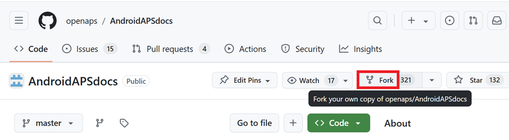
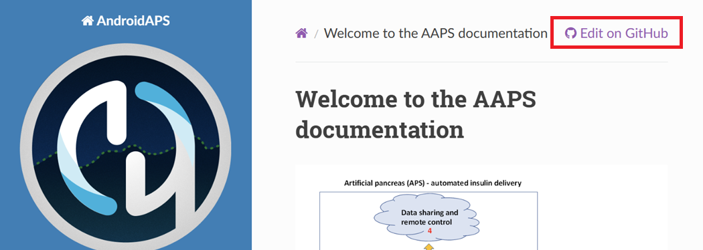
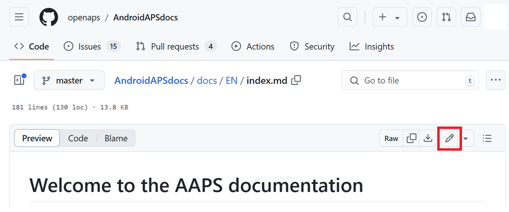
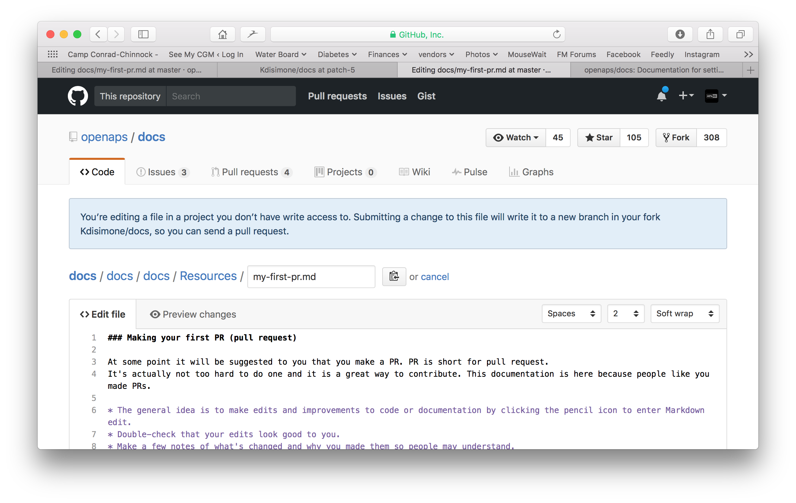
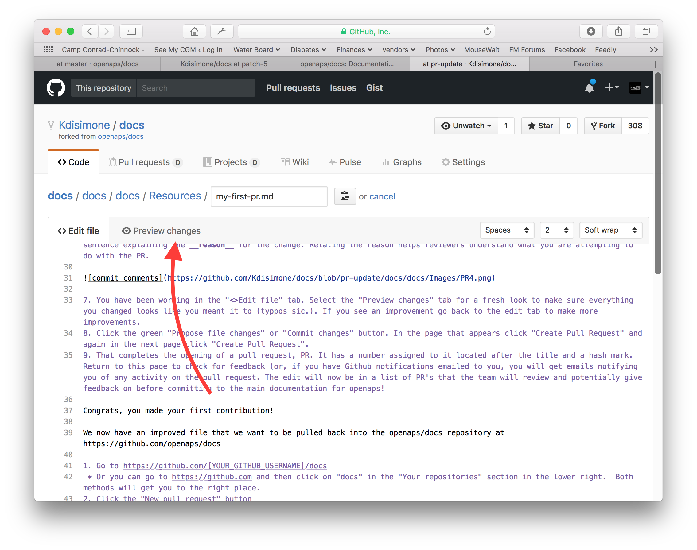
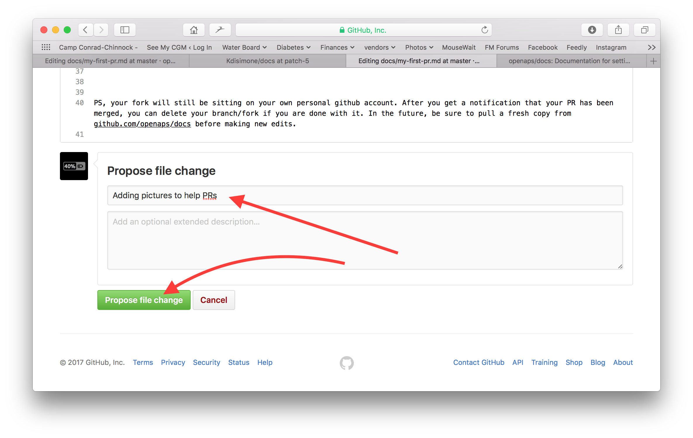
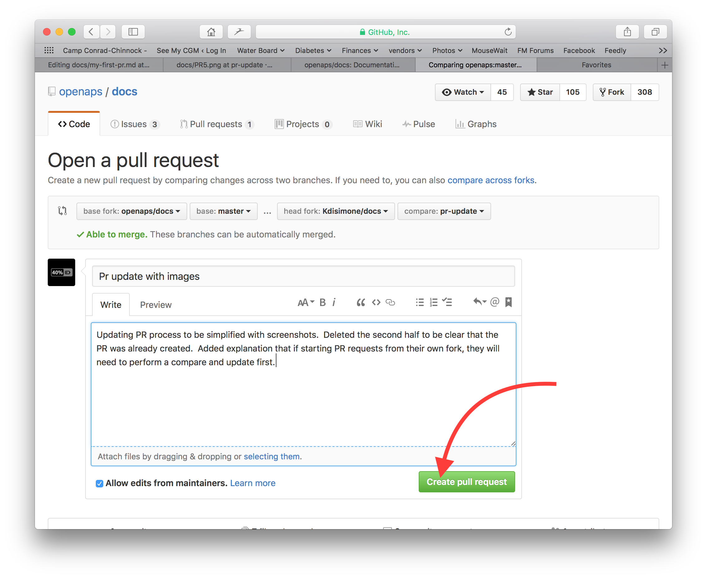
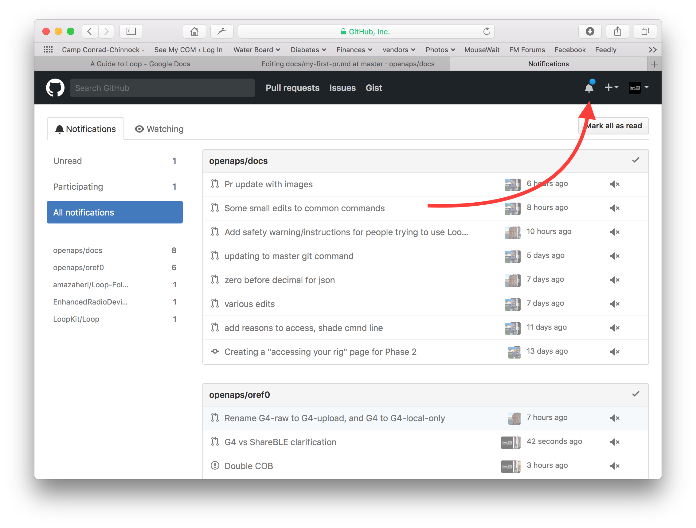
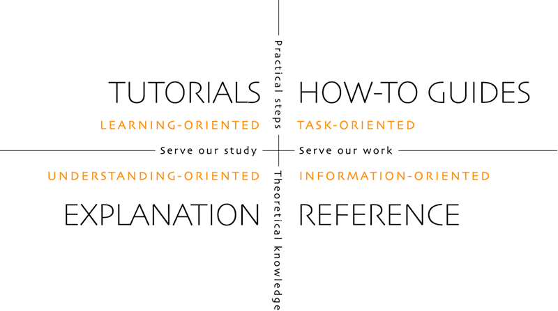

# Dokümanlar nasıl düzenlenir

**Bu açıklama yalnızca İngilizce belgeleri düzenlemek içindir. Tüm yeni bilgiler önce İngilizce olarak eklenmelidir. Diğer dillere çeviri yapmak istiyorsanız (teşekkür ederim), lütfen [crowdin](https://crowdin.com/project/androidapsdocs) kullanın.**

Metnin nasıl biçimlendirileceğine (başlık, kalın...) ve bağlantıların ayarlanmasına ilişkin ipuçları için lütfen bu sayfanın ["code syntax"](#edit-the-docs-code-syntax) bölümüne bakın.

## General

For any questions, feedback or new ideas you can contact the documentation team via [discord](https://discord.gg/4fQUWHZ4Mw).

Bir noktada sizden bir çekme isteği (pull request, PR) oluşturmanız istenecektir. Dokümantasyondaki değişiklikleriniz, GitHub'da saklanan AAPS web sayfalarına bu yolla aktarılır. PR oluşturmak aslında çok zor değildir ve katkıda bulunmanın harika bir yoludur. Şu anda bu dokümantasyonu okuyabilmenizin nedeni, sizin gibi insanların PR oluşturmuş olmasıdır. Don't worry about making a mistake or somehow editing the wrong documents. Değişiklikleriniz, "resmi" AAPS dokümantasyon deposuna birleştirilmeden önce gözden geçirilir. Bu süreçte yanlışlıkla orijinalleri bozamazsınız. Genel süreç şöyledir:

- Mevcut içeriği düzenleyerek kod veya dokümanlarda düzenlemeler ve iyileştirmeler yapın.
- Düzenlemelerinizin iyi görünüp görünmediğini bir kez daha kontrol edin.
- İnsanların düzenlemeleri anlayabilmesi için nelerin değiştiğine dair birkaç not alın.
- Yöneticilerden değişikliklerinizi kullanmalarını isteyen bir çekme isteği oluşturun.
- Bir inceleme yapacaklar ve (1) değişikliklerinizi birleştirecekler, (2) değişiklikleriniz hakkında size geri dönüş yapacaklar veya (3) değişikliklerinizle yeni bir doküman başlatacaklar.

(Yan not: Görsel öğrenen biriyseniz, [burada](https://youtu.be/4b6tsL0_kzg) PR iş akışını gösteren bir YouTube videosu mevcuttur.)

Örneğimizde AndroidAPSdocs'ta bir düzenleme yapacağız. This can be done on any Windows PC, Mac, etc. (any computer with Internet access).

1. <https://github.com/openaps/AndroidAPSdocs> adresine gidin ve deponun kendi kopyanızı oluşturmak için sağ üstteki Fork düğmesine basın.



2. Herhangi bir sayfaya gidin ve düzenlemek istediğiniz sayfayı açın. Sağ üst köşedeki "Edit in GitHub" (GitHub'da düzenle) bağlantısına tıklayabilirsiniz. Bu yalnızca İngilizce sayfalar için mümkündür. 



Veya düzenlenecek sayfa içeriğinin üst çubuğunda görünen kalem simgesine tıklayın. Bunun için GitHub hesabınıza giriş yapmış olmanız gerekir (hesabınız yoksa, kolayca oluşturabilirsiniz).



3. Adım 2'deki seçeneklerden biri veya diğeri, düzenlemelerinizin kaydedileceği deponuzda yeni bir dal oluşturacaktır. Bu dosyada düzenlemelerinizi yapabilirsiniz.

Doküman sayfaları için Markdown kullanıyoruz. Dosyaların uzantısı ".md"dir. Markdown belirtimi sabit değildir ve şu anda Markdown dosyalarımız için myst_parser kullanıyoruz. [Aşağıda anlatılan](#edit-the-docs-code-syntax) doğru sözdizimini kullanmaya dikkat edin.



4. "<>Edit file" (dosyayı düzenle) sekmesinde çalıştınız. Değiştirdiğiniz her şeyin istediğiniz gibi göründüğünden emin olmak için (yazım hatalarını kontrol edin) "Preview changes" (değişiklikleri önizle) sekmesini seçin ve sayfaya yeniden bakın. Gerekli bir iyileştirme görürseniz, daha fazla iyileştirme yapmak için düzenleme sekmesine geri dönün. 



5. Düzenlemelerinizi bitirdiğinizde, sayfanın en altına gidin. Alttaki kutuda, yorumlarınızı "Add an optional extended description..." (isteğe bağlı ayrıntılı açıklama ekleyin) yazan metin alanına yazın. Varsayılan başlık dosya adıdır. Değişikliğin **nedenini** açıklayan bir cümle eklemeye çalışın. Nedeni belirtmek, gözden geçirenlerin PR ile ne yapmak istediğinizi anlamasına yardımcı olur.



6. Yeşil "Propose file changes" (dosya değişikliklerini öner) veya "Commit changes" (değişiklikleri kaydet) düğmesine tıklayın. Açılan sayfada "Create Pull Request" (çekme isteği oluştur) düğmesine, sonraki sayfada da tekrar "Create Pull Request" düğmesine tıklayın.



7. Bu, bir çekme isteğinin (PR) açılmasını tamamlar. GitHub, PR'a bir numara verir. Bu numara başlıktan sonra, bir kare işaretinin (#) arkasında görünür. Geri bildirimi kontrol etmek için bu sayfaya dönün (veya size e-postayla GitHub bildirimleri gönderildiyse, PR ile ilgili herhangi bir etkinlik hakkında bilgilendiren e-postalar alacaksınız). Düzenleme şimdi, ekibin AAPS için ana belgelere geçmeden önce gözden geçireceği ve potansiyel olarak geri bildirimde bulunacağı bir PR listesinde olacak! PR'nin ilerlemesini kontrol etmek isterseniz, GitHub hesabınızın sağ üst köşesindeki zil logosuna tıklayıp tüm PR'lerinizi görebilirsiniz.



Not: Fork'unuz ve dalınız (branch) kendi kişisel GitHub hesabınızda kalmaya devam eder. PR'nizin birleştiğine dair bir bildirim aldıktan sonra, işiniz bittiyse şubenizi silebilirsiniz (Adım 7'in bildirim alanı, kapatıldığında veya birleştiğinde şubeyi silmek için bir bağlantı sağlayacaktır). Gelecekteki düzenlemeler için, bu prosedürü izlerseniz, düzenlemeler her zaman AndroidAPSdocs depolarının güncellenmiş bir sürümüyle başlayacaktır. PR başlatmak için başka bir yöntem kullanmayı seçerseniz (örneğin, başlangıç noktası olarak fork'unuzun master dalından başlayarak düzenleme), önce bir "compare" (karşılaştırma) yaparak ve fork'unuzu son güncellemenizden bu yana gelen tüm güncellemeleri birleştirerek deponuzun güncel olduğundan emin olmanız gerekir. İnsanlar depolarını güncellemeyi unutmaya meyilli olduğundan, "karşılaştırma" yapmaya alışana kadar yukarıda özetlenen PR sürecini kullanmanızı öneririz.

(edit-the-docs-code-syntax)=

## Code syntax

Dokümantasyon sayfaları için Markdown kullanıyoruz. The files have got the suffix ".md".

Markdown, metin içeriğini metin biçimlendirmesinden ayıran çok basit bir metin biçimlendirme dilidir.

Yazar yalnızca, örneğin bir başlığı 1. düzey başlık olarak işaretler; Markdown işlemcisi de işleme sırasında bu başlığı HTML'de göstermek için gereken HTML kodunu oluşturur.

Bunun arkasındaki fikir şudur:

- yazar önce biçimlendirmeyi değil, metni düşünmelidir,
- Markdown metni, örneğin Microsoft Word gibi tescilli araçlar yerine farklı Markdown araçları arasında paylaşılabilir ve
- tek bir Markdown dosyasından birkaç farklı çıktı biçimi oluşturabilirsiniz.

Markdown %100 sabit bir standart değildir. Standarda olabildiğince yakın kalmaya çalışıyoruz, böylece

- Markdown araçlarının ve Markdown SaaS hizmetlerinin gelecekteki gelişimi gerektirdiğinde veya zorladığında Markdown araçlarını değiştirmek için esnek kalabilelim ve
- İngilizce metni Fransızca veya Almanca gibi bir hedef dile çevirmek için çeviri hizmetlerini kullanabilelim. Bu hizmetler Markdown ile çalışabilir, ancak karmaşık biçimlendirme kodlarıyla çalışamaz; çünkü içeriği düzenden ayıramazlar ve bu ciddi sorunlara yol açabilir.

### Başlıklar

- Headline 1: `# headline`
- Headline 2: `## headline`
- Headline 3: `### headline`
- Başlık 4: `#### başlık`

Daha fazla başlık düzeyi kullanmaktan kaçınmaya çalışıyoruz.

### Metin biçimi

- **kalın**: `**text**`
- *italik*: `*text*`
- ***kalın italik***: `***text***`

### Numaralı liste

    1. first
    1. second
    1. üçüncü
    

1. birinci
2. ikinci
3. üçüncü

### Numarasız liste

    - one element
    - another element
    - and another element
    

- bir öğe
- başka bir öğe
- ve başka bir öğe

### Çok düzeyli liste

Bir sonraki düzeyi bir öncekinden 4 boşluk daha sağda girintileyerek listelere ilave liste ekleyebilirsiniz.

    1. first
    1. second
    1. üçüncü
      1. bir öğe
      1. another element
      1. ve başka bir öğe
    1. four
    1. five
    1. altı
    

1. birinci
2. ikinci
3. üçüncü 
    1. bir öğe
    2. başka bir öğe
    3. ve başka bir öğe
4. dört
5. beş
6. altı

### Görseller

Görüntüleri dahil etmek için bu işaretleme sözdizimini kullanırsınız.

- images: ``

Görselin türü PNG veya JPEG olmalıdır.

Görsel adları aşağıdaki adlandırma kurallarından birine uymalıdır. Örnekte uzantı olarak png kullanıyorum. JPEG kullanırsanız lütfen uzantı olarak jpeg kullanın.

- `filename-image-xx.png`; burada xx, bu dosyadaki görseller için benzersiz iki basamaklı bir sayıdır.
- `filename-image-xx.png`; burada xx, md dosyasının yazarının seçtiği anlamlı bir addır.

Görseller İngilizce dilin images klasöründe bulunur ve Crowdin tarafından diğer dillere otomatik olarak aktarılır. Bunun için bir şey yapmanız gerekmez!

Şu anda görselleri çevirmiyoruz: İngilizce bilmeyen okurların da anlayabilmesi için görsellerde **mümkün olan en az metin** bulunmalıdır.

(make-a-PR-image-size)= Görseller için makul bir boyut kullanın. Görseller bilgisayarda, tablette ve telefonda okunabilir olmalıdır.

- Web sayfalarından alınan ekran görüntüleri en fazla **1050 piksel genişliğinde** olmalıdır.
- Süreç akış diyagramları en fazla **1050 piksel genişliğinde** olmalıdır.
- Uygulamadan alınan ekran görüntüleri en fazla **500 piksel genişliğinde** olmalıdır. Gerekli değilse görselleri yan yana koymayın.
- Saatten (**Wear OS**) alınan ekran görüntüleri en fazla **360 piksel genişliğinde** olmalıdır. Daha küçük bir ekran görüntüsünü asla büyütmeyin.

### Links

#### Harici bağlantılar

Harici bağlantılar, dış web sitelerine giden bağlantılardır.

- external link: `[alt text](www.url.tld)`

#### Bir md dosyasının başına giden dahili bağlantılar

Sayfalara giden dahili bağlantılar, kendi sunucumuzda bulunan bir md dosyasının başına giden bağlantılardır.

- internal link to .md page: `[alt text](../folder/file.md)`

#### Adlandırılmış satır içi referanslara giden dahili bağlantılar

Adlandırılmış satır içi referanslara giden dahili bağlantılar, kendi sunucumuzda bulunan bir md dosyasında, bağlantı için referans konmuş herhangi bir noktaya giden bağlantılardır.

Hedef md dosyasında, atlamak istediğiniz yere adlandırılmış bir referans ekleyin.

`(name-of-my-md-file-this-is-my-fancy-named-reference)=`

Adlandırılmış referans, yalnızca bulunduğu md dosyasında değil, tüm AndroidAPSDocs md dosyalarında benzersiz olmalıdır!

Bu nedenle referansa önce dosya adıyla, ardından seçtiğiniz referans adıyla başlamak iyi bir alışkanlıktır.

Yalnızca küçük harf kullanın ve kelimeleri kısa çizgiyle ayırın.

Ardından yazdığınız metinde bu referansa aşağıdaki türde bir bağlantıyla bağlantı verin.

- Adlandırılmış satır içi referanslara dahili bağlantılar: `[alt text](name-of-my-md-file-this-is-my-fancy-named-reference)`

### Notlar, uyarılar, katlanabilir notlar

Dokümantasyona not ve uyarı kutuları ekleyebilirsiniz.

Ayrıca ayrıntılı bilgiler için katlanabilir notlar ekleyebilirsiniz; böylece ayrıntılarla ilgilenmeyen kullanıcılar metni okumaktan vazgeçmez. Dokümantasyon olabildiğince kolay okunmalıdır, bu yüzden bunları dikkatli kullanın.

#### Notes

    ```{admonition} Not başlığı
    :class: note
    Bu bir nottur.
    ```
    

```{admonition} Not başlığı :class: note Bu bir nottur.

    <br />#### Uyarılar
    
    ````
    ```{admonition} Uyarı
    :class: warning
    Bu bir uyarıdır.
    

    ```{admonition} Uyarı başlığı
    :class: warning
    Bu bir uyarıdır.
    ```
    
    #### Katlanabilir notlar
    
    

    {admonition} ilgilenen okurlar için daha ayrıntılı bilgiler
    :class: dropdown
    
    Bu not kutusu katlanmıştır,
    yani buraya daha uzun içerik ekleyebilirsiniz,
    ve bu içerik sayfada çok fazla yer kaplamaz.
    

````

```{admonition} ilgilenen okurlar için daha ayrıntılı bilgiler :class: dropdown Bu not kutusu katlanmıştır, yani buraya daha uzun içerik ekleyebilirsiniz, ve bu içerik sayfada çok fazla yer kaplamaz.

```

## Tablolar

Uzun metinli tablolar kullanmaktan kaçının: içeriği Markdown'da düzenlemek zordur, genellikle telefon ekranının genişliğine sığmazlar ve çeviriden sonra büyük olasılıkla aynı görünmezler.

## Yazım kılavuzu

### İçerik

1. İngilizce yazım ipuçları

2. AAPS'e özel yazım notları

3. Faydalı kaynaklar

###  1\. İngilizce yazım ipuçları

#### Okuyucuya uygun bir dil kullanın

Mümkün olan her yerde sade İngilizce kullanın. Bu, anadili İngilizce olmayan okuyuculara yardımcı olur ve AAPS dokümanlarının diğer dillere çevrilmesini de kolaylaştırır. Kullanıcıyla sohbet eder gibi yazın; yazdığınız kişiyle aynı masada karşılıklı oturduğunuzu düşünün. Unutmayın: AAPS kullanıcılarının çoğunun programlama geçmişi yoktur. Diyabetin kendisinde de çok fazla jargon ve kısaltma vardır. Bazı kişilerin yeni tanı almış olabileceğini, diyabet konusunda sizin kadar deneyimli olmayabileceğini veya farklı bir diyabet eğitimi almış olabileceğini aklınızda tutun. Bir kısaltma kullanırsanız, ilk kullanımda terimi tam olarak yazın ve kısaltmayı hemen arkasından parantez içinde verin, örneğin “super micro bolus (SMB)”. Ayrıca sözlüğe bağlantı verin. Okuyucunun bilmeyebileceği teknik terimler de parantez içinde eklenebilir.

Şunun yerine: *“What causes high postprandial BG peaks in closed loop?”*

Şunu kullanın: *“What causes a high BG peak **after lunch** (postprandial) in closed loop?”*

##### Herkesin anlayabileceği sade kelimeler kullanın

Yazınızı daha kolay anlaşılır yapmak için A'dan Z'ye alternatif kelimeler listesini burada bulabilirsiniz:

<https://www.plainenglish.co.uk/the-a-z-of-alternative-words.html>

#### Gizlilik ve lisans konuları:

Özellikle video veya ekran görüntüsü kaydediyorsanız, özel bilgilerinizi (API anahtarı, parolalar) göstermediğinizden emin olun. YouTube içeriğinin herkese açık listelenmediğinden ve yalnızca dokümantasyondaki bir bağlantıyla izlenebildiğinden emin olun. Telif hakkı ihlal edilen materyallere (BYODA vb.) dikkat çekmekten kaçının.

#### Cümleleri kısa tutun, sadede gelin

- Açık bir yazıda ortalama cümle uzunluğu 15 ila 20 kelime olmalıdır.

- Bu, her cümlenin aynı uzunlukta olması gerektiği anlamına gelmez. Etkili yazın. Kısa cümleleri (bir önceki gibi) daha uzun cümlelerle (bunun gibi) karıştırarak yazınızı çeşitlendirin.

- Bir cümlede tek bir ana fikre ve belki onunla ilgili bir noktaya daha bağlı kalın.

- Özellikle karmaşık bir konuyu açıklarken yine de ara sıra uzun bir cümle yazabilirsiniz. Ancak çoğu uzun cümle bir şekilde bölünebilir.

- Zayıf kelimeleri çıkarın: “you can”, “there is/are/were”, “in order to”.

- Anahtar kelimeleri başlıkların, cümlelerin ve paragrafların başına yakın yerleştirin.

- Görsel kullanın! Mümkün olan her yerde kısa bir diyagram, ekran görüntüsü veya video ekleyin.

#### Talimat vermekten çekinmeyin

Emir cümleleri talimat vermenin en hızlı yoludur, ancak yazarlar bazen emir vermekten çekinir ve sadece “do this” (bunu yapın) yerine “you should do this” (bunu yapmalısınız) yazar. Belki de insanlar emirlerin çok sert göründüğünden endişelenir. Bunu çoğu zaman başa 'please' (lütfen) kelimesini ekleyerek çözebilirsiniz. Ancak bir şeyin mutlaka yapılması gerekiyorsa, ‘please’ demeyin; çünkü bu, okuyucuya reddetme seçeneği verir.

Şunun yerine: *“You should just think of it as a complete statement.”*

Şunu kullanın: *“Think of it as a complete statement.”*

#### Çoğunlukla edilgen değil, etken fiiller kullanın

**Etken fiil** örneği:

- *“The pump (subject) delivers (verb) the insulin (object).” (özne, fiil, nesne)*

Burada “delivers” etken bir fiildir. Cümle, neyin verildiğini söylemeden önce verme işini kimin yaptığını söyler.

**Edilgen fiil** örneği:

- *“The insulin (subject) is delivered (verb) by the pump (object).” (özne, fiil, nesne)*

Burada *“delivered”* edilgen bir fiildir. Etken fiilli cümleye göre özne ve nesne yer değiştirmiştir. “is” ve “by the” kelimelerini eklediğimiz için cümle uzamıştır. Cümleye etken fiille başlamayı da düşünün.

Şunun yerine: *“You can connect your pump with the phone through the AAPS pump menu, and there are a number of pumps available for you to connect with.”*

Şunu kullanın: *“Connect your desired pump to the phone through the AAPS pump menu.”*

Edilgen fiiller sorunlara yol açabilir:

- Kafa karıştırıcı olabilirler.

- Çoğu zaman yazıyı gereksiz yere uzatırlar.

- Yazıyı daha az canlı yaparlar.

##### Edilgen yapının iyi kullanımları

Bazen edilgen yapı kullanmak uygun olabilir.

- Bir şeyi daha az sert yapmak için: 'this bill has not been paid' (edilgen), 'you have not paid this bill' (etken) cümlesinden daha yumuşaktır.

- Suçu üstlenmemek için: 'You made a mistake' (etken) yerine 'a mistake was made' (edilgen).

- İşi kimin veya neyin yaptığını bilmediğinizde: 'the England team has been picked'.

- Sadece kulağa daha iyi geliyorsa.

#### İsimleştirmelerden kaçının

İsimleştirme (nominalisation), fiziksel bir nesne olmayan bir şeyin adıdır; örneğin bir süreç, teknik veya duygu. İsimleştirmeler fiillerden oluşturulur.

Örneğin:

| Fiil                   | İsimleştirme           |
| ---------------------- | ---------------------- |
| complete (tamamlamak)  | completion (tamamlama) |
| introduce (tanıtmak)   | introduction (tanıtım) |
| provide (sağlamak)     | provision (sağlama)    |
| fail (başarısız olmak) | failure (başarısızlık) |

Çoğu zaman türedikleri fiillerin **yerine** kullanılırlar, ancak sanki aslında hiçbir şey olmuyormuş gibi bir izlenim verebilirler. Çok fazla isimleştirme, yazıyı çok sıkıcı ve ağır yapabilir.

Şunun yerine: *“The implementation of the method has been done by a team.”*

Şunu kullanın: *“A team has implemented the method.”*

#### Uygun yerlerde liste kullanın

Listeler bilgiyi bölmek için çok iyidir. İki ana liste türü vardır:

- Başında, ortasında veya sonunda birkaç maddenin sıralandığı tek bir sürekli cümle.

- Bir giriş cümlesiyle başlayan ayrı madde işaretleri.

Yukarıdaki madde işaretli listede her madde tam bir cümledir; bu yüzden her biri büyük harfle başlar ve nokta ile biter. Numara veya harf yerine madde işareti kullanın; madde işaretleri okura ek bilgi yüklemeden her maddeye dikkat çeker.

#### Yanlış inanışlar

- İngilizcede bir cümleye **and, but, because, so veya however** ile başlayabilirsiniz.

- İngilizcede mastarı bölebilirsiniz (split infinitive). Yani **“to boldly go”** diyebilirsiniz.

- İngilizcede bir cümleyi edatla bitirebilirsiniz. Hatta bu, **we should stand up for** (savunmamız gereken) bir şeydir.

- Ve **siz** daha iyi bir **kelime** bulamıyorsanız, **siz** de aynı **kelimeyi** bir cümlede iki kez kullanabilirsiniz.

#### Yazım stilini amaca göre iyileştirme

Dokümantasyonu açık ve kısa tutmak için, dokümantasyonun farklı bölümlerini farklı stillerde yazıyoruz.

Giriş, arka plan ve bilgi geliştirme bölümlerinde “açıklama” (explanation) stili kullanılır.

AAPS'i derleme ve yapılandırma bölümlerinde ve bazı sorun giderme bölümlerinde (çok az açıklamalı) “nasıl yapılır kılavuzu” (how-to guide) stili kullanılır.

Bir eğitim (tutorial), öğrencinin temel beceri kazanmasına yardımcı olur. Kullanıcı **yaparak öğrenir**.



#####  Eğitimler (örneğin bir çocuğa yumurta akı çırpmayı öğretmek)

- anlatıcı doğrudan okura konuşur: In this tutorial **you** will (bu eğitimde siz ...) (we) (biz) bazı nadir durumlarda “we are in this together” (bunu birlikte yapıyoruz) düşüncesini vermek için kullanılabilir

- Gelecek zaman -> son hedefi göstermek için

- Emir kipi -> görevleri yapmak için -> Somut adımlar - soyut kavramlardan kaçının

- Geçmiş zaman -> tamamlanan görevleri göstermek için -> Hızlı ve hemen görülen sonuçlar

- En az açıklama -> görevi tamamlamak için kesinlikle gerekli olan - **ne ve neden**

- Seçenekleri/alternatifleri/… dikkate almayın. Belirsizlik olmasın

- Adım geçişleri: Bir adımı, mantıklı bir akış içinde sonraki adıma geçiren bir cümleyle bitirin. Örnek: *You have now installed the Let’s Encrypt client, but before obtaining certificates, you need to make sure that all required ports are open. To do this, you will update your firewall settings in the next step.*

- **Eğitim** başlığı (1. düzey başlık)

- Giriş (başlık yok)

- Ön koşullar (2. düzey başlık)

- Steps:

- Adım 1 — İlk işi yapma (2. düzey başlık)

- Adım 2 — Sonraki işi yapma (2. düzey başlık)

- Adım n — Son işi yapma (2. düzey başlık)

- Sonuç (2. düzey başlık)
    
    - **Eğitimlerin dili**
        
        *In this tutorial, you will… (Bu eğitimde şunları yapacaksınız…)*
        
        Öğrencinin neyi başaracağını anlatın (not: “you will learn…” (öğreneceksiniz…) değil).
        
        *First, do x. (Önce x'i yapın.) Now, do y. (Şimdi y'yi yapın.) Now that you have done y, do z. (y'yi yaptığınıza göre şimdi z'yi yapın.)*
        
        Belirsizliğe veya şüpheye yer bırakmayın.
        
        *We must always do x before we do y because… (see Explanation for more details). (y'den önce her zaman x'i yapmalıyız, çünkü… (ayrıntılar için Açıklama bölümüne bakın).)*
        
        Eylemleri olabildiğince basit bir dille, en az açıklamayla anlatın. Daha ayrıntılı açıklamaya bağlantı verin.
        
        *The output should look something like this… (Çıktı aşağı yukarı şöyle görünmelidir…)*
        
        Öğrencinize ne bekleyeceğini açıkça söyleyin.
        
        *Notice that… Remember that… (Şuna dikkat edin… Şunu unutmayın…)*
        
        Öğrencinize doğru yolda olduğunu anlaması ve yönünü bulması için bol ipucu verin.
        
        *You have built a secure, three-layer hylomorphic stasis engine… (Güvenli, üç katmanlı bir hilomorfik durağanlık motoru kurdunuz…)*
        
        Öğrencinizin neyi başardığını anlatın (ve ölçülü bir şekilde takdir edin) (not: “you have learned…” (öğrendiniz…) değil)

#####  Nasıl yapılır kılavuzları (örneğin bir yemek tarifi)

Nasıl yapılır kılavuzunun amacı, zaten yetkin olan kullanıcının belirli bir görevi doğru şekilde yapmasına yardımcı olmaktır.

- NASIL yapılır

- anlatıcı doğrudan okura konuşur: In this guide **you** will (bu kılavuzda siz ...)

- Gelecek zaman -> son hedefi göstermek için

- Koşullu emir kipi -> X'i elde etmek için y'yi yapın -> Somut adımlar - soyut kavramlardan kaçının

- En az açıklama -> görevi tamamlamak için kesinlikle gerekli olan -> **ne ve neden**

- Seçenekleri/alternatifleri/… dikkate almayın. Belirsizlik olmasın, ancak başvuru veya açıklama bölümüne bağlantı verebilirsiniz

- **Nasıl yapılır**: Başlık (1. düzey başlık)

- Giriş paragrafı

- İsteğe bağlı ön koşullar (paragraf veya 1'den fazlaysa 2. düzey başlık)

- Steps:

- Adım 1 — İlk işi yapma (2. düzey başlık)

- Adım 2 — Sonraki işi yapma (2. düzey başlık)

- Adım n — Son işi yapma (2. düzey başlık)

- Sonuç paragrafı
    
    - **Nasıl yapılır kılavuzlarının dili**
        
        *This guide shows you how to… (Bu kılavuz size şunu nasıl yapacağınızı gösterir…)*
        
        Kılavuzun kullanıcıya çözmeyi gösterdiği sorunu veya görevi açıkça anlatın.
        
        *If you want x, do y. (x'i istiyorsanız y'yi yapın.) To achieve w, do z. (w'yi elde etmek için z'yi yapın.)*
        
        Koşullu emir cümleleri kullanın.
        
        *Refer to the x reference guide for a full list of options. (Seçeneklerin tam listesi için x başvuru kılavuzuna bakın.)*
        
        Pratik nasıl yapılır kılavuzunuzu, kullanıcının x ile ilgili yapabileceği her olası şeyle doldurmayın.

#####  Açıklama (örneğin yumurta akının çırpıldığında neden katılaştığının arkasındaki bilim)

Bir açıklama, okurun bir konuyu anlamasını netleştirir, derinleştirir ve genişletir.

- NEDEN

- **Hakkında** ile başlayın

- Bağlam verin, ilgili TÜM kaynaklara bağlantı verin

- Seçenekleri/alternatifleri tartışın

- Talimat vermeyin veya başvuru bilgisi vermeyin (onlara bağlantı verin)

- Bilinmeyenleri, değişen hedefleri vb. belirtin…

- **Hakkında** başlığı (1. düzey başlık)

- Giriş (başlık yok)

- İsteğe bağlı ön koşullar (2. düzey başlık)

- Alt konu 1 (2. düzey başlık)

- Sonuç (2. düzey başlık)
    
    - **Açıklamanın dili**
    
    *The reason for x is because historically, y… (x'in nedeni, geçmişte y…)*
    
    Açıklayın.
    
    *W is better than z, because… (W, z'den daha iyidir, çünkü…)*
    
    Uygun olduğunda değerlendirme yapın, hatta görüş bildirin.
    
    *An x in system y is analogous to a w in system z. (y sistemindeki bir x, z sistemindeki bir w'ye benzer.) However… (Ancak…)*
    
    Okura yardımcı olacak bağlam verin.
    
    *Some users prefer w (because z). (Bazı kullanıcılar w'yi tercih eder (çünkü z).) This can be a good approach, but… (Bu iyi bir yaklaşım olabilir, ancak…)*
    
    Alternatifleri tartın.
    
    *An x interacts with a y as follows:… (Bir x, bir y ile şu şekilde etkileşir:…)*
    
    Bir şeyin neden öyle davrandığını anlamaya yardımcı olmak için sistemin iç işleyişini açıklayın.

### 2\. AAPS'e özel yazma/güncelleme notları

#### Yazar ve editör

AAPS dokümantasyonunu yazarken veya güncellerken, süreci iki aşamadan oluşuyor gibi düşünün. Bu aşamalar aynı kişi tarafından farklı zamanlarda veya birden fazla kişi tarafından yapılabilir.

Bir **yazar (örneğin siz!)** dokümantasyonun bir bölümünü kısa ve sohbet havasında bir dille yazar/düzenler, ardından editöre verir.

**Editör (örneğin başka bir AAPS kullanıcısı veya çekme isteğini alan kişi)** yazım kılavuzuna uyulup uyulmadığını kontrol eder, bölümü açıklık ve erişilebilirlik için düzenler ve mümkün olduğunca çok kelimeyi çıkarır (özellikle eğitim ve nasıl yapılır bölümlerinde). Metni yüksek sesle okumak yardımcı olabilir.

#### Genel AAPS noktaları

- Glikoz değerleri için her yerde hem mg/dL hem de mmol/L değerini verin (mümkünse bunu ekran görüntüleri için de düşünün).

- Tutarlılık için “Android APS” yerine “AAPS” kullanın.

- Hangi Android Studio/AAPS sürümü için yazdığınızı veya ekran görüntülerinin hangi sürümden alındığını açıkça belirtin.

### 3\. Faydalı kaynaklar

<https://dev.readthedocs.io/en/latest/style-guide.html>

[Diátaxis (diataxis.fr)](https://diataxis.fr/)

[Technical Writer Style Guide Examples | Technical Writer HQ](https://technicalwriterhq.com/writing/technical-writing/technical-writer-style-guide/)

[DigitalOcean's Technical Writing Guidelines | DigitalOcean](https://www.digitalocean.com/community/tutorials/digitalocean-s-technical-writing-guidelines)

[Top 10 tips for Microsoft style and voice - Microsoft Style Guide | Microsoft Learn](https://learn.microsoft.com/en-us/style-guide/top-10-tips-style-voice?source=recommendations)

<https://www.plainenglish.co.uk/how-to-write-in-plain-english.html>

<https://developers.google.com/style>

<https://www.mongodb.com/docs/meta/style-guide/screenshots/screenshot-guidelines/>