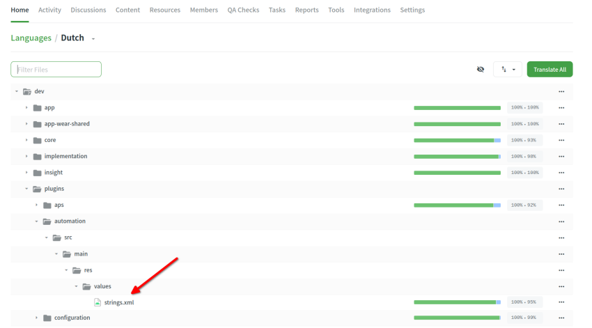

# AAPS uygulaması veya dokümantasyon için dizeler nasıl çevrilir

* Uygulamada kullanılan dizeler için <https://crowdin.com/project/androidaps> adresine gidin ve GitHub hesabınızla giriş yapın
* Dokümantasyon için lütfen <https://crowdin.com/project/androidapsdocs> adresini ziyaret edin ve GitHub hesabınızı kullanarak giriş yapın

* Dokümanlar ekibine katılma isteği gönderin. Bunu yapmak için istediğiniz dilin bayrağına, ardından açılan sayfanın sağ üst köşesindeki "Join" (Katıl) düğmesine tıklayın. Lütfen dili belirtin, kendiniz ve AAPS deneyiminiz hakkında biraz bilgi verin ve çevirmen mi yoksa redaktör mü olmak istediğinizi yazın (redaktörlük yalnızca çeviride deneyimli kişiler + ileri düzey AAPS kullanıcıları içindir).

```{admonition} Onay Zamanı :class: note

Onay manuel bir adımdır. Kâr amacı gütmeyen kuruluş olarak SLA'lar sağlamıyoruz ancak genel olarak onay < 1 gün içinde yapılacaktır. Aksi takdirde lütfen Facebook veya Discord aracılığıyla doküman ekibiyle iletişime geçin.

    <br />* Sizi onayladığımızda bayrağa tıklayın
       
    
    ## Uygulamanın çevirisi
    
    (translations-translate-strings-for-AAPS-app)=
    ### AAPS uygulaması için dizeleri çevirme
    
    * Hangi dizeleri çevireceğiniz konusunda bir tercihiniz yoksa, başlamak için "Translate All" (Tümünü çevir) düğmesini seçin. Size çevrilmesi gereken dizeleri gösterecektir.
    
       
    
    * Tek bir dosyayı çevirmek istiyorsanız, lütfen dosyayı arama iletişim kutusundan veya ağaç yapısından bulun ve o dosyadaki dizeleri çevirmeye başlamak için dosya adına tıklayın.
    
       
    
    * Soldaki cümleleri, yeni bir çeviri metni ekleyerek veya bir öneriyi kullanıp düzenleyerek çevirin 
    
       
    
    
    ### AAPS uygulaması için dizelerin redaksiyonu
    
    * Redaktörler, dilin ana ekranından başlarken "Proofread" (Redakte et) seçeneğini seçerek başlar.
    
        
    
    
      ve çevrilmiş metinleri onaylar 
    
       
    
    Bir redaktör bir çeviriyi onayladığında, bu çeviri AAPS'in bir sonraki sürümüne eklenir.
    
    (translations-translation-of-the-documentation)=
    ## Dokümantasyonun çevirisi
    
    * Çevirmek istediğiniz doküman sayfasının adına tıklayın
    
    
    
    
    * Metni cümle cümle çevirin
    
        1. Sarı metin, şu anda üzerinde çalıştığınız metindir.
    
        1. Yeşil metin zaten çevrilmiştir. Bunu tekrar yapmanız gerekmez.
    
        1. Kırmızı metin, henüz çevrilmesi gereken kalan metindir.
    
        1. Bu, şu anda üzerinde çalıştığınız kaynak metindir.
    
         1. Bu, hazırladığınız çeviridir. Yukarıdaki metni kopyalayabilir veya aşağıdaki önerilerden birini seçebilirsiniz.
    
        1. Bunlar çeviri önerileridir. Özellikle Crowdin'in bir öneriyi ne kadar uygun bulduğunu ya da metnin daha önce çevrilip çevrilmediğini görebilirsiniz. Metin değiştirilmeden yalnızca taşındıysa da tekrar burada görünür.
        1. Bir çeviri önerisini kaydetmek için "kaydet" düğmesine basın. Ardından son kontrol için bir redaktöre gönderilir.
    
    
    
    * Çevrilmiş bir sayfa, şu koşullar sağlanmadan dokümanlarda yayınlanmaz:
    
        1. çevirinin redaksiyonu yapılmış olmalı
    
        1. Crowdin ile GitHub arasındaki senkronizasyon (saatte bir) tamamlanmış olmalı. Bu senkronizasyon GitHub için bir PR (çekme isteği) oluşturur.
    
        1. Github'daki PR onaylanmış olmalı.
    
    Genel olarak bu 1 - 3 güne ihtiyaç duyar ancak tatil günlerinde biraz daha uzun sürebilir.
    
    ### Bağlantıları çevirme
    
    ```{admonition} Bağlantılar artık çevrilmiyor
    :class: note
    
    Bağlantılar artık çevrilmiyor. Eskiden burada bu konuyla ilgili bir bölüm vardı. Markdown'a ve myst_parser'a geçişle bu bölüm kaldırıldı: artık İngilizce metinde etiketleri açıkça oluşturuyoruz ve bu etiketler arka planda diğer dillere aktarılıyor.
    
    

Bağlantıyı temsil eden metni çeviriyorsunuz. Bağlantıyı **silmemeye** dikkat edin. Bağlantı bir çift `<0></0>` etiketiyle gösterilir (bir paragrafta birden fazla bağlantı varsa başka numaralar kullanılır).

Buna özellikle dikkat etmek redaktörlerin görevidir!

### Redaksiyon

* Redaktörler redaksiyon moduna geçerek
    
    
    
    çevrilmiş metinleri onaylayabilirler
    
    

* Bir redaktör bir çeviriyi onayladığında, çeviri dokümanların bir sonraki derlemesine eklenir. Bu derleme sabit bir plana göre değil, gerektiğinde yapılır; tatil dönemleri dışında yaklaşık haftada bir. Süreci hızlandırmak için dokümantasyon ekibini yeni çeviriler hakkında bilgilendirebilirsiniz.