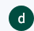

# AAPS için ayrı bir Google hesabı (isteğe bağlı)

Bazı **AAPS** kullanıcıları, **AAPS** için de ana e-posta hesaplarını kullanmayı tercih eder. Bazı **AAPS** kullanıcıları (veya bakım verenleri) ise **AAPS** için ayrı bir e-posta hesabı oluşturur - bu isteğe bağlıdır; aşağıda nasıl yapılacağına dair bir örnek veriyoruz.

**AAPS** için ayrı bir Gmail hesabı oluşturmak istemiyorsanız, doğrudan bir sonraki bölüme, [AAPS'i oluşturma](../SettingUpAaps/BuildingAaps.md) bölümüne geçebilirsiniz.

```{admonition} Advantages of a dedicated Google account for AAPS
:class: dropdown

- Ayrı bir Google Drive alanı sayesinde **Ayarları dışa aktar** ile kişisel Google Drive kotanızı doldurma riskiniz olmaz.
- **AAPS** uygulamasının her sürümü (ve xDrip, BYODA gibi destekleyici uygulamalar) bilgisayar donanımınızdan bağımsız tek bir yerde saklanır. Bilgisayarınız veya telefonunuz çalınsa, kaybolsa ya da bozulsa bile bunlara erişiminiz devam eder.
- Kurulumun herkeste aynı olması, benzer klasör yapısına sahip kullanıcılar arasında çevrimiçi desteği kolaylaştırır.
- Kuruluma bağlı olarak (aşağıya bakın), toplulukta iletişim kurmak için takma ad olarak ayrı bir kimliğiniz olur; bu da gizliliğinizi koruyabilir. 
- Tip 1 diyabetli çocuklar, yetişkin hesabı gerektiren **AAPS** ve ilgili özellikleri kullanırken, reşit olmayan kişiler olarak kendi “gündelik” e-posta hesaplarını koruyabilir.
- Gmail, aynı telefon numarasıyla en fazla 4 hesap kaydetmenize izin verir.
```

## AAPS için ayrı bir Google hesabı nasıl oluşturulur

(⌛Yaklaşık 10 dakika)


Requirements:

* Bir Windows bilgisayarınız (Windows 10 veya üstü) ve **AAPS** uygulamasını çalıştıracak bir Android telefonunuz (Android 12 veya üstü) var. Bazı adımlarda program indirip yüklemek gerektiğinden, ikisinde de en son güvenlik güncellemeleri, internet erişimi ve yönetici yetkileri bulunmalıdır.
* Android telefonunuz, Gmail hesabı gibi kişisel ”gündelik” e-posta adresinizle zaten kurulmuş durumda.

```{admonition} Things to consider when setting up your new account
:class: dropdown
- Gizlilik nedeniyle kendi adınızdan farklı, hesapla ilgili bir ad kullanabilirsiniz (örneğin t1dsuperstar). Böylece kendi kimliğinizi gizli tutarak bu adı **AAPS** genel forumlarında kullanabilirsiniz. Google bir kurtarma e-postası ve telefon numarası istediği için bu hesap yine de size kadar izlenebilir.
- Yeni **AAPS** hesabı, doğrulama için “_gündelik_” hesabınızla aynı telefon numarasını kullanır. Doğrulama için “gündelik” e-posta adresinizi kullanır;
- Yeni AAPS hesabına gönderilen her e-postanın ana hesabınıza iletilmesi için e-posta yönlendirmeyi ayarlayacağız (böylece iki ayrı posta kutusunu kontrol etmeniz gerekmez);
- _Gündelik_ Gmail hesabınız ve AAPS için ayrı Gmail hesabınız için farklı parolalar kullanın
- Bir Gmail hesabında Google “2-step verification” (2 adımlı doğrulama; çok faktörlü kimlik doğrulama olarak da bilinir) kullanıyorsanız, bunu her iki Gmail hesabı için de kullanmanız iyi olur.
- Google “Passkeys” (geçiş anahtarları) kullanmayı planlıyorsanız, birden fazla cihaz kaydettiğinizden emin olun. Böylece hesabınıza erişiminizi kaybetmezsiniz. Bunu yalnızca başka kimsenin erişemediği cihazlarda yapın (_yani_ başka kişilerin de açabildiği ortak hesaplı bir bilgisayarda yapmayın).
```


```{admonition} Video Walkthrough!
:class: note
Ayrı bir Google hesabının nasıl kurulacağını gösteren video için [buraya](<https://drive.google.com/file/d/1dMZTIolO-kd2eB0soP7boEVtHeCDEQBF/view?usp=drive_link>) tıklayın.
```

 Videoda anlatılan adımlar şunlardır:

Bu örnekte: 
- Mevcut “_Gündelik_” Google hesabınız: <donald.muck42@gmail.com>; 
- Yeni “_AAPS_” Gmail hesabınız: <donald.muck42.aaps@gmail.com>; 


### <https://myaccount.google.com> adresine gidin 

 Google'da zaten oturum açtıysanız, bu sizi “Gündelik” hesabınızın **My Account** (Hesabım) sayfasına yönlendirir. (1) Sayfanın sağ üst köşesindeki profil resminize tıklayın (bu örnekte basit bir ) (2) “_add another account_” (başka bir hesap ekle) seçeneğini seçin.


### YENİ ayrı hesabınızın bilgilerini girin: 

- Yeni hesabı girin: 
- Hesap oluşturun
- for my personal use (kişisel kullanımım için). 


### Kişisel bilgilerinizi girin:
 - Adınızı girin
 - soyadınız
 - doğum tarihiniz (yetişkin yaşında olmalısınız)

### YENİ e-posta adresinizi ve parolanızı seçin

Bu örnekte Donald Muck’ın mevcut adresinin sonuna “.AAPS” eklenir…\
Bir parola belirleyin

### SMS doğrulamasını alabilen bir telefon numarası girin

Gmail şimdi doğrulama için girmeniz gereken benzersiz bir kod gönderecektir.

### Kurtarma e-posta adresini girin

Bu örnekte bu, mevcut “_gündelik_” e-posta adresiniz olacaktır…

### Hesap kurulumunu tamamlayın

Gmail hesap adını gösterecektir. Sizden Gmail’in hüküm ve koşullarını kabul etmenizi ve kişiselleştirme ayarlarınızı onaylamanızı ister.

### Yeni profil görünümünü özelleştirin

Bu noktada Gmail’in MyAccount (Hesabım) sayfasında, yeni **AAPS** için ayrı e-posta hesabınızı görüyor olmalısınız. Profil resmi varsayılan olarak adınızın ilk harfi olacaktır. Karışıklığı önlemek için bunu benzersiz bir şeyle değiştirin… bu örnekte Donald.Muck.AAPS,  yerine  kullanmıştır.

\


### Yeni hesabı yapılandırmak için her iki pencerede de Gmail web sitesini açın

Ayrı bir e-posta hesabını takip etmek zorunda kalmamak için, yeni **AAPS** hesabındaki tüm e-postaları gündelik hesabınıza yönlendirin\
Bu bölüm biraz karışık olabilir, çünkü iki hesap arasında sürekli geçiş yapmanız gerekecek. İşi kolaylaştırmak için üst üste iki ayrı tarayıcı penceresi açın:

1. Mevcut tarayıcı pencerenizi ekranın üst kısmına taşıyın ve ekranın yalnızca üst yarısını kaplayacak şekilde yeniden boyutlandırın…
2. Görev çubuğunuzdaki tarayıcı simgesine sağ tıklayın
3. Menüden “New Window” (yeni pencere) seçeneğini seçin... ve pencereyi ekranın yalnızca alt yarısını kaplayacak şekilde ayarlayın.

Her iki tarayıcı penceresinde de <https://gmail.com> adresini açın. Kişisel hesabınızın üstte, yeni **AAPS** hesabının altta olduğundan ve sağ üst köşedeki profil resminden kolayca tanınabildiğinden emin olun. Gerekirse profil resmine tıklayıp doğru hesabı seçerek her zaman hesap değiştirebilirsiniz.


Gmail ana sayfalarınız şöyle görünmelidir:\


 ### Yeni Gmail hesabında (alt pencere) Gmail ayarlarını açın…

- Profil resminin solundaki dişli simgesine tıklayın
- ardından “**See all Settings**” (tüm ayarları görün) seçeneğini seçin


### Yönlendirmeyi ayarlayın…

- “Forwarding and POP/IMAP” (Yönlendirme ve POP/IMAP) ayar sekmesine tıklayın
- “add a forwarding address” (yönlendirme adresi ekle) seçeneğine tıklayın
- “Günlük” e-posta adresinizi ekleyin
- Gmail, “gündelik” e-posta adresinize bir doğrulama kodu gönderir.
- Günlük profilinize geri dönüp yönlendirmeyi kabul ettiğinizi doğrulamak için bağlantıya tıklayacaksınız (veya kodu “günlük” Gmail pencerenizdeki Gmail doğrulama e-postasından alıp “AAPS için ayrılmış yeni” Gmail pencerenize kesip yapıştıracaksınız).

Pencereler arasında epey gidip gelmek gerekir, ancak böylece “günlük” hesabınızın e-postalarına baktığınızda, AAPS için ayrılmış hesabınızdan yönlendirilen Gmail uyarıları gibi e-postaları da görürsünüz.


### Yönlendirilen e-posta adresini doğrulayın

- “Gündelik” Gmail hesabında (üst pencere) “Gmail forwarding Confirmation” (Gmail yönlendirme onayı) e-postasını alırsınız.
- Açın ve “isteği onaylamak için bağlantıya tıklayın”

### Yönlendirilen e-postaları AAPS için ayrılmış yeni Gmail hesabında arşivleyin (alttaki pencere)

<!---->

1. Alttaki pencereyi yenileyin
2. “Forward incoming email” (gelen e-postayı yönlendir) seçeneğini işaretleyin
3. Ve Gmail'in kopyasını arşivleyin (yeni ayrılmış posta kutunuzu temiz tutmak için)
4. Değişikliklerinizi kaydetmek için sayfanın en altına kadar kaydırın\
   


Tebrikler! Artık AAPS için ayrılmış bir Google hesabı oluşturdunuz. Bir sonraki adım [AAPS uygulamasını oluşturmaktır](../SettingUpAaps/BuildingAaps.md).