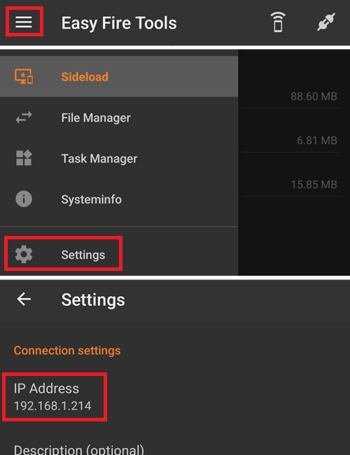
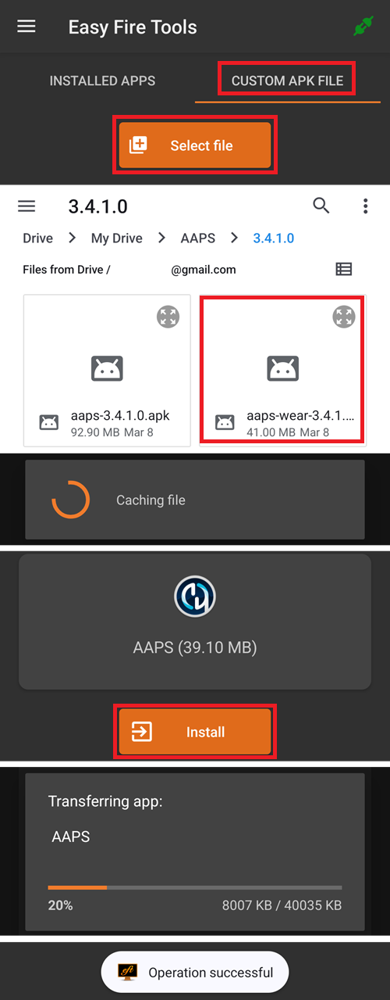
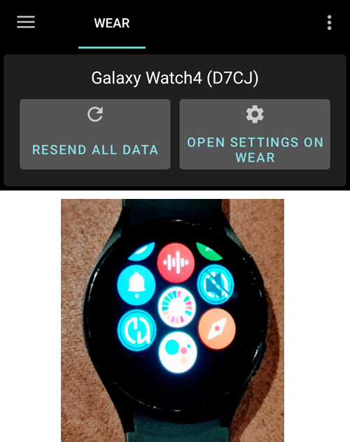
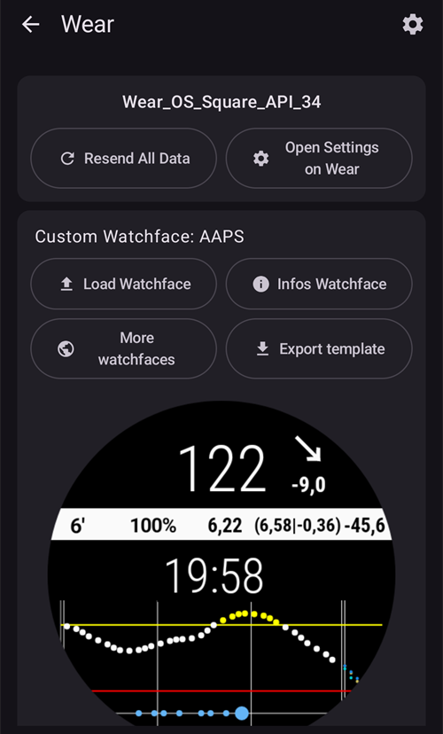
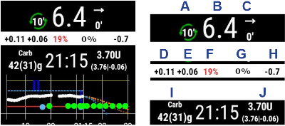

# Wear OS saatinizde AAPS kurulumu

Aşağıdaki talimatlar, sizin oluşturmanız gereken **AAPS Wear** apk'sı için geçerlidir. Henüz oluşturmadıysanız, [buradaki](../WearOS/BuildingAapsWearOS.md) kılavuza bakın. Oluştururken, telefondaki **AAPS** apk'sı için kullandığınız anahtar deposu (keystore) dosyasının aynısını kullandığınızdan emin olun.

Bu bilgilerin bir kısmını **AAPSClient** ve **PumpControl** **Wear** apk'sı için de kullanabilirsiniz. Her **Wear** uygulaması kendi eşleşen telefon uygulamasıyla iletişim kurar. Örneğin: **AAPSClient Wear** uygulaması **AAPS** verilerini değil, **AAPSClient** verilerini göstermek için kullanılabilir. Birkaç istemci türü (**AAPSClient**, **AAPSClient2**, **AAPSClient3**) yan yana yüklüyse, her birinin panellerinde o türün vurgu renginde küçük bir başlık bulunur. Böylece kaydırırken onları ayırt edebilirsiniz.

## Wear OS sürümleri ve uyumluluk

(wearos-watchface-changes)=

### Wear OS saat arayüzü değişiklikleri (AAPS saat arayüzlerine etkisi)

```{admonition} Why newer Wear OS watches break AAPS watchfaces
:class: warning

Haziran 2025'te Google, eski saat arayüzü motorunu (AndroidX / Wearable Support Library veya "WSL" motoru) aşamalı olarak kaldırıp yerine daha yeni, bildirimsel **Watch Face Format**'ı getiren [değişiklikleri duyurdu](https://android-developers.googleblog.com/2025/06/upcoming-changes-to-wear-os-watch-faces.html). **AAPS** özel saat arayüzleri eski motor üzerine kuruludur. Bu yüzden Wear OS sürümü ne kadar yeniyse, bir AAPS saat arayüzünün hatalı çalışma veya hiç çalışmama olasılığı o kadar yüksektir.

Bu durum yalnızca **saat arayüzlerini** etkiler — AAPS **komplikasyonları**, paneller ve uzaktan kontrol işlevleri etkilenmez. Bu aynı zamanda **Wear OS saatteki bir üretici yazılımı/sistem güncellemesinin AAPS saat arayüzlerini bozabilmesinin** nedenidir; ayrıca saat bundan sonra eski bir Wear OS sürümüne geri döndürülemez. AAPS saat arayüzünüz şu anda çalışıyorsa **otomatik saat güncellemelerini kapatın**.
```

Aşağıdaki tablo, Google'ın değişikliğinin AAPS (eski motorlu) saat arayüzlerini Wear OS sürümüne göre nasıl etkilediğini özetler:

| Wear OS sürümü          | Temel Android sürümü | API düzeyi | AAPS (eski) saat arayüzlerine etkisi                                                                                                                                                                  |
| ----------------------- | -------------------- | ---------- | ----------------------------------------------------------------------------------------------------------------------------------------------------------------------------------------------------- |
| Wear OS 6               | Android 16           | 36         | **Eski saat arayüzleri artık kullanılamaz** — AAPS bunun yerine bir [Watch Face Format saat arayüzü](#wearos-aaps-v4-watchface) yükler: özel saat arayüzünüz veya AAPS V4 komplikasyonlu saat arayüzü |
| Wear OS 5               | Android 14           | 34         | **Ciddi** — etkin (etkileşimli) mod çoğu zaman çalışmaz, komplikasyonlar donar, animasyonlar durur                                                                                                    |
| Wear OS 4               | Android 13           | 33         | **Orta** — yavaşlatma (throttling), kaçırılan güncellemeler, kısmi hatalar                                                                                                                            |
| Wear OS 3.0 / 3.2 / 3.5 | Android 11           | 30         | **Düşük** — eski motor hâlâ destekleniyor                                                                                                                                                             |

Saatiniz AAPS saat arayüzlerinin güvenilir çalışmadığı bir sürümdeyse, AAPS verilerini uyumlu bir saat arayüzünde **komplikasyonlar** ile gösterebilirsiniz. Ya da **AAPS**'in [Harici yardımcı uygulamalar](#external-companion-apps) eklentisinden beslenen [GlucoDataHandler](https://play.google.com/store/apps/details?id=de.michelinside.glucodatahandler) uygulamasını bir komplikasyonla kullanabilirsiniz. **Wear OS 6 ve daha yeni** sürümlerde AAPS, yeni formatta yapılmış bir yedek saat arayüzü yükler — aşağıya bakın.

(wearos-aaps-v4-watchface)=

### Wear OS 6 ve daha yenisi — AAPS'in yüklediği saat arayüzü

**Wear OS 6 veya daha yeni** sürümü çalıştıran saatler, klasik AAPS saat arayüzlerini saat arayüzü olarak çalıştıramaz. Bu saatler için AAPS saat uygulaması, Google'ın yeni **Watch Face Format**'ında yapılmış iki saat arayüzü getirir. Wear OS bir uygulamanın yalnızca **bir** saat arayüzü yüklemesine izin verir. Bu yüzden ikisinden hangisinin saatte olacağını siz seçersiniz:

- **Özel saat arayüzü** (varsayılan): telefondan **Saat arayüzü yükle** ile yüklediğiniz özel saat arayüzünü gösterir (bkz. [Bir AAPS saat arayüzüne geçme](#WearOS_changing-to-AAPS-watchface)). Saat, tasarımınızı bir resim olarak çizer. Bu yüzden mevcut her özel saat arayüzü çalışır. Bir özel saat arayüzünün tanımlayabileceği komplikasyon yerleri bu resimde **kullanılamaz**, çünkü Wear OS komplikasyon verilerini yalnızca gerçek bir saat arayüzüne iletir. Tek ayarına ulaşmak için arayüze uzun basın: her zaman açık ekranda sade bir saat mi, yoksa kendi tasarımınızın soluk hali mi gösterilsin.
- **Komplikasyonlu saat arayüzü** (**AAPS V4** saat arayüzü): **yedi komplikasyon yeri** **AAPS verileriyle önceden ayarlanmış** olarak gelir: KŞ değeri, AİNS, AKRB, [KŞ Grafiği komplikasyonu](#Watchfaces-complications), bazal oranı / geçici hedef ve sol üst yerde **Çalışma modu** simgesi (döngü modunu saatten değiştirmek için ona dokunun). Saatin alarm uygulamasını açmak için üstteki saate dokunun. Her yerin ne gösterdiğini saat arayüzü düzenleyicisinde değiştirebilirsiniz.

Seçimi telefonda yaparsınız: **Wear** eklentisini açın ve **Saatte yüklü saat arayüzü** altında ikisinden birini seçin. Bu kart yalnızca Wear OS 6 veya daha yeni bir saat bağlıyken gösterilir. Saat arayüzünü hemen değiştirdiği için **AAPS** sizden onay ister. **Komplikasyonlu saat arayüzü**nden başka bir arayüze geçmek, saat arayüzü düzenleyicisinde değiştirdiğiniz komplikasyonları da varsayılanlara sıfırlar. Onay mesajı da bunu söyler. **Komplikasyonlu saat arayüzü** seçiliyken özel saat arayüzü düğmeleri gizlenir ve onların yerine arayüzün bir önizlemesi gösterilir. **Komplikasyonlu saat arayüzü** seçiliyken bir özel saat arayüzü yüklerseniz, **AAPS** onu saatte görmek için **Özel saat arayüzü** seçeneğine geçmenizi hatırlatır.

- Seçilen saat arayüzü, AAPS saat uygulaması böyle bir saatte ilk kez çalıştığında **otomatik olarak yüklenir ve etkinleştirilir**. Saat uygulamasıyla birlikte **otomatik olarak güncellenir**.
- Saat arayüzünü kaldırdıysanız, saatteki AAPS **ana menüsünün** en altında bir **Saat arayüzünü yükle** öğesi görünür — yeniden yüklemek için ona dokunun.

Wear OS 5 veya daha eski bir saat bağlıyken **Saatte yüklü saat arayüzü** kartı hiç gösterilmez (dayandığı mekanizma Wear OS 6 gerektirir); klasik saat arayüzleri orada eskisi gibi çalışır.

(wearos-complications-watchface-setup)=

### Komplikasyonlu saat arayüzü — önerilen kurulum

**Komplikasyonlu saat arayüzü**nde yedi komplikasyon yeri vardır. Saat arayüzüne uzun basın, **Customize** (Özelleştir) seçeneğine dokunun ve her yer için bir veri kaynağı seçin. Yerler, saat arayüzü düzenleyicisindeki gibi numaralandırılmıştır: **1** sol, **2** orta, **3** sağ, **4** grafik, **5** alt, **6** sol üst ve **7** sağ üst.

| Varsayılan kurulum                                                                                       | Alternatif kurulum                                                                                           |
| -------------------------------------------------------------------------------------------------------- | ------------------------------------------------------------------------------------------------------------ |
|  |  |

| Yer | Konum   | Varsayılan                                                                                         | Alternatif                                                         |
| --- | ------- | -------------------------------------------------------------------------------------------------- | ------------------------------------------------------------------ |
| 1   | Sol     | AİNS simgesi                                                                                       | AKRB & AİNS                                                        |
| 2   | Orta    | Kan Şekeri                                                                                         | Kan Şekeri                                                         |
| 3   | Sağ     | AKRB simgesi                                                                                       | Bazal & Hedef                                                      |
| 4   | Grafik  | KŞ Grafiği                                                                                         | KŞ Grafiği                                                         |
| 5   | Alt     | Bazal & Hedef                                                                                      | Yükleyici/Telefon Pili                                             |
| 6   | Sol üst | Running mode                                                                                       | Running mode                                                       |
| 7   | Sağ üst | Yükleyici/Telefon Pili veya **AAPS Snooze Alert** (AAPS Uyarı Erteleme) için bir uygulama kısayolu | **AAPS Snooze Alert** (AAPS Uyarı Erteleme) için uygulama kısayolu |

**AAPS Snooze Alert** kısayolu, saatin kendi **App shortcut** (uygulama kısayolu) komplikasyonlarından seçilir. Ona dokunmak, telefonda çalan alarmı erteler.

```{tip}
Saatte **Always-on display** (Her zaman açık ekran) özelliğini açın (**Settings** (Ayarlar) > **Display** (Ekran)). Saat arayüzü bundan sonra bilek aşağıdayken de boş bir ekran veya sade bir saat yerine glikoz değerinizi göstermeye devam eder.
```

```{admonition} No complication data while the watch is locked
:class: note
**Settings** (Ayarlar) > **Security and privacy** (Güvenlik ve gizlilik) altında bir **Lock type** (Kilit türü) ayarlıysa, saat kilitliyken komplikasyon verilerini gizler ve siz kilidi açana kadar saat arayüzü boş yerler gösterir. Verileri görünür tutmak için aynı menüde **Hide information** (Bilgileri gizle) seçeneğini kapatın.
```

### Wear OS 3

**AAPS Wear** apk'sını [Wear Installer 2](https://youtu.be/abgN4jQqHb0?si=5L7WUeYMSd_8IdPV), Easy Fire Tools (aşağıda anlatılıyor) veya ADB ile yükleyin.  
**AAPS Wear** işlevlerinde kısıtlama yoktur.

(BuildingAapsWearOs-WearOS5)=

### Wear OS 4 ve Wear OS 5

Örnek: Wear OS 6'ya henüz **güncellenmemiş** Galaxy Watch 4, 5, 6, 7 ve Ultra veya Pixel Watch. Sürümü **Settings** (Ayarlar) > **About watch** (Saat hakkında) > **Software** (Yazılım) altında kontrol edin.

**AAPS Wear** apk'sını [Wear Installer 2](https://youtu.be/abgN4jQqHb0?si=5L7WUeYMSd_8IdPV) ile yükleyin (Wear OS 5 için [bu videoyu](https://www.youtube.com/watch?v=yef_qGvcCnk) izleyin). Tüm **AAPS Wear** işlevleri çalışır, ancak klasik **AAPS** saat arayüzleri yukarıdaki tabloda anlatıldığı gibi kısıtlıdır: Wear OS 4'te yavaşlatılır, Wear OS 5'te çoğu zaman çalışmaz.

```{admonition} Wear OS 5
:class: warning
Wear OS 5'te AAPS saat arayüzü, Wear uygulaması yüklendikten hemen sonra Wear Installer 2 ile seçilmelidir: yükleyici, kurulumun sonunda **AAPS(Özel)** saat arayüzünü sunar. Yanlışlıkla başka bir saat arayüzüne geçerseniz kurulumu tekrarlayın. Saat arayüzü ayarlarını (Koyu, Eşleşen bölücü vb.) değiştirmek mümkün olmayabilir.

Klasik saat arayüzü şu anda sizin için çalışıyorsa **otomatik saat güncellemelerini kapatın**: bir sonraki üretici yazılımı güncellemesi onu büyük olasılıkla bozacaktır. Yine de Wear OS 6'ya güncellerseniz yukarıdaki bölümü okuyun: **AAPS** o zaman yeni formatta kendi saat arayüzünü yükler.
```

Saat arayüzü çok güvenilmezse, bunun yerine bir komplikasyonla [GlucoDataHandler](https://play.google.com/store/apps/details?id=de.michelinside.glucodatahandler) kullanmayı düşünün. Bunun için **AAPS**'te [Harici yardımcı uygulamalar](#external-companion-apps) eklentisinin etkin olması gerekir.

### Wear OS 6 ve daha yenisi

Örnek: One UI 8 Watch yüklü Galaxy Watch 4 ve daha yenisi, 2025 güncellemesinden sonraki Pixel Watch. Çoğu Galaxy ve Pixel saat bu güncellemeyi almıştır.

**AAPS Wear** apk'sını [Wear Installer 2](https://youtu.be/abgN4jQqHb0?si=5L7WUeYMSd_8IdPV) ile yükleyin. Klasik saat arayüzleri kullanılamaz; **AAPS**, telefonda seçilen saat arayüzünü otomatik olarak yükler, bkz. [AAPS'in yüklediği saat arayüzü](#wearos-aaps-v4-watchface). **AAPS Wear** işlevlerinde kısıtlama yoktur.

## Samsung Galaxy Watch 4 akıllı saati **AAPS** ile nasıl kurulur

Bu bölüm akıllı saatleri hiç bilmediğinizi varsayar. Popüler bir saat olan **Galaxy Watch 4** için temel bir tanıtım verir, ardından saatte **AAPS** kurulumunu adım adım anlatır.

_Bu kılavuz, Wear OS 3 çalıştıran bir Galaxy Watch için yazılmıştır._ Wear OS 4 ve sonrasında, bir telefon veya bilgisayar ADB üzerinden bağlandığında saat bir **eşleştirme kodu** ister. Wear Installer 2 ve [aşağıdaki](#BuildingAapsWearOs-WearOS5-TShoot) terminal yöntemi bunu destekler.

[Galaxy Watch 5](https://www.youtube.com/watch?v=Y5upzOIxwTU) ve [Galaxy Watch 6](https://www.youtube.com/watch?v=D6bq20KzPW0) için temel kurulum kılavuzları

## Akıllı saatle temel tanışma

Saatinizin temel kurulumunu yukarıdaki videoya göre yaptıktan sonra telefonda Play Store'a gidin ve şu uygulamaları indirin: "Galaxy Wearable", “Samsung” ve “Easy Fire tools” ya da "Wear Installer 2".

Yeni akıllı saatinizi tanımanıza yardımcı olacak birçok üçüncü taraf YouTube videosu vardır, örneğin:

[https://www.youtube.com/watch?v=tSVkqWNmO2c](https://www.youtube.com/watch?v=tSVkqWNmO2c)

“Galaxy Wearable” uygulamasında bir kullanım kılavuzu bölümü de vardır. Telefonda Galaxy Wearable uygulamasını açın, saati arayın ve saati telefonla eşleştirmeyi deneyin. Sürümünüze bağlı olarak, Play Store'dan bir uygulama daha, “galaxy watch 4 plugin” uygulamasını yüklemeniz istenebilir (indirmesi biraz sürer). Bunu telefona yükleyin, sonra saati ve telefonu Wearable uygulamasında yeniden eşleştirmeyi deneyin. Bir dizi menüden geçin ve çeşitli tercihleri işaretleyin.

## Samsung hesabı oluşturma

Samsung hesabını oluşturmak için kullandığınız e-posta hesabında doğum tarihi, kullanıcı 13 yaşında veya daha büyük olacak şekilde ayarlı olmalıdır. Aksi halde Samsung izinlerini onaylamak çok zordur. Çocuğunuza 13 yaşından önce bir Gmail hesabı verdiyseniz ve bu e-posta adresini kullanıyorsanız, hesabı kolayca yetişkin hesabına çeviremezsiniz. Bunun bir çözümü, mevcut doğum tarihini şu anki yaş 12 yıl 364 gün olacak şekilde değiştirmektir. Ertesi gün hesap yetişkin hesabına dönüşür ve Samsung hesabının kurulumuna devam edebilirsiniz.

(remote-control-transferring-the-aaps-wear-app-onto-your-aaps-phone)=

## **AAPS** Wear uygulamasını **AAPS** telefonunuza aktarma

Wear.apk dosyasını Android Studio'dan telefonunuza şu yollardan biriyle yükleyebilirsiniz:

a)  **AAPS** wear apk dosyasını USB kablosuyla telefona koyun, sonra saate “side-load” edin (yandan yükleyin). Wear.apk dosyasını USB ile telefondaki indirilenler (downloads) klasörüne aktarın veya

b)  Wear.apk dosyasını Android Studio'dan kesip Gdrive'ınıza yapıştırın.


AAPS'i saate yandan yüklemek (side-load) için şunlardan birini kullanabilirsiniz: 1) Wear Installer 2 2) Easy Fire tools 3) Android Debug Bridge (ADB) Burada Wear Installer 2'yi öneriyoruz, çünkü videodaki talimatlar ve işlem çok açık ve iyi anlatılmıştır. Wear Installer 2 sizin için çalışmazsa, Easy Fire Tools veya ADB'yi deneyin. İkisi de aşağıda anlatılıyor.

### Wear Installer 2 ile **AAPS** Wear'i telefondan saate yandan yükleme

 

[Malcolm Bryant](https://www.youtube.com/@Freepoc) tarafından geliştirilen Wear Installer 2, Google Play'den telefonunuza indirilebilir. AAPS wear uygulamasını saate yandan yüklemek (side-load) için kullanılabilir. Uygulamada kullanışlı bir ‘how to sideload’ (yandan yükleme nasıl yapılır) [videosu](https://youtu.be/abgN4jQqHb0?si=5L7WUeYMSd_8IdPV) vardır.

```{tip}
Wear OS 5 saatler için [bu videoyu](https://www.youtube.com/watch?v=yef_qGvcCnk) izleyin.
Sorun giderme ipuçları için [aşağıya](#BuildingAapsWearOs-WearOS5-TShoot) bakın.
```

Bu video gerekli tüm ayrıntıları verir (telefonu kurarken izleyebilmek için videoyu ayrı bir cihazda açmanız en iyisidir).

Videoda da belirtildiği gibi, işlem bitince akıllı saatin pilini tüketmemek için saatte ADB debugging (ADB hata ayıklama) seçeneğini kapatın.

Alternatif olarak (Wear OS 5 için değil) şunları yapabilirsiniz:

### **AAPS** wear'i saate yandan yüklemek için Easy Fire tools kullanma

1)   _[Easy Fire Tools](https://play.google.com/store/apps/details?id=de.agondev.easyfiretools&hl=en)_ uygulamasını Play Store'dan telefona indirin


2)  Saatte geliştirici olun (saat kurulup telefona bağlandıktan sonra):

**Settings** (Ayarlar) > **System** (Sistem) > **About** (Hakkında) > **Versions** (Sürümler) bölümüne gidin (menü adları saat markasına göre değişir — bazı saatlerde **About watch** (Saat hakkında) > **Software info** (Yazılım bilgisi) > **Software version** (Yazılım sürümü) şeklindedir).


Artık geliştirici olduğunuzu söyleyen bir mesaj çıkana kadar **Build number** (Yapım numarası) (veya **Software version**) üzerine art arda hızlıca dokunun.


**Settings** (Ayarlar) > **System** (Sistem) bölümüne geri dönün: artık yeni bir **Developer options** (Geliştirici seçenekleri) menüsü görünür.

**Developer options** içinde **ADB debugging** (ADB hata ayıklama) ve **Wireless debugging** (Kablosuz hata ayıklama) seçeneklerini açın ve çıkan soruları onaylayın. Kablosuz hata ayıklama ardından saatin **IP address & Port** (IP adresi ve port) bilgisini gösterir, örneğin: **192.168.1.214** : 5555. Yalnızca IP adresine (burada **192.168.1.214**) ihtiyacınız vardır, iki noktadan sonraki port numarasına değil. IP adresinin değişebileceğini unutmayın, örneğin AAPS için her yeni telefona geçtiğinizde.


ADIM 3)     Telefondaki Easy Fire tools uygulamasına IP adresini girin, _örn._ **192.168.1.214** (soldaki hamburger menüyü açın, ayarlara gidin ve IP adresini girin).



Sonra sağ üstteki priz simgesine tıklayın. Bağlanınca yeşile döner.


ADIM 4) Easy Fire tools ile aaps-wear.apk dosyasını akıllı saate yandan yüklemek (yani aktarmak) için [buradaki](https://wearablestouse.com/blog/2022/01/04/install-apps-apk-samsung-galaxy-watch-4/?utm_content=cmp-true) talimatları izleyin





(BuildingAapsWearOs-WearOS5-TShoot)=

### Terminali kullanma
Akıllı saatinizi ve bilgisayarınızı aynı Wi-Fi ağına bağlayın.

- ADB'yi yüklemek için şuradan indirin: https://developer.android.com/tools/releases/platform-tools
- Bir terminal açın.
- Windows'ta `C:` diskinizin altında `adb` adlı yeni bir klasör oluşturun. Yukarıda indirdiğiniz `platform-tools-latest-windows.zip` dosyasını açın. `platform-tools` içindeki tüm dosyaları `C:\adb` klasörüne kopyalayın ve bu klasörü bir komut isteminde açın (sağ tıklayın ve Open in Terminal (Terminalde aç) seçin). ADB'nin bulunduğu klasörün yolunu ayarlamak için aşağıdaki komutu yazın: `setx PATH "%PATH%;C:\adb"`
- Mac'te elle yüklemek yerine homebrew kullanabilirsiniz: `brew install android-platform-tools`

Saatte:
- Settings (Ayarlar) → About watch (Saat hakkında) → **Software Information** (Yazılım bilgileri) bölümüne gidin
- Developer mode enabled (Geliştirici modu etkin) mesajını görene kadar Software version (Yazılım sürümü) seçeneğine 7 kez dokunun.
- Settings (Ayarlar) → Developer options (Geliştirici seçenekleri) bölümüne gidin. **ADB debugging** (ADB hata ayıklama) seçeneğini açın
- Settings (Ayarlar) → Developer options (Geliştirici seçenekleri) → Wireless debugging (Kablosuz hata ayıklama) → **Pair new device** (Yeni cihaz eşleştir) bölümüne gidin

Bir Wi-Fi eşleştirme kodu ile IP adresi ve port görünür:


- Terminalde: `adb pair ipaddress:port` Örnek: `adb pair 10.10.1.125:36299`
- Sizden eşleştirme kodu istenir. Kodu girin.
- Şu yanıtı görürsünüz:<br> `Successfully paired to 10.10.1.125:36299 [guid=adb-RXXXW20LMKJY-eh5zBj]`<br>
- Terminale şunu yazın: <br>`adb devices`.<br> Şuna benzer bir şey görmelisiniz:<br> `List of devices attached`<br> `10.10.1.125:36299  offline`<br> `adb-RFAW20LMKJY-eh5zBj._adb-tls-connect._tcp   device`<br>

- Şimdi bilgisayarınızda Wear apk dosyasının bulunduğu klasöre gidin ve şunu yazın<br> `adb install wear-full.apk` <br>wear-full.apk yerine kendi apk dosyanızın adını yazın.
- Şunu görürsünüz:<br> `Performing Streamed Install`<br> `Success`


(wear-os-5-troubleshooting)=

### Wear OS 5 için genel sorun giderme önerileri

- Wi-Fi paylaşımı (tethering) kullanmayın. Bu işe yaramaz.
- Telefonda adb hata ayıklamayı açmanız gerekmez (yalnızca saatte). Telefonda adb hata ayıklamayı kapatın.
- Telefonun ve saatin birbirini görebildiği yerel ağınıza bağlandığınızdan emin olun (bağlanmak için Wi-Fi misafir ağınızı kullanmayın).
- Saatin ve telefonun aynı ağda ve aynı Wi-Fi cihazına bağlı olduğundan emin olun. Özellikle Wi-Fi tekrarlayıcıları (repeater) veya erişim noktaları sorun çıkarabilir.
- Ana yönlendiricinize (router) yakın olun, sonra hem telefonu hem saati yeniden başlatın.

**Eşleştirme:**

- Saat: Wireless Debugging (Kablosuz hata ayıklama): IP adresini not edin.
- Wear Installer: Wear Installer uygulamasına IP adresini girin.
- Pair new (Yeni eşleştir) seçeneğini seçin, gösterilen eşleştirme kodunu ve port numarasını not edin.
- Wear Installer: eşleştirme kodu + boşluk + port numarasını girin.
- Wear Installer eşleştirmenin başarılı olduğunu bildirmelidir. Bildirmezse Wear Installer'dan çıkın ve yeniden deneyin.

Eşleştirme bittikten sonra AAPS wear apk'sını yükleyebilmelisiniz:

- Çıkın/kapatın, sonra Wear Installer'ı yeniden başlatın.
- Kablosuz hata ayıklamada IP ve port numarasını not edin; Wear Installer'da IP ve port numarasını kontrol edin veya girin.
- Not: port numarası, eşleştirme için kullanılandan farklıdır!

## Saat ile telefon arasındaki bağlantıyı **AAPS**'ten kurma

Son adım, telefondaki **AAPS**'i saatteki **Wear.apk** ile birlikte çalışacak şekilde yapılandırmaktır. Bunun için Wear eklentisini etkinleştirin:

* Telefonda **AAPS** uygulamasına gidin

* Sol üst köşedeki **menüyü** (☰) açın ve **Konfigürasyon** > **İletişim** bölümüne gidin

* **Wear** kutusunu işaretleyin


Saatten bolus vermek veya başka işlemler yapmak için [Ayarlar > Wear](#preferences-wear) içinde **Wear kontrolü** seçeneğini de açın.

Başka bir **AAPS** saat arayüzüne geçmek için saatin ana ekranındaki saat arayüzüne uzun basın ve **Customize** (Özelleştir) seçeneğine dokunun. Sonra tüm **AAPS** saat arayüzlerine gelene kadar sağa kaydırın.

**AAPS** Wear.apk akıllı saate başarıyla yüklendiyse şöyle görünür:





Samsung Galaxy gibi bazı akıllı saatlerde, **Wear.apk** & **AAPS**'i Wi-Fi üzerinden uzaktan kullanmak için Samsung Galaxy'nin Advanced Features (Gelişmiş özellikler) altındaki 'Remote Connection' (Uzaktan bağlantı) seçeneği **açık** olmalıdır.


(wear-os-watch-phone-communication)=

### **AAPS** saat ile **AAPS** telefon arasındaki iletişimde sorun giderme

1.  EasyFire tools bağlanmıyorsa veya ‘authorisation failed’ (yetkilendirme başarısız) mesajı alıyorsanız > IP adresinin doğru girildiğini kontrol edin.
2.  Akıllı saatin internete bağlı olduğunu kontrol edin (yalnızca Bluetooth ile telefona bağlı olması yetmez).
3.  **AAPS** telefonu ile akıllı saatin Samsung uygulamasında eşleştirilmiş veya bağlanmış olduğunu kontrol edin.
4.  Telefonu ve akıllı saati tamamen yeniden başlatmak da yardımcı olabilir (yani telefonu kapatıp açmak)
5.  Wear.apk dosyasını telefonunuza indirmeyi başardınız ama hiç KŞ verisi almıyorsanız, saate doğru **AAPS** Wear apk'sını yandan yüklediğinizi _kontrol edin_: tarayıcıyla oluşturmada saat uygulaması `aaps-wear-….apk` dosyasıdır, bkz. [Wear AAPS uygulamasını oluşturma](../WearOS/BuildingAapsWearOS.md). Yüklediğiniz dosya şunlardan biriyse: a) bir **AAPSClient** Wear apk'sı (telefonda **AAPS** çalışırken); b) bir `.aab` dosyası veya c) adında ‘debug’ kelimesi geçen bir dosya, oluşturma sırasında doğru Wear OS apk'sını seçmemişsiniz demektir.
6.  Yönlendiricinizin (router) cihazları birbirinden yalıtmadığını kontrol edin.

Daha fazla sorun giderme ipucunu [burada](https://freepoc.org/wear-installer-help-page/#:~:text=If%20you%20are%20having%20problems,your%20phone%20and%20your%20watch.) bulabilirsiniz

(WearOS_changing-to-AAPS-watchface)=

## WearOS saatinizde bir AAPS saat arayüzüne geçme

AAPS Wear OS APK'sının standart sürümünde birçok saat arayüzü vardır. AAPS Wear APK'sını saatinize yükledikten sonra bunları kullanabilirsiniz. Birini seçmek için adımlar:

1. Saatinizde (WearOS varsayılarak) saat arayüzü seçici ekranını açmak için mevcut saat arayüzüne uzun basın. "Add Watch Face" (Saat arayüzü ekle) düğmesini görene kadar en sağa kaydırın ve bu düğmeyi seçin


2. "AAPS(Özel)" öğesini bulana kadar listede kaydırın (saate göre, yüklü uygulamaların saat arayüzleri "Downloaded" (İndirilenler) bölümünde veya uygulamaya göre gruplanmış olarak listelenir). Mevcut saat arayüzleri kısa listenize eklemek için resmin ortasına tıklayın. "AAPS(Özel)" saat arayüzünün şu anki görünümü sizi endişelendirmesin; tercih ettiğiniz görünümü bir sonraki adımda seçeceğiz.


3. Şimdi telefonunuzda AAPS'i açın ve Wear eklentisini açın: **Konfigürasyon** > **İletişim** > **Wear** > **Eklentiyi aç** (etkin değilse önce **Wear** kutusunu işaretleyin).



4. "Saat arayüzü yükle" düğmesine tıklayın ve beğendiğiniz saat arayüzünü seçin


5. Saatinize bakın: "AAPS(Özel)" saat arayüzü artık seçtiğiniz görünümü göstermelidir. Yenilenmesi için birkaç saniye bekleyin. Telefondaki **Wear** ekranı artık yüklenen saat arayüzünün adını ve önizlemesini gösterir. **Saat arayüzü bilgisi** arayüzün ayrıntılarını ve içerdiği alanları listeler. **Diğer saat arayüzleri** ise başka özel saat arayüzleri indirebileceğiniz [paylaşım sayfasını](../ExchangeSiteCustomWatchfaces/index.md) açar. Artık saat arayüzüne uzun basıp saat arayüzü resmindeki "Customize" (Özelleştir) düğmesine basarak komplikasyonları vb. özelleştirebilirsiniz.

```{admonition} Complications on a custom watchface
:class: note
Özel saat arayüzü formatının 3.0 veya daha yeni sürümüyle yapılan özel saat arayüzleri en fazla beş komplikasyon yeri içerebilir. Bu yerlerin konumunu ve boyutunu saat arayüzü belirler (**Komplikasyon düzeni**). Saatte saat arayüzüne uzun basın, **Customize** (Özelleştir) seçeneğine dokunun ve her yerde gösterilecek veri kaynağını seçmek için **Komplikasyon 1** ile **Komplikasyon 5** arasındaki satırlara dokunun. Aynı satırlar saatteki AAPS uygulamasında **Ayarlar** > **AAPS(Özel)** altında da listelenir; oradan birine dokunmak aynı seçiciyi açar. **Komplikasyon türü önceliği**, veri kaynağı birkaç tür sunduğunda bir yerin değer veya göstergeyi, metni ya da simgeyi tercih edip etmeyeceğini belirler. Değiştirilen öncelik, yalnızca o yer için bir sonraki veri kaynağı seçiminizde uygulanır.

Bu yerler yalnızca özel saat arayüzünün gerçek bir saat arayüzü olarak çalıştığı, **Wear OS 5 veya daha eski** sürümlü saatlerde çalışır. **Wear OS 6 ve daha yeni** sürümlerde özel saat arayüzü komplikasyon yerleri olmadan bir resim olarak gösterilir ve yukarıdaki 1. ve 2. adımlar gerekmez: telefondaki **Wear** eklentisinde **Saatte yüklü saat arayüzü** altında **Özel saat arayüzü** seçeneğinin seçili olduğundan emin olun (bkz. [AAPS'in yüklediği saat arayüzü](#wearos-aaps-v4-watchface)).
```

## AAPSv2 saat arayüzü - Açıklama



A - time since last loop run

B - CGM reading

C - minutes since last CGM reading

D - son CGM değerine göre değişim (mmol veya mg/dL olarak)

E - son 15 dakikada CGM değerinin ortalama değişimi

F - phone battery

G - basal rate (shown in U/h during standard rate and in % during TBR)

H - BGI (blood glucose impact, kan şekerine etki) -> KŞ'nin yalnızca insülin etkisine göre ne kadar yükselmesi veya düşmesi “gerektiği”.

I - karbonhidrat (aktif karbonhidrat | gelecekteki yKarb)

J - insulin on board (from bolus | from basal)
