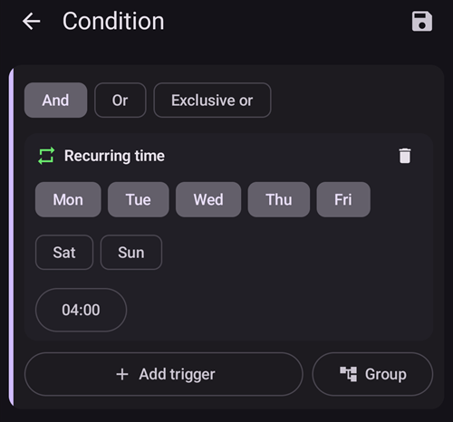

# Як використовувати плагін Autotune

Плагін Autotune — це реалізація алгоритму OpenAPS autotune в AAPS. Він аналізує вашу недавню історію AAPS і пропонує зміни базальних швидкостей, ISF та вуглеводного коефіцієнта.

Плагін Autotune доступний у версіях AAPS з [3.4](#version3400), але типово прихований.

(autotune-how-autotune-calculates-adjustments)=
## Як Autotune розраховує зміни

Autotune переглядає вашу недавню історію AAPS — показники CGM, болюси, вуглеводи і тимчасові базали — і визначає, де ваш **Профіль** (базальні швидкості, ISF, вуглеводний коефіцієнт) не зовсім відповідає тому, що насправді відбувалося з вашою ГК.

Для кожної 5-хвилинної точки даних він порівнює **фактичну зміну ГК** зі зміною, яку передбачав ваш профіль, і відносить отримане відхилення до однієї з трьох груп:

* відхилення, які сталися без активних вуглеводів і без дії інсуліну (використовуються для налаштування **базальних швидкостей**, погодинно),
* відхилення, які сталися після болюсу/корекції без вуглеводів (використовуються для налаштування **ISF**), або
* відхилення, які сталися під час засвоєння вуглеводів (використовуються для налаштування **вуглеводного коефіцієнта**).

Потім він аналізує закономірність відхилень у кожній групі (використовуючи процентилі, а не просте середнє, щоб кілька зашумлених точок не спотворили результат) і пропонує нове значення для цієї години/параметра.

Щоб окремий запуск не перекоригував значення, кожен запуск Autotune зсуває значення лише на частину шляху до того, що підказують дані: до 10 % для ISF і вуглеводного коефіцієнта і до 20 % для кожного сегмента базалу. Загальний зсув додатково обмежують налаштування **Max autosens ratio** / **Min autosens ratio** (див. [Інші налаштування](#autotune-other-settings) нижче) — ті самі межі, що обмежують Autosens. Тому Autotune слід запускати повторно (день за днем або щоночі), а не довіряти йому після одного запуску: результати мають поступово сходитися, а великий стрибок за один запуск — це сигнал ще раз перевірити ваші дані (пропущені вуглеводи, поганий день сенсора _тощо_), а не сліпо йому довіряти.

Autotune можна запускати трьома способами: вручну, одноразово з плагіна (як описано нижче), автоматично щоночі за [правилом автоматизації](#autotune-run-autotune-with-an-automation-rule) або — повністю поза AAPS — як окремий інструмент командного рядка на експортованих даних; саме так деякі посібники спільноти описують його використання без телефона з працюючим AAPS.

*Повний математичний опис базового алгоритму oref0 див. у [документації Autotune від OpenAPS](https://openaps.readthedocs.io/en/latest/docs/Customize-Iterate/autotune.html).*

## Показати плагін Autotune

Створіть порожній файл з назвою `enable_autotune` у підпапці `extra` [каталогу AAPS](#preferences-maintenance-settings) на вашому телефоні.

***ПРИМІТКА: обов'язково перевірте в налаштуваннях AAPS, де знаходиться ваш каталог AAPS, і що ви поклали файл саме туди. Кілька користувачів поклали файл не в ту папку.***


Перезапустіть **AAPS**. Потім відкрийте **Меню** (☰), виберіть **Конфігурація**, потім категорію **Загальне** і позначте **Autotune**. Після цього картка показує **Налаштування** і **Відкрити плагін**:


## Інтерфейс користувача Autotune

Натисніть **Відкрити плагін** на картці **Autotune**, щоб відкрити екран Autotune:


- У спадному меню «Профіль» можна вибрати вхідний профіль, який ви хочете налаштувати (типово вибрано ваш поточний активний профіль)
  - Примітка: щоразу, коли ви вибираєте новий профіль, попередні результати буде видалено, а **Кількість днів даних** буде встановлено на типове значення
- Потім у полі **Кількість днів даних** (у старих версіях — **Днів для Autotune**) вибирають кількість днів, які використовуються в розрахунку для налаштування профілю. Мінімальне значення — 1 день, максимальне — 30 днів. Це число не повинно бути надто малим, щоб отримати правильні ітеративні та плавні результати (понад 7 днів для кожного розрахунку)
  - Примітка: щоразу, коли ви змінюєте **Кількість днів даних**, попередні результати буде видалено
- «Останній запуск» — це посилання, яке відновлює ваш останній успішний розрахунок. Якщо ви не запускали Autotune сьогодні або якщо попередні результати було видалено через зміну параметра розрахунку вище, можна відновити параметри та результати останнього успішного запуску.
- Попередження показує вам, наприклад, деяку інформацію про вибраний профіль (якщо у вас кілька значень IC або кілька значень ISF)
  - Примітка: розрахунок Autotune працює лише з одним значенням IC та одним значенням ISF. Наразі немає алгоритму Autotune для налаштування добового IC або добового ISF. Якщо ваш вхідний профіль має кілька значень, у розділі попереджень ви побачите середнє значення, яке використовується для налаштування профілю.
- Кнопка «Перевірити вхідний профіль» відкриває перегляд профілю, щоб ви могли швидко перевірити свій профіль (одиниці, IC, ISF, базал і ціль)
  - Примітка: Autotune налаштовує лише ваш IC (одне значення), ISF (одне значення) і базал (з добовими змінами). Одиниці та ціль у вихідному профілі не змінюються.

- «Запустити Автотюн» запускає розрахунок Autotune з вибраним профілем і вибраною кількістю днів даних
  - Примітка: розрахунок Autotune може тривати довго. Після запуску можна перейти на інший екран (головний, ...) і пізніше повернутися до плагіна Autotune, щоб побачити результати

  

- Потім під час розрахунку нижче ви побачите проміжні результати

  - Примітка: під час розрахунку налаштування заблоковані, тому ви вже не можете змінити вибраний вхідний профіль або кількість днів. Якщо ви хочете запустити новий розрахунок з іншими параметрами, доведеться дочекатися кінця поточного розрахунку.

  

- Коли розрахунок Autotune завершиться, ви побачите результат (профіль «Налаштовано») і чотири кнопки під ним.

  

- Важливо завжди порівнювати вхідний профіль (стовпець «Профіль»), вихідний профіль (стовпець «Налаштовано») і відсоток зміни для кожного значення (стовпець «%»).

- Для базальних швидкостей ви також бачите кількість «пропущених днів». Пропущені дні виникають, коли Autotune не має достатньо даних, віднесених до категорії «Базал», щоб налаштувати базальну швидкість для цього періоду (наприклад, після кожного прийому їжі, коли засвоюються вуглеводи). Це число має бути якомога меншим, особливо коли базал важливий (наприклад, уночі або наприкінці дня)

- Кнопка «Порівняти профілі» відкриває екран порівняння профілів. Вхідний профіль показано синім, а вихідний профіль (з назвою «Налаштовано») — червоним.

  - Примітка: у прикладі нижче вхідний профіль має добові зміни IC та ISF, але розрахований вихідний профіль має одне значення. Якщо вам важливо отримати добовий вихідний профіль, див. [Добовий профіль IC або ISF](#autotune-circadian-ic-or-isf-profile) нижче.

  

- Якщо ви довіряєте результатам (малий відсоток зміни між вхідним і вихідним профілем), можна натиснути кнопку «Активувати профіль», а потім OK для підтвердження.

  - «Активувати профіль» автоматично створює новий профіль «Налаштовано» у вашому списку профілів (**Керувати → Профіль**).
  - Якщо у **Керувати → Профіль** уже є профіль з назвою «Налаштовано», цей профіль перед активацією буде оновлено розрахованим профілем Autotune

  

- Якщо ви вважаєте, що профіль «Налаштовано» треба скоригувати (наприклад, якщо деякі зміни, на вашу думку, завеликі), можна натиснути кнопку «Копіювати в локальний профіль»

  - У **Керувати → Профіль** буде створено новий профіль з префіксом «Налаштовано» і датою та часом запуску

  

- Потім можна редагувати профіль «Налаштовано»: відкрийте **Керувати** > **Профіль**, перегорніть до картки з назвою «Налаштовано» з датою та часом запуску і натисніть кнопку **Редагувати** (олівець)

  - в інтерфейсі значення профілю буде округлено відповідно до можливостей вашої помпи

  

- Якщо ви хочете замінити вхідний профіль результатом Autotune, натисніть кнопку «Оновити вхідний профіль» і підтвердіть спливаюче вікно кнопкою OK

  - Примітка: якщо натиснути «Активувати профіль» після «Оновити вхідний профіль», буде активовано ваш оновлений профіль, а не типовий профіль «Налаштовано».

  

- Якщо ви оновили вхідний профіль, кнопка «Оновити вхідний профіль» замінюється кнопкою «Повернути вхідний профіль» (див. знімок екрана нижче). Так ви одразу бачите, чи ваш поточний вхідний профіль у **Керувати → Профіль** уже містить результат останнього запуску. Цією кнопкою також можна відновити вхідний профіль без результату autotune

  


## Налаштування Autotune

(autotune-plugin-settings)=

### Налаштування плагіна Autotune

  

```{admonition} Only DEV
:class: note
Функція **Автоматичне перемикання профілю** доступна лише в режимі Dev/інженера.
```

- **Автоматичне перемикання профілю** (типово вимкнено): див. [Запуск Autotune за правилом автоматизації](#autotune-run-autotune-with-an-automation-rule) нижче. Якщо ви увімкнете це налаштування, вхідний профіль буде автоматично оновлено профілем «Налаштовано», і його буде активовано.
  - **Будьте обережні: протягом кількох наступних днів ви маєте пересвідчитися і перевірити, що після оновлення та активації профілю «Налаштовано» без змін ваша петля працює краще**

- **Вважати UAM базалом** (типово вимкнено): це налаштування для користувачів, які використовують AndroidAPS взагалі без введення вуглеводів (повний UAM). Коли воно вимкнене, UAM не відноситься до базалу.
  - Примітка: якщо протягом дня виявлено хоча б одну годину засвоєння вуглеводів, усі дані з категорії «UAM» будуть віднесені до базалу, незалежно від цього налаштування (увімкнено чи вимкнено)
- **Кількість днів за замовчуванням** (типово 5): цим налаштуванням можна задати типове значення. Щоразу, коли ви вибираєте новий профіль у плагіні Autotune, **Кількість днів даних** буде замінено цим типовим значенням
- **Використовувати циркадні IC/ISF** (типово вимкнено): див. [Добовий профіль IC або ISF](#autotune-circadian-ic-or-isf-profile) нижче.

(autotune-other-settings)=
### Other settings

- Autotune також використовує Max autosens ratio і Min autosens ratio, щоб обмежити зміни. Ці значення можна переглянути та змінити в [**Налаштування** > **Налаштування засвоєння** > **Додаткові налаштування**](../SettingUpAaps/Preferences.md) (**Autosens макс.** і **Autosens мін.**).

  


## Розширена функція

(autotune-circadian-ic-or-isf-profile)=

### Добовий профіль IC або ISF

- Якщо у вашому профілі значні зміни IC та/або ISF протягом доби і ви повністю довіряєте своїм добовим часам і змінам, можна увімкнути **Використовувати циркадні IC/ISF** (у старих версіях — «Apply average result in circadian IC/ISF»)

  - Зверніть увагу: розрахунок Autotune завжди виконується з одним значенням, і добові зміни Autotune не налаштовує. Це налаштування лише застосовує середню зміну, розраховану для IC та/або ISF, до ваших добових значень

- На знімку екрана нижче показано профіль «Налаштовано» з вимкненим (ліворуч) і увімкненим (праворуч) застосуванням середньої зміни

  


### Налаштування для певних днів тижня

- Якщо натиснути значок **ока** праворуч від поля **Кількість днів даних**, ви побачите вибір днів. Можна вказати, які дні тижня включати в розрахунок Autotune (на знімку екрана нижче показано приклад для «робочих днів», де субота і неділя вилучені з розрахунку autotune)
  - Якщо кількість днів, включених у розрахунок Autotune, менша за **Кількість днів даних**, праворуч від вибору днів ви побачите, скільки днів буде включено (10 днів у прикладі нижче)
  - Це налаштування дає хороші результати, лише якщо кількість решти днів не надто мала (наприклад, якщо ви налаштовуєте окремий профіль для вихідних, вибравши лише суботу і неділю, слід встановити **Кількість днів даних** щонайменше 21 або 28, щоб у розрахунок Autotune увійшли 6 або 8 днів)

  

- Під час розрахунку Autotune можна бачити хід розрахунків («Частковий результат дня 1 / 4» у прикладі нижче, де субота і неділя виключені)

  


(autotune-run-autotune-with-an-automation-rule)=

## Запуск Autotune за правилом автоматизації

```{admonition} Only DEV
:class: note
Функція **Автоматичне перемикання профілю** доступна лише в режимі Dev/інженера.
```

Перший крок — визначити правильний тригер для правила автоматизації з Autotune:

Примітка: докладніше про те, як створити правило автоматизації, див. [тут](../DailyLifeWithAaps/Automations.md).

- Слід вибрати тригер «Повторюваний час»: запускайте Autotune лише раз на день, Autotune створено для щоденного запуску (з кожним новим запуском ви зсуваєтеся на один день, і зміни профілю швидко мають стати дуже малими)

  

- На початку краще запускати Autotune вдень, щоб мати змогу перевірити результати. Якщо ви хочете запускати Autotune вночі, у тригері треба вибрати 4:00 або пізніше, щоб поточний день увійшов до наступного розрахунку Autotune.

  

- Потім можна вибрати дію **Профіль Autotune** (у групі **Петля та інсулін**)

  

- Потім можна налаштувати параметри дії для вашого запуску. У новій дії **Виберіть профіль для Autotune** показує перший профіль з вашого списку локальних профілів, поле **Днів для Autotune** порожнє, і вибрано всі дні. Виберіть профіль для налаштування і введіть кількість **Днів для Autotune** (від 1 до 30).

  

- Через кілька днів, якщо ви повністю довіряєте результатам Autotune і відсоток змін малий, можна увімкнути в [налаштуваннях Autotune](#autotune-plugin-settings) «**Автоматичне перемикання профілю**», щоб профіль після розрахунку автоматично оновлювався і активувався.

Примітка: якщо ви хочете автоматично налаштовувати профілі для певних днів тижня (наприклад, профіль для «вихідних днів» і ще один для «робочих днів»), створіть по одному правилу для кожного профілю, виберіть ті самі дні в тригері та в дії Autotune; кількість днів для Autotune має бути достатньо великою, щоб налаштування точно виконувалося щонайменше з 6 або 8 днями, і не забудьте вибрати в тригері час після 4:00...

- Нижче наведено приклад правила, яке запускається щоробочого дня (з понеділка по п'ятницю) о 04:00 і налаштовує профіль «Normal» з 14 **Днів для Autotune**, лише робочі дні (тому в розрахунок Autotune включено лише 10 днів).

  


## Поради та хитрощі

Autotune працює з інформацією, яка є у вашій базі даних, тому якщо ви щойно встановили AAPS на новий телефон, доведеться почекати кілька днів, перш ніж можна буде запустити Autotune з достатньою кількістю днів для корисних результатів.

Autotune — лише допомога, важливо регулярно перевіряти, чи ви згодні з розрахованим профілем. Якщо маєте сумніви, змініть налаштування Autotune (наприклад, кількість днів) або скопіюйте результати в локальний профіль і скоригуйте профіль перед використанням.

Завжди кілька днів запускайте Autotune вручну, щоб перевірити результати, перш ніж їх застосовувати. І лише коли ви повністю довіряєте результатам Autotune, а різниця між попереднім і розрахованим профілем стає дуже малою, починайте використовувати автоматизацію (ніколи раніше)

- Autotune може дуже добре працювати в одних користувачів і не працювати в інших, тому **якщо ви не довіряєте результату Autotune, не використовуйте його**

Також важливо аналізувати результати Autotune, щоб зрозуміти (або спробувати зрозуміти), чому Autotune пропонує ці зміни

- може змінитися загальна сила вашого профілю в бік збільшення або зменшення (наприклад, збільшення загального базалу разом зі зменшенням значень ISF та IC). це може супроводжуватися кількома наступними днями з корекцією autosens понад 100 % (потрібна більша агресивність) або нижче 100 % (ви чутливіші)
- Іноді Autotune пропонує інший баланс між базальними швидкостями та IC/ISF (наприклад, нижчий базал і агресивніші IC/ISF)

Ми радимо не використовувати Autotune у таких випадках:

- Ви вводите не всі вуглеводи
  - Якщо ви не вводите вуглеводи для корекції гіпоглікемії, Autotune побачить неочікуване зростання вашої ГК і збільшить ваші базальні швидкості на 4 години раніше. Це може бути протилежним тому, що потрібно, щоб уникнути гіпо, особливо якщо це посеред ночі. Тому важливо вводити всі вуглеводи, особливо корекцію гіпо.
- У вас багато періодів, коли протягом дня виявлено UAM.
  - Чи ввели ви всі вуглеводи і чи правильно їх оцінили?
  - Усі періоди UAM (крім випадку, коли ви протягом дня не вводите вуглеводи і віднесення UAM до базалу вимкнено) будуть віднесені до базалу, це може дуже збільшити ваш базал (набагато більше, ніж потрібно)

- Ваші вуглеводи засвоюються дуже повільно: якщо більшість засвоєння вуглеводів розраховується з параметром min_5m_carbimpact (ці періоди видно як маленьку помаранчеву крапку вгорі кривої COB), розрахунок COB може бути неправильним і давати неправильні результати.
  - Коли ви займаєтеся спортом, ви зазвичай чутливіші, і ваша ГК не дуже зростає, тому під час або після фізичного навантаження часто видно періоди з повільними вуглеводами. Але якщо у вас надто часто буває неочікувано повільне засвоєння вуглеводів, можливо, потрібно скоригувати профіль (вище значення IC) або min_5m_carbimpact трохи завеликий.
- У вас бувають «дуже погані дні», наприклад, кілька годин гіперглікемії з величезною кількістю інсуліну, щоб повернутися в діапазон, або після заміни сенсора довгі періоди з неправильними значеннями ГК. Якщо за останні тижні у вас були лише один або 2 «погані дні», можна вручну вимкнути ці дні в розрахунку autotune, щоб виключити їх, і знову **уважно перевірте, чи можна довіряти результатам**
- Якщо відсоток зміни завеликий
  - Можна спробувати збільшити кількість днів, щоб отримати плавніші результати
