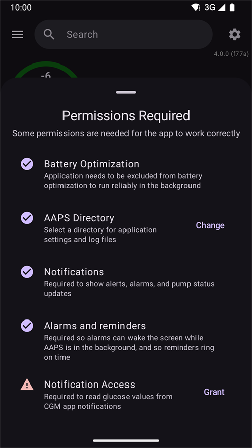

# Dexcom G6 і ONE

## Спочатку основи

-   Дотримуйтеся загальних рекомендацій щодо гігієни CGM і встановлення сенсора [тут](../CompatibleCgms/GeneralCGMRecommendation.md).

## Загальні поради для петлі з G6 і ONE

- Нові трансмітери називаються Firefly. Сенсори не можна перезапустити без зняття трансмітера, а сам трансмітер не можна скинути. Також вони не створюють сирих (raw) даних.

- Якщо ви перезапускаєте сенсори, будьте готові калібрувати та стежте за відхиленнями.

- Попереднє замочування (pre-soak) G6/ONE із заводським калібруванням, імовірно, дасть відхилення в результатах. Якщо ви робите попереднє замочування (pre-soak), то для найкращих результатів вам, імовірно, доведеться калібрувати сенсор.

Докладніше читайте у [статті](https://www.diabettech.com/artificial-pancreas/diy-looping-and-cgm/), яку опублікував Tim Street на [www.diabettech.com](https://www.diabettech.com).

## Якщо ви використовуєте G6 або ONE з xDrip

- Якщо ще не налаштовано, завантажте [xDrip](https://github.com/NightscoutFoundation/xDrip) і змініть його налаштування згідно зі [сторінкою налаштувань xDrip](../CompatibleCgms/xDrip.md).
- Виберіть xDrip у [**Конфігурація → Джерело ГК**](#Config-Builder-bg-source).
- Трансмітери Dexcom G6 і ONE можуть одночасно бути підключені до приймача Dexcom (або до помпи t:slim) і до одного застосунку на вашому телефоні.
- Якщо ви використовуєте xDrip як приймач, спочатку видаліть застосунок Dexcom. **Не можна одночасно підключити xDrip і застосунок Dexcom до трансмітера!**
- Якщо вам потрібен Clarity і ви хочете користуватися сигналами тривоги xDrip, використовуйте [BYODA](#DexcomG6-if-using-g6-with-build-your-own-dexcom-app) (лише G6) з локальною трансляцією (local broadcast) в xDrip.
- You can also use xDrip as a companion app of the official Dexcom app, but you might experience delays in BG readings. Щоб зчитувати сповіщення застосунку Dexcom без xDrip як довірене джерело даних, використовуйте [Читач сповіщень](#DexcomG6-notification-reader).
- З сучасними трансмітерами xDrip завжди використовує [власний алгоритм трансмітера](https://navid200.github.io/xDrip/docs/Native-Algorithm.html) (native algorithm); вимикати його немає причин. [Превентивні перезапуски](https://navid200.github.io/xDrip/docs/Preemptive-Restart.html) (preemptive restarts) працюють лише на старих трансмітерах (прошивка 1.6.5.25 або старіша), де вони потрібні, щоб сенсор не зупинявся через 10 днів; нові трансмітери (Firefly) їх ігнорують. Перш ніж робити будь-який перезапуск, прочитайте [Restart a sensor](https://navid200.github.io/xDrip/docs/Restart-G6-sensor.html).
- Усе, що стосується самого сенсора і трансмітера, описано на [сторінці xDrip про Dexcom](https://navid200.github.io/xDrip/docs/Dexcom_page.html).

(DexcomG6-if-using-g6-with-build-your-own-dexcom-app)=
## Якщо ви використовуєте G6 з Build Your Own Dexcom App

```{admonition} Old app version
:class: warning
Dexcom BYODA — це вже дуже стара версія застосунку, її не можна оновити.
```

-   [Build Your Own Dexcom App](https://docs.google.com/forms/d/e/1FAIpQLScD76G0Y-BlL4tZljaFkjlwuqhT83QlFM5v6ZEfO7gCU98iJQ/viewform?fbzx=2196386787609383750) (BYODA) підтримує локальну трансляцію (local broadcast) в AAPS та/або xDrip

-   Цей застосунок дозволяє використовувати ваш Dexcom G6 з будь-яким смартфоном Android.
-   Видаліть оригінальний застосунок Dexcom або змінений (patched) застосунок Dexcom, якщо ви раніше використовували один з них (**не зупиняйте** поточний сенсор)
-   Установіть завантажений apk
-   Введіть код сенсора та серійний номер трансмітера в зміненому (patched) застосунку.
-   У налаштуваннях телефону перейдіть у apps > Dexcom G6 > permissions > additional permissions і натисніть 'Access Dexcom app'.
-   Через короткий час BYODA має отримати сигнал трансмітера.

### Налаштування для AAPS

-   Виберіть **BYODA** у [**Конфігурація → Джерело ГК**](#Config-Builder-bg-source).

-   Якщо ви не отримуєте значень, виберіть будь-яке інше джерело даних, а потім знову виберіть **BYODA**, щоб викликати запит дозволів для встановлення зʼєднання між AAPS і трансляцією BYODA.

### Налаштування для xDrip

-   Виберіть '640G/Eversense' як джерело даних.
-   Щоб отримувати значення, в xDrip потрібно виконати команду 'start sensor'. Це не вплине на ваш поточний сенсор, яким керує Build Your Own Dexcom App.

(DexcomG6-notification-reader)=
## Якщо ви використовуєте G6 або ONE з Читачем сповіщень

Офіційний застосунок Dexcom G6 або ONE залишається підключеним до трансмітера. **AAPS** зчитує значення глюкози безпосередньо зі сповіщення застосунку Dexcom, без жодного іншого застосунку між ними.

```{admonition} Trusted data source
:class: note
Значення із застосунків Dexcom G6 і ONE є [довіреним джерелом даних ГК](#GettingStarted-TrustedBGSource): SMB можна дозволити весь час.
```

Порівняно з BYODA або xDrip, Читач сповіщень має обмеження:

- **Немає стрілки тренду** і **немає заповнення пропусків (backfill)**: значення, пропущені, поки телефон був вимкнений або поза зоною досяжності, втрачаються.
- Кожне значення отримує час появи сповіщення, а не точний час вимірювання сенсором.
- Зчитуються лише значення від 40 до 405 мг/дл (від 2,2 до 22,5 ммоль/л). «LOW» і «HIGH» не зчитуються.

### Налаштуйте застосунок Dexcom

-   Залиште застосунок Dexcom встановленим і підключеним до трансмітера.
-   Переконайтеся, що застосунок Dexcom показує поточне значення глюкози у своєму сповіщенні. Його сповіщення мають залишатися видимими: не вимикайте їх звук і не приховуйте їх.
-   Використовуйте в застосунку Dexcom ті самі одиниці глюкози (мг/дл або ммоль/л), що й в **AAPS**. Інакше **AAPS** не зможе зчитати значення.

### Налаштування в AAPS

-   Виберіть **Читач сповіщень** у [**Конфігурація → Джерело ГК**](#Config-Builder-bg-source) і підтвердьте перемикання.

    

-   Коли ви повернетеся на головний екран, **AAPS** покаже **Потрібні дозволи**. Поруч із **Доступ до сповіщень** натисніть **Надати**.

    

-   Android відкриє свій список доступу до сповіщень (його назва залежить від версії Android, наприклад *Notification read, reply & control*). Виберіть **AAPS**, увімкніть **Allow notification access** (дозволити доступ до сповіщень) і підтвердьте кнопкою **Allow** (дозволити).

    

    Android попереджає, що **AAPS** зможе читати всі ваші сповіщення. **AAPS** читає лише сповіщення підтримуваних застосунків CGM і ігнорує всі інші.

    

-   Якщо **Allow notification access** неактивний (*Controlled by Restricted Setting*), Android блокує його, бо **AAPS** встановлено не з Play Store. Відкрийте інформацію про застосунок **AAPS** (довго натисніть на значок **AAPS** > **App info**), натисніть меню з трьома крапками вгорі праворуч і виберіть **Allow restricted settings** (дозволити налаштування з обмеженнями). Потім поверніться на екран доступу до сповіщень і дозвольте його.
-   Значення з'являються в **AAPS**, коли застосунок Dexcom показує нове значення.

```{warning}
Якщо сповіщення застосунку Dexcom показує більше одного числа глюкози або жодного, **AAPS** пропускає це сповіщення.
```


(DexcomG6-troubleshooting-g6)=
## Усунення проблем G6 і ONE

### Усунення проблем, специфічних для Dexcom G6/ONE

-   Прокрутіть вниз до розділу **Troubleshooting** [тут](https://navid200.github.io/xDrip/docs/Dexcom_page.html).

### Загальне усунення проблем

Загальне усунення проблем для CGM можна знайти [тут](#general-cgm-troubleshooting).

### Новий трансмітер з працюючим сенсором

Якщо вам потрібно замінити трансмітер під час роботи сенсора, можна спробувати зняти трансмітер, не пошкодивши кріплення сенсора. Відео можна знайти [тут](https://navid200.github.io/xDrip/docs/Remove-transmitter.html). Якщо ви натомість виберете [цей спосіб](https://youtu.be/tx-kTsrkNUM), будьте обережні, щоб не [пошкодити контакти сенсора](https://navid200.github.io/xDrip/docs/Petroleum-jelly-in-Dexcom-G6-Sensor.html) смужкою.
