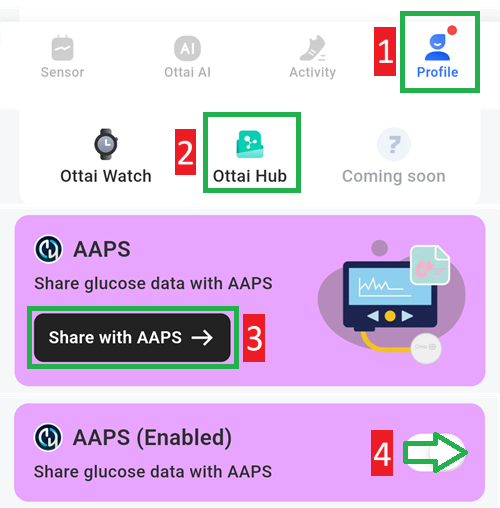

# Ottai M8

## Використання M8 із застосунком Ottai

-   Завантажте і встановіть apk з <https://play.google.com/store/apps/details?id=com.ottai.seas>. Для китайської версії Ottai використовуйте <https://ottai.com.cn/70ICjxAI4i>

-   Запуск сенсора

- Виберіть **Syai/Ottai** у [**Конфігурація → Джерело ГК**](#Config-Builder-bg-source).

Увімкніть трансляцію в застосунку Ottai:

1. Виберіть Profile
2. Ottai hub
3. Натисніть Share with AAPS і прийміть угоду про передавання даних третій стороні
4. Увімкніть Share glucose data with AAPS

