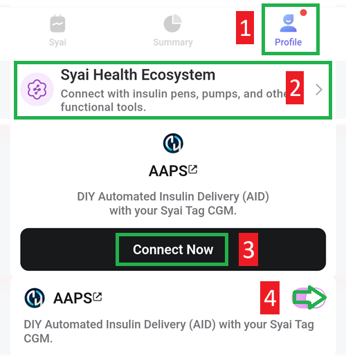

# Syai X1

## Використання X1 із застосунком Syai Tag

-   Встановіть apk з <https://play.google.com/store/apps/details?id=com.syai.tag>.

-   Запуск сенсора X1

- Select **Syai/Ottai** in [**Configuration → BG Source**](#Config-Builder-bg-source).

Увімкніть трансляцію (broadcast) у застосунку Syai:

1. Виберіть Profile
2. Syai Health Ecosystem
3. Натисніть Connect Now with AAPS (підключитися до AAPS) і прийміть угоду про передачу даних третій стороні
4. Увімкніть Enable share data with AAPS (обмін даними з AAPS)

