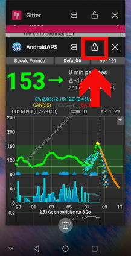

# Як налаштувати телефон Huawei

**Для яких телефонів ця сторінка:** телефони Huawei з **EMUI 12 – EMUI 15**. Усі ці версії базуються на Android 12 – мінімальній версії для поточної версії **AAPS**. На телефоні зі старішою версією EMUI можна використовувати лише [старішу версію AAPS](#maintenance-android-version-aaps-version).

```{admonition} Телефони з HarmonyOS NEXT / HarmonyOS 5 :class: warning

Нові телефони Huawei, що продаються в Китаї, працюють на HarmonyOS NEXT (HarmonyOS 5 і новіші). Ця система вже не є Android і не може запускати **AAPS**. ```

Телефони Huawei дуже агресивно закривають застосунки, що працюють у фоновому режимі. Застосуйте всі налаштування нижче до **AAPS** і до вашого застосунку CGM (наприклад, xDrip+ або Juggluco). Інакше петля і показники глюкози можуть зупинятися, коли екран вимкнено.

Назви меню можуть трохи відрізнятися на різних моделях. Якщо ви не можете знайти параметр, введіть його назву в рядок пошуку вгорі **Налаштувань**.

Знімки екрана нижче зроблено на старішій версії EMUI. Налаштування однакові в EMUI 12 – 15.

## Ігнорувати оптимізацію батареї

1. Відкрийте **Налаштування > Програми > Програми** (Settings > Apps > Apps).
2. Натисніть меню **⋮** у верхньому правому куті та виберіть **Спеціальний доступ > Оптимізація батареї** (Special access > Battery optimization).
3. Натисніть стрілку вгорі списку та виберіть **Усі програми** (All apps).
4. Виберіть **AAPS** і виберіть **Не дозволяти** (Don't allow). Після цього Huawei не оптимізуватиме застосунки з цього списку.
5. Повторіть для вашого застосунку CGM.


## Запуск програм: дозволити роботу у фоновому режимі

1. Відкрийте **Налаштування > Батарея > Запуск програм** (Settings > Battery > App launch) (або **Налаштування > Програми > Програми >** виберіть застосунок **> Батарея > Запуск програм**).
2. Знайдіть **AAPS** і вимкніть **Керувати автоматично** (Manage automatically).
3. У вікні **Керувати вручну** (Manage manually) увімкніть усі три параметри: 
    - **Автозапуск (Auto-launch)**
    - **Вторинний запуск** (Secondary launch – застосунок можуть запускати інші застосунки)
    - **Робота у фоновому режимі (Run in background)**
4. Повторіть для вашого застосунку CGM.


## Закріпіть AAPS у списку останніх застосунків

Закріплені застосунки не закриваються, коли ви очищуєте список останніх застосунків.

1. Відкрийте список останніх застосунків.
2. Проведіть вниз по картці **AAPS**. На картці з'явиться значок замка.
3. Зробіть те саме для вашого застосунку CGM.



## Режим енергозбереження

Тримайте **Режим енергозбереження** (Power saving mode) і **Ультраенергозбереження** (Ultra power saving) вимкненими (**Налаштування > Батарея**). Вони закривають фонові застосунки незалежно від налаштувань вище.

## Якщо AAPS усе одно зупиняється у фоновому режимі

Більше рішень саме для Huawei дивіться на [Don't kill my app](https://dontkillmyapp.com/huawei).

## Телефони Honor

Honor тепер окремий бренд, і його телефони працюють на MagicOS замість EMUI. Налаштування фонової роботи дуже схожі: знайдіть **Запуск програм** (App launch) у налаштуваннях батареї застосунку, вимкніть **Керувати автоматично** і дозвольте всі три параметри, потім вилучіть застосунок з оптимізації батареї.