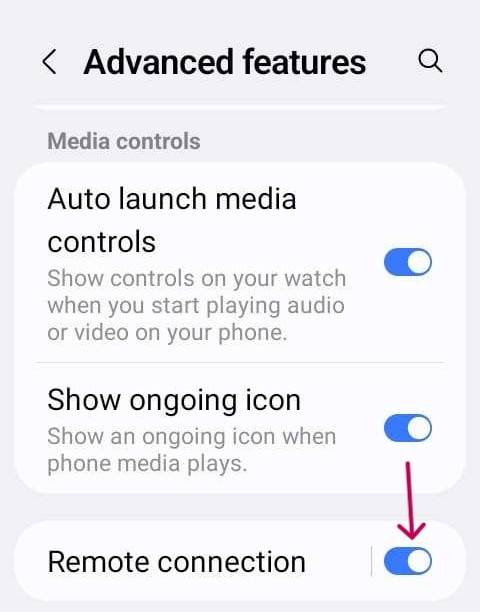

# Jelly

## Jelly Star Mini

**Функції**

* Android 13
* 8 ГБ RAM

**Переваги**

* Він дуже маленький.
* Навіть якщо ви скажете людям, вони можуть не вважати його звичайним смартфоном і легше приймуть його як виняток там, де телефони зазвичай заборонені.

**Недоліки**

* Recommended only for experienced loopers. Some settings are not easy to recognize: you have to know from experience with a big Android AAPS phone how and where things are located. Some AAPS buttons are small and hard to tap: you need a precise touch, not stubby fingers.
* Можна використовувати лише як телефон для петлі. Краще мати звичайний смартфон у кишені. 

### Оптимізація роботи батареї

Jelly має сильні функції оптимізації, які **треба** вимкнути для AAPS (та інших DIY-застосунків, як-от BYODA, xDrip, OOP2, Juggluco тощо).

Ви можете залишити Intelligent assistance увімкненим, але його **треба вимкнути для DIY-застосунків**.

Ви можете увімкнути NFC для сенсорів Libre.

### Оптимізація роботи батареї

Щоб уникнути перешкод для **AAPS**, обмеження «battery usage» на Jelly Star треба вимкнути, вибравши «unrestricted» для **AAPS** (та для інших **DIY-застосунків**, як-от BYODA, xDrip, OOP2, Juggluco тощо).

### Google Play Protect

Не забудьте вимкнути Google Play Protect.

### Remote Connection для Wear apk

For certain smart watches, like the Samsung Galaxy, 'Remote connection' under Advanced features in the Galaxy Wearable app must be switched **on** to use the Jelly, **Wear.apk** & **AAPS** remotely via Wi-Fi.

