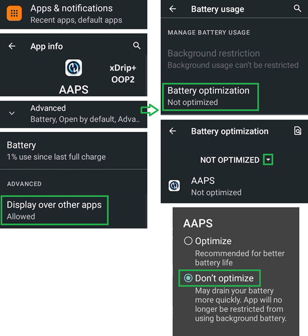

# Jelly

## Jelly Star Mini

**Функції**

* Android 13
* 8 ГБ RAM

**Переваги**

* Він дуже маленький.
* Навіть якщо ви скажете людям, вони можуть не вважати його звичайним смартфоном і легше приймуть його як виняток там, де телефони зазвичай заборонені.

**Недоліки**

* Рекомендовано лише досвідченим користувачам петлі. Деякі налаштування нелегко знайти: ви маєте з досвіду роботи з AAPS на звичайному великому телефоні Android знати, що і де розташовано. Деякі кнопки AAPS маленькі, і на них важко натиснути: потрібен точний дотик, а не товсті пальці.
* Можна використовувати лише як телефон для петлі. Краще мати звичайний смартфон у кишені. 

### Оптимізація роботи батареї

Jelly має сильні функції оптимізації, які **треба** вимкнути для AAPS (та інших DIY-застосунків, як-от BYODA, xDrip, OOP2, Juggluco тощо).

Ви можете залишити Intelligent assistance увімкненим, але його **треба вимкнути для DIY-застосунків**.

Ви можете увімкнути NFC для сенсорів Libre.

### Оптимізація роботи батареї

Щоб уникнути перешкод для **AAPS**, обмеження «battery usage» на Jelly Star треба вимкнути, вибравши «unrestricted» для **AAPS** (та для інших **DIY-застосунків**, як-от BYODA, xDrip, OOP2, Juggluco тощо).

### Google Play Protect

Не забудьте вимкнути Google Play Protect.

### Remote Connection для Wear apk

Для деяких розумних годинників, як-от Samsung Galaxy, у застосунку Galaxy Wearable у розділі Advanced features (розширені функції) треба **увімкнути** «Remote connection» (віддалене підключення), щоб використовувати Jelly, **Wear.apk** і **AAPS** віддалено через Wi-Fi.

