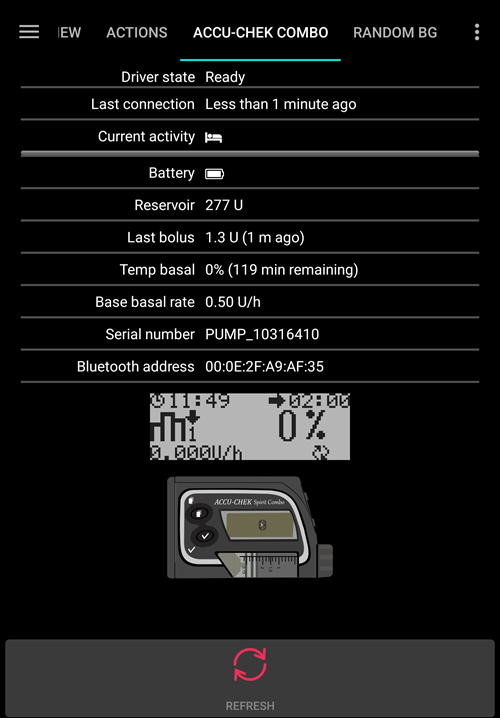

# Accu-Chek Combo

**Це програмне забезпечення є частиною DIY-рішення, а не готовим продуктом. Воно вимагає, щоб ВИ прочитали, вивчили та зрозуміли систему, зокрема як нею користуватися. Воно не керує вашим діабетом замість вас, але допомагає покращити контроль діабету та якість життя, якщо ви готові витратити на це потрібний час. Не поспішайте, дайте собі час навчитися. Лише ви відповідаєте за те, що робите з цією системою.**

```{admonition} Accu-Chek Combo is being phased out
:class: note

Roche виходить з ринку інсулінових помп, щоб зосередити свій напрям діабету на CGM Accu-Chek SmartGuide. Компанія оголосила про припинення продажу помп Accu-Chek Combo і Accu-Chek Insight; її остання мікропомпа Accu-Chek Solo також поступово знімається з виробництва (останні поставки в Німеччині наприкінці 2025 року). Зміни впроваджуються за регіонами, починаючи з Німеччини; очікується, що далі будуть інші європейські ринки. Якщо ви покладаєтеся на цю помпу, заздалегідь сплануйте перехід на підтримувану помпу.
```

```{contents} Table of contents
:depth: 1
:local: true
```

## Можливості помпи з AAPS

* Зв'язується з **AAPS** через вбудований Bluetooth вашого телефону, без додаткового пристрою зв'язку.
* Автоматична обробка літнього часу (DST) і часового поясу.

## Вимоги до обладнання та програмного забезпечення

* Помпа Roche Accu-Chek Combo (будь-яка прошивка, працюють усі).
* Пристрій Smartpix або Realtyme разом із програмою 360 Configuration Software для налаштування помпи. (Roche безкоштовно надсилає своїм клієнтам пристрої Smartpix і програму налаштування на запит.)
* Сумісний телефон з Android 12 або новішим. Подробиці дивіться в [примітках до випуску](#maintenance-android-version-aaps-version).
* Застосунок **AAPS**, встановлений на вашому телефоні.

Деякі телефони можуть працювати краще за інші. Це залежить від якості підтримки Bluetooth і від того, чи мають вони додаткову, дуже агресивну логіку енергозбереження. Список телефонів наведено в документі [Телефони для AAPS](#Phones-list-of-tested-phones). Зверніть увагу: це неповний список, він відображає особистий досвід користувачів. Додайте й ваш досвід і так допоможіть іншим (ці проєкти тримаються на взаємодопомозі).

(combov2-before-you-begin)=
## Перш ніж почати

**БЕЗПЕКА ПОНАД УСЕ** – не виконуйте цей процес там, де ви не зможете виправити помилку. Тримайте під рукою пристрій Smartpix / Realtyme і програму 360 Configuration Software. Заплануйте приблизно годину на налаштування всього і перевірку, що все працює правильно.

Зверніть увагу на такі обмеження:

* Подовжений і багатохвильовий болюс наразі не підтримуються (натомість можна використовувати [подовжені вуглеводи](../DailyLifeWithAaps/ExtendedCarbs.md)).
* Підтримується лише один базальний профіль (перший).
* Найменша базальна швидкість у вашому **профілі** – 0,05 Од/год. **AAPS** не приймає **профіль** з меншою швидкістю. Combo округлює базальні швидкості до власних кроків (0,01 Од/год нижче 1 Од/год, 0,05 Од/год до 10 Од/год, 0,1 Од/год вище). **AAPS** використовує швидкості, які помпа справді вводить.
* Тимчасові базальні швидкості обмежені 500 % від поточної базальної швидкості. **AAPS** враховує це обмеження.
* Петлю вимкнено, якщо поточний активний профіль на помпі не профіль № 1. Так триває, доки профіль № 1 не стане активним. Після цього під час наступного підключення AAPS (самостійно через деякий час або тому, що ви натиснете **Оновити** на екрані помпи Accu-Chek Combo) він побачить, що профіль № 1 поточний, і знову ввімкне петлю.
* Якщо петля просить скасувати поточний TBR, Combo натомість встановить TBR 90 % або 110 % на 15 хвилин. Причина в тому, що справжнє скасування TBR викликає на помпі сигнал із сильною вібрацією, і цю вібрацію не можна вимкнути.
* Стабільність з'єднання Bluetooth різна на різних телефонах. Через це бувають сигнали «помпа недоступна», коли з'єднання з помпою більше не встановлюється. Якщо виникла ця помилка, переконайтеся, що Bluetooth увімкнено, натисніть **Оновити** на екрані помпи (**Керувати** > **Помпа**), щоб перевірити, чи це був тимчасовий збій. Якщо з'єднання все ще не встановлюється, перезапустіть телефон – зазвичай це допомагає.
* Є ще одна проблема, коли перезапуск не допомагає, а треба натиснути кнопку на помпі (це скидає стек Bluetooth помпи), щоб помпа знову приймала з'єднання від телефона.
* Не встановлюйте TBR на помпі, бо петля бере керування TBR на себе. Виявлення нового TBR на помпі може тривати до 20 хвилин, і дію TBR буде враховано лише з моменту виявлення. Тож у найгіршому випадку до 20 хвилин TBR не буде враховано в IOB.

Наразі драйвер підтримує такі мови на Combo. (Це не пов'язано з мовою AAPS – ідеться про мову, яку показує сам РК-дисплей Combo.)

* англійська
* іспанська
* французька
* італійська
* російська
* турецька
* польська
* чеська
* угорська
* словацька
* румунська
* хорватська
* нідерландська
* грецька
* фінська
* норвезька
* португальська
* шведська
* данська
* німецька
* словенська
* литовська

**Важливо**: якщо на вашій помпі встановлено мову, якої немає в цьому списку, зверніться до розробників і встановіть на помпі мову з цього списку. Інакше драйвер не працюватиме правильно.

## Налаштування телефону

Дуже важливо переконатися, що оптимізацію батареї вимкнено. AAPS сам виявляє, коли на нього діє така оптимізація, і в інтерфейсі просить її вимкнути. Але на сучасних телефонах Android сам Bluetooth _теж_ є застосунком (системним застосунком). І зазвичай цей «застосунок Bluetooth» працює _з увімкненою за замовчуванням оптимізацією батареї_. Через це Bluetooth може перестати відповідати, коли телефон економить енергію і закриває застосунок Bluetooth. Тому в налаштуваннях системного застосунку Bluetooth теж треба вимкнути оптимізацію батареї. На жаль, шлях до системного застосунку Bluetooth різний на різних телефонах. У стандартному Android перейдіть до Settings -> Apps -> See all N apps (N = кількість застосунків на вашому телефоні). Потім відкрийте меню в правому верхньому куті та натисніть «Show system», «Show system apps» або «All apps». Тепер у розгорнутому списку застосунків знайдіть застосунок «Bluetooth». Виберіть його і на екрані «App info» натисніть «Battery». Там вимкніть оптимізацію батареї (іноді вона називається «battery usage»).

## Налаштування Combo

* Налаштуйте помпу за допомогою програми Accu-Chek 360 Configuration Software. Якщо у вас немає цієї програми, зверніться на гарячу лінію Accu-Chek. Зазвичай вони надсилають зареєстрованим користувачам CD з «360° Pump Configuration Software» та USB-інфрачервоний пристрій SmartPix (пристрій Realtyme теж підходить, якщо він у вас є).

  - **Обов'язкові налаштування** (позначені зеленим на знімках екрана):

     * Встановіть або залиште конфігурацію меню «Standard». Тоді на помпі будуть видні лише підтримувані меню та дії, а непідтримувані будуть приховані (подовжений/багатохвильовий болюс, кілька базальних профілів). Їх використання обмежує роботу петлі, бо тоді петля не може працювати безпечно.
     * Перевірте, що _Quick Info Text_ має значення «QUICK INFO» (без лапок, знаходиться в _Insulin Pump Options_).
     * Встановіть для TBR _Maximum Adjustment_ на 500 %
     * Вимкніть _Signal End of Temporary Basal Rate_
     * Встановіть для TBR _Duration increment_ на 15 хв
     * Увімкніть Bluetooth

  - **Рекомендовані налаштування** (позначені синім на знімках екрана)

     * Встановіть сигнал низького рівня картриджа на ваш розсуд
     * Налаштуйте максимальний болюс, що підходить для вашої терапії, для захисту від помилок у програмі
     * Так само налаштуйте максимальну тривалість TBR як запобіжник. Дозвольте щонайменше 3 години, бо функція від'єднання помпи на 3 години встановлює 0 % на 3 години.
     * Увімкніть блокування кнопок на помпі, щоб не можна було вводити болюс з помпи, особливо якщо помпу використовували раніше і швидкий болюс став звичкою.
     * Встановіть тайм-аут дисплея і тайм-аут меню на мінімум: 5,5 і 5 відповідно. Так AAPS швидше відновлюється після помилок і зменшується кількість вібрацій, які можуть бути під час таких помилок

  

  

  

  

## Активація драйвера і спарювання з Combo

* Відкрийте **меню** (☰) у лівому верхньому куті, перейдіть до [**Конфігурація** > **Помпа**](../SettingUpAaps/ConfigBuilder.md) і виберіть **Accu-Chek Combo**.

  

  Коли його вибрано, картка **Accu-Chek Combo** показує дві кнопки: **Налаштування** і **Відкрити плагін**:

  

  **Налаштування** відкриває налаштування драйвера Accu-Chek Combo (дивіться [Налаштування](#combov2-preferences) нижче):

  

  **Відкрити плагін** (або **Керувати** > **Помпа**) відкриває екран помпи Accu-Chek Combo. Поки помпу не спарено, на ньому показано **Помпа не спарена**:

  

* На екрані помпи натисніть **Спарювання**. Відкриється екран **Спарувати з помпою**. Виконайте кроки, показані на екрані, потім натисніть **Почати спарювання**. Коли Android попросить дозвіл зробити телефон видимим для інших пристроїв Bluetooth, натисніть **Дозволити**. Згодом Combo покаже на своєму екрані 10-значний PIN для спарювання, і **AAPS** попросить його ввести. Введіть цей PIN у поле **10-значний PIN**.

  

  

  

  Наступні зображення зі старішої версії **AAPS**. Кроки й тексти ті самі, але екрани виглядають трохи інакше.

  

  

  

* Якщо PIN введено неправильно, **AAPS** показує **PIN не спрацював. Перевірте на друкарську помилку. Якщо повторюється, скасуйте та спробуйте спарування знову.**

  

* Коли показано **Спарювання з Combo успішне**, натисніть **OK**. Ви повернетеся на екран помпи, який тепер показує статус помпи (дивіться [Вміст екрана помпи Accu-Chek Combo](#combov2-tab-contents) нижче). Кнопку **Спарювання** замінено на **Розпарувати**.

* Щоб перевірити налаштування (для безпеки помпа має бути **від'єднана** від будь-якої канюлі!), за допомогою AAPS встановіть TBR 500 % на 15 хв і введіть болюс. Тепер на помпі має працювати TBR, а болюс має бути в історії. AAPS також має показувати активний TBR і введений болюс.

* На Combo рекомендовано увімкнути блокування кнопок, щоб не можна було вводити болюс з помпи, особливо якщо помпу використовували раніше і функція «швидкий болюс» стала звичкою.

## Примітки щодо спарювання

Accu-Chek Combo була розроблена до виходу Bluetooth 4.0 і лише через рік після виходу найпершої версії Android. Тому її спосіб спарювання з іншими пристроями не на 100 % сумісний з тим, як це робить Android сьогодні. Щоб повністю це обійти, AAPS потрібні дозволи системного рівня, які є лише в системних застосунків. Їх встановлюють виробники телефонів – користувачі не можуть встановити системні застосунки.

Через це спарювання ніколи не буде на 100 % без проблем. Зокрема, під час спарювання діалог PIN Bluetooth в Android може на мить з'явитися і сам зникнути. Але іноді він залишається на екрані і просить 4-значний PIN. (Не плутайте його з 10-значним PIN для спарювання Combo.) Нічого не вводьте, просто натисніть «Скасувати». Якщо спарювання не продовжується, виконайте інструкції на екрані, щоб спробувати спарувати знову.

(combov2-tab-contents)=
## Вміст екрана помпи Accu-Chek Combo

Щоб відкрити екран помпи, перейдіть до **Керувати** > **Помпа**. Коли помпу спарено, екран показує таку інформацію (пункти перелічено згори вниз):



1. **Стан драйвера**: драйвер може бути в одному з таких станів:
   - **Роз'єднано**: з'єднання Bluetooth немає; драйвер більшість часу в цьому стані і підключається до помпи лише за потреби – так економиться енергія
   - **Підключення**
   - **Перевірка помпи**: помпа підключена, але драйвер зараз виконує перевірки безпеки, щоб переконатися, що все гаразд і актуально
   - **Готово**: драйвер готовий приймати команди від AAPS
   - **Призупинено**: помпу призупинено (на Combo показано як «stopped»)
   - Опис команди, яка виконується, наприклад **Встановлення базального профілю** або **Оновлення статусу помпи**
   - **Помилка**: сталася помилка; з'єднання розірвано, будь-яку поточну команду перервано
2. **Останнє підключення**: скільки хвилин тому драйвер успішно підключився до Combo; якщо минуло понад 30 хвилин, цей пункт показано червоним
3. **Акумулятор**: рівень заряду батареї; Combo показує лише **Заряджена**, **Низький заряд** або **Розряджена** і не дає точнішої інформації (наприклад, у відсотках), тому тут показано лише ці три рівні
4. **Резервуар**: скільки Од зараз у резервуарі Combo
5. **Останній болюс**: скільки хвилин тому було введено останній болюс; якщо після запуску AAPS болюс ще не вводили, цей пункт не показано
6. **Тимчасовий базал**: дані про поточний активний тимчасовий базал; якщо зараз його немає, цей пункт не показано
7. **Базова базальна швидкість**: поточна активна базова базальна швидкість («базова» означає базальну швидкість без впливу активного TBR на коефіцієнт базальної швидкості)
8. **Серійний номер**: серійний номер Combo, який повідомляє помпа (він збігається із серійним номером на задній панелі Combo)
9. **Адреса Bluetooth**: 6-байтова адреса Bluetooth Combo у форматі `XX:XX:XX:XX:XX:XX`

Поки драйвер щось робить (наприклад, встановлює базальний профіль), поле під списком описує поточну дію, а тонка смуга показує хід виконання.

Combo може працювати через Bluetooth у режимі _віддаленого терміналу_ або в режимі _команд_. Режим віддаленого терміналу відповідає «режиму дистанційного керування» на глюкометрі Combo, який імітує РК-дисплей помпи і чотири кнопки. Деякі команди драйвер мусить виконувати в цьому режимі, бо в режимі команд для них немає відповідника. Режим команд набагато швидший, але, як уже сказано, має обмежені можливості. Коли активний режим віддаленого терміналу, поточний екран віддаленого терміналу показано в полі просто над зображенням Combo. Однак коли драйвер переходить у режим команд, це поле залишається порожнім.

(Ви на це не впливаєте; драйвер сам вирішує, який режим використовувати. Це лише примітка, щоб ви знали, чому іноді в цьому полі видно кадри з Combo.)

Унизу є такі кнопки:

- **Оновити**: запускає негайне оновлення статусу помпи. Також ця кнопка повідомляє AAPS, що виявлену раніше помилку усунено і AAPS може знову перевірити, що все гаразд (докладніше нижче в [розділі про сигнали](#combov2-alerts)). Натиснути її можна лише тоді, коли драйвер роз'єднаний, призупинений або в стані помилки.
- **Розпарувати**: розпаровує спарену Combo від **AAPS** і Android, після того як ви підтвердите **Ви дійсно хочете розпарувати помпу?**. Коли жодну помпу не спарено, цю кнопку замінено на **Спарювання**.

(combov2-preferences)=
## Налаштування

Для драйвера Combo доступні такі налаштування (**Конфігурація** > **Помпа** > **Accu-Chek Combo** > **Налаштування** або значок налаштувань (шестерня) на екрані помпи). Пункти перелічено згори вниз:

1. **Тривалість пошуку (у секундах)**: під час спарювання драйвер робить телефон видимим для помпи. Цей параметр визначає, як довго триває видимість. За замовчуванням вибрано максимум (300 секунд = 5 хвилин). Android не дозволяє видимості тривати безкінечно, тому треба вибрати тривалість.
2. **Автовиявлення та автоматичний запис зміни резервуара**: якщо ввімкнено, драйвер записує «заміну резервуара», яку ви зазвичай записуєте самі через **Керувати** > **Підготовка/Заповнення**. Докладніше про це [нижче](#combov2-autodetections).
3. **Автовиявлення та автоматичний запис зміни батареї**: якщо ввімкнено, драйвер записує «заміну батареї», яку ви зазвичай записуєте самі через **Керувати** > **Заміна батареї помпи**. Докладніше про це [нижче](#combov2-autodetections).
4. **Увімкнути детальний лог Combo**: драйвер записує в лог набагато більше інформації. **УВАГА**: не вмикайте це, якщо вас не попросив розробник. В іншому разі це може додати багато зайвого в логи **AAPS** і зробити їх менш корисними.

Спарювання і розпарювання виконуються на екрані помпи, а не в налаштуваннях (дивіться вище).

(combov2-autodetections)=
## Автовиявлення та автоматичний запис заміни батареї і резервуара

Драйвер може виявляти заміну батареї та резервуара, стежачи за рівнем батареї та резервуара. Якщо під час останнього оновлення статусу помпи Combo повідомила, що рівень батареї низький, а під час нового оновлення рівень батареї нормальний, драйвер робить висновок, що користувач замінив батарею. Така ж логіка діє для рівня резервуара: якщо зараз він вищий, ніж раніше, це вважається заміною резервуара.

Це працює, лише якщо батарею та резервуар замінюють, коли їх рівень показано як низький, _і_ батарея та резервуар достатньо заповнені.

Ці автовиявлення можна вимкнути в [налаштуваннях](#combov2-preferences) драйвера.

(combov2-alerts)=
## Сигнали (попередження та помилки) і як вони обробляються

Combo показує сигнали як екрани віддаленого терміналу. Попередження показуються з кодом «Wx» (x – цифра) разом із коротким описом. Наприклад, «W7», «TBR OVER». Помилки схожі, але показуються з кодом «Ex».

Деякі попередження драйвер закриває автоматично. Ось вони:

- W1 «reservoir low»: драйвер перетворює це на попередження «низький рівень резервуара», яке показано на головному екрані AAPS
- W2 «battery low»: драйвер перетворює це на попередження «низький заряд батареї», яке показано на головному екрані AAPS
- W3, W6, W7, W8: усі вони лише інформують користувача, тому драйвер може безпечно закривати їх автоматично

Інші попередження _не_ закриваються автоматично. Також помилки _ніколи_ не закриваються автоматично. Обидва типи обробляються однаково: драйвер показує діалог із сигналом поверх інтерфейсу AAPS і перериває виконання будь-якої поточної команди. Потім драйвер переходить у стан «помилка» (дивіться [вміст екрана помпи Accu-Chek Combo вище](#combov2-tab-contents)). У цьому стані жодні команди не виконуються. Користувач мусить усунути помилку на помпі; наприклад, при закупорці може знадобитися замінити канюлю. Коли користувач усунув помилку, звичайну роботу можна відновити, натиснувши **Оновити** на екрані помпи Accu-Chek Combo. Тоді драйвер підключається до Combo і оновлює її статус, перевіряючи, зокрема, чи помилка ще показана на екрані. Також драйвер через деякий час сам оновлює статус помпи, тому натискати цю кнопку вручну не обов'язково.

Болюс – особливий випадок. Він виконується в режимі команд Combo, який під час болюса не повідомляє, що з'явився сигнал. Тому драйвер не може автоматично закривати попередження _під час_ болюса. На жаль, це означає, що помпа подаватиме звукові сигнали, доки болюс не завершиться. Найчастіший сигнал під час болюса – W1 «reservoir low» (низький рівень резервуара). **Не** закривайте попередження Combo вручну на самій помпі під час болюса. Ви ризикуєте перервати болюс. Драйвер обробить попередження, коли болюс завершиться.

Сигнали, які виникають, коли драйвер не підключений до Combo, драйвер не помітить. Combo не може сама надіслати сигнал на телефон; з'єднання завжди починає телефон. Тому сигнал залишатиметься, доки драйвер не підключиться до помпи. Ви можете натиснути **Оновити** на екрані помпи, щоб почати з'єднання і дати драйверу обробити сигнал одразу (а не чекати, доки AAPS сам вирішить підключитися).

**ВАЖЛИВО**: якщо виникає помилка або з'являється попередження, яке не належить до автоматично закриваних, драйвер переходить у стан помилки. У цьому стані петлю **БУДЕ ЗАБЛОКОВАНО**, доки статус помпи не буде оновлено! Петлю розблоковано, коли статус помпи оновлено (натисканням **Оновити** або автоматичним оновленням драйвера) і помилку більше не показано.

## На що звернути увагу під час використання Combo

* Пам'ятайте, що це не готовий продукт. Особливо на початку користувач мусить стежити за системою і розуміти її, її обмеження і те, як вона може дати збій. Наполегливо радимо НЕ використовувати цю систему, якщо людина, яка нею користується, не може повністю її зрозуміти.
* Через те, як працює дистанційне керування Combo, деякі операції (особливо встановлення базального профілю) виконуються повільно порівняно з іншими помпами. Це прикре обмеження Combo, яке неможливо обійти.
* Не встановлюйте і не скасовуйте TBR на помпі. Петля бере керування TBR на себе і інакше не може надійно працювати, бо неможливо визначити час початку TBR, який користувач встановив на помпі.
* Не натискайте жодних кнопок на помпі, поки AAPS з нею з'єднується (поки помпа підключена до AAPS, на ній показано логотип Bluetooth). Це перерве з'єднання Bluetooth. Робіть це лише тоді, коли є проблеми зі встановленням з'єднання (дивіться [розділ «Перш ніж почати» вище](#combov2-before-you-begin)).
* Не натискайте жодних кнопок, поки помпа вводить болюс. Зокрема, не намагайтеся закривати сигнали натисканням кнопок. Чому саме, докладніше пояснено в [розділі про сигнали](#combov2-alerts).

## Що робити, якщо не вдається встановити з'єднання з Combo

Драйвер робить усе можливе, щоб підключитися до Combo, і використовує кілька прийомів для максимальної надійності. І все ж іноді з'єднання не встановлюється. Ось кілька кроків, які можуть допомогти.

1. Натисніть кнопку на Combo. Іноді стек Bluetooth у Combo перестає відповідати і більше не приймає з'єднання. Якщо натиснути кнопку на Combo, щоб на РК-дисплеї щось з'явилося, стек Bluetooth скидається. Здебільшого лише цей крок і потрібен, щоб усунути проблеми зі з'єднанням.
2. Перезапустіть телефон. Це може знадобитися, якщо проблема в самому стеку Bluetooth телефона.
3. Якщо кришка батарейного відсіку Combo стара, подумайте про її заміну. Старі кришки батарейного відсіку можуть спричиняти проблеми з живленням Combo, що впливає на Bluetooth.
4. Якщо спроби з'єднання все ще не вдаються, розпаруйте помпу і спаруйте її знову.

(combov2-tips-for-basic-usage)=
## Поради щодо щоденного використання

### Як забезпечити безперебійну роботу

* Завжди **носіть смартфон із собою**, а вночі залишайте його біля ліжка. Під час сну помпа може опинитися за вашим тілом або під ним, тому найкраще класти телефон вище (на полицю або дошку).
* Завжди стежте, щоб батарея помпи була якомога більш заряджена. Поради щодо батареї дивіться в розділі про батарею.
* Коли можливо, керуйте помпою лише через застосунок AAPS. Для цього увімкніть блокування кнопок на помпі в **PUMP SETTINGS / KEY LOCK / ON**. Кнопки помпи потрібні лише під час заміни батареї або картриджа.


### Помпа недоступна. Що робити?

#### Увімкніть сигнал недоступності помпи
* В **AAPS** натисніть значок **Налаштування** (шестерня) у правому верхньому куті головного екрана, перейдіть до **Локальні сповіщення**, увімкніть **Сигнал, якщо помпа недоступна** і встановіть **Поріг недоступності помпи** на **31** хвилину.
* Так сигнал не спрацює, коли ви виходите з кімнати і залишаєте телефон на столі, але ви дізнаєтеся, якщо помпа недоступна довше, ніж триває тимчасова базальна швидкість.

#### Відновлення зв'язку з помпою

* Коли AAPS повідомляє про сигнал **Помпа недоступна**, спочатку зніміть блокування кнопок і **натисніть будь-яку кнопку на помпі** (наприклад, кнопку «вниз»). Щойно дисплей помпи вимкнеться, натисніть **Оновити** на екрані помпи Accu-Chek Combo (**Керувати** > **Помпа**). Зазвичай після цього зв'язок знову працює.
* Якщо це не допомагає, перезапустіть смартфон. Після перезапуску AAPS знову запуститься і встановить нове з'єднання з помпою.

* Тести з різними смартфонами показали, що на деяких смартфонах помилка «помпа недоступна» буває частіше, ніж на інших. Успішно перевірені смартфони дивіться в [Телефони для AAPS](#Phones-list-of-tested-phones).

#### Причини і наслідки частих помилок зв'язку
* На телефонах з **малим обсягом пам'яті** (або з **агресивним енергозбереженням**) AAPS часто закривається. Це видно з того, що кнопки терапії (панель швидкого запуску) на головному екрані не показані, коли ви відкриваєте AAPS, бо система ініціалізується. Через це під час запуску можуть спрацьовувати сигнали «помпа недоступна». У полі **Останнє підключення** на екрані помпи (**Керувати** > **Помпа**) можна перевірити, коли AAPS востаннє з'єднувався з помпою.


* Ця помилка може швидше розряджати батарею помпи, бо під час перезапуску застосунку базальний профіль зчитується з помпи.
* Вона також збільшує ймовірність помилки, через яку помпа відхиляє всі вхідні з'єднання, доки не буде натиснуто кнопку на помпі.

### Не вдається скасувати тимчасову базальну швидкість
* Іноді AAPS не може автоматично закрити сигнал **TBR CANCELED**. Тоді треба або натиснути **Оновити** на екрані помпи Accu-Chek Combo, або підтвердити сигнал на помпі.

### Батарея помпи: що врахувати

#### Заміна батареї
* Після сигналу **low battery** (низький заряд батареї) батарею треба замінити якомога швидше, щоб завжди мати достатньо енергії для надійного зв'язку Bluetooth зі смартфоном, навіть якщо телефон далі від помпи.
* Навіть після сигналу **low battery** батарея може працювати ще досить довго. Однак після сигналу «low battery» рекомендовано завжди мати при собі нову батарею.
* Перед заміною батареї натисніть на символ **Петля** на головному екрані і виберіть **Призупинити петлю** на 1 годину.
* Зачекайте, поки телефон з'єднається з помпою і логотип Bluetooth на помпі зникне.


* Зніміть блокування кнопок на помпі, переведіть помпу в режим зупинки, підтвердіть можливо скасовану тимчасову базальну швидкість і швидко замініть батарею.
* Після заміни батареї не треба знову встановлювати годинник помпи: AAPS автоматично оновлює дату та час помпи.
* Потім знову переведіть помпу в режим роботи і виберіть **Відновити**, натиснувши на значок **Петлю призупинено** на головному екрані.
* AAPS знову встановить потрібну тимчасову базальну швидкість, коли надійде наступне значення глюкози крові.

(Accu-Chek-Combo-Tips-for-Basic-usage-battery-type-and-causes-of-short-battery-life)=
#### Тип батареї і причини короткого терміну роботи
* Інтенсивний зв'язок Bluetooth споживає багато енергії, тому використовуйте лише **якісні батареї**, як-от Energizer Ultimate Lithium, батареї «power one» з «великого» сервісного набору Accu-Chek, а якщо ви хочете акумулятор – акумулятори Eneloop.

 

Типовий термін роботи різних типів батарей:
* **Energizer Ultimate Lithium**: 4–7 тижнів
* **Power One Alkaline** (Varta) із сервісного набору: 2–4 тижні
* Акумулятори **Eneloop rechargeable** (BK-3MCCE): 1–3 тижні

Якщо ваша батарея працює значно менше, ніж указано вище, перевірте такі можливі причини:
* Є кілька варіантів кришки батарейного відсіку помпи Combo, які частково замикають батареї, і ті швидко розряджаються. Кришки без цієї проблеми можна впізнати за золотистими металевими контактами.
* Якщо годинник помпи «не переживає» коротку заміну батареї, ймовірно, зламаний конденсатор, який підтримує роботу годинника під час короткого вимкнення живлення. У такому разі може допомогти заміна помпи компанією Roche, що не є проблемою протягом гарантійного терміну.
* Апаратне і програмне забезпечення смартфона (операційна система Android і стек Bluetooth) також впливає на термін роботи батареї помпи, хоча точні чинники ще не повністю відомі. Якщо є можливість, спробуйте інший смартфон і порівняйте термін роботи батареї.

### Подовжений болюс, багатохвильовий болюс
Алгоритм OpenAPS не підтримує паралельний подовжений болюс або багатохвильовий болюс. Але схожої терапії можна досягти такими способами:
* Використовуйте **e-вуглеводи** під час введення вуглеводів або в калькуляторі болюса: введіть вуглеводи всієї їжі і тривалість, протягом якої, як ви очікуєте, вуглеводи потраплятимуть у кров як глюкоза. Тоді система розрахує невеликі порції вуглеводів, рівномірно розподілені на всю тривалість. Через це алгоритм вводитиме відповідну дозу інсуліну і водночас постійно перевірятиме загальне зростання чи зниження рівня глюкози крові. Для підходу, схожого на багатохвильовий болюс, можна також поєднати менший негайний болюс з e-вуглеводами.
* Перед їжею встановіть тимчасову ціль **Очікуваний прийом їжі** з глюкозою 80 на кілька годин (натисніть на ціль на головному екрані або **Керувати** > **Тимчасова ціль**). Тривалість має відповідати інтервалу, який ви вибрали б для подовженого болюса. Так ваша ціль буде нижчою, ніж зазвичай, і кількість введеного інсуліну збільшиться.
* Потім у **Калькулятор болюса** введіть усі вуглеводи їжі, але не застосовуйте одразу запропоновані значення. Якщо треба ввести болюс, схожий на багатохвильовий, зменште дозу інсуліну. Залежно від їжі алгоритм тепер мусить вводити додаткові SMB або вищі тимчасові базальні швидкості, щоб протидіяти зростанню глюкози крові. Тут з обмеженнями безпеки для базальної швидкості (Max U/h, максимальний базальний IOB) треба експериментувати дуже обережно і за потреби тимчасово їх змінювати.

* Не використовуйте подовжений або багатохвильовий болюс безпосередньо на помпі. Драйвер їх не підтримує (дивіться [Перш ніж почати](#combov2-before-you-begin)); якщо багатохвильовий болюс усе ж введено на помпі, **AAPS** записує його з історії помпи як звичайний болюс плюс подовжений болюс, тож він врахований в IOB. Подовжений болюс не працює в закритій петлі (подробиці дивіться на [цій сторінці](#extended-bolus-and-why-they-wont-work-in-closed-loop-environment)).

### Сигнали під час введення болюса
* Після кожного болюса драйвер зчитує історію болюсів помпи. Це механізм безпеки для правильного розрахунку активного інсуліну (IOB), навіть коли болюс введено безпосередньо з помпи.
* Якщо перед болюсом в історії помпи є болюс, про який **AAPS** не знав (наприклад, болюс, введений безпосередньо на помпі), запитаний болюс **не вводиться**, бо його розраховано без цього інсуліну. **AAPS** показує **В історії помпи є болюс, про який AAPS не знав. Запитаний болюс не введено...** Перевірте історію болюсів на помпі та ваш IOB. Якщо болюс ще потрібен, розрахуйте його знову. Це діє також, коли невідомий болюс знайдено під час нового з'єднання.
* Якщо болюс введено, але в історії помпи були й інші болюси, про які **AAPS** не знав, їх буде записано зараз, і **AAPS** попросить вас перевірити IOB перед наступним болюсом.
* Якщо з'єднання з помпою втрачено **під час** болюса, **AAPS** не записує 0 Од: він показує, скільки помпа ввела на той момент, і попереджає, що помпа може ще ввести решту. **Не вводьте болюс повторно.** **AAPS** прочитає реальну кількість з історії помпи під час наступного підключення.
* Якщо з'єднання втрачено, коли **AAPS** надсилає болюс, невідомо, чи помпа його отримала. Перевірте історію болюсів на помпі перед наступним болюсом.
* Якщо **AAPS** не може підтвердити, що болюс введено, він показує **Помилка введення болюсу. Схоже, болюс не було введено. Щоб бути впевненими, перевірте помпу, щоб уникнути подвійного болюсу, а потім введіть болюс знову.** Болюси ніколи не повторюються автоматично.

## Де отримати допомогу

Драйвер Combo розробляє спільнота на **волонтерських** засадах. Перш ніж просити допомоги, будь ласка:

1. **Прочитайте** відповідний розділ цієї документації, щоб перевірити, як має працювати функція.
2. **Запитайте** на каналі *#AAPS* у [Discord](https://discord.gg/4fQUWHZ4Mw) або в інших [каналах спільноти](../GettingHelp/WhereCanIGetHelp.md).
3. **Повідомте про помилку**: спершу пошукайте серед [наявних issues](https://github.com/nightscout/AndroidAPS/issues); якщо вашої проблеми там немає, створіть [нову issue](https://github.com/nightscout/AndroidAPS/issues) і додайте ваші [файли журналів](../GettingHelp/AccessingLogFiles.md).

Коли просите про допомогу, вкажіть марку і модель телефону, версію Android, версію **AAPS** і простий опис проблеми (що змінилося, коли востаннє все працювало).
