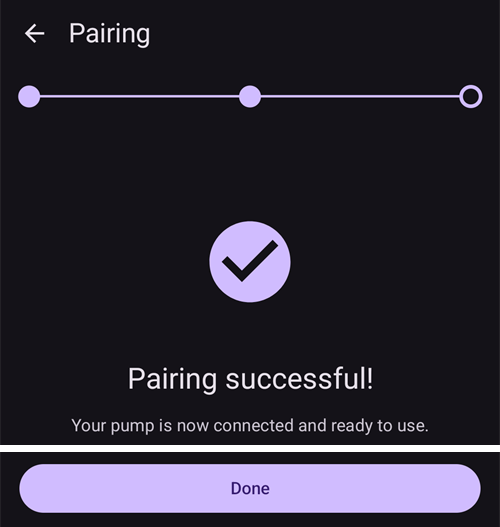

# DanaRS, Dana-i і Dana-i2

*Ці інструкції описують, як налаштувати застосунок і помпу, якщо у вас DanaRS (з 2017 року), Dana-i або Dana-i2. Якщо у вас оригінальна DanaR, відкрийте сторінку [Інсулінова помпа DanaR](./DanaR-Insulin-Pump.md).*

**Dana-i2 можна використовувати з AAPS версії 4.0.** Вона використовує той самий драйвер **Dana-i/RS**, що й Dana-i.

* У помпі DanaRS/i/i2 застосунок використовує «BASAL A». Наявні дані буде перезаписано.

    {contents} Зміст
    :depth: 1
    :local: true

## Можливості помпи з AAPS

* Зв'язується з **AAPS** через вбудований Bluetooth телефону, без додаткового пристрою зв'язку.
* Перехід на літній/зимовий час і зміну часового поясу потрібно виконувати вручну (див. [Зміна часового поясу в подорожі](#timezone-traveling-danarv2-danars)).

(DanaRS-Insulin-Pump-pairing-pump)=

## Спарювання помпи

* Відкрийте **меню** (☰) у верхньому лівому куті головного екрана **AAPS** і виберіть **Конфігурація**.
* Торкніться **Помпа** і виберіть **Dana-i/RS**.
    
    
    
    Після вибору на картці **Dana-i/RS** є дві кнопки: **Налаштування** і **Відкрити плагін**:
    
    
    
    **Налаштування** відкриває налаштування драйвера Dana-i/RS:
    
    
    
    **Відкрити плагін** (або **Керувати** > **Помпа**) відкриває екран помпи Dana-i/RS. Поки помпу не спарено, він виглядає так:
    
    

* На екрані помпи торкніться **Спарювання**. **AAPS** шукає помпи поруч.

* Торкніться вашої помпи в списку.
    
    

* **Ви повинні підтвердити спарювання на помпі!** Це працює так само, як інші спарювання Bluetooth, які ви, можливо, знаєте (наприклад, смартфон і автомагнітола).
    
    

* Виконайте спарювання відповідно до типу та прошивки вашої помпи:
    
    * Для DanaRS v1 **AAPS** запитує **Пароль помпи (лише v1)**. Введіть пароль помпи (див. [Пароль за замовчуванням](#DanaRS-Insulin-Pump-default-password)).
    * Для DanaRS v3 **AAPS** просить натиснути OK на помпі і ввести 2 послідовності цифр і літер, показані на помпі. Щоб дисплей помпи не вимикався, натискайте кнопку мінус, доки не закінчите. Потім торкніться **Готово**.
    * Для Dana-i і Dana-i2 з'являється стандартне вікно спарювання Android. Введіть 6-значне число, показане на помпі.

* Коли з'явиться **Спарювання успішне!**, торкніться **Готово**.
    
    
    
    Ви повернетеся на екран помпи, де тепер видно стан вашої помпи.
    
    

* У **Налаштування** виберіть **Швидкість болюсу**, щоб змінити стандартну швидкість болюсу (12 с/Од, 30 с/Од або 60 с/Од).

* Встановіть на помпі крок базалу 0,01 Од/год у меню лікаря (Doctors menu, див. посібник користувача помпи).
* Встановіть на помпі крок болюсу 0,05 Од у меню лікаря (Doctors menu, див. посібник користувача помпи). **AAPS** зчитує кроки базалу і болюсу з помпи і використовує їх для кожного болюсу, тому болюс завжди відповідає кроку, встановленому на помпі. Екран помпи показує їх у рядку **Крок базалу/болюсу**.
* Увімкніть подовжені болюси на помпі

### Параметри лише для деяких моделей

* **Автоблокування**: на Dana-i2 екран **Параметри користувача** (на екрані помпи, **Керувати** > **Помпа**) має перемикач **Автоблокування** для налаштування автоблокування помпи. Після зміни натисніть **Зберегти параметри на помпі**.
* **Режим Easy**: на моделях помп зі спрощеним меню (easy menu) екран помпи показує рядок **Режим Easy** зі значенням **Увімк.** або **Вимк.**.
* Якщо Dana-i2 відмовляється вводити болюс, **AAPS** показує причину, наприклад *Помпу не заповнено (prime)*, *Недостатньо інсуліну в резервуарі* або *На помпі увімкнено режим Easy sleep*.

(DanaRS-Insulin-Pump-default-password)=

### Пароль за замовчуванням

* Для DanaRS з прошивкою v1 і v2 пароль за замовчуванням 1234.
* Для DanaRS з прошивкою v3 або Dana-i пароль за замовчуванням залежить від дати виготовлення помпи і має вигляд MMDD, де MM — місяць, а DD — день виготовлення (наприклад, '0124' означає місяць 01 і день 24).
    
    * У MAIN MENU виберіть REVIEW, а потім у підменю відкрийте SHIPPING INFORMATION
    * Цифра 3 — дата виготовлення. 
    * Для v3/i цей пароль використовується лише для блокування меню на помпі. Він не використовується для зв'язку, і його не потрібно вводити в AAPS.

(DanaRS-Insulin-Pump-change-password-on-pump)=

## Зміна пароля на помпі

* Натисніть кнопку OK на помпі
* У головному меню виберіть «OPTION» (кілька разів натисніть кнопку зі стрілкою, щоб перейти праворуч)
    
    

* У меню параметрів виберіть «USER OPTION»
    
    

* Кнопкою зі стрілкою прокрутіть вниз до «11. password»
    
    

* Натисніть OK, щоб ввести старий пароль.

* Введіть **старий пароль** (пароль за замовчуванням див. [вище](#DanaRS-Insulin-Pump-default-password)) і натисніть OK
    
    

* Якщо тут ввести неправильний пароль, повідомлення про помилку не буде!

* Встановіть **новий пароль** (змінюйте цифри кнопками + & - / переходьте праворуч кнопкою зі стрілкою).
    
    

* Підтвердьте кнопкою OK.

* Натисніть OK, щоб зберегти налаштування.
    
    

* Перейдіть вниз до «14. EXIT» і натисніть OK, щоб вийти.
    
    

(DanaRS-Insulin-Pump-dana-rs-specific-errors)=

## Помилки, характерні для Dana RS

### Помилка під час введення інсуліну

Якщо під час введення болюсу зв'язок між AAPS і Dana RS втрачено (наприклад, ви відійшли від телефону, поки Dana RS вводить інсулін), ви побачите таке повідомлення і почуєте звуковий сигнал тривоги.

* Здебільшого це лише проблема зв'язку, а правильна кількість інсуліну введена.
* Перевірте в історії помпи, що введено правильний болюс. Це можна зробити на самій помпі або в **AAPS** на екрані помпи (**Керувати** > **Помпа**) > **Історія помпи** > **Болюси**.
* За бажанням видаліть запис про помилку в [терапії](#screens-bolus-carbs).
* Справжня кількість буде зчитана і записана під час наступного з'єднання. Щоб зробити це одразу, торкніться **Оновити** на екрані помпи або просто дочекайтеся наступного з'єднання.

## Важливо при заміні телефону

При переході на новий телефон потрібно виконати такі кроки:

* [Експорт налаштувань](../Maintenance/ExportImportSettings.md) на старому телефоні
* Перенесення налаштувань зі старого телефону на новий

### DanaRS v1

* **Вручну спаруйте** Dana RS з новим телефоном
* Якщо під час імпорту ви позначите **Також замінити налаштування помпи**, налаштування з'єднання з помпою теж буде імпортовано, і AAPS на новому телефоні вже «знатиме» помпу, тому не почне пошук Bluetooth. Тому новий телефон і помпу потрібно спарувати вручну.
* Встановіть AAPS на новий телефон.
* [Імпорт налаштувань](../Maintenance/ExportImportSettings.md) на новому телефоні

### DanaRS v3, Dana-i, Dana-i2

* Почніть спарювання, як описано [вище](#DanaRS-Insulin-Pump-pairing-pump).
* Іноді спочатку потрібно очистити дані спарювання в **AAPS**. На екрані помпи (**Керувати** > **Помпа**) торкніться **Розпарувати** і підтвердьте **Скинути дані спарювання?**. Потім знову торкніться **Спарювання**.

## Зміна часового поясу в подорожі з помпами DanaRS, Dana-i і Dana-i2

Про подорожі через часові пояси читайте в розділі [Зміна часового поясу з помпами](#timezone-traveling-danarv2-danars).

## Де отримати допомогу

Драйвер DanaRS/Dana-i/Dana-i2 розробляє спільнота на **волонтерських** засадах. Перш ніж просити допомоги, будь ласка:

1. **Прочитайте** відповідний розділ цієї документації, щоб переконатися, як функція має працювати.
2. **Запитайте** в каналі *#AAPS* у [Discord](https://discord.gg/4fQUWHZ4Mw) або в одному з інших [каналів спільноти](../GettingHelp/WhereCanIGetHelp.md).
3. **Повідомте про помилку**: спочатку пошукайте серед [наявних issues](https://github.com/nightscout/AndroidAPS/issues); якщо вашої проблеми там немає, створіть [новий issue](https://github.com/nightscout/AndroidAPS/issues) і додайте ваші [файли журналів](../GettingHelp/AccessingLogFiles.md).

Коли просите допомоги, вкажіть марку і модель телефону, версію Android, версію **AAPS** і простий опис проблеми (що змінилося, коли востаннє все працювало).