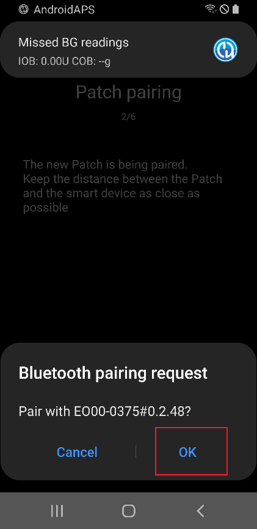
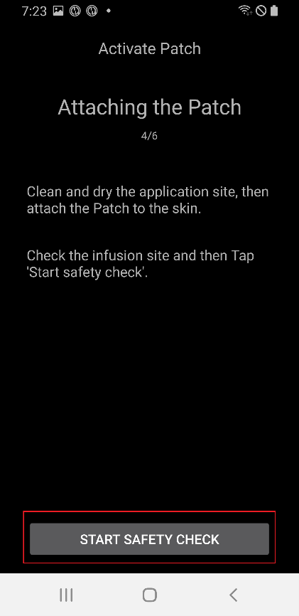
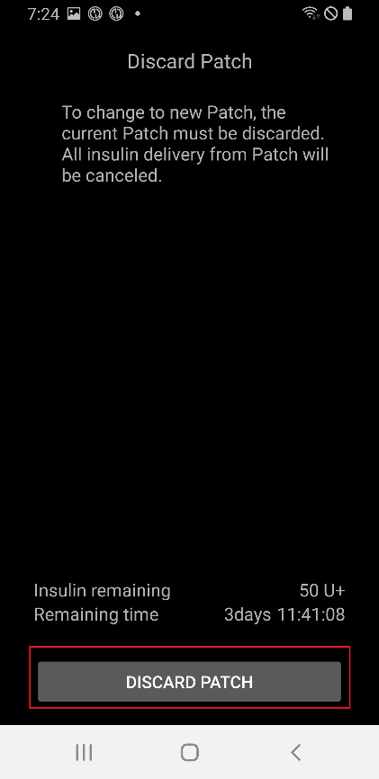

# EOPatch2

Для патча потрібен інсулін швидкої дії U-100, наприклад NovoRapid або Humalog. Використовуйте інсулін швидкої дії, який призначив вам лікар.

Найменша доза, яку може ввести патч, становить 0,05 Од. Задайте кожну базальну швидкість у вашому **профілі** не менше 0,05 Од/год, з кроком 0,05 Од/год. Інакше **AAPS** округлює кожну швидкість до найближчих 0,05 Од/год (ніколи не до 0) і використовує швидкості, які патч справді вводить. Тому загальна кількість інсуліну за день трохи відрізняється від вашого **профілю**. Так само болюси мають бути не менше 0,05 Од.

```{contents} Table of contents
:depth: 1
:local: true
```

## Можливості помпи з AAPS

* Зв'язується з **AAPS** через вбудований Bluetooth вашого телефону, без додаткового пристрою зв'язку.
* Перехід на літній/зимовий час і зміну часового поясу потрібно виконувати вручну.

## Налаштування помпи

1. Відкрийте **меню** (☰) у верхньому лівому куті головного екрана **AAPS** і виберіть **Конфігурація**.
1. У розділі **Помпа** виберіть **EOPatch2**.
1. Натисніть кнопку «Назад», щоб повернутися на головний екран.

 

Після вибору на картці **EOPatch2** є дві кнопки: **Налаштування** і **Відкрити плагін**:


## Налаштування

Відкрити налаштування EOPatch2 можна двома способами:

* натисніть **Налаштування** на картці **EOPatch2** у **Конфігурація**, або
* відкрийте екран помпи (**Керувати** → **Помпа**) і натисніть значок шестерні у верхньому правому куті.

Є три налаштування:


### Попередження про низький резервуар

Попередження з'являється, коли в патчі залишається стільки інсуліну або менше. Можна задати від 10 до 50 Од, з кроком 5 Од. За замовчуванням — 10 Од.

### Нагадування про закінчення терміну патча

Нагадує, скільки часу залишилося до закінчення терміну поточного патча. Можна задати від 1 до 24 годин, з кроком 1 година. За замовчуванням — 4 години.

### Звукові нагадування патча

Коли це увімкнено, патч подає звуковий сигнал на початку і в кінці болюсу, подовженого болюсу або тимчасового базалу. На ваш звичайний базал це не впливає. За замовчуванням вимкнено.

## Активація нового патча

### Відкрийте майстер активації

Відкрийте екран помпи через **Керувати** → **Помпа** (або натисніть **Відкрити плагін** на картці **EOPatch2** у **Конфігурація**). Коли активного патча немає, екран показує **Не активовано** і кнопку **Активувати патч** унизу.

Натисніть **Активувати патч**, щоб запустити майстер.


Майстер проведе вас через кожен крок. Ряд крапок угорі показує, на якому ви етапі.

```{note}
Якщо ви ще ніколи не активували **профіль** в **AAPS**, майстер спочатку показує сторінку **Потрібен профіль**. Виберіть профіль і натисніть **Активувати профіль**.
```

### Заповнення інсуліном

Вставте голку шприца в порт заповнення інсуліном на патчі. Повільно натискайте на поршень, щоб заповнити патч. Коли в патчі більше 80 Од, він один раз подає звуковий сигнал і запускається (вмикається).

Коли почуєте сигнал, натисніть **Почати спарювання**.


```{warning}
- Не повертайте важіль введення голки, доки майстер не скаже це зробити. Якщо повернути його зарано, це може спричинити серйозні проблеми під час заповнення або перевірки безпеки.
- Патч вміщує від 80 до 200 Од. Якщо ввести менше 80 Од, патч не працюватиме.
- Вийміть інсулін з холодильника за 15–30 хвилин до заповнення, щоб він нагрівся до кімнатної температури. Температура інсуліну має бути не нижче 10 °C.
```

### Спарювання патча

Тепер **AAPS** автоматично намагається спарюватися з патчем. Під час спарювання з'являються два запити Android на спарювання через Bluetooth. У першому натисніть **OK**. У другому, який показує ключ доступу, знову натисніть **OK**.

```{warning}
- Під час спарювання тримайте патч і телефон на відстані не більше 30 см один від одного.
- Після запуску патч подає звуковий сигнал кожні 3 хвилини, доки спарювання не завершиться.
- Ви повинні завершити активацію патча протягом 60 хвилин після його запуску. Якщо не вдається, викиньте патч.
```

  

```{admonition} Older screenshot
:class: note
Два знімки екрана спарювання через Bluetooth зроблено в попередній версії **AAPS**: екран **AAPS** за запитом Android на спарювання в **AAPS** 4 виглядає інакше.
```

### Вибрати інсулін

Виберіть інсулін, яким ви заповнили патч, і натисніть **Далі**. Після активації **AAPS** виконує перемикання профілю з цим інсуліном.

### Підготовка до прикріплення патча

Зніміть захисну плівку з клейкої стрічки патча, потім натисніть **Далі**.

Якщо стирчить голка, або патч мокрий, брудний чи його клейка стрічка загнулася, натисніть натомість **Викинути** і використайте новий патч.


### Місце введення

Цей крок з'являється, лише якщо в налаштуваннях чергування місць увімкнено **Керувати заміною місць введення помпи**. Торкніться місця на схемі тіла, де ви прикріпите патч, і натисніть **Далі**, або натисніть **Пропустити**.

### Прикріплення патча

Інсулін треба вводити в місце з жировою тканиною під шкірою, де мало нервів і кровоносних судин. Добре підходять живіт, рука або стегно. Очистіть і висушіть місце, потім прикріпіть патч до шкіри.

Перевірте місце інфузії, потім натисніть **Почати перевірку безпеки**.

```{warning}
- Рівномірно притисніть краї клейкої стрічки патча, щоб весь патч міцно прилип до шкіри.
- Якщо патч прилип не повністю, між патчем і шкірою може потрапити повітря. Це послаблює клей і водостійкість патча.
```


### Перевірка безпеки

Перевірка безпеки триває близько 30 секунд. Коли вона закінчиться, патч один раз подасть звуковий сигнал. Якщо вона не вдалася, натисніть **Повторити**.

```{warning}
Для безпечного використання не повертайте важіль введення голки, доки перевірка безпеки не завершиться.
```

 

```{admonition} Older screenshot
:class: note
Знімки екрана від **Підготовка до прикріплення патча** до **Перевірка безпеки** зроблено в попередній версії **AAPS**, в **AAPS** 4 вони можуть виглядати інакше.
```

### Введення голки

Міцно тримайте патч. Поверніть важіль введення голки вгору більш ніж на 100°, щоб ввести голку. Коли голку введено правильно, патч один раз подає звуковий сигнал. Потім продовжуйте повертати важіль до кінця, щоб зняти його. Натисніть **Далі**.

```{caution}
Якщо ви перейдете до наступного кроку, не почувши сигналу, з'явиться **Помилка введення голки**. Перевірте, чи був сигнал, і натисніть **Повторити**. Якщо помилка не зникає, натисніть **Викинути**, щоб деактивувати патч.
```

### Активацію патча завершено

Остання сторінка підтверджує, що патч активний і що він нагадає вам, коли наближатиметься кінець його терміну. Натисніть **Завершити**, щоб повернутися на екран помпи.

## Викидання патча

Замініть патч, коли в ньому мало інсуліну, коли закінчився його термін або якщо він несправний. Ми рекомендуємо використовувати кожен патч не довше 84 годин після його запуску.

1. Відкрийте екран помпи (**Керувати** → **Помпа**). Поки патч активний, натисніть **Викинути патч**.
1. Сторінка **Викинути патч** показує час, що залишився, і кількість інсуліну в патчі. Натисніть **Викинути патч**.
1. З'явиться вікно для підтвердження. Знову натисніть **Викинути патч**.
1. Коли патч деактивовано, майстер показує **Патч викинуто.** Зніміть патч з тіла і натисніть **Підтвердити**.

Після цього майстер одразу переходить до активації нового патча (див. вище). Натисніть стрілку «Назад», якщо хочете зупинитися тут.

Поки немає активного патча, **AAPS** показує помпу як призупинену і записує тимчасовий базал 0 Од/год, тому базальний інсулін не враховується в IOB, доки не буде активовано наступний патч.

   

```{admonition} Older screenshot
:class: note
Знімки екрана вище зроблено в старішій версії **AAPS**. В **AAPS** 4 екран помпи відкривають через **Керувати** → **Помпа**, а кнопка на ньому називається **Викинути патч**.
```

```{admonition} If the patch does not respond
:class: warning
Якщо **AAPS** не може зв'язатися з патчем, він може показати сторінку про вимкнення сигналу тривоги патча вручну: зніміть патч з тіла, відклейте клейку стрічку і скріпкою сильно натисніть в отвір поруч із портом заповнення інсуліном.

Сторінка **Викинути патч** має також кнопку **Примусове скидання**. Вона лише видаляє патч з **AAPS**, не надсилаючи патчу жодної команди. Патч продовжує вводити інсулін, доки не розрядиться його батарея або доки ви не вимкнете його вручну. Використовуйте її, лише якщо звичайне викидання не вдалося, і зніміть патч з тіла.
```

## Призупинення і відновлення введення інсуліну

Призупинення введення інсуліну також скасовує подовжений болюс і тимчасовий базал. Після відновлення вони **не** запускаються знову. Поки введення інсуліну призупинено, патч подає звуковий сигнал кожні 15 хвилин.

### Призупинення введення інсуліну

1. Відкрийте екран помпи (**Керувати** → **Помпа**) і натисніть **Призупинити помпу**.
1. Вікно пояснює, що буде призупинено. Натисніть **Підтвердити**.
1. У вікні **Час призупинення базалу** виберіть тривалість призупинення: 30 хв, 1 год, 1 год 30 хв або 2 год. Натисніть **Підтвердити**.

Введення інсуліну призупиняється на вибраний час.

  

```{admonition} Older screenshot
:class: note
Знімки екрана вище зроблено в старішій версії **AAPS**. В **AAPS** 4 екран помпи відкривають через **Керувати** → **Помпа**, а кнопка на ньому називається **Призупинити помпу**.
```

### Відновлення введення інсуліну

1. Відкрийте екран помпи (**Керувати** → **Помпа**) і натисніть **Відновити помпу**.
1. У вікні **Відновити введення інсуліну** натисніть **Підтвердити**.

 

```{admonition} Older screenshot
:class: note
Знімки екрана вище зроблено в старішій версії **AAPS**. В **AAPS** 4 екран помпи відкривають через **Керувати** → **Помпа**, а кнопка на ньому називається **Відновити помпу**.
```

```{warning}
Коли час призупинення закінчується, **AAPS** показує попередження **Призупинення інсуліну закінчилося**. Введення інсуліну **не** відновлюється, доки ви цього не підтвердите. Якщо ви не підтвердите, може розвинутися гіперглікемія.
```

(eopatch2-alarms-and-warnings)=

## Сигнали тривоги і попередження

### Сигнали тривоги

Сигнали тривоги призначені для термінових ситуацій найвищого пріоритету і вимагають ваших дій негайно. **AAPS** подає сигнал тривоги, який звучить, доки ви його не підтвердите, і показує повідомлення як сповіщення на екрані **Огляд**. Сигнал тривоги означає, що з патчем, який ви використовуєте, є проблема. У багатьох випадках патч потрібно викинути і замінити новим.

Коли ви натискаєте **Підтвердити** у сповіщенні, **AAPS** обробляє сигнал тривоги. Для більшості сигналів тривоги це деактивує патч. Для сигналу **Неприйнятна температура** кнопка називається **Повторити**.

 

```{admonition} Older screenshot
:class: note
Знімки екрана сигналів тривоги зроблено в попередній версії **AAPS**, в **AAPS** 4 вони можуть виглядати інакше.
```

Різні сигнали тривоги пояснено нижче.

| Сигнал тривоги                           | Пояснення                                                                                                                                                                     |
| ---------------------------------------- | ----------------------------------------------------------------------------------------------------------------------------------------------------------------------------- |
| Порожній резервуар                       | У патчі закінчився інсулін.                                                                                                                                                   |
| Термін дії патча закінчився              | Час використання патча минув, і він більше не може вводити інсулін.                                                                                                           |
| Закупорка                                | Схоже, шлях подачі інсуліну в патчі заблоковано.                                                                                                                              |
| Помилка самоперевірки під час увімкнення | Патч виявив неочікувану помилку під час самоперевірки після запуску.                                                                                                          |
| Неприйнятна температура                  | Під час активації або використання температура патча виходить за межі нормальної робочої температури. Перемістіть патч у місце з відповідною температурою (від 4,4 до 37 °C). |
| Помилка введення голки                   | Під час активації голку введено неправильно. Перевірте, чи край патча для введення голки і важіль введення голки знаходяться на одній прямій лінії.                           |
| Помилка батареї патча                    | Внутрішня батарея патча майже розрядилася, і патч вимкнеться.                                                                                                                 |
| Помилка активації патча                  | Патч не було повністю активовано протягом 60 хвилин після запуску.                                                                                                            |
| Помилка патча                            | Патч виявив неочікувану помилку під час активації або використання.                                                                                                           |

### Попередження

Попередження призначені для ситуацій середнього або низького пріоритету. Попередження з'являється як сповіщення на екрані **Огляд**.


```{admonition} Older screenshot
:class: note
Цей знімок екрана зроблено в попередній версії **AAPS**: в **AAPS** 4 попередження з'являється на головному екрані, який виглядає інакше.
```

Різні попередження пояснено нижче.

| Попередження                          | Пояснення                                                                                                                  |
| ------------------------------------- | -------------------------------------------------------------------------------------------------------------------------- |
| Призупинення інсуліну закінчилося     | Вибраний вами час призупинення минув. Натисніть **Відновити помпу** у сповіщенні, щоб знову запустити введення інсуліну.   |
| Низький рівень резервуара             | Залишок інсуліну в патчі нижчий за кількість, задану в **Попередження про низький резервуар**.                             |
| Термін роботи патча минув             | Період використання патча закінчився.                                                                                      |
| Термін роботи патча скоро закінчиться | Патч потрібно викинути протягом 1 години.                                                                                  |
| Активацію патча не завершено          | Після спарювання активацію патча було перервано більш ніж на 3 хвилини. Відкрийте екран помпи і завершіть активацію патча. |
| Низький заряд батареї патча           | Батарея патча розряджена.                                                                                                  |

## Де отримати допомогу

Драйвер EOPatch2 розробляє спільнота на **волонтерських** засадах. Перш ніж просити допомоги, будь ласка:

1. **Прочитайте** відповідний розділ цієї документації, щоб перевірити, як має працювати функція.
2. **Запитайте** на каналі *#AAPS* у [Discord](https://discord.gg/4fQUWHZ4Mw) або в інших [каналах спільноти](../GettingHelp/WhereCanIGetHelp.md).
3. **Повідомте про помилку**: спершу пошукайте серед [наявних issues](https://github.com/nightscout/AndroidAPS/issues); якщо вашої проблеми там немає, створіть [нову issue](https://github.com/nightscout/AndroidAPS/issues) і додайте ваші [файли журналів](../GettingHelp/AccessingLogFiles.md).

Коли просите про допомогу, вкажіть марку і модель телефону, версію Android, версію **AAPS** і простий опис проблеми (що змінилося, коли востаннє все працювало).
